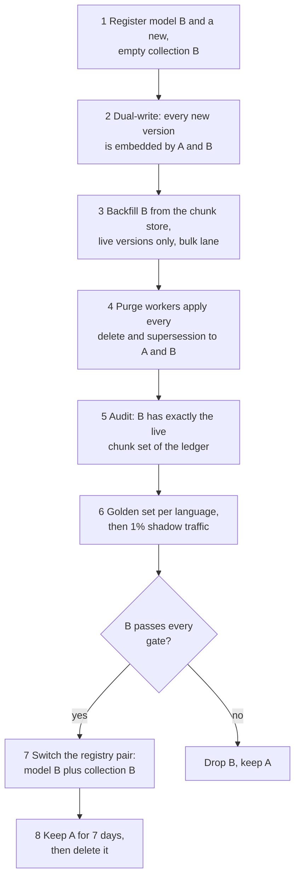

# 06 — Indexing at 120 Million Chunks

Lodestar has two search indexes. The **vector index** finds chunks whose meaning is close to the
question's meaning, even when they share no words — *"Can I get money back for a taxi?"* finds
*"Local transport costs are reimbursable"*. The **keyword index** finds chunks containing the
question's exact terms — `FIN-POL-017`, `Form 16`, `section 80C` — which vector search often
misses. Doc [07](07-retrieval-reranking-and-context.md) combines them. This document is about
building, sizing and running each at Kestrel's scale: 120 million chunks, 1.16 million of them
replaced every day, filtered by permissions on every query, in three languages.

Remember from doc [02](02-architecture-and-the-ledger.md) §3 that both indexes are
**projections**: they return chunk IDs and scores, never text, and they are allowed to be briefly
wrong. That frees this document to optimise them for speed and recall, without making them
responsible for correctness.

---

## 1. What the vector index has to do

| Requirement | Value | Source |
|---|---|---|
| Points | 120M, growing about 11% a year | Doc 01 §5 |
| Return | Top 50 candidates per query | Doc 07 §4 |
| Latency | 30 ms p50, 95 ms p99, including filters | Doc 12 §2 |
| Load | 100 queries per second provisioned | Doc 01 §3 |
| Filters | Permissions on every query; date, department, type and author when asked | Doc 03 §3 |
| Churn | 1.16M points tombstoned per day, 1.2M inserted | Doc 01 §8 |
| Availability | Survive the loss of one availability zone | Doc 16 §3 |
| Recall | At least 98% of what an exact search would return, at k = 50 | §2 below |

---

## 2. How approximate nearest-neighbour search works

### The exact way, and why it is too slow

The simplest way to find the 50 vectors closest to a query is to compare the query with every
stored vector. With 1-byte quantized values, that means reading:

> 120M vectors × 1,024 bytes = 122.9 GB

A server reads memory at very roughly 20 GB per second when the whole machine works on one query.
So an exact search takes 122.9 ÷ 20 ≈ **6 seconds** on one machine, or about 0.8 seconds if split
across eight. The latency budget is 30 ms. Exact search is out by a factor of about 25 even when
sharded — and at 100 queries a second it would need 100 times as many machines again.

### HNSW, in plain terms

**HNSW** (Hierarchical Navigable Small World) is the structure most vector databases use instead.
It works like this:

- Each stored vector is a **node** in a graph. Each node is linked to a handful of nodes whose
  vectors are close to it — at most **m** neighbours on most layers and 2m on the bottom one.
- The graph has **layers**. The bottom layer contains every node. Each higher layer contains a
  random, shrinking fraction of nodes — roughly one in m of the layer below — so the top layer has
  very few nodes, linked over long distances.
- A search starts at the top layer, greedily walks to whichever neighbour is closest to the
  query, and drops down a layer when it cannot get closer. On the bottom layer it keeps a list of
  the best **ef** candidates found so far and keeps expanding them until the list stops improving.

The effect is like finding a street address by first choosing the country, then the city, then
the neighbourhood, then walking. A search visits a few thousand nodes instead of 120 million.

The price is that it is **approximate**: the greedy walk can miss a true near neighbour that sits in
a part of the graph it never reached. The parameters trade that risk against speed:

| Parameter | Lodestar's value | What it controls | Cost of raising it |
|---|---:|---|---|
| `m` | 16 | Links per node (32 on the bottom layer). More links means more routes to every node | Memory: 32 links × 4 bytes = 128 bytes per node, about 18 GB in total |
| `ef_construction` | 200 | How hard the build searches for good neighbours when inserting a node | Slower inserts and rebuilds |
| `ef` (at query time) | 128 | How many candidates the bottom-layer search keeps | Slower queries; better recall |

### Measuring "approximate"

"98% recall at k = 50" means: of the 50 vectors an exact search would return, the HNSW search
returns at least 49 on average. Lodestar measures it every night: it takes 2,000 real queries from
the previous day, runs each through the index and through an exact scan of one shard, and compares.
The nightly number at `ef = 128` is about 98.6%. It is a property of the index, separate from
whether the right *document* was found — that is retrieval recall, measured on the golden set (doc
[14](14-evaluation.md)).

### Quantization, then re-scoring

The search runs on the 1-byte quantized vectors in memory (doc
[01](01-the-running-system-and-its-numbers.md) §5). Quantizing loses a little precision, which shows
up as small mis-orderings among close candidates. So each shard searches for twice as many candidates
as it needs (100 rather than 50), then reads the full-precision 4-byte vectors of those 100 from
local NVMe disk and re-scores them exactly:

> 100 vectors × 4 KB = 400 KB of random reads per shard per query

NVMe serves those in one or two milliseconds when issued in parallel. The re-scored top 50 from each
shard go back to the query service. This combination — quantized in memory, full precision on disk
for the finalists — is what lets one copy of the index fit in 158.9 GB of RAM instead of 491.5 GB.

---

## 3. Shards: why eight

A **shard** is one slice of the index, held and searched independently. Each query is sent to every
shard and the results are merged — a pattern called **scatter-gather**.

### Assigning chunks to shards

Chunks are assigned by a hash of their **document ID**, so every chunk of a document lives on the
same shard. That makes deleting a document a single-shard operation and keeps a document's chunks
together for diversity decisions.

Sharding by department instead would let a query filtered to `department = legal` search one shard.
But Kestrel's departments are very uneven — Engineering has 35% of the corpus, Legal 6% — so shards
would be very unequal in size and load, and the most common queries (unfiltered, or filtered only by
permission) would still hit every shard. Hash sharding keeps the shards equal.

### Choosing the count

Three pressures pull in different directions.

**Fewer shards means a smaller tail.** In scatter-gather, a query is as slow as its slowest shard.
If each shard is slower than its own 99th percentile on 1% of requests, then with 8 shards:

> P(at least one of 8 shards is slow) = 1 − 0.99⁸ = **7.7%**

So the query-level latency at the 92nd percentile is already the shard-level 99th. For the query's
p99 to equal the shard's p99, each shard would need to meet that latency at its **99.87th**
percentile (0.99^(1/8) = 0.99874). More shards make this worse.

**More shards means each one is smaller and faster to rebuild.** A shard of 15 million points
(120M ÷ 8) takes about 20 GB of RAM, fits two to a 64 GB node with room for the operating system and
disk cache, and rebuilds its HNSW graph in about an hour. With 4 shards, each would need 40 GB and
twice as long to rebuild after a failure.

**Shards must spread across nodes.** With 12 nodes and 3 replicas, 8 shards give 24 shard replicas,
two per node.

Eight balances these. The tail is handled separately, by **hedged requests**: if a shard has not
replied within its p95 latency (about 55 ms), the query service sends the same request to another
replica of that shard and takes whichever answers first. That fires on about 5% of shard requests,
costs 5% more shard work, and cuts the shard-level tail sharply, because two replicas are rarely slow
at the same moment.

### Replicas and placement

Each shard has **3 replicas, one in each availability zone**. Queries read from the replica in their
own zone. Writes go to all three and are acknowledged when two have applied them (a quorum); the
ingestion committer waits for that acknowledgement before flipping a version live (doc
[05](05-ingestion-pipeline-and-versions.md) §4). If a zone fails, every shard still has two replicas,
and the remaining two zones carry the full query load — which is why each zone's nodes are sized to
handle half the provisioned 100 queries per second rather than a third.

---

## 4. The node layout

| | Per node | Cluster (12 nodes) |
|---|---:|---:|
| Shard replicas | 2 | 24 |
| vCPUs | 8 | 96 |
| RAM used by index | 39.7 GB of 64 GB | 476.6 GB |
| Full-precision vectors on NVMe | 122.9 GB of 1.8 TB | 1.47 TB |
| Queries served at provisioned load | ~8.3 per second (×2 shards) | 100 per second |

The spare RAM is deliberate. It holds the operating system's disk cache — which keeps recently
re-scored full-precision vectors in memory — and gives room for a segment rebuild, which temporarily
holds the old and new versions of a segment at once (§5).

---

## 5. Churn: 1.16 million tombstones a day

Doc [01](01-the-running-system-and-its-numbers.md) §8 showed that updates and deletions tombstone
**0.97% of the index every day**. Here is what that does to HNSW, and what to do about it.

### Why HNSW cannot simply remove a node

A node in an HNSW graph is not only a result; it is a **route**. Other nodes reach their neighbours
through it. Removing it outright would disconnect parts of the graph, and the greedy search would
start missing whole regions. So vector databases **tombstone** instead: the node is marked deleted,
excluded from results, but kept in the graph as a stepping stone.

That works for a while. But a search has to collect `ef` *live* candidates, and as the share of dead
nodes grows, it visits more and more nodes to find them. Latency rises, and because the dead nodes'
neighbour lists were chosen when they were alive, recall slowly falls too.

Without compaction, a fifth of the index would be tombstones in 0.20 ÷ 0.0097 = **21 days**.

### Compaction

Indexes are stored in **segments** — independently built pieces of a shard, typically around a
million points each. When a segment's share of tombstones passes a threshold, the database builds a
fresh segment from only the live points and swaps it in.

Lodestar sets that threshold at **10%** per segment (the common default is 20%). At about 1% a day,
each segment is rebuilt roughly every ten days, so about a tenth of the index — 12 million points —
is rebuilt each day. HNSW build costs on the order of half a millisecond of CPU per point at
`ef_construction = 200`, so that is around:

> 12M points × 0.5 ms = 6,000 core-seconds ≈ **1.7 core-hours a day** per copy, about 5 across
> the three replicas

That is cheap, and it runs mostly outside the peak hour. The 10% threshold keeps search latency within
about 5% of a freshly built index. The tombstone ratio of every segment is a dashboard metric, because
a compaction backlog is the most common cause of slowly rising vector-search latency (doc
[17](17-failure-catalogue.md) `X-03`).

### Tombstones and "fully purged"

A tombstoned vector cannot be returned, so a deleted document is **unretrievable** as soon as its
tombstones are written — seconds after the purge task runs. But its bytes are still on disk until its
segment is rebuilt, which at a 10% threshold might be ten days later. Doc
[00](00-requirements-and-what-zero-hallucination-can-mean.md) §3.6 promised **physical erasure from live
disks within 24 hours**. So the purge worker also marks every segment that contains a *deleted* (not
merely superseded) document for forced rebuild within 24 hours, whatever its tombstone ratio.

Work out what that costs. 22,000 deletions a day × 12 chunks = 264,000 deleted points a day. With
segments of about a million points, one copy of the index has about 120 segments, so each segment
receives around 2,200 deleted points a day. Every segment is touched every day, which means the 24-hour
rule amounts to **rebuilding the whole index daily**:

> 120M points × 0.5 ms = 60,000 core-seconds ≈ **16.7 core-hours a day** per copy, 50 across three
> replicas

Spread over an eight-hour overnight window, that is about 6 cores running continuously out of the
cluster's 96 — noticeable, but affordable. It is worth knowing the number, because it is the price of
one phrase in the requirements. If legal agreed that physical erasure from the vector index could take
7 days rather than 24 hours, the forced rebuilds would mostly coincide with ordinary compaction and the
cost would nearly disappear.

Why erase vectors at all, when they contain no text? Because an embedding is not anonymous. Published
**embedding inversion** techniques reconstruct a large part of the original text from its vector. A
deleted document's vectors are a copy of the document for erasure purposes. Doc
[09](09-freshness-updates-and-deletion.md) §7 covers the same requirement for the keyword index.

---

## 6. Filtered search: the hard part

Every query carries a permission filter, and many carry metadata filters. Combining a filter with
HNSW is the part of vector search that most often goes wrong at scale, because the graph was built
without knowing which nodes a given query is allowed to see.

### Three strategies, and when each fails

**Post-filtering** searches the graph normally, then throws away results the filter rejects. It is fast
and correct when the filter keeps most points. It fails badly when it does not: if a query's filter
keeps only 0.05% of the corpus, then to end up with 50 results the search would need about 50 ÷ 0.0005
= **100,000** candidates — so in practice it returns far fewer than 50, often zero.

**Pre-filtering by brute force** uses a **payload index** — an ordinary inverted index from field
values to point IDs, such as `department = legal → {points…}` — to list exactly the points that pass,
and compares the query with each of them directly. It is exact, and fast when the list is short:

> 60,000 matching points × 1 KB = 60 MB → a few milliseconds

It becomes slow when the list is long: 10% of a 15-million-point shard is 1.5 million points, 1.5 GB to
scan, about 150 ms.

**Filtered graph search** walks the HNSW graph but only counts nodes that pass the filter. It is fast
when the filter keeps a large share of points. When the filter keeps a small share, the passing nodes
are scattered through a graph whose links mostly point at non-passing nodes, and the search can get
stuck in a region with no passing neighbours. Recall collapses — silently, because it still returns
*something*.

### Choosing per query

The choice depends on **selectivity**: the fraction of points the filter keeps. Qdrant-class engines
estimate it from their payload indexes before searching, and choose a strategy — a **query planner**,
like the one in a relational database. Lodestar configures it as follows, per shard:

| Filter keeps | Strategy | Latency | Recall at k = 50 |
|---|---|---:|---:|
| Under 2% (fewer than ~300,000 points) | Payload index, then exact comparison | Up to ~30 ms | 100% (exact) |
| 2% to 20% | Filtered graph search with `ef` raised in proportion, plus payload-aware links (below) | 30–60 ms | ~97% |
| Over 20% | Filtered graph search at normal `ef` | ~30 ms | ~98.5% |

**Payload-aware links** are extra graph edges built *within* each value of the most-used filter fields —
department, visibility, document type — so that, for example, Legal's points form a connected graph of
their own inside the main one. Filtered search on `department = legal` can then follow links that stay
inside Legal. They cost extra memory and build time, so they are built only for the handful of fields
that dominate filtering.

### Making the permission filter cheap

The permission filter for a Kestrel user reads:

```
visibility = org_wide
OR (visibility = department AND department IN [the user's departments])
OR (visibility = restricted AND acl CONTAINS ANY [the user's restricted-relevant groups])
```

The third clause is where cost hides. A typical employee is in 40 directory groups and an administrator
in over 2,000. Passing all of them into every query's filter means a "contains any of 2,000 values" test
on every candidate. But only about **3,000 of Kestrel's 41,000 groups appear in any document's ACL**. The
query service intersects the user's groups with that set first; for a typical user the result is between
zero and ten groups, and the filter stays small.

For most users, the permission filter keeps **60–70% of the corpus** — organisation-wide documents plus
their department's — so permission filtering alone almost always takes the cheap last row of the table.
The expensive cases come from metadata filters stacked on top: *"Legal contracts, effective in 2023,
authored by R. Sharma"* can keep 0.01% of the corpus. That case takes the first row and is exact.

### Testing the hard filters

The golden set's recall is computed with each question's real filters. In addition, a nightly job
replays the **1% most selective filters** seen in the previous week's traffic against an exact scan and
reports their recall separately. A regression in filtered recall does not show up in the overall number,
because selective filters are rare — but the queries that use them are often the ones from Legal and
Compliance, which is the worst place for a silent recall collapse.

### Stale permissions in the index are safe

The `acl` and `visibility` fields in the index lag the ledger by seconds to minutes. That is acceptable,
for an asymmetric reason explained fully in doc [13](13-access-control-security-and-privacy.md) §3: if
the index has a permission the ledger has *removed*, hydration drops the chunk, so nothing leaks; if the
index lacks a permission the ledger has *added*, the chunk is not found until the index catches up, which
is a brief recall miss. The index filter is for **recall**. The ledger check is for **security**.

---

## 7. The keyword index

### BM25, briefly

The keyword index scores a chunk for a query with **BM25**, a formula with three ideas:

- A term that appears **more often** in the chunk scores higher — but with diminishing returns, so a
  chunk that repeats "leave" twenty times does not beat one that says it three times by much.
- A term that is **rare in the corpus** counts for more. "Halcyon" (an M&A codename) in a chunk is strong
  evidence; "policy" is weak.
- A **long chunk** gets a mild penalty, so it does not win simply by containing more words.

### What it finds that vectors miss

| Query | Why vectors struggle | What the keyword index matches |
|---|---|---|
| "FIN-POL-017 per-diem" | A code has no meaning to embed | `codes: FIN-POL-017` exactly |
| "Form 16 deadline" | "Form 16" (an Indian tax form) looks like generic "form" | The phrase `form 16` |
| "section 80C limit" | Numbers embed poorly | `80c` |
| "Halcyon valuation" | A codename unknown to the embedding model | The rare term `halcyon` |
| "ISO 45001 audit Chennai" | Identifiers and place names | All three terms |

### Analyzers per language

An **analyzer** turns text into the terms the index stores: it splits words, lowercases, removes very
common words and reduces words to a base form (**stemming**: "reimbursements" and "reimbursed" both
become "reimburs"). Each language needs its own:

| Field | Analyzer | Kestrel-specific additions |
|---|---|---|
| `text_en` | English stemmer, stop words | Synonyms from the corpus glossary: `LTA ⇔ leave travel allowance`, `PF ⇔ provident fund`, `CTC ⇔ cost to company` |
| `text_es` | Light Spanish stemmer; accent folding for matching only (`días` and `dias` match) | `dieta ⇔ viáticos` (Spain and Mexico use different words for per-diem) |
| `text_hi` | Unicode normalisation (nukta, chandrabindu and anusvara variants), light Hindi stemmer, danda treated as a separator | `छुट्टी ⇔ अवकाश` (two words for leave) |
| `text_hi_rom` | A romanized copy of each Hindi chunk, matched with edit-distance tolerance | So "chhutti" and "chutti" both match छुट्टी (doc 11 §4) |
| `codes` | Exact keyword, no analysis | Document codes and external identifiers |

The glossary deserves a sentence of its own. Kestrel's documents are full of internal acronyms and
India-specific terms that general-purpose models do not know. A glossary of about 1,800 terms was mined
from the corpus (acronyms with their expansions found in the same document, reviewed by people from each
department) and is applied as query-time synonyms. It is cheap, transparent and easy to correct, and it
recovers much of what a HyDE step would have offered (doc [02](02-architecture-and-the-ledger.md) §10).

### Sizing and settings

8 primary shards with 2 replicas each (one per zone), refresh interval 1 second so updates are
searchable within a second of being written, and `_source` restricted to IDs (doc
[03](03-apis-and-data-model.md) §8). At 98.5 GB per copy, the three copies need about 300 GB across six
data nodes.

**BM25 does not cross languages.** A Hindi question will not match an English chunk lexically, except
through shared tokens like codes, numbers and English words typed in Latin script. Cross-lingual
retrieval is the vector index's job (doc [11](11-multilingual-en-hi-es.md) §3).

---

## 8. The embedding model

Lodestar uses a **self-hosted multilingual encoder** of the bge-m3 class: 1,024 dimensions, trained so
that a sentence and its translation map to nearby vectors in over a hundred languages, with an input
limit far above Lodestar's 430-token chunks.

**Why multilingual and cross-lingual.** The requirement is that a Hindi question finds an English policy
(doc [00](00-requirements-and-what-zero-hallucination-can-mean.md) §3.9). That only works if Hindi and
English texts with the same meaning land near each other in vector space. A model trained per language,
or an English-only model, cannot do it.

**Why self-hosted.** Three reasons, in order of importance. First, **version control**: a hosted
embedding endpoint can be updated by its provider, and a query embedded by a new model version searched
against vectors from the old one returns plausible-looking nonsense with no error (doc
[17](17-failure-catalogue.md) `X-05`). A self-hosted model changes only when Lodestar changes it. Second,
**data handling**: the text of every chunk passes through the embedder, and keeping that inside Kestrel's
infrastructure removes a data-residency question for the Spanish and Indian corpora (doc
[13](13-access-control-security-and-privacy.md) §9). Third, cost: the ingestion and query embedding load
needs less than one L4 most of the time (doc [01](01-the-running-system-and-its-numbers.md) §7).

**Pinning.** The model's exact weights file is identified by hash in the model registry, along with the
tokenizer version and any instruction prefix the model expects on queries. The query service reads all
three from the registry together with the name of the collection they belong to, so a query can never be
embedded with one model and searched against another's collection.

**A lever for later: fewer dimensions.** Some models are trained so that their first 512 or 256
dimensions are a usable embedding on their own. Truncating to 512 would halve vector RAM to about 80 GB
per copy. Whether it costs recall — and how much in Hindi, which is usually where reductions hurt first —
is a golden-set experiment, not an assumption.

---

## 9. Changing the embedding model without losing a deletion

Sooner or later a better embedding model appears. Doc [01](01-the-running-system-and-its-numbers.md) §7
showed that re-embedding all 120 million chunks costs **191 L4-hours, about $163**. The money is
negligible. The procedure is not, because the index has to keep serving and keep honouring deletions
throughout.

### The blue-green procedure



**Calendar time: about two weeks**, almost all of it in steps 5 and 6. The backfill itself takes about
12 hours on 16 spot L4s. During the overlap the cluster holds two collections, so it temporarily needs
another 476 GB of RAM — rented for the fortnight.

### The race that resurrects deleted documents

Step 3 hides the one dangerous moment. The backfill reads chunks from the chunk store, embeds them, and
writes them to collection B. Consider this timeline for one document:

| Time | Event |
|---|---|
| 14:00:00 | Backfill worker reads `LEGAL-TMP-0911`'s chunks from the chunk store |
| 14:00:03 | Legal deletes `LEGAL-TMP-0911`; the purge task deletes its points from A and B. B does not have them yet, so B's delete is a no-op |
| 14:00:09 | Backfill worker finishes embedding and **writes the chunks to B** |

Collection B now holds a deleted document. Nothing will ever delete it again, because its deletion has
already been processed.

The hydration gate means no *answer* would use it: its chunks are gone from the chunk store. But B now
holds an erased document's text in vector form, against requirement F7. Two defences close the race:

1. **The backfill writer checks the ledger immediately before each write**, and skips chunks whose
   version is no longer live. That closes all but a sub-millisecond window.
2. **Step 5's audit** compares B's set of `(doc_id, version_seq)` pairs with the ledger's live set and
   deletes anything extra. That closes the rest.

The same race, and the same two defences, apply to any rebuild of any index from the chunk store —
including restoring a shard from a snapshot (doc [09](09-freshness-updates-and-deletion.md) §8).

---

## 10. When not to build this

Everything above is sized for 120 million chunks with restrictive permissions. Smaller systems should
build less.

- **Under about 5–10 million chunks, use `pgvector` inside the ledger's PostgreSQL.** The hydration gate
  becomes a join in the same query as the vector search, there is one system to operate, and HNSW in
  PostgreSQL performs well at that size. At 120 million 1,024-dimension vectors, its memory needs and
  index build times become hard to manage alongside the ledger's transactional work.
- **Under about 20 million chunks, consider one engine for both indexes** (doc
  [02](02-architecture-and-the-ledger.md) §8).
- **If permissions are coarse** — a few broad groups — the filtered-search machinery in §6 is mostly
  unnecessary.
- **A managed vector service** is reasonable if it supports filtered search with cardinality-based
  planning, quantization with re-scoring, and deletes by filter — and if its update cadence for the
  service itself can be pinned or at least announced.

---

## What to take away

1. **Exact search is 25× too slow even sharded; HNSW trades a measured 1–2% recall for that speed.**
   Measure that recall nightly against an exact scan.
2. **Quantize in memory, re-score from NVMe.** It is what makes one copy fit in 158.9 GB.
3. **Eight hash-sharded shards, three replicas, hedged requests.** Scatter-gather turns a shard's p99
   into the query's p92; hedging is cheaper than fewer, larger shards.
4. **Tombstones are routes, not just results.** At 0.97% churn a day, compact at a 10% per-segment
   threshold, and force a rebuild within 24 hours of any segment holding a *deleted* document.
5. **Filtered search needs a planner.** Exact scan below 2% selectivity, filtered graph search with
   payload-aware links above; test the 1% most selective real filters separately.
6. **Trim the permission filter to the groups that appear in any ACL.** 2,000 group IDs become fewer
   than ten.
7. **The keyword index exists for codes, numbers, names and rare terms** — and a reviewed glossary of
   internal acronyms is the cheapest retrieval improvement available.
8. **Self-host and pin the embedding model, and switch model and collection as one pair.** A mismatched
   pair fails silently.
9. **A model migration costs $163 of GPU and two weeks of calendar time.** The danger is the backfill
   resurrecting a document deleted mid-flight; check the ledger before each write and audit afterwards.

Continue to [07 — Retrieval, reranking and context assembly](07-retrieval-reranking-and-context.md).
