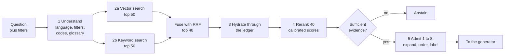

# 07 — Retrieval, Reranking and Context Assembly

This stage turns a question into the handful of passages the model will read. It has about 150
milliseconds, and it has two jobs that pull against each other:

- **Recall** — the passage that answers the question must be among the ones admitted. If it is
  not, the best possible outcome downstream is an honest abstention, and the likely one is a
  claim built from something nearby.
- **Precision** — the admitted passages should be relevant. Every irrelevant passage is one more
  thing the model can misread, misattribute or blend into a claim (doc
  [00](00-requirements-and-what-zero-hallucination-can-mean.md) §4, the "conflation" row).

The stage runs in five steps — understand the question, generate candidates, hydrate, rerank,
assemble — and this document takes them in order, with the question *"Can I claim per-diem for a
three-day trip to Madrid?"* from Priya, a finance analyst in Pune, as the running example.



---

## 1. What "good retrieval" is measured as

Doc [00](00-requirements-and-what-zero-hallucination-can-mean.md) §3.2 replaced precision@5 with
something achievable. The three measures this stage is held to:

| Measure | Definition | Target |
|---|---|---|
| **Recall@5** | The chunk containing the answer is among the top 5 after reranking | > 90%, **in each language** |
| **Admitted recall** | The answer chunk is among the chunks actually admitted to the model's context | ≥ recall@5 − 1 point |
| **Context precision** | Of the admitted chunks, the share that are relevant | > 80% |

Recall@5 is a ranking measure, kept because it is the original requirement and easy to compare across
changes. Admitted recall and context precision measure what the model actually receives, and they are
the ones the variable-k rule in §7 is tuned against.

---

## 2. Understanding the question, without a model call

Before searching, the query service does five cheap, deterministic things. None of them calls an LLM
— doc [12](12-latency-budget-and-caching.md) §2 has no room for one on first-turn questions.

**Detect the language.** A small character-level language detector labels the question `en`, `es`,
`hi` or `hi-Latn` (romanized Hindi) in under a millisecond. The label picks the keyword fields to
search and the language of the answer.

**Resolve filters.** Filters arrive from the API (doc [03](03-apis-and-data-model.md) §3) and can also
be stated in the question. A pattern matcher recognises dates and periods ("in 2023", "last year",
"desde enero", "2024 में"), department names and document types in all three languages, and turns them
into structured filters. These are **shown to the user as removable chips** — *Effective in 2023 ×,
Finance ×* — because a filter the user did not intend silently removes the right answer from the
candidates.

**Apply the effective-date default.** Unless the user asks about another date, only document versions
in effect **today** are searched. Priya's question is about the current policy, not last year's. Doc
[09](09-freshness-updates-and-deletion.md) §9 explains what happens when a version has been uploaded
but does not take effect until next month.

**Recognise codes.** Patterns for Kestrel's document codes (`FIN-POL-017`, `HR-IN-044`) and common
external identifiers (`Form 16`, `ISO 45001`, `section 80C`) are matched. A query containing a code
searches the keyword index's exact `codes` field with a strong boost, and gets more weight in fusion
(§4).

**Expand from the glossary.** The 1,800-term glossary of Kestrel acronyms and regional terms (doc
[06](06-indexing-at-120m-chunks.md) §7) adds synonyms to the keyword query: "LTA" also searches "leave
travel allowance"; "viáticos" also searches "dieta". The vector query is left as written — embedding
models already handle paraphrase, and adding synonym text to the embedding input blurs it.

### Why there is no HyDE step

HyDE — having the model write a hypothetical answer and searching with that — is the most common
LLM-based retrieval improvement. Kestrel measured it in the pilot, on the golden set:

| | English recall@5 | Hindi recall@5 | Added p50 latency |
|---|---:|---:|---:|
| Without HyDE (glossary, hybrid search, reranker) | 92.2% | 85.6% | — |
| With HyDE | 93.3% | 85.2% | **+450 ms** |

HyDE helped English by about a point and slightly *hurt* Hindi, where the model's hypothetical answers
were weaker and pulled the search towards English-style phrasing. A point of English recall is not
worth a third of the p50 budget. HyDE remains available as an offline tool for generating evaluation
questions (doc [14](14-evaluation.md) §4).

---

## 3. Romanized Hindi and cross-lingual search

Two kinds of question need special handling before search:

- **Romanized Hindi** — "per diem ke liye kitna milta hai Madrid mein" — is searched against the
  `text_hi_rom` field (a romanized copy of each Hindi chunk) and against English text, and is also
  transliterated to Devanagari for the vector query, because the embedding model represents Devanagari
  Hindi far better than ad hoc Latin spellings of it.
- **Cross-lingual questions** — Hindi or Spanish questions whose answer is in an English document,
  which is most of them, because 70% of the corpus is English — rely on the vector index. The
  multilingual embedder places *"मैड्रिड के लिए दैनिक भत्ता कितना है?"* close to *"per-diem for Madrid"*.
  The keyword index cannot help across languages, except through codes, numbers and place names.

Doc [11](11-multilingual-en-hi-es.md) covers both in depth, including why Hindi recall is the number
most at risk.

---

## 4. Candidate generation and fusion

### Two searches in parallel

The vector search and the keyword search run at the same time, each with the same permission and
metadata filters, and each returns its **top 50** chunk IDs with scores. Neither returns text.

Why 50 each, when only up to 8 will be admitted? Because the reranker is much better at judging
relevance than either search, and it can only rerank what it is given. The candidates' job is to make
sure the answer chunk is somewhere in the pile; the reranker's job is to find it. A small candidate
set caps recall before the reranker ever runs.

### Reciprocal rank fusion

The two result lists have incomparable scores: vector search returns cosine similarities between −1
and 1, BM25 returns unbounded positive numbers whose scale depends on the query. Adding them makes no
sense. **Reciprocal rank fusion (RRF)** ignores the scores and uses only the ranks:

> fused score of a chunk = Σ over the lists it appears in of 1 ÷ (60 + its rank in that list)

The constant 60 dampens the difference between rank 1 and rank 2, so a chunk that is near the top of
*both* lists beats a chunk that is first in only one. With three of Priya's candidates:

| Chunk | Vector rank | Keyword rank | Fused score |
|---|---:|---:|---|
| FIN-POL-017, §4.2 Europe | 1 | 7 | 1/61 + 1/67 = 0.01639 + 0.01493 = **0.03132** |
| FIN-POL-017, §4.1 India | 3 | — | 1/63 = **0.01587** |
| "Madrid office: getting there", travel wiki | — | 1 | 1/61 = **0.01639** |

The policy section that both searches liked wins clearly. The wiki page, which keyword search ranked
first because it contains "Madrid" six times, comes second, ahead of the India section — which is
fine, because the reranker will sort them properly.

**Weighted fusion for code queries.** When the question contains a recognised code, the keyword list
counts twice (`2 ÷ (60 + rank)`), because a user who types `FIN-POL-017` means that document. That is
the only weighting; anything more elaborate should be justified by the golden set, not intuition.

The fused list is cut to the **top 40** distinct chunk IDs.

---

## 5. Hydration, then reranking

### Hydration drops what must not be used

The 40 IDs are hydrated through the ledger (doc [02](02-architecture-and-the-ledger.md) §3): one query
returns the text, sentence boundaries and locator of each chunk that is in a live version of an active
document Priya may read. Superseded, deleted, blacked-out and unpermitted chunks simply do not come
back. On a normal day, 40 IDs return about 39.6 chunks; during a large re-indexing, perhaps 37. The
over-fetch in §4 absorbs the difference.

### What a reranker is

The searches in §4 use a **bi-encoder**: the question and each chunk are embedded *separately*, and
compared by the distance between their vectors. That is fast — chunk vectors are computed once at
ingestion — but each side is summarised without seeing the other.

A **cross-encoder** reranker reads the question and a passage *together*, as one input, and outputs a
relevance score. It can notice that the passage answers the question for India but the question asks
about Madrid; a bi-encoder, which compressed each into a vector independently, often cannot. It is
far more accurate and far more expensive, which is why it runs only on 40 candidates rather than 120
million.

Lodestar's reranker is a multilingual cross-encoder of the same size as the embedder (doc
[01](01-the-running-system-and-its-numbers.md) §7), self-hosted on the three H100s.

### Truncating passages to 256 tokens

Each passage is truncated to its first 256 tokens for reranking (the full chunk is still what the model
reads later). That cuts reranking compute from 369 ms to 150 ms on an L4, or from 45 ms to 18 ms on an
H100 (doc [01](01-the-running-system-and-its-numbers.md) §7). On the golden set, truncation cost **0.6
points** of recall@5, because structure-aware chunks tend to state their topic early — usually in the
first sentence after the heading — and the breadcrumb is prepended to the passage the reranker sees.

### Calibrating the scores

A reranker outputs a number, but not a probability. Its raw scores for relevant Hindi passages tend to
be lower than for relevant English ones, simply because it was trained on more English. A single
threshold on raw scores would therefore admit English passages more readily than Hindi ones.

So raw scores are **calibrated per language**: on the golden set, for each language, the raw scores
are mapped to the observed fraction of passages at that score that were relevant (using isotonic
regression, which fits a monotonic step function). After calibration, a score of 0.6 means "about 60%
of passages scored like this were relevant", in every language. The thresholds in §7 are set on
calibrated scores. Calibration is recomputed whenever the reranker, the chunker or the golden set
changes.

### Where recall is lost

Recall@5 is the product of two probabilities, and measuring them separately tells you where to work:

> recall@5 = P(answer chunk in the 40 candidates) × P(reranker keeps it in its top 5, given it was a
> candidate)

| Language | Candidate recall@40 | Reranker keeps it | **Recall@5** |
|---|---:|---:|---:|
| English | 97.0% | 95.0% | **92.2%** |
| Spanish | 96.5% | 94.0% | **90.7%** |
| Hindi | 93.0% | 92.0% | **85.6%** |
| Weighted by query mix | | | **90.9%** |

The blend passes the 90% requirement. Hindi fails it by 4.4 points, and Spanish passes by less than one.
That is why the requirement is enforced **per language** (doc
[00](00-requirements-and-what-zero-hallucination-can-mean.md) §8). The decomposition also shows that
fixing Hindi needs work on *both* factors: raising Hindi candidate recall to 98% alone gives 0.98 × 0.92
= 90.2%, which only just clears 90% with no margin. Doc [11](11-multilingual-en-hi-es.md) §5 has the
plan. [reference_impl/evaluation.py](reference_impl/evaluation.py) reproduces this table.

---

## 6. Assembling the context

### Diversity

Before admission, two diversity rules apply to the reranked list:

- **One chunk per near-duplicate cluster for the same passage.** If the travel policy exists on the
  Finance site and as a copy on the India HR site (doc [04](04-parsing-and-chunking.md) §9), only the
  authoritative copy's chunk is admitted. Otherwise both fill context slots with identical text, and the
  model may cite either.
- **At most three chunks per document**, unless the question names the document. This keeps one long
  document from crowding out a second source that qualifies or contradicts it.

### Expanding around the best chunks

For the top three admitted chunks, the assembler fetches the **two sentences before and after** each
chunk from the chunk store, within the same section. This is the job that overlap does in a naive
chunker (doc [04](04-parsing-and-chunking.md) §6), done only where it is needed. It also feeds the
qualifier check: an exception sentence immediately after a chunk becomes visible to the verifier even
if it was in the next chunk (doc [08](08-grounded-generation-and-verification.md) §7). Expansion is
budgeted at 600 tokens.

### Ordering

Admitted chunks are grouped **by document, in reading order** within each document, and documents are
ordered by their best chunk's score. A model reads a policy section more reliably as a coherent passage
than as fragments shuffled by score. At about 3,000 tokens of context, the known tendency of models to
attend less to the middle of very long contexts is not a significant factor.

### Labelling

Each chunk is introduced with a header, and each sentence carries its prompt-local ID:

```
[D1] Travel and Expense Policy (FIN-POL-017) · version 4 · effective 2025-04-01 · Finance · authoritative
  [S1.1] (p.7) Employees travelling to Madrid may claim a per-diem of €85 per day.
  [S1.2] (p.7) The per-diem covers meals and local transport.
  [S1.3] (p.7) Contractors are not eligible for per-diem allowances.
  [S1.4] (p.8) Receipts are not required for per-diem claims.

[D2] Travel and Expense Policy (FIN-POL-017) · version 4 · effective 2025-04-01 · Finance · authoritative
  [S2.1] (p.7) City: Madrid · Per-diem: €85 · Covers: Meals, local transport
  [S2.2] (p.7) City: Mumbai · Per-diem: ₹4,500 · Covers: Meals
```

The header gives the model what it needs to tell sources apart and to describe conflicts — title, code,
version, effective date, department, authority. Chunks flagged by the prompt-injection screen (doc
[04](04-parsing-and-chunking.md) §11) are never admitted.

---

## 7. Admitting a variable number of chunks

### The rule

After diversity, chunk *i* (in reranked order) is admitted if:

- its calibrated relevance is at least **τ_admit = 0.35**, and
- fewer than **8** chunks have been admitted, and
- the token budget of 3,000 is not exhausted.

The top chunk is always admitted if the sufficiency gate (below) passes.

So a single-fact question like Priya's typically admits one to three chunks; a question that genuinely
draws on several sections ("compare the per-diem rules for India and Spain") admits five to eight.

### Choosing τ_admit

The threshold trades the two measures from §1 against each other. On the English golden set:

| τ_admit | Mean chunks admitted | Context precision | Admitted recall |
|---:|---:|---:|---:|
| 0.20 | 6.1 | 64% | 92.6% |
| 0.35 | 3.4 | **82%** | **91.8%** |
| 0.50 | 2.2 | 88% | 89.4% |
| Fixed k = 5 | 5.0 | 41% | 92.2% |

At 0.35 both targets are met: context precision above 80%, and admitted recall within a point of
recall@5. Raising the threshold further buys precision by losing recall, which the targets do not allow.
The last row shows what the fixed-k design delivers: the same recall as k = 5, with context precision
of 41% — close to the theoretical ceiling of 40.2% from doc
[00](00-requirements-and-what-zero-hallucination-can-mean.md) §3.2.

Thresholds are tuned per language on calibrated scores and stored in the model registry as part of the
reranker's configuration, so changing the reranker without re-tuning them is blocked by the release
gate (doc [14](14-evaluation.md) §5).

### The sufficiency gate

Before any of the admitted chunks reach the generator, one check: **is the best calibrated relevance at
least τ_suff = 0.30?** If not, Lodestar abstains without calling the model:

> I couldn't find this in the documents you can access. The closest documents are: Relocation Policy —
> India (page 3); Travel and Expense Policy (page 9).

The gate does three things at once. It is the main defence against **answering from memory** (doc
[00](00-requirements-and-what-zero-hallucination-can-mean.md) §4): the model is never handed weak
evidence and a question it may know the answer to. It **saves money**: the 6% of queries it stops cost
retrieval but no generation. And it produces a useful answer — a list of where to look — rather than a
guess.

τ_suff is tuned against measures M3 and M4: correct abstention on at least 95% of the golden set's
unanswerable questions, and false abstention on at most 5% of its answerable ones. Those two pull in
opposite directions, and the gate is only one of the places abstention happens: the generator can also
answer `NOT_FOUND`, and an answer can end up with every claim removed by verification (doc
[08](08-grounded-generation-and-verification.md) §9).

---

## 8. Authority, recency and conflicting sources

The reranker judges *relevance*. It does not know which of two relevant documents is official, current,
or right. Three adjustments are applied after reranking and before admission.

**Authority.** Documents from the official policy repositories carry `authoritative = true` (doc
[04](04-parsing-and-chunking.md) §8). When an authoritative document and a non-authoritative one both
answer the question, the authoritative one is ranked first.

**Recency of effect.** Between two authoritative documents on the same topic, the one with the later
effective date is ranked first. A version with an *inferred* effective date (no date found in the text)
is ranked below one with an explicit date.

**Conflicts.** A conflict is two admitted chunks, from different documents, that state different values
for the same thing — in practice, chunks from the same near-duplicate cluster or the same document code
whose numbers differ. Kestrel's most common case:

> [D1] Travel and Expense Policy (FIN-POL-017) · authoritative · effective 2025-04-01:
> "Employees travelling to Madrid may claim a per-diem of €85 per day."
>
> [D3] Sales team wiki: Travel tips · not authoritative · last edited 2023-02-14:
> "The per-diem in Madrid is €120."

The rule is:

- **If an authoritative source answers, a conflicting non-authoritative source is not admitted.** It is
  recorded as a conflict and listed for the wiki page's owner on the admin dashboard, because an outdated
  copy is a problem someone can fix.
- **If no authoritative source answers, both are admitted**, and the generator is instructed to present
  the disagreement rather than choose (doc [08](08-grounded-generation-and-verification.md) §8): *"Two
  documents disagree: a 2023 Sales wiki page says €120, and a 2024 Finance procedure says €85."*

This is the mechanism behind the warning in doc [00](00-requirements-and-what-zero-hallucination-can-mean.md)
§4 that grounded is not the same as true. Lodestar cannot know which document is correct. It can make
sure the user sees where each statement came from, how official it is, and when it was written.

---

## 9. When to build less

- **A corpus under a few hundred thousand chunks** can often skip the reranker: with fewer candidates
  competing, hybrid search plus fusion may meet recall targets alone. Measure first.
- **A single-language corpus** does not need per-language calibration or romanized fields — but still
  needs calibration, because a raw reranker score is not a probability.
- **Questions that are mostly lookups by code** ("show me SOP-PUN-0312") should be routed to the keyword
  index with a much heavier weight, or bypass retrieval entirely and open the document.
- **If your users never filter**, skip the filter chips — but keep the effective-date default, because
  "today" is the filter nobody types.

---

## What to take away

1. **Retrieval has to deliver recall and precision at once.** Measure recall@5, admitted recall and
   context precision; the last two describe what the model actually reads.
2. **Do the cheap, deterministic query work and skip HyDE.** Language detection, filter chips,
   effective-date defaults, code recognition and a reviewed glossary cost microseconds; HyDE cost 450 ms
   for one point of English recall and lost recall in Hindi.
3. **Fuse by rank, not by score.** Reciprocal rank fusion needs no score normalisation and rewards
   agreement between the two searches.
4. **Hydrate before reranking.** The reranker should never spend compute on chunks that cannot be used.
5. **Calibrate the reranker per language.** A raw score is not a probability, and its scale differs by
   language; thresholds on raw scores quietly disadvantage Hindi.
6. **Decompose recall into candidate recall × reranker recall, per language.** The blend passed at 90.9%
   while Hindi failed at 85.6%, and the decomposition says both factors need work.
7. **Admit a variable number of chunks.** τ_admit = 0.35 met 82% context precision with admitted recall
   within a point of recall@5; fixed k = 5 gave 41%.
8. **Abstain before generating when evidence is weak.** The sufficiency gate prevents answering from
   memory, saves the generation cost, and still points the user somewhere useful.
9. **Relevance is not authority.** Rank official and current sources first, drop conflicting unofficial
   copies when an official source answers, and show both sides when none does.

Continue to [08 — Grounded generation and verification](08-grounded-generation-and-verification.md).
