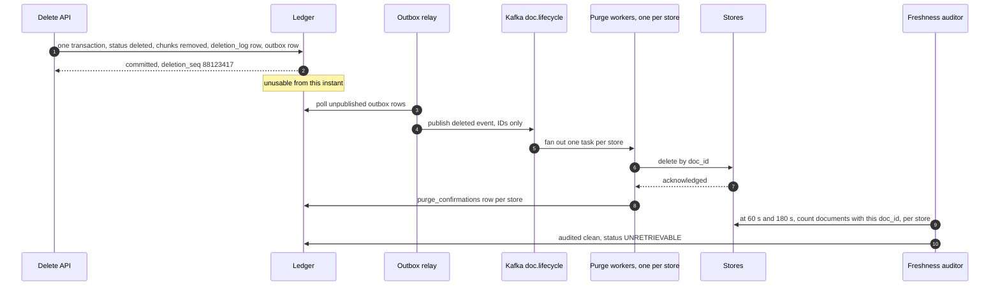

# 09 — Freshness, Updates and Deletion

Three requirements in the original list are about time:

- F6 — when a document is re-uploaded, answers based on the previous version must not be served;
- F7 — deleted documents are fully purged from all indices within 5 minutes;
- N7 — updated or deleted documents stop appearing in answers within 5 minutes.

Doc [00](00-requirements-and-what-zero-hallucination-can-mean.md) §3.5 and §3.6 showed that each of
these hides a decision, and doc [02](02-architecture-and-the-ledger.md) §3 introduced the mechanism
that makes them tractable: the **hydration gate**, which makes every change effective for answers
at the moment it commits. This document follows the consequences all the way through: the update
race, the dozen places a document's text lands, how purges are proven rather than assumed, what
happens to an answer that is mid-generation when its source is deleted, why backups are the hardest
part, and what to do with a policy that has been uploaded but does not take effect until next month.

---

## 1. Three clocks, not one

"Within 5 minutes" sounds like one deadline. It is three, and they start and stop at different
moments.

| Clock | Starts | Stops when | Lodestar's deadline |
|---|---|---|---|
| **Unusable** | The delete, update flip or revocation commits in the ledger | No answer can use the old text as evidence | **0 seconds** — at commit |
| **Unretrievable** | Same | No index, cache or store returns the old text to any query, verified by the auditor | **5 minutes** |
| **Erased** | Same | The bytes are gone from live disks; backups have expired or been made safe | **24 hours** live; **35 days** backups |

The first clock is the one users care about: will an answer quote something that should be gone?
The hydration gate stops it at zero, because evidence is read only from the ledger (§2). The second
clock is the requirement as written, and it is about copies. The third is what a privacy regulator
or a legal hold will ask about.

For updates, there is a fourth question, which none of the clocks answers: **how long until the new
version is available?** That is ingestion latency, and §3 shows how it interacts with the first
clock.

---

## 2. Effective at commit: the hydration gate

Recall the rule from doc [02](02-architecture-and-the-ledger.md) §3: indexes return only chunk IDs,
and text becomes evidence only when it is fetched from the chunk store by a query that keeps only
live versions of active documents the user may read.

So the three changes take effect like this:

| Change | What commits | Effect on the next query |
|---|---|---|
| **Delete** | `documents.status = 'deleted'`; the document's chunks are deleted from the chunk store; a `deletion_log` row and an outbox event are written — one transaction | Its chunk IDs, still returned by the indexes for a few seconds, hydrate to nothing |
| **Update** | `documents.live_version_id` changes from version 4 to version 5 — a single-row update | Version 4's chunk IDs fail `c.version_id = d.live_version_id`; version 5's pass |
| **Revocation** | A row leaves `doc_acl`, or `visibility` changes | Users who lost access fail the permission clause |

None of these waits for an index, a cache or a purge job.

One precision about "at commit". The gate reads from PostgreSQL **read replicas**, which apply the
primary's changes a short time later — typically under 100 ms. So strictly, a change is effective at
commit plus replica lag. The query service routes hydration to the primary whenever a replica's lag
exceeds 2 seconds (doc [16](16-availability-degradation-scaling-and-cost.md) §3), which bounds the
gap; for everything this document discusses, a 2-second bound is indistinguishable from zero. That is what [reference_impl/ledger.py](reference_impl/ledger.py)
tests in "a deletion is effective at commit, before any index has been purged": the vector and keyword
indexes both still contain the document, and hydration returns nothing.

---

## 3. Updates: swap or blackout

### The dilemma

An update has two halves: the old version must stop being used, and the new version must start being
available. The hydration gate makes the first half instant — but only at the moment of the flip, and the
flip can only happen once the new version has been parsed, chunked, embedded and indexed (doc
[05](05-ingestion-pipeline-and-versions.md) §4). For a ten-page policy that takes seconds. For a 2,000-page
scanned contract during a spike, it can take longer than 5 minutes.

In the meantime there are only two options. Keep using the old version, which F6 forbids. Or stop using the
document at all, which makes a document the user has just updated temporarily invisible.

### The rule

> **Swap if you can, black out if you must, and say which happened.**

- When a new version is registered, the document's `pending_since` is set to the registration time.
- If the new version is ready and flips within **270 seconds**, the swap is atomic and invisible: one query
  sees version 4, the next sees version 5.
- If 270 seconds pass first, the document enters **blackout**: `status = 'blackout'`, and the gate stops
  returning *any* version of it. Answers that would have used it carry a notice: *"Travel and Expense Policy is
  being updated and was not used for this answer."*
- When the new version flips, blackout ends automatically.

Why 270 and not 300? Because the blackout itself is a database update that has to propagate to the read
replicas the gate reads from, and the 30-second margin covers that with room to spare. The tests "an update
ready inside the SLA swaps atomically" and "an update not ready by upload + 270 s hides the old version" in
`ledger.py` encode both branches.

### How often each branch happens

In the pilot, the median update went live about 6 seconds after registration and the p99 about 90 seconds
(doc [05](05-ingestion-pipeline-and-versions.md) §6). **0.3% of updates** reached blackout, almost all large
scans during the morning sync peak. At 75,000 updates a day, that is about 225 documents a day spending some
time invisible — typically under two minutes each.

### The notice must not leak

The blackout notice names the document. It is sent only to users who could read the document; for anyone
else, the document simply does not exist, as it would not if it were active (doc
[03](03-apis-and-data-model.md) §3).

### When the new version never arrives

A new version that fails permanently — a password-protected PDF, say — leaves the document in blackout until
someone acts. That is the "silence over staleness" choice from doc [05](05-ingestion-pipeline-and-versions.md)
§4: the uploader has asserted that version 4 is out of date, and only an explicit, audited reinstatement makes
it live again.

---

## 4. Where a document's text actually lives

Purging "all indices" is the easy part. The hard part is knowing every place the text — or something derived
from it — has been copied. Here is Lodestar's complete inventory, with how each is handled. Rows marked
**by reference** hold no copy at all, which is the cheapest kind of purge.

| # | Place | What it holds | Purge mechanism | Unretrievable by | Erased by |
|---|---|---|---|---|---|
| 1 | Chunk store (PostgreSQL) | Chunk text | Deleted in the delete transaction | **Commit** | 24 h (vacuum, §7) |
| 2 | Vector index | Vectors and filter fields (no text) | Delete by `doc_id` filter → tombstones | Seconds | 24 h (forced segment rebuild, doc 06 §5) |
| 3 | Keyword index | Inverted index of the text | Delete by query on `doc_id` → marked deleted | Seconds, after refresh | 24 h (expunge merge, §7) |
| 4 | Object store | Raw upload, rendered PDF, parsed blocks — every version | Delete **every object version** under the document's prefix | Seconds | 24 h (§7) |
| 5 | Answer cache (Redis) | Answers citing the document | Delete keys listed in `ans_by_doc:{doc_id}`; plus validate-on-read | Seconds; **commit** via validation | Seconds |
| 6 | Conversation store | Claim text the model wrote; **references** to sentences | Redact claim text in turns found via `turn_citations` | 30 s | 24 h (vacuum) |
| 7 | Traces and query logs | Chunk IDs and sentence keys **by reference**; full prompts only in the 1% debug sample | Delete debug-sample traces found via a `doc_id` index; TTL 7 days | 60 s | 24 h |
| 8 | Kafka | IDs and object keys only — **by reference** | Nothing to purge (doc 05 §3) | — | — |
| 9 | Embedding cache | Vectors keyed by content hash | Delete by the document's chunk hashes | Seconds | Seconds |
| 10 | Read replicas of PostgreSQL | Replicated copy of 1 and 6 | Replication applies the delete | Replication lag, under 1 s | With the primary |
| 11 | LLM provider | Prompts in flight; the provider's prompt cache | Zero-retention agreement; the cached prefix is the system prompt only, never documents | — | Contractual |
| 12 | Golden set and evaluation data | Span labels **by reference** | Questions whose evidence is deleted are retired automatically | Next evaluation run | — |
| 13 | Analytics warehouse | Query outcomes, chunk IDs **by reference**, no text | Nothing to purge | — | — |
| 14 | Citation viewer cache (CDN) | Rendered PDF pages | Purge by URL prefix; signed URLs expire in 15 minutes | 15 min | 15 min |
| 15 | Backups and snapshots | Everything above, as of the snapshot | Cannot be edited; **replay on restore** (§8) | On restore | 35 days |

Three design choices did most of the work in that table, and they are worth naming because they apply to any
system with a deletion requirement:

1. **Store references, not copies.** Kafka, traces, the warehouse, the golden set and conversation history
   quotes all hold IDs. Rows 7, 8, 12 and 13 need little or no purging as a result.
2. **Index every copy by the document it came from.** `ans_by_doc`, `turn_citations` and the trace store's
   `doc_id` index turn "find every copy" from a scan of everything into a key lookup.
3. **Keep documents out of the provider's prompt cache.** The cached prefix is the system prompt. Document text
   is never in it, so there is nothing to purge on the provider's side beyond requests already in flight.

---

## 5. Purging, and proving it

### The pipeline

Typical timings, measured in the pilot:

| Step | p50 | p99 |
|---|---:|---:|
| Outbox row → Kafka | 0.4 s | 2 s |
| Kafka → purge task started | 0.2 s | 3 s |
| Vector index delete, all 3 replicas acknowledged | 1.1 s | 4 s |
| Keyword index delete and refresh | 1.8 s | 6 s |
| Answer cache keys deleted | 0.1 s | 1 s |
| Conversation claim text redacted | 8 s | 30 s |
| **Last store confirmed** | **~9 s** | **~35 s** |

The 5-minute deadline leaves about 265 seconds of margin at p99 for retries, a slow node, or a Kafka consumer
restart.

### Why the auditor does not trust the purge workers

A purge worker reports "done" when its store acknowledges the delete. That is not the same as the document
being gone. The store may have acknowledged on one replica and lost the write on failover. The worker may have
deleted by the wrong field. A snapshot may have been restored since (§8). The keyword index may have
acknowledged before refreshing.

So the **freshness auditor** is a separate process that asks each store directly, at 60 seconds and again at 180
seconds after commit: *how many items do you hold for `doc_id = doc_01JB7K3V9Q2R`?* The answer must be zero.
Only when every store returns zero is the deletion marked `UNRETRIEVABLE`. If any store still returns a nonzero
count at 300 seconds, the auditor **pages** — a missed SLA is an incident, with the store and the count in the
alert. `ledger.py` tests this with a purge worker whose keyword-index deletes silently fail: the auditor is
quiet at 200 seconds and pages at 301.

The auditor also runs a **daily full reconciliation**: for each store, the set of document IDs it holds is
compared against the ledger's active set, and any extra is purged and reported. That catches what the per-deletion
audit cannot, such as a restore nobody mentioned.

### Lag alerts that fire before the SLA does

Waiting for the auditor to page at 300 seconds is late. Earlier signals:

- `doc.lifecycle` consumer lag over **30 seconds** — the purge workers are falling behind.
- Oldest unconfirmed deletion over **120 seconds** — some store is not keeping up.
- Outbox rows unpublished for over **10 seconds** — the relay is down.

Each points at a different component, which is the point of having three.

---

## 6. The answer that is mid-generation when its source changes

### The race

An answer takes about 1.3 seconds from question to last claim. Suppose a document it cites is deleted 0.8
seconds in. The evidence was hydrated before the delete, so the model has the text. The first two claims were
verified and streamed before the delete. The third claim is still being generated.

### The two checks

- **Per claim, before it is sent**, the orchestrator checks that every version the claim cites is still live and
  readable. It does this without a database round trip: for the duration of the request, it subscribes to
  `doc.lifecycle` events for the documents in its context, so a delete or flip during generation is pushed to it.
  A claim citing a changed document is withheld.
- **At the end**, the delivery check re-reads the ledger for every cited version (doc
  [02](02-architecture-and-the-ledger.md) §5, step 15), as a backstop if a lifecycle event was delayed.

Claims sent before the change were true of the current version **when they were delivered**, which is what the
hallucination definition requires (doc [00](00-requirements-and-what-zero-hallucination-can-mean.md) §4). They are
not silently left standing, though: the stream ends with a `notice` event, *"A source used in this answer was
removed while it was being written"*, and the client marks those claims.

### How rare it is

Rare enough that it is tempting to skip, which is exactly why it is worth computing. A deletion lands on a given
document at a rate of 22,000 ÷ 86,400 ÷ 10,000,000 per second. An answer is exposed for about 1.3 seconds across
about 1.5 cited documents. Across 423,000 answers a day:

> Answers racing a **deletion**: about **7.7 a year**
> Answers racing an **update**: about **26 a year**

So roughly once every ten days, an answer will be built from a document that changes while it is being
written.
Without the checks, each of those is an answer quoting text that was gone before the user read it. With them, it
costs a subscription per request and one cheap lookup per claim.

---

## 7. Physical erasure on live systems

"Unretrievable" is achieved in seconds. "Erased from live disks within 24 hours" needs each store's own
mechanism, and several of them have a trap.

**Vector index.** Tombstoned vectors stay on disk until their segment is rebuilt. Segments holding a deleted
document's points are force-rebuilt within 24 hours — which, as doc [06](06-indexing-at-120m-chunks.md) §5
computed, amounts to rebuilding the whole index daily, about 50 core-hours. Vectors count as copies because
embedding inversion can recover much of the original text.

**Keyword index.** Lucene marks deleted documents in a per-segment bitmap and leaves the data in place until a
merge rewrites the segment. A nightly merge with `only_expunge_deletes` on the shards that received deletions that
day rewrites only segments with deleted documents.

**Object store — the versioning trap.** Kestrel's raw-upload bucket has versioning enabled, so that an accidental
overwrite can be recovered. In a versioned bucket, **deleting an object does not delete it**: it adds a "delete
marker" on top, and every previous version remains readable by anyone with version-level access. The purge worker
must list and delete **every version** of every object under the document's prefix. A lifecycle rule additionally
expires non-current versions after one day, as a backstop.

**PostgreSQL.** A deleted row is not removed from disk immediately; it becomes a dead tuple until vacuum reclaims
the space, and its contents remain in the write-ahead log until that is recycled. Autovacuum on the chunk
partitions is tuned to run at least daily, and WAL retention on the primary is 24 hours. Older WAL lives in the
backup archive, which §8 covers.

**Traces.** Full-prompt debug traces (a 1% sample) have a 7-day TTL and are deleted early by `doc_id` index. All
other traces hold references only.

---

## 8. Backups and restores

### Backups cannot be edited

Lodestar keeps 35 days of backups: nightly PostgreSQL base backups with continuous WAL archiving (so the ledger can
be restored to any point in time), daily vector-index snapshots and daily keyword-index snapshots. A backup is an
immutable file. You cannot delete one document from a 300 GB snapshot.

So deleted documents remain in backups until those backups expire, and the deletion API reports exactly that
(`"backups_expire_by"`, doc [03](03-apis-and-data-model.md) §2) rather than claiming erasure it has not achieved.

### The rule that keeps backups safe

> **A restore is not finished until the deletion log has been replayed past the snapshot.**

Restoring a vector shard from Wednesday's snapshot brings back every document deleted since Wednesday (doc
[02](02-architecture-and-the-ledger.md) §2, failure 5). The hydration gate means those documents still cannot be
*cited* — but they are back in a store, and the auditor's next daily reconciliation would flag them as a breach. So
the restore procedure is:

1. Restore the snapshot, taken at time T, to the replacement node.
2. **Replay every deletion in `deletion_log` committed after T**, and drop every chunk whose version is no longer live
   (versions superseded since T).
3. Run the auditor's reconciliation against the restored shard.
4. Only then add the shard back to the serving set.

`ledger.py` tests both halves: a naive restore resurrects a deleted document, and `restore_with_replay` removes it and
also drops versions superseded after the snapshot.

### Restoring the ledger itself

The hardest case is restoring the **ledger** to an earlier point — after a bad migration, say. A point-in-time restore
to 09:00 un-does every deletion committed after 09:00, because the deletion log lives in the ledger. The restored
ledger would consider those documents active, and the gate would let them back into answers.

So the deletion log is **mirrored outside the ledger**: every committed deletion is also appended, by the outbox relay,
to an append-only object-store log with write-once retention (object lock). After any ledger restore, deletions in the
mirror with a sequence number above the restored ledger's highest are re-applied before the ledger serves traffic. The
deletion log is the one dataset in the system that must survive every other dataset being rolled back.

### Practise it

A restore procedure that has never been run does not work. Kestrel runs a restore drill quarterly: restore one vector
shard and one ledger replica into an isolated environment, replay, reconcile, and record how long each step took. The
first drill found that the replay step was missing from the runbook entirely.

### When 35 days is too long

Some datasets — a privacy request under GDPR for an EU employee, or material under India's Digital Personal Data
Protection Act — may need erasure from backups well inside 35 days. The tool for that is **crypto-shredding**: encrypt
a defined set of data with its own key, and destroy the key to make every copy, including backups, unreadable. It works
cleanly for large, well-defined sets (a department, a legal entity, a jurisdiction) with keys held in a key management
service. It works badly per document, because 10 million keys, each of which must itself be backed up somewhere, recreate
the original problem. Lodestar supports it per data domain, not per document, and the decision about which domains need
it belongs to legal.

---

## 9. A version that does not take effect yet

### The case F6 did not anticipate

On 21 October, Finance uploads version 5 of the travel policy. It raises the Madrid per-diem to €90, **effective 1
November**. Requirement F6 says that once a document is re-uploaded, the previous version must not be served. But
until 1 November, version 4 *is* the policy. An employee asking on 25 October what they can claim for a trip that
week must get €85.

F6 assumed that a re-upload is a correction. A future-dated version is not a correction; it is a schedule.

### Two kinds of new version

When a new version's effective date (extracted at ingestion, doc [04](04-parsing-and-chunking.md) §8) is in the
future, the uploader is asked — or, for connectors, the source's configured default applies — which it is:

| Kind | Meaning | Ledger behaviour |
|---|---|---|
| **Replaces** (the default) | Version 4 was wrong or outdated | Swap or blackout, as in §3 |
| **Scheduled** | Version 4 remains in effect until version 5's effective date | Version 5 is indexed and marked `scheduled`; version 4 stays live; at 00:00 on the effective date, **in the document's jurisdiction's time zone**, a scheduler flips version 5 live |

The time zone matters: a Spanish policy effective 1 November takes effect at 23:00 UTC on 31 October; an Indian
one at 18:30 UTC.

### What answers do in between

- A question about today uses version 4, with a notice: *"A new version of this policy takes effect on 1 November
  2026."*
- A question about a date on or after 1 November — "What will the per-diem be for my trip on 3 November?", where the
  date filter resolves to 3 November (doc [07](07-retrieval-reranking-and-context.md) §2) — uses version 5.

The hydration rule generalises from "the live version" to "the version in effect on the query's date, among versions
that are live or scheduled". For the 99% of documents that have only one current version, the two are the same.

---

## 10. Permission revocation is a freshness event

Doc [00](00-requirements-and-what-zero-hallucination-can-mean.md) §3.7 added requirement F9: a revocation takes effect
within 5 minutes. Permissions change in two places, with different paths.

**A document's ACL changes** (someone edits who may read `LEGAL-118`). The change commits to the ledger, and from that
instant the gate enforces it (§2). Index payloads are updated afterwards. Stale payloads are safe for the asymmetric
reason in doc [13](13-access-control-security-and-privacy.md) §3.

**A user's group membership changes** (Priya leaves the M&A group). That change happens in the corporate directory, not
in Lodestar. Lodestar resolves a user's groups through a cache with a **5-minute TTL**, refreshed early when the
directory sends a change notification, which it usually does within seconds. So the worst case is 5 minutes, and the
typical case is under a minute. A session token that embeds group membership would be worse — its lifetime would
become the revocation delay — so Lodestar's tokens carry identity only, never groups.

**Conversation history after a revocation.** Priya's old conversation contains claims drawn from M&A documents she can
no longer read. Quotes in history are re-hydrated through the gate, so they show `[source no longer available]`. The
claim *text* is still hers — she saw it legitimately at the time — but the renderer hides claims whose every citation
fails her current permissions, for the same reason: the history should not become a way to keep reading what access
control has withdrawn.

---

## 11. What freshness is measured by

| Indicator | Target | Alert |
|---|---|---|
| Deletion: commit to `UNRETRIEVABLE`, p99 | < 300 s | Any deletion past 300 s pages |
| Deletion: oldest unconfirmed | < 120 s | Page at 120 s |
| Update: registration to live, p99, interactive and sync lanes | < 240 s | Ticket at 240 s |
| Updates reaching blackout | < 1% daily | Ticket at 1% |
| Revocation: directory change to enforced, p99 | < 300 s | Page at 300 s |
| Daily reconciliation: extra documents in any store | 0 | Page on any nonzero |
| Connector detection delay, per source | Reported, no target | Ticket on a 3× jump |

The last row has no target because it is outside the system's control (doc
[05](05-ingestion-pipeline-and-versions.md) §5). It is on the dashboard so that nobody mistakes "the pipeline met its
SLA" for "the contract system is fresh".

---

## What to take away

1. **"Within 5 minutes" is three clocks.** Unusable at commit, unretrievable within 5 minutes, erased within 24 hours
   on live systems and 35 days in backups. Promise each one separately.
2. **The hydration gate makes the first clock zero.** Every delete, flip and revocation takes effect for answers when
   it commits, whatever the copies are doing.
3. **Swap if you can, black out if you must, and say which happened.** At Kestrel 0.3% of updates reach blackout,
   usually for under two minutes.
4. **Inventory every copy, and prefer references to copies.** Fifteen places hold a document's text or derivatives;
   designing four of them to hold only IDs removed most of the purge work.
5. **Prove purges independently.** The auditor counts per store; the purge worker's own report is not evidence.
6. **Check liveness per claim during streaming.** An answer races a change to its source about 34 times a year at
   Kestrel; each check costs almost nothing.
7. **Watch for erasure traps.** A versioned object store keeps every version after a delete; Lucene and HNSW keep bytes
   until a rewrite; PostgreSQL keeps dead tuples and WAL.
8. **A restore is not finished until the deletion log is replayed**, and the deletion log must be mirrored outside the
   ledger so a ledger restore cannot undo it.
9. **Distinguish a correction from a schedule.** A future-dated version must not replace the version that is still in
   effect.
10. **Revocation is a freshness event.** Never put group membership in a long-lived token.

Continue to [10 — Multi-turn conversations](10-multi-turn-conversations.md).
