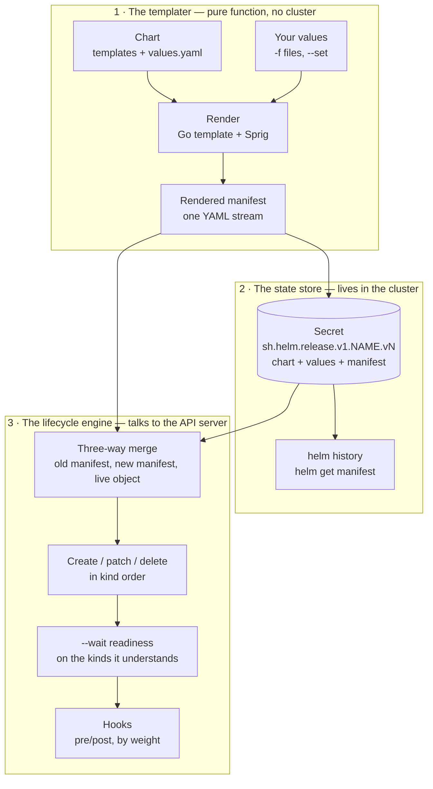

# What Helm Is, What Problem It Solves, and the Three Tools Hiding Inside It

Start here even if you have written charts for years. This doc does three things: it shows the
problem Helm was built to solve so that its design choices stop looking arbitrary, it defines
every term the rest of the collection uses without re-explaining, and it lays out the sixteen
failure classes that every later doc slots into.

The single most useful idea in the collection is in this doc, so it is worth stating up front and
then earning: **Helm is three separate tools that share a command-line interface.** They fail
independently, they are debugged with different commands, and almost every confusing Helm
incident is a case of debugging the wrong one of the three.

## The problem, before the solution

Suppose you have one service — `checkout-api` at Riverbend — and you deploy it to Kubernetes with
plain YAML. You need a `Deployment`, a `Service`, a `ServiceAccount`, a `ConfigMap`, an
`HorizontalPodAutoscaler`, a `PodDisruptionBudget`, and a `ServiceMonitor` so Prometheus finds it.
Seven files. You check them into the repository, you run `kubectl apply -f k8s/`, and it works.
Nothing is wrong with this. For one service in one cluster, this is the correct answer and you
should not read any further.

Now three things happen, in this order, at every company.

**First, a second environment.** You need `checkout-api` in `rb-dev` as well as
`rb-prod-use1`. The two differ in about nine ways: replica count (2 versus 24), resource requests,
the image tag, the log level, the database hostname, whether the HPA exists at all, the Ingress
hostname, the number of Kafka consumer threads, and one feature flag. Nine differences across
seven files. You now have three bad options: copy the directory and let the copies drift; write a
shell script that runs `sed`; or start templating.

**Second, software you did not write.** Somebody needs Prometheus. Prometheus is not seven YAML
files, it is about four hundred, including nine CustomResourceDefinitions, three webhooks, and a
set of RBAC rules that depend on which features you enable. You are not going to read four
hundred files, and you are certainly not going to maintain a fork of them. You need a way to
consume somebody else's Kubernetes application as a unit, with a handful of knobs.

**Third, two hundred and forty services.** Riverbend's services are 90% identical to each other.
Every one has a Deployment with the same security context, the same Prometheus annotations, the
same topology-spread rules, the same `preStop` hook, the same label set. The 10% that differs is
the interesting part. If each team writes its own seven files, then when the platform team needs
to add a required label to every pod in the fleet, that is 240 pull requests to 240 repositories,
and you will never get the last eleven of them merged.

Those three problems are genuinely different, and Helm answers all three, which is why it is
popular and also why it is confusing. Templating answers the first. Packaging and distribution
answer the second. Library charts and a shared template answer the third. They pull the design in
different directions, and most of the trade-offs in this collection are a consequence.

## The three tools

Here is the separation, and it is worth internalising because the rest of the collection depends
on it.



**Tool one: the templater.** It is a pure function. Chart plus values in, one stream of YAML out.
It does not touch your cluster.[^lookup] You can run it on a laptop with no `kubeconfig`:

```bash
helm template checkout-api ./charts/checkout-api -f envs/prod-use1.yaml
```

Everything the templater can get wrong, it gets wrong deterministically and in a way you can see
by reading its output. Bad indentation, a missing value, a number that turned into a string. These
are the `T-` and `V-` failure classes, and they are the easiest class of Helm problem because the
feedback loop is a second long and requires no cluster.

[^lookup]: One exception, and it causes a whole case study: the `lookup` function reads live
objects from the cluster, which makes the templater impure. See `T-11` and `CS-1`.

**Tool two: the state store.** When you `helm install` or `helm upgrade`, Helm writes a record of
what it did into the cluster — by default a Secret in the release's namespace, named
`sh.helm.release.v1.<release-name>.v<revision>`. That Secret contains the chart it used, the values
it was given, and the manifest it rendered. There is one per revision, and Helm keeps the last ten
by default.

This is the part nobody looks at, and it is where the confusing incidents live. Helm's idea of
"what is installed" comes from these Secrets and nowhere else. If the Secret says a `ConfigMap`
exists and somebody deleted the `ConfigMap` with `kubectl`, Helm does not know. If the Secret is
gone, the release does not exist as far as Helm is concerned, even though all its objects are
running happily. These are the `R-` failure classes.

You can read it:

```bash
# What Helm thinks it installed, as YAML
helm get manifest checkout-api -n checkout

# The actual Secret, decoded — this is the raw state
kubectl get secret -n checkout sh.helm.release.v1.checkout-api.v47 \
  -o jsonpath='{.data.release}' | base64 -d | base64 -d | gzip -d | jq '.info'
```

⚠️ Note the *two* `base64 -d` calls. The Secret's `data` field is base64-encoded by Kubernetes as
all Secret data is; the value inside is *itself* base64-encoded by Helm, wrapping a gzip stream
wrapping JSON. This double encoding surprises people every single time, and doc 04 explains why
it is there.

**Tool three: the lifecycle engine.** This is the part that talks to the API server. It takes the
rendered manifest, compares it against the previous revision's manifest and against the live
objects, computes patches, applies them in a fixed order by resource kind, optionally waits for
things to become ready, and runs hooks around the whole thing. If it fails partway, it optionally
rolls back.

This is where the *expensive* incidents live, because this tool's failures happen in production,
under time pressure, with a half-applied change. These are the `U-`, `H-`, and `C-` classes.

### Why the separation matters in practice

Because the debugging command is different for each.

| Symptom | Which tool | First command |
|---|---|---|
| "The YAML is wrong" / "that field should not be there" | Templater | `helm template` — no cluster needed |
| "The value I set had no effect" | Templater | `helm template --debug`, then `helm get values --all` |
| "Helm says the release does not exist" | State store | `kubectl get secret -l owner=helm -n $NS` |
| "Helm wants to recreate something I did not change" | State store | `helm get manifest` versus `kubectl get -o yaml` |
| "The upgrade hangs" | Lifecycle engine | `kubectl get events`, `kubectl rollout status` |
| "The upgrade failed and now I cannot upgrade again" | State store + lifecycle | `helm history`, then doc 17's triage tree |
| "It worked in dev and did nothing in prod" | Usually GitOps model mismatch | Doc 11, `G-01` |

If you take one operational habit from this collection, take this one: **before you touch a
broken release, decide which of the three tools is broken.** It cuts the search space by two
thirds, and the temptation under pressure is to skip it.

## The vocabulary, defined once

These words are used precisely throughout, and Helm's own documentation is sometimes loose with
them. Where it is, the docs here use the precise sense.

**Chart.** The package. A directory (or a `.tgz` of one) containing `Chart.yaml`, a `templates/`
directory, a default `values.yaml`, and optionally `charts/` (dependencies), `crds/`, and
`values.schema.json`. A chart is *inert*. It is a function waiting for arguments.

**Release.** One installation of a chart, identified by a **name** and a **namespace**. The same
chart installed twice under different names is two releases with no relationship to each other.
`checkout-api` in `rb-dev` and `checkout-api` in `rb-prod-use1` are two releases even though the
name matches, because they are in different clusters. This is why Riverbend has 940 releases and
240 services.

**Revision.** One version of a release, numbered from 1, incremented by every `helm upgrade` *and
by every `helm rollback`* — a rollback does not decrement the counter, it appends a new revision
whose content matches an old one. So `helm history` on a release that has been upgraded twice and
rolled back once shows four revisions.

**Manifest.** The rendered YAML that a revision installed. `helm get manifest` gives you exactly
the bytes Helm sent to the API server, which is the single most useful thing you can look at when
a release is misbehaving. It is not the same as what is running — the API server adds defaults,
controllers add status, mutating webhooks add sidecars.

**Hook.** A resource in the chart annotated with `helm.sh/hook`, which Helm installs *outside* the
normal flow, at a defined point in the lifecycle, and — critically — **does not record in the
release manifest**. Hooks are the main source of "but Helm should have cleaned that up" surprises.
Doc 06 is entirely about them.

**Subchart / dependency.** A chart inside another chart's `charts/` directory, declared in the
parent's `Chart.yaml`. A subchart is rendered as part of the parent release; it does not get its
own release. Parent and subchart share a values namespace with specific and slightly odd rules,
covered in doc 08.

**Library chart.** A chart with `type: library` in `Chart.yaml`. It contains only named templates
(`_helpers.tpl` and friends) and produces no output of its own. It exists so 240 charts can share
one definition of "what a Riverbend Deployment looks like". This is the answer to the third
problem from the top of this doc.

**Ownership metadata.** Three pieces of metadata Helm stamps on every object it manages:

```yaml
metadata:
  labels:
    app.kubernetes.io/managed-by: Helm
  annotations:
    meta.helm.sh/release-name: checkout-api
    meta.helm.sh/release-namespace: checkout
```

Helm checks these before adopting an existing object, and refusing to overwrite something it does
not own is the source of the `invalid ownership metadata` error. It is also the mechanism you use
to hand an existing hand-made object *into* Helm's management. `R-07` covers both directions.

**Release status.** One of `deployed`, `failed`, `superseded`, `uninstalled`, `uninstalling`,
`pending-install`, `pending-upgrade`, `pending-rollback`. The three `pending-` states are supposed
to be transient. When they are not, you have `O-01`, the most common Helm incident in existence.

## What changed between Helm 2 and Helm 3, and why you still care

You will not run Helm 2 — it reached end of life in November 2020. But you will read Stack
Overflow answers written for it, inherit charts that carry its assumptions, and hear people say
things about Helm that stopped being true, so the difference is worth ninety seconds.

Helm 2 had a **server-side component called Tiller**. It ran in the cluster, held the release
state, and did all the applying. Because it had to be able to install anything for anyone, it
typically ran with `cluster-admin`, and because its gRPC port was often unauthenticated, anyone
who could reach it in the pod network could create any object in the cluster. This was, by a wide
margin, the worst thing about Helm.

Helm 3 deleted Tiller. The consequences are the ones that still shape how you operate it:

1. **Helm uses your credentials.** `helm install` is a client that reads your `kubeconfig` and
   makes the same API calls `kubectl` would. Whatever you cannot do, Helm cannot do for you. This
   is the fix for Tiller, and it creates a new question: what RBAC does your CI deploy identity
   have, and what can somebody do with a chart if they can get it deployed? Doc 13, `Z-01`.
2. **Release state moved into the release namespace**, as a Secret, instead of living centrally in
   `kube-system` as a ConfigMap. So release state is now namespaced, and a release's history is
   visible to anyone with `get secrets` in that namespace — including the values, which may
   contain passwords. Doc 12, `Y-08`.
3. **Release names became namespace-scoped.** Two namespaces can each have a release called
   `redis`. In Helm 2 they could not.
4. **Three-way strategic merge on upgrade.** Helm 2 diffed old manifest against new manifest and
   applied the difference, which meant a field somebody had edited with `kubectl` was invisible to
   it. Helm 3 also reads the live object, which is why it can now detect and correct drift — and
   also why it sometimes refuses to proceed on an object it did not expect to look like that. This
   is the single behavioural change that generates the most "why is Helm doing that" questions,
   and doc 04 works it through on a real object.
5. **`crds/` appeared**, along with the decision not to manage them on upgrade. Doc 07.
6. **`requirements.yaml` merged into `Chart.yaml`**, with `apiVersion: v2`. If you see
   `requirements.yaml` in a chart, it is a Helm 2 chart and `apiVersion: v1`; Helm 3 still renders
   it, which is why these survive in the wild.

## The sixteen failure classes

Everything that goes wrong with Helm falls into one of sixteen buckets. This is the taxonomy the
whole collection is organised around, and the letter is the scenario-ID prefix, so `U-09` is the
ninth scenario in the upgrade-lifecycle class and lives in doc 05.

Grouped by which of the three tools owns it:

### Templater failures — cheap, deterministic, caught before the cluster

| Letter | Class | Doc | The characteristic symptom |
|---|---|---|---|
| **T** | Rendering and templating | [02](02-chart-anatomy-and-the-rendering-pipeline.md) | The YAML is syntactically valid and semantically wrong. Indentation, type coercion, a truncated name, a template that renders to nothing |
| **V** | Values and precedence | [03](03-values-design-and-precedence.md) | "I set the value and it had no effect", or "the list I overrode got replaced instead of merged" |

### State-store failures — confusing, slow to diagnose, usually not urgent

| Letter | Class | Doc | The characteristic symptom |
|---|---|---|---|
| **R** | Release state and drift | [04](04-the-release-as-state.md) | Helm and the cluster disagree. "Release not found" for something that is running; "cannot be imported"; an object Helm keeps trying to change back |
| **K** | Packaging and supply chain | [09](09-packaging-repositories-and-supply-chain.md) | The chart you deployed is not the chart you reviewed. A mutable tag, an unpinned dependency, a repository that changed |
| **I** | Inventory and visibility | [16](16-observability-and-release-inventory.md) | You cannot answer "which releases are on library chart v3?" without writing a script, so nobody asks |

### Lifecycle failures — expensive, urgent, happen in production

| Letter | Class | Doc | The characteristic symptom |
|---|---|---|---|
| **U** | Upgrade and rollback lifecycle | [05](05-install-upgrade-and-rollback-mechanics.md) | The upgrade hangs, times out, half-applies, or leaves the release in `pending-upgrade`. Immutable fields. Rollback that does not restore what you assumed |
| **H** | Hooks and migrations | [06](06-hooks-migrations-and-ordering.md) | A migration ran twice, or did not run, or ran in the wrong direction. A Job from 2023 still sitting in the namespace |
| **C** | CRDs | [07](07-crds-and-the-helm-blind-spot.md) | The chart upgraded and the CRD did not. A new field is silently dropped. Uninstall deleted every custom resource in the cluster |
| **O** | Operational recovery | [17](17-failure-modes-and-the-operations-playbook.md) | You are stuck and the next action is not obvious. This class is the union of the others seen from inside an incident |

### Composition and environment failures — architectural, expensive to fix late

| Letter | Class | Doc | The characteristic symptom |
|---|---|---|---|
| **D** | Dependencies and composition | [08](08-dependencies-subcharts-and-umbrella-charts.md) | A `global:` value collision, an unpinned subchart, one bad subchart blocking a 31-chart release, a library-chart bump that touched 240 services |
| **E** | Environments and promotion | [10](10-multi-environment-and-multi-cluster.md) | It worked in staging. The environments differ in a way nobody wrote down |
| **G** | GitOps integration | [11](11-helm-with-gitops-argo-and-flux.md) | The hook did not run, the drift got reverted, or two systems both believe they own the field |
| **S** | Scale | [15](15-how-helm-breaks-at-scale.md) | Everything still works and everything is slow. `helm list -A` takes 38 seconds. `etcd` is growing |

### Security and quality failures — the ones nobody is paged for

| Letter | Class | Doc | The characteristic symptom |
|---|---|---|---|
| **Y** | Secrets and sensitive values | [12](12-secrets-and-sensitive-values.md) | A password in `helm history`, in a CI log, in a pull request, or regenerated during a dry run |
| **Z** | Security, RBAC, tenancy | [13](13-security-rbac-and-tenancy.md) | A deploy identity that can create ClusterRoleBindings. A tenant chart that escaped its namespace |
| **Q** | Quality and testing | [14](14-testing-linting-and-ci.md) | The chart rendered fine and the upgrade path was never tested, so the first person to find the immutable-field problem is production |

Two observations about this taxonomy that are worth more than the table itself.

**The cheap classes are the ones everybody tests for.** `T` and `V` failures are caught by
`helm lint`, `helm template`, and a schema. They are also the two classes almost every CI pipeline
checks. Meanwhile `U` — the upgrade path — is almost never tested, because testing it requires
installing the *old* version first, and most pipelines install the new chart into a clean cluster
and call it a test. Doc 14 keeps returning to this: **testing that the chart renders is not testing
that the upgrade works**, and they fail for entirely different reasons.

**The expensive classes are triggered by change and prolonged by state.** Look at the case studies
in doc 18 and you will see a pattern: the *trigger* is almost always a `U`, `H`, or `C` — something
about this particular upgrade. But the *duration* is almost always an `R` — the release state ended
up in a condition where the obvious next action (upgrade again, roll back) is refused, and the team
spends forty minutes learning about release Secrets while the incident continues. That is why doc
04 is recommended third in the reading order despite being about a Secret nobody looks at.

## A concrete walk through `helm upgrade`, end to end

Everything above is orientation. Here is one real command, traced through all three tools, so the
vocabulary has something to attach to. This is the upgrade that takes `checkout-api` in
`rb-prod-use1` from image tag `2026.09.14` to `2026.09.17`.

```bash
helm upgrade checkout-api ./charts/checkout-api \
  --namespace checkout \
  --install \
  --values envs/prod-use1.yaml \
  --set image.tag=2026.09.17 \
  --atomic \
  --timeout 8m \
  --history-max 5
```

**Step 1 — load the chart (templater).** Helm reads `Chart.yaml`, checks `apiVersion`, resolves
the `dependencies:` list against `charts/` on disk. It does *not* go to the network unless you ran
`helm dependency update`; if `charts/` does not contain what `Chart.yaml` asks for, it fails here
with `found in Chart.yaml, but missing in charts/ directory`. Doc 08, `D-02`.

**Step 2 — coalesce values (templater).** Chart defaults, then subchart defaults, then each
`--values` file left to right, then `--set`. The result is one map, and you can see it afterwards
with `helm get values --all`. Doc 03 derives the ordering, including the two places it is not what
you would guess.

**Step 3 — validate against the schema, if there is one (templater).** If the chart has
`values.schema.json`, the coalesced values are validated now. This is the earliest possible
failure and the cheapest, which is why doc 14 argues every chart with more than about fifteen
values should have one.

**Step 4 — render (templater).** Every file in `templates/` not starting with `_` is executed as a
Go template against a context containing `.Values`, `.Release`, `.Chart`, `.Capabilities`, and
`.Files`. Output is concatenated into one YAML stream, split on `---`, and parsed. A file rendering
to only whitespace and comments produces no object, which is how `{{- if .Values.ingress.enabled }}`
works and also how a typo makes an object silently vanish. Doc 02, `T-05`.

**Step 5 — read the current release (state store).** Helm lists Secrets in `checkout` with label
`owner=helm,name=checkout-api`, finds the highest revision, and reads its manifest. Say that is
revision 46. If the status of revision 46 is `pending-upgrade`, Helm stops here with
`another operation (install/upgrade/rollback) is in progress` and you are in `O-01`.

**Step 6 — run `pre-upgrade` hooks (lifecycle).** Any hook resources, in weight order, each waited
for. At Riverbend this is the `db-migrate` Job. If it fails, the upgrade aborts *before anything
else changes* — which is the whole reason to put migrations here, and also why a non-idempotent
migration is dangerous, because `--atomic` will now trigger a rollback whose `pre-rollback` hooks
also run. Doc 06, `H-09`, and `CS-8`.

**Step 7 — compute and apply the change (lifecycle).** For each object in the new manifest, Helm
does a three-way merge: the old manifest (from revision 46's Secret), the new manifest, and the
live object fetched from the API server. Objects present in revision 46 and absent now are
deleted. Objects are processed in a fixed kind order — Namespace, then ResourceQuota, through
ServiceAccount, ConfigMap, Secret, Service, and so on, with Deployment well down the list — which
is the only ordering guarantee Helm gives you and is coarser than people assume. Doc 02, `T-13`.

**Step 8 — wait (lifecycle).** Because `--atomic` implies `--wait`, Helm now polls until every
resource *of a kind it knows how to check* is ready, or until the eight-minute timeout. It
understands Deployments, StatefulSets, DaemonSets, ReplicaSets, ReplicationControllers, Pods,
PVCs, and Services. It does **not** understand your CustomResources — a `Prometheus` object that
never becomes healthy will not hold `--wait`, and a chart that installs only CRs will report
success instantly. Doc 05, `U-04`.

**Step 9 — write the new release record (state store).** Revision 47's Secret is created;
revision 46's status becomes `superseded`. With `--history-max 5`, the oldest revisions beyond
five are deleted. ⚠️ The pruning happens *after* the new revision is written, so you briefly hold
six, which matters only at Lantern's chart sizes (doc 15, `S-03`).

**Step 10 — run `post-upgrade` hooks (lifecycle).** Cache warm-up, a smoke test, a notification.
If a `post-upgrade` hook fails, the release is marked `failed` — and under `--atomic` you get a
rollback of an upgrade that actually succeeded. That surprises people, and `H-07` is about whether
you want that.

**If anything after step 6 fails**, `--atomic` triggers `helm rollback` to revision 46, creating
revision 48 whose content matches 46. Rollback restores Kubernetes objects. It does not restore
your database, un-run your migration, or revert your CRDs. Doc 05 lists all five blind spots, and
one of them caused `CS-8`.

That is the whole of Helm. Every doc in the collection is a magnification of one of those ten
steps.

## What to take away

1. **Helm is three tools sharing a CLI**: a pure templater, an in-cluster state store, and a
   lifecycle engine. Before debugging, decide which one is broken — it removes two thirds of the
   search space, and skipping this step is the most common mistake under pressure.
2. **The release Secret is the state.** `sh.helm.release.v1.<name>.v<n>` holds the chart, the
   values, and the manifest. Helm knows nothing about your cluster that is not either in that
   Secret or freshly read from the API server, and most long-duration Helm incidents are the two
   disagreeing.
3. **Three problems drove the design** — multi-environment configuration, consuming third-party
   applications, and standardising a fleet of similar services. They pull in different directions,
   which is why Helm feels overbuilt for the first problem and underbuilt for the third.
4. **Helm 3's removal of Tiller means Helm runs as you.** That fixed the worst security problem
   and created the question of what your CI deploy identity is allowed to do.
5. **The three-way merge is the behavioural change that generates the most surprises**, because
   Helm now sees hand-edits to live objects and has an opinion about them.
6. **Hooks are not part of the release.** This single fact explains orphaned Jobs, migrations that
   run when you did not expect, and cleanup that never happens.
7. **Sixteen failure classes, and the expensive ones are not the ones CI checks.** Rendering
   failures are cheap and well-tested; upgrade-path failures are expensive and almost never
   tested, because testing them requires installing the old version first.
8. **Triggers and durations are different classes.** The trigger of a Helm incident is usually
   about this upgrade (`U`, `H`, `C`); the duration is usually about release state (`R`). Learn the
   state model before you need it.
