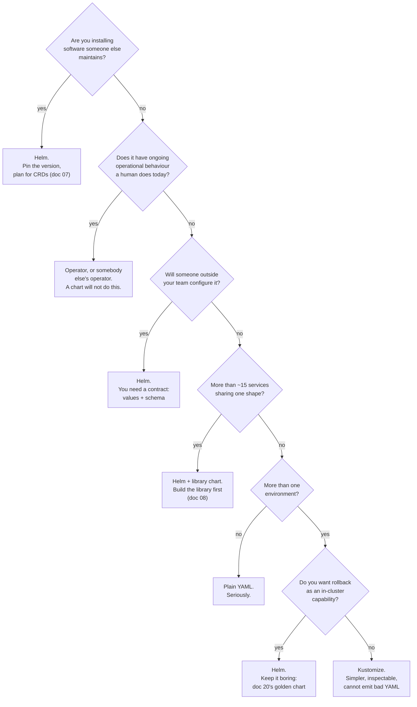

# Helm Use Cases — Where It Fits, Where It Does Not, and How to Decide

Most Helm advice is written by someone who has already decided you are using Helm. This doc does
not assume that. It walks nine situations where people reach for Helm, says what happens in each,
and gives an honest verdict — including four where the answer is "use something else" and one
where the answer is "you have a different problem than you think you have".

Then it compares the real alternatives on the axes that actually differentiate them, and gives you
a decision procedure you can run in about ten minutes with a colleague and a whiteboard.

The thesis, stated up front so you can argue with it as you read:

> **Helm earns its complexity when the chart and its consumer are separated** — by an
> organisational boundary, a trust boundary, or a release cadence. When the person writing the
> templates and the person supplying the values are the same person in the same repository on the
> same day, Helm's central feature (a parameterised, versioned, distributable package) is pure
> overhead, and a simpler tool will do the job with less to go wrong.

Everything below is an application of that sentence.

## Why "it depends" is not good enough, and what to measure instead

Tool comparisons stall because people compare on features. Every tool can set a replica count.
The useful axes are the ones where the tools genuinely differ, and there are five:

1. **Is the configuration surface a contract?** If someone outside your team has to configure
   this, they need a documented, validated, versioned set of knobs — not the ability to patch
   arbitrary YAML. Helm's `values.yaml` plus `values.schema.json` is a contract. Kustomize's
   patches are not; they are direct access to the manifest.
2. **Who owns the template, and who owns the values?** If those are different people, you need
   a package boundary. If they are the same person, the boundary costs you and buys nothing.
3. **How does it get to the cluster, and what remembers what it did?** Helm keeps release state
   in-cluster. Kustomize keeps nothing. GitOps controllers keep their own. Having *two* things
   remember is worse than having one (doc 11).
4. **What happens on day two?** Not the install — the twentieth upgrade, the rollback, the schema
   change, the field that became immutable. Almost all real cost is here, and almost all
   comparisons stop at the install.
5. **Can you read it?** A 900-line template with nested `include`s and six levels of `if` is a
   maintenance liability regardless of how good the tool is. Templating YAML with a text
   templating language is the original sin of the whole ecosystem, and the cost is real.

Hold those five in mind. Each use case below is really a question about which of them apply.

## Use case 1 — Consuming software you did not write

**The situation.** Riverbend needs cert-manager, ingress-nginx, external-dns,
kube-prometheus-stack, Vault, and the External Secrets Operator. Between them that is roughly
1,100 Kubernetes objects and 14 CustomResourceDefinitions, and nobody at Riverbend is going to
read them.

**What Helm gives you.** Exactly what you want: a versioned artefact from the vendor with a
documented set of knobs, installable in one command, upgradable to a new version in one command,
and a record of which version you are on.

```bash
helm repo add jetstack https://charts.jetstack.io
helm upgrade cert-manager jetstack/cert-manager \
  --install --namespace cert-manager --create-namespace \
  --version 1.16.2 \
  --values envs/prod-use1/cert-manager.yaml
```

The alternative is genuinely worse. If you vendor the rendered YAML, you own a fork: next quarter
the vendor changes 40 of the 400 files and you have to work out which of your local edits
conflict. If you write your own manifests, you are reimplementing a product.

**Verdict: Helm is the right answer, and there is not a close second.** This is the use case Helm
was designed for and the one it is unambiguously good at. Note what makes it work: the template
author (the vendor) and the values author (you) are different organisations, on different release
cadences, communicating through a documented contract. All five axes point the same way.

**The caveats, which are real and covered elsewhere.** You are now running a chart you have not
read, which can create any object your credentials allow — including ClusterRoleBindings (doc 13,
`Z-04`). You need to pin the version and verify the artefact (doc 09, `K-03`). The chart's CRDs
will not be upgraded by Helm, so you need a plan for them (doc 07). And `kube-prometheus-stack`
in particular will eventually fail to install because its release Secret exceeds 1 MiB (doc 04,
`R-05`). None of that changes the verdict; all of it is work you have to do.

## Use case 2 — One service across several environments

**The situation.** `checkout-api` needs to run in `rb-dev`, `rb-stg`, `rb-prod-use1` and
`rb-prod-euw1`. Nine fields differ between them. This is the second problem from doc 00, and it is
the most common reason people adopt Helm.

**What Helm gives you.** A chart with nine values and four environment files. It works. It is also
the case where Helm is *least* clearly better than the alternative, and it is worth seeing why.

Here is the Helm version — the chart's `templates/deployment.yaml`, partially:

```yaml
spec:
  replicas: {{ .Values.replicaCount }}
  template:
    spec:
      containers:
        - name: {{ .Chart.Name }}
          image: "{{ .Values.image.repository }}:{{ .Values.image.tag }}"
          resources:
            {{- toYaml .Values.resources | nindent 12 }}
          env:
            - name: LOG_LEVEL
              value: {{ .Values.logLevel | quote }}
```

And `envs/prod-use1.yaml`:

```yaml
replicaCount: 24
image:
  tag: "2026.09.17"
logLevel: warn
resources:
  requests: { cpu: "1500m", memory: "2Gi" }
  limits:   { memory: "2Gi" }
```

Here is the Kustomize version. `base/deployment.yaml` is a **real, complete, valid** Deployment
manifest with production-ish defaults, and `overlays/prod-use1/patch.yaml` is:

```yaml
apiVersion: apps/v1
kind: Deployment
metadata:
  name: checkout-api
spec:
  replicas: 24
  template:
    spec:
      containers:
        - name: checkout-api
          resources:
            requests: { cpu: "1500m", memory: "2Gi" }
            limits:   { memory: "2Gi" }
          env:
            - name: LOG_LEVEL
              value: warn
```

Now compare on the five axes.

- **Contract?** No — the same team owns both sides. So Helm's contract buys nothing, and
  Kustomize's lack of one costs nothing.
- **Separate owners?** No.
- **State?** Helm adds a release Secret and revision history, which is genuinely useful:
  `helm history` and `helm rollback` with no Git access is a real operational capability that
  Kustomize does not have.
- **Day two?** Roughly even. Both hit immutable fields and both need a testing strategy.
- **Readable?** Kustomize wins clearly. `base/deployment.yaml` is a manifest you can read,
  validate with `kubeconform`, and paste into a ticket. The Helm template is a program that emits
  a manifest, and you need `helm template` to know what it does.

**Verdict: this is a genuine toss-up, and if this is your *only* use case, prefer Kustomize.** It
is simpler, its output is inspectable without running anything, and an overlay cannot produce
invalid YAML through an indentation mistake. Choose Helm here only if you also have use case 1
(you are running third-party charts anyway, so you have the tooling) or use case 3 (you have a
fleet), or if you specifically want `helm rollback` as an in-cluster capability.

⚠️ **The trap in this use case** is that it starts as four environment files and becomes
`if .Values.global.region == "euw1"` inside a template. Once environment *logic* is in the chart,
the chart is no longer a package with parameters — it is a program that knows about your
environments, and the contract is gone. Doc 10, `E-04`, is about spotting this and reversing it.

## Use case 3 — A fleet of near-identical services

**The situation.** Riverbend's 240 services. Each needs a Deployment, Service, ServiceAccount,
HPA, PDB, ServiceMonitor and NetworkPolicy. They are about 90% identical. The platform team needs
to be able to change the shared 90% without opening 240 pull requests.

This is the use case where Helm's value is highest and least well known, and the mechanism is the
**library chart**.

`riverbend-common` is a chart with `type: library` and no rendered output of its own. It contains
one named template per resource kind:

```
charts/riverbend-common/
├── Chart.yaml            # type: library
└── templates/
    ├── _deployment.tpl   # defines "riverbend-common.deployment"
    ├── _service.tpl
    ├── _serviceaccount.tpl
    ├── _hpa.tpl
    ├── _pdb.tpl
    ├── _servicemonitor.tpl
    ├── _networkpolicy.tpl
    └── _labels.tpl       # the label set every object gets
```

A service chart is then genuinely small. All of `charts/checkout-api/templates/`:

```yaml
# deployment.yaml
{{- include "riverbend-common.deployment" . }}
# service.yaml
{{- include "riverbend-common.service" . }}
# hpa.yaml
{{- include "riverbend-common.hpa" . }}
```

...and a `values.yaml` that supplies the 10% that is specific to `checkout-api`.

**What this buys.** The platform team adds a required `PodDisruptionBudget` by editing
`_pdb.tpl`, releasing `riverbend-common` v4.3.0, and bumping a dependency version. The
240 services get it on their next deploy — or, if it is urgent, in one scripted pass.

**What it costs, and you should price this honestly.**

- **One chart is now a fleet-wide single point of failure.** A bug in `_deployment.tpl` v4.3.0
  breaks every service that deploys after it. Riverbend does 45 production upgrades a weekday, so
  a bad library release has a blast radius of "everything that deploys today". This is `D-11`, and
  it is why doc 14 argues a library chart needs the most rigorous test suite of any chart you own.
- **Indirection cost.** A developer debugging their Deployment now has to read a library template
  in another repository to find out where `terminationGracePeriodSeconds` came from. Mitigate by
  making `helm template` the standard debugging instruction and by keeping the library shallow —
  ⚠️ no `include` inside `include` inside `include`.
- **The escape hatch problem.** Eventually one service needs a Deployment that the library does
  not support. If your answer is "add a value to the library", you will have 90 values in it
  within a year. Doc 08, `D-12`, argues for a different answer: let that service stop using the
  library template and write its own, and accept the divergence explicitly.

**Verdict: Helm with a library chart is the right answer for a fleet, and Helm *without* one is
the worst of all worlds** — 240 hand-written charts that are 90% duplicated is strictly worse than
240 hand-written manifest directories, because it is the same duplication plus templating.

If you are adopting Helm for a fleet, **the library chart is not an optimisation to add later.**
It is the reason you are adopting Helm. Build it first.

## Use case 4 — Shipping an operator and its CRDs

**The situation.** You maintain an operator. It has CRDs, a controller Deployment, RBAC, a
validating webhook with a certificate, and a `ServiceMonitor`. You need to ship it to users.

**What Helm gives you.** A good install and a poor upgrade, and the split is precisely at the CRD
boundary.

The install is fine. Files in `crds/` go in first, before templates, so the controller's CRDs
exist before anything references them. Webhook certificates can be generated in-template with
`genSignedCert` or delegated to cert-manager.

The upgrade is where it breaks down, and the reason is a deliberate design decision in Helm that
you cannot configure away: **Helm never upgrades or deletes anything in `crds/`.** Not on
`helm upgrade`, not on `helm rollback`, not on `helm uninstall`. The documented reason is that
deleting a CRD deletes every custom resource of that kind cluster-wide, and Helm's authors
decided — correctly — that no package manager should be able to do that by accident.

The consequence for you as an operator author: when v2 of your operator adds a field to your CRD,
`helm upgrade` installs the new controller and leaves the old CRD in place. The new controller
writes the new field; the API server, validating against the old schema, drops it silently. Your
users get a controller that appears to work and ignores half its configuration. This is `C-01` and
it is the single most common operator-upgrade bug in the ecosystem.

**Verdict: Helm is adequate for distributing an operator and insufficient for managing its
lifecycle.** Ship a Helm chart because that is what your users expect, and then do one of the four
things in doc 07 — most commonly, put the CRDs in `templates/` behind a
`{{- if .Values.installCRDs }}` guard *and* document that they must be applied separately before
upgrade, which is what cert-manager, Prometheus Operator, and most mature projects converged on
after being burned.

If you are a *consumer* of operators rather than an author: manage CRDs as a separate,
deliberately-applied artefact outside the chart, and treat "the chart's CRDs" as a convenience for
first install only.

## Use case 5 — Day-two configuration knobs

**The situation.** Somebody asks for a value in the chart so they can change the cache TTL, the
rate limit, the feature-flag set, or the list of enabled regions, without a code deploy.

This is the use case where the answer is **you have a different problem than you think you have.**

Walk through what happens if you say yes. The TTL becomes `.Values.cache.ttlSeconds`. Changing it
now requires: a pull request to the environment values file, a merge, a CI run, `helm upgrade`, a
rolling restart of 24 pods, and roughly six minutes. You have built a configuration system whose
unit of change is a pod restart. Then somebody needs to change it during an incident, discovers
the six minutes, and adds a `ConfigMap` reload sidecar, and now you have two configuration systems.

The tell is this: **Helm values are deploy-time configuration, and the request was for run-time
configuration.** They are different problems with different latency requirements and different
audit requirements.

**Verdict: do not put run-time configuration in `values.yaml`.** The right answers, in rough
order of how often they are correct:

- **A feature-flag service** (LaunchDarkly, Unleash, or something homegrown) for anything a
  product person should be able to change. Latency: seconds. Audit: built in.
- **A `ConfigMap` the application watches**, mounted as a file, with the application reloading on
  change. Helm's job is to create the ConfigMap's *initial* content, not to be the mechanism for
  changing it.
- **A CustomResource**, if the thing being configured is genuinely part of your platform's API and
  you want validation and status reporting. This is the operator pattern and it is a lot of work,
  so reserve it for things that need it.

The useful test: **ask how quickly a change must take effect, and who is allowed to make it.** If
the answer is "in under a minute" or "someone without repository access", it is not a Helm value.

⚠️ There is a related anti-pattern worth naming: the chart with a value for everything. Riverbend's
first attempt at `riverbend-common` had 187 values, because every time a service needed something
slightly different, somebody added a knob. A chart with 187 values has no contract — it has an
API surface nobody can validate and every consumer uses differently. Doc 03, `V-11`, covers how to
get back from there.

## Use case 6 — Ephemeral and per-pull-request environments

**The situation.** Every pull request gets a namespace with the service and its dependencies,
which is destroyed when the PR merges.

**What Helm gives you.** This is a quietly excellent fit, for a reason that has nothing to do with
templating: **the release name is a handle you can compute, and `helm uninstall` is a cleanup
primitive that works without Git.**

```bash
helm upgrade "pr-${PR_NUMBER}" ./charts/checkout-api \
  --install --namespace "pr-${PR_NUMBER}" --create-namespace \
  --values envs/ephemeral.yaml \
  --set image.tag="${GIT_SHA}" \
  --atomic --timeout 5m
```

and the teardown, which is the part that matters:

```bash
helm uninstall "pr-${PR_NUMBER}" --namespace "pr-${PR_NUMBER}"
kubectl delete namespace "pr-${PR_NUMBER}"
```

The reaper for abandoned environments is then a query against release metadata rather than a
label-matching sweep across every resource type:

```bash
# Ephemeral releases older than 72 hours, from Helm's own state
helm list -A -o json | jq -r --argjson cut "$(date -u -d '72 hours ago' +%s)" '
  .[] | select(.name | startswith("pr-"))
      | select((.updated | sub("\\.[0-9]+ "; " ") | strptime("%Y-%m-%d %H:%M:%S %z") | mktime) < $cut)
      | "\(.namespace)/\(.name)"'
```

**Verdict: good fit, with two caveats.** First, `helm uninstall` does not delete anything with
`helm.sh/resource-policy: keep`, does not delete PVCs created by a StatefulSet's
`volumeClaimTemplates`, and does not delete the namespace — so the namespace delete above is not
optional, and it is what actually reclaims the storage (`U-14`, and `CS-7` is the case study of
not doing this). Second, ephemeral environments are the place where `--atomic` is unambiguously
correct: nobody is watching, a failed environment is worthless, and a clean failure is much better
than a half-built namespace.

## Use case 7 — Bundling a whole stack as one unit

**The situation.** "Let us have a `riverbend-platform` chart that installs everything, so a new
cluster is one command."

This is seductive and it is usually wrong, and Riverbend actually tried it, which makes it doc 08's
central worked example. The short version of what happened:

- The umbrella chart declared 31 dependencies. `helm dependency update` vendored them into
  `charts/`, producing 9.8 MB of chart source.
- The release Secret for one install came to roughly 1.4 MB after gzip and base64, which is over
  the 1 MiB limit on a Kubernetes Secret, so the install failed with
  `Secret "sh.helm.release.v1.riverbend-platform.v1" is invalid: data: Too long`. Derived in doc
  04, `R-05`.
- Worked around by splitting into three umbrellas. Then the real problem appeared: **one release
  means one failure domain.** A bad `external-dns` value meant `helm upgrade` refused to render,
  so cert-manager could not be upgraded either. And `--atomic` on a failure anywhere rolled back
  everything, including the eleven charts that had upgraded fine.
- And `--wait` on a release with 31 subcharts waits for all of them, so the slowest component sets
  the timeout for the whole platform.

**Verdict: use an umbrella chart for a genuinely atomic unit, and a release per component
otherwise.** The test is: *if component A fails to upgrade, do you want component B rolled back?*
For a database plus its sidecar plus its backup CronJob, yes — they are one thing. For
cert-manager and Prometheus, no; they have nothing to do with each other and coupling their
lifecycles is a cost with no benefit.

What you actually want for "a new cluster in one command" is an *orchestrator over many releases*,
not one big release. That is Helmfile, or an Argo CD `ApplicationSet`, or 31 Flux `HelmRelease`
objects with `dependsOn`. Doc 10 covers the choice.

## Use case 8 — Helm called from infrastructure-as-code

**The situation.** Your Terraform already creates the EKS cluster. It feels natural to have it
also install the cluster add-ons via the `helm_release` resource.

**What you get.** It works, and it buys you one genuinely valuable thing: ordering across the
boundary. Terraform knows the cluster and its IAM roles exist before the chart installs, and it
can pass outputs — role ARNs, hostnames, subnet IDs — straight into values without a human
copying them.

**What it costs.**

- **A second state store.** Terraform tracks the `helm_release` in its state file; Helm tracks it
  in the release Secret. When those disagree — somebody ran `helm upgrade` by hand, or a Terraform
  apply was interrupted — you reconcile two systems, and `terraform state rm` plus a re-import is
  now part of your incident procedure.
- **Diff quality.** `terraform plan` on a `helm_release` cannot show you the Kubernetes objects
  that will change; it shows you that the values changed. You lose the single most useful
  pre-deploy check there is, which is a rendered diff (doc 14, `Q-09`).
- **Blast radius.** A `terraform apply` that touches the cluster's add-ons is the same command
  that can touch the cluster. Most organisations eventually want those separated.

**Verdict: use it for the small number of add-ons that genuinely depend on infrastructure
outputs** — the CNI, the CSI driver, `external-dns` needing a role ARN, the load-balancer
controller — **and keep application releases out of Terraform.** The boundary to draw is: if the
chart's values contain something only Terraform knows, Terraform can install it; otherwise, it
belongs with the applications, in whatever installs the applications.

## Use case 9 — Distributing to customers, including air-gapped

**The situation.** You sell software that runs in the customer's cluster. They may have no
internet access. They need to install it, upgrade it, and have support able to reason about what
they are running.

**Verdict: Helm, without hesitation, and this is its strongest case after use case 1.** Everything
about the design fits:

- One versioned artefact — a `.tgz`, or an OCI artefact — that a customer can mirror into their own
  registry and install with no network access to you.
- `values.schema.json` as a real contract, validated on the customer's machine before anything is
  created, so a misconfiguration is a clear error rather than a broken install.
- `helm get values` and `helm history`, run by the customer and pasted into a support ticket, tell
  you exactly what they have — which is worth a great deal when you cannot see their cluster.
- Provenance files and signatures (doc 09) give them a way to verify the artefact came from you.

The work this creates for you is in doc 09 (immutability, signing, mirroring instructions) and doc
07 (a CRD upgrade story your customers can execute without you on the call).

## The alternatives, compared honestly

Five things people use instead of Helm. Each is better than Helm at something specific.

**Plain YAML with `kubectl apply -f`.** Better than everything for a small number of objects in a
single environment. No abstraction, no rendering, nothing to learn, and the file is the truth.
Breaks down the moment you have a second environment, and has no answer for pruning: a resource
you delete from the directory stays in the cluster forever unless you remember to delete it.
`kubectl apply --prune` exists and is fragile enough that you should not build on it.

**Kustomize.** Better than Helm at *readability and inspectability*, because the base is real YAML
and an overlay is a real patch. It cannot produce a YAML syntax error through an indentation
mistake, because it operates on parsed objects rather than text. Its weaknesses are the mirror of
that strength: no contract (an overlay can patch anything, so there is no documented configuration
surface), no distribution story for third-party software, no state, and — the one that actually
hurts — **patch composition becomes hard to follow at depth.** Four overlays deep, working out
which one set a field requires running `kustomize build` and reading the output, at which point you
have the same debugging experience as Helm with fewer features. Built into `kubectl` as
`kubectl apply -k`, which is a real advantage.

**Operators and CustomResources.** Better than both at *day-two behaviour*. A chart installs a
Postgres; an operator runs one — it can fail over, resize a volume, take a backup, upgrade the
minor version, and report health in a `status` field. If the thing you are deploying has ongoing
operational behaviour that a human currently performs, an operator is the right shape and a chart
is not. The cost is enormous: you are writing and maintaining a distributed controller. Use
somebody else's operator gladly; write one only when the operational behaviour is the point.

**cdk8s, Pulumi, jsonnet, Timoni.** Better than Helm at *not templating YAML with a text
templating engine*, which is a real problem and the source of most `T-` failures. In cdk8s you
write TypeScript or Python and get type checking, loops that are loops, and functions that
compose; in Timoni you write CUE and get genuine schema validation. If you have ever written
`{{- if and .Values.a (or .Values.b .Values.c) }}` and felt something was wrong, these are the
tools responding to that feeling. The cost is ecosystem: there are ten thousand Helm charts and
you will still need Helm to install them, so these tools tend to cover your own software while
Helm covers everybody else's. That is a defensible architecture and also two systems.

**Argo CD or Flux with plain directories.** Better than Helm at *reconciliation* — continuous
drift correction, pruning, and a UI showing sync state. Not actually an alternative to Helm so
much as a different layer: both can render Helm charts, and doc 11 is about what happens when they
do. Worth listing here because "we use Argo CD" is a common answer to "how do you deploy", and it
does replace some of what Helm's lifecycle engine does.

### The comparison table, on the axes that matter

| | Plain YAML | Kustomize | **Helm** | cdk8s / Timoni | Operator |
|---|---|---|---|---|---|
| Configuration is a validated contract | no | no | **yes** (`values.schema.json`) | yes (types / CUE) | yes (CRD schema) |
| Distributable to third parties | no | awkward | **yes** | immature | yes |
| Inspect result without running a tool | **yes** | no | no | no | n/a |
| Can emit invalid YAML | no | no | **yes** | no | no |
| Keeps release state in-cluster | no | no | **yes** | no | yes (the CRs) |
| Rollback without Git access | no | no | **yes** | no | depends |
| Prunes removed resources | no | with GitOps | **yes** | with GitOps | yes |
| Manages CRD lifecycle | manual | manual | **no** (by design) | yes | yes |
| Day-two operational behaviour | no | no | no | no | **yes** |
| Fleet standardisation | no | partly (components) | **yes** (library chart) | yes | n/a |
| Learning cost | none | low | medium | high | very high |

Read the "can emit invalid YAML" row as the honest cost of Helm's power, and the "distributable"
and "fleet standardisation" rows as what you get for paying it.

## A decision procedure

Run this in order. Stop at the first clear answer.



Two notes on using it.

**The answer is often "Helm for other people's software, Kustomize for yours."** That is a
perfectly good architecture and a very common one. It does mean two tools, which people resist,
but the alternative — wrapping everything in Helm so there is one tool — means writing charts for
things that did not need to be charts.

**Answering yes to question 1 changes the economics of every later question.** If you already run
14 third-party charts, you already have Helm in CI, Helm expertise, a chart repository, and Helm
in your incident runbooks. The marginal cost of the fifteenth chart is small, and the "use
Kustomize for your own services" recommendation in use case 2 gets weaker. Cost the tool once, not
per use.

## What to take away

1. **Helm earns its complexity when the template author and the values author are separated** — by
   organisation, trust boundary, or release cadence. When they are the same person in the same
   repository, the package boundary is overhead.
2. **Consuming third-party software and shipping to customers are Helm's two unambiguous wins.**
   Nothing else in the ecosystem does versioned, parameterised, mirrorable distribution as well.
3. **For one service in a few environments, Kustomize is usually the better tool** — inspectable
   output, no possibility of an indentation bug, less to learn. Choose Helm here for
   `helm rollback` or because you have Helm anyway, not because it is better at the templating.
4. **For a fleet, the library chart *is* the reason to use Helm.** Helm without a library chart at
   240 services is duplication plus templating, which is worse than duplication alone. Build the
   library first, and price its blast radius: one bad release affects everything that deploys that
   day.
5. **Helm distributes operators adequately and manages their CRDs not at all.** That is a
   deliberate design decision, not a bug, and doc 07 is the workaround.
6. **Run-time configuration does not belong in `values.yaml`.** The test is how fast a change must
   take effect and who is allowed to make it. Under a minute, or someone without repository
   access, means feature flags or a watched ConfigMap.
7. **Prefer a release per component to one umbrella release**, unless a failure in component A
   genuinely should roll back component B. "One command to build a cluster" is an orchestration
   problem — Helmfile, ApplicationSet, `dependsOn` — not an argument for one giant chart.
8. **Two tools is an acceptable answer.** "Helm for other people's software, something simpler for
   ours" is coherent, common, and usually cheaper than making everything a chart.
