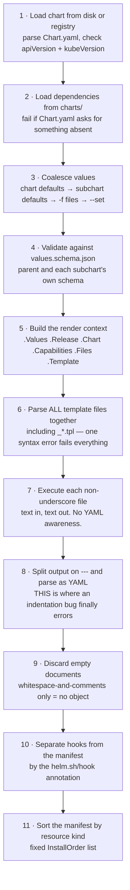

# Chart Anatomy and the Rendering Pipeline

This doc is about the first of Helm's three tools: the templater. It is a pure function — chart
and values in, YAML out — which makes it the cheapest part of Helm to understand and the cheapest
to test, because you need no cluster and the feedback loop is under a second.

It is also the part where Helm's original sin lives. **Helm templates YAML by treating it as
text.** The Go template engine has no idea it is producing YAML; it is concatenating strings, and
whether the result parses is your problem. Every scenario in the `T-` class is a consequence of
that one decision, and once you internalise it, most of them stop being surprising.

By the end you should be able to read an unfamiliar chart and know, without running anything,
where its output comes from and which lines are most likely to be wrong.

## Every file in a chart, and who reads it

Here is a complete Riverbend service chart. Not a minimal example — the real shape, with the files
that matter in production.

```
charts/checkout-api/
├── Chart.yaml              # metadata + dependencies. Helm reads this first.
├── Chart.lock              # resolved dependency versions. Generated, committed.
├── values.yaml             # the chart's defaults. Also the documentation.
├── values.schema.json      # JSON Schema. Validated before any rendering.
├── .helmignore             # what NOT to package. Easy to get wrong (T-12).
├── README.md               # never read by Helm. Read by humans, so keep it current.
├── crds/                   # CRDs. Installed first, never upgraded (doc 07).
│   └── (empty for a service chart)
├── charts/                 # vendored dependencies. Populated by `helm dependency update`.
│   └── riverbend-common-4.2.0.tgz
└── templates/
    ├── NOTES.txt           # printed after install. Rendered, but produces no objects.
    ├── _helpers.tpl        # named templates. Leading underscore = not rendered directly.
    ├── deployment.yaml
    ├── service.yaml
    ├── serviceaccount.yaml
    ├── configmap.yaml
    ├── hpa.yaml
    ├── pdb.yaml
    ├── servicemonitor.yaml
    ├── networkpolicy.yaml
    └── tests/
        └── connection-test.yaml   # a `helm.sh/hook: test` resource (doc 06)
```

The rules about this layout that are not obvious:

- **Anything in `templates/` whose filename starts with `_` is not rendered as a manifest.** It is
  still *parsed*, so the named templates it defines are available everywhere. This is why
  `_helpers.tpl` works and why a syntax error in it breaks every other file.
- **Files in `templates/` are rendered in lexical order, but the *output* is not applied in that
  order.** Helm sorts the resulting objects by kind. `T-13` covers the sort and what it does not
  give you.
- **`templates/NOTES.txt` is rendered with the same context as everything else** and its output is
  printed to the terminal. It is the only place a chart can talk to the person installing it, and
  it is routinely stale. A good `NOTES.txt` prints the URL the service is now reachable at and the
  command to check it; a bad one prints instructions from two years ago.
- **Subdirectories under `templates/` are rendered too**, at any depth. `templates/tests/` is a
  convention, not a mechanism — nothing special happens to that directory; the files in it happen
  to carry test hook annotations.
- **`crds/` is not templated.** The files there are applied as literal YAML. You cannot put
  `{{ .Values.x }}` in a CRD and have it substituted. People try this constantly.
- **`charts/` can contain either unpacked directories or `.tgz` files**, and Helm reads both. Which
  you commit is doc 09's question; both are done in practice.

### `Chart.yaml`, field by field

```yaml
apiVersion: v2                    # v2 = Helm 3 chart. v1 is Helm 2 and still renders.
name: checkout-api                # must match the directory name, or `helm lint` complains
version: 4.11.3                   # the CHART version. SemVer, enforced.
appVersion: "2026.09.17"          # the APPLICATION version. A string, not enforced.
kubeVersion: ">=1.27.0-0"         # install refuses on an older cluster
type: application                 # or `library` — see doc 08
description: Riverbend checkout API
dependencies:
  - name: riverbend-common
    version: "4.2.0"
    repository: "oci://registry.riverbend.internal/charts"
annotations:
  riverbend.io/owner: checkout-team
  riverbend.io/tier: "1"
```

Two of these cause real confusion.

**`version` versus `appVersion`.** `version` is the version of the *package* — bump it when you
change a template. `appVersion` is the version of the *software* — bump it when you build a new
image. They move independently: a chart change that adds a PodDisruptionBudget bumps `version` and
not `appVersion`. Helm enforces SemVer on `version` and nothing at all on `appVersion`, which is
why `appVersion` must be quoted — an unquoted `appVersion: 1.20` is the float `1.2`, and your
image tag becomes `1.2`. That is `T-05` in its most common form.

⚠️ **`kubeVersion` is checked against the cluster's reported version at install time**, and it is
a SemVer *range*, so `>=1.27.0-0` — note the `-0` — is required to match pre-release versions.
Without the `-0`, the constraint `>=1.27.0` does not match `1.27.0-eks-a1b2c3`, and your chart
refuses to install on EKS. This catches people once, memorably.

### `values.yaml` is documentation, not just defaults

The convention that pays for itself: **every value has a comment, and the comment says what breaks
if you change it**, not what the value is named.

```yaml
# Number of replicas. Ignored when autoscaling.enabled is true — the HPA owns it.
# Production `use1` runs 24; anything under 6 will not survive an AZ loss with the
# topologySpreadConstraints this chart sets.
replicaCount: 2

image:
  repository: registry.riverbend.internal/checkout-api
  # MUST be quoted. An unquoted date-like or dotted tag becomes a number. See T-05.
  tag: "2026.09.17"
  pullPolicy: IfNotPresent

# Requests are what the scheduler uses; there is deliberately no CPU limit, because
# CPU limits throttle this service's p99 (see MicroservicesPOF N-04).
resources:
  requests:
    cpu: "200m"
    memory: "512Mi"
  limits:
    memory: "512Mi"
```

Doc 03 is entirely about designing this file. What matters here is the mechanical part: the file's
contents become `.Values`, deeply merged with everything the user supplies.

## The rendering pipeline, step by step

When you run `helm template` or the render phase of `helm upgrade`, this happens in this order.
Knowing the order tells you which errors can mask which.



Three things about this sequence are worth dwelling on.

**Step 6 parses everything together.** A missing `{{ end }}` in `_helpers.tpl` produces an error
that points at a completely different file, because the parser's idea of where the template ends
is now wrong. When Helm reports a syntax error at `deployment.yaml:1`, suspect the helpers file.

**Step 7 has no idea it is making YAML.** This is the sentence to remember. `nindent`, `toYaml`,
`quote` and the rest are string functions that happen to produce YAML-shaped strings. Nothing
checks your work until step 8.

**Step 8 is where indentation errors surface**, and the error message is a YAML parser error with
a line number *in the concatenated output*, not in your template. Which is why the first debugging
move is always to look at the output:

```bash
# See exactly what step 8 was given. --debug prints the rendered output even on failure.
helm template checkout-api ./charts/checkout-api -f envs/prod-use1.yaml --debug
```

⚠️ `--debug` on a *failed* render is the single most useful Helm flag and most people do not know
it exists. Without it, a YAML error tells you nothing; with it, you see the broken output.

### The render context

Five objects, and the distinctions between them matter.

| Object | Contains | Notes |
|---|---|---|
| `.Values` | The coalesced values | The only part the user controls |
| `.Release` | `.Name`, `.Namespace`, `.Revision`, `.IsInstall`, `.IsUpgrade`, `.Service` | `.Revision` is 1 on install. `.Service` is always the string `Helm` |
| `.Chart` | Everything in `Chart.yaml` — `.Name`, `.Version`, `.AppVersion`, `.Annotations` | Read-only. Note `.Chart.Name` is the *chart's* name, not the release's |
| `.Capabilities` | `.KubeVersion`, `.APIVersions`, `.HelmVersion` | Queried from the cluster during install; **faked** during `helm template` (`T-10`) |
| `.Files` | Access to non-template files in the chart | `.Get`, `.GetBytes`, `.Glob`, `.Lines`, `.AsConfig`, `.AsSecrets` |
| `.Template` | `.Name` (current file path), `.BasePath` | Useful in error messages and named templates |

Inside a subchart, `.Values` is scoped to *that subchart's* values, `.Chart` is the subchart's
`Chart.yaml`, and `.Release` is shared with the parent. This scoping is doc 08's main subject and
the source of the `global:` pattern.

## Go templates and Sprig, without the hand-waving

Helm uses Go's `text/template` plus the [Sprig](https://masterminds.github.io/sprig/) function
library plus about a dozen Helm-specific functions. You do not need all of Sprig. You need about
twenty functions, and here they are with the reason each exists.

### The ones you cannot avoid

**`toYaml`** — serialise a value as YAML. Used for any nested structure the user supplies:

```yaml
          resources:
            {{- toYaml .Values.resources | nindent 12 }}
```

**`nindent N`** — newline, then indent every line by N spaces. The workhorse. `nindent` is
`indent` with a leading newline, and it exists precisely because the pattern above needs both.
Getting `N` right is manual counting, and getting it wrong is `T-01`.

**`quote`** — wrap in double quotes and escape. Required for anything that might look like a
number or a boolean to a YAML parser:

```yaml
            - name: LOG_LEVEL
              value: {{ .Values.logLevel | quote }}
```

Without `quote`, a `logLevel` of `off` becomes the boolean `false` under YAML 1.1 parsing, and the
API server rejects a boolean where it wants a string. `T-05`.

**`default`** — supply a fallback. ⚠️ `default` fires on *any* empty value, which in Go template
terms includes `0`, `false`, and the empty string. So
`{{ .Values.replicaCount | default 3 }}` silently turns a deliberate `replicaCount: 0` into 3, and
you cannot scale a service to zero. If zero or false is a meaningful value, test explicitly:

```yaml
replicas: {{ if kindIs "invalid" .Values.replicaCount }}3{{ else }}{{ .Values.replicaCount }}{{ end }}
```

That is ugly, and the ugliness is the point — `default` is convenient and subtly wrong for numeric
and boolean values.

**`required "message" .Values.x`** — fail the render with your message if the value is absent.
This is how you make a mandatory value mandatory:

```yaml
          image: "{{ required "image.repository is required" .Values.image.repository }}:{{ required "image.tag is required — never rely on latest" .Values.image.tag }}"
```

Without `required`, a missing value renders as the empty string and you get
`image: ":2026.09.17"`, which fails at the API server with a message about the image reference
rather than about your values. `T-07`.

**`include` versus `template`.** Both invoke a named template. `template` is a *statement* — it
writes directly to the output and **cannot be piped**. `include` is a *function* — it returns a
string, so it can be piped. Which means this works:

```yaml
  labels:
    {{- include "riverbend-common.labels" . | nindent 4 }}
```

and this does not, and fails with a parse error that does not mention piping:

```yaml
  labels:
    {{- template "riverbend-common.labels" . | nindent 4 }}   # WRONG
```

**Use `include` always.** There is no case where `template` is better, and making it a blanket
rule removes a whole class of confusion. `T-04`.

**`tpl`** — render a string as a template. This lets a *value* contain template syntax:

```yaml
# values.yaml
ingress:
  host: "checkout.{{ .Values.global.baseDomain }}"
```

```yaml
# templates/ingress.yaml
  - host: {{ tpl .Values.ingress.host . | quote }}
```

Genuinely useful, and ⚠️ genuinely a security consideration in a multi-tenant setting: `tpl`
executes arbitrary template code from a value, and template code can call `lookup`, which reads
cluster objects. A tenant who can supply values to a chart that `tpl`s them can read Secrets the
*deployer's* credentials can read. Doc 13, `Z-07`.

### The ones that show up in every real chart

| Function | What it does | Where you meet it |
|---|---|---|
| `trunc N` | Truncate to N characters | The 63-character label limit — always with `trimSuffix` |
| `trimSuffix "-"` | Remove a trailing character | Because `trunc 63` can leave a dangling `-`, which is invalid in a name |
| `printf` | Format a string | Building names: `printf "%s-%s" .Release.Name .Chart.Name` |
| `b64enc` / `b64dec` | Base64 | Secret data must be base64 in the manifest |
| `sha256sum` | Hash | The ConfigMap-checksum annotation pattern, below |
| `toJson` / `fromJson` | JSON round-trip | Annotations that must hold JSON |
| `dict` / `list` / `merge` | Build maps and lists | Composing values inside a library template |
| `hasKey` | Map key exists | Distinguishing "absent" from "set to empty" |
| `kindIs` | Type check | Guarding against a user passing a string where a map is expected |
| `genCA` / `genSignedCert` | Generate a certificate | Webhook TLS, and see `T-11` for why it is dangerous |
| `lookup` | Read a live cluster object | See `T-11`. Powerful and impure |
| `semverCompare` | Compare versions | `{{ if semverCompare ">=1.29-0" .Capabilities.KubeVersion.Version }}` |

### The one pattern worth memorising

**Restart pods when their configuration changes.** Kubernetes does not restart a pod when a
mounted ConfigMap changes; the file changes under the running process and most applications ignore
it. The standard fix is to put a hash of the ConfigMap's content into the pod template, so that
changing the config changes the pod spec and triggers a rollout:

```yaml
# templates/deployment.yaml
spec:
  template:
    metadata:
      annotations:
        checksum/config: {{ include (print $.Template.BasePath "/configmap.yaml") . | sha256sum }}
```

Read it inside out: `$.Template.BasePath` is the chart's `templates` path, `print` builds the full
path to `configmap.yaml`, `include` renders that file to a string, and `sha256sum` hashes it. If
the rendered ConfigMap differs by a byte, the annotation differs, the pod template differs, and
the Deployment rolls.

⚠️ Two things about this pattern. First, it makes the Deployment roll on *any* ConfigMap change
including a comment, which is almost always what you want but occasionally causes an unexpected
restart. Second, if your ConfigMap contains the image tag or anything else that already changes
per deploy, the annotation changes every time and tells you nothing — put only the genuinely
configuration-like parts in the hashed file.

## The `T-` failure catalogue

### T-01 · `toYaml` without `nindent`, or with the wrong indent

**What you see.** `error converting YAML to JSON: yaml: line 34: did not find expected key`, or
the render succeeds and a field lands at the wrong nesting level, so the API server rejects the
object with `unknown field "requests"`.

**Mechanism.** `toYaml` emits YAML starting at column zero. If you write

```yaml
          resources:
            {{ toYaml .Values.resources }}
```

then the *first* line of the output is indented by the 12 spaces in your template, and every
subsequent line is at column zero. The result is:

```yaml
          resources:
            requests:
  cpu: 200m
  memory: 512Mi
```

which is not the structure you meant. `nindent 12` fixes it by prefixing a newline (so the
template's own indentation is irrelevant) and indenting *every* line by 12.

**Confirm it.** `helm template ... --debug` and read the output around the reported line. The
shape of the bug is unmistakable once you know it: correctly-indented first line, flush-left
remainder.

**Recover.** Replace `{{ toYaml X }}` with `{{- toYaml X | nindent N }}` where N is the column the
*children* of the key should sit at. Count from the rendered output, not from the template file —
they can differ if the whole block is inside a conditional.

**Prevent.** Three things, in order of effectiveness:

1. **Make `{{- toYaml X | nindent N }}` the only allowed form** in review. A bare `toYaml` without
   a pipe to `nindent` or `indent` is a bug with a very small number of exceptions.
2. **Render in CI and parse the output**, which catches this without a cluster:
   ```bash
   helm template checkout-api ./charts/checkout-api -f envs/prod-use1.yaml | kubeconform -strict -
   ```
3. **Put the block in a library template** so the indentation is written once (doc 08). At
   Riverbend, `resources` is rendered by `riverbend-common.deployment`, so no service chart
   contains a `toYaml` at all — which removed this entire failure class from 240 charts.

### T-02 · Whitespace control that eats a list item

**What you see.** A list with one fewer element than you wrote, or a YAML error about a mapping
value in an unexpected place.

**Mechanism.** `{{-` removes all whitespace *including newlines* to the left of the action; `-}}`
removes it to the right. The `-}}` form is the dangerous one, because it will happily join your
tag onto the next line:

```yaml
env:
  {{- range .Values.extraEnv }}
  - name: {{ .name -}}
    value: {{ .value }}
  {{- end }}
```

The `-}}` after `.name` strips the newline, producing `- name: LOG_LEVELvalue: warn`. The fix is
that you almost never want `-}}` in a YAML context; you want `{{-` at the start of a line to pull
the action up onto the previous line, and nothing at the end.

**Confirm it.** `helm template --debug` and look for two things on one line that should be on two.
For a stubborn case, make the whitespace visible:

```bash
helm template checkout-api ./charts/checkout-api | sed -n '20,40p' | cat -A | head -20
```

`cat -A` shows line ends as `$` and tabs as `^I`, which makes a vanished newline obvious.

**Recover.** Remove the `-}}`.

**Prevent.** A style rule: **`{{-` at the start of a line, never `-}}` at the end**, with the
exception of `{{- end -}}` at the very end of a named template in a `.tpl` file, where there is no
YAML to break. Enforceable with a grep in CI:

```bash
grep -rn -- '-}}' charts/*/templates/*.yaml && \
  { echo "use {{- at line start, not -}} at line end"; exit 1; }
```

### T-03 · A template that silently renders to nothing

**What you see.** The object is not in the cluster. No error. `helm upgrade` reported success.
Worse: on an *upgrade*, the object that was there before is now **deleted**, because Helm compares
the new manifest against the old one and removes what disappeared.

**Mechanism.** A file whose output is only whitespace and comments produces no object (step 9 of
the pipeline). That is deliberate — it is how `{{- if .Values.ingress.enabled }}` disables an
Ingress. But it means any of these has the same effect:

```yaml
{{- if .Values.ingres.enabled }}       # typo in the key: always false
{{- if .Values.autoscaling.Enabled }}  # wrong case: always false
{{- if eq .Values.tier "1" }}          # tier is the integer 1, not the string "1": always false
```

Go templates do not error on a missing map key; `.Values.ingres` is simply the zero value, which
is falsy. So the typo is a silent disable.

The upgrade case is the dangerous one. Suppose `checkout-api` has had a PodDisruptionBudget for a
year. Someone refactors the chart, mistypes the guard, and upgrades. Helm's three-way merge sees a
PDB in revision 46's manifest and no PDB in revision 47's, concludes it was intentionally removed,
and deletes it. The service now has no disruption protection and nothing said a word. During the
next node drain, you find out.

**Confirm it.** Count objects before and after, which is the check that catches this generally:

```bash
# What Helm currently has
helm get manifest checkout-api -n checkout | grep -c '^kind:'

# What the new chart would produce
helm template checkout-api ./charts/checkout-api -f envs/prod-use1.yaml | grep -c '^kind:'
```

Better, see exactly which kinds and names differ:

```bash
diff <(helm get manifest checkout-api -n checkout | grep -E '^(kind|  name):' | paste - -) \
     <(helm template checkout-api ./charts/checkout-api -f envs/prod-use1.yaml \
        | grep -E '^(kind|  name):' | paste - -)
```

**Recover.** Fix the guard and upgrade again. The deleted object comes back. If it was a PVC or
anything with data, it does not, which is why `helm.sh/resource-policy: keep` exists — and why
that annotation causes its own problems (`U-14`).

**Prevent.** This is what `helm diff` is for, and it is the highest-value check in doc 14:

```bash
helm plugin install https://github.com/databus23/helm-diff
helm diff upgrade checkout-api ./charts/checkout-api -n checkout -f envs/prod-use1.yaml
```

A deletion shows up as a red block with a `-` prefix, in a pull request, before anyone approves.
Riverbend requires this output in the PR description for any chart change, which is a process
control rather than a technical one and has caught this class four times.

Additionally: **turn missing keys into errors during development.** Helm does not expose Go's
`missingkey=error` option, but a schema does the equivalent job by rejecting unknown keys, and
`helm lint --strict` catches some cases.

### T-04 · `template` where `include` was needed

**What you see.** `parse error at (checkout-api/templates/deployment.yaml:8): unexpected "|" in operand`

**Mechanism.** `template` is a statement, not a function; it has no return value to pipe.

**Confirm it.** The error names the file and says `unexpected "|"`. Grep for it:

```bash
grep -rn '{{[- ]*template ' charts/*/templates/
```

**Recover.** Change `template` to `include`.

**Prevent.** The grep above, as a CI check. There is no legitimate use of `template` in these
charts, so a blanket ban costs nothing.

### T-05 · YAML type coercion — the quoting failures

**What you see.** Four distinct symptoms that share one cause:

- `image: checkout-api:1.2` when `values.yaml` said `tag: 1.20`
- `error validating data: expected string, got boolean` for a `LOG_LEVEL` of `off`
- A port rendered as `8.08e+03`
- `"true"` where you wanted `true`, or the reverse

**Mechanism.** YAML types unquoted scalars, and Helm's values file is YAML, and the rendered output
is YAML, so you get two rounds of coercion. Specifically:

- `1.20` is a float. Floats drop trailing zeros. `1.20` → `1.2`.
- Large integers can render in scientific notation once they have been through a float.
- YAML 1.1 — which the Kubernetes ecosystem largely still follows — treats `yes`, `no`, `on`,
  `off`, `true`, `false`, `y`, `n` as booleans. So `logLevel: off` is `false`, and
  `enableFeature: no` is `false` (which happens to be right), and a Norwegian country code `no` is
  also `false` (which is not).
- Version strings like `3.10` sort and compare as floats, so `3.10 < 3.9`.

**Confirm it.** Render and look at the actual bytes:

```bash
helm template checkout-api ./charts/checkout-api | grep -E 'image:|value:'
```

**Recover.** Quote it, in both places — in `values.yaml` and at the point of use:

```yaml
# values.yaml
image:
  tag: "2026.09.17"     # quoted here
```
```yaml
# templates/deployment.yaml
          image: "{{ .Values.image.repository }}:{{ .Values.image.tag }}"   # and quoted here
```

⚠️ Quoting in the template does not save you if the value was already coerced in `values.yaml`.
By the time the template runs, `1.20` is already the float `1.2` and `| quote` gives you `"1.2"`.
**The quoting that matters is in the values file.**

**Prevent.** `values.schema.json` with explicit types is the real fix, because it rejects the
wrong type before rendering:

```json
{
  "$schema": "https://json-schema.org/draft/2020-12/schema",
  "type": "object",
  "properties": {
    "image": {
      "type": "object",
      "required": ["repository", "tag"],
      "properties": {
        "repository": { "type": "string" },
        "tag": { "type": "string", "pattern": "^[0-9]{4}\\.[0-9]{2}\\.[0-9]{2}(-[a-z0-9]+)?$" }
      }
    },
    "logLevel": { "enum": ["debug", "info", "warn", "error"] }
  }
}
```

An unquoted `tag: 1.20` now fails validation with `image.tag: got number, want string` — a clear
error at step 4 of the pipeline instead of a mysterious image pull failure twenty minutes later.
Doc 03, `V-09`, covers schemas properly.

### T-06 · Name truncation collisions and the 53-character wall

**What you see.** Either `release name "..." exceeds max length of 53`, or — much worse — two
different objects with the same name, one silently overwriting the other, or a Deployment whose
`selector` matches another Deployment's pods.

**Mechanism.** Three limits stack up:

1. **Kubernetes label values are limited to 63 characters.** Object names in most kinds are
   limited to 253, but names that become label values (and Helm's generated `selector` labels do)
   are bound by 63.
2. **Helm limits release names to 53 characters.** The reason is arithmetic: Helm stores release
   metadata in labels, and needs room for the `sh.helm.release.v1.` prefix and the `.vNNN` suffix
   within 63.
3. So **every chart truncates**, with the standard helper:

```yaml
{{- define "checkout-api.fullname" -}}
{{- printf "%s-%s" .Release.Name .Chart.Name | trunc 63 | trimSuffix "-" -}}
{{- end -}}
```

And there is the bug. `trunc 63` on two long names that share their first 63 characters produces
**the same output**. At Riverbend this happened with two releases in a per-PR namespace:

```
pr-4471-riverbend-checkout-api-integration-canary-green   →  truncated
pr-4471-riverbend-checkout-api-integration-canary-blue    →  truncated
```

Both truncate to the same 63 characters, because the distinguishing suffix is past position 63.
Two Deployments, same name — so the second overwrites the first — and if they had been in
different namespaces, two Deployments with the same `selector` labels, each adopting the other's
pods, each scaling in response to the other. That is a genuinely confusing hour.

**Confirm it.** Render and check for duplicates:

```bash
helm template checkout-api ./charts/checkout-api \
  | grep -E '^kind:|^  name:' | paste - - | sort | uniq -d
```

Any output is a collision. For the fleet, check name lengths at the source:

```bash
helm list -A -o json | jq -r '.[] | select(.name | length > 40) | "\(.name)  (\(.name | length))"'
```

**Recover.** Shorten the release name, or override with `fullnameOverride` so the name is explicit
rather than derived.

**Prevent.** Two rules that between them eliminate this:

1. **Cap release names at 40 characters in CI**, not 53. The extra 13 characters of headroom
   absorb every `-metrics`, `-headless` and `-config` suffix your templates add.
2. **Hash rather than truncate when you must shorten.** A truncation that loses the distinguishing
   part is silent; a hash is not:
   ```yaml
   {{- define "checkout-api.fullname" -}}
   {{- $n := printf "%s-%s" .Release.Name .Chart.Name -}}
   {{- if gt (len $n) 63 -}}
   {{- printf "%s-%s" (trunc 54 $n | trimSuffix "-") (sha256sum $n | trunc 8) -}}
   {{- else -}}
   {{- $n -}}
   {{- end -}}
   {{- end -}}
   ```
   Collisions now require a SHA-256 prefix collision, which is not going to happen to you.

⚠️ Changing a fullname helper on an *existing* release renames every object, which for a
Deployment means a new Deployment plus an orphaned old one, and for a Service means a new
ClusterIP. Doc 05, `U-08`. Fix the helper on new charts; for existing ones, set
`fullnameOverride` to the current name and move on.

### T-07 · A missing value that renders as the empty string

**What you see.** `InvalidImageName`, or an env var that is set to nothing, or a hostname of `""`,
or — the nastiest — a `nodeSelector` that matched every node because the value it filtered on was
empty.

**Mechanism.** Go templates render a missing key as the empty string and do not complain. The
error surfaces later, at the API server or at runtime, with a message about the symptom rather
than the cause.

**Confirm it.** Grep the render for suspicious emptiness:

```bash
helm template checkout-api ./charts/checkout-api -f envs/prod-use1.yaml \
  | grep -nE ': *(""|''|$)' | grep -v '^\s*#'
```

**Recover.** Supply the value.

**Prevent.** `required` on everything that has no sensible default, and a schema with a `required`
array. The two are complementary: the schema catches the absence earliest and with the best
message, and `required` catches the case where the value arrives as an empty string (which
satisfies a schema of `type: string` but is still wrong):

```yaml
{{ required "image.tag must be set to an immutable tag; 'latest' is rejected in CI" .Values.image.tag }}
```

### T-08 · `.Release.Name` versus `.Chart.Name` versus the fullname

**What you see.** After renaming a release, or after switching from
`helm install checkout ./charts/checkout-api` to
`helm install checkout-api ./charts/checkout-api`, every object is recreated. Or: two releases of the same chart
in one namespace collide because the chart hard-coded `.Chart.Name` into object names.

**Mechanism.** Three different names, three different behaviours:

- `.Release.Name` — what the user typed. Changes if they install under a different name. Unique
  per namespace.
- `.Chart.Name` — from `Chart.yaml`. The same for every release of that chart, so using it alone
  in an object name means two releases of the chart in one namespace collide.
- The **fullname** helper — conventionally `.Release.Name` plus `.Chart.Name`, unless
  `.Release.Name` already contains the chart name, in which case just the release name. That
  conditional is why the standard helper is longer than you would expect:

```yaml
{{- define "checkout-api.fullname" -}}
{{- if .Values.fullnameOverride -}}
{{- .Values.fullnameOverride | trunc 63 | trimSuffix "-" -}}
{{- else -}}
{{- $name := default .Chart.Name .Values.nameOverride -}}
{{- if contains $name .Release.Name -}}
{{- .Release.Name | trunc 63 | trimSuffix "-" -}}
{{- else -}}
{{- printf "%s-%s" .Release.Name $name | trunc 63 | trimSuffix "-" -}}
{{- end -}}
{{- end -}}
{{- end -}}
```

So `helm install checkout-api ./charts/checkout-api` gives objects named `checkout-api`, not
`checkout-api-checkout-api`. That is the entire purpose of the `contains` branch, and it is why
you should not simplify the helper.

**Confirm it.** `helm get manifest` and read the names.

**Prevent.** ⚠️ **Never put a name that can change into a `selector`.** A Deployment's
`spec.selector` is immutable; if your selector labels include the fullname and the fullname
changes, the upgrade fails with `field is immutable` and the only way out is deleting the
Deployment (`U-07`). The convention that avoids this: selector labels are the *stable* subset —
`app.kubernetes.io/name` and `app.kubernetes.io/instance` — and everything volatile (version,
chart version, managed-by) goes in `metadata.labels` and the pod template's labels but **not** in
the selector:

```yaml
{{- define "riverbend-common.selectorLabels" -}}
app.kubernetes.io/name: {{ include "riverbend-common.name" . }}
app.kubernetes.io/instance: {{ .Release.Name }}
{{- end -}}

{{- define "riverbend-common.labels" -}}
{{ include "riverbend-common.selectorLabels" . }}
app.kubernetes.io/version: {{ .Chart.AppVersion | quote }}
helm.sh/chart: {{ printf "%s-%s" .Chart.Name .Chart.Version | replace "+" "_" | trunc 63 }}
app.kubernetes.io/managed-by: {{ .Release.Service }}
{{- end -}}
```

Two named templates, and the discipline is that `spec.selector` uses only the first one. Getting
this wrong is the most common cause of `U-07`, and the cost of fixing it later is a delete and
recreate of every Deployment in the fleet.

### T-09 · `tpl` on a value that a user controls

Covered above as a security note; the mechanical failure is simpler. `tpl` renders the string with
the *current* context, so a value containing `{{ .Values.x }}` sees the context at the point `tpl`
was called — which inside a subchart is the subchart's values, not the parent's. A value that works
in the parent chart renders empty in a subchart. Use `$` to reach the root context explicitly, and
prefer not to `tpl` at all if a plain `printf` will do.

### T-10 · `.Capabilities` differs between `helm template` and `helm install`

**What you see.** A chart that renders an `autoscaling/v2` HPA on your laptop and an
`autoscaling/v2beta2` one in the cluster, or an object that appears in `helm template` output and
not in the cluster (or the reverse). Golden-file tests in CI that pass while production is wrong.

**Mechanism.** `.Capabilities.APIVersions` is the set of API groups and versions the *cluster*
supports. During `helm install` and `helm upgrade`, Helm queries the API server for it. During
`helm template`, there is no cluster, so Helm supplies a **built-in default** based on the Helm
binary's compiled-in Kubernetes version. So:

```yaml
{{- if .Capabilities.APIVersions.Has "monitoring.coreos.com/v1" }}
apiVersion: monitoring.coreos.com/v1
kind: ServiceMonitor
...
{{- end }}
```

renders **nothing** under `helm template`, because the fake capability set contains only core
Kubernetes APIs, not the Prometheus Operator's CRDs. Your golden-file test asserts the
ServiceMonitor is absent; production has it. Both are "correct" and they disagree.

**Confirm it.** Compare the two:

```bash
# Fake capabilities
helm template checkout-api ./charts/checkout-api | grep -c ServiceMonitor
# Real capabilities, from the cluster, still without installing anything
helm template checkout-api ./charts/checkout-api --validate | grep -c ServiceMonitor
```

⚠️ `--validate` sends the rendered output to the API server for validation, which means it needs
cluster access *and* it populates real capabilities. It is the flag that makes `helm template`
honest, and it is not the default.

**Recover / Prevent.** Three options, and the third is the one to prefer:

1. Use `--validate` (or `--dry-run=server` on an install) whenever the answer matters. ⚠ **version**:
   `--dry-run=server` landed in Helm 3.13; earlier versions have only the client-side `--dry-run`.
2. Pass capabilities explicitly in tests: `helm template --api-versions monitoring.coreos.com/v1`
   makes the golden file deterministic and honest about what it is asserting.
3. **Prefer an explicit value over a capability check.** `{{- if .Values.serviceMonitor.enabled }}`
   is boring, visible in `helm get values`, identical in every environment, and cannot disagree
   with itself. Capability checks are for charts distributed to strangers whose clusters you cannot
   see; inside your own platform you know whether you run the Prometheus Operator. Riverbend
   replaced every `.Capabilities.APIVersions.Has` in `riverbend-common` with a value for exactly
   this reason.

### T-11 · `lookup` returns nothing during a dry run, and your password rotates

This is the most consequential templating bug in Helm, it has its own case study (`CS-1`), and it
is worth understanding in full.

**What you see.** After a `helm upgrade`, every pod fails to authenticate to the database. The
Secret's value changed and nobody changed it. Or: a webhook's TLS certificate is regenerated on
every upgrade, so the API server rejects calls to it for the thirty seconds before the CA bundle
catches up.

**Mechanism.** The pattern everybody writes for "generate a password once and keep it":

```yaml
{{- $existing := lookup "v1" "Secret" .Release.Namespace "checkout-api-db" }}
apiVersion: v1
kind: Secret
metadata:
  name: checkout-api-db
data:
  {{- if $existing }}
  password: {{ index $existing.data "password" }}
  {{- else }}
  password: {{ randAlphaNum 32 | b64enc | quote }}
  {{- end }}
```

The logic is right: look for the existing Secret, reuse its value, generate only on first install.

The problem is that **`lookup` returns an empty map whenever there is no live cluster connection
to query.** That is the case for:

- `helm template` (no cluster at all)
- `helm install --dry-run` / `helm upgrade --dry-run` (client-side dry run, ⚠ before 3.13 the only
  kind)
- **Argo CD's render step**, which is `helm template` — so this pattern *cannot work* under Argo
  CD's default render-only model at all (doc 11, `G-03`)
- `helm diff` in its default mode

So in every one of those contexts the `else` branch runs, `randAlphaNum` produces a new password,
and whatever consumes that render gets a different password than the cluster has. If the consumer
is a human reading a diff, you see a spurious change and shrug. If the consumer is Argo CD
applying the render, **the Secret is overwritten with a new password** and every pod holding the
old one starts failing authentication. That is `CS-1`, and it cost Riverbend 41 minutes.

There is a second, subtler failure even under plain Helm: `randAlphaNum` is non-deterministic, so
two renders differ, so Helm's three-way merge sees a changed Secret on *every* upgrade even when
the `lookup` worked — no, in fact the `lookup` branch makes it stable. But if the Secret is ever
briefly absent — deleted by a cleanup job, or in a namespace being recreated — the next upgrade
regenerates it.

**Confirm it.** Check whether your rendered Secret is stable across two renders:

```bash
a=$(helm template checkout-api ./charts/checkout-api | grep -A3 'name: checkout-api-db' | sha256sum)
b=$(helm template checkout-api ./charts/checkout-api | grep -A3 'name: checkout-api-db' | sha256sum)
[ "$a" = "$b" ] || echo "NON-DETERMINISTIC: this Secret regenerates on every render"
```

And check whether Helm currently believes the Secret differs from the cluster:

```bash
helm diff upgrade checkout-api ./charts/checkout-api -n checkout | grep -A5 'Secret.*checkout-api-db'
```

**Recover.** If it has already happened: get the real password back from the cluster if the Secret
still has it, from a backup, or from the database if you can reset it. Then break the loop — do not
upgrade again until you have moved off the pattern, because the next upgrade does it again.

**Prevent.** **Do not generate secrets in templates.** That is the actual answer, and everything
else is mitigation. The correct shapes, in order of preference:

1. **The External Secrets Operator.** The chart creates an `ExternalSecret` custom resource naming
   a path in Vault or AWS Secrets Manager; a controller materialises the `Secret`. The password
   lives in a secret manager that is designed for it, rotation is a first-class operation, and the
   chart contains no secret material at all. Doc 12, `Y-05`.
2. **A one-time bootstrap outside the chart** — a `Job` or a human running a script at
   provisioning time — with the chart merely referencing the Secret by name and failing loudly if
   it is absent:
   ```yaml
   {{- if not (lookup "v1" "Secret" .Release.Namespace "checkout-api-db") }}
   {{- fail "Secret checkout-api-db does not exist. Run scripts/bootstrap-db-secret.sh first." }}
   {{- end }}
   ```
   ⚠️ Note this *also* breaks under `helm template`, but it breaks **loudly** and in the safe
   direction — a failed render, not a rotated credential. That asymmetry is the whole design
   principle here: when a function is unreliable, arrange for its unreliability to cause a refusal
   rather than a silent wrong answer.
3. **`helm.sh/resource-policy: keep` plus a pre-install-only hook**, so the Secret is created once
   and never touched by later upgrades. This works and leaves you with an orphan on uninstall.

If you are on Argo CD, option 1 is not a preference, it is a requirement — `lookup` never works
there.

### T-12 · `.helmignore` and files that were not packaged

**What you see.** `.Files.Get "config/rules.yaml"` returns nothing after you package the chart,
though it worked from the directory. Or your packaged chart is 40 MB because it contains `.git`.

**Mechanism.** `helm package` excludes anything matching `.helmignore`, using patterns similar to
`.gitignore` but **not identical** — no `**` support in older versions, and a leading `/` anchors
to the chart root. And `.Files` cannot access anything outside the chart or inside `templates/`.

**Confirm it.** Look inside the package:

```bash
helm package ./charts/checkout-api -d /tmp && tar tzf /tmp/checkout-api-4.11.3.tgz
```

**Prevent.** A `.helmignore` that is explicit about what it excludes, plus the `tar tzf` check in
CI for any chart that uses `.Files`:

```
.git/
.gitignore
.github/
*.tgz
ci/
tests/
.idea/
*.swp
README.md
```

⚠️ Note that excluding `README.md` shrinks the release Secret (doc 04) by a few kilobytes per
revision, which sounds trivial and is 7,240 revisions at Riverbend. Doc 15, `S-04`.

### T-13 · The install order is by kind, and it is coarser than you think

**What you see.** A Deployment whose pods `CrashLoopBackOff` because the ConfigMap they mount does
not exist yet — no, actually not that one, because ConfigMap sorts before Deployment. The real
symptom: a `ServiceMonitor` applied before the Prometheus Operator's CRD exists in the same
release, failing with `no matches for kind "ServiceMonitor"`. Or a webhook that starts rejecting
requests before the pod backing it is ready.

**Mechanism.** Helm sorts the rendered objects by kind, using a fixed list compiled into the
binary. The install order begins roughly:

```
Namespace, NetworkPolicy, ResourceQuota, LimitRange, PodSecurityPolicy, PodDisruptionBudget,
ServiceAccount, Secret, ConfigMap, StorageClass, PersistentVolume, PersistentVolumeClaim,
CustomResourceDefinition, ClusterRole, ClusterRoleBinding, Role, RoleBinding, Service,
DaemonSet, Pod, ReplicaSet, Deployment, StatefulSet, Job, CronJob, Ingress, APIService
```

with the delete order being approximately the reverse. Four things follow from this, and they are
the whole point of the scenario:

1. **It is a *kind* order, not a dependency order.** Two Deployments have no relative ordering, and
   if one depends on the other being up, Helm will not help you.
2. **It does not wait.** Without `--wait`, Helm applies a Service and immediately applies the
   Deployment; "ordered" means "submitted in this order", not "ready in this order". Even *with*
   `--wait`, the wait happens after everything is applied, not between kinds.
3. **Anything not in the list — every CustomResource — sorts to the end**, together, in an
   unspecified relative order. So a chart installing a CRD in `templates/` and a CR of that kind
   in the same release is a race that usually works and sometimes does not.
4. **Hooks are the only real ordering primitive**, because a hook genuinely blocks. If you need
   "A, then wait, then B", A is a hook. Doc 06.

**Confirm it.** The order Helm will use is the order in `helm template` output, because Helm sorts
before printing:

```bash
helm template checkout-api ./charts/checkout-api | grep '^kind:' | nl
```

**Recover.** Retry. Most ordering races resolve on the second `helm upgrade`, which is why
`external-secrets`-style charts often "just work on the second try" — and why that is an
unacceptable answer for a production install path.

**Prevent.** In descending order of robustness:

1. **Split into separate releases with an explicit dependency.** Flux's `HelmRelease.spec.dependsOn`
   or Argo CD sync waves express "CRDs first, then the operator, then the resources" properly.
2. **Put CRDs in `crds/`**, which Helm applies before everything else in the release, outside the
   kind sort. This is what `crds/` is *for*, and it is a real ordering guarantee (doc 07).
3. **Use a hook for the thing that must be first**, with a negative weight.
4. **Make the application tolerant.** A pod that crashes and retries until its dependency exists
   is fine; Kubernetes is built for that. Fighting to order everything perfectly is usually the
   more expensive path.

### T-14 · Scope loss inside `range` and `with`

**What you see.** `nil pointer evaluating interface {}.Values` inside a `range` block.

**Mechanism.** `range` and `with` rebind `.` to the current element. So inside
`{{- range .Values.extraEnv }}`, `.` is one env var and `.Values` does not exist. Use `$` for the
root context, which is always available:

```yaml
env:
  {{- range .Values.extraEnv }}
  - name: {{ .name }}
    value: {{ tpl .value $ | quote }}      # $ is the root, so .Values works inside tpl
  {{- end }}
```

**Prevent.** A habit: **capture what you need before entering the block.**

```yaml
{{- $fullname := include "checkout-api.fullname" . -}}
{{- $ns := .Release.Namespace -}}
{{- range .Values.extraVolumes }}
  - name: {{ printf "%s-%s" $fullname .name }}
{{- end }}
```

This reads better than `$.Release.Namespace` scattered through the body and it makes the
dependencies of the loop explicit.

## What to take away

1. **The templater does not know it is producing YAML.** It concatenates strings; step 8 of the
   pipeline is where a YAML parser finally looks. Every `T-` failure is downstream of that one
   fact.
2. **`helm template --debug` on a failed render** is the highest-value diagnostic in this doc and
   the least known. Without it a YAML error tells you nothing.
3. **`{{- toYaml X | nindent N }}` is the only correct shape.** A bare `toYaml` is a bug with very
   few exceptions, and pushing the pattern into a library template removes it from every consuming
   chart.
4. **`include`, never `template`.** One is pipeable, the other is not, and there is no case where
   the non-pipeable one is better.
5. **A template that renders to nothing is a deletion on upgrade.** A typo in an `if` guard
   silently removes a live object, and `helm diff` in the pull request is what catches it.
6. **Quote in `values.yaml`, not just in the template.** By render time the coercion has already
   happened. A schema with explicit types is the real fix.
7. **Selector labels must be the stable subset.** Never put a version, a chart version, or
   anything derived from a changeable name into `spec.selector`, because that field is immutable
   and the recovery is deleting the workload.
8. **`lookup` returns empty on any dry run, including Argo CD's render** — so the
   generate-a-password-once pattern silently rotates credentials. Do not generate secrets in
   templates; use the External Secrets Operator, or fail loudly, but never produce a plausible
   wrong answer.
9. **`.Capabilities` lies under `helm template`.** Prefer an explicit value to a capability check
   inside your own platform, where you already know what the cluster runs.
10. **Install order is by kind, does not wait, and puts all custom resources last.** Hooks and
    separate releases are the only real ordering primitives; `crds/` is the one genuine
    "before everything" guarantee.
