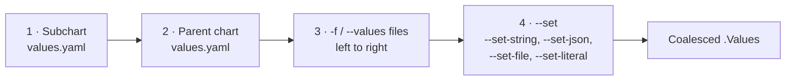

# Values — Precedence, Coalescing, and Designing a Configuration Contract

`values.yaml` is the only part of a chart the consumer controls, which makes it the chart's public
API. Most charts treat it as a bag of variables instead, and the consequences show up two years
later when 240 services all use the bag differently and nobody can change it.

This doc has two halves. The first is mechanical: how Helm combines values, in exactly what order,
with the three places the rules are not what you would guess. The second is design: how to build a
values surface that survives having many consumers, and how to get back from one that did not.

The thesis:

> **Values are an API, and the two things that make an API usable are a narrow surface and a
> machine-checkable contract.** A chart with 187 values has neither. A chart with 22 values and a
> JSON Schema has both, and the schema is worth more than any amount of documentation, because the
> schema fails the build and the documentation does not.

## The precedence chain, derived

There are five sources of values. Here they are in order from weakest to strongest — later
overrides earlier:



Written as a rule you can apply:

1. **A subchart's own `values.yaml`** is the weakest. It is the default of last resort.
2. **The parent chart's `values.yaml`**, in the section named after the subchart, overrides the
   subchart's defaults. So if `riverbend-common` defaults `podSecurityContext.runAsUser` to 1000
   and `checkout-api/values.yaml` has `riverbend-common: { podSecurityContext: { runAsUser: 65532 } }`,
   65532 wins.
3. **Each `-f` file**, in the order given on the command line. Later files override earlier ones.
   `-f base.yaml -f prod.yaml` means `prod.yaml` wins on any key both set.
4. **`--set` and its siblings**, which beat every file.
5. **Within the same precedence level, the merge is deep for maps and shallow for lists** — which
   is `V-02` and the single most surprising rule here.

Verify any of this against a real release rather than reasoning about it:

```bash
# What the user supplied (only the overrides)
helm get values checkout-api -n checkout

# The full coalesced result, chart defaults included — this is what .Values was
helm get values checkout-api -n checkout --all
```

⚠️ `helm get values` without `--all` shows only the overrides, and people read its empty output as
"no values are set". Always use `--all` when debugging.

### The three places precedence surprises people

**Surprise one: `helm upgrade` forgets your `--set` values.**

This is the most consequential and least known. Consider:

```bash
# Monday
helm upgrade checkout-api ./charts/checkout-api -n checkout \
  -f envs/prod-use1.yaml --set replicaCount=40      # scaled up for a sale

# Tuesday — a routine image bump
helm upgrade checkout-api ./charts/checkout-api -n checkout \
  -f envs/prod-use1.yaml --set image.tag=2026.09.18
```

On Tuesday, `replicaCount` goes back to whatever `envs/prod-use1.yaml` says. Monday's `--set` is
gone. **`helm upgrade` computes values from the chart and the flags you passed *this time*.** It
does not inherit the previous release's overrides.

That is arguably correct behaviour — the command is declarative, and what you passed is what you
get — but it means an `helm upgrade` that omits a flag is a silent revert of that flag. At
Riverbend this was the mechanism behind a capacity incident: someone had scaled a consumer group's
deployment with `--set`, and a routine deploy four hours later put it back.

The three flags in this area, and what each does:

| Flag | Behaviour |
|---|---|
| *(default)* | Chart defaults, plus only the `-f`/`--set` given on *this* command |
| `--reuse-values` | Last release's computed values, plus this command's `-f`/`--set` on top. ⚠️ Chart default *changes* are ignored — a new default added in the chart version you are upgrading to will not appear |
| `--reset-values` | Explicitly discard the previous values and use chart defaults plus this command's flags. The default behaviour, stated |
| `--reset-then-reuse-values` | ⚠ **version** (Helm 3.14+) Chart defaults from the new chart, then the previous release's *user-supplied* values, then this command's. This is what most people mean when they reach for `--reuse-values` |

**The right answer is not a flag.** It is: *never pass configuration with `--set` that you want to
persist*. Put it in a file, commit the file, and let the file be the truth. `--set` is for
per-invocation facts — the image tag from CI, a one-off debug flag — and for nothing else. If you
find yourself wanting `--reuse-values`, what you actually want is a values file you forgot to
write.

**Surprise two: `-f` file order is left to right, and CI usually gets it backwards.**

```bash
# base is weakest, region-specific is strongest. This is correct.
helm upgrade checkout-api ./charts/checkout-api \
  -f envs/base.yaml \
  -f envs/prod.yaml \
  -f envs/prod-use1.yaml
```

The failure mode is a CI template that builds the file list by globbing, because `envs/*.yaml`
expands in lexical order: `base.yaml`, `prod-use1.yaml`, `prod.yaml` — and now `prod.yaml`
overrides the region file. It works for months because the two rarely disagree, then one day they
do. Never glob a values file list; enumerate it.

**Surprise three: a subchart cannot see the parent's values, and the parent cannot reach into a
subchart's templates.**

Inside a subchart's templates, `.Values` is *only* the subchart's section. This is `V-07` and it
is the reason `global:` exists.

## Deep merge for maps, replace for lists

This rule causes more confusion than everything else in this doc combined, so it gets a worked
example.

**Maps merge, key by key, at every depth.** Given a chart default:

```yaml
resources:
  requests:
    cpu: "200m"
    memory: "512Mi"
  limits:
    memory: "512Mi"
```

and an override of:

```yaml
resources:
  requests:
    cpu: "1500m"
```

the result is:

```yaml
resources:
  requests:
    cpu: "1500m"        # overridden
    memory: "512Mi"     # retained from the default
  limits:
    memory: "512Mi"     # retained from the default
```

That is almost always what you want, and it is why maps are the right shape for most values.

**Lists are replaced wholesale.** Given a chart default:

```yaml
extraEnv:
  - name: OTEL_EXPORTER_OTLP_ENDPOINT
    value: "http://otel-collector.observability:4317"
  - name: JAVA_TOOL_OPTIONS
    value: "-XX:MaxRAMPercentage=75"
```

and an override of:

```yaml
extraEnv:
  - name: LOG_LEVEL
    value: debug
```

the result is a list with **one** element. The OTel endpoint and the JVM options are gone. Nothing
warns you. The pods come up, they do not export traces, and you find out when somebody looks for a
span next week.

There is no way to merge lists in Helm's coalescing. This is not a missing feature you can enable;
it is a consequence of the merge being defined on maps.

### What to do about it

**Design values so the things users extend are maps, not lists.** The pattern:

```yaml
# values.yaml — a map keyed by env var name
extraEnv:
  OTEL_EXPORTER_OTLP_ENDPOINT: "http://otel-collector.observability:4317"
  JAVA_TOOL_OPTIONS: "-XX:MaxRAMPercentage=75"
```

```yaml
# templates/deployment.yaml
          env:
            {{- range $k, $v := .Values.extraEnv }}
            - name: {{ $k }}
              value: {{ $v | quote }}
            {{- end }}
```

Now an override adding `LOG_LEVEL: debug` merges, and removing a key is
`OTEL_EXPORTER_OTLP_ENDPOINT: null` (see `V-06`). ⚠️ Two costs to be honest about: the render order
of a Go template `range` over a map is sorted by key, so your env list is alphabetical rather than
in the order you wrote it — harmless, but it makes diffs noisier the first time. And a map cannot
express an env var sourced from a `secretKeyRef`, because the value is not a scalar. Riverbend's
answer is two values: `extraEnv` as a map of literals, and `extraEnvFrom` as a list for the rare
structured cases, accepting that the list still replaces.

**Where a list is genuinely required** — `tolerations`, `topologySpreadConstraints`,
`imagePullSecrets`, anything whose schema is a list of structs — document that it replaces, and
put the full intended list in every environment file rather than relying on the default:

```yaml
# values.yaml
# NOTE: this list is REPLACED, not merged, by any override. If you set tolerations
# in an environment file you must repeat every entry you want, including these.
tolerations:
  - key: riverbend.io/workload
    operator: Equal
    value: application
    effect: NoSchedule
```

## `--set` and its four siblings

`--set` is convenient and it has five behaviours that bite.

**It infers types.** `--set replicaCount=24` gives an integer; `--set image.tag=1.20` gives the
float `1.2`; `--set enabled=true` gives a boolean; `--set version=3.10` gives `3.1`. Use
`--set-string` for anything that must stay a string:

```bash
--set-string image.tag=2026.09.17
```

⚠️ `--set-string image.tag=1.20` gives you `"1.20"`. `--set image.tag=1.20` gives you `1.2`. In CI,
where the tag comes from a variable and you cannot see it, this is the difference between a deploy
and a twenty-minute confusion.

**Commas separate assignments, so a value containing a comma needs escaping.**

```bash
# WRONG: two assignments, the second is nonsense
--set nodeSelector.zone=use1-az1,use1-az2

# RIGHT
--set nodeSelector.zone=use1-az1\,use1-az2
```

**Dots separate path segments, so a key containing a dot needs escaping.** This comes up constantly
with annotations, which conventionally contain domain names:

```bash
--set 'podAnnotations.riverbend\.io/owner=checkout-team'
```

The backslash escapes the dot inside the key. Getting this wrong creates
`podAnnotations: { riverbend: { io/owner: ... } }`, which renders as a nested map where the API
server wants a string, and the error message talks about types rather than about your quoting.

**Braces set a list.**

```bash
--set 'tolerations[0].key=riverbend.io/workload' --set 'tolerations[0].effect=NoSchedule'
--set 'imagePullSecrets={regcred,regcred-backup}'
```

Workable and unpleasant. For anything with structure, use `--set-json`:

```bash
--set-json 'tolerations=[{"key":"riverbend.io/workload","operator":"Equal","value":"application","effect":"NoSchedule"}]'
```

⚠ **version**: `--set-json` arrived in Helm 3.10.

**The full family**, because three of these are genuinely useful and underused:

| Flag | Use it for |
|---|---|
| `--set` | Scalars where type inference is harmless: integers, booleans |
| `--set-string` | Anything that must be a string. **Default to this in CI** |
| `--set-json` | Lists and nested structures, without bracket syntax |
| `--set-file` | Reading a value from a file — a certificate, a config blob, a script. `--set-file tls.crt=./server.pem` avoids putting a multi-line value on a command line |
| `--set-literal` | A string with no escaping at all, including dots and commas. ⚠ **version** 3.8+. The escape hatch when the escaping above is defeating you |

## `null` deletes a key

To remove a key that a chart default sets, override it with `null`:

```yaml
# envs/dev.yaml — dev has no resource limits at all
resources:
  limits: null
```

This is a real feature of the coalescing, not a coincidence. Two limitations, both worth knowing:

- ⚠️ **`--set x=null` sets the string `"null"`, not a null.** You must use a file. (`--set-json
  'x=null'` does work, which is another reason to prefer `--set-json`.)
- Deleting a key from a *list* is not possible, because lists replace.

## Designing the values contract

Now the design half. The mechanics above are what Helm does; this is what you should do with them.

### Start from the questions, not the fields

The failure mode is designing values by walking the Kubernetes API: "a Deployment has
`replicas`, so we need `replicaCount`; it has `resources`, so we need `resources`". Do that and you
end up with a values file that is a slightly worse Deployment manifest, which is the worst
possible outcome — all the indirection of templating with none of the abstraction.

Instead, ask: **what decisions does a consumer of this chart actually have to make?** For a
Riverbend service, the honest list is short:

| Decision | Value | Why the consumer owns it |
|---|---|---|
| Which image | `image.repository`, `image.tag` | Changes every deploy |
| How much of it | `replicaCount` or `autoscaling.{min,max}Replicas` | Capacity is per-environment |
| How big each one | `resources.requests`, `resources.limits` | Sizing is per-environment |
| Is it reachable from outside | `ingress.enabled`, `ingress.host` | Not every service is |
| What does it talk to | `config.*` — endpoints, topic names, timeouts | The service's own configuration |
| What identity does it use | `serviceAccount.annotations` (the IRSA role ARN) | Per-environment IAM |
| How sensitive is it | `tier` — drives PDB strictness, topology spread, alert routing | One value, many consequences |

That is about 18 leaf values. Everything else — the security context, the Prometheus annotations,
the `preStop` hook, the topology spread constraints, the standard label set, the
`terminationGracePeriodSeconds`, the seccomp profile — is a **platform decision**, not a consumer
decision, and belongs in the library chart with no value attached to it.

The test for whether something should be a value: **can you name a legitimate reason for two
Riverbend services to differ on it?** If not, it is not a value; it is a platform decision that a
value would only let someone get wrong.

⚠️ You will get pushback on this, in the form of "but what if someone needs to override it?" The
answer is that when someone genuinely needs to, they open a pull request against the library chart
and you have a conversation about whether the platform's default is wrong. That conversation is the
feature. A value is a way of avoiding it, and the cost of avoiding it 187 times is doc 03's
running theme.

### The `tier` value, as an example of doing this well

Riverbend's charts have a single value `tier`, an integer from 1 to 3, and the library chart
derives seven things from it:

```yaml
{{- define "riverbend-common.tierDefaults" -}}
{{- $t := .Values.tier | int -}}
{{- if eq $t 1 -}}
minAvailable: 75%
topologySpreadWhenUnsatisfiable: DoNotSchedule
priorityClassName: riverbend-tier1
terminationGracePeriodSeconds: 60
preStopSleepSeconds: 15
alertRoute: pagerduty-primary
maxUnavailable: 10%
{{- else if eq $t 2 -}}
minAvailable: 50%
topologySpreadWhenUnsatisfiable: ScheduleAnyway
priorityClassName: riverbend-tier2
terminationGracePeriodSeconds: 45
preStopSleepSeconds: 10
alertRoute: slack-owning-team
maxUnavailable: 25%
{{- else -}}
minAvailable: 0
topologySpreadWhenUnsatisfiable: ScheduleAnyway
priorityClassName: riverbend-tier3
terminationGracePeriodSeconds: 30
preStopSleepSeconds: 5
alertRoute: none
maxUnavailable: 50%
{{- end -}}
{{- end -}}
```

One value the service owner understands ("how bad is it if this is down?") replaces seven values
the service owner does not, and the platform team can change what tier 1 *means* across 240
services in one library release. This is the whole argument for a library chart expressed in one
value, and it generalises: **prefer one value with semantic meaning to seven values with
mechanical meaning.**

### `values.schema.json` — the contract that fails the build

A schema is validated at step 4 of the render pipeline, which is before anything is rendered and
long before anything reaches the cluster. It is the cheapest failure available and it catches the
entire `T-05` type-coercion class for free.

A real one, for the values above:

```json
{
  "$schema": "https://json-schema.org/draft/2020-12/schema",
  "type": "object",
  "additionalProperties": false,
  "required": ["image", "tier"],
  "properties": {
    "tier": {
      "description": "Service criticality. Drives PDB, priority class, spread and alert routing.",
      "type": "integer",
      "enum": [1, 2, 3]
    },
    "image": {
      "type": "object",
      "additionalProperties": false,
      "required": ["repository", "tag"],
      "properties": {
        "repository": { "type": "string", "minLength": 1 },
        "tag": {
          "description": "Immutable tag. CalVer, optionally with a short sha suffix.",
          "type": "string",
          "pattern": "^[0-9]{4}\\.[0-9]{2}\\.[0-9]{2}(-[0-9a-f]{7,12})?$"
        },
        "pullPolicy": { "enum": ["Always", "IfNotPresent", "Never"] }
      }
    },
    "replicaCount": { "type": "integer", "minimum": 0, "maximum": 200 },
    "resources": {
      "type": "object",
      "additionalProperties": false,
      "properties": {
        "requests": { "$ref": "#/$defs/resourceMap" },
        "limits":   { "$ref": "#/$defs/resourceMap" }
      }
    },
    "autoscaling": {
      "type": "object",
      "additionalProperties": false,
      "properties": {
        "enabled":     { "type": "boolean" },
        "minReplicas": { "type": "integer", "minimum": 1 },
        "maxReplicas": { "type": "integer", "minimum": 1 }
      }
    },
    "extraEnv": {
      "description": "A MAP, not a list, so overrides merge. See V-02.",
      "type": "object",
      "additionalProperties": { "type": "string" }
    }
  },
  "$defs": {
    "resourceMap": {
      "type": "object",
      "additionalProperties": false,
      "properties": {
        "cpu":    { "type": "string", "pattern": "^[0-9]+(m|)$" },
        "memory": { "type": "string", "pattern": "^[0-9]+(Mi|Gi)$" }
      }
    }
  }
}
```

Four things in there are doing the real work, and three of them get left out of most schemas.

**`"additionalProperties": false` is the most valuable line in the file.** Without it, a typo in a
values file is silently ignored — `replicasCount: 40` sets a key nothing reads, and the service
runs at 2 replicas. With it, the typo is a hard error naming the offending key. If you add one
thing to your charts after reading this doc, add this.

**The `pattern` on `image.tag`** encodes a policy — immutable tags only — in a place that cannot be
skipped. `tag: latest` fails validation. This is more reliable than any review checklist.

**`minimum` and `maximum` on `replicaCount`** catch the fat-finger: `--set replicaCount=240`
instead of `24` is a schema failure rather than a capacity event.

**`enum` on `tier`** means the value cannot be `"1"` (a string), which would make
`eq (.Values.tier | int) 1` work but `eq .Values.tier 1` fail, and is exactly the kind of thing
that renders fine in one place and wrong in another.

## The `V-` failure catalogue

### V-01 · "I set the value and nothing happened"

**What you see.** The value is in your file, `helm upgrade` succeeded, and the rendered manifest
does not reflect it.

**Mechanism.** One of five things, in descending order of frequency:

1. **Wrong nesting.** You set `image.tag` and the template reads `.Values.checkoutApi.image.tag`,
   or the value belongs to a subchart and you set it at the top level.
2. **A typo**, silently ignored because there is no `additionalProperties: false`.
3. **The template does not read it.** Somebody added the value to `values.yaml` and never wired it
   up. Surprisingly common in charts with many values.
4. **Something stronger overrode it** — a later `-f` file, or a `--set` in the CI wrapper script
   you did not know existed.
5. **`helm upgrade` forgot it**, because it was set with `--set` on a previous invocation.

**Confirm it.** Work outwards from the render. These four commands answer it in every case:

```bash
# 1. Did the value reach .Values at all?
helm get values checkout-api -n checkout --all | yq '.image.tag'

# 2. Does the template read the path you set?
grep -rn 'image.tag\|image\.tag' charts/checkout-api/templates/ charts/riverbend-common/templates/

# 3. What did the render actually produce?
helm template checkout-api ./charts/checkout-api -f envs/prod-use1.yaml | grep 'image:'

# 4. Is there a wrapper adding flags you did not pass?
grep -rn 'helm upgrade' .github/workflows/ ci/
```

**Recover.** Fix the path.

**Prevent.** `"additionalProperties": false` in the schema, which converts cases 1 and 2 from
silence into an error. For case 3, doc 14's golden-file tests: a value that changes nothing in the
rendered output has no test asserting its effect, and adding that test is how you find out.

### V-02 · An override replaced a list instead of merging it

Covered in full above. The scenario shape for reference:

**What you see.** Environment variables, tolerations, volumes or `imagePullSecrets` that the chart
default provided are absent after an override.

**Mechanism.** Lists replace. There is no list merge.

**Confirm it.** Count:

```bash
helm template checkout-api ./charts/checkout-api | yq '.spec.template.spec.containers[0].env | length'
helm template checkout-api ./charts/checkout-api -f envs/prod-use1.yaml | yq '.spec.template.spec.containers[0].env | length'
```

A drop is the bug.

**Recover.** Repeat the full list in the override.

**Prevent.** Make extension points maps. Where they must be lists, say so in a comment next to the
value and add a golden-file test asserting the platform-required entries are present in every
environment's render — that test is the only thing that actually catches it:

```bash
for e in dev stg prod-use1 prod-euw1; do
  helm template checkout-api ./charts/checkout-api -f envs/$e.yaml \
    | yq 'select(.kind=="Deployment").spec.template.spec.containers[0].env[].name' \
    | grep -q OTEL_EXPORTER_OTLP_ENDPOINT \
    || { echo "FAIL: $e lost the OTel endpoint"; exit 1; }
done
```

### V-03 · `--set` escaping — dots and commas

Covered above. **Confirm it** by rendering and looking at the shape:

```bash
helm template checkout-api ./charts/checkout-api \
  --set 'podAnnotations.riverbend\.io/owner=checkout-team' --debug \
  | yq 'select(.kind=="Deployment").spec.template.metadata.annotations'
```

**Prevent.** Ban `--set` for anything containing a dot or a comma. Use `--set-json` or a file.

### V-04 · `--set` type inference

Covered above. The one-line prevention: **in CI, use `--set-string` by default and `--set` only
for integers and booleans you have deliberately reasoned about.**

### V-05 · Values file order

**What you see.** A region-specific override that does not take effect; or a change to
`envs/prod.yaml` that unexpectedly affects one region and not another.

**Mechanism.** Left-to-right precedence, and a glob that sorts lexically.

**Confirm it.** Print the exact command CI ran. If your CI does not log the full `helm upgrade`
command line, that is the first thing to fix — it is one line and it answers this class of
question immediately.

**Prevent.** Enumerate files, never glob. And name files so that lexical order happens to match
intended precedence anyway (`00-base.yaml`, `10-prod.yaml`, `20-prod-use1.yaml`), so that a future
glob is harmless. Do both: the enumeration is the rule, and the naming is what limits the damage
when somebody ignores the rule, which eventually somebody will.

### V-06 · `null` handling

**What you see.** `--set resources.limits=null` produced the string `"null"` in the manifest, and
the API server rejected it.

**Mechanism.** `--set` does not parse `null`.

**Recover.** Use a values file with `limits: null`, or `--set-json 'resources.limits=null'`.

### V-07 · Subchart value scoping

**What you see.** A value set at the top level has no effect on a subchart. Or a subchart template
referencing `.Values.image.tag` renders empty even though the parent sets it.

**Mechanism.** Inside a subchart's templates, `.Values` contains **only** the subchart's section of
the coalesced values. Given this parent `values.yaml`:

```yaml
image:
  tag: "2026.09.17"          # for the parent's own templates

riverbend-common:            # for the subchart. Key must match the subchart's NAME (or alias)
  podSecurityContext:
    runAsUser: 65532
```

the subchart sees `.Values.podSecurityContext.runAsUser` and does **not** see `.Values.image.tag`.

Three ways across the boundary, and they are not equivalent:

1. **`global:`** — anything under `global` in the coalesced values is visible as `.Values.global`
   in every chart, parent and all subcharts, at every depth. This is the intended mechanism and it
   is a flat shared namespace, with the collision risk that implies (`V-08`).
2. **`import-values`** in the parent's `Chart.yaml` dependency entry, which copies values *up*
   from child to parent. Useful and obscure; doc 08, `D-08`.
3. **A library chart instead of a subchart.** A library template is `include`d from the parent's
   own template file, so it executes with the **parent's** context and sees all of the parent's
   values with no scoping problem at all. This is a significant and underappreciated advantage of
   the library-chart pattern over the subchart pattern, and it is why Riverbend's shared templates
   are a library chart rather than a subchart wrapping a Deployment.

**Confirm it.** Render with `--debug` and read the values dump Helm prints; or, inside a template
you are debugging, print the context:

```yaml
{{- /* temporary: dump what this chart can actually see */ -}}
{{- fail (printf "VALUES SEEN HERE:\n%s" (toYaml .Values)) }}
```

`fail` aborts the render with your message, which makes it a usable print statement in a language
that has none.

**Prevent.** Prefer library charts to subcharts for shared templates. Where you must use
subcharts, put the small number of genuinely shared facts under `global:` and nothing else.

### V-08 · `global:` collisions

**What you see.** Setting `global.imageRegistry` for one subchart changes it for eleven others,
one of which needed a different registry. Or two third-party charts both define
`global.storageClass` with incompatible meanings.

**Mechanism.** `global` is one flat namespace shared by every chart in the release, including
third-party subcharts you did not write. Riverbend's platform umbrella had 31 subcharts, six of
which used `global.imagePullSecrets` and three of which used `global.storageClass`, and the
semantics differed.

**Confirm it.** Find every use of `global` across the dependency tree:

```bash
helm dependency update ./charts/riverbend-platform >/dev/null
grep -rhno 'Values\.global\.[A-Za-z0-9_.]*' ./charts/riverbend-platform/charts/ \
  | sed 's/.*Values\.global\.//' | sort -u
```

That list is the shared namespace you are actually operating in, and seeing it for the first time
is usually a surprise.

**Recover.** Set the value per-subchart instead of globally, which always works because the
per-subchart section has higher precedence than the subchart's own default — but note it does
*not* override a `global`, because `global` is a different key rather than a stronger one. If a
subchart reads `global.storageClass` and nothing else, you cannot override it per-subchart at all;
you have to fork the chart or accept the global value.

**Prevent.** Keep `global` to a very short list, written down, with each entry justified. At
Riverbend after the incident it is four keys: `global.imageRegistry`, `global.environment`,
`global.region`, `global.baseDomain`. Anything else is per-chart. And **prefer no umbrella chart
at all**, which removes the shared namespace entirely (doc 08).

### V-09 · The schema did not catch what you expected

**What you see.** A bad value got through despite a schema.

**Mechanism.** Four gaps, all of which are worth knowing:

1. **No `additionalProperties: false`**, so unknown keys pass. This is the big one.
2. **A subchart's schema validates only the subchart's section**, and only if the subchart has one.
   Your parent schema saying nothing about `riverbend-common:` means that section is unvalidated
   unless the library chart ships its own schema — which library charts often do not, because their
   authors think of them as internal.
3. **`helm template` with a partial values set fails `required`**, which means a schema with a
   `required` array makes `helm template ./chart` with no values fail. That is correct behaviour
   and it surprises people writing tests; supply a `ci/default-values.yaml` for the test case.
4. **A schema cannot express cross-field constraints** well. "If `autoscaling.enabled` then
   `replicaCount` is ignored" is not a schema rule. JSON Schema can do some of this with
   `if`/`then`/`dependentRequired`, and it gets unreadable quickly. Enforce cross-field rules in
   the template with `fail`:

```yaml
{{- if and .Values.autoscaling.enabled (gt (int .Values.autoscaling.minReplicas) (int .Values.autoscaling.maxReplicas)) }}
{{- fail "autoscaling.minReplicas must be <= autoscaling.maxReplicas" }}
{{- end }}
{{- if and .Values.ingress.enabled (not .Values.ingress.host) }}
{{- fail "ingress.enabled requires ingress.host" }}
{{- end }}
```

**Prevent.** A CI check that the schema itself is doing its job, which is a test people never
write and which pays for itself immediately:

```bash
# Asserts that the schema REJECTS a typo. If this passes, additionalProperties is missing.
if helm template checkout-api ./charts/checkout-api \
     -f envs/prod-use1.yaml --set replicasCount=40 >/dev/null 2>&1; then
  echo "FAIL: schema accepted the unknown key 'replicasCount'"; exit 1
fi
```

### V-10 · `--reuse-values` hides a new chart default

**What you see.** You upgrade to a chart version whose release notes say it now sets
`securityContext.seccompProfile` by default. The rendered output does not have it.

**Mechanism.** `--reuse-values` takes the *computed* values of the previous release — which already
had the old chart's defaults baked in — and layers this command's flags on top. The new chart's
defaults never enter the calculation. So every default added or changed in the new chart version is
silently ignored, and you have upgraded the templates without upgrading the defaults.

This is a genuinely nasty one because `--reuse-values` is exactly the flag someone reaches for to
be *safe*.

**Confirm it.**

```bash
diff <(helm get values checkout-api -n checkout --all) \
     <(helm template checkout-api ./charts/checkout-api -f envs/prod-use1.yaml --debug 2>&1 \
        | sed -n '/^COMPUTED VALUES:/,/^HOOKS:/p')
```

**Recover.** Upgrade again without `--reuse-values`, passing your values files explicitly.

**Prevent.** Do not use `--reuse-values`. If you think you need it, you have unwritten values
files; write them. If you genuinely need previous *user* values plus new chart defaults, that is
`--reset-then-reuse-values` (⚠ **version** 3.14+), which is what `--reuse-values` should have been.

### V-11 · The chart with 187 values and no contract

**What you see.** Nobody can change a default, because 240 consumers each depend on a different
subset. Two services set the same thing in two different ways. A value nothing reads.

**Mechanism.** Every time a consumer needed something the chart did not do, somebody added a knob.
This is locally rational and globally catastrophic: the configuration surface grew monotonically
and nothing ever removed anything, because removal is a breaking change for an unknown number of
consumers.

**Confirm it.** Find the values nothing reads, and the values everyone uses identically. Both are
removable:

```bash
# Values declared in values.yaml but referenced by no template — dead knobs.
comm -23 \
  <(yq -o=props '.' charts/riverbend-common/values.yaml | cut -d= -f1 | sed 's/ *$//' | sort -u) \
  <(grep -rhoE '\.Values\.[A-Za-z0-9_.]+' charts/riverbend-common/templates/ \
      | sed 's/^\.Values\.//' | sort -u)
```

```bash
# Values every consumer sets to the same thing — should be a platform default, not a knob.
for f in envs/*/values-*.yaml; do yq -o=props '.' "$f"; done \
  | sort | uniq -c | sort -rn | head -30
```

**Recover.** This is a multi-quarter programme, not a change, and the order matters:

1. **Freeze the surface.** No new values without an owner and a justification. This is the only
   step that stops the bleeding, and it is a process control.
2. **Add `additionalProperties: false`** and a schema covering what exists. You now know who uses
   what, because the ones who fail the build tell you.
3. **Delete the dead knobs** found by the first script. No consumer impact, immediate reduction.
4. **Promote the unanimous knobs to platform defaults** found by the second script: set the value
   in the library chart, remove it from all 240 environment files in one scripted pass, and remove
   the knob. Each one of these is a genuine reduction in surface and cannot break anyone, because
   everyone already agreed on the value.
5. **For the genuinely-divergent remainder, group them behind a semantic value** like `tier`. This
   is the hard, judgement-heavy part and it is where most of the reduction comes from.

Riverbend's `riverbend-common` went from 187 values to 34 over two quarters this way. Steps 3 and 4
between them accounted for 106 of the 153 removed, which is the encouraging part — most of a bloated
values surface is dead or unanimous, and both are cheap to remove.

**Prevent.** The test from earlier in this doc, applied at review time to every proposed new value:
*can you name a legitimate reason for two services to differ on this?* And a hard ceiling — at
Riverbend, a library chart pull request that increases the value count needs a platform-team
approval, which is a small amount of friction applied at exactly the right point.

### V-12 · Absent, empty, and null are three different things

**What you see.** A template's `if` behaves differently for a value that is missing, a value set to
`""`, and a value set to `null`, and the difference matters.

**Mechanism.** In Go template terms, all three are falsy, so `{{ if .Values.x }}` cannot tell them
apart. But they behave differently in coalescing and in `toYaml`:

| State | `if .Values.x` | `hasKey .Values "x"` | What `toYaml` emits |
|---|---|---|---|
| absent | false | false | key omitted |
| `x: ""` | false | true | `x: ""` |
| `x: null` | false | true | `x: null` |
| `x: 0` | **false** | true | `x: 0` |
| `x: false` | **false** | true | `x: false` |

The two bolded rows are the trap, and they are the same trap as `default`: a meaningful `0` or
`false` is indistinguishable from absence in a truthiness test. So

```yaml
{{- if .Values.replicaCount }}
  replicas: {{ .Values.replicaCount }}
{{- end }}
```

silently omits `replicas` when someone deliberately sets `replicaCount: 0` to scale a service down,
and the Deployment defaults to 1 replica. The service they were trying to turn off is running.

**Confirm it.** Test the boundary explicitly:

```bash
helm template checkout-api ./charts/checkout-api --set replicaCount=0 | yq 'select(.kind=="Deployment").spec.replicas'
```

**Prevent.** Use `hasKey` or `kindIs` when absence and zero must differ, and reach for the schema
to make the states you do not want impossible:

```yaml
{{- if hasKey .Values "replicaCount" }}
  replicas: {{ .Values.replicaCount }}
{{- end }}
```

and for the common case, decide that zero is not a valid value and let the schema say so
(`"minimum": 1`), so the ambiguity cannot arise. **Removing a state is better than handling it.**

## What to take away

1. **Precedence is subchart defaults, parent defaults, `-f` files left to right, then `--set`.**
   Verify with `helm get values --all`, never from memory.
2. **`helm upgrade` does not inherit the previous release's `--set` values.** An upgrade that omits
   a flag silently reverts it. The fix is not `--reuse-values`; it is putting persistent
   configuration in a committed file and reserving `--set` for per-invocation facts.
3. **Maps merge, lists replace, and there is no list merge.** Design extension points as maps. Where
   a list is unavoidable, document that it replaces and add a test asserting the
   platform-required entries survive every environment's render.
4. **`"additionalProperties": false` is the highest-value line you can add to a chart.** It turns
   a silently-ignored typo into a build failure, which is the entire difference between a values
   file you can trust and one you cannot.
5. **Design values from the decisions a consumer must make, not from the Kubernetes API.** If you
   cannot name a legitimate reason for two services to differ on something, it is a platform
   default, not a knob.
6. **Prefer one semantic value to seven mechanical ones.** `tier: 1` that derives a PDB, a priority
   class, spread constraints and alert routing is better than seven independent values, and it lets
   the platform change what tier 1 means fleet-wide.
7. **Prefer library charts to subcharts for shared templates**, because a library template executes
   in the parent's context and has no value-scoping problem — which also means no `global:`
   namespace to collide in.
8. **`--set-string` by default in CI.** Type inference turns `1.20` into `1.2` and `off` into
   `false`, and you will not see it happen.
9. **A bloated values surface is mostly dead or unanimous.** Find the knobs no template reads and
   the knobs everyone sets identically; those two categories are cheap to remove and, at
   Riverbend, were 106 of the 153 values eliminated.
10. **Zero and false are falsy, so truthiness cannot distinguish them from absent.** Use `hasKey`,
    or better, use the schema to make the ambiguous state invalid in the first place.
