# Hooks, Migrations, and the Only Real Ordering Primitive Helm Has

Hooks are the part of Helm that behaves least like the rest of Helm, and the reason is one sentence
that is easy to read past in the documentation:

> **A hook resource is not part of the release manifest.**

Helm creates it, waits for it, and then forgets about it. It is not in `helm get manifest`, it is
not compared on the next upgrade, it is not deleted by `helm uninstall` unless you asked for that
specifically, and it is not restored by `helm rollback`. Hooks live outside the state model that
doc 04 described.

That is also what makes them useful. Because a hook is outside the manifest, Helm can genuinely
*block* on it — which makes hooks the only mechanism Helm has for "do this, wait for it to finish,
then do that". The kind-ordering from `T-13` submits things in an order; a hook waits.

So this doc is about two things: the mechanics of hooks, and the one thing almost everybody uses
them for, which is database migrations. The migration half matters more, because a migration is
where Helm's lifecycle meets something Helm cannot roll back.

## The nine hook phases

```mermaid
flowchart TD
    subgraph INS["helm install"]
      I1["pre-install"] --> I2["apply manifest<br/>+ wait"] --> I3["post-install"]
    end
    subgraph UPG["helm upgrade"]
      U1["pre-upgrade"] --> U2["three-way merge apply<br/>+ wait"] --> U3["post-upgrade"]
    end
    subgraph RB["helm rollback"]
      R1["pre-rollback"] --> R2["apply old manifest<br/>+ wait"] --> R3["post-rollback"]
    end
    subgraph UN["helm uninstall"]
      D1["pre-delete"] --> D2["delete manifest objects"] --> D3["post-delete"]
    end
    subgraph TST["helm test"]
      T1["test"]
    end
```



Declared with an annotation, and a resource can carry several phases:

```yaml
metadata:
  annotations:
    "helm.sh/hook": pre-install,pre-upgrade
```

The nine, with what each is actually for:

| Phase | Runs | Use it for |
|---|---|---|
| `pre-install` | Before the first apply | Creating something the manifest depends on that Helm's kind-ordering cannot guarantee; a first-time bootstrap |
| `post-install` | After the first apply and wait | Seeding data; registering with an external system |
| `pre-upgrade` | Before the upgrade's apply | **Database migrations.** The main event |
| `post-upgrade` | After the upgrade's apply and wait | Smoke tests; cache invalidation; a deploy notification |
| `pre-rollback` | Before a rollback's apply | ⚠️ Almost always a mistake. See `H-08` |
| `post-rollback` | After a rollback | Notifying that a rollback happened |
| `pre-delete` | Before objects are deleted | Draining; deregistering from a load balancer; a final backup |
| `post-delete` | After objects are deleted | Cleaning up external resources — a DNS record, an S3 bucket, a database |
| `test` | Only on `helm test` | A test suite you run on demand, never during a deploy |

⚠️ Two historical notes that come up when reading old charts. `crd-install` was a Helm 2 hook,
removed in Helm 3 in favour of the `crds/` directory — if you see it, the chart predates Helm 3 and
the annotation is silently ignored. And `test-success` / `test-failure` were the Helm 2 spellings of
`test`; `test-success` still works as an alias, `test-failure` does not.

## Hook weights, and what they are not

```yaml
metadata:
  annotations:
    "helm.sh/hook": pre-upgrade
    "helm.sh/hook-weight": "-5"
```

Rules, stated precisely, because each one surprises somebody:

1. **Weights sort ascending.** `-10` runs before `0` runs before `5`. Negative weights are normal
   and mean "early".
2. **The value must be a quoted string**, because annotation values are strings, and Helm parses it
   as an integer. `"helm.sh/hook-weight": 5` — unquoted — is a YAML integer in the annotations map,
   which the API server rejects outright: `cannot unmarshal number into Go struct field`.
3. **Helm waits for each hook to complete before starting the next**, within a phase. So weights
   give you genuine sequencing, unlike the kind sort.
4. **Weights are scoped to the phase.** A `pre-upgrade` hook with weight 100 still runs before any
   `post-upgrade` hook with weight -100.
5. **Equal weights have no defined relative order.** If two hooks must be ordered, give them
   different weights.
6. ⚠️ **"Weight" is not "priority".** It is a sequence number. A higher weight is not more
   important; it is later. People read "weight 10" as "important" and are surprised when it runs
   last.

## Delete policies, and the Jobs you have right now

```yaml
metadata:
  annotations:
    "helm.sh/hook-delete-policy": before-hook-creation,hook-succeeded
```

Three policies, combinable:

| Policy | Effect |
|---|---|
| `before-hook-creation` | Delete a previous hook resource of the same name before creating this one. **This is the default** if you specify no policy at all |
| `hook-succeeded` | Delete the hook resource after it succeeds |
| `hook-failed` | Delete the hook resource after it fails |

**The combination you almost always want is `before-hook-creation,hook-succeeded`**, and the
reasoning is worth spelling out:

- `before-hook-creation` makes the hook re-runnable. Without it — and you get it by default, but
  people override the policy and lose it — the second run hits `U-07`, because a `Job`'s
  `spec.template` is immutable and you cannot patch a Job to use a new image.
- `hook-succeeded` cleans up on success, so you are not accumulating Job objects.
- **Deliberately omitting `hook-failed`** keeps the failed Job and its pod around so you can read
  the logs. This is the important part: if you add `hook-failed`, your migration Job vanishes the
  instant it fails and its logs go with it, and you are debugging a failed deploy with no evidence.
  Keeping failures is worth the untidiness.

⚠️ **With no policy specified, you get `before-hook-creation` only** — so successful hooks are
*never* deleted. Go and look; you probably have Jobs from two years ago:

```bash
kubectl get jobs -A -l 'helm.sh/hook' \
  -o custom-columns='NS:.metadata.namespace,NAME:.metadata.name,HOOK:.metadata.annotations.helm\.sh/hook,AGE:.metadata.creationTimestamp' \
  | sort -k4
```

At Riverbend this found 1,847 completed hook Jobs across 38 namespaces, the oldest 14 months old,
each holding a pod object and a log. They are harmless individually and they are 1,847 objects in
`etcd` and 1,847 entries in every `kubectl get pods -A`.

## The one Helm cannot help you with: hooks need RBAC that the release has not created yet

This is a genuinely confusing ordering problem and the fix is not obvious.

Your `pre-upgrade` migration Job needs a ServiceAccount with permission to read a Secret. The chart
creates that ServiceAccount, in `templates/serviceaccount.yaml`. So:

1. `pre-upgrade` hooks run.
2. The migration Job starts with `serviceAccountName: checkout-api-migrate`.
3. That ServiceAccount does not exist yet, because the main manifest has not been applied.
4. The Job's pod fails to be admitted, or is created with no token.

**Hooks run before the manifest, so a hook cannot use anything the manifest creates.** The
kind-ordering that puts ServiceAccount before Deployment does not help, because the whole manifest
comes after all `pre-*` hooks.

The fix is to make the ServiceAccount, Role and RoleBinding **hooks too**, with lower weights:

```yaml
# templates/migrate-rbac.yaml
{{- $fullname := include "checkout-api.fullname" . -}}
apiVersion: v1
kind: ServiceAccount
metadata:
  name: {{ $fullname }}-migrate
  annotations:
    "helm.sh/hook": pre-install,pre-upgrade
    "helm.sh/hook-weight": "-10"
    "helm.sh/hook-delete-policy": before-hook-creation
---
apiVersion: rbac.authorization.k8s.io/v1
kind: Role
metadata:
  name: {{ $fullname }}-migrate
  annotations:
    "helm.sh/hook": pre-install,pre-upgrade
    "helm.sh/hook-weight": "-9"
    "helm.sh/hook-delete-policy": before-hook-creation
rules:
  - apiGroups: [""]
    resources: ["secrets"]
    resourceNames: ["{{ $fullname }}-db"]
    verbs: ["get"]
---
apiVersion: rbac.authorization.k8s.io/v1
kind: RoleBinding
metadata:
  name: {{ $fullname }}-migrate
  annotations:
    "helm.sh/hook": pre-install,pre-upgrade
    "helm.sh/hook-weight": "-8"
    "helm.sh/hook-delete-policy": before-hook-creation
roleRef: { apiGroup: rbac.authorization.k8s.io, kind: Role, name: "{{ $fullname }}-migrate" }
subjects:
  - kind: ServiceAccount
    name: {{ $fullname }}-migrate
    namespace: {{ .Release.Namespace }}
```

Weights `-10`, `-9`, `-8`, then the migration Job at `-5`. Note `before-hook-creation` without
`hook-succeeded` on all three — the RBAC must survive until the Job that uses it finishes, and
deleting it after each install just recreates it next time.

⚠️ And note `resourceNames` on the Role. A migration Job's RBAC is a standing grant in your cluster
that exists for the specific purpose of one Job; scoping it to the exact Secret it needs is the
difference between a narrow grant and a "read all Secrets in this namespace" grant that will be
found in an audit. Doc 13, `Z-06`.

## Database migrations — the part that actually matters

Here is the question everybody gets to eventually: **should the migration be a `pre-upgrade` hook,
or a separate pipeline step?**

The honest answer is that both work and they fail differently, and the choice should be made from
the failure modes rather than from tidiness.

### Option A — `pre-upgrade` hook

```yaml
# templates/migrate-job.yaml
apiVersion: batch/v1
kind: Job
metadata:
  name: {{ include "checkout-api.fullname" . }}-migrate
  annotations:
    "helm.sh/hook": pre-upgrade
    "helm.sh/hook-weight": "-5"
    "helm.sh/hook-delete-policy": before-hook-creation
spec:
  backoffLimit: 2
  activeDeadlineSeconds: 900
  template:
    metadata:
      labels:
        {{- include "riverbend-common.selectorLabels" . | nindent 8 }}
        riverbend.io/component: migrate
    spec:
      serviceAccountName: {{ include "checkout-api.fullname" . }}-migrate
      restartPolicy: Never
      containers:
        - name: migrate
          image: "{{ .Values.image.repository }}:{{ .Values.image.tag }}"
          command: ["/app/checkout-api", "migrate", "up"]
          env:
            - name: DATABASE_URL
              valueFrom:
                secretKeyRef:
                  name: {{ include "checkout-api.fullname" . }}-db
                  key: url
```

**What is good about this.** The migration and the code that needs it are one artefact and one
version — the Job uses `.Values.image.tag`, the same image as the Deployment, so the migration is
always the one that shipped with this code. It runs exactly once per upgrade, with Helm waiting. If
it fails, the upgrade aborts *before any pod is replaced*, so you are still fully on the old
version with the old schema, which is the cleanest possible failure.

**What is bad about it.** Three things:

- **`--atomic` makes it dangerous.** The migration runs, then the rollout fails, then Helm rolls
  back the *code* and leaves the *schema* migrated. Old code, new schema.
- **You cannot easily run it alone.** Migrating without deploying — which you want for a long
  backfill — means a separate mechanism anyway.
- **It is inside the deploy's timeout budget.** A 12-minute migration inside an 8-minute
  `--timeout` fails the deploy, and raising the deploy timeout to accommodate the worst-case
  migration makes every normal deploy slower to fail.

### Option B — a separate pipeline step

```bash
# Step 1: migrate. Its own timeout, its own retries, its own approval gate if needed.
kubectl -n checkout create job "migrate-$GIT_SHA" \
  --from=cronjob/checkout-api-migrate-template
kubectl -n checkout wait --for=condition=complete "job/migrate-$GIT_SHA" --timeout=30m

# Step 2: deploy.
helm upgrade checkout-api ./charts/checkout-api --install -n checkout \
  -f envs/prod-use1.yaml --set-string image.tag="$GIT_SHA" --atomic --timeout 8m
```

**What is good.** Separate timeout, separate retry, separately approvable, separately runnable, and
the deploy is a pure deploy so `--atomic` is safe. Visible as its own step in the pipeline, so when
it fails you know what failed.

**What is bad.** The migration and the code are now two artefacts that can be at different
versions, and keeping them in step is your discipline rather than Helm's. Someone will eventually
deploy without migrating.

### The recommendation, and the thing that makes either one safe

**Use option A for small, fast, forward-compatible migrations, and option B for anything that takes
minutes or needs a human to look at it.** Riverbend uses A for everything under 60 seconds and B
for backfills, which is about a 90/10 split.

But the choice matters much less than this, which matters enormously:

> **Every migration must be backward compatible with the currently-running code, for at least one
> release.** Then the ordering question disappears, `--atomic` is safe, rollback is safe, and a
> half-completed deploy with mixed pod versions is safe — because both versions of the code work
> against both versions of the schema.

This is the **expand/contract** pattern, and it is the actual answer to the migration problem. To
rename `orders.total` to `orders.total_cents`:

| Release | Migration | Code | Both versions work because |
|---|---|---|---|
| **1 — expand** | Add `total_cents`, backfill it, add a trigger or dual-write keeping both in sync | Writes both columns, reads `total` | New column is additive; old code ignores it |
| **2 — migrate reads** | none | Writes both, reads `total_cents` | Both columns are populated and consistent |
| **3 — stop writing the old** | none | Writes only `total_cents` | Nothing reads `total` any more |
| **4 — contract** | Drop `total` | unchanged | No code references it |

Four deploys to rename a column, which feels absurd the first time somebody proposes it. What it
buys: **at no point is there a schema that the previous release's code cannot run against.** So
rollback always works, `--atomic` is always safe, and a rollout stuck half-done with 12 old pods
and 12 new pods is a non-event rather than an incident.

The rules that follow, and they are short enough to put in a review checklist:

1. **Never drop or rename a column in the same release that stops using it.**
2. **Never add a `NOT NULL` column without a default** — old code does not know to populate it.
3. **Never narrow a type or add a constraint** that existing rows or old code could violate.
4. **Adding an index is safe; adding it non-concurrently on a large table is an outage.** Use
   `CREATE INDEX CONCURRENTLY` (and note it cannot run inside a transaction, which many migration
   frameworks wrap around everything by default).
5. **A migration must be idempotent**, because it will be retried. `H-06`.

## The `H-` failure catalogue

### H-01 · Hook resources are not in the release, so they are not cleaned up

**What you see.** Hundreds of completed Jobs and their pods, months old. An uninstalled release
whose migration Job is still there.

**Mechanism.** The opening sentence of this doc. Hooks are outside the manifest, so
`helm uninstall` — which deletes what is in the manifest — does not touch them.

**Confirm it.** The `kubectl get jobs -A -l 'helm.sh/hook'` command from earlier. Also check for
orphans whose release no longer exists:

```bash
kubectl get jobs -A -l 'helm.sh/hook' -o json | jq -r '.items[]
  | "\(.metadata.namespace)\t\(.metadata.name)"' \
  | while IFS=$'\t' read -r ns name; do
      rel=$(kubectl get job -n "$ns" "$name" \
        -o jsonpath='{.metadata.annotations.meta\.helm\.sh/release-name}' 2>/dev/null)
      [ -n "$rel" ] && ! helm status "$rel" -n "$ns" >/dev/null 2>&1 \
        && echo "ORPHAN: $ns/$name (release $rel is gone)"
    done
```

**Recover.** Delete them. `ttlSecondsAfterFinished` on the Job also works retroactively for Jobs
that have not yet been cleaned:

```bash
kubectl delete jobs -A -l 'helm.sh/hook' --field-selector status.successful=1
```

**Prevent.** Two layers, and use both:

1. `"helm.sh/hook-delete-policy": before-hook-creation,hook-succeeded` on every hook. Successful
   hooks clean themselves up; failures stay for debugging.
2. `ttlSecondsAfterFinished` on the Job spec as a backstop, so even a hook whose delete policy you
   got wrong eventually disappears:
   ```yaml
   spec:
     ttlSecondsAfterFinished: 86400    # 24h — long enough to debug, short enough not to accumulate
     backoffLimit: 2
   ```

### H-02 · The hook Job cannot be re-created

**What you see.**

```
Error: UPGRADE FAILED: pre-upgrade hooks failed: Job.batch "checkout-api-migrate" is invalid:
spec.template: Invalid value: ...: field is immutable
```

**Mechanism.** A Job's `spec.template` is immutable, and the hook has a fixed name. The previous
run's Job still exists, with the previous image. Helm tries to patch it, and cannot.

**Confirm it.**

```bash
kubectl get job -n checkout checkout-api-migrate \
  -o jsonpath='{.spec.template.spec.containers[0].image}{"\n"}{.status}' | head
```

**Recover.** Delete the old Job and upgrade again:

```bash
kubectl delete job -n checkout checkout-api-migrate
```

**Prevent.** `before-hook-creation` in the delete policy — which you get by default, so the
presence of this error means somebody set a policy that omitted it. The alternative pattern, which
some charts use, is a unique name per run:

```yaml
  name: {{ include "checkout-api.fullname" . }}-migrate-{{ .Release.Revision }}
```

⚠️ This works and it accumulates one Job per revision forever unless you also set
`hook-succeeded`. `before-hook-creation` with a stable name is simpler and is the right default;
the revision-suffixed name is useful only when you specifically want the history.

### H-03 · A `pre-upgrade` hook failed — what state are you in?

**What you see.**

```
Error: UPGRADE FAILED: pre-upgrade hooks failed: job failed: BackoffLimitExceeded
```

**Mechanism.** The hook failed, so Helm aborted before applying the manifest.

**This is the good failure**, and it is worth being explicit about why: **nothing was deployed.**
The old pods are still running the old code against the old schema. The release is marked `failed`
but the previous revision's objects are untouched. You have lost nothing except time.

⚠️ The one thing to check: **did the migration partially apply?** A migration framework that runs
statements outside a transaction can fail halfway. The database, unlike Kubernetes, is not rolled
back by Helm.

**Confirm it.** Read the logs, which are still there because you did not set `hook-failed`:

```bash
kubectl logs -n checkout job/checkout-api-migrate --tail=100
kubectl describe job -n checkout checkout-api-migrate | sed -n '/Events/,$p'
```

Then check the database's own migration ledger — every framework has one (`schema_migrations`,
`flyway_schema_history`, `alembic_version`):

```bash
kubectl exec -n checkout deploy/checkout-api -- \
  psql "$DATABASE_URL" -c "SELECT version, dirty FROM schema_migrations ORDER BY version DESC LIMIT 5;"
```

A `dirty` flag, or a version recorded for a migration that did not finish, means manual repair
before anything else.

**Recover.** Fix the migration, or fix the data, and upgrade again.

**Prevent.** Wrap each migration in a transaction where your database supports DDL transactions
(PostgreSQL does; MySQL largely does not). Where it cannot be transactional, make each migration a
single statement so "partially applied" is not a state. And `backoffLimit: 2` rather than `0`, so a
transient connection failure retries instead of failing the deploy — which only works if the
migration is idempotent (`H-06`).

### H-04 · Hook weights did not produce the order you expected

**What you see.** Hooks running in the wrong order; or the API server rejecting your annotation.

**Mechanism.** One of: the weight is unquoted (rejected as a number); two hooks share a weight
(undefined order); or you expected a `post-*` hook to sort against a `pre-*` one.

**Confirm it.** List the hooks in the order Helm will run them — `helm get hooks` prints them, and
this extracts the schedule:

```bash
helm get hooks checkout-api -n checkout \
  | yq -r 'select(.kind!=null) |
      [(.metadata.annotations["helm.sh/hook"]),
       (.metadata.annotations["helm.sh/hook-weight"] // "0"),
       .kind, .metadata.name] | @tsv' \
  | sort -k1,1 -k2,2n | column -t
```

For a chart you have not installed yet, `helm template --show-only` does not separate hooks, so use:

```bash
helm template checkout-api ./charts/checkout-api -f envs/prod-use1.yaml \
  | yq -r 'select(.metadata.annotations["helm.sh/hook"] != null) |
      [(.metadata.annotations["helm.sh/hook"]),
       (.metadata.annotations["helm.sh/hook-weight"] // "0"),
       .kind, .metadata.name] | @tsv' | sort -k1,1 -k2,2n | column -t
```

**Prevent.** Quote every weight. Use a spaced scheme — `-10`, `-9`, `-8`, `-5`, `0`, `5` — so there
is room to insert without renumbering, and no two hooks in a phase share a weight.

### H-05 · The delete policy deleted the evidence

**What you see.** A migration failed and the Job is gone, so there are no logs.

**Mechanism.** `hook-failed` in the delete policy.

**Recover.** If your cluster ships logs off-node — and at Riverbend it does, to Lantern — the logs
survive the pod:

```bash
# Lantern query for the deleted pod's logs
lantern query --since 2h \
  'k8s.namespace:"checkout" AND k8s.labels."riverbend.io/component":"migrate"'
```

This is one of the concrete arguments for a log platform: hook pods are ephemeral by design, and
without off-node logs a failed hook is a failure with no explanation.

**Prevent.** Never use `hook-failed`. The tidiness is not worth the blindness.

### H-06 · The migration ran twice

**What you see.** A duplicate-key error, a doubled counter, a backfill that ran twice.

**Mechanism.** Several routes, and the point is that they are all normal:

- `backoffLimit: 2` retried it after a transient failure.
- The upgrade was retried after a `--timeout`, and the `pre-upgrade` hook ran again.
- `--atomic` rolled back, and the next attempt ran it again.
- Two concurrent upgrades (`U-15`).

**A hook will run more than once. Design for it.** The pattern:

```sql
-- Idempotent: safe to run any number of times
ALTER TABLE orders ADD COLUMN IF NOT EXISTS total_cents BIGINT;
CREATE INDEX IF NOT EXISTS idx_orders_total_cents ON orders (total_cents);
INSERT INTO settings (key, value) VALUES ('schema_epoch', '47')
  ON CONFLICT (key) DO UPDATE SET value = EXCLUDED.value;
```

and for data changes that cannot be expressed idempotently, a guard on a ledger:

```sql
BEGIN;
  -- Take a lock so two concurrent runs serialise rather than interleave
  SELECT pg_advisory_xact_lock(hashtext('migrate:backfill_total_cents'));
  -- Do nothing if already applied
  DO $$
  BEGIN
    IF NOT EXISTS (SELECT 1 FROM schema_migrations WHERE version = '20260917_backfill') THEN
      UPDATE orders SET total_cents = ROUND(total * 100) WHERE total_cents IS NULL;
      INSERT INTO schema_migrations (version) VALUES ('20260917_backfill');
    END IF;
  END $$;
COMMIT;
```

The advisory lock is the part people leave out, and it is what makes concurrent runs safe rather
than merely usually-safe.

**Prevent.** The rule: **`backoffLimit` greater than zero is a declaration that your migration is
idempotent.** If it is not, `backoffLimit: 0` — and accept that a transient network blip fails your
deploy, which is the correct trade for a non-idempotent operation.

### H-07 · A `post-upgrade` hook failure rolled back a good deploy

**What you see.** Under `--atomic`, the deploy succeeded, a smoke test was flaky, and Helm rolled
back the working new version.

**Mechanism.** `--atomic` rolls back on any failure, including a `post-upgrade` hook.

**Prevent.** Decide what a `post-upgrade` hook failure should mean, and there are only two sensible
answers:

- **"The deploy is bad, roll it back."** Then the hook must be reliable: `backoffLimit: 2`,
  generous timeouts, and testing only things that are genuinely broken if the deploy is broken. A
  smoke test that calls a third party is not this.
- **"Tell me, but do not roll back."** Then it is not a hook. Make it a separate pipeline step
  after `helm upgrade`, which can fail the pipeline and alert without touching the release.

Riverbend's split: the `post-upgrade` hook checks only that the new pods answer their own
`/readyz` through the Service — a check that cannot fail unless the deploy is genuinely broken —
and everything else (the end-to-end order flow, the third-party integration) is a pipeline step
after the deploy.

### H-08 · A `pre-rollback` hook ran the migration in reverse

This is `CS-8`, at Waypoint, and it is the strongest argument against `pre-rollback` hooks
existing at all.

**What you see.** A rollback that destroyed data.

**Mechanism.** The chart had a symmetrical design: `pre-upgrade` ran `migrate up`, `pre-rollback`
ran `migrate down`. It looks tidy and it is a trap, because **`migrate down` is a destructive
operation triggered automatically by a failure.**

At Waypoint the sequence was: deploy revision 61, `pre-upgrade` migration adds a column and
backfills it, the new pods fail their readiness probe for an unrelated reason (a config value
missing in one region), `--atomic` fires, `pre-rollback` runs `migrate down`, which **drops the
column that had just been backfilled**. The rollback then succeeded, the old code ran fine, and the
data was gone. It was recoverable from a backup, at the cost of a four-hour window of trip records
being re-derived.

**Confirm you have this problem.** One grep across every chart you own:

```bash
grep -rln 'pre-rollback' charts/*/templates/ | while read -r f; do
  echo "== $f"; grep -nE 'migrate|down|revert|rollback' "$f"
done
```

**Recover.** Restore from backup. There is no other path.

**Prevent.** **Do not write `pre-rollback` hooks that change data.** The general principle:

> A rollback is triggered *automatically, by a failure, without a human deciding*. Nothing
> destructive should be attached to it.

If you have down-migrations, they are for a human to run deliberately after thinking about it, not
for `--atomic` to trigger at 2 a.m. And if every migration is backward compatible (expand/contract,
above), you do not need down-migrations at all — the old code runs against the new schema, so
rolling back the code is sufficient.

`post-rollback` for a *notification* is fine and useful. It is the only rollback hook Riverbend
uses.

### H-09 · A migration that was not backward compatible

**What you see.** After a deploy, some pods work and some do not. Or after a rollback, nothing
works.

**Mechanism.** During any rolling update, both versions of the code run simultaneously against one
schema. If the migration broke the old code, the old pods start erroring the moment the migration
completes — which is *before* the new pods exist, because the hook runs first. So a
non-backward-compatible `pre-upgrade` migration breaks production during the window between the
migration finishing and the rollout completing, which at 24 replicas is several minutes.

**Confirm it.** The signature is errors from the *old* version starting at the moment the migration
Job completed:

```bash
# Migration completion time
kubectl get job -n checkout checkout-api-migrate \
  -o jsonpath='{.status.completionTime}{"\n"}'
# Errors by pod image version around then
lantern query --since 30m \
  'k8s.namespace:"checkout" AND level:ERROR' --group-by k8s.labels."app.kubernetes.io/version"
```

Errors concentrated in the old version, starting at the completion time, is the diagnosis.

**Prevent.** Expand/contract, and a review rule that names the four forbidden operations from
earlier in this doc. Enforceable in CI with a linter over migration files:

```bash
# Reject the obviously-unsafe operations in any new migration file
git diff --name-only origin/main...HEAD -- 'db/migrations/*' | while read -r m; do
  grep -inE 'DROP +COLUMN|DROP +TABLE|RENAME +COLUMN|ALTER +COLUMN .* +SET +NOT +NULL|ALTER +COLUMN .* +TYPE' "$m" \
    && { echo "UNSAFE in $m — see H-09. Needs an expand/contract plan and an explicit override."; exit 1; }
done
```

⚠️ Make the override possible but explicit — a `-- safe: contract phase of RB-2291` comment the
linter accepts — because the contract phase legitimately drops a column, and a check you cannot
override gets disabled.

### H-10 · Hooks under Argo CD

**What you see.** A migration that runs under Helm in dev and does not run under Argo CD in prod.
This is `CS-6` at Corridor.

**Mechanism.** Argo CD's default model renders the chart with `helm template` and applies the
output, so there is no Helm lifecycle to hook into. It *maps* some Helm hooks onto its own sync
phases, and the mapping is partial. Doc 11, `G-04`, has the full table; the summary is that
install/upgrade pre- and post-hooks map onto PreSync and PostSync, and `test` hooks do not run
during a sync at all.

**Prevent.** Doc 11. The short version: know which model you are on, and do not assume a chart that
works under `helm upgrade` behaves the same under Argo CD.

### H-11 · `helm test` — what it is for, and why nobody uses it

```yaml
# templates/tests/connection-test.yaml
apiVersion: v1
kind: Pod
metadata:
  name: "{{ include "checkout-api.fullname" . }}-test-connection"
  annotations:
    "helm.sh/hook": test
    "helm.sh/hook-delete-policy": before-hook-creation,hook-succeeded
spec:
  restartPolicy: Never
  containers:
    - name: probe
      image: registry.riverbend.internal/curl:8.9
      args:
        - "-sSf"
        - "--max-time"
        - "10"
        - "http://{{ include "checkout-api.fullname" . }}:{{ .Values.service.port }}/readyz"
```

```bash
helm test checkout-api -n checkout --logs
```

**What it is genuinely good for:** a chart you ship to strangers. A customer installs it, runs
`helm test`, and either it passes or they have a specific failure to put in a support ticket. That
is real value and it is why chart authors should write them.

**Why it is rarely used internally:** the same assertion is usually better placed as a
`post-upgrade` hook (so it runs automatically) or as a pipeline step (so it can be richer than a
container with `curl`). `helm test` is a manual command, and manual verification steps do not get
run.

⚠️ And under Argo CD, `test` hooks do not run during a sync, so a chart relying on `helm test` for
verification is unverified there.

**Recommendation:** if you distribute charts, write a `test` hook — it is a small amount of work
and it meaningfully improves your support experience. If you only consume charts internally, put
the assertion where it will actually run.

### H-12 · A hook that needs the application to be running

**What you see.** A `post-install` hook that seeds data fails because the application is not up.

**Mechanism.** `post-install` runs after the apply **and after the wait** — so with `--wait`, the
Deployment is ready. **Without `--wait`, it is not.** A `post-install` hook is only reliably "after
the app is up" if you are waiting.

**Prevent.** Always `--wait` (which `--atomic` gives you) when you have `post-*` hooks that depend
on the workload. And make the hook itself tolerant — retry with a backoff inside the container
rather than assuming — because "ready" for Helm and "able to serve this request" for your
application are not always the same moment.

## What to take away

1. **A hook is not part of the release manifest.** It is not in `helm get manifest`, not deleted by
   `helm uninstall`, not restored by rollback. That exclusion is what lets Helm block on it, and it
   is also the source of every orphaned Job in your cluster.
2. **Hooks are the only real ordering primitive Helm has.** Kind-sorting submits in an order; a
   hook waits for completion. If you need "A, then B", A is a hook.
3. **`"helm.sh/hook-weight": "-5"` — quoted, ascending, phase-scoped, and not a priority.** An
   unquoted weight is rejected by the API server; equal weights have no defined order.
4. **`before-hook-creation,hook-succeeded` is the delete policy you want, and never
   `hook-failed`** — deleting a failed hook deletes its logs, and you are then debugging a failed
   deploy with no evidence.
5. **Hooks run before the manifest, so a hook cannot use a ServiceAccount the manifest creates.**
   Make the RBAC a hook too, at lower weights, scoped with `resourceNames`.
6. **Every migration must be backward compatible with the currently-running code.** Expand/contract
   makes the `pre-upgrade`-versus-pipeline-step question stop mattering, makes `--atomic` safe, and
   makes a half-finished rollout a non-event. It is the single most important idea in this doc.
7. **A hook will run more than once** — retries, timeouts, `--atomic`, concurrent deploys. A
   `backoffLimit` above zero is a claim that your migration is idempotent; advisory locks plus a
   ledger check are how you make that claim true.
8. **Never attach a destructive operation to `pre-rollback`.** A rollback is triggered
   automatically by a failure with no human involved, and a down-migration run under those
   conditions is how Waypoint lost four hours of trip records.
9. **Decide what a `post-upgrade` hook failure means.** If it should roll the deploy back, the hook
   must be reliable and check only things that are broken when the deploy is broken. If it should
   only inform you, it is a pipeline step, not a hook.
10. **A `post-*` hook is only "after the app is up" if you are waiting.** Without `--wait`, it runs
    against pods that may not exist yet.
