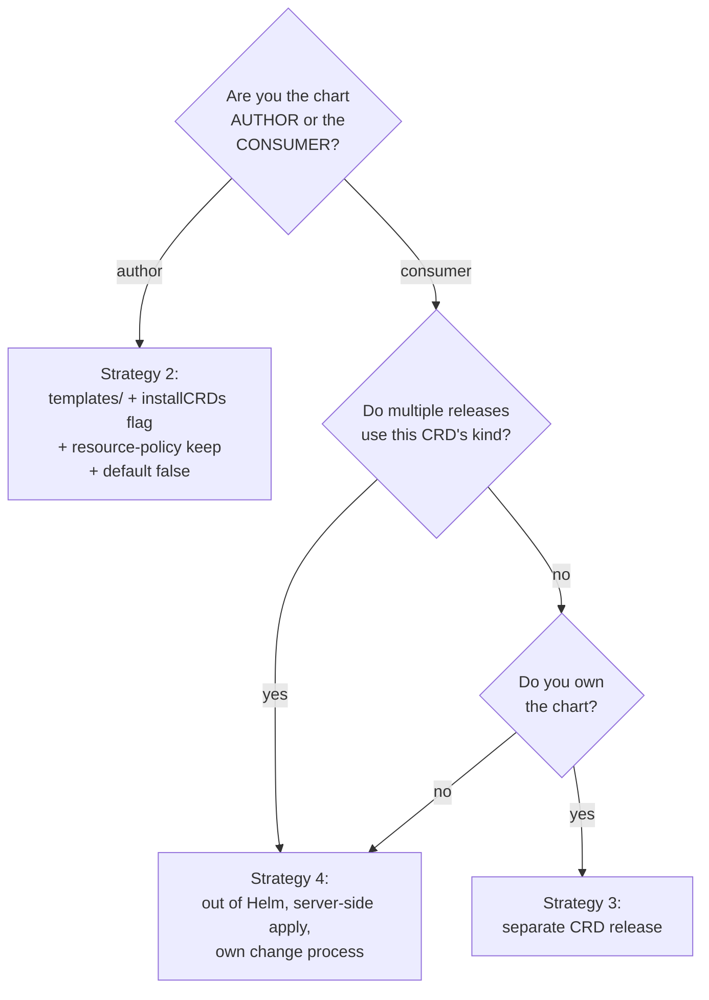

# CRDs and the Helm Blind Spot

Helm has one documented, deliberate, unconfigurable refusal:

> **Helm installs the contents of `crds/` on first install, and then never touches them again.**
> Not on `helm upgrade`. Not on `helm rollback`. Not on `helm uninstall`.

This is not a limitation waiting to be fixed. It is a decision, and the reasoning behind it is
sound: **deleting a CustomResourceDefinition deletes every custom resource of that kind in the
entire cluster.** If `helm uninstall cert-manager` removed the `Certificate` CRD, it would silently
delete every `Certificate` in every namespace, including the ones belonging to other teams and
other releases. Helm's authors decided no package manager should be able to do that as a side
effect of an uninstall, and they were right.

The consequence is that **you have a CRD lifecycle problem and Helm is not going to solve it for
you.** This doc is about recognising that you have it, and the four ways to handle it.

## Why a CRD is different from everything else in a chart

Three properties, and each one is the reason for one of the failures below.

**A CRD is cluster-scoped and shared.** A `Deployment` belongs to one namespace and one release. A
CRD belongs to the cluster, and every release that creates resources of that kind depends on it.
So "which release owns this CRD" often has no good answer — at Riverbend, 240 service releases all
create `ServiceMonitor` objects, and the CRD arrived with the `kube-prometheus-stack` release,
which is owned by a different team.

**A CRD's schema is a contract with data at rest.** If you remove a field from a CRD's schema,
existing stored objects that have that field become... complicated. The API server validates on
write, not on read, so the field survives in `etcd` but is **pruned** from what you get back if
`preserveUnknownFields` is false, which is mandatory for `apiextensions.k8s.io/v1`. So a schema
narrowing does not error; it silently makes data invisible.

**A CRD deletion cascades.** Deleting a CRD triggers deletion of every resource of that kind,
cluster-wide, which in turn triggers their finalizers, which may block, which leaves the CRD in
`Terminating` forever. `C-10`.

## The four strategies

There are exactly four places CRDs can live, and each is right in some situation. Here they are
with the honest trade-off.

### Strategy 1 — `crds/` in the chart

```
charts/prometheus-operator/
├── Chart.yaml
├── crds/
│   ├── prometheuses.yaml
│   ├── servicemonitors.yaml
│   └── ...
└── templates/
    └── deployment.yaml
```

**Behaviour.** Applied before everything else in the release, on install only. Not templated —
`{{ }}` in these files is literal text. Never upgraded, never deleted.

**Good for:** a first install with no prior state. It is a genuine ordering guarantee — the CRD
exists before any template that references it, which the kind-sort (`T-13`) cannot promise.

**Bad because:** the upgrade story is "the user has to know". Which they do not.

**Verdict:** correct for a chart whose users install it once into a fresh cluster and never
upgrade. That describes almost nobody.

### Strategy 2 — CRDs in `templates/` behind a flag

```yaml
# templates/crds.yaml
{{- if .Values.installCRDs }}
{{- range $path, $_ := .Files.Glob "crd-files/**.yaml" }}
{{ $.Files.Get $path }}
---
{{- end }}
{{- end }}
```

**Behaviour.** Now they are ordinary manifest objects. Helm upgrades them, rolls them back, and —
⚠️ — **deletes them on uninstall, taking every custom resource in the cluster with them.**

**Good for:** the upgrade actually works. `helm upgrade` applies the new schema. This is why
cert-manager, and most mature projects, converged on this shape with `installCRDs: false` as the
default.

**Bad because:** the uninstall is now a cluster-wide data-destruction event, and the ordering
guarantee is gone (CRDs sort before most things in the kind order but still inside the manifest, so
`--wait` and hook interleaving can bite).

**Mitigate the uninstall risk with `resource-policy: keep`:**

```yaml
{{- if .Values.installCRDs }}
apiVersion: apiextensions.k8s.io/v1
kind: CustomResourceDefinition
metadata:
  name: prometheuses.monitoring.coreos.com
  annotations:
    "helm.sh/resource-policy": keep
{{- end }}
```

Now upgrade works and uninstall leaves them. ⚠️ And you have created an orphan that blocks
reinstall with `R-07` — which for a CRD is arguably the right trade, because you would rather be
told to think about it than lose every `Prometheus` object.

**Verdict:** the best option available *inside* a chart, with `resource-policy: keep` and a default
of `false`. This is what to do if you are a chart author.

### Strategy 3 — a separate CRD-only release

```bash
helm upgrade prometheus-operator-crds ./charts/prometheus-operator-crds \
  --install -n observability --atomic
helm upgrade kube-prometheus-stack prometheus-community/kube-prometheus-stack \
  --install -n observability --skip-crds -f values.yaml
```

**Behaviour.** The CRDs are a first-class release with their own version, history, and rollback.

**Good for:** the lifecycle is explicit and auditable. `helm history prometheus-operator-crds` tells
you when the schema last changed, which is genuinely useful during an incident.

**Bad because:** two releases to keep in step, and Helm will not enforce the ordering between them.
And uninstalling the CRD release still cascades.

**Verdict:** good when you own both charts and can enforce the ordering in your pipeline. It is
what Northlight does for its mesh CRDs.

### Strategy 4 — CRDs out of Helm entirely

```bash
kubectl apply --server-side --force-conflicts -f crds/
```

managed by a separate pipeline, a Flux `Kustomization`, or an Argo CD Application with a sync wave
that runs first.

**Behaviour.** Helm never sees them. `--skip-crds` on every chart, or charts whose `installCRDs`
defaults to false.

**Good for:** CRDs are cluster infrastructure, versioned and rolled out like cluster infrastructure,
with their own change process. Which is what they are. Server-side apply handles the large-object
problem (`C-05`) and field ownership properly.

**Bad because:** it is another thing to run, and a new cluster needs it before anything else.

**Verdict: this is the right answer for a platform team.** Riverbend arrived here after `CS-3`, and
the argument that settled it was not technical: **a CRD schema change affects every team in the
cluster, so it should go through a change process that every team can see, not arrive as a side
effect of one team's chart bump.**

⚠️ `--server-side` is not optional at scale. See `C-05`.

### Choosing



The question in the middle is the important one. **A CRD whose kind is used by more than one
release is shared infrastructure**, and shared infrastructure does not belong inside one release.

## The `C-` failure catalogue

### C-01 · The chart upgraded and the CRD did not

**What you see.** The operator is on v2, its CRD is the v1 schema, and a field you set in a custom
resource is silently absent when you read the object back. Or the controller logs
`unknown field "spec.scrapeProtocols"` and ignores half its configuration.

**Mechanism.** `helm upgrade` skips `crds/` entirely. The new controller writes and expects the new
schema; the API server validates and **prunes** against the old one. Because
`apiextensions.k8s.io/v1` requires structural schemas with pruning enabled, a field the schema does
not know about is removed from the stored object without error.

So this failure is **silent in both directions**: no error on write, and the field is simply not
there on read.

**Confirm it.** Compare the installed CRD against the one the chart shipped:

```bash
# What is installed
kubectl get crd prometheuses.monitoring.coreos.com \
  -o jsonpath='{.metadata.annotations.controller-gen\.kubebuilder\.io/version}{"  "}{.spec.versions[*].name}{"\n"}'

# What the chart you just installed contains
helm pull prometheus-community/kube-prometheus-stack --version 66.2.1 --untar -d /tmp/kps
grep -h 'controller-gen.kubebuilder.io/version' /tmp/kps/kube-prometheus-stack/charts/crds/crds/*prometheuses* 2>/dev/null
```

A direct field-level check, which is the one that actually answers "is my field there":

```bash
kubectl get crd prometheuses.monitoring.coreos.com -o json \
  | jq '.spec.versions[] | select(.name=="v1") | .schema.openAPIV3Schema.properties.spec.properties
        | has("scrapeProtocols")'
```

And the generic detector — write a field and see whether it survives:

```bash
kubectl patch prometheus -n observability riverbend --type=merge \
  -p '{"spec":{"scrapeProtocols":["PrometheusProto"]}}'
kubectl get prometheus -n observability riverbend -o jsonpath='{.spec.scrapeProtocols}{"\n"}'
# Empty output = the field was pruned = your CRD is stale
```

**Recover.** Apply the CRDs for the version you are running:

```bash
kubectl apply --server-side --force-conflicts \
  -f https://raw.githubusercontent.com/prometheus-operator/prometheus-operator/v0.78.2/example/prometheus-operator-crd/
```

Then re-apply your custom resources, because the fields that were pruned are gone from storage and
re-applying the CRD does not bring them back. ⚠️ This is the step people miss: fixing the schema
does not repair the data. Anything that was pruned must be written again.

**Prevent.** Strategy 4, plus a check that the installed CRD matches the operator version. Worth
running as a scheduled job because it is silent otherwise:

```bash
# For each operator release, compare its appVersion against what its CRDs claim
helm list -A -o json | jq -r '.[] | "\(.namespace)\t\(.name)\t\(.app_version)"' \
  | while IFS=$'\t' read -r ns name ver; do
      case "$name" in
        *prometheus*|*cert-manager*|*external-secrets*|*istio*)
          echo "$ns/$name app_version=$ver — verify CRDs manually against this version" ;;
      esac
    done
```

That is deliberately a reminder rather than an automated assertion, because the mapping from
operator version to CRD version is project-specific and a script that guesses it wrong is worse
than a checklist item.

### C-02 · Uninstall deleted every custom resource in the cluster

**What you see.** `helm uninstall` of a monitoring stack, and suddenly every `ServiceMonitor` in
every namespace is gone — including the 240 owned by service charts that had nothing to do with
this release.

**Mechanism.** Strategy 2 without `resource-policy: keep`. The CRD was an ordinary manifest object,
so uninstall deleted it, and Kubernetes garbage-collected every resource of that kind.

**Confirm it before you do it.** This is a pre-flight check, not a diagnosis, and it takes five
seconds:

```bash
REL=kube-prometheus-stack; NS=observability

# Will this uninstall delete any CRDs?
helm get manifest "$REL" -n "$NS" \
  | yq -r 'select(.kind=="CustomResourceDefinition") |
      "\(.metadata.name)\tkeep=\(.metadata.annotations["helm.sh/resource-policy"] // "NO")"'

# If so, how many objects would go with each one?
helm get manifest "$REL" -n "$NS" \
  | yq -r 'select(.kind=="CustomResourceDefinition") | .spec.names.plural + "." + .spec.group' \
  | while read -r kind; do
      printf '%-50s %s objects cluster-wide\n' "$kind" "$(kubectl get "$kind" -A --no-headers 2>/dev/null | wc -l)"
    done
```

⚠️ **Run this before every `helm uninstall` of anything that ships CRDs.** It is the difference
between an uninstall and an incident, and it is two commands.

**Recover.** Reapply the CRDs, then recreate every custom resource. For CRs created by charts, that
is a `helm upgrade` of each owning release — at Riverbend, 240 of them, which is a scripted pass
that takes twenty minutes and is why this is worth preventing.

**Prevent.** `helm.sh/resource-policy: keep` on every CRD in `templates/`, or strategy 4.

### C-03 · A CRD and a resource of that kind in the same release

**What you see.**

```
Error: INSTALLATION FAILED: unable to build kubernetes objects from release manifest:
resource mapping not found for name: "riverbend" namespace: "observability" from "":
no matches for kind "Prometheus" in version "monitoring.coreos.com/v1"
ensure CRDs are installed first
```

**Mechanism.** Helm builds *all* objects from the manifest before applying any of them, and
building requires the API server to recognise the kind. A CRD in `templates/` is not installed at
build time, so a CR of that kind in the same manifest cannot be built. The error message says
exactly this, which makes it one of Helm's better errors.

⚠️ Note this is not a race that sometimes works — it fails deterministically, because the failure is
at build time rather than apply time.

**Recover.** Two applies. Install with the CRD only, then install the rest. Or, if the CRD is in
`crds/`, it is applied before the build and the problem does not exist — which is the one thing
`crds/` is unambiguously good at.

**Prevent.** Never put a CRD and a resource of that kind in one release. The CRD goes in `crds/`,
in a separate release, or outside Helm.

### C-04 · `--skip-crds` and now nothing installs them

**What you see.** `C-03`'s error on a fresh cluster, from a chart that used to work.

**Mechanism.** Somebody added `--skip-crds` to fix `R-05` (the 1 MiB Secret limit) and did not add
the separate CRD apply. The existing clusters were fine because the CRDs were already there; the
new cluster was not.

**Prevent.** ⚠️ **`--skip-crds` is half a change.** The other half is a CRD apply step that runs
first, and it belongs in the same commit. A cluster-bootstrap test — build a fresh `kind` cluster
and run your whole install sequence in CI, weekly — is the only thing that reliably catches this
class, because every incremental change works on an existing cluster.

### C-05 · `metadata.annotations: Too long: must have at most 262144 bytes`

**What you see.**

```
The CustomResourceDefinition "prometheuses.monitoring.coreos.com" is invalid:
metadata.annotations: Too long: must have at most 262144 bytes
```

**Mechanism.** Client-side `kubectl apply` stores the entire applied object in the
`kubectl.kubernetes.io/last-applied-configuration` annotation, so it can compute a diff next time.
Kubernetes caps total annotations at 256 KiB. A Prometheus Operator CRD embeds the full OpenAPI
schema for every Prometheus setting and is comfortably over that on its own.

So the object fits in `etcd` (under the 1.5 MiB request limit) but cannot be applied client-side,
because applying it doubles it.

**Recover.** Server-side apply, which keeps field ownership in `metadata.managedFields` instead of
an annotation:

```bash
kubectl apply --server-side --force-conflicts -f crds/
```

⚠️ `--force-conflicts` is usually needed the first time, because the object may already have
client-side-apply ownership from a previous `kubectl apply`, and server-side apply refuses to take
over a field another manager claims. `--force-conflicts` takes ownership. Read the conflict list
before you force it if the CRD was managed by something you care about.

**Prevent.** Use `--server-side` for CRDs unconditionally. There is no downside for this object
class and it removes the entire failure.

### C-06 · A rollback reverted a CRD schema

**What you see.** After `helm rollback`, custom resources that used a new field stop working, and
the field has disappeared from them.

**Mechanism.** Under strategy 2, the CRD is an ordinary object, so rollback restores the *old*
schema — and pruning then removes the new fields from every stored object of that kind. The
rollback did exactly what it was asked to do, and it destroyed data across the cluster.

**Confirm it.** After any rollback of a chart carrying CRDs, check what the schema now accepts, per
`C-01`.

**Prevent.** This is the strongest argument for strategy 4. **A CRD schema should never be rolled
back automatically**, for the same reason a `pre-rollback` migration should not run automatically
(`H-08`): rollback is triggered by a failure, with no human deciding, and the operation is
destructive to data outside the release.

If you must keep CRDs in `templates/`, `resource-policy: keep` also protects against this, because
Helm excludes kept resources from its deletion and update path.

### C-07 · Conversion webhooks and ordering

**What you see.** Every read of a custom resource fails with
`conversion webhook for ...: dial tcp: connect: connection refused`. Or a namespace stuck in
`Terminating` because the webhook that could convert its resources is gone.

**Mechanism.** A CRD with multiple versions and a `conversionStrategy: Webhook` routes every read
and write through a pod. That creates two ordering hazards:

- **On install or upgrade**, the CRD exists before the webhook pod is ready, so any read of that
  kind in the window fails. Helm's `--wait` does not know about this, and a `post-install` hook
  that reads a CR will fail.
- **On uninstall**, deleting the webhook Deployment before the custom resources means the resources
  can no longer be read or deleted, because conversion is impossible. Helm's delete order is
  roughly the reverse of install order, which puts Deployment deletion before... nothing useful,
  because the CRs are not in this release's manifest at all. So you get resources that cannot be
  deleted and a namespace that will not terminate.

**Confirm it.**

```bash
kubectl get crd -o json | jq -r '.items[]
  | select(.spec.conversion.strategy=="Webhook")
  | "\(.metadata.name)\t\(.spec.conversion.webhook.clientConfig.service.namespace)/\(.spec.conversion.webhook.clientConfig.service.name)"'
```

Every row is a CRD whose readability depends on a running pod. Check those pods are healthy before
touching anything.

**Recover.** Bring the webhook back. If the Deployment is gone, recreate it from the chart — you
may need to `helm rollback` or re-install the operator release just to restore the webhook so the
resources become deletable. In the truly stuck case, removing the finalizer from the CRs by hand,
after removing the conversion strategy from the CRD, is the escape hatch; it is data-destructive
and should be a last resort.

**Prevent.** Uninstall in the right order, deliberately: delete the custom resources first, then
the operator, then the CRDs. And **never let a conversion webhook be in the same release as the
CRDs that depend on it** — which is strategy 4 again.

### C-08 · Two charts shipping the same CRD at different versions

**What you see.** A chart upgrade that reverts another chart's CRD. Two releases that fight, with
the schema flipping between two versions every time either one is deployed.

**Mechanism.** CRDs are cluster-scoped and named globally. If `kube-prometheus-stack` ships
`servicemonitors.monitoring.coreos.com` and a vendor's chart also ships it (bundled at an older
version, as vendors do), then whichever deployed most recently wins.

**Confirm it.** Find CRDs claimed by more than one release:

```bash
kubectl get crd -o json | jq -r '.items[]
  | select((.metadata.annotations // {}) | has("meta.helm.sh/release-name"))
  | "\(.metadata.annotations["meta.helm.sh/release-name"])\t\(.metadata.name)"' \
  | sort -k2 | awk -F'\t' '{if ($2==p) print "CONTESTED: " $2 " (also " $1 ")"; p=$2}'
```

⚠️ This only finds CRDs from strategy 2 — anything installed from `crds/` carries no ownership
annotation at all, which means **you cannot tell from the cluster which release installed it.** That
absence of provenance is itself an argument for strategy 4, where the provenance is your CRD
pipeline.

**Prevent.** One owner per CRD, declared somewhere a human can read. Strategy 4 makes that owner
the platform team by construction. Where a vendor chart insists on bundling CRDs, use its
`--skip-crds` equivalent and accept that you now have to track the version compatibility yourself.

### C-09 · A version was removed from `spec.versions` and stored objects became unreadable

**What you see.** `kubectl get` on a custom resource returns
`conversion webhook ... no kind "Foo" is registered for version "v1alpha1"`, or the objects simply
do not appear.

**Mechanism.** A CRD's `spec.versions` lists served versions, and exactly one has
`storage: true` — the version objects are actually persisted as. Removing a version from the list
means the API server can no longer serve it. If any object is still *stored* at that version, it
becomes unreadable.

The correct sequence for retiring a version is: add the new version as served, flip `storage` to
the new version, **rewrite every existing object** so it is stored at the new version (a no-op
`kubectl get -o yaml | kubectl apply` pass, or `kubectl patch` with an empty merge), update
`status.storedVersions` on the CRD, and only then remove the old version. Operators that manage
their own CRDs generally do this; a chart that drops a version from a YAML file does not.

**Confirm it.** `status.storedVersions` is the authoritative answer to "what versions does data
actually exist at":

```bash
kubectl get crd prometheuses.monitoring.coreos.com \
  -o jsonpath='served={.spec.versions[*].name}{"\n"}stored={.status.storedVersions[*]}{"\n"}'
```

If `storedVersions` contains anything not in `served`, you have objects you cannot read.

**Prevent.** Never hand-edit a CRD's version list. Let the operator manage it, or follow the full
sequence above as a deliberate, documented migration.

### C-10 · Finalizers on custom resources blocking deletion

**What you see.** `kubectl delete namespace pr-4471` hangs forever in `Terminating`.

**Mechanism.** A custom resource has a finalizer; the controller that would remove the finalizer is
gone (uninstalled first); so the resource cannot be deleted; so the namespace cannot terminate.
Extremely common with per-PR environments that install an operator and then delete the namespace.

**Confirm it.** Find what is blocking:

```bash
kubectl get namespace pr-4471 -o json | jq '.status.conditions'
# The decisive one: what is left in the namespace?
kubectl api-resources --verbs=list --namespaced -o name \
  | xargs -n1 -I{} sh -c 'kubectl get {} -n pr-4471 --no-headers 2>/dev/null | sed "s|^|{} |"' \
  | grep -v '^$'
```

**Recover.** Bring the controller back so it can finalise properly. If that is not possible,
removing the finalizer is the escape hatch:

```bash
# ⚠️ This abandons whatever external cleanup the finalizer existed to do —
# an S3 bucket, a DNS record, a cloud load balancer. Know what you are skipping.
kubectl patch certificate -n pr-4471 checkout-tls \
  --type=json -p '[{"op":"remove","path":"/metadata/finalizers"}]'
```

**Prevent.** Teardown order for ephemeral environments: delete the application releases, wait,
*then* delete the namespace. Or install operators once per cluster rather than once per ephemeral
environment, which removes the problem and is cheaper anyway.

## What to take away

1. **Helm installs `crds/` once and never touches it again** — not on upgrade, rollback, or
   uninstall. This is deliberate, because deleting a CRD deletes every resource of that kind
   cluster-wide, and no package manager should do that as a side effect.
2. **The consequence is that you own the CRD lifecycle.** The failure when you do not is silent in
   both directions: no error on write, and the unknown field is pruned from what you read back.
3. **A CRD used by more than one release is shared infrastructure** and does not belong inside one
   release. That question — how many releases use this kind — is the one that decides your strategy.
4. **Chart authors: `templates/` plus an `installCRDs` flag defaulting to false, plus
   `helm.sh/resource-policy: keep`.** Upgrade works, uninstall does not destroy the cluster's data,
   and the orphan that blocks reinstall is the right thing to be stopped by.
5. **Platform teams: take CRDs out of Helm.** `kubectl apply --server-side` from a pipeline with its
   own change process. The argument is not technical — a schema change affects every team, so it
   should be visible to every team rather than arriving inside one team's chart bump.
6. **`--server-side` is required, not optional.** Client-side apply stores the whole object in an
   annotation, and large CRDs exceed the 256 KiB annotation cap.
7. **`--skip-crds` is half a change.** The other half is the CRD apply step, in the same commit, and
   a fresh-cluster bootstrap test is the only thing that catches the omission — because every
   incremental change works on a cluster that already has them.
8. **Before any `helm uninstall`, check whether the release owns CRDs and how many objects depend
   on them.** Two commands, and it is the difference between an uninstall and an incident.
9. **Never roll a CRD schema back automatically.** Rollback is triggered by a failure with no human
   deciding, and reverting a schema prunes fields from stored objects across the cluster.
10. **Conversion webhooks make a CRD's readability depend on a running pod.** Delete the resources,
    then the operator, then the CRDs — in that order — or you get objects that cannot be read and a
    namespace that will not terminate.
