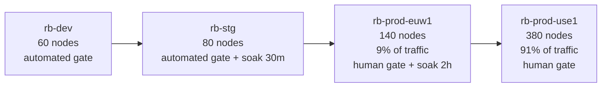

# Multi-Environment and Multi-Cluster — Layering, Promotion, and Drift

Riverbend runs 240 services across four clusters. That is 816 service releases (doc 00's
arithmetic: 240 + 240 + 240 + 96), and the question this doc answers is: **where does the
difference between them live?**

There are only two possible answers, and almost every problem here comes from choosing the wrong
one or from letting them mix:

> **A difference between environments belongs in the environment's values, or it belongs in the
> chart with the environment as an input. The first is configuration; the second is logic. The
> first scales to a new environment for free; the second requires editing every chart.**

The second thesis, which is about promotion:

> **Promotion means the same artefact, with different values, verified in order.** If your
> production deploy renders a different chart than your staging deploy verified, you did not
> promote anything — you deployed twice and hoped.

## The four layouts people try

### Layout 1 — one values file per environment

```
charts/checkout-api/
  Chart.yaml
  values.yaml              # defaults + documentation
envs/
  dev.yaml
  stg.yaml
  prod-use1.yaml
  prod-euw1.yaml
```

```bash
helm upgrade checkout-api ./charts/checkout-api -n checkout -f envs/prod-use1.yaml
```

**Good.** Simple, obvious, one file per environment, easy to diff two environments by diffing two
files.

**Breaks when** the four files are 80% identical, which they become. Then a change that should apply
everywhere has to be made four times, and the fourth one gets forgotten. That is `E-05`, and it is
the single most common multi-environment failure.

**Verdict:** correct for two or three environments. Riverbend outgrew it at four clusters × two
tiers of criticality.

### Layout 2 — layered values files

```
envs/
  00-base.yaml            # everything common. The biggest file.
  10-nonprod.yaml         # relaxed limits, debug logging, no PDB
  10-prod.yaml            # strict limits, warn logging, PDB
  20-dev.yaml             # just the dev-specific facts
  20-stg.yaml
  20-prod-use1.yaml       # just the use1-specific facts: replicas, IRSA role, hostname
  20-prod-euw1.yaml
```

```bash
helm upgrade checkout-api ./charts/checkout-api -n checkout \
  -f envs/00-base.yaml -f envs/10-prod.yaml -f envs/20-prod-use1.yaml
```

**Good.** A common change is one edit to `00-base.yaml`. The per-environment files shrink to the
genuinely-specific facts, which at Riverbend is 6 to 11 keys each. A new region is one small file.

**Breaks when** the layering gets deep enough that finding where a value comes from requires
running Helm. Three layers is comfortable; five is not.

**The naming matters.** `00-`, `10-`, `20-` prefixes make lexical order match precedence order, so a
glob is harmless and the order is self-documenting. Doc 03, `V-05`, is why this is worth doing.

**Verdict: this is the right answer for most organisations**, and it is what Riverbend uses.

### Layout 3 — one chart per environment

```
charts/checkout-api-dev/
charts/checkout-api-prod/
```

**Verdict: no.** This is layout 1 with the duplication moved somewhere worse, because now the
*templates* diverge too. If you have inherited this, the migration is to layout 2, and the first
step is diffing the renders to find out what actually differs.

### Layout 4 — environments inside the chart

```yaml
# templates/deployment.yaml
replicas: {{ if eq .Values.environment "prod-use1" }}24{{ else if eq .Values.environment "prod-euw1" }}9{{ else }}2{{ end }}
```

**Verdict: no, and this is the one to actively remove.** It is `E-01`, and it deserves its own
scenario because of how it arrives: not as a decision, but as one `if` that was quicker than
touching four files, followed by nine more over a year.

## What belongs in the chart, and what belongs in the environment

The test, and it is a good one:

> **If standing up a new environment requires editing the chart, the chart contains environment
> logic and should not.**

Applied to Riverbend's actual values:

| Fact | Where | Why |
|---|---|---|
| `replicaCount`, `resources` | Environment | Capacity is per-environment by definition |
| `image.tag` | Neither — the deploy command | It changes per deploy, not per environment |
| `ingress.host` | Environment | Derived from `global.baseDomain`, which is an environment fact |
| `serviceAccount.annotations` (the IRSA role ARN) | Environment | Per-account IAM. ⚠️ See `E-07` |
| `logLevel` | Environment | Debug in dev, warn in prod |
| `tier` | **Chart** | A service's criticality is a property of the service, not the cluster |
| `podSecurityContext`, `seccompProfile` | **Library chart** | Platform decision. Nobody differs legitimately |
| `topologySpreadConstraints` | **Library chart**, derived from `tier` | Platform decision |
| `terminationGracePeriodSeconds` | **Library chart**, derived from `tier` | Platform decision |
| Kafka bootstrap servers | Environment, under `global` | One cluster-wide fact many services need |
| Database hostname | Environment | Per-cluster |
| Feature flags | **Neither.** A flag service | Doc 01, use case 5 |

Note `tier` being in the chart, not the environment. That is the interesting one: it means
`checkout-api` is tier 1 in dev too, so its dev deployment has the same PDB semantics and the same
topology spread. That costs a little capacity in dev and buys you a dev environment that behaves
like production, which is the entire point of having one.

## Promotion

**What promotion should mean:** the same chart version and the same image digest, deployed to a
sequence of environments, with a gate between each.

```bash
# CI, on merge to main. Build once.
CHART_VER=$(yq -r '.version' charts/checkout-api/Chart.yaml)
IMG_DIGEST=$(crane digest "registry.riverbend.internal/checkout-api:${GIT_SHA}")

helm package charts/checkout-api --version "$CHART_VER" -d /tmp
helm push "/tmp/checkout-api-${CHART_VER}.tgz" oci://registry.riverbend.internal/charts

# Then promote THAT artefact, unchanged, through the ladder.
for stage in dev stg prod-use1 prod-euw1; do
  await_gate "$stage"       # automated checks for dev/stg, human approval for prod
  helm upgrade checkout-api \
    "oci://registry.riverbend.internal/charts/checkout-api" --version "$CHART_VER" \
    --install -n checkout --kube-context "rb-${stage}" \
    -f "envs/00-base.yaml" -f "envs/10-$(tier_of "$stage").yaml" -f "envs/20-${stage}.yaml" \
    --set-string "image.digest=${IMG_DIGEST}" \
    --atomic --timeout 8m --history-max 5 --wait-for-jobs \
    --description "$CI_PIPELINE_URL"
done
```

Three properties of that loop are the whole point, and losing any one of them breaks promotion:

**The chart version is resolved once, at the top.** Not `./charts/checkout-api` in each stage — a
packaged, pushed, immutable artefact. Otherwise a commit landing mid-promotion means production gets
a chart staging never saw.

**The image is a digest, not a tag.** Otherwise a rebuild of the same tag means production runs
different bytes.

**Only the values files change between stages.** If anything else differs — a flag, a `--set`, a
different chart path — you are not promoting.

⚠️ **The common failure is a `--set` that differs per stage.** Somebody adds
`--set debug.enabled=true` for dev, then a second one, and within six months the production command
and the dev command share only the word `helm`. Every per-stage difference belongs in
`envs/20-${stage}.yaml`, where it is visible, committed, and diffable.

## Per-region and per-cell rollout

Riverbend has two production clusters. Northlight has more, and Lumen (500M DAU) more still. Once
you have more than one production cluster, **"deploy to production" is not one action**, and the
ordering is a safety mechanism you should design deliberately.

The ladder, from smallest blast radius to largest:



⚠️ Note the smaller production cluster goes **first**. That is deliberate and it is the opposite of
what people do by default, which is to deploy to the big one because that is where the traffic is
and therefore where you find problems. The reason to invert it: **a bad deploy to `euw1` affects 9%
of customers, and a bad deploy to `use1` affects 91%.** You want the smaller exposure to be the one
that finds the problem.

The cost of this ordering is honest and worth naming: `euw1` carries less traffic, so it is a
*weaker* test — some problems only appear at `use1`'s volume. The mitigation is a soak period long
enough for the traffic `euw1` does have to exercise the change, plus the acceptance that
volume-dependent problems will be found in `use1` and must therefore be quickly rollback-able. This
is a trade-off, not a solution.

**The mechanism** for driving this is one of three, and you should pick one rather than scripting
it by hand:

**Helmfile environments:**

```yaml
# helmfile.yaml
environments:
  dev:       { values: [envs/00-base.yaml, envs/10-nonprod.yaml, envs/20-dev.yaml] }
  stg:       { values: [envs/00-base.yaml, envs/10-nonprod.yaml, envs/20-stg.yaml] }
  prod-euw1: { values: [envs/00-base.yaml, envs/10-prod.yaml,    envs/20-prod-euw1.yaml] }
  prod-use1: { values: [envs/00-base.yaml, envs/10-prod.yaml,    envs/20-prod-use1.yaml] }
---
releases:
  - name: checkout-api
    namespace: checkout
    chart: oci://registry.riverbend.internal/charts/checkout-api
    version: {{ requiredEnv "CHART_VER" }}
    atomic: true
    timeout: 480
    values:
      - image:
          digest: {{ requiredEnv "IMG_DIGEST" }}
```

```bash
helmfile -e prod-euw1 diff      # review first
helmfile -e prod-euw1 apply
```

**Argo CD `ApplicationSet`** with a cluster generator, which fans one template across clusters and
gives you a UI showing sync state per cluster. Doc 11.

**Flux `HelmRelease` per cluster**, with the cluster's own repository directory. Doc 11.

Riverbend uses Helmfile for platform components and Argo CD `ApplicationSet` for the 240 services,
which is a split doc 11 argues for.

## The `E-` failure catalogue

### E-01 · Environment logic inside the chart

**What you see.** A chart containing `{{ if eq .Values.global.region "euw1" }}`. Standing up a fifth
cluster requires a pull request to 240 charts.

**Mechanism.** It arrives one `if` at a time, because a conditional is quicker than editing four
values files. Nobody decides to do it.

**Confirm it.** Grep the fleet:

```bash
grep -rn --include='*.yaml' --include='*.tpl' \
  -E '(eq|ne)[[:space:]]+\.Values\.(global\.)?(environment|env|region|cluster|stage)' \
  charts/ | tee /tmp/envlogic
wc -l < /tmp/envlogic
```

Any output is environment logic in a chart. At Riverbend this found 34 occurrences across 19 charts
the first time it was run.

**Recover.** Each one becomes a value. Mechanically:

```yaml
# Before, in templates/deployment.yaml
{{- if eq .Values.global.region "euw1" }}
        - name: GDPR_STRICT_MODE
          value: "true"
{{- end }}
```

```yaml
# After: templates/deployment.yaml uses the extraEnv map (doc 03) and nothing else changes.
# envs/20-prod-euw1.yaml gains:
extraEnv:
  GDPR_STRICT_MODE: "true"
```

The chart no longer knows what a region is. Adding a fifth cluster is a new
`envs/20-prod-apse1.yaml`, and the charts are untouched.

**Prevent.** The grep above as a CI check, and the test from earlier in this doc: **if a new
environment requires editing the chart, the chart has environment logic.** Make that a review
question for anything touching a template.

⚠️ The legitimate exception, and there is exactly one worth allowing: a `{{ if .Capabilities... }}`
or a value-driven conditional for a *capability* the cluster either has or does not — an API version,
a CRD, a storage class. That is not environment logic; it is a capability check, and doc 02's
`T-10` argues for expressing it as a value anyway.

### E-02 · Values files that are 80% identical

**What you see.** Four files, each 180 lines, differing in 11 places.

**Mechanism.** Layout 1 at four environments.

**Confirm it.** Measure the actual overlap:

```bash
for a in dev stg prod-use1 prod-euw1; do
  yq -o=props '.' "envs/${a}.yaml" | sed 's/ = .*//' | sort > "/tmp/keys-$a"
done
echo "keys present in all four:  $(comm -12 /tmp/keys-dev /tmp/keys-prod-use1 | wc -l)"
echo "keys with IDENTICAL values in all four:"
for a in dev stg prod-use1 prod-euw1; do yq -o=props '.' "envs/${a}.yaml"; done \
  | sort | uniq -c | awk '$1==4 {print "  " $2}' | head -40
```

Every key in that last list is a candidate for `00-base.yaml`.

**Recover.** Migrate to layout 2, and verify the migration is a no-op by comparing renders before
and after:

```bash
for e in dev stg prod-use1 prod-euw1; do
  helm template checkout-api ./charts/checkout-api -f "envs/${e}.yaml" > "/tmp/before-$e.yaml"
done
# ... do the refactor into 00-base / 10-tier / 20-env ...
for e in dev stg prod-use1 prod-euw1; do
  tier=$([[ $e == prod-* ]] && echo prod || echo nonprod)
  helm template checkout-api ./charts/checkout-api \
    -f envs/00-base.yaml -f "envs/10-${tier}.yaml" -f "envs/20-${e}.yaml" > "/tmp/after-$e.yaml"
  diff -u "/tmp/before-$e.yaml" "/tmp/after-$e.yaml" && echo "$e: identical ✓"
done
```

⚠️ That diff-the-renders check is what makes a values refactor safe to do at all. Without it, a
layering refactor across 240 charts is an unbounded risk; with it, it is mechanical.

### E-03 · The production deploy rendered a different chart than staging

**What you see.** A change that worked in staging and behaved differently in production, with no
values difference to explain it.

**Mechanism.** The promotion used a chart *path* rather than a pinned artefact, and a commit landed
between the staging deploy and the production deploy. Or two pipelines were in flight and the
production stage of pipeline A ran after the staging stage of pipeline B.

**Confirm it.** The chart version is in `helm list` and in the release metadata:

```bash
for c in rb-stg rb-prod-use1; do
  printf '%-16s ' "$c"
  helm list -n checkout --kube-context "$c" -o json \
    | jq -r '.[] | select(.name=="checkout-api") | "chart=\(.chart)  updated=\(.updated)"'
done
```

Different chart versions across the ladder for what was supposed to be one promotion is the
diagnosis.

**Prevent.** Package and push once, promote by version. And make the pipeline carry the version
through explicitly rather than recomputing it per stage — `requiredEnv "CHART_VER"` in the Helmfile
above fails loudly if it is not set, which is better than defaulting to something.

### E-04 · Staging is not staging

**What you see.** "It worked in staging" as a recurring phrase in postmortems.

**Mechanism.** Staging differs from production in ways nobody wrote down. The real list at
Riverbend, found by running the audit in `E-09`:

- 80 nodes versus 380, so topology spread constraints that are satisfiable in production are not in
  staging (and vice versa — `DoNotSchedule` on a 3-zone spread behaves differently at 80 nodes).
- One Kafka broker set with 3 brokers versus 24, so partition counts differ, so consumer-group
  rebalance behaviour differs.
- No `external-secrets` in staging — secrets were created by hand once. So a chart change affecting
  the `ExternalSecret` was untested.
- A different ingress controller version, two minor versions behind.
- No PodDisruptionBudgets, because somebody disabled them in `10-nonprod.yaml` two years ago to
  make node drains faster in staging.

That last one is the interesting one: **it was a deliberate, reasonable decision that made staging
unable to test the thing it was later needed to test.**

**Confirm it.** `E-09`'s audit.

**Prevent.** Two habits:

1. **Write down every intentional difference**, in a file that lives next to the values, with a
   reason and an owner. `envs/DIFFERENCES.md`. When somebody asks "could this have been caught in
   staging", the answer is in that file.
2. **Minimise the difference list rather than the environment cost.** The instinct is to make
   staging cheap; the useful goal is to make it *representative*. Riverbend's compromise: staging
   runs the same *kinds* of objects with the same *semantics* — PDBs on, spread constraints on,
   external-secrets on, same controller versions — and differs only in *scale*. That costs more than
   the previous staging and it costs far less than a production incident, and the argument that won
   was that a staging environment which cannot test your PDB is not testing your deploy.

### E-05 · A value set in one environment and never in the others

**What you see.** A fix applied in staging that was never applied in production. Or a value added
for a new region that the other three regions silently lack.

**Mechanism.** Layout 1's duplication. Four files, one edit.

**Confirm it.** This is the audit worth running weekly:

```bash
# Keys that exist in SOME environments and not all — each is a potential omission
for e in dev stg prod-use1 prod-euw1; do
  yq -o=props '.' "envs/20-${e}.yaml" 2>/dev/null | sed 's/ = .*//' | sort | sed "s|^|$e |"
done | awk '{print $2}' | sort | uniq -c | awk '$1<4 {print $2}' \
  | while read -r k; do
      printf '%-44s' "$k"
      for e in dev stg prod-use1 prod-euw1; do
        v=$(yq -o=props '.' "envs/20-${e}.yaml" 2>/dev/null | grep -F "$k = " | sed 's/.* = //')
        printf ' %-12s' "${v:-—}"
      done; echo
    done
```

A `—` in a column where the others have values is either a deliberate difference or an omission,
and the point of the report is that somebody has to say which.

**Prevent.** Layout 2 — a common change goes in `00-base.yaml` and applies to all four by
construction. Plus the audit above as a scheduled job whose output goes to the platform channel.

### E-06 · All regions deployed at once

**What you see.** A bad change in every production cluster simultaneously.

**Mechanism.** A `for` loop over clusters with no gate between iterations, or an Argo CD
`ApplicationSet` with auto-sync enabled on every cluster.

**Prevent.** Gates between stages, and for `ApplicationSet` specifically, a **progressive sync
strategy** rather than auto-sync everywhere:

```yaml
apiVersion: argoproj.io/v1alpha1
kind: ApplicationSet
metadata:
  name: checkout-api
spec:
  strategy:
    type: RollingSync
    rollingSync:
      steps:
        - matchExpressions:
            - { key: envLabel, operator: In, values: [dev] }
        - matchExpressions:
            - { key: envLabel, operator: In, values: [stg] }
        - matchExpressions:
            - { key: envLabel, operator: In, values: [prod-euw1] }
        - matchExpressions:
            - { key: envLabel, operator: In, values: [prod-use1] }
  generators:
    - clusters:
        selector:
          matchLabels: { riverbend.io/deploy-target: "true" }
  template:
    # ...
```

⚠️ Each step waits for the previous step's applications to be Healthy before starting. Which means
a resource type Argo CD cannot assess the health of does not gate anything — the same blind spot as
`U-04`, one layer up.

### E-07 · A cluster-specific fact in the wrong layer

**What you see.** A pod that cannot assume its IAM role in one region. A PVC pending because the
storage class does not exist. A node selector matching nothing.

**Mechanism.** A fact that is per-cluster ended up in `00-base.yaml` or in the chart. The usual
culprits:

| Fact | Why it is per-cluster |
|---|---|
| IRSA / workload-identity role ARN | Contains the AWS account ID and the OIDC provider, both per-cluster |
| StorageClass name | `gp3` in one account, `gp3-encrypted` in another |
| Node selector / taint values | Node groups are named per-cluster |
| Ingress class and annotations | Controller version and load-balancer configuration differ |
| Availability-zone names | `us-east-1a` means nothing in `eu-west-1` |
| Kafka bootstrap servers, database hosts | Obviously per-cluster, and still get hard-coded |

**Confirm it.** Look for cluster-shaped strings in the shared layers, which is a grep that catches
most of them:

```bash
grep -nE 'arn:aws|[a-z]{2}-[a-z]+-[0-9][a-z]?|\.internal|[0-9]{12}' \
  envs/00-base.yaml envs/10-prod.yaml envs/10-nonprod.yaml
```

Any hit in a shared layer is a per-cluster fact in the wrong place. (The twelve-digit pattern
catches AWS account IDs, and the region pattern catches both regions and zones.)

**Prevent.** A rule with a machine check: **`00-base.yaml` and `10-*.yaml` contain no account IDs,
no region names, no zone names, and no hostnames.** The grep above as a CI check enforces it, and
the effect is that everything cluster-specific is forced into `20-*.yaml` where it belongs.

### E-08 · Fan-out without a mechanism

**What you see.** A shell script with a cluster list, no state, no visibility into which clusters
succeeded, and a partial failure that nobody notices.

**Mechanism.** `for c in $CLUSTERS; do helm upgrade ...; done` with no error handling.

**Prevent.** Use a tool that tracks per-target state. Helmfile reports per-release outcomes and
exits non-zero. Argo CD shows per-cluster sync status in a UI and in its API. Flux exposes
per-`HelmRelease` conditions you can alert on.

⚠️ At minimum, if you must script it, make partial failure loud:

```bash
failed=()
for c in rb-dev rb-stg rb-prod-euw1 rb-prod-use1; do
  helm upgrade checkout-api "oci://registry.riverbend.internal/charts/checkout-api" \
    --version "$CHART_VER" --install -n checkout --kube-context "$c" \
    -f envs/00-base.yaml -f "envs/10-$(tier_of "$c").yaml" -f "envs/20-${c#rb-}.yaml" \
    --atomic --timeout 8m --history-max 5 || failed+=("$c")
done
if (( ${#failed[@]} )); then
  echo "FAILED in: ${failed[*]}"
  echo "Fleet is now INCONSISTENT — $CHART_VER is deployed in some clusters and not others."
  exit 1
fi
```

The second message is the one that matters. A partial fan-out leaves you in a state nobody
described, and saying so explicitly is better than a non-zero exit code somebody will not read.

### E-09 · The environment-drift audit

Not a failure — the audit that finds `E-04` and `E-05`, and which almost nobody runs.

**What it compares:** the *rendered output* across environments, not the values. Values can differ
legitimately; the question is whether the differences are the ones you intended.

```bash
#!/usr/bin/env bash
# envdrift.sh — compare the rendered manifest of one release across all four clusters
set -euo pipefail
REL=$1; NS=$2
CLUSTERS=(rb-dev rb-stg rb-prod-euw1 rb-prod-use1)

for c in "${CLUSTERS[@]}"; do
  helm get manifest "$REL" -n "$NS" --kube-context "$c" 2>/dev/null \
    | yq -r 'select(.kind!=null) | "\(.kind)/\(.metadata.name)"' | sort > "/tmp/kinds-$c"
done

echo "== objects present in some clusters and not others =="
sort -u /tmp/kinds-rb-* | while read -r kn; do
  line=$(printf '%-44s' "$kn")
  miss=0
  for c in "${CLUSTERS[@]}"; do
    if grep -qxF "$kn" "/tmp/kinds-$c"; then line+="  yes"; else line+="  NO "; miss=1; fi
  done
  (( miss )) && echo "$line"
done

echo
echo "== fields differing between prod clusters (the pair that should match most closely) =="
for c in rb-prod-euw1 rb-prod-use1; do
  helm get values "$REL" -n "$NS" --kube-context "$c" --all -o json \
    | jq -S 'del(.image, .replicaCount, .autoscaling, .ingress.host,
                 .serviceAccount.annotations, .global.region)' > "/tmp/vals-$c.json"
done
diff -u /tmp/vals-rb-prod-euw1.json /tmp/vals-rb-prod-use1.json \
  && echo "  (no unexpected differences)"
```

⚠️ The `del(...)` in the second half is the interesting design decision: it deletes the keys that
are *supposed* to differ, so anything remaining is unexpected. Maintaining that exclusion list is
the work, and it is the same work as writing down your intentional differences — which is `E-04`'s
prevention. The two reinforce each other: the audit's exclusion list *is* the
`envs/DIFFERENCES.md` file, in executable form.

Riverbend runs this nightly for the 30 tier-1 services and reports diffs to the owning team.

### E-10 · Secrets per environment

**What you see.** A secret that exists in staging and not in production, so the production deploy
fails — or worse, succeeds with an empty value.

**Mechanism.** Secrets are the one thing that cannot live in the values layering, so they live in a
separate mechanism, and that mechanism's per-environment coverage is not checked by anything.

**Prevent.** Doc 12. The short version: use the External Secrets Operator so the chart references a
secret *path*, which is a value like any other and therefore participates in the layering and the
audit above. Then "does this secret exist in this environment" becomes a question the
`ExternalSecret`'s status answers, and you can alert on it.

### E-11 · A new environment takes three weeks

**What you see.** Adding a fifth cluster is a quarter-long project.

**Mechanism.** The accumulated cost of everything above: environment logic in charts, cluster facts
in shared layers, secrets created by hand, undocumented differences.

**Confirm it.** Try it. The useful exercise is to actually stand up a throwaway cluster and time
it, because the estimate and the reality differ. At Riverbend the first attempt took eleven days,
of which nine were finding out what was undocumented.

**Prevent.** Treat "stand up a new environment" as a tested capability rather than a rare project.
Concretely: a `kind` or ephemeral cluster in CI, weekly, running the full bootstrap from an empty
cluster to a working `checkout-api`. It is the same test that catches `C-04`, and it is the only
thing that keeps the bootstrap path honest — because every incremental change works on a cluster
that already exists.

### E-12 · Cells and the blast-radius ladder

Northlight (2,500 services, 100,000 sidecars) and Lumen (500M DAU) do not have four clusters; they
have cells. The Helm consequence is that the promotion ladder gets longer and cannot be enumerated
by hand.

**The pattern:** clusters carry labels describing their position in the ladder, and the deploy
mechanism generates targets from the labels rather than from a list:

```yaml
# The cluster Secret in Argo CD, labelled
metadata:
  labels:
    riverbend.io/wave: "3"           # position in the ladder
    riverbend.io/traffic-share: "4"  # percent
    riverbend.io/region: use1
    riverbend.io/deploy-target: "true"
```

Then a `RollingSync` strategy with steps matching on `wave`, and the ladder is data rather than
code. Adding a cell is labelling a cluster.

⚠️ The failure mode specific to this scale: **a wave with no members silently succeeds.** A
`matchExpressions` selecting `wave: "3"` when no cluster carries that label completes instantly, and
the rollout proceeds to wave 4 having tested nothing. Assert the target count:

```bash
for w in 1 2 3 4 5; do
  n=$(kubectl get secrets -n argocd -l "argocd.argoproj.io/secret-type=cluster,riverbend.io/wave=$w" \
        --no-headers 2>/dev/null | wc -l)
  [ "$n" -gt 0 ] || { echo "wave $w has NO clusters — the ladder has a gap"; exit 1; }
  echo "wave $w: $n clusters"
done
```

This is the same principle as `U-04` and `E-06`: **when a mechanism can succeed by doing nothing,
assert that it did something.**

## What to take away

1. **A difference between environments is either configuration or logic.** Configuration lives in
   values and scales to a new environment for free; logic lives in the chart and requires editing
   every chart. Choose configuration every time.
2. **Layered values files with numeric prefixes** (`00-base`, `10-tier`, `20-cluster`) is the right
   layout for most organisations. Three layers is comfortable, five is not, and the prefixes make
   lexical order match precedence order so a glob cannot hurt you.
3. **The test for environment logic: if standing up a new environment requires editing the chart,
   the chart has it.** One grep finds it; each occurrence becomes a value.
4. **`tier` belongs in the chart, not the environment.** A service's criticality is a property of
   the service, which means dev behaves like production — which is the point of having a dev.
5. **Promotion means one packaged chart version and one image digest, with only values files
   differing between stages.** A `--set` that varies per stage is the thing that erodes this, one
   flag at a time.
6. **Deploy to the smaller production cluster first.** 9% exposure finding the problem beats 91%.
   The cost — a weaker test at lower volume — is real and is paid for with a soak period and fast
   rollback.
7. **Shared values layers contain no account IDs, region names, zone names, or hostnames.** One
   grep enforces it, and the effect is that everything cluster-specific is forced into the cluster's
   own file.
8. **Compare rendered output across environments, not values.** Delete the keys that should differ;
   whatever remains is unexpected. That exclusion list is your intentional-differences document in
   executable form.
9. **Write down every deliberate environment difference, with a reason and an owner.** Riverbend's
   staging could not test PodDisruptionBudgets because of a reasonable decision made two years
   earlier that nobody remembered.
10. **"Stand up a new environment" should be a tested capability, not a rare project.** A weekly
    empty-cluster bootstrap in CI is the only thing that keeps the path honest, because every
    incremental change works on a cluster that already exists.
11. **When a deploy mechanism can succeed by doing nothing, assert that it did something.** An empty
    rollout wave, a `--wait` on only custom resources, and a fan-out loop that skipped a cluster all
    fail the same way: silently, with a green result.
