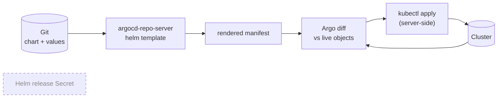
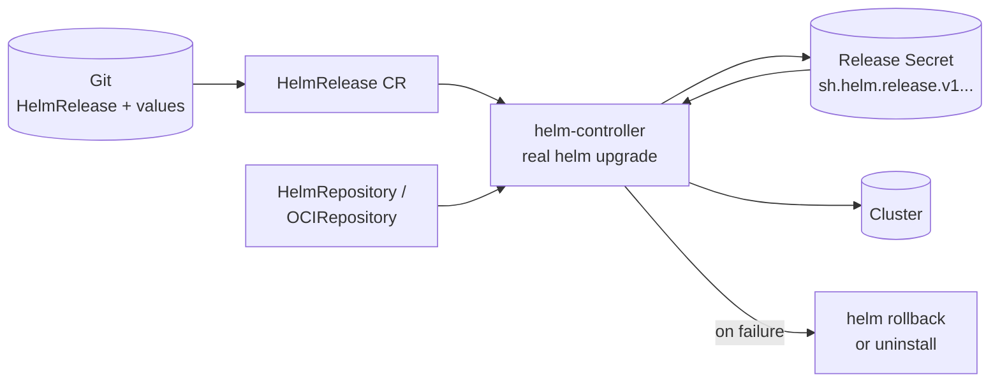

# Helm Under GitOps — Argo CD, Flux, and the Two Integration Models

If you run Argo CD or Flux, you have a Helm question you may not know you have:

> **Does your GitOps controller *use* Helm, or does it merely *render* Helm charts?**

Those are two fundamentally different architectures with the same YAML in Git, and almost every
surprising Helm-under-GitOps behaviour is a consequence of the difference. The doc's thesis:

> **In the render-only model, Helm is a templating library and nothing else** — no release Secret,
> no revisions, no `helm rollback`, no `lookup`, and only a partial mapping of hooks. In the
> real-release model, Helm's full lifecycle runs, and you have two systems that both believe they
> own the outcome. **Both are defensible. Not knowing which you are on is not.**

## The two models

### Model 1 — render-only (Argo CD's default)

Argo CD, given a Helm chart source, runs the equivalent of:

```bash
helm template <release-name> <chart> --namespace <ns> -f <values> --include-crds
```

and applies the resulting objects itself, tracking them with its own labels and annotations. Then
its reconciler continuously compares the rendered output against the live cluster.



The dashed box is the point: **there is no release Secret.** `helm list` returns nothing.
`helm history` returns nothing. `helm rollback` is not available. Argo CD's own history — which is
real, stored in the `Application` resource's `status.history` — replaces it.

### Model 2 — real release (Flux's `helm-controller`)

Flux's `HelmRelease` resource is reconciled by a controller that uses the Helm Go libraries to
perform an actual `helm upgrade`:



`helm list -A` works. `helm history` works. Hooks all run. `lookup` works, because there is a real
cluster connection. `helm rollback` works, and the controller can invoke it automatically.

### The choice is not "Argo CD or Flux"

This is the most common misconception, so it is worth being precise:

- **Argo CD defaults to model 1** and can be pushed towards model 2 with a config-management plugin
  that shells out to `helm upgrade`, which people do and which is a meaningful amount of custom
  machinery.
- **Flux defaults to model 2** with `HelmRelease`, and can do model 1 by using a `Kustomization`
  over `helm template` output (a "helm-to-manifests" render step in CI), which people also do.

So the axis is the *model*, and each tool has a default on it. Choose the model first.

## What the render-only model loses, precisely

This is the table to read before choosing, because each row is a real capability.

| Capability | Model 1 (render-only) | Model 2 (real release) |
|---|---|---|
| `helm list` / `helm history` / `helm get values` | ❌ nothing | ✅ works |
| `helm rollback` | ❌ — Argo CD's own history instead, which is equally capable but a different tool | ✅ |
| `lookup` function | ❌ **always returns empty** | ✅ |
| `.Capabilities.APIVersions` | ⚠️ populated from the destination cluster by the repo-server, so usually correct — but see `G-11` | ✅ |
| `pre-install` / `pre-upgrade` hooks | ⚠️ mapped to `PreSync` | ✅ |
| `post-install` / `post-upgrade` hooks | ⚠️ mapped to `PostSync` | ✅ |
| `pre-delete` / `post-delete` hooks | ⚠️ partial — `post-delete` maps to Argo's `PostDelete` | ✅ |
| `pre-rollback` / `post-rollback` hooks | ❌ no rollback concept to hook | ✅ (and see `H-08` — you may not want this) |
| `test` hooks | ❌ do not run during sync | ✅ via `helm test` |
| `--wait` on built-in kinds | ✅ Argo's own health assessment, which is **better** | ✅ |
| Readiness of custom resources | ✅ **Argo assesses CR health**, including via Lua | ❌ Helm cannot (`U-04`) |
| Drift correction | ✅ continuous, with self-heal | ⚠️ Flux has drift detection; plain Helm has none |
| Pruning removed resources | ✅ explicit and visible | ✅ via manifest diff |
| Release state size in `etcd` | ✅ **none** — no release Secrets at all | ⚠️ doc 15's `S-01` |
| Per-cluster fan-out | ✅ `ApplicationSet` | ✅ one `HelmRelease` per cluster repo |

Two rows deserve emphasis because they cut in opposite directions.

**Render-only *wins* on custom-resource readiness.** Doc 05's `U-04` — `--wait` declaring success on
a `Certificate` that was never issued — is a Helm limitation that Argo CD does not have, because
Argo has a health-assessment framework with built-in support for many CRs and Lua hooks for the
rest. If your platform is CR-heavy, this is a significant point in model 1's favour.

**Render-only *loses* on `lookup`, absolutely.** Not "sometimes"; there is no cluster connection
during `helm template`, so `lookup` returns empty every time. Every chart that uses the
generate-a-password-once pattern (`T-11`) is broken under model 1 — and broken in the dangerous
direction, because it regenerates rather than failing. `CS-1` and `CS-6` are both this.

## The hook mapping, in detail

Argo CD translates Helm hook annotations into its own resource hooks. The mapping:

| Helm annotation | Argo CD phase | Runs during sync? |
|---|---|---|
| `pre-install`, `pre-upgrade` | `PreSync` | ✅ before the apply |
| `post-install`, `post-upgrade` | `PostSync` | ✅ after the apply, once healthy |
| `post-delete` | `PostDelete` | ✅ on app deletion |
| `pre-delete` | *(no equivalent)* | ❌ |
| `pre-rollback`, `post-rollback` | *(no rollback concept)* | ❌ |
| `test`, `test-success` | *(mapped to `Skip`)* | ❌ **not run** |
| `crd-install` | *(unsupported — Helm 2 relic)* | ❌ |

And the delete policies:

| Helm annotation | Argo CD equivalent |
|---|---|
| `helm.sh/hook-delete-policy: hook-succeeded` | `argocd.argoproj.io/hook-delete-policy: HookSucceeded` |
| `hook-failed` | `HookFailed` |
| `before-hook-creation` | `BeforeHookCreation` |

⚠️ **`helm.sh/hook-weight` maps onto Argo's sync waves**, but sync waves also apply to ordinary
resources, so a hook's weight and a resource's `argocd.argoproj.io/sync-wave` share one ordering
space. That means a hook weight you chose for its ordering relative to other hooks may now order
against arbitrary resources too. Verify rather than assume.

**The practical consequence.** A migration hook works under Argo CD — it becomes a `PreSync`
resource. A `test` hook does not run, so a chart relying on `helm test` for verification is
unverified. And a `pre-delete` hook that drains a queue before teardown silently does not run,
which is `G-05`'s more dangerous cousin.

**Confirm what will happen** for a specific chart, before trusting it:

```bash
helm template checkout-api ./charts/checkout-api -f envs/prod-use1.yaml \
  | yq -r 'select(.metadata.annotations["helm.sh/hook"] != null)
      | [.metadata.annotations["helm.sh/hook"],
         (.metadata.annotations["helm.sh/hook-weight"] // "0"),
         .kind, .metadata.name] | @tsv' \
  | awk -F'\t' '{
      argo = "??";
      if ($1 ~ /pre-(install|upgrade)/)   argo="PreSync";
      if ($1 ~ /post-(install|upgrade)/)  argo="PostSync";
      if ($1 ~ /post-delete/)             argo="PostDelete";
      if ($1 ~ /pre-delete/)              argo="NOT RUN under Argo CD";
      if ($1 ~ /rollback/)                argo="NOT RUN under Argo CD";
      if ($1 ~ /test/)                    argo="NOT RUN during sync";
      printf "%-22s w=%-4s %-10s %-40s -> %s\n", $1, $2, $3, $4, argo }'
```

Run that for every chart when you adopt Argo CD. At Riverbend it found two charts with `pre-delete`
hooks that would have silently stopped running.

## Configuration in each model

### Argo CD `Application`

```yaml
apiVersion: argoproj.io/v1alpha1
kind: Application
metadata:
  name: checkout-api-prod-use1
  namespace: argocd
spec:
  project: riverbend-services
  destination:
    server: https://rb-prod-use1.eks.internal
    namespace: checkout
  sources:
    # The chart, from OCI, pinned
    - repoURL: registry.riverbend.internal/charts
      chart: checkout-api
      targetRevision: 4.11.3
      helm:
        releaseName: checkout-api
        valueFiles:
          - $values/envs/00-base.yaml
          - $values/envs/10-prod.yaml
          - $values/envs/20-prod-use1.yaml
        # Fail rather than silently ignore a values file that moved
        ignoreMissingValueFiles: false
    # The values, from Git, so values changes are a Git commit
    - repoURL: https://github.com/riverbend/deploy.git
      targetRevision: main
      ref: values
  syncPolicy:
    automated:
      prune: true
      selfHeal: true
    syncOptions:
      - CreateNamespace=false
      - ServerSideApply=true
  revisionHistoryLimit: 10
```

Three things in there are the interesting decisions.

**The multi-source pattern** (`sources:` with a `$values` ref) keeps the chart in the registry and
the values in Git. That is what lets you promote a pinned chart version while values changes remain
ordinary commits. ⚠ **version**: multi-source `Application`s are Argo CD 2.6+.

**`ignoreMissingValueFiles: false`** is the default and you should not change it. With it true, a
values file that was renamed or moved is silently skipped, and you deploy with the wrong
configuration and a green sync status.

**`ServerSideApply=true`** is worth turning on for the same reason as doc 07's `C-05`: it avoids the
last-applied-configuration annotation, handles large objects, and gives you proper field ownership.

### Flux `HelmRelease`

```yaml
apiVersion: source.toolkit.fluxcd.io/v1beta2
kind: OCIRepository
metadata:
  name: checkout-api
  namespace: checkout
spec:
  interval: 10m
  url: oci://registry.riverbend.internal/charts/checkout-api
  ref:
    tag: "4.11.3"
  verify:                       # enforce the signature (doc 09, K-07)
    provider: cosign
    matchOIDCIdentity:
      - issuer: "https://token.actions.githubusercontent.com"
        subject: "^https://github\\.com/riverbend/charts/.*$"
---
apiVersion: helm.toolkit.fluxcd.io/v2
kind: HelmRelease
metadata:
  name: checkout-api
  namespace: checkout
spec:
  interval: 10m
  chartRef:
    kind: OCIRepository
    name: checkout-api
  install:
    remediation: { retries: 2 }
  upgrade:
    remediation:
      retries: 2
      remediateLastFailure: true
      strategy: rollback
    cleanupOnFail: true
  maxHistory: 5                          # doc 04, R-04
  timeout: 8m
  driftDetection:
    mode: enabled                        # correct drift, like Argo's selfHeal
  valuesFrom:
    - kind: ConfigMap
      name: checkout-api-base
      valuesKey: values.yaml
    - kind: ConfigMap
      name: checkout-api-prod-use1
      valuesKey: values.yaml
  values:
    image:
      digest: sha256:4a1f8c2e9b7d5a3f0c6e8b1d4a7f2c9e5b8d1a4f7c0e3b6d9a2f5c8e1b4d7a0f
  # The U-04 fix: wait for a custom resource's real readiness
  test:
    enable: true
    ignoreFailures: false
```

The interesting decisions here:

**`verify:` with `matchOIDCIdentity`** enforces the cosign signature from doc 09 — in the controller,
which cannot be skipped. This is the "somewhere that cannot be skipped" that `K-07` asks for, and it
is a genuine advantage of model 2.

**`remediation.strategy: rollback` with `retries: 2`** is `--atomic` with retries, expressed
declaratively. Note `G-07` for what happens when it loops.

**`valuesFrom` referencing ConfigMaps** is how Flux does values layering — order matters, later
wins, same semantics as `-f`. The ConfigMaps themselves are generated by a Flux `Kustomization`
from files in Git, so values remain Git-committed.

**`test.enable: true`** actually runs `helm test` after an upgrade, which is the one place a `test`
hook earns its keep in an internal platform (doc 06, `H-11`).

## The `G-` failure catalogue

### G-01 · `helm list` shows nothing

**What you see.** A release deployed and visible in the cluster; `helm list -A` is empty.

**Mechanism.** Model 1. There is no release Secret because no `helm install` ever ran.

**Confirm it.** Read the ownership metadata on any object, which tells you who deployed it:

```bash
kubectl get deploy -n checkout checkout-api -o json | jq '{
  helm_managed_by: .metadata.labels["app.kubernetes.io/managed-by"],
  helm_release:    .metadata.annotations["meta.helm.sh/release-name"],
  argo_instance:   .metadata.labels["argocd.argoproj.io/instance"],
  argo_tracking:   .metadata.annotations["argocd.argoproj.io/tracking-id"]
}'
```

- `helm_managed_by: Helm` plus `helm_release` set → a real Helm release exists somewhere. Check the
  namespace and driver (doc 04, `R-01`).
- `argo_instance` or `argo_tracking` set, and no Helm annotations → model 1. This is not a failure.
- **Both set** → `G-02`, and you have a problem.

⚠️ Note that under model 1, Argo CD renders with `helm template`, and `helm template` **does** emit
`app.kubernetes.io/managed-by: Helm` in charts that include the standard label helper — because that
label comes from the chart's template, not from Helm's runtime. So the *label* being `Helm` proves
nothing. The `meta.helm.sh/release-name` **annotation** is the reliable signal, because Helm's
runtime adds it and `helm template` does not.

**Recover.** Nothing to recover. Use the right tool: `argocd app get checkout-api-prod-use1`,
`argocd app history`, `argocd app rollback`.

**Prevent.** Update your runbooks. A runbook that says "run `helm history`" against a model-1
release sends the on-call engineer down a blind alley during an incident, and that is the actual
cost of not knowing which model you are on.

### G-02 · Two owners, one object

**What you see.** An object that changes back and forth. A `helm upgrade` whose change is reverted
within three minutes. A field that flaps between two values on a timer.

**Mechanism.** Argo CD with `selfHeal: true` reconciles continuously against the rendered Git state.
A human running `helm upgrade` changes the live object. Argo CD notices the drift and reverts it.
Meanwhile Helm's release Secret now records a state that no longer matches the cluster.

This is the worst state in this doc, because both systems are working correctly and the result is
incoherent.

**Confirm it.** Doc 04's `R-12` command finds contested objects:

```bash
kubectl get deploy,sts,ds,svc,cm -A -o json | jq -r '.items[]
  | select((.metadata.annotations // {}) | has("meta.helm.sh/release-name"))
  | select((.metadata.labels // {}) | has("argocd.argoproj.io/instance"))
  | "CONTESTED: \(.metadata.namespace)/\(.kind)/\(.metadata.name)"'
```

And check Argo's own view of the flapping:

```bash
argocd app history checkout-api-prod-use1 | tail -10
kubectl get application -n argocd checkout-api-prod-use1 \
  -o jsonpath='{.status.operationState.phase}{" "}{.status.sync.status}{" "}{.status.health.status}{"\n"}'
```

**Recover.** Pick one owner. For a release Argo CD should own:

```bash
# 1. Stop Argo fighting while you clean up
argocd app set checkout-api-prod-use1 --sync-policy none

# 2. Remove Helm's claim. ⚠️ --keep-history keeps the release record and does NOT delete objects...
#    which is NOT what we want here. We want the objects to stay and the record to go.
#    So: delete only the release Secrets, leaving every object in place.
kubectl delete secret -n checkout -l 'owner=helm,name=checkout-api'

# 3. Remove Helm's ownership annotations, so nothing later tries to adopt them
helm_objs=$(kubectl get all,cm,secret,sa,hpa,pdb -n checkout -o json | jq -r '.items[]
  | select((.metadata.annotations // {}) | ."meta.helm.sh/release-name" == "checkout-api")
  | "\(.kind|ascii_downcase)/\(.metadata.name)"')
for o in $helm_objs; do
  kubectl annotate "$o" -n checkout meta.helm.sh/release-name- meta.helm.sh/release-namespace-
done

# 4. Confirm Argo's diff is now empty, THEN re-enable
argocd app diff checkout-api-prod-use1
argocd app set checkout-api-prod-use1 --sync-policy automated --self-heal --auto-prune
```

⚠️ Step 2 uses `kubectl delete secret` rather than `helm uninstall` deliberately. `helm uninstall`
deletes the *objects*; `helm uninstall --keep-history` keeps the release record, which is the
opposite of what you want. Deleting only the Secrets removes Helm's memory while leaving the
workload running, which is exactly the surgery required. Read doc 04 before doing this so you know
what you are deleting.

**Prevent.** This should be an RBAC boundary, not a convention:

```yaml
# The CI deploy identity has no write access to namespaces Argo CD owns.
# Argo CD's service account does. There is exactly one writer per namespace.
apiVersion: rbac.authorization.k8s.io/v1
kind: RoleBinding
metadata:
  name: ci-deploy
  namespace: checkout            # Argo-owned: this RoleBinding does NOT exist here
```

Plus a naming convention that makes it visible: at Riverbend, namespaces reconciled by Argo CD
carry a label `riverbend.io/deployer: argocd`, and the deploy wrapper script refuses to run against
a namespace carrying it:

```bash
d=$(kubectl get ns "$NS" -o jsonpath='{.metadata.labels.riverbend\.io/deployer}' 2>/dev/null)
[ "$d" = "argocd" ] && { echo "REFUSING: $NS is reconciled by Argo CD. Change it in Git."; exit 1; }
```

### G-03 · `lookup` never works, so the password regenerates

**What you see.** Every sync rewrites a Secret with a new random value. Pods fail to authenticate.

**Mechanism.** `helm template` has no cluster connection, so `lookup` returns empty and the
generate branch runs. Under model 1 this happens on **every reconcile**, not just every deploy — so
with a 3-minute reconcile interval, a chart using this pattern rewrites the Secret twenty times an
hour.

This is `CS-1` at Riverbend and `CS-6` at Corridor, and it is the single most damaging
Helm-under-GitOps failure.

**Confirm it.** Argo's diff shows a permanent, never-resolving difference on a Secret:

```bash
argocd app diff checkout-api-prod-use1 | grep -A6 'Secret'
# A Secret that ALWAYS differs, with a different value each time you run the command,
# is a non-deterministic render.
```

The definitive test, from doc 02:

```bash
a=$(helm template checkout-api ./charts/checkout-api | grep -A3 'name: checkout-api-db' | sha256sum)
b=$(helm template checkout-api ./charts/checkout-api | grep -A3 'name: checkout-api-db' | sha256sum)
[ "$a" = "$b" ] || echo "NON-DETERMINISTIC — this Secret rotates on every reconcile"
```

**Recover.** Stop the bleeding first, then fix the pattern:

```bash
argocd app set checkout-api-prod-use1 --sync-policy none     # stop the rewriting
# restore the working password from a backup or the secret manager, then move off the pattern
```

**Prevent.** Doc 12. Under model 1 there is no mitigation — use the External Secrets Operator, which
puts the generation in a controller where it belongs. ⚠️ And note that **`randAlphaNum` anywhere in
a chart under model 1 is a bug**, not just in the `lookup` pattern — the same applies to `genCA`,
`genSignedCert`, and `uuidv4`. A CI check:

```bash
grep -rnE 'randAlpha|randNumeric|randAscii|genCA|genSelfSignedCert|genSignedCert|uuidv4' \
  charts/*/templates/ && { echo "non-deterministic function in a template — breaks under GitOps"; exit 1; }
```

### G-04 · A hook did not run

Covered above. The one-line prevention: run the mapping script for every chart when you adopt Argo
CD, and know that `pre-delete`, both rollback phases, and `test` do not run.

### G-05 · Argo CD reverted a manual change during an incident

**What you see.** An emergency `kubectl scale` that lasted four minutes.

**Mechanism.** `selfHeal: true`. Argo reverts anything that differs from Git.

**This is correct behaviour and it will happen during an incident**, when somebody is trying to
change something quickly. So you need a designed answer rather than a surprise.

**The three options, and they are all legitimate:**

1. **Commit the change.** Correct when there is time. A one-line values change, a merge, and a sync
   is about four minutes at Riverbend — which is fine for most incidents and not for all.
2. **Pause reconciliation deliberately**, do the thing, then reconcile:
   ```bash
   argocd app set checkout-api-prod-use1 --sync-policy none
   kubectl scale -n checkout deploy/checkout-api --replicas=48
   # ... incident ...
   # then EITHER commit the change and re-enable, OR re-enable and let Argo revert it
   argocd app set checkout-api-prod-use1 --sync-policy automated --self-heal
   ```
   ⚠️ The risk is forgetting step three. Alert on any `Application` with auto-sync disabled for more
   than two hours — this is a real alert worth having, because a paused application is an
   application that has silently stopped being reconciled.
3. **Make the field not managed.** For a replica count under an HPA, the answer is doc 04's fix:
   do not render `replicas`. Then scaling is not a drift, because Git has no opinion. This is the
   best answer where it applies, and it applies more often than people realise — `ignoreDifferences`
   in the `Application` spec extends the same idea to fields you cannot remove from the chart:
   ```yaml
   spec:
     ignoreDifferences:
       - group: apps
         kind: Deployment
         jsonPointers: [/spec/replicas]
   ```

**Prevent.** Decide, before the incident, which of the three is your default — and write it in the
runbook. Riverbend's answer: option 3 for replicas (by construction), option 1 for anything with
time, option 2 with a mandatory alert for genuine emergencies.

### G-06 · Argo CD reports `OutOfSync` on something that is fine

**What you see.** A permanent `OutOfSync` on fields a controller owns, or on defaults the API server
added.

**Mechanism.** Argo diffs the rendered manifest against the live object. Unlike Helm's three-way
merge, it does not have an "old manifest" to tell it which fields it is responsible for — so a
field the API server defaulted, or a webhook injected, appears as a difference.

This is the flip side of doc 04's three-way merge: **Helm ignores fields in neither manifest; Argo
CD, in its default diff mode, does not have that concept.** Hence perpetual diffs on
`spec.template.spec.containers[].terminationMessagePath`, injected sidecars, and
`metadata.annotations` added by controllers.

**Confirm it.**

```bash
argocd app diff checkout-api-prod-use1
```

**Recover.** `ignoreDifferences`, and `ServerSideApply=true` which handles much of it properly
through field ownership:

```yaml
spec:
  syncOptions:
    - ServerSideApply=true
  ignoreDifferences:
    - group: apps
      kind: Deployment
      jsonPointers:
        - /spec/replicas
    - group: ""
      kind: Service
      jsonPointers:
        - /spec/clusterIP
    - group: admissionregistration.k8s.io
      kind: ValidatingWebhookConfiguration
      jqPathExpressions:
        - '.webhooks[]?.clientConfig.caBundle'    # cert-manager injects this
```

⚠️ `ServerSideApply=true` is the better fix and should be tried first, because `ignoreDifferences`
is a growing list of exceptions that eventually hides real drift. A long `ignoreDifferences` block
is a smell.

### G-07 · A Flux `HelmRelease` remediation loop

**What you see.** A release repeatedly upgrading, failing, rolling back, and upgrading again. The
`HelmRelease` status cycles. Revision numbers climb fast.

**Mechanism.** `upgrade.remediation.retries: 2` plus a reconcile `interval: 10m` means: try, fail,
roll back, wait, try again. If the failure is deterministic — a bad value, an immutable field — this
loops forever, and each cycle burns two revisions (`R-04`).

At Lantern this consumed 240 revisions of one release over a weekend, which pruned every good
revision at `maxHistory: 5` and left no rollback target.

**Confirm it.**

```bash
flux get helmreleases -A
kubectl describe helmrelease -n checkout checkout-api | sed -n '/Conditions/,$p'
helm history checkout-api -n checkout --max 20 | tail -20
```

A history of alternating `superseded`/`failed` at short intervals is the signature.

**Recover.** Suspend the release, fix the cause, resume:

```bash
flux suspend helmrelease checkout-api -n checkout
# fix the values or the chart, commit
flux resume helmrelease checkout-api -n checkout
```

**Prevent.** Two mechanisms:

1. **`retries` small and a longer `interval`.** `retries: 2` with `interval: 10m` is reasonable;
   `retries: 5` with `interval: 1m` is a loop generator.
2. **Alert on remediation**, not just on failure. A `HelmRelease` that has remediated at all is
   worth a notification, because it means an upgrade failed and was undone — which under a
   declarative controller is otherwise invisible:
   ```promql
   increase(gotk_reconcile_condition{type="Ready",status="False",kind="HelmRelease"}[15m]) > 0
   ```

### G-08 · Values in the wrong place

**What you see.** A values change that had no effect; or a values file Argo CD did not read.

**Mechanism.** Each model has its own values mechanism, and both have a silent-skip mode:

- **Argo CD:** `spec.source.helm.valueFiles` are paths *relative to the chart source*, unless you
  use the `$values` multi-source ref. A path that does not resolve is an error only if
  `ignoreMissingValueFiles: false` — which is the default, so leave it alone.
- **Flux:** `valuesFrom` references ConfigMaps or Secrets. ⚠️ A `valuesFrom` entry with
  `optional: true` on a missing ConfigMap is **silently skipped**, which is the same failure.

**Prevent.** Never set `ignoreMissingValueFiles: true` or `optional: true` on a values source. The
whole point of a values file is that it must be present. Audit for it:

```bash
grep -rn 'ignoreMissingValueFiles: *true' argocd/ 2>/dev/null
grep -rn -B3 'optional: *true' clusters/*/helmreleases/ 2>/dev/null
```

### G-09 · Custom-resource health, which model 1 does better

Not a failure — the capability, because it is the answer to `U-04`.

Argo CD assesses health per resource kind, with built-in logic for many CRs and Lua scripts for the
rest. So a `Certificate` that is not issued keeps the `Application` `Progressing`, which gates a
`RollingSync` step, which is a genuine readiness guarantee that Helm's `--wait` cannot give you.

A custom health check, as a `ConfigMap` entry in `argocd-cm`:

```yaml
data:
  resource.customizations.health.acme.riverbend.io_ShardSet: |
    hs = {}
    if obj.status ~= nil and obj.status.conditions ~= nil then
      for _, c in ipairs(obj.status.conditions) do
        if c.type == "Ready" and c.status == "True" then
          hs.status = "Healthy"; hs.message = c.message; return hs
        end
        if c.type == "Ready" and c.status == "False" then
          hs.status = "Degraded"; hs.message = c.message; return hs
        end
      end
    end
    hs.status = "Progressing"; hs.message = "waiting for Ready condition"
    return hs
```

Flux's equivalent is a `Kustomization`'s `healthChecks` plus kstatus conventions, which works on any
CR that sets standard conditions — less flexible than Lua, and requiring nothing custom for
well-behaved CRs.

**If your platform is CR-heavy, this is the strongest single argument for model 1.**

### G-10 · `helm test` does not run

Covered in the mapping table. Under model 1, put the assertion in a `PostSync` hook (a Job with
`argocd.argoproj.io/hook: PostSync`) rather than a `test` hook, so it actually runs.

### G-11 · Migrating between models

**From model 2 to model 1** (Flux `HelmRelease` → Argo CD `Application`, or plain Helm → Argo CD):

1. Render what Helm currently has and what Argo would produce, and **diff them**:
   ```bash
   helm get manifest checkout-api -n checkout > /tmp/helm-now.yaml
   helm template checkout-api oci://registry.riverbend.internal/charts/checkout-api \
     --version 4.11.3 -n checkout \
     -f envs/00-base.yaml -f envs/10-prod.yaml -f envs/20-prod-use1.yaml > /tmp/argo-would.yaml
   dyff between /tmp/helm-now.yaml /tmp/argo-would.yaml   # or diff, if dyff is unavailable
   ```
   ⚠️ Expect differences from `lookup` and `.Capabilities` — and **each one is a chart you must fix
   before migrating**, not a difference to accept. This is where you discover `G-03`.
2. Create the `Application` with `syncPolicy: {}` (manual) and confirm `argocd app diff` is clean.
3. Sync once, manually.
4. Remove Helm's claim: delete the release Secrets and the ownership annotations (the procedure in
   `G-02`).
5. Enable `automated` with `selfHeal` and `prune`.

**From model 1 to model 2** (Argo CD → Flux `HelmRelease`):

Same shape in reverse, with the key step being that Helm must **adopt** the existing objects — which
means stamping ownership metadata on all of them first, exactly as doc 04's `R-08` describes. Argo
CD's own labels and annotations should be removed in the same pass so nothing later tries to prune
them.

⚠️ **In both directions, do it on one low-tier release first, in dev, and write down what you had
to fix.** The list will be the same for the other 239.

## Which to pick

The honest answer depends on two properties of your platform, and nothing else much.

**Choose model 1 (render-only, Argo CD default) if:**

- Your platform is CR-heavy and you need genuine readiness gating on custom resources.
- You want continuous drift correction and a UI showing per-cluster sync state.
- You have many clusters and want `ApplicationSet` fan-out with progressive sync.
- You can live without `lookup`, `helm test`, `pre-delete` hooks, and `helm rollback` — and you have
  audited your charts to confirm none of them depend on those.
- You want no release Secrets in `etcd` at all, which removes doc 15's `S-01` entirely.

**Choose model 2 (real release, Flux `HelmRelease`) if:**

- You consume third-party charts that use hooks and `lookup` heavily, and you would rather not fork
  them.
- You want signature verification enforced by the controller (`verify:` with cosign).
- You want `helm history` and `helm get values` to work, because your runbooks and your operators
  use them.
- You want declarative rollback-on-failure with retries rather than building it.

**Riverbend runs both**, which sounds like a hedge and is a deliberate split:

| What | Model | Why |
|---|---|---|
| 240 service charts | Model 1, Argo CD `ApplicationSet` | Fan-out across 4 clusters with progressive sync; the charts are all first-party and were audited for `lookup` and hooks |
| 31 platform components | Model 2, Flux `HelmRelease` | Third-party charts with hooks; signature enforcement; `helm history` for the components on-call touches most |

The boundary that makes this coherent: **first-party charts we control are model 1; third-party
charts we do not are model 2.** Stated that way, it is a rule rather than a hedge, and it is the
rule that makes "which model is this?" answerable in one second during an incident.

## What to take away

1. **The axis is the model, not the tool.** Render-only versus real-release. Argo CD defaults to the
   first, Flux to the second, and both can do either with effort. Choose the model first.
2. **In render-only, there is no release Secret** — `helm list`, `helm history` and `helm rollback`
   all return nothing. Argo CD's own history replaces them, which is equally capable and a different
   tool. Update your runbooks, because a blind alley during an incident is the real cost.
3. **`lookup` always returns empty under render-only**, so every generate-a-password-once chart
   rewrites its Secret on every reconcile — twenty times an hour at a 3-minute interval. This is the
   single most damaging failure in this doc.
4. **Ban all non-deterministic template functions** — `randAlphaNum`, `genCA`, `uuidv4` — with a CI
   grep. Under a reconciling controller, a non-deterministic render is a permanent diff.
5. **Hooks map partially.** `pre-delete`, both rollback phases, and `test` do not run under
   render-only. Run the mapping script over every chart when you adopt it.
6. **Render-only wins on custom-resource readiness.** Argo CD's health assessment gates on a
   `Certificate` actually being issued, which Helm's `--wait` cannot do. If your platform is
   CR-heavy this is the strongest argument for model 1.
7. **Two owners on one object is the worst state in this doc**, because both systems are working
   correctly and the result is incoherent. Make it an RBAC boundary, not a convention: exactly one
   writer per namespace, and a deploy script that refuses to run against an Argo-owned namespace.
8. **`selfHeal` will revert an emergency change**, so decide your answer in advance: commit it,
   deliberately pause with an alert on being paused, or make the field unmanaged. The third is best
   where it applies.
9. **`ServerSideApply=true` before `ignoreDifferences`.** A growing exception list eventually hides
   real drift.
10. **Never allow a values source to be silently optional.** `ignoreMissingValueFiles: true` and
    `optional: true` both turn a missing configuration file into a green deploy with the wrong
    configuration.
11. **Alert on remediation and on paused reconciliation**, not just on failure. Under a declarative
    controller, an upgrade that failed and was undone is otherwise invisible, and a paused
    application has silently stopped being reconciled.
