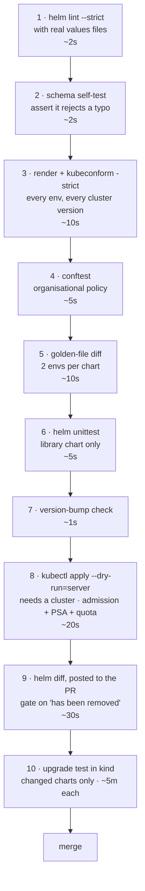

# Testing, Linting, and CI

Almost every Helm CI pipeline checks the same two things: that the chart lints, and that it renders.
Both are worth checking and neither catches the failures that actually hurt.

The thesis, and it is the one idea in this doc:

> **Testing that a chart renders is not testing that an upgrade works.** They fail for different
> reasons. A render test catches the `T-` and `V-` classes, which are cheap and deterministic. The
> expensive classes — immutable fields, hook ordering, a template that silently renders to nothing
> and therefore *deletes* a live object, a CRD that did not upgrade — are properties of the
> *transition* from one revision to the next, and a pipeline that installs the new chart into a
> clean cluster cannot see any of them.

The second idea, which is about ordering your effort:

> **The single highest-value check is a rendered diff in the pull request.** It is not a test, it
> does not run in a cluster, and it catches more real problems than everything else in this doc
> combined — because it shows a human exactly what will change, including the things no assertion
> was written for.

## The ladder, in value order

Here is the full set, ordered by value per unit of effort. Build them in this order.

| # | Check | Catches | Cost |
|---|---|---|---|
| 1 | **`helm diff` in the PR** | Everything, by showing a human | ~zero. A plugin and a CI step |
| 2 | **`values.schema.json` with `additionalProperties: false`** | Typos, wrong types, out-of-range values | An hour per chart, once |
| 3 | **Render + `kubeconform` against the real API version** | Invalid manifests, removed API versions | ~zero |
| 4 | **`helm template --validate` or `kubectl apply --dry-run=server`** | Admission, PSA, quota, real capabilities | Needs a cluster |
| 5 | **The upgrade test** | `U-07`, `H-*`, `C-01`, silent deletions | A day to build, and it is the one that pays |
| 6 | **Golden-file renders** | Unintended changes to shared templates | Ongoing maintenance |
| 7 | **Policy as a test (Conftest)** | Organisational rules, pre-cluster | Half a day |
| 8 | **`helm lint --strict`** | Chart metadata problems, a few template errors | ~zero, and low value |
| 9 | **`helm unittest`** | Specific template logic | High maintenance for the value |

Note that `helm lint` is eighth. That is deliberate and the next section says why.

## What `helm lint` actually does

`helm lint` checks:

- `Chart.yaml` exists, is valid YAML, has `apiVersion`, `name` and a SemVer `version`
- the chart name matches the directory name
- `values.yaml` is parseable
- the templates parse and render without error, against the chart's *default* values
- the rendered output is valid YAML
- with `--strict`, warnings become errors
- if `values.schema.json` exists, the default values validate against it

What it does **not** check, which is most of what matters:

- that the rendered output is a **valid Kubernetes object**. `kind: Deploymnet` lints clean.
- that it renders with *your* values. It uses chart defaults unless you pass `-f`.
- ⚠️ that any field is correct. A `resources.limits.memory` of `512` (no unit) lints clean and is
  rejected by the API server.
- anything about the upgrade path, hooks, CRDs, or what exists in the cluster.

So: run it, in one line, and do not believe it is a test.

```bash
helm lint ./charts/checkout-api --strict -f envs/00-base.yaml -f envs/20-prod-use1.yaml
```

⚠️ Passing your real values files to `lint` is worth doing and is usually omitted — linting against
chart defaults tests a configuration nobody deploys.

## Check 1 — `helm diff` in the pull request

The one to build first.

```bash
helm plugin install https://github.com/databus23/helm-diff
```

```bash
helm diff upgrade checkout-api ./charts/checkout-api \
  --namespace checkout --kube-context rb-prod-use1 \
  -f envs/00-base.yaml -f envs/10-prod.yaml -f envs/20-prod-use1.yaml \
  --set-string image.tag="$IMAGE_TAG" \
  --context 5
```

Output is a unified diff between what is deployed and what would be deployed. In a pull request it
looks like this, and a reviewer needs no Helm knowledge to read it:

```diff
checkout, checkout-api, Deployment (apps) has changed:
  spec:
    template:
      spec:
        containers:
        - name: checkout-api
-         image: registry.riverbend.internal/checkout-api:2026.09.14
+         image: registry.riverbend.internal/checkout-api:2026.09.17

checkout, checkout-api, PodDisruptionBudget (policy) has been removed:
- apiVersion: policy/v1
- kind: PodDisruptionBudget
- metadata:
-   name: checkout-api
```

That second block is `T-03` — a typo in a guard, about to delete a live PodDisruptionBudget — caught
by a reviewer glancing at a diff. No assertion would have caught it, because nobody writes an
assertion for "the PDB still exists".

**In CI**, posting the diff as a comment:

```yaml
# .github/workflows/chart-diff.yml
name: chart-diff
on: pull_request
jobs:
  diff:
    runs-on: ubuntu-latest
    permissions: { contents: read, pull-requests: write, id-token: write }
    strategy:
      matrix:
        env: [dev, stg, prod-euw1, prod-use1]
    steps:
      - uses: actions/checkout@v4
      - uses: azure/setup-helm@v4
      - run: helm plugin install https://github.com/databus23/helm-diff
      - name: Authenticate to cluster
        run: ./ci/kubeconfig.sh "rb-${{ matrix.env }}"     # OIDC, read-only identity
      - name: Diff
        id: diff
        run: |
          set -o pipefail
          tier=$([[ "${{ matrix.env }}" == prod-* ]] && echo prod || echo nonprod)
          helm dependency build ./charts/checkout-api
          helm diff upgrade checkout-api ./charts/checkout-api \
            -n checkout \
            -f envs/00-base.yaml -f "envs/10-${tier}.yaml" -f "envs/20-${{ matrix.env }}.yaml" \
            --context 5 --no-color \
            | tee /tmp/diff.txt
          # Fail the job if any object would be REMOVED and the PR does not say so
          if grep -q 'has been removed' /tmp/diff.txt && \
             ! grep -qi 'INTENTIONAL-DELETION' <<< "${{ github.event.pull_request.body }}"; then
            echo "::error::This change deletes objects. Add INTENTIONAL-DELETION to the PR body if that is intended."
            exit 1
          fi
      - uses: peter-evans/create-or-update-comment@v4
        if: always()
        with:
          issue-number: ${{ github.event.pull_request.number }}
          body-path: /tmp/diff.txt
```

⚠️ **The `has been removed` gate is the highest-value ten lines in this doc.** A chart change that
deletes a live object is almost always a bug (`T-03`), and requiring an explicit acknowledgement in
the pull request body converts a silent deletion into a deliberate one. Riverbend added this after
`CS-2` and it has blocked four accidental deletions since.

**The one requirement:** `helm diff` needs read access to the target cluster, because it compares
against live state. A read-only identity per cluster, assumed via OIDC, with `get` on the kinds the
charts create. That is a small amount of setup and it is the reason people skip this check, which is
a bad trade.

## Check 2 — the schema

Doc 03 covers the design. The CI side is one line plus a test that the schema is doing its job:

```bash
# The schema is validated automatically by template/lint/install. Nothing extra needed.
helm template checkout-api ./charts/checkout-api -f envs/20-prod-use1.yaml >/dev/null

# But TEST THE SCHEMA ITSELF — this is the part people skip
set +e
helm template checkout-api ./charts/checkout-api \
  -f envs/20-prod-use1.yaml --set replicasCount=40 >/dev/null 2>&1
rc=$?
set -e
[ "$rc" -ne 0 ] || { echo "FAIL: schema accepted unknown key — additionalProperties is missing"; exit 1; }
```

## Check 3 — validate the rendered manifests

`kubeconform` validates against the real Kubernetes OpenAPI schemas, including CRD schemas if you
supply them:

```bash
# Download your CRD schemas once, into a location kubeconform can use
mkdir -p /tmp/crd-schemas
kubectl get crds -o json | jq -c '.items[]' | while read -r crd; do
  name=$(jq -r '.spec.names.kind | ascii_downcase' <<<"$crd")
  grp=$(jq -r '.spec.group' <<<"$crd")
  for v in $(jq -r '.spec.versions[].name' <<<"$crd"); do
    jq -r --arg v "$v" '.spec.versions[] | select(.name==$v) | .schema.openAPIV3Schema' <<<"$crd" \
      > "/tmp/crd-schemas/${name}-${grp%%.*}-${v}.json"
  done
done

for e in dev stg prod-euw1 prod-use1; do
  tier=$([[ $e == prod-* ]] && echo prod || echo nonprod)
  helm template checkout-api ./charts/checkout-api \
    -f envs/00-base.yaml -f "envs/10-${tier}.yaml" -f "envs/20-${e}.yaml" \
    --api-versions monitoring.coreos.com/v1 \
    --api-versions external-secrets.io/v1beta1 \
  | kubeconform -strict -summary \
      -kubernetes-version 1.29.0 \
      -schema-location default \
      -schema-location '/tmp/crd-schemas/{{ .ResourceKind }}-{{ .Group }}-{{ .ResourceAPIVersion }}.json' \
      -
done
```

Three flags in there are the ones that make this useful rather than decorative:

**`-strict`** rejects unknown fields. Without it, `resourecs:` (misspelled) passes.

**`-kubernetes-version 1.29.0`** pins the schema set to your cluster's version, which catches an
API version your cluster has removed — the thing that produces `U-13` on a rollback.

**`--api-versions` on the Helm side** populates `.Capabilities` so that capability-gated objects
render (doc 02, `T-10`). Without it, your `ServiceMonitor` is absent from the render and therefore
untested.

## Check 4 — validate against the real API server

`kubeconform` checks schemas. It does not check admission, and a great many real failures are
admission failures (doc 13's `Z-04` and `Z-09`).

```bash
helm template checkout-api ./charts/checkout-api \
  -f envs/00-base.yaml -f envs/10-prod.yaml -f envs/20-prod-use1.yaml \
  | kubectl apply --dry-run=server -f - -n checkout
```

⚠️ `--dry-run=server` runs the full chain: validation, mutating webhooks, validating webhooks, Pod
Security Admission, and quota. It is the only check that tells you the thing will actually be
admitted. It needs cluster access and `create` permission (the dry run does not persist), which is
a permission grant worth making for a CI identity.

Or, entirely inside Helm:

```bash
helm upgrade checkout-api ./charts/checkout-api -n checkout \
  -f envs/20-prod-use1.yaml --dry-run=server
```

⚠ **version**: `--dry-run=server` on `helm upgrade` is 3.13+. Before that, `--dry-run` was
client-side only, which means it did not talk to the cluster and therefore did not validate
anything — and, per doc 02's `T-11`, made `lookup` return empty.

## Check 5 — the upgrade test

**This is the test that matters and almost nobody runs it.** Everything in the `U-`, `H-` and `C-`
classes is a property of the transition, and the only way to test a transition is to perform it.

```bash
#!/usr/bin/env bash
# ci/upgrade-test.sh — install the PREVIOUS chart version, then upgrade to this one.
set -euo pipefail

CHART=${1:-./charts/checkout-api}
NAME=$(yq -r '.name' "$CHART/Chart.yaml")
NEW_VER=$(yq -r '.version' "$CHART/Chart.yaml")

# The previous version: what is on the main branch, not what is published — so that two
# chart changes in one day are each tested against their real predecessor.
OLD_VER=$(git show "origin/main:$CHART/Chart.yaml" | yq -r '.version')
echo "upgrade test: $NAME $OLD_VER -> $NEW_VER"
[ "$OLD_VER" != "$NEW_VER" ] || { echo "chart version not bumped; nothing to test"; exit 0; }

kind create cluster --name upgrade-test --image kindest/node:v1.29.8 --wait 120s
trap 'kind delete cluster --name upgrade-test' EXIT

# Prerequisites the chart assumes exist. This list is itself valuable documentation —
# it is exactly what a fresh cluster needs before your charts work.
kubectl apply --server-side -f ci/fixtures/crds/
kubectl create namespace checkout
kubectl label namespace checkout pod-security.kubernetes.io/enforce=restricted
kubectl apply -f ci/fixtures/secrets/     # stand-ins for ExternalSecret output
kubectl apply -f ci/fixtures/quota.yaml

# 1. Install the OLD chart.
git worktree add /tmp/oldchart origin/main
helm dependency build "/tmp/oldchart/${CHART#./}"
helm install "$NAME" "/tmp/oldchart/${CHART#./}" -n checkout \
  -f ci/fixtures/values-upgradetest.yaml --wait --timeout 5m

kubectl -n checkout get deploy,svc,pdb,hpa -o name | sort > /tmp/objects-before

# 2. Upgrade to the NEW chart. --atomic so a failure is unambiguous.
helm dependency build "$CHART"
helm upgrade "$NAME" "$CHART" -n checkout \
  -f ci/fixtures/values-upgradetest.yaml --atomic --wait --timeout 5m --wait-for-jobs

kubectl -n checkout get deploy,svc,pdb,hpa -o name | sort > /tmp/objects-after

# 3. Assert nothing disappeared. This catches T-03 — the silently-deleted object.
if ! diff -u /tmp/objects-before /tmp/objects-after; then
  echo "FAIL: the object set changed across the upgrade. If intentional, update the allow-list."
  exit 1
fi

# 4. Assert the rollback works, which is the other half of the transition.
helm rollback "$NAME" -n checkout --wait --timeout 5m
helm status "$NAME" -n checkout | head -5

echo "upgrade test passed"
```

**What this catches that nothing else does:**

| Scenario | How the test sees it |
|---|---|
| `U-07` immutable field | `helm upgrade` fails with `field is immutable` |
| `T-03` silently deleted object | Step 3's object-set diff |
| `H-02` hook Job cannot be recreated | `helm upgrade` fails in the `pre-upgrade` hook |
| `H-09` non-idempotent migration | The hook runs twice across install + upgrade |
| `C-01` stale CRD | The fixture CRDs are the old version; the upgrade exposes the mismatch |
| `U-12` rollback failure | Step 4 |
| `Z-04` Pod Security rejection | The namespace is labelled `restricted`, so the pods must comply |
| `Z-09` quota interaction | The fixture quota is sized realistically, so a rollout that needs surge headroom fails here |

**The cost, honestly:** a `kind` cluster takes 40–90 seconds to create, the install and upgrade take
2–4 minutes, so about five minutes per chart. At 240 charts you do not run this for every chart on
every commit — you run it for the charts whose files changed, and for **every chart when the library
chart changes**, which is the case where it matters most (`D-11`).

```bash
# Which charts need the upgrade test for this PR?
changed=$(git diff --name-only origin/main...HEAD)
if grep -q '^charts/riverbend-common/' <<<"$changed"; then
  echo "library chart changed — testing one representative chart per tier"
  targets="charts/checkout-api charts/catalog-search charts/cert-expiry-audit"
else
  targets=$(grep '^charts/' <<<"$changed" | cut -d/ -f1-2 | sort -u)
fi
for t in $targets; do ./ci/upgrade-test.sh "./$t"; done
```

⚠️ Note the library-chart branch tests **one representative chart per tier** rather than all 240 —
three upgrade tests, fifteen minutes, covering the shapes that differ. Testing all 240 would take
twenty hours and would not find anything the three do not.

## Check 6 — golden-file renders

Commit the expected render; fail if it changes unexpectedly.

```bash
#!/usr/bin/env bash
# ci/golden.sh [--update]
set -euo pipefail
UPDATE=${1:-}
for c in charts/*/; do
  name=$(basename "$c")
  [ -f "$c/Chart.yaml" ] || continue
  [ "$(yq -r '.type // "application"' "$c/Chart.yaml")" = "application" ] || continue
  helm dependency build "$c" >/dev/null 2>&1 || true
  for e in dev prod-use1; do        # two environments, not four — see below
    tier=$([[ $e == prod-* ]] && echo prod || echo nonprod)
    out="testdata/golden/${name}-${e}.yaml"
    helm template "$name" "$c" -n "${name%%-*}" \
      -f envs/00-base.yaml -f "envs/10-${tier}.yaml" -f "envs/20-${e}.yaml" \
      --api-versions monitoring.coreos.com/v1 \
      --api-versions external-secrets.io/v1beta1 \
      --set-string image.tag=GOLDEN \
      | yq 'del(.metadata.labels."helm.sh/chart")' \
      > /tmp/render.yaml
    if [ "$UPDATE" = "--update" ]; then
      mkdir -p testdata/golden && cp /tmp/render.yaml "$out"
    else
      diff -u "$out" /tmp/render.yaml \
        || { echo "GOLDEN DIFF: $name/$e — review, then run ci/golden.sh --update"; exit 1; }
    fi
  done
done
```

Four decisions in there are what keep golden files from becoming a maintenance burden:

**`--set-string image.tag=GOLDEN`** pins the one value that changes every deploy. Without it, every
golden file changes on every release and the test is noise.

**`del(.metadata.labels."helm.sh/chart")`** removes the chart-version label, which changes whenever
you bump `version` — again, noise rather than signal.

**Two environments, not four.** `dev` and `prod-use1` cover the `nonprod`/`prod` tier split, which
is where the meaningful differences are. `stg` and `prod-euw1` add files without adding coverage.

**`--api-versions`** so capability-gated objects appear (`T-10`). A golden file that asserts your
`ServiceMonitor` is absent is worse than no golden file.

**Where golden files genuinely pay:** a library-chart change. One `_deployment.tpl` edit produces a
diff in every golden file, and reviewing that diff in the pull request is how you find out that a
change intended for tier 1 also affected tier 3. That is `D-11`'s prevention, and it is the main
reason to have them.

## Check 7 — policy as a test

Conftest runs OPA policies against the rendered manifests, before any cluster is involved:

```rego
# policy/helm.rego
package main

import future.keywords.if
import future.keywords.in

deny contains msg if {
  input.kind in {"Deployment", "StatefulSet", "DaemonSet"}
  some c in input.spec.template.spec.containers
  endswith(c.image, ":latest")
  msg := sprintf("%s/%s: container %q uses a mutable ':latest' tag (see Helm doc 09, K-03)",
                 [input.kind, input.metadata.name, c.name])
}

deny contains msg if {
  input.kind in {"Deployment", "StatefulSet", "DaemonSet"}
  some c in input.spec.template.spec.containers
  not c.resources.requests.memory
  msg := sprintf("%s/%s: container %q has no memory request (see Helm doc 13, Z-09)",
                 [input.kind, input.metadata.name, c.name])
}

deny contains msg if {
  input.kind in {"Deployment", "StatefulSet", "DaemonSet"}
  not input.metadata.labels["riverbend.io/owner"]
  msg := sprintf("%s/%s: missing riverbend.io/owner label (breaks the inventory, doc 16)",
                 [input.kind, input.metadata.name])
}

deny contains msg if {
  input.kind == "Deployment"
  input.spec.replicas
  input.spec.template.metadata.annotations["riverbend.io/hpa-managed"] == "true"
  msg := sprintf("Deployment/%s: renders spec.replicas while HPA-managed — fights the HPA (doc 04, R-02)",
                 [input.metadata.name])
}

warn contains msg if {
  input.kind == "Ingress"
  not input.metadata.annotations["cert-manager.io/cluster-issuer"]
  msg := sprintf("Ingress/%s: no cert-manager issuer annotation; TLS will not be provisioned",
                 [input.metadata.name])
}
```

```bash
helm template checkout-api ./charts/checkout-api -f envs/20-prod-use1.yaml \
  | conftest test --policy policy/ --all-namespaces -
```

**Why bother, when doc 13 argues for admission policy?** Because these run in the pull request,
before a cluster is involved, and the feedback lands on the author rather than on the deploy. Use
both: Conftest in CI for fast feedback, an admission policy in the cluster as the enforcement that
cannot be bypassed. The rules should be the *same rules*, and Kyverno and Gatekeeper both have CLI
modes that let you run the cluster policy in CI, which is the tidier version of this once you have
more than a handful.

## Check 9 — `helm unittest`, and why it is last

```yaml
# charts/checkout-api/tests/deployment_test.yaml
suite: deployment
templates:
  - deployment.yaml
tests:
  - it: omits spec.replicas when autoscaling is enabled
    set:
      autoscaling.enabled: true
      replicaCount: 7
    asserts:
      - notExists:
          path: spec.replicas
  - it: sets replicas when autoscaling is disabled
    set:
      autoscaling.enabled: false
      replicaCount: 7
    asserts:
      - equal:
          path: spec.replicas
          value: 7
  - it: never puts a version label in the selector
    asserts:
      - notExists:
          path: spec.selector.matchLabels["app.kubernetes.io/version"]
      - notExists:
          path: spec.selector.matchLabels["helm.sh/chart"]
```

```bash
helm plugin install https://github.com/helm-unittest/helm-unittest
helm unittest ./charts/checkout-api
```

**Good for:** a specific piece of template *logic* with several branches, where you want to assert
the branches individually. The three tests above are genuinely worth having, because each asserts a
rule from an earlier doc (`R-02`'s HPA fix, `T-08`'s selector discipline) that would otherwise be
enforced only by review.

**Why it is last:** for most charts, the assertions duplicate what a golden file already covers,
with more maintenance. The exception is the library chart, where the logic *is* the product and
branch-level assertions are the right shape. **Use `helm unittest` on your library chart and golden
files on everything else** — that split gets you most of the value at a fraction of the
maintenance.

## `ct` — chart-testing

The CNCF tool that wraps several of these for chart *repositories*:

```bash
ct lint --config ct.yaml --all
ct install --config ct.yaml --all      # installs each changed chart into a kind cluster
```

```yaml
# ct.yaml
remote: origin
target-branch: main
chart-dirs: [charts]
chart-repos:
  - riverbend=oci://registry.riverbend.internal/charts
validate-maintainers: false
check-version-increment: true
helm-extra-args: --timeout 300s
```

**What it adds over doing it yourself:** `check-version-increment` — it fails if a chart changed
without its `version` being bumped, which is the discipline that makes everything else in this doc
possible (the upgrade test needs a previous version to compare against; the golden files need a
stable version to diff). And it handles multi-chart repositories by testing only what changed.

**What it does not add:** the upgrade test. `ct install` installs into a clean cluster. ⚠️ `ct` does
have an `--upgrade` flag that tests upgrading from the previously-released version, which is closer
— and it tests against the *published* previous version rather than against the previous commit, so
two chart changes in one day are not each tested against their real predecessor. The script in check
5 uses `origin/main` for that reason.

## The `Q-` failure catalogue, briefly

Each of these is a *missing check* rather than a malfunction, so they are short.

### Q-01 · `helm lint` passed and the object is invalid

`lint` does not validate against the Kubernetes schema. Add `kubeconform -strict`.

### Q-02 · A values typo was silently ignored

No schema, or a schema without `additionalProperties: false`. Doc 03, `V-01`.

### Q-03 · The render was never validated against your cluster's API version

`kubeconform` without `-kubernetes-version`, or with a version that does not match the cluster. A
chart using `policy/v1beta1` passes against a 1.20 schema set and fails on a 1.29 cluster.

### Q-04 · Golden files that nobody reads

**The symptom:** a pull request whose golden-file diff is 400 lines, approved without reading. Every
render changed because the image tag or the chart-version label is in there.

**The fix:** the two `del`/`--set` normalisations from check 6. A golden diff should be small enough
to read, and if it is not, the noise sources need removing until it is.

### Q-05 · The chart was tested and the upgrade was not

Check 5. The most consequential gap in most pipelines.

### Q-06 · A library-chart change was reviewed as a template diff, not a render diff

**The symptom:** a five-line change to `_deployment.tpl` that altered every tier-3 service's
`terminationGracePeriodSeconds`. The template diff looked fine; the *effect* was not reviewed.

**The fix:** golden files across tiers, so the pull request shows the rendered consequence rather
than the template change. This is the main argument for golden files.

### Q-07 · `--api-versions` was not passed, so capability-gated objects were untested

Doc 02, `T-10`. The golden file asserted your `ServiceMonitor` absent; production has it.

### Q-08 · The test cluster had no CRDs, so the chart's CRs were never validated

`kubeconform` with `-schema-location default` only, and no CRD schemas. Extract them from a real
cluster, as check 3 does.

### Q-09 · No diff in the pull request

Check 1. The highest-value check in the doc.

### Q-10 · The chart changed without a version bump

So the upgrade test has nothing to compare against and the golden files diff against the wrong
baseline. `ct`'s `check-version-increment`, or:

```bash
changed=$(git diff --name-only origin/main...HEAD | grep '^charts/' | cut -d/ -f1-2 | sort -u)
for c in $changed; do
  old=$(git show "origin/main:$c/Chart.yaml" 2>/dev/null | yq -r '.version' || echo none)
  new=$(yq -r '.version' "$c/Chart.yaml")
  [ "$old" = none ] || [ "$old" != "$new" ] \
    || { echo "$c changed without a version bump ($new)"; exit 1; }
done
```

### Q-11 · Cluster version skew across environments

**The symptom:** a chart that works in dev (1.30) and fails in production (1.29), or uses an API
that production has and dev has removed.

**The fix:** validate against **every** cluster version you run, not just the newest:

```bash
for kv in 1.29.8 1.30.5; do
  helm template checkout-api ./charts/checkout-api -f envs/20-prod-use1.yaml \
    | kubeconform -strict -kubernetes-version "$kv" -schema-location default - \
    || { echo "fails on Kubernetes $kv"; exit 1; }
done
```

And keep the list of versions in one place that your cluster inventory generates, so it cannot drift
from reality.

## The full pipeline

Putting it together, in the order the stages should run — fastest and cheapest first:



Stages 1 to 7 need no cluster and complete in under a minute, so they run on every push. Stages 8
to 10 need cluster access and are slower, so they run once on the pull request and again before
merge.

## What to take away

1. **Testing that a chart renders is not testing that an upgrade works.** The expensive failure
   classes are properties of the transition between revisions, and a pipeline that installs into a
   clean cluster cannot see any of them.
2. **A rendered diff in the pull request is the highest-value check available.** It catches things
   no assertion was written for, because it shows a human what will actually change.
3. **Gate on `has been removed`.** Ten lines of CI that convert a silently-deleted live object into
   an explicit acknowledgement in the pull request body.
4. **`helm lint` is eighth on the value ladder.** It does not validate against the Kubernetes
   schema, so `kind: Deploymnet` passes. Run it with your real values files and do not believe it is
   a test.
5. **`kubeconform -strict -kubernetes-version <yours>`, with your CRD schemas and
   `--api-versions`.** Each of those three is the difference between a check that catches things and
   a check that decorates the pipeline.
6. **`--dry-run=server` is the only check that tests admission** — Pod Security, quota, and your
   policy controller. It needs cluster access, which is why people skip it, which is a bad trade.
7. **Build the upgrade test.** Install the previous commit's chart, upgrade to this one, assert the
   object set did not shrink, then roll back. Five minutes per chart, and it catches immutable
   fields, hook re-runs, silent deletions, and broken rollbacks.
8. **For a library-chart change, test one representative chart per tier** — three upgrade tests
   rather than 240, covering the shapes that differ.
9. **Golden files pay for themselves on shared templates and not much else.** Normalise the image
   tag and the chart-version label, or the diffs become noise nobody reads.
10. **`helm unittest` on the library chart, golden files on everything else.** Branch-level
    assertions are the right shape where the logic is the product, and duplicated maintenance
    everywhere else.
11. **Enforce the version bump.** Without it the upgrade test has no baseline and the golden files
    diff against the wrong thing, so every other check in this doc degrades.
