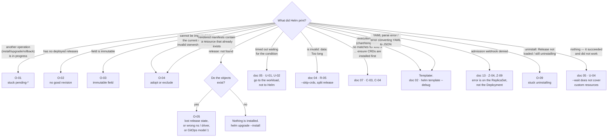
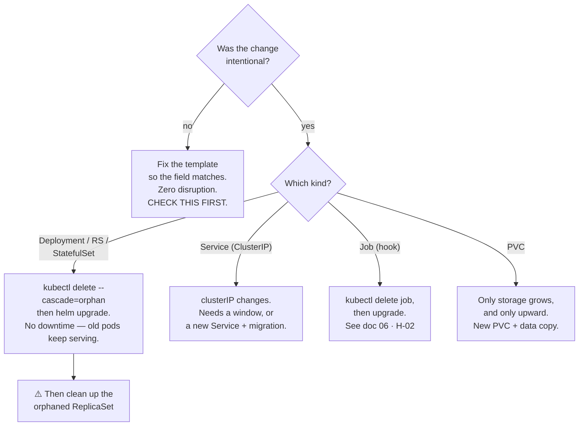

# Failure Modes and the Operations Playbook

This is the doc to open when something is broken. It starts with a triage tree keyed on the error
string Helm printed at you, then gives the full procedure for each stuck state.

Two rules before any of it.

**Rule one: decide which of the three Helms is broken** (doc 00). Templater, state store, or
lifecycle engine. It cuts the search space by two thirds and the temptation under pressure is to
skip it.

**Rule two: before modifying release state, establish that nothing is running.** Every destructive
procedure below is safe if no Helm operation is in flight and unsafe if one is. The check takes
twenty seconds:

```bash
NS=checkout; REL=checkout-api

# How old is the most recent release record? Compare to your longest --timeout.
kubectl get secret -n "$NS" -l "owner=helm,name=$REL" \
  -o jsonpath='{range .items[*]}{.metadata.labels.version}{"\t"}{.metadata.labels.status}{"\t"}{.metadata.labels.modifiedAt}{"\n"}{end}' \
  | sort -k1,1nr \
  | awk -v now="$(date -u +%s)" -F'\t' '{printf "rev %s  %-18s  %d min ago\n", $1, $2, (now-$3)/60}' \
  | head -5

# Is a pipeline for this release running right now? (Adapt to your CI.)
gh run list --workflow deploy.yml --json status,displayTitle,createdAt \
  --jq '.[] | select(.status=="in_progress")' 2>/dev/null
```

⚠️ If the most recent record is younger than your `--timeout` plus your rollback time, **wait**. You
may be about to collide with a live operation, and two concurrent writers to release state produce a
worse problem than the one you started with.

## The triage tree

Find your error string.



## O-01 · Stuck in `pending-install`, `pending-upgrade`, or `pending-rollback`

The most common Helm incident in existence, so it gets the fullest treatment.

**What you see.**

```
Error: UPGRADE FAILED: another operation (install/upgrade/rollback) is in progress
```

**Mechanism.** Doc 05, `U-09`. Helm writes a `pending-*` record before doing the work and updates it
afterwards. If the process dies in between — `Ctrl-C`, a CI job timeout, a killed runner pod — the
record stays `pending-*` forever. There is no lease, no owner, and no expiry, so Helm cannot
distinguish "a process is working" from "a process died two weeks ago" and must refuse.

**Confirm it.** Rule two's check, plus:

```bash
helm history checkout-api -n checkout --max 10
```

```
REVISION  UPDATED                   STATUS           CHART                DESCRIPTION
44        Fri Sep 19 10:02:11 2026  superseded       checkout-api-4.11.0  https://ci…/p/8802
45        Mon Sep 22 09:14:02 2026  superseded       checkout-api-4.11.1  https://ci…/p/8841
46        Wed Sep 24 11:02:55 2026  deployed         checkout-api-4.11.2  https://ci…/p/8903
47        Mon Sep 29 16:44:01 2026  pending-upgrade  checkout-api-4.11.3  Preparing upgrade
```

Revision 46 is `deployed`, 47 is `pending-upgrade`. That is the recoverable shape.

### Recovery path A — rollback (preferred)

Works whenever there is a `deployed` revision. It is the supported path and it leaves clean state.

```bash
NS=checkout; REL=checkout-api

LAST_GOOD=$(helm history "$REL" -n "$NS" -o json \
  | jq -r 'map(select(.status=="deployed")) | max_by(.revision) | .revision // empty')
echo "last deployed revision: ${LAST_GOOD:-NONE}"

[ -n "$LAST_GOOD" ] || { echo "no deployed revision — use path B or C"; exit 1; }

# See what this will change before doing it
helm get manifest "$REL" -n "$NS" --revision "$LAST_GOOD" > /tmp/target.yaml
diff <(helm get manifest "$REL" -n "$NS" | yq -r 'select(.kind!=null)|"\(.kind)/\(.metadata.name)"' | sort) \
     <(yq -r 'select(.kind!=null)|"\(.kind)/\(.metadata.name)"' /tmp/target.yaml | sort)

helm rollback "$REL" "$LAST_GOOD" -n "$NS" --wait --timeout 8m
```

⚠️ **Always pass the revision explicitly.** `helm rollback` with no argument goes to the *previous*
revision, which may be the pending one — and rolling back to a pending revision does not help.

This creates revision 48 with revision 46's content and marks 47 `superseded`. You can now upgrade
normally.

### Recovery path B — delete the pending revision's Secret

Use when there is no `deployed` revision (the pending one is revision 1), or when the rollback
itself fails.

```bash
NS=checkout; REL=checkout-api; REV=47

# 1. Rule two. Confirm nothing is running. Do not skip this.

# 2. Look at what you are about to delete.
kubectl get secret -n "$NS" "sh.helm.release.v1.${REL}.v${REV}" \
  -o jsonpath='{.data.release}' | base64 -d | base64 -d | gzip -d \
  | jq '{status: .info.status, first: .info.first_deployed, last: .info.last_deployed,
         description: .info.description, chart: .chart.metadata.version}'

# 3. Keep a copy. 28 KB is cheap insurance and you may want it for the postmortem.
kubectl get secret -n "$NS" "sh.helm.release.v1.${REL}.v${REV}" -o yaml \
  > "/tmp/backup-${REL}-v${REV}.yaml"

# 4. Delete it. ⚠️ DESTRUCTIVE to release history, not to running objects.
kubectl delete secret -n "$NS" "sh.helm.release.v1.${REL}.v${REV}"

# 5. Helm now sees revision 46 as latest. Verify, then upgrade.
helm history "$REL" -n "$NS" --max 5
helm upgrade "$REL" ./charts/"$REL" --install -n "$NS" \
  -f envs/00-base.yaml -f envs/10-prod.yaml -f envs/20-prod-use1.yaml \
  --atomic --timeout 8m --history-max 5
```

**What this leaves behind.** Revision 47 may have partially applied objects that Helm no longer
knows about. The next upgrade's three-way merge uses revision 46 as "old", so:

- An object 47 *modified* gets reconciled to the new manifest. Fine.
- An object 47 *created* that the new manifest also creates gets adopted. Fine.
- An object 47 *created* that the new manifest does **not** create becomes an orphan (`U-08`).

Check for the third case after recovering:

```bash
kubectl get all,cm,secret,sa,hpa,pdb -n "$NS" -o json | jq -r --arg r "$REL" '.items[]
  | select((.metadata.annotations // {})["meta.helm.sh/release-name"] == $r)
  | "\(.kind|ascii_downcase)/\(.metadata.name)"' | sort > /tmp/actual.txt
helm get manifest "$REL" -n "$NS" \
  | yq -r 'select(.kind!=null)|"\(.kind|ascii_downcase)/\(.metadata.name)"' | sort > /tmp/owned.txt
comm -13 /tmp/owned.txt /tmp/actual.txt
```

### Recovery path C — edit the status inside the payload

The last resort. Use when you must keep revision 47 (its manifest is what you want) and paths A and
B do not apply.

⚠️ **The advice you will find on the internet — patch the `status` label — does not work**, because
the authoritative status lives inside the gzipped JSON payload (doc 04). Patching only the label
produces a release that looks `deployed` in `helm list` and still refuses to upgrade, which wastes
twenty minutes at the worst time. Here is the correct surgery:

```bash
#!/usr/bin/env bash
# unstick.sh — flip a pending release's status to `deployed`, in BOTH places.
# ⚠️ Read every line before running. Confirm nothing is in flight (rule two).
set -euo pipefail
NS=$1; REL=$2; REV=$3
SECRET="sh.helm.release.v1.${REL}.v${REV}"

# 1. Back up.
kubectl get secret -n "$NS" "$SECRET" -o yaml > "/tmp/backup-${SECRET}.yaml"
echo "backed up to /tmp/backup-${SECRET}.yaml"

# 2. Decode, inspect, and confirm this is the state you expect.
kubectl get secret -n "$NS" "$SECRET" -o jsonpath='{.data.release}' \
  | base64 -d | base64 -d | gzip -d > /tmp/release.json
jq '.info | {status, description, last_deployed}' /tmp/release.json
read -r -p "flip this to deployed? [y/N] " ok; [ "$ok" = y ] || exit 1

# 3. Rewrite the status inside the payload, and re-wrap in the same three layers.
jq '.info.status = "deployed"
    | .info.description = "manually unstuck — see Helm/17 O-01 path C"' /tmp/release.json \
  | gzip -c | base64 -w0 | base64 -w0 > /tmp/release.b64

# 4. Patch the Secret's data AND its status label together.
kubectl patch secret -n "$NS" "$SECRET" --type=merge \
  -p "{\"data\":{\"release\":\"$(cat /tmp/release.b64)\"}}"
kubectl label secret -n "$NS" "$SECRET" status=deployed --overwrite

# 5. Verify Helm agrees.
helm history "$REL" -n "$NS" --max 3
helm status "$REL" -n "$NS" | head -5
```

⚠️ Three notes on that script. `base64 -w0` is GNU; on macOS use `base64` with no flag (it does not
wrap by default) or `base64 | tr -d '\n'`. The **double** base64 in step 3 mirrors the double decode
in step 2 — get this wrong and Helm reports a corrupt release. And step 4 patches *both* the payload
and the label, which is the whole point of path C.

**Prevent.** Doc 05, `U-09`. The four measures, in order of value:

1. **Never `Ctrl-C` a `helm upgrade`.** A timeout writes `failed`, which is recoverable; an
   interrupt writes nothing, which is not.
2. **CI job timeout ≥ 2 × `--timeout` + 2 minutes**, so the job cannot kill Helm mid-rollback.
3. **Serialise deploys per release** with a CI concurrency group, `cancel-in-progress: false`.
4. **Alert on `pending-*` older than 15 minutes** (doc 16, `I-03`). This state does not resolve
   itself, so the only question is whether you find it or your next deploy does.

## O-02 · `"<release>" has no deployed releases`

**What you see.** That message from `helm upgrade --install` on a release that exists.

**Mechanism.** Doc 05, `U-06`. The release exists but no revision has status `deployed`, so there is
nothing to upgrade from and `--install` does not trigger (the release is not absent).

**Confirm it.**

```bash
helm history checkout-api -n checkout --max 20 -o json | jq -r '.[] | "\(.revision)\t\(.status)"'
```

**Recover.** Two cases:

**There is an older `deployed` revision** (they are not all failed) — roll back to it, which gives
you something to upgrade from:

```bash
helm rollback checkout-api 44 -n checkout --wait --timeout 8m
```

**Nothing was ever deployed** (revision 1 failed) — the release has no good state. Remove it and
install fresh:

```bash
# See what the uninstall will delete. ⚠️ Do this first, especially for PVCs.
helm get manifest checkout-api -n checkout | yq -r 'select(.kind!=null)|"\(.kind)/\(.metadata.name)"'

helm uninstall checkout-api -n checkout
helm upgrade checkout-api ./charts/checkout-api --install -n checkout \
  -f envs/00-base.yaml -f envs/20-dev.yaml --atomic --timeout 8m --history-max 5
```

⚠️ **Do not use `--keep-history` here.** It keeps the release record — which is the thing in your
way — while deleting the objects. It is the exact opposite of helpful for this problem.

## O-03 · `field is immutable`

Doc 05, `U-07`, has the mechanism and the full recovery. The decision, condensed for incident use:



The `--cascade=orphan` command, because getting it right matters:

```bash
kubectl delete deploy -n checkout checkout-api --cascade=orphan
helm upgrade checkout-api ./charts/checkout-api -n checkout \
  -f envs/00-base.yaml -f envs/10-prod.yaml -f envs/20-prod-use1.yaml --atomic --timeout 8m

# Clean up the ReplicaSet that lost its owner
kubectl get rs -n checkout -l app.kubernetes.io/instance=checkout-api -o json \
  | jq -r '.items[] | select(.metadata.ownerReferences == null) | .metadata.name' \
  | xargs -r kubectl delete rs -n checkout
```

⚠️ **`--force` is not on that tree deliberately.** For a Deployment it replaces rather than patches,
terminating every pod at once — a full outage for the duration of the new rollout. It is one flag
and it is the wrong answer.

## O-04 · Adopting or excluding an existing object

**What you see.**

```
Error: INSTALLATION FAILED: Unable to continue with install: ConfigMap "checkout-api-config"
in namespace "checkout" exists and cannot be imported into the current release: invalid
ownership metadata; label validation error: missing key "app.kubernetes.io/managed-by"...
```

Doc 04, `R-07` and `R-08`, have the full treatment. The incident-time decision:

```bash
NS=checkout; KIND=configmap; NAME=checkout-api-config; REL=checkout-api

# 1. Who owns it now?
kubectl get "$KIND" -n "$NS" "$NAME" -o json | jq '{
  managed_by: .metadata.labels["app.kubernetes.io/managed-by"],
  helm_rel:   .metadata.annotations["meta.helm.sh/release-name"],
  helm_ns:    .metadata.annotations["meta.helm.sh/release-namespace"],
  argo:       .metadata.labels["argocd.argoproj.io/instance"],
  created:    .metadata.creationTimestamp
}'

# 2. ⚠️ What would adoption CHANGE? This is the step that prevents data loss.
diff <(kubectl get "$KIND" -n "$NS" "$NAME" -o yaml \
        | yq 'del(.metadata.managedFields,.metadata.resourceVersion,.metadata.uid,
                  .metadata.creationTimestamp,.metadata.annotations["kubectl.kubernetes.io/last-applied-configuration"])') \
     <(helm template "$REL" ./charts/"$REL" -n "$NS" -f envs/20-prod-use1.yaml \
        | yq "select(.kind==\"ConfigMap\" and .metadata.name==\"$NAME\")")

# 3. If the diff is acceptable, adopt.
kubectl label   "$KIND" -n "$NS" "$NAME" 'app.kubernetes.io/managed-by=Helm' --overwrite
kubectl annotate "$KIND" -n "$NS" "$NAME" \
  "meta.helm.sh/release-name=$REL" "meta.helm.sh/release-namespace=$NS" --overwrite
helm upgrade "$REL" ./charts/"$REL" --install -n "$NS" -f envs/20-prod-use1.yaml
```

Step 2 is the whole procedure. Adoption means the next upgrade overwrites the object's contents with
whatever the chart renders, and if somebody hand-edited it with a value the chart does not know
about, that value is gone.

⚠ **version** Helm 3.17's `--take-ownership` does steps 3's labelling for you. Convenient, and it
makes the overwrite implicit rather than explicit — use it when you are certain the object holds
nothing you care about, and the manual path when you are not.

## O-05 · The release Secret is gone but the objects are running

**What you see.** `helm history` says `release: not found`; `kubectl get deploy` shows it running.

**Mechanism.** Doc 04, `R-01`. Five causes, and **check the cheap three first**:

```bash
# 1. Wrong namespace?
kubectl get secrets -A --field-selector type=helm.sh/release.v1 \
  -o custom-columns='NS:.metadata.namespace,REL:.metadata.labels.name' | grep -i checkout

# 2. Wrong driver?
echo "HELM_DRIVER=${HELM_DRIVER:-secret}"
kubectl get cm -A -l owner=helm --no-headers 2>/dev/null | head

# 3. Deployed by something else? (GitOps model 1 — doc 11, G-01)
kubectl get deploy -n checkout checkout-api -o json | jq '{
  helm: .metadata.annotations["meta.helm.sh/release-name"],
  argo: .metadata.labels["argocd.argoproj.io/instance"]
}'
```

If `helm` is null and `argo` is set, nothing is broken — Argo CD owns this and you should be using
`argocd app`, not `helm`.

**Recover, when the state is genuinely gone.** There is no `helm import`, so you re-adopt. This is
`R-08`'s procedure applied under pressure:

```bash
REL=checkout-api; NS=checkout; CHART=./charts/checkout-api
VALS="-f envs/00-base.yaml -f envs/10-prod.yaml -f envs/20-prod-use1.yaml"

# 1. Render what the chart would produce, with the image tag that is ACTUALLY running —
#    not the latest. Getting this wrong turns a state-recovery into an unintended deploy.
RUNNING_TAG=$(kubectl get deploy -n "$NS" "$REL" \
  -o jsonpath='{.spec.template.spec.containers[0].image}' | sed 's/.*://')
echo "running tag: $RUNNING_TAG"
helm template "$REL" "$CHART" -n "$NS" $VALS --set-string image.tag="$RUNNING_TAG" \
  > /tmp/rendered.yaml

# 2. Compare object-by-object against what is live. Read every difference.
yq -r 'select(.kind!=null)|"\(.kind|ascii_downcase)/\(.metadata.name)"' /tmp/rendered.yaml \
| sort -u | while read -r kn; do
    if ! kubectl get "$kn" -n "$NS" >/dev/null 2>&1; then echo "ABSENT:    $kn"; continue; fi
    if diff -q <(yq "select(.kind|ascii_downcase==\"${kn%%/*}\" and .metadata.name==\"${kn##*/}\")" /tmp/rendered.yaml) \
               <(kubectl get "$kn" -n "$NS" -o yaml | yq 'del(.metadata.managedFields,
                   .metadata.resourceVersion,.metadata.uid,.metadata.generation,
                   .metadata.creationTimestamp,.status,
                   .metadata.annotations["kubectl.kubernetes.io/last-applied-configuration"])') \
       >/dev/null 2>&1
    then echo "IDENTICAL: $kn"; else echo "DIFFERS:   $kn"; fi
  done

# 3. Stamp ownership on everything the chart wants.
yq -r 'select(.kind!=null)|"\(.kind|ascii_downcase)/\(.metadata.name)"' /tmp/rendered.yaml \
| sort -u | while read -r kn; do
    kubectl get "$kn" -n "$NS" >/dev/null 2>&1 || continue
    kubectl label   "$kn" -n "$NS" 'app.kubernetes.io/managed-by=Helm' --overwrite
    kubectl annotate "$kn" -n "$NS" \
      "meta.helm.sh/release-name=$REL" "meta.helm.sh/release-namespace=$NS" --overwrite
  done

# 4. Install. Helm adopts rather than conflicts, and revision 1 records the current state.
helm upgrade "$REL" "$CHART" --install -n "$NS" $VALS \
  --set-string image.tag="$RUNNING_TAG" --history-max 5 \
  --description "state recovery — see Helm/17 O-05"
```

⚠️ **Step 1's `RUNNING_TAG` is the detail that matters.** A state recovery should change nothing
about what is running; using the chart's default or the latest CI tag turns a recovery into an
unplanned deploy, during an incident, with no diff reviewed. Deploy forward as a separate,
deliberate step afterwards.

**Prevent.** Exclude `type=helm.sh/release.v1` from every Secret cleanup sweep, back release Secrets
up with the rest of the cluster, and alert on the revision count dropping (doc 16's alert 3).

## O-06 · Uninstall left things behind

Doc 05, `U-14`. **Before** uninstalling anything, run the pre-flight:

```bash
REL=kube-prometheus-stack; NS=observability

echo "== CRDs this uninstall would DELETE (and everything of that kind, cluster-wide) =="
helm get manifest "$REL" -n "$NS" \
  | yq -r 'select(.kind=="CustomResourceDefinition")
      | "\(.metadata.name)  keep=\(.metadata.annotations["helm.sh/resource-policy"] // "NO")"'
helm get manifest "$REL" -n "$NS" \
  | yq -r 'select(.kind=="CustomResourceDefinition") | .spec.names.plural + "." + .spec.group' \
  | while read -r k; do
      printf '  %-46s %s objects cluster-wide\n' "$k" "$(kubectl get "$k" -A --no-headers 2>/dev/null | wc -l)"
    done

echo "== objects that will SURVIVE (resource-policy: keep) =="
helm get manifest "$REL" -n "$NS" \
  | yq -r 'select(.metadata.annotations["helm.sh/resource-policy"]=="keep")|"\(.kind)/\(.metadata.name)"'

echo "== PVCs Helm never knew about (StatefulSet volumeClaimTemplates) =="
kubectl get pvc -n "$NS" -o json | jq -r '.items[]
  | select((.metadata.annotations // {}) | has("meta.helm.sh/release-name") | not)
  | "  \(.metadata.name)\t\(.spec.resources.requests.storage)"'

echo "== hook resources (not in the manifest, so not deleted) =="
kubectl get jobs,pods -n "$NS" -l 'helm.sh/hook' --no-headers 2>/dev/null
```

⚠️ **The first section is the one that turns an uninstall into an incident.** A CRD in `templates/`
without `resource-policy: keep` takes every resource of that kind with it, across every namespace
and every team.

**After uninstalling**, the leftovers are your list. For an ephemeral environment, deleting the
namespace handles the survivors, the unknown PVCs, and the hook resources in one command — which is
why doc 01's teardown includes it.

## O-07 · Rolling back a release whose chart no longer exists

**What you see.** You need to roll back and the chart version was deleted from the registry, or the
Git branch is gone.

**Mechanism — and this is good news.** `helm rollback` uses the chart stored **inside the target
revision's release Secret** (doc 04). It does not need the chart source at all.

```bash
helm rollback checkout-api 46 -n checkout --wait --timeout 8m
```

**Verify the chart is really in there**, before you rely on it:

```bash
kubectl get secret -n checkout sh.helm.release.v1.checkout-api.v46 \
  -o jsonpath='{.data.release}' | base64 -d | base64 -d | gzip -d \
  | jq '{chart: .chart.metadata.version, templates: (.chart.templates | length)}'
```

⚠️ What *can* still fail is the **image** (doc 05, `U-12`) and the **API versions** in the stored
manifest (`U-13`). Check both before committing to a rollback:

```bash
# Image still exists?
helm get manifest checkout-api -n checkout --revision 46 \
  | yq -r '.. | select(has("image")) | .image' 2>/dev/null | grep -v '^null$' | sort -u \
  | while read -r i; do crane manifest "$i" >/dev/null 2>&1 && echo "OK $i" || echo "GONE $i"; done

# Manifest still applicable to this cluster version?
helm get manifest checkout-api -n checkout --revision 46 \
  | kubectl apply --dry-run=server -f - -n checkout
```

Two commands, ten seconds, and they turn "let us try rolling back" into a known answer.

## O-08 · The namespace was deleted

**What you see.** Everything is gone, including the release Secrets, because they lived in the
namespace.

**Mechanism.** Release state is namespaced. Deleting the namespace deletes the release history along
with the workloads.

**Recover.** Recreate the namespace with its labels and quota, then install fresh. There is nothing
to roll back to, so the question becomes "what was deployed?" — which is exactly what doc 16's
deploy ledger exists to answer, because Helm's own record went with the namespace.

```bash
# From the ledger, not from Helm
curl -sf 'http://deploy-ledger.observability/v1/deploys?namespace=checkout&limit=1' \
  | jq -r '.[0] | "chart=\(.chart_version) image=\(.image_digest) sha=\(.git_sha)"'
```

⚠️ **This is the strongest single argument for the ledger.** Every other source of truth about what
was deployed lives in the namespace that just disappeared.

**Prevent.** Namespace deletion protection — a Kyverno policy or an admission webhook rejecting
`DELETE` on namespaces carrying `riverbend.io/protected: "true"`:

```yaml
apiVersion: kyverno.io/v1
kind: ClusterPolicy
metadata:
  name: protect-namespaces
spec:
  validationFailureAction: Enforce
  rules:
    - name: no-delete-protected
      match:
        any:
          - resources:
              kinds: ["Namespace"]
              selector:
                matchLabels:
                  riverbend.io/protected: "true"
      preconditions:
        all:
          - key: "{{ request.operation }}"
            operator: Equals
            value: DELETE
      validate:
        message: "This namespace is protected. Remove the label deliberately first."
        deny: {}
```

## O-09 · Stuck in `uninstalling`

**What you see.** `helm uninstall` failed partway. The release status is `uninstalling` and every
subsequent command refuses.

**Mechanism.** Same shape as `O-01` — a transient state that the process did not get to update.
Usually caused by a permission error on one kind (doc 13, `Z-08`), a finalizer blocking a delete
(doc 07, `C-10`), or the process being killed.

**Confirm it.** Find what is blocking:

```bash
kubectl get secret -n checkout -l 'owner=helm,name=checkout-api' \
  -o custom-columns='NAME:.metadata.name,STATUS:.metadata.labels.status'

# Which objects Helm still thinks it owns, and which still exist
helm get manifest checkout-api -n checkout \
  | yq -r 'select(.kind!=null)|"\(.kind|ascii_downcase)/\(.metadata.name)"' \
  | while read -r kn; do
      kubectl get "$kn" -n checkout >/dev/null 2>&1 && echo "STILL EXISTS: $kn"
    done

# Anything with a finalizer?
kubectl get all,cm,secret,pvc -n checkout -o json | jq -r '.items[]
  | select((.metadata.finalizers // []) | length > 0)
  | "FINALIZER: \(.kind)/\(.metadata.name) — \(.metadata.finalizers | join(","))"'
```

**Recover.** Delete the remaining objects yourself, then remove the release record:

```bash
# 1. Whatever is left, by hand — after understanding why the delete failed
kubectl delete deploy,svc,cm,sa,hpa,pdb -n checkout -l app.kubernetes.io/instance=checkout-api

# 2. Then the release records
kubectl delete secret -n checkout -l 'owner=helm,name=checkout-api'
```

⚠️ Removing a finalizer is a last resort, and doing so abandons whatever external cleanup the
finalizer existed to perform — a cloud load balancer, a DNS record, an S3 bucket. Know what you are
skipping (doc 07, `C-10`).

## O-10 · The rollback itself failed

**What you see.** Under `--atomic`, both the upgrade and its rollback failed. Status is
`pending-rollback` or `failed`.

**Mechanism.** Doc 05, `U-03`. If the upgrade failed because the cluster cannot schedule pods, the
rollback needs to schedule the *old* pods and may fail the same way.

**This is the worst state to be in and the priority order matters:**

```bash
NS=checkout; REL=checkout-api

# 1. WHAT IS SERVING RIGHT NOW? Answer this before touching Helm.
kubectl -n "$NS" get pods -l "app.kubernetes.io/instance=$REL" \
  -o custom-columns='NAME:.metadata.name,READY:.status.containerStatuses[*].ready,IMAGE:.spec.containers[0].image,AGE:.metadata.creationTimestamp' \
  | sort -k4

# 2. Is traffic being served? Endpoints, not pods, is the authoritative answer.
kubectl -n "$NS" get endpointslices -l "kubernetes.io/service-name=$REL" \
  -o jsonpath='{range .items[*].endpoints[*]}{.addresses[0]}{" ready="}{.conditions.ready}{"\n"}{end}'

# 3. Only then, why did the rollback fail?
kubectl -n "$NS" get events --sort-by=.lastTimestamp | tail -30
```

**Recover.** Restore service first, then fix Helm's bookkeeping — in that order.

- **If no pods are ready:** this is an outage. Get capacity or fix the blocker
  (`FailedScheduling` → nodes; `ImagePullBackOff` → the image; `CrashLoopBackOff` → the
  application). Scaling the old ReplicaSet up directly is legitimate here:
  ```bash
  kubectl -n "$NS" get rs -l "app.kubernetes.io/instance=$REL" \
    --sort-by=.metadata.creationTimestamp \
    -o custom-columns='NAME:.metadata.name,DESIRED:.spec.replicas,READY:.status.readyReplicas,IMAGE:.spec.template.spec.containers[0].image'
  kubectl -n "$NS" scale rs checkout-api-7d9f4b2c81 --replicas=24    # the known-good one
  ```
  ⚠️ This takes the workload out of the Deployment's control temporarily and Helm's next upgrade
  will reconcile it. That is acceptable during an outage and must be written down, because it will
  be undone.
- **Once service is restored**, clear the release state via `O-01` path A, B or C.

## O-11 · Two deployers fighting

Doc 11, `G-02`, has the full procedure. The incident-time detection:

```bash
kubectl get deploy,sts,svc,cm -A -o json | jq -r '.items[]
  | select((.metadata.annotations // {}) | has("meta.helm.sh/release-name"))
  | select((.metadata.labels // {}) | has("argocd.argoproj.io/instance"))
  | "CONTESTED: \(.metadata.namespace)/\(.kind)/\(.metadata.name)"'
```

**Immediate mitigation:** stop one of them. Disabling Argo's auto-sync is reversible and fast:

```bash
argocd app set checkout-api-prod-use1 --sync-policy none
```

Then resolve ownership properly, per `G-02`.

## O-12 · The runbook template

Every tier-1 release should have one of these, at a stable path, generated from a template so the
structure is identical across services. The point is that an on-call engineer who has never seen this
service can act.

```markdown
# Runbook — checkout-api

## Identity
- Release: `checkout-api` in namespace `checkout`
- Clusters: `rb-dev`, `rb-stg`, `rb-prod-euw1`, `rb-prod-use1`
- Chart: `charts/checkout-api` (repo `riverbend/deploy`), library `riverbend-common`
- Tier: 1 — PDB 75%, priority `riverbend-tier1`, pages `pagerduty-primary`
- Deployer: **Argo CD** (model 1 — doc 11). ⚠️ Do NOT run `helm upgrade`; `helm history` is empty.
- Owner: `#checkout-team`

## Is it healthy?
```bash
argocd app get checkout-api-prod-use1
kubectl -n checkout get deploy,pods -l app.kubernetes.io/instance=checkout-api
kubectl -n checkout get endpointslices -l kubernetes.io/service-name=checkout-api
```

## What changed?
```bash
curl -sf 'http://deploy-ledger.observability/v1/deploys?release=checkout-api&cluster=rb-prod-use1&limit=5' \
  | jq -r '.[] | "\(.finished_at) \(.chart_version) \(.git_sha[0:8]) \(.triggered_by)"'
argocd app history checkout-api-prod-use1 | tail -5
```

## Roll back
```bash
argocd app history checkout-api-prod-use1
argocd app rollback checkout-api-prod-use1 <ID>
```
Pre-flight: the previous image must still exist —
`crane manifest registry.riverbend.internal/checkout-api:<tag>`

## Scale up under load
`replicaCount` is NOT rendered (HPA-managed, doc 04 R-02), so scaling is not drift and Argo
will not revert it:
```bash
kubectl -n checkout scale deploy/checkout-api --replicas=48
```

## Migrations
`pre-upgrade` hook `checkout-api-migrate`, expand/contract only (doc 06). A failed migration
aborts before any pod changes — you are still fully on the old version.
```bash
kubectl -n checkout logs job/checkout-api-migrate --tail=100
```

## Known failure modes
| Symptom | Cause | Doc |
|---|---|---|
| Sync stuck `Progressing`, pods `Pending` | Quota — surge needs 30 pods, quota is 30 | 13 · Z-09 |
| Sync `Synced` but 503s | `--wait` does not cover the `Certificate` | 05 · U-04 |
| `OutOfSync` on `spec.replicas` | HPA — should be in `ignoreDifferences` | 11 · G-06 |
```

⚠️ **The "Deployer" line is the most important line in the runbook.** Doc 11's `G-01` costs twenty
minutes when an on-call engineer runs `helm history` against a model-1 release and concludes the
release does not exist. Putting the answer at the top removes that entirely.

## What to take away

1. **Decide which of the three Helms is broken before touching anything**, and **establish that
   nothing is running before modifying release state.** Those two checks take under a minute and
   prevent most of the ways an intervention makes things worse.
2. **The triage tree is keyed on the error string**, because Helm's messages are actually fairly
   specific once you know which state each one indicates.
3. **For `pending-*`, try rollback first.** It is the supported path, it leaves clean state, and it
   works whenever a `deployed` revision exists. Always pass the revision explicitly.
4. **Patching the `status` label does not unstick a release.** The authoritative status is inside
   the gzipped payload, so the internet's most-cited fix produces a release that looks healthy and
   still refuses to upgrade. Path C patches both.
5. **Back up the Secret before deleting it.** 28 KB, and you may want it for the postmortem.
6. **Never use `--keep-history` to get out of `O-02`.** It keeps the record that is blocking you and
   deletes the objects, which is exactly backwards.
7. **`--cascade=orphan` is what makes the immutable-field recovery zero-downtime**, and it is the
   flag people omit. Fix the template first if the change was accidental — that is the case more
   often than assumed.
8. **When recovering lost release state, pin the image tag to what is actually running.** Otherwise
   a state recovery becomes an unplanned deploy, mid-incident, with no diff reviewed.
9. **Run the uninstall pre-flight before any `helm uninstall` of something that ships CRDs.** Two
   commands, and it is the difference between an uninstall and a cluster-wide data-destruction
   event.
10. **Rollback does not need the chart source** — it is in the release Secret. What it does need is
    the image and applicable API versions, and both are checkable in ten seconds.
11. **When a rollback also fails, answer "what is serving traffic" before touching Helm.** Restore
    service, then fix the bookkeeping. Scaling the known-good ReplicaSet directly is legitimate, and
    must be written down because the next upgrade undoes it.
12. **Put the deployer at the top of every runbook.** "Argo CD — do not run `helm upgrade`" saves
    twenty minutes of an on-call engineer's time in the worst twenty minutes available.
