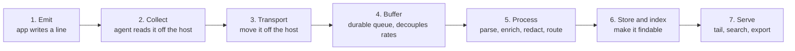
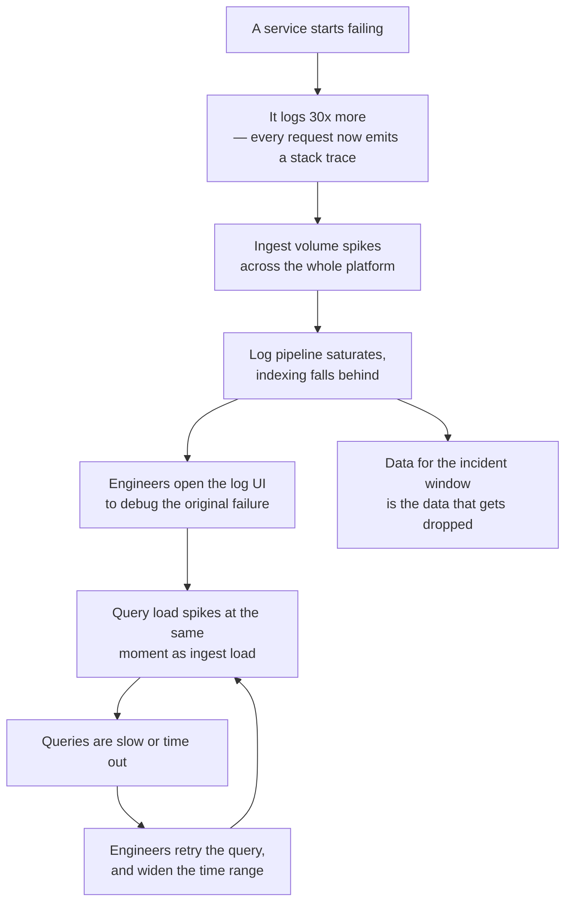

# What a Log Collector Actually Is, and Why It Is Hard

This doc builds the vocabulary the rest of the collection uses without re-explaining. It answers
four questions: what a log is and how it differs from the other telemetry you already collect,
what the pipeline between `log.Info()` and a search box is actually made of, which four
properties make that pipeline unusually hard, and what the fifteen classes of thing that go wrong
are called.

Read it even if you have run a logging stack before. Most of the arguments later in the
collection turn on distinctions made here — particularly **event time versus ingest time**, the
difference between **a log line and a log event**, and the reason the collection treats
**"the pipeline lost data" and "the pipeline stopped" as opposite failures you must choose
between**.

---

## Start with the thing you are actually building

Here is a line of code somebody wrote on a Tuesday afternoon:

```go
log.Error("charge failed: card_declined", "user_id", 98712, "order_id", "RB-8814027")
```

And here is what somebody wants, eleven minutes later, in an incident channel:

> "Show me every `card_declined` in the last ten minutes, grouped by payment provider, and let me
> see them scroll past live while I change the config."

Between those two facts sits an entire distributed system. It has to take that line off a disk on
one of twelve thousand machines, attach enough context that it means something to a person who
has never heard of that machine, move it across a network that is sometimes down, hold it
somewhere durable while the machine that produced it is deleted by an autoscaler, make it
searchable within seconds, keep it searchable for thirteen months, and do all of that for
**five and a half million other lines in the same second**.

That system is a **log collector** — though the name undersells it, because collection is the
easy third. This collection uses the term for the whole path, and where a distinction matters it
says which stage it means.

### The three questions people ask logs

Almost every real use of a logging platform is one of three, and they want incompatible things
from the same data. The whole architecture is shaped by the need to serve all three off one
ingest path.

1. **"What is happening right now?"** — someone is mid-incident, watching lines scroll. They want
   latency measured in **seconds from emit to screen**, they only care about the last few
   minutes, they will tolerate losing a line, and they are looking at one or two services.
2. **"Find me this exact thing."** — someone has a trace ID, an order ID, or a regular expression
   and wants every matching line from the last day or two. They want **completeness** — a search
   that silently omits the one line they needed is worse than no search — and they will wait ten
   seconds for it.
3. **"Give me all of it."** — an analytics team, a compliance team, or a machine-learning
   pipeline wants a bulk copy of a time range. They want **exactness and reproducibility**: the
   same request tomorrow must return the same bytes. They will wait an hour.

Write those down, because they conflict:

| | Live tail | Search | Bulk export |
|---|---|---|---|
| Latency it needs | 1–2 seconds | 2–10 seconds | minutes to hours |
| Completeness it needs | best effort | high | exact and repeatable |
| Data age it touches | last 15 minutes | last 24–48 hours | last 24–48 hours, frozen |
| How much it reads | a trickle | a pruned slice | everything |
| What it breaks when it misbehaves | one user's browser | the query tier | the storage tier |

A design that optimises for any one of these will be bad at the other two. Live tail wants data
in memory and unindexed, because indexing costs latency. Search wants data indexed and
compacted, because scanning costs money. Export wants data immutable and partitioned by time,
because that is what makes a request reproducible. The pipeline in this collection **forks into
three consumer paths off one shared buffer** precisely so each fork can make its own choice, and
docs 12, 13 and 14 each own one of them.

---

## A log is not a metric, and the difference is not stylistic

You will hear "the three pillars of observability: metrics, logs, traces". That framing is
popular and not very useful, because it describes what the data looks like rather than what it
costs. Here is the distinction that actually drives design decisions.

**A metric is a pre-aggregated number with bounded cardinality.** When a service exports
`http_requests_total{service="checkout-api", status="500"}`, the cost of that time series does
not depend on how many requests happen. A million requests and a hundred requests produce the
same one counter, sampled every fifteen seconds. Metrics have **cost proportional to the number
of distinct label combinations**, and they are cheap because you chose those combinations in
advance.

**A log is an unaggregated record of one event, with unbounded content.** A million requests
produce a million lines. Cost is **proportional to traffic**, directly and without mercy. There
is no label set you can choose ahead of time that bounds it, because the whole point of the log
line is that it carries the details you did not know you would need — the user ID, the SQL that
was slow, the full stack trace.

**A trace is a log with a causal structure attached.** A span is a log record that also knows its
parent. Everything in this collection about volume, transport, storage and retention applies to
spans essentially unchanged; what differs is that traces have their own sampling problem
(you must keep or drop a whole trace, not individual spans) which doc 08 covers.

The practical consequence is a rule you should internalise before reading further:

> **Metrics tell you that something is wrong. Logs tell you what.** So metrics must be complete
> and can be cheap, and logs must be detailed and are therefore expensive. Any time you find
> yourself computing an aggregate from logs — counting errors, measuring a rate — you have found
> something that should have been a metric, and doc 07 shows how to convert it at the pipeline
> instead of at query time.

This matters commercially. At Lantern's scale — defined in doc 01, 10 TB per hour — the metric
system handles roughly 40 million active time series and costs a few tens of thousands of dollars
a month. The log system handles 5.56 million records per second and, on a commercial SaaS
platform, would cost **over seven hundred thousand dollars a month** at list price. Doc 20
derives that number. It is the single strongest argument in the whole collection, and it is a
direct consequence of "cost proportional to traffic".

---

## Line, record, event, stream: four words that are not synonyms

Being sloppy about these four words causes real bugs, so this collection is strict about them.

**A line** is a sequence of bytes ending in `\n` in a file or on a pipe. It is a *transport-level*
unit. It is not necessarily meaningful on its own: a Java stack trace is forty lines that are one
thought, and a container runtime will split any line over 16 KB into multiple lines with a
continuation marker.

**A record** is what one meaningful emission became after the agent reassembled it — the forty
stack-trace lines glued back together, the 16 KB fragments rejoined. Records are what the rest of
the pipeline counts, charges for, and stores. The gap between "lines read" and "records emitted"
is a real metric that catches multiline-parsing bugs, and doc 02 shows why it is the first thing
to check when a stack trace arrives as forty unrelated rows.

**An event** is a record after it has been parsed and given structure: typed fields, a resolved
timestamp, attached metadata about where it came from. A record is bytes; an event is a row.

**A stream** is the ordered sequence of records from one source. The definition of "one source"
is a design decision with large consequences, and different systems draw it differently:
Kubernetes draws it at the container (one stream per container, per stdout/stderr channel), Loki
draws it at the unique label set, syslog draws it at the TCP connection. **Ordering guarantees
only ever exist within a stream**, never across streams, and a great deal of confusion about
"my logs are out of order" resolves the moment somebody notices they were comparing two streams.

---

## The seven stages, and what each one is for

Every log platform ever built — Splunk, the ELK stack, Loki, Datadog, a homegrown thing with
`rsyslog` and a cron job — is the same seven stages. They differ in which stages are merged,
which are skipped, and which are run by a vendor. Naming the stages lets the rest of this
collection say "this is a stage 4 problem" and have that mean something.



**Stage 1 — Emit.** The application produces the record. Design decisions here: structured versus
free text, what goes in the message versus in fields, which level, and whether to log at all.
This is the cheapest place to reduce volume by a factor of ten and the hardest place to change,
because it requires every team to edit code. Doc 04 and doc 08.

**Stage 2 — Collect.** Something on the host gets the record out of a file, a socket, or a
container runtime, reassembles multiline records, attaches host and container metadata, and
buffers it. This is the only stage that runs on hardware you do not control the capacity of, and
it is where the hardest correctness problem in the entire pipeline lives — **what to do when you
cannot keep up and the disk is filling**. Doc 02 and doc 03.

**Stage 3 — Transport.** Get bytes across the network, compressed, authenticated, and batched,
from twelve thousand agents to a handful of endpoints. The problems here are connection
management at fan-in, load balancing long-lived streams, and the fact that an agent's retry is
indistinguishable from a duplicate. Doc 05.

**Stage 4 — Buffer.** A durable, replayable queue between the producers and everything
downstream. This is the stage that people running small systems skip and people running large
ones consider non-negotiable, and doc 06 argues at length for why. In one sentence: **it is the
only thing that lets the storage tier have a bad day without the application tier noticing.**

**Stage 5 — Process.** Parse text into fields, attach data the agent did not have (which
deployment, which team owns this service, which customer this tenant maps to), strip
personally-identifiable data, derive metrics, decide sampling, and route different records to
different destinations. Doc 07 and doc 08.

**Stage 6 — Store and index.** Write to object storage in a format that can be scanned
efficiently, build whatever index the query patterns require, and manage the lifecycle from hot
to warm to cold to deleted. The central tradeoff of the whole collection lives here: **every byte
of index you build is paid for at write time on 100% of the data, to save scan time on the small
fraction of data anyone ever queries.** Docs 09 and 10.

**Stage 7 — Serve.** The three flows. Docs 11 through 14.

There are two more things that are not stages because they touch every stage:

- **The control plane.** Configuration for twelve thousand agents, sampling rules, tenant quotas,
  retention policies, schema definitions, access rules. It governs the data plane, and like every
  control plane it is a single point of failure that people forget to test. Docs 08, 16 and 18.
- **Self-observability.** Metrics and health for the pipeline itself, which has the awkward
  property that **you cannot debug the logging system with logs**. Doc 19.

---

## The four properties that make this hard

Plenty of systems move a lot of bytes. Here is what makes a log platform specifically difficult,
and each of these generates a whole doc later.

### Property 1: volume is set by someone else, and they can change it without telling you

Your capacity plan says 10 TB/hr. Then a team ships a change that adds one `log.Debug` inside a
loop that runs per row of a result set. That service goes from 900 lines/s to 400,000 lines/s at
11:40 on a Thursday. Nobody meant to do it. Nobody will notice until your alert fires.

This is different from every other capacity problem you have. A database's load is bounded by
user traffic, which grows in ways you can forecast. A log platform's load is bounded by **the sum
of every logging statement any engineer in the company writes**, and a single-character change
can move it by two orders of magnitude. Doc 16 covers the quota machinery this forces on you, and
the reason that machinery has to live at stage 2 (on the host, near the source) and not just at
stage 6 (where the bill arrives).

Here is the number that makes it concrete. A single pod emitting one 500-byte line per
millisecond produces 500 KB/s — which is 43 GB/day from **one pod**. At Riverbend's 3,100 pods,
if one percent of them do that, it is 1.3 TB/day of pure accident.

### Property 2: the data is at its most valuable in the first sixty seconds and almost worthless after a week

Query volume against log data follows a decay curve steeper than almost any other data store:

```
Share of all queries, by age of the data queried
  last 15 minutes  ████████████████████████████████████  48%
  15 min – 1 hour  ██████████████████                    24%
  1 hour – 24 h    ████████████                          16%
  1 – 7 days       █████                                  7%
  7 – 30 days      ██                                     3%
  older than 30 d  █                                      2%
```

So **72% of queries touch data less than an hour old**, but **that data is 0.4% of what you
store** if you retain thirteen months. You are paying to keep 8.7 petabytes so that 2% of queries
can work.

That asymmetry is not a problem — it is the single biggest design lever you have, and it is why
every mature log platform is built as **tiers with genuinely different technology**, not one
system with a retention setting. The hot tier can afford memory and indexes because it is tiny.
The cold tier must be object storage with no index at all because it is enormous. Doc 09 builds
the tiering; doc 10 explains why the index must not be uniform across tiers.

### Property 3: losing data is silent

If your database drops a write, the write returns an error and somebody sees it. If your log
pipeline drops a record, **nothing happens**. The application already moved on; it called
`log.Error()` and that returned `void`. There is no acknowledgement path and no user waiting.

The failure surfaces weeks later as: "I searched for the request and there's nothing. Weird.
Anyway." — and the conclusion the engineer draws is not "the pipeline lost it", it is "the code
path didn't execute", which sends them debugging the wrong thing for two hours.

This is why doc 15 exists and why it is one of the most important docs here. **A log pipeline
that cannot measure its own loss rate does not have a loss rate of zero; it has an unknown loss
rate.** The techniques for measuring it — per-stream sequence numbers, per-stage counters that
must reconcile, and synthetic canary records injected at stage 1 and counted at stage 7 — are all
in doc 15, and none of them are free.

### Property 4: it must survive the incident it is needed for

Every other data system can be down while you fix it, because while it is down, nothing is
generating demand for it. The log platform is the opposite: **the moments it is most loaded are
exactly the moments people most need it.**

Work through the sequence, because it is a genuine feedback loop and not a hypothetical:



Two separate bad things happen at once. The loop `F → H → F` is a classic retry amplification —
the same shape as the cascading failures in
[`../MicroservicesPOF/04-cascading-and-metastable-failures.md`](../MicroservicesPOF/04-cascading-and-metastable-failures.md),
applied to a query tier. And `D → I` is worse than it looks: the pipeline drops data **during**
the incident, meaning the records you lose are precisely the ones that would have explained it.

Every architectural choice in this collection that looks like paranoia — the durable buffer at
stage 4, the separate consumer group per flow, per-tenant quotas, admission control on queries,
shedding *indexing* before shedding *archiving* — is a response to property 4. Doc 18 works
through it as a named failure class.

---

## Event time versus ingest time, and why you need both

This distinction causes more subtle bugs than anything else in the collection, so it gets its own
section here rather than being introduced later.

Every record carries **two timestamps that mean different things**:

- **Event time** (`ts`): when the thing happened, as recorded by the process that logged it. This
  is what a human means by "when". It comes from the application's clock, which may be wrong.
- **Ingest time** (`ingest_ts`): when the pipeline first took durable custody of the record. This
  comes from the gateway's clock, which is one of a handful of machines you can actually keep
  synchronised.

Here is why you cannot use just one.

**If you only keep event time**, you cannot answer "is my pipeline healthy?" — because you cannot
distinguish "no records arrived in the last minute because nothing happened" from "no records
arrived because the pipeline is down". And you cannot safely finalise a time partition, because a
record with an event time of 14:00 might arrive at 14:00:01 or at 19:30 (from an agent whose
host was partitioned for five hours, or from a mobile device that was offline). You never know
when 14:00 is *done*.

**If you only keep ingest time**, search becomes wrong in a way people will not forgive. An
engineer searching 14:00–14:05 for the incident they are debugging will silently miss the records
that describe it, because those records arrived at 19:30. They will conclude the code path did
not execute.

So: **partition storage by ingest time, search by event time, and make the gap visible.** That
one sentence resolves most of it, and the reasoning is worth spelling out:

- **Partitioning by ingest time** means a partition is *closed* the moment its window passes. No
  record will ever be added to the 14:00 partition after 14:05, because "14:00" means "arrived at
  14:00". Partitions are immutable, so exports are reproducible and compaction is safe. This is
  what doc 14 relies on to make the bulk export repeatable.
- **Searching by event time** means the user gets what they meant. The query planner turns "event
  time 14:00–14:05" into "scan ingest partitions 14:00 through 14:05, **plus** every later
  partition up to the configured maximum lateness, filtering on the event-time column." That
  widening is the price, and it is why the maximum-lateness bound matters commercially: if you
  allow 24 hours of lateness, every five-minute search scans 24 hours of partitions.
- **Making the gap visible** means exporting `ingest_ts − ts` as a distribution. It is your single
  best health signal (doc 19), and it catches clock skew: a host whose clock is 40 minutes fast
  produces *negative* lag, which is both diagnostic and, if you do not guard against it,
  a record that lands in a partition for a time that has not happened yet.

A third timestamp is sometimes worth carrying: **collection time**, when the agent read the line.
The difference between collection time and event time isolates delay inside the host (a full
buffer, a slow agent) from delay on the network. At twelve thousand agents it is worth the eight
bytes.

---

## The two decisions that define your architecture

Almost everything else follows from these two. They are introduced here and then argued
properly — the first in doc 10, the second in doc 02.

### Decision 1: how much do you index?

You have a spectrum, and the two ends are genuinely different products.

**Index everything** (Elasticsearch, Splunk): build an inverted index over every token in every
record. Any search for any word is fast. You pay for it at write time on 100% of the data — the
index is typically 40–120% of the size of the data itself, and building it costs more CPU than
anything else in the pipeline. At 5.56M records/s this is the dominant line item in your budget.

**Index almost nothing** (Loki, and the S3-plus-brute-force designs): index only a handful of
low-cardinality labels — tenant, service, level, hour — and store everything else as opaque
compressed blocks. Writes are cheap and fast. Any query that the labels can prune is fast; any
query that they cannot prune becomes a brute-force scan over terabytes.

**Index sparsely** (ClickHouse, Druid, and most things built in the last five years): sort the
data by the columns people filter on, keep a coarse min/max index per block so you can skip
blocks, and add probabilistic indexes — Bloom filters over tokens or character n-grams — that let
you skip blocks for substring searches too. This is the middle, and it is the middle because
**a filter that eliminates 99% of blocks is nearly as good as an exact index and costs 2% of the
space.**

The reason this is *the* decision: it sets your cost per TB, your query latency profile, and
which queries are impossible. Doc 10 derives the tradeoff with real numbers, and doc 11 shows
what a regex search costs under each choice.

### Decision 2: what do you do when you cannot keep up?

The agent on the host has produced more records than it can ship. Its buffer is full. It has
exactly four options and there is no fifth:

1. **Block the application.** Make the logging call slow or stop the process reading the pipe.
   This preserves every record — and turns a logging problem into an outage of the service. Almost
   always wrong, and yet it is the default in more setups than people realise (a full Docker
   `json-file` log on a full disk will block the container's write).
2. **Drop new records.** Keep what you have, discard what arrives. Fast, bounded, and you lose
   *the newest* data — which during an incident is the data you need.
3. **Drop old records.** Ring-buffer semantics. You lose the *oldest* data, keeping the tail. For
   live debugging this is usually the better of the two drops, and it is what most agents do not
   do by default.
4. **Spill to disk.** Trade memory for local disk, buying minutes or hours of outage tolerance.
   This is the right answer right up until the disk fills, at which point you are back to choosing
   between 1, 2 and 3 — with the added risk that you have now filled a disk the *application*
   needed.

There is no option that is both lossless and non-blocking. **You are choosing which failure you
prefer, and if you do not choose explicitly, the default in your agent's config has chosen for
you.** Doc 02 works through what each agent actually does by default, which is more surprising
than it should be.

---

## The fifteen failure classes used throughout

Every failure in this collection gets an ID whose letter names the owning doc. These are the
cross-reference spine: the case studies in doc 21, the interview bank in doc 23, and the playbook
in doc 24 all cite them rather than re-explaining.

| Prefix | Owning doc | Class | The question it covers |
|---|---|---|---|
| `A-nn` | 02 | **A**gent and host collection | Did the record get off the machine? |
| `S-nn` | 04 | **S**chema, parsing, and structure | Did it survive being turned into fields? |
| `T-nn` | 05 | **T**ransport and gateway | Did it cross the network exactly once? |
| `B-nn` | 06 | **B**uffer tier | Is the queue holding, and for how long? |
| `P-nn` | 07 | **P**rocessing tier | Did enrichment and routing do the right thing? |
| `V-nn` | 08 | **V**olume control: sampling, quotas | Did we drop the right things, on purpose? |
| `W-nn` | 09 | Storage, **W**riting and formats | Is it on disk in a shape we can read back? |
| `X-nn` | 10 | Inde**X**ing | Can we find it without reading everything? |
| `Q-nn` | 11, 13 | **Q**uery execution | Did the search finish, and was it complete? |
| `L-nn` | 12 | **L**ive tail | Is the real-time path keeping up? |
| `E-nn` | 14 | **E**xport and bulk delivery | Is the bulk copy correct and repeatable? |
| `D-nn` | 15 | **D**elivery guarantees and loss | How much did we lose, and do we know? |
| `M-nn` | 16 | **M**ulti-tenancy and isolation | Whose problem became everyone's problem? |
| `C-nn` | 17 | **C**ompliance, security, PII | What did we store that we should not have? |
| `O-nn` | 18 | **O**perating the platform | The pipeline itself is the incident |

Each scenario follows the same five headings, so you can skim to the part you need:

- **What you see** — the symptom, from the point of view of whoever gets paged.
- **Mechanism** — why it happens, derived rather than asserted.
- **Confirm it** — the query, command, or measurement that distinguishes this from the three
  other things it looks like.
- **Recover** — what to do in the next ten minutes.
- **Prevent** — the design or configuration change, and what that change costs.

---

## What to take away

1. **A log collector is seven stages**, not one component: emit, collect, transport, buffer,
   process, store and index, serve. Naming the stage a problem lives in is most of diagnosing it.
2. **Three flows want incompatible things** from the same data — live tail wants latency, search
   wants completeness, export wants reproducibility. The architecture forks into three consumer
   paths off one durable buffer so each can make its own tradeoff.
3. **Log cost is proportional to traffic; metric cost is proportional to cardinality.** That
   single difference is why a logging platform is the most expensive part of most observability
   budgets, and why any aggregate you compute from logs should have been a metric.
4. **Volume is controlled by people who are not you**, and one line of code in a loop can move it
   two orders of magnitude in an afternoon. Quotas are not optional bureaucracy; they are the
   capacity plan.
5. **72% of queries touch data under an hour old, which is 0.4% of what you store.** Build tiers
   with genuinely different technology, not one system with a retention setting.
6. **Log loss is silent.** There is no acknowledgement path back to the application, so a pipeline
   that does not actively measure loss has an unknown loss rate, not a zero one.
7. **The platform is most loaded exactly when it is most needed.** Failing services log more,
   engineers query more, and both spikes land in the same minute — so the data lost is the data
   that would have explained the incident.
8. **Keep event time and ingest time separately.** Partition by ingest time so partitions close
   and exports are reproducible; search by event time so results mean what the user meant; export
   the gap between them as your primary health signal.
9. **When you cannot keep up there are exactly four options** — block, drop newest, drop oldest,
   spill to disk — and no combination of them is both lossless and non-blocking. Choose
   deliberately, because your agent's default has already chosen.
10. **How much you index is the decision that defines the product.** It sets your cost per TB,
    your latency profile, and which queries are simply not possible.

Next: [01-requirements-and-the-capacity-model.md](01-requirements-and-the-capacity-model.md),
which fixes the numbers — 10 TB/hr, 12,000 hosts, 5.56M records/s — and derives every downstream
sizing decision from them in visible steps.
