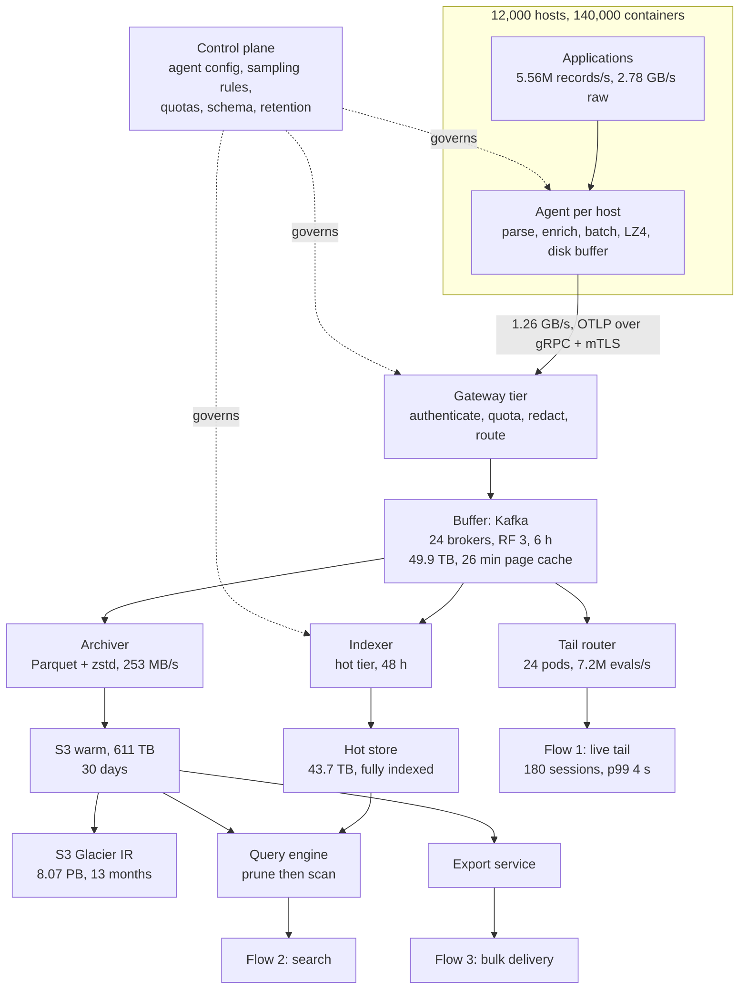

# Requirements and the Capacity Model

This doc fixes every number the rest of the collection uses. Where a later doc says "recall that
a Lantern broker holds sixteen minutes of page cache" or "the ngram index costs 2.1% of stored
bytes", it is referring to an arithmetic step on this page.

Read it once carefully. The habit worth building is not memorising the figures — it is noticing
**which figure each design decision actually turns on**, because that is the one to recompute for
your own system. Most of the time it is not the headline throughput. It is the average record
size, the peak-to-average ratio, and the compression ratio, and those three are the ones people
guess at.

---

## The requirement, stated precisely

> Design a log platform that ingests **10 TB per hour** from several thousand services, and
> serves three consumers: engineers watching logs live for debugging, engineers running exact
> and regular-expression searches against recent data, and an analytics team that needs a bulk
> copy of the last 24–48 hours.

That is the whole brief, and it is under-specified in five ways that matter more than the 10 TB.
Before any arithmetic, pin them down, because a sizing exercise that skips this step produces a
confident answer to the wrong question.

**1. Is 10 TB/hr average or peak?** These differ by roughly a factor of two in real fleets, and
which one you were given changes every downstream number. We will take it as **average over a
day**, and derive peak from a measured diurnal ratio. If it were peak, every figure here divides
by 1.7 and the system is dramatically cheaper.

**2. Is 10 TB compressed or raw?** Log text compresses by between four and eleven times depending
on codec and layout, so this is a factor-of-ten ambiguity hiding in the question. We take it as
**raw bytes as emitted by the applications**, which is the only definition the emitting teams can
verify.

**3. What does "real time" mean for the tail?** A second? Five? Thirty? We will commit to a
number and hold the design to it: **p50 under 1.5 s and p99 under 4 s from `log.Info()` returning
to a line appearing in a browser.** Doc 12 spends that budget stage by stage.

**4. What does the regex search cover, and how complete must it be?** "Real-time regex over all
logs" is not buildable at this volume — doc 11 shows the brute-force cost is about 192,000 CPU
cores for a ten-second answer, which is not a system, it is a data centre. So the requirement
becomes: **regex over a time-and-service-bounded slice, with a hard cost ceiling per query, and
honest reporting when a query is truncated.** The word "honest" is doing real work there; a
search that silently returns partial results is worse than one that refuses.

**5. What does "the last 24–48 hours" mean when records arrive late?** If an agent was
partitioned for three hours and flushes at 19:30, does a 14:00 export contain its records? The
answer has to be fixed as policy, not left to whichever job happens to run — doc 14 defines it
as a **watermark with a stated maximum lateness**, and everything downstream depends on that
being explicit.

Three more requirements are always implied and never stated, so state them:

- **Loss budget.** We commit to **under 0.01% of records lost end to end in steady state**, and
  to *measuring* it rather than asserting it (doc 15). Zero loss is not achievable at this volume
  without blocking applications, and claiming it is dishonest.
- **Retention.** 48 hours hot and searchable, 30 days warm and searchable more slowly,
  **13 months cold** for compliance. The 13 months is what makes the storage bill interesting.
- **Multi-tenancy.** 40 business units share the platform. No tenant may degrade another
  (doc 16), and each must be billed for what it uses.

---

## Two systems, one platform

The collection uses two named systems throughout, at deliberately different scales, because
several arguments only become visible when you compare them.

**Lantern** is the central log platform — the 10 TB/hr system this brief describes. It is the
subject of the collection.

**Riverbend** is the online marketplace that is Lantern's largest single application tenant. It
is the same Riverbend used in
[`../K8s/cronJobs`](../K8s/cronJobs/README.md),
[`../Observability`](../Observability/README.md),
[`../Kafka`](../Kafka/README.md) and
[`../MicroservicesPOF`](../MicroservicesPOF/README.md), with the same figures, so the collections
agree with each other. Where a number below is inherited rather than invented, it is marked.

Having both matters because they make opposite points. Riverbend's logging problem is small
enough to hold in your head and is the scale most readers actually operate at — it is where
"just run Elasticsearch" is the right answer. Lantern's is the scale at which every instinct
from Riverbend is wrong. Doc 22 walks the transitions between them.

### Riverbend, as inherited

| Fact | Value | Source |
|---|---|---|
| Services | 240 across 38 namespaces | `K8s/cronJobs`, `MicroservicesPOF` |
| Platform | EKS, control plane 1.29 | `K8s/cronJobs` |
| CronJobs | 412 | `K8s/cronJobs` |
| Catalogue reads | 5,000/s steady, 42,000/s peak | `MicroservicesPOF` |
| `checkout-api` | 640 req/s steady, 3,400 req/s flash-sale peak | `MicroservicesPOF` |
| Orders | 67/s steady | `MicroservicesPOF` |
| Kafka cluster | 6 × `m5.2xlarge`, `clickstream.events` at 34,000/s | `Kafka` |

Two facts are new here, needed for log arithmetic and consistent with the above: Riverbend runs
**380 nodes** and **3,100 pods**.

---

## Deriving Riverbend's log volume

Do this one first. It is small enough to check by hand, and it establishes the method.

**Step 1 — count the requests that produce logs.** Edge traffic is catalogue reads plus checkout
plus the rest of the surface (search, cart, account, reviews, order history):

```
catalogue reads                      5,000 req/s
checkout-api                           640 req/s
everything else at the edge          2,560 req/s
                                     ----------
edge total                           8,200 req/s
```

**Step 2 — apply the internal fan-out.** In a 240-service estate, one edge request touches
several services. Riverbend's measured average is **5.4 internal calls per edge request**:

```
8,200 × 5.4 = 44,280 internal RPCs/s
total calls handled anywhere        = 8,200 + 44,280 = 52,480 calls/s
```

**Step 3 — apply the per-call logging rate.** Each service writes one access-log line per inbound
call. On top of that, application code emits roughly 0.4 lines per call on average — some calls
log nothing, some log five lines:

```
52,480 × 1.4 = 73,472 lines/s from application and access logs
```

**Step 4 — add the infrastructure logs**, which people forget and which are not small. Across
380 nodes: kubelet, containerd, the CNI, kube-proxy, the ingress controller, node agents, plus
the 412 CronJobs' output:

```
380 nodes × ~30 lines/s each   = 11,400 lines/s
CronJob output, averaged       =    600 lines/s
                                 -------------
infrastructure                 = 12,000 lines/s
```

**Step 5 — total, and convert to bytes.** Access logs are short (about 300 B), application logs
with structured fields are longer (about 700 B), infrastructure sits in between. The weighted
mean comes out at **520 bytes**:

```
records/s   = 73,472 + 12,000 = 85,472  ≈ 85,000 records/s
bytes/s     = 85,000 × 520    = 44.2 MB/s
per hour    = 44.2 × 3,600    = 159 GB/hr
per day                       = 3.8 TB/day
```

**Step 6 — peak.** A flash sale takes catalogue reads to 42,000/s and checkout to 3,400/s, a
4.2× multiplier on the application path. Infrastructure logging does not scale with traffic:

```
application at peak  = 73,472 × 4.2 = 308,582 records/s
infrastructure       =                 12,000 records/s
peak total           =                320,582 records/s ≈ 320,000/s
peak bytes           = 320,000 × 520 = 166 MB/s = 599 GB/hr
```

So Riverbend alone swings between **159 and 599 GB/hr**. Hold on to that 3.8× swing; it is the
reason doc 06 sizes the buffer for peak and doc 16 puts a quota above peak but below runaway.

**A boundary worth drawing now.** Riverbend's `clickstream.events` topic carries 34,000
events/s, and those are *not* in the numbers above. Clickstream is product analytics: a
schema'd, versioned business event stream that feeds the data warehouse. It happens to look like
logs and it must not be treated as logs, because it has different retention, different
correctness requirements, and a different owner. **Keeping that boundary crisp is one of the
cheapest things you can do to control log volume** — doc 04 returns to it, because the most
common way a log platform doubles in size is a team deciding it is a convenient event bus.

---

## Deriving Lantern's numbers

Now the platform. Start from the brief and unfold it.

### The base rate

```
10 TB/hr, decimal TB:
    10 × 10^12 bytes ÷ 3,600 s      = 2.78 × 10^9  bytes/s = 2.78 GB/s
per minute:      2.78 × 60          = 167 GB/min
per day:         2.78 × 86,400      = 240 TB/day
per 48 hours:                       = 480 TB
```

### Record count, which depends entirely on average size

This is the number people guess at, and it swings everything. The platform-wide mix is heavier on
short machine-generated lines than Riverbend's, because edge and mesh access logs dominate:

| Source | Share of bytes | Typical record | Records/s |
|---|---|---|---|
| Edge and CDN access logs | 31% | 380 B | 2.27M |
| Mobile and web client telemetry | 18% | 640 B | 782K |
| Service mesh access logs (Envoy) | 14% | 420 B | 926K |
| Batch and ETL platform (Spark executors) | 11% | 900 B | 340K |
| Application logs, 40 business units | 21% | 700 B | 834K |
| Infrastructure and network devices | 5% | 290 B | 479K |

Check the arithmetic on one row so the method is visible — edge access logs:

```
31% of 2.78 GB/s = 0.862 GB/s
0.862 × 10^9 ÷ 380 bytes = 2.27 × 10^6 records/s   ✓
```

Summing the right-hand column:

```
2.27M + 0.78M + 0.93M + 0.34M + 0.83M + 0.48M = 5.63M records/s
```

and the implied platform-wide mean record size:

```
2.78 × 10^9 ÷ 5.63 × 10^6 = 494 bytes
```

Round to **5.6 million records per second at an average of 494 bytes**. The collection uses
**5.56M/s and 500 B** as the working figures, which is the same number to the precision anyone
should trust.

**Notice what the table says, because it is the most actionable fact in this doc.** 65% of the
bytes — edge, mesh, mobile, infrastructure — are **machine-generated records that no human ever
reads individually**. They are read in aggregate, by dashboards and by two or three
investigations a week. Only the 21% application slice is what people mean when they say "logs".
Doc 08 builds the whole volume-control argument on this split, and doc 20 shows that routing
those two classes to *different storage tiers with different indexing* is worth more than every
other optimisation in the collection combined.

Riverbend's 159 GB/hr sits inside the 21% application slice: it is **1.6% of the platform**. At
peak it is 6.0%. That ratio is realistic and it is why doc 16's quota system has to work at two
levels — a tenant can triple without anyone noticing, and that is fine, but it must not be able
to take 40% of the platform.

### Peak, and the two kinds of peak

Diurnal peak-to-average across a global fleet is **1.7×** (it would be 3× for a single-region
consumer product, and 1.2× for a batch-heavy platform; global mixes flatten out):

```
peak ingest       = 2.78 × 1.7 = 4.73 GB/s
peak records/s    = 5.56M × 1.7 = 9.45M records/s
```

The second kind of peak is not diurnal and does not respect your capacity plan. An **incident
spike** is a single service's volume multiplying because it started failing and every request now
produces a stack trace. Measured across a year of Lantern incidents, the worst single-service
spike was **31×**, from a service normally producing 40 MB/s:

```
40 MB/s × 31 = 1.24 GB/s from one service
             = 45% of the platform's entire average throughput, from one tenant
```

**Design for the diurnal peak; survive the incident spike by shedding it.** You cannot provision
for 31× on an arbitrary tenant — that would mean running the platform at 3% utilisation. You
provision for 1.7× and you build per-tenant admission control so the 31× is absorbed by dropping
that tenant's excess, not by dropping everyone's. This is the single most important capacity
statement in the collection and doc 16 implements it.

### The fleet

```
hosts running an agent                      12,000
containers / pods                          140,000
average log rate per host   2.78 GB/s ÷ 12,000  = 232 KB/s
```

That average is close to meaningless, because log volume per host is extraordinarily skewed. The
measured distribution:

```
p50 host                     18 KB/s
p90 host                    140 KB/s
p99 host                    4.1 MB/s
max host                     40 MB/s      ← a Spark executor node during a big job
```

**The p99 host produces 228× the median host.** Any agent resource limit set from the average
will kill the p99 hosts; any limit set for the p99 hosts wastes 12,000 × the difference. Doc 02
deals with this directly, and the answer is not a single limit — it is a limit plus a spill-to-
disk buffer plus a per-host rate cap that degrades rather than crashes.

---

## Compression, which is the biggest single lever

Every downstream sizing number depends on a compression ratio, so establish them properly rather
than assuming. These are representative ratios for **JSON-ish log text** — highly repetitive,
low-entropy, with the same field names on every record. Throughputs are per core on a modern
x86 server.

| Codec and layout | Ratio | Compress speed | Decompress speed | Where it belongs |
|---|---|---|---|---|
| none | 1.0 | — | — | nowhere |
| LZ4 | 2.2 : 1 | ~500 MB/s | ~2.5 GB/s | on the host, where CPU belongs to the application |
| Snappy | 2.4 : 1 | ~400 MB/s | ~1.8 GB/s | interchangeable with LZ4 |
| zstd level 1 | 3.6 : 1 | ~350 MB/s | ~1.3 GB/s | gateway to buffer |
| zstd level 3 | 4.6 : 1 | ~180 MB/s | ~1.2 GB/s | the general-purpose default |
| zstd level 9 | 6.1 : 1 | ~35 MB/s | ~1.1 GB/s | archive, written once |
| gzip level 6 | 4.1 : 1 | ~55 MB/s | ~400 MB/s | legacy only — strictly worse than zstd |
| **Parquet + dictionary + zstd-3** | **11 : 1** | ~90 MB/s | ~1.0 GB/s | **the storage tier** |

The last row is the important one and it deserves an explanation rather than a number, because
the jump from 4.6 to 11 is not a better algorithm — it is a better *layout*.

A row-oriented compressor sees this:

```
{"ts":"2026-09-30T14:23:01.847Z","service":"payment-api","level":"ERROR","host":"ip-10-0-3-47",...}
{"ts":"2026-09-30T14:23:01.849Z","service":"payment-api","level":"INFO","host":"ip-10-0-3-47",...}
```

It compresses the repeated field names well, because they are close together in its window. But
`payment-api` and `ip-10-0-3-47` recur every few hundred bytes, and a 64 KB compression window
only holds a few hundred records, so it re-encodes those references over and over.

A column-oriented layout sees this instead:

```
service column:  payment-api, payment-api, payment-api, ... (200,000 times)
level column:    ERROR, INFO, INFO, WARN, INFO, ...
host column:     ip-10-0-3-47, ip-10-0-3-47, ...
```

Now `service` is a dictionary with maybe 240 entries and a column of small integers, which
run-length-encodes to almost nothing. `level` has six distinct values. `host` has one per file.
The only column with real entropy is the message text — and it is now compressed against
*other message text*, not interleaved with metadata, so its own ratio improves too.

**The practical rule:** the more of your record is structured metadata rather than free text, the
bigger the columnar win. Access logs, which are almost entirely metadata, hit 18:1. Free-text
application logs with long stack traces hit 6:1. The 11:1 blended figure reflects Lantern's mix,
and doc 09 shows how to measure your own rather than adopting it.

### The compressed rates everything downstream uses

```
raw ingest                                        2.78 GB/s
on the wire, agent → gateway, LZ4 at 2.2:1        1.26 GB/s
gateway → buffer, zstd-1 at 3.6:1                 0.77 GB/s
in storage, Parquet + zstd-3 at 11:1              0.25 GB/s  ( = 253 MB/s )
```

---

## Sizing the buffer tier

Full derivation in doc 06; the numbers it produces are here because later docs cite them.

Kafka holds the buffer. The gateway recompresses with zstd-1 before producing (doc 05), so the
buffer stores **0.77 GB/s of unique data** — not the 1.26 GB/s that crossed the network.

**Step 1 — cluster write rate, including replication.** At replication factor 3, every byte is
written three times:

```
0.77 GB/s × 3 = 2.31 GB/s of disk write across the cluster
```

**Step 2 — read rate.** Three consumer groups read everything: the indexer (feeds storage), the
archiver (writes Parquet), and the tail router (feeds live tail). Plus replication fetches, which
are reads on the leader:

```
consumer reads    = 0.77 × 5 = 3.85 GB/s   (upper bound: not every group reads every topic)
replication reads = 0.77 × 2 = 1.54 GB/s
total read        =            5.39 GB/s
```

**Step 3 — pick a broker and count them.** `i3en.6xlarge`: 24 vCPU, 192 GB RAM, 2 × 7.5 TB NVMe
(15 TB raw, ~12 TB usable at 80%), 25 Gbps network.

Three independent constraints, and the binding one is not the obvious one:

```
Disk write:   2.31 GB/s ÷ 550 MB/s per broker (50% of sustained NVMe)  =  4.2 brokers
Network:      (2.31 write + 5.39 read) GB/s = 7.70 GB/s = 61.6 Gbit/s
              ÷ 25 Gbps × 0.6 usable = 15 Gbps per broker              =  4.1 brokers
Retention:    0.77 GB/s × 21,600 s (6 h) = 16.6 TB unique × 3 = 49.9 TB
              ÷ 12 TB usable per broker                                =  4.2 brokers
```

All three land near four, so four brokers would carry the steady-state load. **We run 24.** The
gap between 4 and 24 is worth understanding, because it is where most sizing exercises go wrong:

- **Peak, not average.** 1.7× diurnal takes the requirement to 7 brokers before anything else.
- **Losing an availability zone.** Across 3 AZs, losing one must leave the survivors able to
  carry everything: 7 ÷ (2/3) = 11.
- **Partition count and recovery.** More brokers means fewer partitions per broker, which means
  a failed broker's partitions are re-led faster and a replacement catches up faster. At 24
  brokers a single failure moves 4% of the load, not 14%.
- **Page cache**, which is the real reason, and which the disk and network sums above miss
  entirely.

**Step 4 — page cache residency, the number that actually governs the design.** A Kafka consumer
reading near the tail is served from the operating system's page cache and costs the broker
almost nothing. A consumer that has fallen behind reads from disk, and that read competes with
every write. So the question "how far behind can a consumer be before it starts hurting the
cluster?" has a numeric answer:

```
per broker at 24 brokers:  0.77 GB/s ÷ 24        = 32.1 MB/s of unique writes
                           × 3 (replicas land here too) = 96.3 MB/s written per broker
page cache available:      192 GB RAM − ~40 GB for the JVM and OS = ~150 GB
residency:                 150 GB ÷ 96.3 MB/s    = 1,558 s ≈ 26 minutes
```

**Any consumer within 26 minutes of the tail reads from memory. Beyond that, it reads disk, and
the disk reads compete with the ingest writes.** This single number explains a great deal later:
why the tail router must never be allowed to lag (doc 12), why one lagging consumer degrades the
whole cluster (doc 18, `B-07`), and why the archiver — which reads everything — is configured to
stay close to the tail even though nothing about its job requires freshness.

Compare with the Riverbend cluster in [`../Kafka`](../Kafka/README.md): 6 brokers, page-cache
residency about 29 minutes at average load and 11 at peak. Same physics, different constants.

**Final buffer sizing:**

```
24 × i3en.6xlarge, 3 AZs, RF 3, min.insync.replicas 2, 6-hour retention
49.9 TB stored of 288 TB raw capacity (17% — disk is not the constraint)
96.3 MB/s written per broker, ~26 minutes of page-cache residency
```

---

## Sizing storage

```
raw in                 2.78 GB/s
stored (11:1)          253 MB/s = 910 GB/hr = 21.8 TB/day
```

| Tier | Age | Volume | Medium | Monthly cost |
|---|---|---|---|---|
| Hot, indexed | 0–48 h | 43.7 TB | SSD-backed, local to query nodes | ~$4,800 (instance storage) |
| Warm | 2–30 days | 611 TB | S3 Standard @ $0.023/GB-mo | $14,053 |
| Cold | 30 d – 13 mo | 8.07 PB | S3 Glacier Instant Retrieval @ $0.004/GB-mo | $32,280 |

Check the warm figure:

```
28 days × 21.8 TB/day = 610.4 TB = 610,400 GB × $0.023 = $14,039/month   ✓
```

And cold:

```
(400 − 30) days × 21.8 TB/day = 8,066 TB = 8,066,000 GB × $0.004 = $32,264/month   ✓
```

Storage totals about **$51,000 a month**, which is the cheap part. Doc 20 puts the whole bill
together — compute, network and storage — and compares it against the SaaS alternatives, where
the same volume lists at over $700,000 a month.

### The object-count problem, stated now because it surprises people

Storage cost is not only bytes. Object storage charges per request, and the query planner has to
enumerate objects before it can skip them.

Suppose you flush an object every 60 seconds for freshness, partitioned by tenant and service.
With 40 tenants averaging 200 services each:

```
objects/day = 40 × 200 × 1,440 flushes = 11.5M objects/day
average size = 21.8 TB ÷ 11.5M          = 1.9 MB
PUT cost     = 11.5M × $0.005/1,000     = $57.60/day = $1,728/month
```

The money is survivable; the object count is not. A query over 48 hours now has to consider
**23 million objects** before reading one, and listing that many is slower than scanning some of
them. Worse, 1.9 MB objects defeat the compression you worked for — dictionaries are per-file,
so a small file has a small dictionary.

Flush hourly instead and the arithmetic inverts:

```
objects/day  = 40 × 200 × 24 = 192,000
average size = 21.8 TB ÷ 192,000 = 113 MB   ← a good Parquet file size
```

But now data is up to an hour stale, which fails requirement 3 outright.

**The resolution is two-tier, and it is the same resolution Druid, Iceberg and every streaming
lakehouse arrived at:** write small objects immediately for freshness, and run a compaction job
that rewrites them into large ones once the window is closed. You pay for the data twice — once
written small, once rewritten large — and you get both freshness and efficiency. Doc 09 works
through the compaction schedule and what it costs.

---

## Sizing the query tier, and the number that kills the naive design

Doc 11 does this properly. The headline, because it reframes the whole problem:

A brute-force regular-expression scan over 48 hours of data means reading **480 TB of raw bytes**
(43.7 TB on disk, decompressed as you go). Effective throughput for decompress-plus-RE2-match is
about **250 MB/s of raw bytes per core**:

```
480 × 10^12 ÷ 250 × 10^6 = 1,920,000 core-seconds = 22.2 core-days
to answer in 10 seconds:   1,920,000 ÷ 10 = 192,000 cores
```

192,000 cores for one query. There is no budget for that and no cluster that would survive one
user pressing enter twice.

So the query tier is not a scanning problem, it is a **pruning** problem, and the entire design
is a chain of filters applied before any bytes are read:

```
start                                                480 TB
÷ 192   time: 48 h narrowed to the 15-minute window    2.5 TB
÷  40   tenant and service selectivity                62.5 GB
÷   6   log level (ERROR only)                        10.4 GB
÷  50   n-gram Bloom index on the literal substring     208 MB
```

**208 MB.** Eight cores, under a second. The factor-of-2.3-million reduction is what the
architecture is *for*, and every one of those four divisions is a design decision made somewhere
earlier in the pipeline: partitioning by time (doc 09), sorting by tenant and service (doc 09),
storing level as a low-cardinality column (doc 04), and building n-gram Bloom filters (doc 10).

The corollary is the honest part of the requirement: **a regex with no literal substring in it,
over all tenants, over 48 hours, is not answerable and the system must say so** rather than
attempting it. Doc 11 covers how to detect that at plan time and what to offer the user instead.

---

## Sizing the live-tail tier

Full derivation in doc 12; the shape is this. Roughly 1,200 engineers use Lantern, with about
**180 concurrent tail sessions** at peak — a normal weekday afternoon, a couple of incidents
running.

The naive implementation gives each session its own Kafka consumer. 180 consumers each reading
their topic is survivable, but it means every new session adds a consumer group, triggers a
rebalance, and reads from wherever its offset lands — which, if it lands more than 26 minutes
back, is a disk read (see the page-cache figure above). At 180 sessions that is a self-inflicted
denial of service on the buffer tier.

The shared design has a router tier that consumes each partition **once** and evaluates every
subscription against each record. Naively that is:

```
5.56M records/s × 180 subscriptions = 1.0 billion predicate evaluations/s
```

which is not affordable. But subscriptions are not uniform — almost every one is scoped to a
single service. Index the subscriptions by service, and each record is only tested against the
subscriptions for *its* service:

```
average subscribers per service with any subscriber: 1.3
evaluations/s = 5.56M × 1.3 = 7.2M/s
across 24 router pods        = 301,000/s per pod
```

Three hundred thousand predicate evaluations per second per pod is ordinary work. **The
optimisation is not a faster matcher — it is an index over the subscriptions**, which is the same
idea as an index over the data, applied to the other side of the join. Doc 12 builds it.

---

## The whole thing, on one page



---

## The reference table

Every number the collection reuses. When a later doc cites a figure, it is this table.

### Ingest

| | |
|---|---|
| Raw ingest, average | 2.78 GB/s = 10 TB/hr = 240 TB/day |
| Raw ingest, diurnal peak (1.7×) | 4.73 GB/s |
| Records/s average | 5.56M |
| Records/s peak | 9.45M |
| Average record size | 494 B (working figure 500 B) |
| Worst observed single-service incident spike | 31× |
| Hosts with an agent | 12,000 |
| Containers | 140,000 |
| Per-host rate: p50 / p90 / p99 / max | 18 KB/s / 140 KB/s / 4.1 MB/s / 40 MB/s |
| Share that is machine-generated, never read individually | 65% |

### Compression

| | |
|---|---|
| LZ4, on the host | 2.2 : 1 |
| zstd-1, gateway to buffer | 3.6 : 1 |
| zstd-3, general purpose | 4.6 : 1 |
| Parquet + dictionary + zstd-3, storage | 11 : 1 |
| Wire rate after LZ4 | 1.26 GB/s |
| Storage write rate | 253 MB/s = 21.8 TB/day |

### Buffer

| | |
|---|---|
| Brokers | 24 × `i3en.6xlarge`, 3 AZs |
| RF / min ISR | 3 / 2 |
| Retention | 6 hours |
| Stored into Kafka (after gateway zstd-1) | 0.77 GB/s |
| Stored | 49.9 TB of 288 TB capacity |
| Write per broker | 96.3 MB/s |
| **Page-cache residency** | **~26 minutes** |

### Storage

| | |
|---|---|
| Hot, 48 h, indexed | 43.7 TB |
| Warm, 30 d, S3 | 611 TB, $14,053/mo |
| Cold, 13 mo, Glacier IR | 8.07 PB, $32,280/mo |
| Target compacted object size | 113 MB |

### Serving

| | |
|---|---|
| Tail sessions, peak concurrent | 180 |
| Tail latency target | p50 1.5 s, p99 4 s |
| Tail predicate evaluations/s | 7.2M across 24 pods |
| Brute-force scan cost, 48 h | 192,000 cores for a 10 s answer |
| Achievable prune factor | 2,300,000× → 208 MB scanned |
| Loss budget | < 0.01% end to end, measured |

### Riverbend, the largest application tenant

| | |
|---|---|
| Records/s steady / peak | 85,000 / 320,000 |
| Bytes | 44.2 MB/s = 159 GB/hr = 3.8 TB/day |
| Share of platform, steady / peak | 1.6% / 6.0% |
| Services / nodes / pods | 240 / 380 / 3,100 |

---

## What to take away

1. **Pin down the five ambiguities before doing arithmetic** — average or peak, raw or
   compressed, what "real time" means numerically, what the regex is allowed to cover, and what
   "the last 48 hours" means when data arrives late. A sizing exercise that skips this is a
   confident answer to a question nobody asked.
2. **Average record size is the number everyone guesses and everything depends on.** 10 TB/hr is
   5.6M records/s at 500 bytes and 2.8M at 1,000. Measure it; do not assume it.
3. **65% of the volume is machine-generated data no human reads line by line.** Routing that
   class to different storage with different indexing is worth more than every micro-optimisation
   in this collection put together.
4. **Compression is layout, not algorithm.** Going from zstd-3 on rows (4.6:1) to Parquet with
   dictionaries and zstd-3 on columns (11:1) is a 2.4× cost reduction that costs you nothing but
   choosing a file format.
5. **Design for the diurnal peak (1.7×) and shed the incident spike (31×).** Provisioning for the
   spike means running at 3% utilisation; the answer is per-tenant admission control, so one
   tenant's bad day is absorbed by dropping that tenant's excess.
6. **Page-cache residency — 26 minutes here — governs the buffer tier**, not disk capacity. It
   is the line between a consumer that costs the cluster nothing and one that competes with
   ingest for disk.
7. **The query tier is a pruning problem, not a scanning problem.** Brute force over 48 hours is
   192,000 cores; four independent pruning steps get the same query to 208 MB. Every one of those
   steps is a decision made earlier in the pipeline.
8. **Freshness and object size are in direct conflict** — 60-second flushes give 11.5M objects a
   day at 1.9 MB each, hourly flushes give 192,000 at 113 MB. Two-tier write-then-compact is the
   only way to have both, and you pay for the data twice.
9. **Index the subscriptions, not just the data.** Live tail's billion-evaluations-per-second
   problem becomes 7.2M by indexing 180 subscriptions by service — the same trick as a data
   index, applied to the other side of the join.
10. **Storage is $51,000 a month and is the cheap part.** The expensive parts are indexing CPU and,
    if you buy rather than build, the per-gigabyte ingest price. Doc 20 puts the full bill
    together.

Next: [02-the-agent-on-the-host.md](02-the-agent-on-the-host.md), which starts at stage 2 — how a
record actually gets off a machine, and the four ways that goes wrong before it ever reaches the
network.
