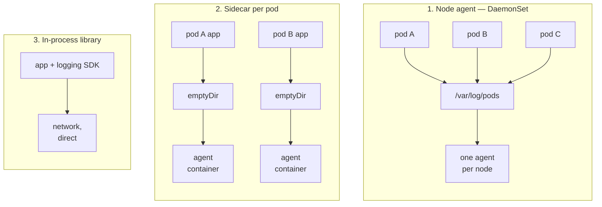

# The Agent on the Host

Stage 2. A process wrote bytes somewhere on a machine; something has to notice, read them,
reassemble them into records, attach context, and hold them until the network is ready. This is
the least glamorous part of the pipeline and the part that loses the most data, for a reason
worth stating up front:

> **Every other stage runs on capacity you provisioned. Stage 2 runs on capacity someone else
> provisioned, for something else, and lent you a slice of.**

The agent is a guest on a node whose CPU, memory and disk belong to the application. It must
never take enough of any of them to hurt its host — and the moment the pipeline downstream has a
problem, the agent is the thing holding the bag. Those two facts are in direct tension and
resolving them is what this doc is about.

By the end you should be able to say, for your own fleet, exactly what happens to a log line
emitted at the instant the network goes away, and for how long that answer stays acceptable.

---

## Where the bytes actually are

Before designing anything, know what you are reading from. On a Kubernetes node there are four
distinct sources and they behave differently.

### 1. Container stdout and stderr

This is the great majority of it. The application writes to file descriptor 1 or 2. The
container runtime — `containerd` in almost all current clusters — reads the other end of that
pipe and writes to a file on the node in **CRI log format**:

```
2026-09-30T14:23:01.847392011Z stdout F charge failed: card_declined for user_id=98712
2026-09-30T14:23:01.849104882Z stderr F java.lang.IllegalStateException: pool exhausted
2026-09-30T14:23:01.849110023Z stdout P {"ts":"2026-09-30T14:23:01.849Z","service":"payment-api"
2026-09-30T14:23:01.849110987Z stdout F ,"level":"ERROR","msg":"..."}
```

Four fields, space-separated: an RFC3339Nano timestamp written by the runtime, the stream name,
a **tag**, and the payload. The tag is the part people miss. `F` means *full* — this line ended
with a newline. `P` means *partial* — the line was longer than the runtime's buffer (16 KB in
containerd) and has been split; the next entry continues it. Lines 3 and 4 above are one JSON
object cut in half.

**An agent that does not reassemble `P` entries will emit invalid JSON for every log line over
16 KB**, which in practice means every large stack trace and every request body somebody
accidentally logged. It will then fail to parse them, route them to a dead-letter path, and
nobody will notice for months. Scenario `A-05`.

The files live at `/var/log/pods/<namespace>_<pod>_<uid>/<container>/0.log`, with
`/var/log/containers/` holding symlinks with friendlier names. The trailing `0` is a rotation
counter.

### 2. Files inside the container

Some applications — anything with a logging framework configured before containers existed —
write to `/var/log/app/application.log` inside their own filesystem. A node-level agent cannot
see that path unless the directory is a volume mounted from the host. This is the single most
common reason "the agent is running but we get no logs from that service".

The fix is a shared `emptyDir` volume mounted into both the application container and, via the
host path, reachable by the agent — or, better, convincing the team to log to stdout. Doc 03
covers when a sidecar is the lesser evil.

### 3. The node itself

`kubelet`, `containerd`, the CNI plugin, `kube-proxy`, `sshd`, the kernel. These come from
`systemd-journald` (a binary, indexed, rotating store read through the journal API, not by
tailing a file) or from `/var/log/messages`. At Riverbend's 380 nodes this is 11,400 records/s —
3% of its volume and the first thing you need when a node misbehaves.

### 4. Everything that is not a container

Network devices sending syslog over UDP, managed databases writing to a cloud log service,
load balancers writing access logs to object storage, serverless functions. These have no host
and no agent; they need a receiver, which is stage 3's problem (doc 05). At Lantern they are 5%
of records and 31% of bytes, because edge access logs live here.

---

## The three collection topologies

There are exactly three places the collector can run, and the choice is usually made once per
platform and lived with for years.



**Node agent (DaemonSet).** One agent per node reads every container's log files. This is the
default and should be, for three reasons: the cost is amortised across all pods on the node
(twelve thousand agents rather than one hundred and forty thousand), the agent sees the files
after the container has exited so short-lived pods are still collected, and it is one thing to
configure and upgrade rather than a change to every deployment manifest.

Its weaknesses are real though. All tenants on a node share one agent, so one noisy pod can
starve the others of the agent's throughput — a genuine noisy-neighbour problem, `A-09`, and the
reason per-container rate limits exist inside the agent. It also needs host-path mounts and
elevated permissions, which some security postures dislike.

**Sidecar.** One agent container per pod. Use it when the application cannot log to stdout and
you cannot change it, when a single tenant needs isolation strong enough that sharing a node
agent is unacceptable, or when one application needs radically different parsing. The costs are
unpleasant at scale: 140,000 sidecars at a conservative 50 MB and 0.05 cores each is **7 TB of
memory and 7,000 cores** across the fleet, spent on doing the same job twelve thousand times.

**In-process library.** The application links a logging SDK that ships over the network itself.
Tempting — no files, no parsing, structure preserved end to end. In practice it is the worst of
the three for a general platform, and the reason is `A-13`: **the library is inside the
application's process, so its backpressure is the application's backpressure.** When the network
is slow, either the library blocks a request thread or it silently drops. It also couples every
service's release cycle to the logging platform's, in every language you use. Reserve it for
cases where structure genuinely cannot survive serialisation to text.

**Lantern runs node agents**, with sidecars permitted by exception (currently 340 pods across
three teams) and in-process shipping prohibited.

---

## Tailing a file correctly, which is harder than it looks

The agent's core loop sounds trivial: open the file, read to the end, remember where you were,
wait for more. Every part of that has a failure mode.

### Position tracking and why an offset is not enough

The agent stores a **checkpoint** per file: how many bytes it has successfully handed downstream.
On restart it resumes from there. Store only a byte offset and you have a bug, because offsets
are only meaningful relative to a specific file, and "the file at this path" changes.

Real checkpoints are keyed by **(device, inode)** and hold the offset plus a fingerprint of the
first bytes of the file:

```json
{
  "path":        "/var/log/pods/payments_payment-api-7d9f_8e21.../payment-api/0.log",
  "device":      66311,
  "inode":       4325891,
  "fingerprint": "sha256:9f2a...(first 256 bytes)",
  "offset":      184320117,
  "updated":     "2026-09-30T14:23:04.110Z"
}
```

The fingerprint exists because inodes are reused. A file is deleted, a new one is created, the
filesystem hands out the same inode number, and the agent resumes at offset 184,320,117 in a file
that is 900 bytes long — so it reads nothing, forever, and that container's logs vanish silently.
Comparing the first 256 bytes catches it.

### Rotation, and the two kinds

When a log file reaches its size limit, something rotates it. There are two mechanisms and they
break in different ways.

**Rename-and-create** (what `containerd` and `logrotate` do by default). `0.log` is renamed to
`0.log.20260930-142301` and a new empty `0.log` is created. The *inode* the agent holds is still
open and still valid — the agent can finish reading the renamed file, then notice the new inode
at the original path and start on that. This works, and it works precisely because the agent
tracks inodes rather than paths.

The subtlety is **deletion while still open**. If the rotation also deletes old files and the
agent is behind, the file is unlinked but the agent's open descriptor keeps it alive — disk space
is not reclaimed until the agent closes it. An agent that is hours behind can hold gigabytes of
deleted files open, and `df` will disagree with `du` in a way that has confused every ops team at
least once. Scenario `A-06`.

**Copy-and-truncate** (`logrotate` with `copytruncate`, used when the writing process cannot be
told to reopen). The content is copied elsewhere and the original file is truncated to zero
in place. **The inode does not change.** The agent, holding offset 184,320,117 on a file that is
now 0 bytes, must detect that the file shrank and reset to 0 — and everything written between the
copy and the truncate is simply gone, for everyone, because that is a race inside `logrotate`
itself and no agent can fix it.

**Copy-and-truncate is lossy by construction. Avoid it.** If a legacy application forces it,
accept a measurable loss rate and document it, rather than pretending the agent handles it.

### Detecting new data

`inotify` gives you an event when a file is modified, and using it avoids polling twelve thousand
hosts. But `inotify` has per-user watch limits — `fs.inotify.max_user_watches`, commonly 8,192 on
an unmodified kernel — and a node running 400 containers with rotation has well over that many
paths. When the limit is hit, watches fail to register and **the agent silently stops noticing
new data in some files**, `A-14`.

Production agents use a hybrid: `inotify` where available, with a periodic full directory scan
(every 10–30 s) as the backstop that catches anything the watch missed. Raise the limit anyway:

```
fs.inotify.max_user_watches  = 524288
fs.inotify.max_user_instances = 512
```

### Multiline reassembly

A Java stack trace is one thought spread over forty lines. Presented as forty records, it is
useless: you cannot search for the exception and see the frames, the forty records may be
interleaved with other threads' output, and your record count — and therefore your bill — is
forty times higher than it should be.

Reassembly is rule-driven, and there are two rule shapes:

```yaml
# Shape 1: "a new record starts when the line matches this"
#   Best when you can positively identify a record start. Prefer this.
multiline:
  type: regex
  start_pattern: '^\d{4}-\d{2}-\d{2}T'      # every record begins with a timestamp
  flush_timeout: 2s
  max_lines: 500
  max_bytes: 262144

# Shape 2: "this line continues the previous one"
#   Necessary when starts are not identifiable. More fragile.
multiline:
  type: regex
  continuation_pattern: '^(\s+at |\s+\.\.\.|Caused by: )'
```

Three parameters matter more than the pattern:

- **`flush_timeout`.** The agent cannot know a record is finished until the next one starts. For
  the last record before a quiet period, it waits. Two seconds is the usual compromise: long
  enough that a slow multi-line write is not split, short enough not to wreck the tail latency
  budget. **This is a floor on your end-to-end latency for multiline sources** and doc 12 has to
  account for it.
- **`max_lines` / `max_bytes`.** Without these, one malformed line that never matches the start
  pattern causes the agent to accumulate *the entire rest of the file* into a single record. This
  is a genuine out-of-memory cause, not a theoretical one.
- **The interleaving caveat.** Two threads writing to the same stdout can interleave their
  output. No reassembly rule can unpick that. The only real fix is at stage 1: **applications
  should emit stack traces as an escaped field inside a single JSON record**, which turns a
  forty-line problem into a non-problem. Doc 04 argues this properly.

The diagnostic that catches every multiline bug is one ratio:

```
lines read from file  ÷  records emitted downstream
```

At Riverbend it sits at 1.9 (stack traces are common in the payment path). If it jumps to 1.0,
reassembly has stopped working. If it climbs past 50, a start pattern has stopped matching and
the agent is accumulating.

---

## Enrichment: turning a line into something that means something

`charge failed: card_declined for user_id=98712` is meaningless in a search box. It becomes
meaningful when the agent attaches where it came from. There are three sources of that context
and they have different costs.

**Free — from the file path.** The CRI path encodes namespace, pod name, pod UID and container
name. Parsing it costs nothing and gets you most of the way.

**Cheap — from the environment.** Node name, node labels (instance type, availability zone,
node pool), agent version, cluster name. Read once at startup.

**Expensive — from the Kubernetes API.** Pod labels and annotations, owner references (which
Deployment, which ReplicaSet), the service account, resource limits. These require a call to the
API server, and this is where node agents go wrong at scale.

Naively: one API call per new container. With 140,000 containers and a normal churn rate, plus
12,000 agents each watching, you have built a distributed denial of service against your own
control plane. The three mitigations are all required:

1. **Watch, do not poll.** One `Watch` on pods filtered by `spec.nodeName` — the agent's own node
   — gives a streaming feed of just what it needs. 12,000 watches on a well-tuned API server is
   fine; 12,000 pollers is not.
2. **Cache with negative entries.** Cache the metadata for each pod UID, and cache *failures*
   too, so a pod that has already been deleted is not looked up repeatedly.
3. **Never block on enrichment.** If the API server is unavailable, ship the record with the
   metadata you have from the path and mark it `enrichment: partial`. Doc 07 can fill the gap
   later from a central cache. An agent that blocks on the API server turns a control-plane
   problem into a data-loss event — the same fail-static principle as
   [`../MicroservicesPOF/05-service-discovery-and-the-control-plane.md`](../MicroservicesPOF/05-service-discovery-and-the-control-plane.md).

There is a race you cannot fully win, `A-08`. A pod that starts and crashes in 400 ms may be gone
from the API server before the agent looks it up. You will have its logs — the files outlive the
container — and no labels for them. Mitigate with a **grace cache**: keep deleted pods' metadata
for five minutes after the delete event, which covers the overwhelming majority.

---

## Buffering, and the choice you cannot avoid

Doc 00 set out the four options when the agent cannot keep up: block, drop newest, drop oldest,
spill to disk. Here is what that means in configuration.

### The memory buffer

Every agent has one. It absorbs short network hiccups and smooths batching. Size it from the
outage it should survive:

```
Riverbend node, average:  85,000 records/s ÷ 380 nodes × 520 B = 116 KB/s per node
Riverbend node at peak:                                          438 KB/s per node
Lantern p99 host:                                                4.1 MB/s

A 64 MB memory buffer holds:
    p50 Lantern host (18 KB/s):    64 MB ÷   18 KB/s = 3,555 s  ≈ 59 minutes
    Riverbend node at peak:        64 MB ÷  438 KB/s =   146 s  ≈ 2.4 minutes
    Lantern p99 host (4.1 MB/s):   64 MB ÷  4.1 MB/s =    15.6 s
```

**Fifteen seconds.** That is what a 64 MB memory buffer buys you on a busy host, and it is
shorter than a rolling restart of the gateway tier. Memory buffers handle jitter; they do not
handle outages. That is what the disk buffer is for.

### The disk buffer

```
A 5 GB disk buffer holds:
    p50 host:                5 GB ÷   18 KB/s = 277,777 s ≈ 77 hours
    Riverbend node at peak:  5 GB ÷  438 KB/s =  11,415 s ≈ 3.2 hours
    Lantern p99 host:        5 GB ÷  4.1 MB/s =   1,220 s ≈ 20 minutes
    Lantern max host:        5 GB ÷   40 MB/s =     125 s ≈ 2 minutes
```

The spread is the whole point. **A single disk-buffer size cannot serve a fleet whose per-host
rate spans 2,200×.** The p50 host is over-provisioned by four orders of magnitude; the max host
gets two minutes.

Three things follow, and Lantern does all three:

- **Size the buffer as a fraction of the node's disk, with a floor and a ceiling** — for example
  `min(max(2 GB, 4% of the log volume), 20 GB)` — rather than a constant.
- **Put it on a separate volume from the application's.** An agent that fills the node's root
  disk has caused an outage far worse than losing logs: the kubelet begins evicting pods under
  disk pressure, and it evicts them from a node that is now also not shipping the logs that would
  explain why. `A-06` is the single most damaging agent failure and this is the mitigation.
- **Reserve headroom and stop before the disk is full**, not when it is. Stop buffering at 85% of
  the allocated volume and start dropping, loudly.

### What to drop, when you must

Given that you will sometimes drop, drop *well*. Priority ordering inside the agent, cheapest to
most expensive to lose:

```
1. DEBUG and TRACE from any source          — drop first, always
2. INFO from sources marked low-value        — access logs, health checks
3. INFO from application sources
4. WARN
5. ERROR, FATAL, and anything with a sampling-exempt marker  — drop last
```

Most agents do not do this by default: they drop whatever arrives when the buffer is full, which
is a uniform random sample weighted by volume — meaning you preferentially lose the high-volume
`DEBUG` output *and* the rare `ERROR` in the same proportion. Configuring level-aware shedding
turns a 5% loss event into a 5% loss of things you did not need. Doc 08 generalises this.

**Drop oldest, not newest.** During an incident the newest records describe what is happening
now. Ring-buffer semantics are almost always the right choice for the memory buffer, and almost
no agent defaults to them. Check yours.

---

## Resource limits: the agent must not hurt its host

An agent is a container on a node with 140,000 siblings. Give it limits, and get them right,
because both directions are harmful.

### CPU

A CPU **limit** in Kubernetes is enforced by the CFS quota, and when the agent exceeds it the
kernel *throttles* it — stops scheduling it until the next 100 ms period. For a latency-sensitive
process this is catastrophic and counterintuitive: an agent limited to 0.5 cores that needs 0.6
for 200 ms of a burst is stopped dead for tens of milliseconds at a time, its buffers fill, and
it drops. Same mechanism as
[`../MicroservicesPOF/12-capacity-autoscaling-and-noisy-neighbours.md`](../MicroservicesPOF/12-capacity-autoscaling-and-noisy-neighbours.md).

Work out the requirement rather than guessing. Per MB/s of raw logs an agent needs roughly:

```
read + line splitting        0.018 cores per MB/s
JSON parsing                 0.045 cores per MB/s      ← the dominant cost
enrichment (cached)          0.004 cores per MB/s
LZ4 compression              0.002 cores per MB/s
framing and send             0.006 cores per MB/s
                             ---------------------
total                        0.075 cores per MB/s
```

So:

```
Riverbend node at peak, 0.438 MB/s:   0.033 cores
Lantern p99 host, 4.1 MB/s:           0.31  cores
Lantern max host, 40 MB/s:            3.0   cores
```

**Set `requests` from the p50 and `limits` generously — or set no CPU limit at all** and rely on
`requests` plus a low priority class to keep the agent from starving the application. Leaving CPU
limits off for the log agent is a defensible choice that many platform teams make deliberately;
the alternative is throttling exactly when volume spikes, which is exactly when you need the
agent working.

Note the second line of that table: **parsing is 60% of the agent's CPU**. This is the strongest
argument for structured logging at the source (doc 04) — if the application emits JSON, the agent
can often forward it without reparsing, and if it emits an even cheaper binary encoding it costs
less still.

### Memory

Memory is the opposite: a limit here is a hard kill, not a slowdown. An OOMKilled agent loses its
entire memory buffer and restarts. And the situation that fills the buffer — downstream slow, or
a volume spike — is exactly the situation where you need it alive. `A-07`.

```
agent memory = baseline + buffer + (per-file state × files) + metadata cache
             = 40 MB + 64 MB + (4 KB × 400 files) + 12 MB
             = 40 + 64 + 1.6 + 12 = 118 MB
set limit    = 256 MB   (2.2× headroom for spikes and fragmentation)
```

Prefer an agent with a **hard internal buffer cap** so it enforces its own memory ceiling and
starts spilling to disk before the kernel's OOM killer becomes involved. Then the Kubernetes
limit is a backstop that should never fire, not the primary control.

### Disk

Covered above; the rule is a separate volume and stopping at 85%.

---

## The agent failure catalogue

| Class | Scenarios |
|---|---|
| **A. Reading the file** | `A-01` … `A-05` |
| **B. Resources and the host** | `A-06` … `A-09` |
| **C. Context and correctness** | `A-10` … `A-14` |

### A-01 · Rotation loses the tail

**What you see.** Gaps in a service's logs at regular intervals — every hour, or every time the
file hits 10 MB. Nobody notices until someone searches a window that happens to land on one.

**Mechanism.** The agent tracks files by path. On rename-and-create rotation the path now points
at a new, empty inode. The agent reopens at the path, sees a smaller file, resets its offset to
0, and **never finishes reading the renamed file** — everything between the last checkpoint and
the rotation is lost. The faster the file rotates, the bigger the gap.

**Confirm it.** Compare the agent's `files_open` against the number of log files on the node
during a rotation; a path-tracking agent drops to the new count instantly, an inode-tracking one
holds the old descriptor until drained. Or: `ls -li` the log directory across a rotation and check
the agent's checkpoint file for the old inode.

**Recover.** Nothing to recover — the data is gone. Stop the bleeding by slowing rotation
(larger `containerLogMaxSize`) while you fix the agent.

**Prevent.** Use an agent that tracks `(device, inode)` with a content fingerprint, and that
keeps reading a renamed file to EOF before closing it. Every serious agent does this; verify it
rather than assuming, because the failure is invisible.

### A-02 · Restart replays and duplicates

**What you see.** After every agent restart or node reboot, a burst of records that are already
in the store. Downstream sees the same `trace_id` twice.

**Mechanism.** The agent checkpoints periodically — say every 5 s — rather than after every
successful send. On restart it resumes from the last checkpoint and re-sends everything after it.
At 4.1 MB/s and a 5-second checkpoint interval, that is 20 MB of duplicates per restart, per host.

This is not a bug to eliminate. **At-least-once is the correct choice here**, because the
alternative — checkpointing before the send succeeds — turns restarts into silent loss. Doc 15
argues this properly.

**Confirm it.** Count records with duplicate `(host, stream, event_id)` in a window spanning a
known agent restart.

**Recover.** Deduplicate downstream.

**Prevent.** You do not prevent it; you *bound* it and handle it. Shorten the checkpoint interval
to trade write amplification for a smaller replay window, and give every record a deterministic
identity — `hash(host, inode, byte_offset)` is free and exact — so the processing tier can drop
repeats. Doc 07 implements it.

### A-03 · Checkpoint ahead of reality, and silent loss

**What you see.** Nothing. That is the problem.

**Mechanism.** The inverse of `A-02`. The agent advances its checkpoint when it hands a batch to
its output buffer rather than when the send is acknowledged. The process dies with 40 MB in
flight, restarts, and resumes past data that was never delivered. No error, no gap warning,
nothing.

**Confirm it.** Only by reconciling counts: the agent's `records_read` must equal the gateway's
`records_received` for that host, allowing for in-flight. Any persistent divergence is this.

**Recover.** Unrecoverable.

**Prevent.** Advance the checkpoint **only on acknowledgement from the next durable stage**. This
guarantees `A-02` instead, which is the right trade. Test it by killing `-9` the agent under load
and reconciling counts; a surprising number of configurations fail this.

### A-04 · Stack traces arrive as forty records

**What you see.** A search for an exception returns the `Caused by:` line with no frames. Record
counts for a service are several times what the team expects. Bills rise.

**Mechanism.** No multiline rule, or a start pattern that stopped matching after a log-format
change.

**Confirm it.** The `lines_read ÷ records_emitted` ratio, described above. Riverbend's is 1.9; a
value of 1.0 for a Java service means reassembly is off.

**Recover.** Reassembly cannot be done after the fact with confidence — interleaving from other
threads makes it ambiguous. Fix forward.

**Prevent.** Two layers. Configure `start_pattern` with `flush_timeout`, `max_lines` and
`max_bytes`. And **push the real fix upstream**: an application that emits the trace as a JSON
string field never has this problem. Doc 04.

### A-05 · The 16 KB split

**What you see.** JSON parse failures for exactly the largest records. Truncated stack traces.
Records that end mid-word.

**Mechanism.** `containerd` splits any line over 16 KB into `P`-tagged partial entries. An agent
that ignores the tag emits each fragment as a record.

**Confirm it.** `grep -c ' P ' /var/log/pods/.../0.log` — any non-zero count means partials exist
on this node. Then check whether your parse-failure rate correlates with it.

**Recover.** Reprocess from the buffer tier if the raw bytes were preserved; otherwise the
records are unparseable.

**Prevent.** Use an agent whose CRI parser handles `P`/`F` (Fluent Bit's `cri` parser and Vector's
`kubernetes_logs` source both do). Independently, cap record size at the source — a 16 KB log line
is almost always a mistake, and doc 04 recommends truncating with an explicit marker rather than
shipping it.

### A-06 · The agent fills the node's disk

**What you see.** Pods being evicted from a node with `DiskPressure`. Applications failing to
write. The node goes `NotReady`.

**Mechanism.** Two variants, both common.

*Variant 1 — the buffer.* Downstream is unavailable, the agent spills to disk as designed, and
the disk it spills to is the node's root volume shared with container images, `emptyDir` volumes
and the log files themselves. The kubelet starts evicting at 85% and the node degrades.

*Variant 2 — deleted-but-open.* The agent has fallen hours behind. Rotation deletes old files, but
the agent's open descriptors keep the inodes alive. `du` says 4 GB, `df` says 94% full, and the
discrepancy is invisible until you look for it.

**Confirm it.**

```bash
df -h /var/lib
du -sh /var/log/pods                 # if these disagree wildly, it is variant 2
lsof +L1 | grep -c fluent-bit        # files with link count 0 held open by the agent
```

**Recover.** ⚠️ **Do not delete the agent's buffer directory while the agent is running** — it
holds the descriptors, so you free nothing and lose the checkpoint consistency. Restart the agent
first (which releases deleted inodes and reclaims the space immediately), then clear the buffer
if still needed. Accept the data loss consciously rather than as a side effect.

**Prevent.** Dedicated volume for the buffer. Hard cap well under the volume size. Stop at 85%
and drop, with an alert. And alert on *agent lag* — the deleted-but-open case is always preceded
by the agent falling behind, which is a signal you can see hours earlier.

### A-07 · The agent is OOMKilled during the spike it exists for

**What you see.** `OOMKilled` on the agent container, restart loops, and a log gap exactly
covering an incident.

**Mechanism.** Volume spikes 31×. The memory buffer fills because the gateway is also under
pressure. The agent's memory exceeds its limit and the kernel kills it, discarding the buffer.
It restarts, re-reads from its checkpoint into a still-full downstream, and is killed again.

**Confirm it.** `kubectl get pods -n logging -o wide | grep -c OOMKilled`, plus the agent's
`buffer_bytes_used` gauge right before each kill.

**Recover.** Raise the limit temporarily and simultaneously reduce input — turn off `DEBUG`
globally through the control plane, which is the fastest lever you have (doc 08). Raising the
limit alone just moves the ceiling.

**Prevent.** An internal buffer cap that triggers disk spill well below the container limit, so
the agent controls its own degradation rather than the kernel doing it abruptly. Set the
Kubernetes limit at roughly 2× the internal cap as a backstop. Load-test the agent at 30× its
normal input — this failure only appears under the conditions you are least likely to test.

### A-08 · Records with no Kubernetes metadata

**What you see.** Records with `namespace` and `pod` from the file path but no labels, no owner,
no team attribution. They fall out of team dashboards and out of cost attribution.

**Mechanism.** The pod was deleted from the API server before the agent enriched its records —
common for crash-looping pods and for Jobs that finish in under a second. Also happens when the
API server is briefly unavailable, if the agent degrades by shipping without metadata (which is
the correct degradation, but it must be visible).

**Confirm it.** Rate of records where `enrichment == "partial"`, broken down by namespace. A
spike localised to one namespace is crash-looping pods; a spike everywhere is the API server.

**Recover.** Backfill in the processing tier from a central metadata cache keyed by pod UID —
doc 07. This works because the UID is always available from the path.

**Prevent.** A grace cache of five minutes for deleted pods in the agent. Never block on
enrichment. Export `enrichment_partial_ratio` as a first-class SLI (doc 19) so degradation is
visible rather than merely present.

### A-09 · One noisy pod starves the node's other tenants

**What you see.** Several unrelated services on the same node report missing logs. They have
nothing in common except the node.

**Mechanism.** One pod on the node is emitting 40 MB/s. The node agent is shared, its throughput
is finite, and its internal queue is FIFO across all sources — so the noisy pod occupies the
queue and everything else waits behind it. Head-of-line blocking, at stage 2.

**Confirm it.** Per-container byte rates on that node, sorted. The offender is usually two orders
of magnitude above the others.

**Recover.** Apply a per-container rate limit to the offender through the control plane, or
exclude it entirely while you find the owner. Both should be a config push, not a redeploy.

**Prevent.** **Per-container rate limits inside the agent**, with fair scheduling across sources
rather than a single FIFO queue. This is the stage-2 instance of the general multi-tenancy
problem, and doc 16 covers the full picture. The default limit at Lantern is 2 MB/s per
container, raised by exception, with the limiter dropping and counting rather than blocking.

### A-10 · Short-lived containers vanish before collection

**What you see.** A Job that runs for 300 ms produces no logs, ever. Init containers that fail
are invisible.

**Mechanism.** Less common than feared for node agents, because log files outlive the container
— but real when the *pod* is deleted, since the kubelet removes `/var/log/pods/<pod>` on pod
deletion. A CronJob with `ttlSecondsAfterFinished: 0` and an agent 30 seconds behind loses
everything.

**Confirm it.** Compare completed Jobs in the API against distinct pod UIDs seen in the log
store over the same window.

**Prevent.** Set `ttlSecondsAfterFinished` to at least 300 on Jobs. Keep the agent's lag under
that with an alert. For genuinely critical short-lived work, have the Job write to a durable
location itself rather than relying on collection — this is the case where the in-process
approach is right. See [`../K8s/cronJobs`](../K8s/cronJobs/README.md) for the wider Job-lifecycle
problem.

### A-11 · CPU throttling during the spike

**What you see.** Agent lag climbing during peak while its CPU usage sits flat at its limit.

**Mechanism.** CFS quota throttling, as described above. The flatness is the tell — a
CPU-starved process shows a jagged profile, a throttled one shows a ceiling.

**Confirm it.** `container_cpu_cfs_throttled_periods_total` over
`container_cpu_cfs_periods_total` for the agent container. Anything above a few percent is
material.

**Recover.** Raise or remove the limit. Effective immediately, no restart needed for a
`limits` change on most runtimes — though the pod may be recreated depending on your Kubernetes
version's in-place resize support.

**Prevent.** Size from the 0.075 cores-per-MB/s figure at the host's p99 rate, not its average.
Consider running the agent with no CPU limit and a `system-node-critical` priority class.

### A-12 · A skewed host clock puts records in the wrong window

**What you see.** Records appearing in searches for a time window that has not happened yet, or
for one hours past. One host's records are consistently offset.

**Mechanism.** Event time comes from the application's clock. A host whose NTP has failed drifts,
and nothing in the pipeline corrects it — event time is taken on faith because correcting it
would corrupt the field's meaning.

**Confirm it.** The `ingest_ts − ts` distribution per host. A healthy host sits at a few hundred
milliseconds; a skewed host is a sharp spike at a constant offset, and a *negative* value is
proof, because a record cannot be ingested before it was emitted.

**Recover.** Fix NTP on the host. Records already stored keep their wrong event time; they are
still findable by ingest time.

**Prevent.** Alert on `|ingest_ts − ts| > 60 s` per host at p50. **Clamp, do not correct**: if
event time is outside a sane window relative to ingest time, keep the original in a field like
`ts_reported`, set `ts` to the clamped value, and flag the record. Silently rewriting timestamps
destroys the evidence that anything was wrong.

### A-13 · The application blocks writing to stdout

**What you see.** Request latency rising on a service, with no slow dependency and no CPU
pressure. Thread dumps show threads parked in a write to fd 1.

**Mechanism.** stdout is a pipe with a finite buffer (64 KB on Linux by default). If the reader
— the container runtime — stops draining it, the pipe fills and the next write blocks. The
runtime stops draining when its own write to the log file blocks, which happens when the disk is
full or extremely slow.

**A full disk on a node therefore becomes a latency incident in every application on that node**,
through a path nobody has on their dependency diagram. This is the clearest reason the log
buffer must not share a volume with anything else.

**Confirm it.** Thread dump showing writes to fd 1; `df` on the node; `container_fs_writes_total`
flatlined for the runtime.

**Recover.** Free disk space on the node. Applications unblock immediately.

**Prevent.** Separate volumes, disk alerts at 80% not 95%, and — for services where logging must
never affect the request path — a non-blocking appender in the logging library that drops when
its own queue is full. Logback's `AsyncAppender` with `neverBlock=true`, or its equivalent, is a
one-line change with a large effect. Note the tradeoff being made explicitly: **you are choosing
to lose logs rather than to lose requests**, which is right for most services and wrong for an
audit log.

### A-14 · The agent stops noticing new files

**What you see.** Logs from pods scheduled *after* some point in time are missing. Older pods on
the same node are fine. An agent restart fixes it, and it recurs.

**Mechanism.** `fs.inotify.max_user_watches` exhausted. New watches fail; existing ones keep
working, which is exactly why the symptom is "new pods only".

**Confirm it.**

```bash
cat /proc/sys/fs/inotify/max_user_watches
find /proc/*/fd -lname anon_inode:inotify 2>/dev/null | wc -l
```

and the agent's own "failed to watch" error counter, which it will be emitting and nobody is
alerting on.

**Recover.** Raise the sysctl — it takes effect immediately — then restart the agent to register
the missing watches.

**Prevent.** Set `max_user_watches` to 524288 in the node bootstrap. Use an agent with a periodic
directory-scan fallback so watch exhaustion degrades into higher latency rather than silence.
Alert on the agent's watch-failure counter.

---

## What to take away

1. **Stage 2 runs on someone else's capacity.** Every agent decision is bounded by "this must not
   hurt the application", and the agent is simultaneously the thing holding the bag when
   downstream fails. That tension is the whole design.
2. **Track files by `(device, inode)` plus a content fingerprint, never by path.** Path tracking
   loses the tail on every rotation and inode reuse resumes at an offset in the wrong file.
3. **Copy-and-truncate rotation is lossy by construction.** No agent can fix the race inside
   `logrotate`. Avoid it, or measure and document the loss.
4. **Handle CRI `P`/`F` partial tags**, or every log line over 16 KB becomes several broken
   records — which selects precisely for the stack traces you most need.
5. **Watch `lines_read ÷ records_emitted`.** It is one number and it catches every multiline
   failure in both directions: 1.0 means reassembly stopped, 50 means it is accumulating.
6. **Never block on enrichment.** Ship with partial metadata and a flag, then backfill centrally.
   An agent that waits on the API server converts a control-plane problem into permanent loss.
7. **A 64 MB memory buffer is 15 seconds on a busy host.** Memory buffers absorb jitter; only
   disk buffers survive outages, and disk buffers need their own volume and a hard cap at 85%.
8. **No single buffer size fits a fleet spanning 2,200× in per-host rate.** Size as a fraction
   with a floor and a ceiling.
9. **Drop by level and drop the oldest first.** Most agents default to dropping whatever arrives,
   which loses your rare `ERROR` at the same rate as your abundant `DEBUG`.
10. **Parsing is 60% of the agent's CPU.** That single fact is the strongest practical argument
    for structured logging at the source.
11. **Memory limits kill, CPU limits throttle** — and both fire during the volume spike the agent
    exists to handle. Prefer internal caps the agent enforces itself, with the Kubernetes limit
    as a backstop that should never trigger.
12. **Advance the checkpoint only on downstream acknowledgement.** That guarantees duplicates,
    which you can fix with a deterministic record identity; the alternative guarantees silent
    loss, which you cannot fix at all.

Next: [03-agent-technology-choices.md](03-agent-technology-choices.md), which compares the
agents that implement all of this and derives what each one costs at 12,000 hosts.
