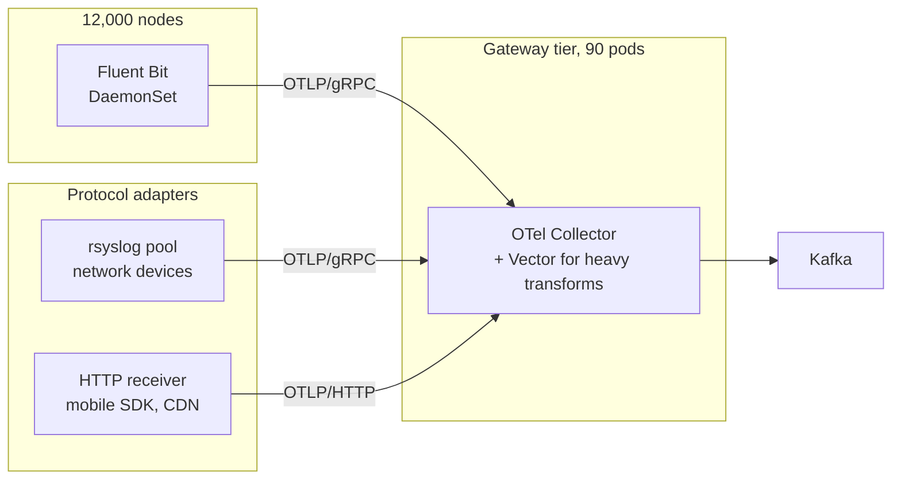

# Choosing the Agent

Doc 02 described what an agent has to do. This doc is about which one to run. It compares the
seven real candidates, derives what each costs across 12,000 hosts, and — more usefully — sets
out the five properties that actually differentiate them, so you can evaluate a version released
after this was written.

The short version, stated up front so the rest is checkable rather than suspenseful: **at
Lantern's scale the node agent should be Fluent Bit or Vector, and the gateway should be the
OpenTelemetry Collector or Vector.** The reasoning is what matters, and about half of it is not
about the agents at all — it is about the cost of *changing* agents later.

---

## Why this decision is heavier than it looks

Agent choice feels like picking a tool. It is closer to picking a database, for three reasons.

**It is deployed to every machine you own.** A bad choice is 12,000 rollbacks. A configuration
bug is 12,000 hosts degrading simultaneously, and the thing that would tell you about it is the
thing that broke.

**It defines your record shape.** Each agent has its own internal model of a log event, its own
metadata field names, its own parser syntax. Switching agents rewrites every parsing rule, every
field name in every saved query, and every dashboard. Teams that switched from Fluentd to Fluent
Bit usually describe it as a multi-quarter project, and the work is almost all in the long tail
of custom parsers.

**It is a privileged process on every node.** It mounts host paths, reads every container's
output, holds credentials to your ingest endpoint, and in most deployments runs as root. Its CVE
history is your CVE history, and its supply chain is your supply chain. The number of plugins
you enable is the size of your attack surface — this is a real argument for the leaner agents and
doc 17 returns to it.

---

## The five properties that actually differentiate agents

Feature matrices are mostly noise; every agent can tail a file and send it somewhere. These five
are where they genuinely differ, and the first two dominate.

### 1. Resource cost per MB/s, and where it goes

Doc 02 derived roughly 0.075 cores per MB/s for a full parse-and-ship pipeline, of which parsing
is 60%. Agents differ by **3–5× on that figure**, and at 12,000 hosts a 3× difference is real
money.

The mechanism behind the difference is mostly language runtime and data representation:

- **Compiled, no garbage collector** (Fluent Bit in C, Vector in Rust) — memory is bounded and
  predictable, which matters more than the average because you are setting a hard limit that
  kills the process.
- **Compiled with a garbage collector** (the OpenTelemetry Collector and Promtail, in Go) —
  fine, but with GC pauses under load and a memory profile that sawtooths, so limits must be set
  above the peak of the sawtooth rather than the average.
- **Interpreted** (Fluentd, in Ruby with C extensions) — several times the CPU per MB/s, and a
  memory profile that depends on plugin quality. Fluentd's buffering is solid and its plugin
  ecosystem is the largest of any agent; the cost is throughput.

The second half of this property is **how many times the record is copied and re-parsed**. An
agent that deserialises JSON into a generic map, processes it, then re-serialises is doing the
expensive work twice. Agents that keep records in a compact binary form internally (Fluent Bit
uses MessagePack; Vector uses its own typed event model) avoid a large fraction of the cost.

### 2. What it does when it cannot keep up

This is the property doc 02 spent the most time on, and agents differ sharply. Check four things:

- **Does it have a disk buffer at all, on by default?**
- **Is the buffer per-output or global?** Per-output is better: a slow destination should not
  block a healthy one.
- **Does it drop oldest or newest?**
- **Does it advance its checkpoint on send or on acknowledgement?**

The answers are often not what the documentation implies, and the only reliable way to know is
to test: fill the buffer, kill the agent with `-9`, restart it, and reconcile counts.

### 3. Configuration model, and whether it is testable

This decides your operational life. Three shapes exist:

- **Declarative sections** (Fluent Bit's classic INI-ish config, Filebeat's YAML): easy to read,
  limited expressiveness, hard to unit-test. Complex logic becomes a chain of filters, which is
  hard to follow.
- **A real transformation language** (Vector's VRL, Fluent Bit's newer processors, OTel's OTTL):
  you can express conditional logic, and — crucially — **you can unit-test a transformation
  against sample input** in CI. At the scale where one bad parser affects 12,000 hosts, this is
  not a nicety.
- **Plugin code** (Fluentd, and Lua in Fluent Bit): maximum power, and a place for memory leaks
  and unbounded loops to live inside a process on every node.

Prefer the middle. A transformation you can test is a transformation you can change on a Friday.

### 4. Pipeline topology it supports

Can one agent instance send to multiple destinations with independent buffering and independent
failure? Can it route conditionally? Can it do fan-out with different processing per branch?

This matters more than it seems, because the moment you have two destinations — your platform
and a security team's SIEM, say — the question "does the SIEM being down stop logs reaching the
platform?" becomes load-bearing. Doc 07 covers routing; the agent has to support it.

### 5. Protocol and ecosystem fit

Which wire protocols can it speak, and — the part people skip — **what is its OpenTelemetry
story?** OTLP is becoming the common denominator across logs, metrics and traces. An agent that
speaks OTLP natively lets you change backends without changing agents, which is the only real
defence against the switching cost described above.

---

## The candidates

### Fluent Bit

Written in C, originally as Fluentd's embedded-systems sibling, now much more capable than that
framing suggests and the most widely deployed log agent in Kubernetes.

**Resource profile.** The leanest of the realistic options. Roughly **0.030–0.045 cores per MB/s**
with JSON parsing, and a 25–45 MB resident baseline. No garbage collector, so memory is a
function of buffer configuration rather than of load history — which makes a hard container
limit safe to set.

**Buffering.** Memory buffer with `storage.type filesystem` for disk spill, configured per
output. `storage.max_chunks_up` bounds memory; `storage.total_limit_size` bounds disk. Both
default to values that are too permissive for a shared node, so set them.

**Configuration.** The classic format is sections of key-value pairs, readable but awkward for
conditional logic. The YAML format and the newer `processors` model are considerably better.
Lua filters are available and are the standard escape hatch — treat them the way you would treat
a stored procedure, because the same caveats apply.

**Where it is strong.** Kubernetes. The `kubernetes` filter handles CRI parsing, `P`/`F`
reassembly and API-server enrichment with a watch and a cache, which is exactly the doc 02
requirement list. Native OTLP output. Small enough that running it on every node is not a
capacity conversation.

**Where it is weak.** Complex transformations are painful without Lua. Error messages for
misconfiguration are terse. Multiline parsing has historically had sharp edges — verify your
rules against real stack traces rather than trusting the built-in parsers.

### Vector

Written in Rust by Timber, now maintained under Datadog. Designed from the start as a general
observability data router rather than a log shipper.

**Resource profile.** Slightly heavier than Fluent Bit at rest — 60–90 MB baseline — and
comparable or better under load, roughly **0.035–0.050 cores per MB/s**. Its advantage grows with
transformation complexity, because VRL compiles rather than interpreting per record.

**Buffering.** Per-sink buffers, memory or disk, with an explicit `when_full` choice of `block`
or `drop_newest`. Vector is unusually honest here: it makes you state which failure you want,
which is exactly the doc 02 argument. Acknowledgement support (`acknowledgements.enabled`)
propagates end-to-end so the source only advances its checkpoint once a sink has confirmed —
this is the `A-03` fix, available as a setting.

**Configuration.** VRL, the Vector Remap Language, is the best transformation model of any agent
here. It is typed, it fails at *compile* time for a bad field reference rather than at 03:00 on
one host, and `vector vrl` runs a transformation against sample input for unit tests in CI.

**Where it is strong.** Anywhere records need real work: parsing several formats, conditional
routing, redaction, deriving metrics from logs. Equally good as node agent and as gateway, so one
technology covers both tiers. Excellent internal observability.

**Where it is weak.** The Kubernetes enrichment path is good but has historically lagged Fluent
Bit's in edge cases. Larger binary and baseline. Governance is a single vendor, which is worth
weighing.

### The OpenTelemetry Collector

Written in Go, vendor-neutral, under the CNCF. The `filelog` receiver plus the `k8sattributes`
processor gives a complete node agent; the same binary with different components is a gateway.

**Resource profile.** The heaviest of the compiled options: 80–150 MB baseline and roughly
**0.06–0.09 cores per MB/s** for a comparable pipeline, with GC sawtooth. The `contrib`
distribution includes hundreds of components you will not use — build a custom distribution with
`ocb` (the OpenTelemetry Collector Builder) and both the footprint and the attack surface drop
substantially.

**Buffering.** Historically the weak point. The `sending_queue` with `file_storage` gives
persistence, but the semantics are less mature than Fluent Bit's or Vector's, and disk buffering
needs explicit configuration that is easy to omit. Verify behaviour under `-9` before trusting it
on a node.

**Configuration.** YAML with receivers, processors, exporters and pipelines. OTTL is the
transformation language and is improving quickly, though it is behind VRL in ergonomics.

**Where it is strong.** One agent for logs, metrics and traces, with genuinely shared context —
the same `k8sattributes` processor stamps the same resource attributes on all three, so joining
them actually works. Semantic conventions come for free, which doc 04 argues is worth real money.
Vendor neutrality is a strategic asset: your instrumentation is not tied to a backend.

**Where it is weak.** Resource cost on the node. Buffering maturity. The component sprawl in
`contrib`. Configuration verbosity.

**The pragmatic split, and the one Lantern uses:** a lean agent on the node, the OTel Collector
as the gateway tier. You get OTLP as the platform's lingua franca and the semantic conventions,
without paying Go's footprint 12,000 times.

### Filebeat and the Elastic Beats

Go, from Elastic, designed for Elasticsearch.

**Resource profile.** Middle: 50–90 MB baseline, roughly **0.05–0.07 cores per MB/s**.

**Buffering.** A memory queue and a disk queue. The disk queue is functional and was
significantly improved in recent versions, but it remains less flexible than Vector's per-sink
model.

**Where it is strong.** If your destination is Elasticsearch, the integration is genuinely
better than anything else — index lifecycle management, ingest pipelines, and the prebuilt
modules for common software (nginx, MySQL, Kubernetes) that give you working parsers and
dashboards on day one. That module library is worth weeks of work.

**Where it is weak.** Everything else is a second-class destination. Licensing moved to the
Elastic License, which some organisations cannot accept. Transformation is limited compared to
VRL.

**When to pick it:** you are committed to Elasticsearch, you want the module library, and you do
not expect to change backends. That is a narrower condition than it was five years ago.

### Fluentd

Ruby with C extensions. The original CNCF log agent and, for years, the default.

**Resource profile.** The heaviest by a wide margin: 150–300 MB baseline and roughly
**0.15–0.30 cores per MB/s**, three to eight times Fluent Bit. Multi-worker mode helps
throughput but multiplies the memory.

**Where it is strong.** The plugin ecosystem — over a thousand plugins, covering integrations
nothing else has. Buffering is mature and well understood. A vast amount of institutional
knowledge exists.

**Where it is weak.** Cost per MB/s, on every node you own.

**When to pick it:** you need a plugin that exists nowhere else, and you run it as a small
**aggregator tier** rather than a node agent. That is the standard modern pattern — Fluent Bit on
the node, Fluentd in the middle for the one integration you cannot replace. Do not deploy Fluentd
as a DaemonSet on 12,000 nodes in 2026.

### Promtail and Grafana Alloy

Promtail is Loki's purpose-built agent, now superseded by **Grafana Alloy**, which folds
Promtail, the Grafana Agent and an OTel Collector distribution into one binary with a
programmable configuration language.

**Resource profile.** Go; between Filebeat and the OTel Collector.

**Where it is strong.** If your backend is Loki, the label-oriented model is native rather than
adapted — the agent's job is to attach exactly the right small set of labels, and Promtail's
configuration is shaped around that. Alloy's `river`/Alloy configuration language is genuinely
expressive.

**Where it is weak.** Outside Grafana's ecosystem the fit is looser. Alloy's ambition — one agent
for everything — brings the same footprint concerns as OTel contrib.

### rsyslog and syslog-ng

The ones that were already there.

**Resource profile.** Extremely low; these are mature C daemons that have been optimised for
decades.

**Where they are strong.** Receiving syslog from things that only speak syslog — network
hardware, appliances, legacy Unix. At Lantern this is a real fraction of the 5% infrastructure
slice, and there is no modern replacement for a device that will only send RFC 3164 over UDP 514.

**Where they are weak.** Configuration is arcane. Structured-data handling is bolted on. Not a
Kubernetes agent.

**How to use them:** as a **protocol adapter** at the edge, not as your pipeline. A small pool of
`rsyslog` receivers that accept syslog and re-emit it as OTLP into the gateway tier. Doc 05 has
the topology.

---

## The comparison, with the numbers that matter

Resource figures are for a pipeline doing CRI parsing, JSON parsing, Kubernetes enrichment, LZ4
compression and a network send — the doc 02 workload. Measure your own; treat these as the right
order of magnitude and the right *ratios*.

| | Fluent Bit | Vector | OTel Collector | Filebeat | Fluentd | Alloy |
|---|---|---|---|---|---|---|
| Language | C | Rust | Go | Go | Ruby | Go |
| Baseline RSS | 25–45 MB | 60–90 MB | 80–150 MB | 50–90 MB | 150–300 MB | 70–130 MB |
| Cores per MB/s | 0.030–0.045 | 0.035–0.050 | 0.060–0.090 | 0.050–0.070 | 0.15–0.30 | 0.055–0.085 |
| Memory predictability | excellent | excellent | GC sawtooth | GC sawtooth | poor | GC sawtooth |
| Disk buffer | yes, per output | yes, per sink | yes, needs setup | yes | yes, mature | yes |
| End-to-end acknowledgement | partial | **yes** | partial | yes | yes | partial |
| Transformation language | Lua, processors | **VRL** | OTTL | limited | Ruby plugins | Alloy config |
| Testable in CI | awkward | **yes** | partial | no | with effort | partial |
| K8s enrichment | **excellent** | good | good | good | plugin | good |
| CRI `P`/`F` handling | yes | yes | yes | yes | plugin | yes |
| Native OTLP | in and out | in and out | **native** | out only | plugin | in and out |
| Governance | CNCF | Datadog | CNCF | Elastic | CNCF | Grafana |

### What each costs across 12,000 hosts

Take the p50 host at 18 KB/s and the p99 at 4.1 MB/s (doc 01), and price the fleet. Use a blended
$0.034 per core-hour and $0.0045 per GB-hour of memory, which is roughly on-demand `m6i` pricing.

**CPU.** The fleet's aggregate log rate is 2.78 GB/s = 2,780 MB/s, and the agent tier processes
all of it:

```
Fluent Bit  @ 0.038 cores/MB/s :  2,780 × 0.038 =  106 cores
Vector      @ 0.043            :  2,780 × 0.043 =  120 cores
OTel        @ 0.075            :  2,780 × 0.075 =  209 cores
Filebeat    @ 0.060            :  2,780 × 0.060 =  167 cores
Fluentd     @ 0.220            :  2,780 × 0.220 =  612 cores
```

**Memory** is the surprise, because it is dominated by the baseline — you pay it 12,000 times
whether the host is busy or not:

```
Fluent Bit  @ 35 MB  : 12,000 ×  35 MB =   420 GB
Vector      @ 75 MB  : 12,000 ×  75 MB =   900 GB
OTel        @ 115 MB : 12,000 × 115 MB = 1,380 GB
Filebeat    @ 70 MB  : 12,000 ×  70 MB =   840 GB
Fluentd     @ 220 MB : 12,000 × 220 MB = 2,640 GB
```

**Monthly cost** (730 hours):

| Agent | CPU cores | Memory | CPU $/mo | Memory $/mo | **Total $/mo** |
|---|---|---|---|---|---|
| Fluent Bit | 106 | 420 GB | $2,631 | $1,380 | **$4,011** |
| Vector | 120 | 900 GB | $2,978 | $2,957 | **$5,935** |
| Filebeat | 167 | 840 GB | $4,145 | $2,759 | **$6,904** |
| OTel Collector | 209 | 1,380 GB | $5,187 | $4,533 | **$9,720** |
| Fluentd | 612 | 2,640 GB | $15,190 | $8,672 | **$23,862** |

Check one row: Fluent Bit CPU is `106 × 730 × $0.034 = $2,631`; memory is
`420 × 730 × $0.0045 = $1,380`. ✓

**Three things to take from this table, and the third is the important one.**

First, the spread between the best and worst realistic choice is about $5,700 a month — real, but
**under 1% of what doc 20 will show this platform costs in total**. Agent efficiency is not where
the money is.

Second, the gap to Fluentd is nearly $20,000 a month, which *is* worth a migration.

Third, and this is the point: **because the differences are small relative to the whole, you
should choose on operational properties, not on this table.** Testable transformations, honest
buffering semantics, and good self-observability will each save you more than $5,700 the first
time they prevent an incident. The cost table exists to establish that cost should not decide
this — which is the opposite of what a cost table usually does.

---

## What Lantern runs, and why



**Fluent Bit on the node.** Chosen for the memory profile more than the CPU. A hard container
limit on a process with no garbage collector is a limit you can reason about, and doc 02's `A-07`
— OOMKilled during the spike you needed it for — is the failure this most directly avoids. Its
Kubernetes enrichment is the most battle-tested. Its configuration is the weakest part of the
choice, and Lantern mitigates that by keeping node-level configuration deliberately minimal:
**read, reassemble, enrich, batch, compress, send.** No parsing of application formats, no
routing, no redaction beyond a small set of always-on patterns.

That minimalism is itself a design decision and it deserves its own justification, because it is
counterintuitive. You could parse on the node — it is the most parallel place in the system, the
CPU is already there, and you avoid moving text you are going to discard.

Lantern does not, for three reasons:

1. **Parsing rules change far more often than agents can be safely redeployed.** A parser fix on
   the node is a 12,000-host rollout; in the gateway it is a config push to 90 pods and a
   rollback that takes forty seconds.
2. **A bad parser on the node destroys data irrecoverably.** A bad parser in the gateway, with
   the raw bytes preserved in Kafka, is fixed by replaying the topic. This is the single
   strongest operational argument in the whole doc: **keep irreversible operations downstream of
   a durable buffer.**
3. **The node is the one place where cost is multiplied by 12,000.** Anything that can move to a
   tier of 90 pods should.

The cost of the minimalism is that raw text crosses the network, so you compress harder (LZ4 at
the agent, and the gateway re-compresses with zstd for the Kafka hop) and you accept that the
1.26 GB/s wire rate in doc 01 is higher than it would be if the agent dropped fields first.
Lantern judged that worth it. **A team with a tighter network budget and a stable log format
should decide differently**, and that is a legitimate difference, not a mistake.

**The OTel Collector as gateway.** Here the Go footprint is paid 90 times, not 12,000, and what
you get for it is OTLP as the single ingest protocol, semantic conventions applied centrally, and
the ability to change backends without touching a single node. Vector is deployed alongside for
the heaviest transformations, where VRL's expressiveness earns its place.

**`rsyslog` as a protocol adapter**, not a pipeline. Twelve pods that accept RFC 3164 and RFC
5424 over UDP and TCP and re-emit OTLP.

---

## When to pick differently

The recommendation above is for a 10 TB/hr multi-tenant platform. Most readers do not have one.

**Under about 100 GB/day and one backend:** run whatever your backend's vendor ships. Filebeat
with Elasticsearch, Promtail with Loki, the vendor agent with a SaaS. The integration quality is
worth more than any property in this doc, and the cost difference is a rounding error. Do not
build a gateway tier; send straight to the backend.

**On a managed platform that collects for you** (GKE, EKS with Fluent Bit add-on, ECS with
`awslogs`): use it until it stops fitting. The moment you need custom routing, per-tenant quotas
or a second destination, you will need your own agent — but that moment may be years away.

**If you are already all-in on OpenTelemetry for traces and metrics:** run the OTel Collector on
the node too, and pay the footprint. Consistent resource attributes across all three signals is
worth more than $5,700 a month, because it is the difference between "click from this log to its
trace" working and not working.

**If you have one weird integration:** do not choose your whole fleet's agent for it. Run the
lean agent everywhere and a small Fluentd aggregator for the one thing.

---

## Evaluating a new agent

If you are assessing something released after this was written, run these six tests. Together
they take a day and they tell you more than any documentation.

1. **The `-9` test.** Load it to steady state, `kill -9`, restart, reconcile counts. You are
   looking for whether it duplicates (acceptable, `A-02`) or loses (not acceptable, `A-03`).
2. **The rotation test.** Rotate a file it is tailing, under load, both by rename and by
   `copytruncate`. Count records across the boundary.
3. **The full-buffer test.** Make the destination unavailable for twice the buffer's capacity.
   Observe what it drops and whether it tells you. Then restore the destination and check whether
   the recovery burst is rate-limited or whether it stampedes the endpoint.
4. **The multiline test.** Feed it real stack traces from your own applications, interleaved with
   other threads' output. Not the example in the documentation.
5. **The 31× test.** Multiply the input rate by 31 — doc 01's worst observed incident spike — and
   watch memory. This is the test that finds the OOM.
6. **The self-observability test.** With the destination down and the buffer filling, what does
   the agent tell you? An agent that exports `records_dropped_total` broken down by reason is
   worth substantially more than one that is 10% faster, because doc 19 depends on it.

---

## What to take away

1. **Agent choice is closer to picking a database than picking a tool** — it is deployed to every
   machine, it defines your record shape, and switching is a multi-quarter project dominated by
   the long tail of custom parsers.
2. **Five properties differentiate agents**: resource cost per MB/s, behaviour when it cannot
   keep up, whether transformations are testable, multi-destination topology, and OTLP support.
   Everything else on a feature matrix is noise.
3. **The realistic fleet cost spread is about $5,700 a month on a platform costing far more than
   that** — so choose on operational properties, not cost. The exception is Fluentd as a
   DaemonSet, which costs roughly $20,000 a month more and is worth migrating off.
4. **Memory predictability beats memory efficiency.** A non-GC agent lets you set a hard limit you
   can reason about, which directly prevents being OOMKilled during the volume spike.
5. **Keep the node agent minimal** — read, reassemble, enrich, batch, compress, send. Parsing
   rules change weekly and a node rollout is 12,000 hosts; a gateway rollout is 90 pods with a
   forty-second rollback.
6. **Keep irreversible operations downstream of the durable buffer.** A bad parser before Kafka
   destroys data; a bad parser after it is fixed by replaying the topic.
7. **The standard modern shape is a lean node agent plus a richer gateway** — Fluent Bit or Vector
   below, OTel Collector or Vector above. It pays Go's footprint 90 times instead of 12,000 while
   still getting OTLP and semantic conventions.
8. **Use `rsyslog` as a protocol adapter, never as a pipeline.** Some devices will only ever speak
   syslog over UDP and there is no modern replacement for receiving that.
9. **Run the six tests** — `kill -9`, rotation, full buffer, real multiline, 31× spike,
   self-observability — on any candidate. They take a day and they surface everything the
   documentation does not.
10. **Under 100 GB/day with one backend, stop reading and use your vendor's agent.** Most of this
    doc is the cost of multi-tenancy and scale, and you have not bought either yet.

Next: [04-the-log-record-schema-and-parsing.md](04-the-log-record-schema-and-parsing.md), which
defines what a record should contain, why parsing where you parse matters, and how field
explosion destroys a storage tier.
