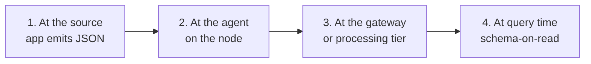

# The Log Record: Schema, Parsing, and Where Structure Comes From

A log platform's usefulness is decided almost entirely by what is in each record and what shape
it is in. You can build a technically magnificent pipeline and still have a search box nobody can
use, because every record is a sentence and the only query that works is substring matching.

This doc defines the record, argues for where structure should come from and where parsing should
happen, and works through the ways a schema quietly destroys a storage tier. Scenario IDs are
`S-nn`.

The argument in one line, made properly over the next several thousand words: **structure is
cheapest at the source and most flexible at query time, and the right answer is to demand a small
mandatory core at the source while treating everything else as schema-on-read.**

---

## Start with what a search needs

Here is a record as a human wrote it:

```
2026-09-30 14:23:01 ERROR charge failed: card_declined for user_id=98712 order=RB-8814027 provider=stripe latency=1240ms
```

And here are five things somebody will want to ask within a week of that line existing:

1. Every `card_declined` for provider `stripe` in the last hour. *(needs `provider` as a field)*
2. The decline rate by provider, as a time series. *(needs an aggregation over a field)*
3. Every log line — any service, any level — for `order=RB-8814027`. *(needs cross-service
   correlation on a business identifier)*
4. The p99 of `latency` for declines. *(needs `latency` as a **number**, not text)*
5. Everything that happened in the same request as this line. *(needs a trace ID)*

The line above can answer exactly none of them without substring gymnastics. Question 4 is
outright impossible: `latency=1240ms` is a string, and `1240ms` sorts before `900ms`.

The same event, structured:

```json
{
  "ts": "2026-09-30T14:23:01.847Z",
  "level": "ERROR",
  "service": "payment-api",
  "msg": "charge failed",
  "error.code": "card_declined",
  "payment.provider": "stripe",
  "order.id": "RB-8814027",
  "user.id": 98712,
  "duration_ms": 1240,
  "trace.id": "4bf92f3577b34da6a3ce929d0e0e4736",
  "span.id": "00f067aa0ba902b7"
}
```

All five questions become one-line queries. That is the entire argument for structured logging,
and it is not aesthetic — it is the difference between a searchable corpus and 8 petabytes of
prose.

But notice the second, less obvious property, because it is where the money is: **the structured
version compresses far better**. Doc 01 derived 11:1 for Parquet with dictionary encoding, and
that ratio depends on the record having columns to dictionary-encode. The free-text version has
one column — the whole line — with the service name, the provider and the order ID embedded in
it as high-entropy text. Structure is not just a query feature; it is a **2 to 3× storage cost
reduction**.

---

## The record: a mandatory core and an open body

The design that works is neither "no schema" nor "a schema for everything". It is a small
mandatory core that the platform guarantees and depends on, plus an open set of attributes that
the platform stores but does not require.

### The mandatory core

Ten fields. Every record has them; the pipeline rejects or repairs records that do not. Keep this
list short, because every field on it is a promise 40 business units have to keep.

| Field | Type | Who sets it | Why it is mandatory |
|---|---|---|---|
| `ts` | timestamp, UTC, ns | application | Event time. Everything the user searches by. |
| `ingest_ts` | timestamp, UTC, ns | gateway | Partitioning, watermarks, health. Doc 00. |
| `level` | enum | application | The single most-used filter. Must be an enum, not free text. |
| `body` | string | application | The human-readable message. |
| `service.name` | low-cardinality string | agent, from metadata | Routing, quotas, ownership, pruning. |
| `service.namespace` | low-cardinality string | agent | Tenant boundary. |
| `deployment.environment` | enum | agent | `production` / `staging` / `dev`. Prevents the worst class of mistake. |
| `host.name` | string | agent | Infrastructure correlation. |
| `k8s.pod.uid` | string | agent, from path | The join key for late metadata backfill (`A-08`). |
| `tenant.id` | low-cardinality string | gateway | Billing, quotas, access control. Set by the *platform*, never by the client. |

Two of these deserve comment.

**`tenant.id` is set by the gateway from the authenticated identity, not by the sender.** If the
client can set it, a misconfigured agent bills another team, and — much worse — a compromised
agent can write records into another tenant's space or read them back. This is an access-control
boundary and doc 17 treats it as one.

**`deployment.environment` prevents a specific recurring disaster**: a staging cluster
misconfigured to ship to the production tenant, so a load test appears as a production incident.
Making it mandatory and enumerated means the mistake is caught at ingest rather than at 03:00.

### The strongly recommended set

Not enforced, but the platform gives them special treatment — dedicated columns, indexes,
correlation features:

```
trace.id, span.id, trace.flags     → correlation with traces
error.type, error.message, error.stack → the exception, as fields
http.request.method, http.response.status_code, http.route, url.path
db.system, db.operation
duration_ms                        → numeric, always milliseconds, always this name
user.id, session.id                → subject to the PII rules in doc 17
```

**Use the OpenTelemetry semantic conventions for these names.** Not because the names are
better than ones you would invent, but because they are *the same names everyone else uses*.
That buys three things: instrumentation libraries emit them without configuration, dashboards and
detection rules are portable between organisations, and — the practical one — a new engineer
already knows the field is `http.response.status_code` and does not have to discover that your
platform calls it `status` in one service and `httpStatus` in another.

The cost is the dots. `http.response.status_code` is verbose and everyone complains for a month.
Pay it.

### Everything else

Free-form attributes, stored, queryable, not indexed by default. This is where
`payment.provider`, `cart.item_count` and `feature_flag.checkout_v2` live. The platform does not
know about them ahead of time and does not need to — with one hard constraint, which is the
subject of `S-01` below and the most important operational rule in this doc: **the set of
distinct attribute *keys* must be bounded, even though the set of *values* is not.**

---

## Where should parsing happen?

Four candidate places, and the choice is a real tradeoff rather than a best practice.



### 1. At the source

The application emits structured records directly — `zap`, `slog`, `logrus` with a JSON encoder,
`structlog`, Logback with `logstash-logback-encoder`.

**In favour, and it is a strong case.** It is the only place where the structure is *known*
rather than *recovered*. The code that logs the payment provider has the variable in hand; every
later stage is reverse-engineering it out of a string that was built by concatenation. Parsing at
the source costs approximately nothing (you were formatting the line anyway), and doc 02 measured
parsing as 60% of agent CPU — parsing at the source removes that work from 12,000 hosts.

It also eliminates a whole class of failure. A regex parser breaks when someone changes the
message wording; a structured emitter does not, because the field was never in the message.

**Against.** It requires every team to change code, in every language, including the ones nobody
owns. It cannot be applied to software you did not write — nginx, Postgres, Kafka, the kernel.
And a poorly designed emitter creates its own problems, which `S-01` covers.

### 2. At the agent

**In favour.** Maximum parallelism — 12,000 hosts is the most compute you will ever have, and
the work is embarrassingly parallel. Parsing early also means you can drop fields before they
cross the network.

**Against, and this is decisive at scale.** Parsing rules change constantly; agent rollouts are
slow and risky. A bad rule destroys data *before* the durable buffer, which means the damage is
permanent — you cannot replay what was never stored. Doc 03 made this the central argument for a
minimal node agent, and it holds here: **do not put irreversible transformations upstream of your
buffer.**

The exception is parsing that is cheap, stable and enabling: CRI format, multiline reassembly,
and detecting whether the payload is already JSON. Lantern does exactly those three at the agent
and nothing else.

### 3. At the gateway or processing tier

**In favour.** Rules change with a config push to 90 pods. Rules are centrally versioned,
reviewed and unit-tested. And — the property that matters most — **the raw bytes are in Kafka, so
a bad rule is fixed by replaying the topic.** A parsing bug becomes a two-hour reprocessing job
instead of a permanent hole in the record.

**Against.** It is a central bottleneck: all 2.78 GB/s flows through it. Doc 07 sizes it, and
parsing is the dominant cost there too.

### 4. At query time — schema-on-read

Store the raw record; extract fields when someone asks.

**In favour.** Infinitely flexible. You can write a new extraction today against data ingested
six months ago, which is genuinely impossible with the other three. No ingest-time decision can
be wrong, because no ingest-time decision was made.

**Against.** You pay the extraction cost on every query, over far more data than you kept. And
you cannot index what you have not extracted, so the pruning chain in doc 01 — the one that took
480 TB down to 208 MB — mostly does not apply.

### What to actually do

**All four, for different fields.** The allocation that works:

| What | Where | Why |
|---|---|---|
| The mandatory core | source, with the agent filling infrastructure fields | It is needed for routing, quotas and pruning before anything else can happen |
| Semantic-convention fields from your own code | source | Free there, reverse-engineered anywhere else |
| Third-party formats (nginx, Postgres, syslog) | gateway | Rules change, and replay must be possible |
| Everything else | query time | Flexibility where it costs nothing to defer |

The line between rows 3 and 4 is drawn by one question: **will anyone filter or aggregate on this
field?** If yes, extract it at ingest and give it a column, because that is what makes pruning
work. If it is only ever *read* once a matching record is found, leave it in the body.

---

## Field explosion, which is how schemas kill storage tiers

This is the most damaging schema mistake and it is made by well-intentioned people writing
reasonable-looking code.

### The mechanism

Columnar storage allocates per-column overhead: a dictionary, statistics, an offset index, a page
header. Call it **2 KB per column per file** for Parquet with the usual settings. That is
negligible for 40 columns and ruinous for 40,000.

Here is how you get to 40,000 columns. A service logs a per-item map:

```json
{ "msg": "cart priced", "items": { "SKU-4471": 3, "SKU-9928": 1, "SKU-1102": 7 } }
```

The pipeline flattens nested objects into dotted columns — which is the standard and usually
correct behaviour:

```
items.SKU-4471 = 3
items.SKU-9928 = 1
items.SKU-1102 = 7
```

**The SKU is now a column name.** Riverbend has 2.4 million SKUs. Within a day the schema has
hundreds of thousands of columns, each present in a handful of records and absent from all the
rest.

### What it costs, derived

Take one hour of Lantern storage — 910 GB across roughly 8,000 Parquet files — and suppose one
tenant has produced 50,000 distinct column names appearing across 15% of those files:

```
files affected            = 8,000 × 0.15 = 1,200
column overhead per file  = 50,000 × 2 KB = 100 MB
total overhead            = 1,200 × 100 MB = 120 GB
                          = 13% of the hour's entire storage, for one tenant's key sprawl
```

And that is the cheap part. The expensive parts:

- **Query planning gets slow.** The planner reads file metadata to decide what to skip. Metadata
  that was 200 KB per file is now 100 MB, so *planning* a query reads 120 GB.
- **Sparse columns compress badly.** A column present in 0.001% of rows is almost entirely nulls,
  and while nulls encode cheaply, the per-column overhead does not.
- **In Elasticsearch this is fatal rather than expensive.** Each new field is a mapping update,
  which is a cluster-state change propagated to every node. A mapping explosion of this size will
  take the cluster down, which is why `index.mapping.total_fields.limit` defaults to 1,000 —
  and why raising it, which is what people do when they hit it, is the wrong move.

### The rule, and how to enforce it

> **Values may be unbounded. Keys must be bounded.**

Restructure so the variable part is a value:

```json
{ "msg": "cart priced",
  "items": [ {"sku": "SKU-4471", "qty": 3},
             {"sku": "SKU-9928", "qty": 1} ] }
```

Now there are two columns — `items.sku` and `items.qty`, as repeated fields — no matter how many
SKUs exist. `sku` is a high-cardinality *value*, which columnar formats handle well.

Enforcement has to be automatic, because this will recur:

1. **A hard per-tenant limit on distinct attribute keys** — Lantern's is 2,000. Beyond it, extra
   keys are collapsed into a single `overflow` map stored as a JSON string: still searchable,
   no longer a column. The tenant gets an alert naming the offending keys.
2. **Reject keys that look generated** at ingest: keys matching a UUID, a long digit run, or a
   known identifier pattern. Cheap, catches most of it at the source.
3. **A daily report of new keys per tenant.** Sprawl is visible a day after it starts if anyone
   looks.

The same discipline as metric cardinality, and for the same reason — see
[`../Observability/05-instrumentation-and-cardinality.md`](../Observability/05-instrumentation-and-cardinality.md).
The difference is that metric cardinality explosions are loud (your time-series database falls
over) and log key explosions are quiet (your bill rises and queries get slower).

---

## Timestamps, in detail

Doc 00 established event time versus ingest time. Here is what goes wrong in the details.

### Formats, and the one to demand

```
RFC 3339 / ISO 8601, UTC, nanoseconds   2026-09-30T14:23:01.847392011Z   ← demand this
RFC 3339 with an offset                 2026-09-30T10:23:01.847-04:00    ← acceptable
Unix epoch seconds                      1790778181                        ← ambiguous precision
Unix epoch milliseconds                 1790778181847                     ← ambiguous with above
Unix epoch nanoseconds                  1790778181847392011               ← ambiguous with above
Apache common log                       30/Sep/2026:14:23:01 +0000        ← parseable, slow
syslog RFC 3164                         Sep 30 14:23:01                   ← no year, no zone
"2026-09-30 14:23:01"                   ← no zone. The worst one, and the most common.
```

Two of these are genuinely dangerous.

**Naked epoch numbers** are ambiguous about their unit. `1790778181847` is milliseconds if you
guess right and the year 58,743 if you guess wrong. Heuristics based on magnitude work until they
do not. Demand a unit in the field name — `ts_ms`, `ts_ns` — or demand RFC 3339.

**Timestamps without a zone** are the most common format in the world and the most damaging.
`2026-09-30 14:23:01` means nothing without knowing where it was written. The pipeline has to
guess, and every guess is wrong somewhere:

- Guess UTC: correct for containers with `TZ` unset, wrong for anything with a local zone,
  silently shifting records by up to 14 hours.
- Guess the host's zone: correct more often, and now the same log line means different things
  depending on which node it landed on.
- Guess the tenant's configured zone: a control-plane dependency in the parsing path, and wrong
  during daylight-saving transitions, where one local hour occurs twice.

**There is no correct answer, so the answer is a policy.** Lantern's: assume UTC, set
`ts_inferred_zone: true`, and alert the tenant. The flag is the important half — it makes the
guess visible instead of silent. Scenario `S-04`.

### Parse failure

A timestamp that will not parse leaves the pipeline with a record and no event time. Three
possible behaviours, and only one is acceptable:

- **Drop the record.** Loses data over a formatting problem. No.
- **Substitute `ingest_ts` silently.** The record is findable, at the wrong time, with no
  indication. This is the default in several popular pipelines and it is the worst option,
  because it is indistinguishable from correct. `S-03`.
- **Substitute `ingest_ts` and mark it.** Set `ts = ingest_ts`, keep the original string in
  `ts_raw`, set `ts_parse_failed: true`. Findable, honest, diagnosable, and alertable.

The general principle, which appears throughout this collection and comes from
[`../ErrorHandling.md`](../ErrorHandling.md): **when you must guess, record that you guessed.**

### Clock skew and the future

Covered as `A-12` in doc 02. The pipeline rule: clamp event time to a window around ingest time
— Lantern allows 48 hours in the past and 5 minutes in the future — keep the original in
`ts_reported`, and flag. The 5-minute future allowance exists because small forward skew is
common and rejecting it outright would lose real data; a record claiming to be from next Tuesday
is a clock failure, not a late record.

---

## Levels, and why they must be an enum

`level` is the most-used filter in any log platform. It needs to be a small, closed, ordered set:

```
TRACE < DEBUG < INFO < WARN < ERROR < FATAL
```

Six values. Not `Error`, `error`, `ERR`, `E`, `SEVERE`, `40`, or `critical`. Normalise at the
gateway to the canonical six and keep the original in `level_raw` if it differed.

Why the strictness is worth the fuss:

- **Filtering by level is the cheapest prune you have**, and doc 01's chain relies on a factor of
  6 from it. That only works if the column is a 3-bit dictionary, not free text.
- **Level-aware shedding** (doc 02's drop ordering, doc 08's sampling) needs a total order. You
  cannot say "drop everything below WARN" if the values do not compare.
- **Dynamic level control** — the single most effective emergency lever in the whole platform —
  needs the application and the pipeline to agree on what the levels are.

### Dynamic level control is worth building

The ability to change a running service's log level without redeploying it is worth more than
most features in this collection, in both directions:

- **Turning it down** is your fastest response to a volume emergency. Doc 02's `A-07` recovery
  step is "turn off DEBUG globally", and that only exists if levels are controllable at runtime.
- **Turning it up** is your fastest response to a debugging emergency — raise one service to
  DEBUG for ten minutes, for one pod, and turn it off automatically.

The implementation is a control-plane push (doc 08) to a log-level endpoint on each service, with
a mandatory expiry so an elevated level cannot be forgotten. The expiry is not optional: the most
common cause of a sustained volume increase is DEBUG left on after an investigation.

### What the levels mean

Teams disagree, and the disagreement produces `S-09` — a service where everything is INFO, or
one where everything is ERROR. Publish definitions and hold to them:

- **ERROR** — something failed that the service could not handle, and a human should look at it
  eventually. If nobody would act on it, it is not ERROR.
- **WARN** — something unexpected that the service handled. A retry succeeded, a fallback was
  used, a deprecated path was taken.
- **INFO** — a significant state change worth seeing in production by default. One or two per
  request at most.
- **DEBUG** — detail useful when investigating. Off in production by default.
- **TRACE** — per-loop-iteration detail. Off everywhere by default, and the level that causes
  volume incidents.

The useful test for ERROR versus WARN: **would you page on a sustained rate of this?** If not,
it is WARN. A service logging ERROR for every failed client validation has made its own error
rate meaningless, and doc 19's alerting depends on it meaning something.

---

## Designing the message body

Even with good fields, the `body` string matters — it is what a human reads.

**Keep it constant.** The message should be the *same string* for every occurrence of the same
event, with all variation in fields:

```
bad:   "charge failed: card_declined for user_id=98712, attempt 3 of 5, took 1240ms"
good:  body = "charge failed"
       error.code = "card_declined", user.id = 98712, retry.attempt = 3, duration_ms = 1240
```

Three reasons, and the third is the one people miss:

1. **Grouping.** "Which errors are most common?" is a `GROUP BY body` over a low-cardinality
   column. With values interpolated, every occurrence is unique and grouping returns nothing
   useful.
2. **Compression.** A constant string dictionary-encodes to a couple of bits per record. An
   interpolated one is high-entropy text on every row. At Lantern's volume this alone is
   meaningful.
3. **Indexing.** A constant message makes the `body` column low-cardinality, which means a
   dictionary index over it is small and exact — and that turns "find all records with this
   message" from a scan into a lookup.

**Write it for someone who has never seen the code.** `"charge failed"` is good.
`"cs.pmt.chg.f"` is not. `"error in processPaymentInternal"` is not, because it names an
implementation detail that will be renamed next quarter.

**Never put the stack trace in the body.** It goes in `error.stack` as a single escaped string.
That one convention eliminates the entire multiline problem from doc 02 for your own code — the
forty lines become one field in one record, and `A-04` cannot happen.

---

## The failure catalogue

| Class | Scenarios |
|---|---|
| **A. Schema shape** | `S-01` … `S-04` |
| **B. Parsing** | `S-05` … `S-08` |
| **C. Semantics and evolution** | `S-09` … `S-13` |

### S-01 · Field explosion

**What you see.** Storage cost rising faster than ingest volume. Query planning slow on queries
that should be trivial. In Elasticsearch: `Limit of total fields [1000] has been exceeded` and,
if that limit was raised, cluster instability.

**Mechanism.** Identifiers used as object keys, flattened into columns. Derived above.

**Confirm it.** Distinct attribute keys per tenant per day, trended. A healthy tenant is flat at
a few hundred; an exploding one climbs monotonically and never plateaus.

**Recover.** Cap the tenant's keys immediately — collapse to the `overflow` map — then compact
the affected partitions to physically drop the columns. ⚠️ Do not simply raise the field limit:
that converts a bounded cost into an unbounded one and is how Elasticsearch clusters die.

**Prevent.** The 2,000-key cap, generated-key rejection at ingest, and a daily new-key report.
Teach the rule: values unbounded, keys bounded.

### S-02 · The same field name with different types

**What you see.** A query filtering `user.id > 1000` returns nothing, or errors. An aggregation
over `duration_ms` fails for some files and not others.

**Mechanism.** Service A logs `"user.id": 98712` (integer). Service B logs
`"user.id": "98712"` (string). Service C logs `"user.id": {"internal": 98712}` (object). In a
columnar store the column's type is fixed per file, so you now have files that disagree, and the
query engine must either coerce (slow, lossy) or fail (confusing).

**Confirm it.** Scan file metadata for columns whose physical type varies across files in the
same partition. Any store worth using can report this.

**Recover.** Pick the canonical type and coerce at read time while you fix the emitters. Coercion
rules must be explicit: string-to-number succeeds or the value becomes null *and is counted*,
never silently zero.

**Prevent.** A **type registry** in the control plane: once a field name has been seen with a
type, that binding is fixed platform-wide. A record whose type conflicts gets the value moved to
`fieldname_str` and is flagged, rather than being rejected or silently coerced. This is the
single highest-value piece of schema governance you can build, and it is a few hundred lines.

### S-03 · Silent timestamp substitution

**What you see.** Records clustered at exactly the ingest time, in a suspiciously smooth
distribution. Searches for a known incident window return nothing.

**Mechanism.** Timestamp parse failure, silently replaced by `ingest_ts`. Described above.

**Confirm it.** The distribution of `ingest_ts − ts`. A spike at exactly zero, with no jitter, is
substitution: real records always have *some* gap.

**Recover.** If `ts_raw` was preserved, reparse. If not, the original event time is gone.

**Prevent.** Never substitute without flagging. Alert on `ts_parse_failed` rate per service.

### S-04 · Zone-less timestamps shifted by hours

**What you see.** One service's records consistently offset by a whole number of hours. Worse
during daylight-saving transitions, where an hour of records is duplicated or missing.

**Mechanism.** `2026-09-30 14:23:01` with no zone, assumed UTC, emitted by a host in
`America/New_York`.

**Confirm it.** Per-service p50 of `ingest_ts − ts`. A whole-hour offset is unmistakable — real
network and buffering delay is never exactly 4 hours.

**Recover.** Correct at read time with a per-service offset while the emitter is fixed. Do not
rewrite stored data; the flag plus a view is safer and reversible.

**Prevent.** `ts_inferred_zone: true` on every guess, an alert on its rate, and a container
standard of `TZ=UTC` everywhere. The last one is a one-line change to a base image that
eliminates most of this class.

### S-05 · The dead-letter queue nobody reads

**What you see.** Nothing. A team reports missing logs; investigation finds millions of their
records in the unparseable path, going back weeks.

**Mechanism.** A parser fails; the pipeline routes the record to a dead-letter destination rather
than dropping it, which is correct. Nobody alerts on the destination's depth, which is not.

**Confirm it.** Dead-letter rate by service and by parser rule.

**Recover.** Fix the rule and replay. This is only possible because the raw bytes were preserved
— which is the argument for parsing after the buffer, made concrete.

**Prevent.** Alert on dead-letter rate as a **ratio of the source's total**, not an absolute
count; a small service's total failure is invisible in an absolute threshold. Expire the
dead-letter store and alert before expiry, so "we will get to it" has a deadline. Same discipline
as [`../Kafka/06-lag-backpressure-and-poison-messages.md`](../Kafka/06-lag-backpressure-and-poison-messages.md).

### S-06 · Structure trapped in the message

**What you see.** Engineers writing `body LIKE '%provider=stripe%'` because there is no
`provider` field. Queries are slow and results are wrong whenever the wording changes.

**Mechanism.** The application built a sentence by concatenation. The information is present and
not addressable.

**Confirm it.** Sample the highest-volume services' bodies and look for `key=value` patterns. If
a substring query is anyone's habit, this is why.

**Recover.** A gateway parser extracting `key=value` pairs (`logfmt`) works surprisingly well as
a stopgap and can be applied at query time to historical data.

**Prevent.** Structured logging at the source. This is a per-team change and the way to get it
is to make the benefit visible: give teams a dashboard of "queries against your service that had
to use substring matching", which is far more persuasive than a style guide.

### S-07 · Personal data in the body

Covered fully in doc 17 (`C-01`…). Noted here because the *schema* is the mitigation: PII in a
declared field can be redacted, tokenised or access-controlled by rule. PII interpolated into a
free-text body can only be caught by pattern matching, which is probabilistic and expensive.
**Structure is a privacy control**, which is an argument for it that rarely gets made.

### S-08 · Deeply nested objects

**What you see.** Column counts in the thousands from a handful of services. Query latency poor
on those services even for simple filters.

**Mechanism.** A service logs an entire request or response object. Flattening a five-level
structure with twenty fields per level produces a very wide row, and if any level is keyed by an
identifier you also have `S-01`.

**Confirm it.** Columns per record by service, and maximum nesting depth.

**Prevent.** Cap flattening depth — Lantern's is 3 — and store anything deeper as a JSON string
in one column. Still searchable with JSON functions, no longer a schema. And push back on the
practice: logging a whole object is a sign nobody decided what mattered, and it is usually also
`S-07`.

### S-09 · Levels that mean nothing

**What you see.** A service where 94% of records are ERROR, or one where everything is INFO.
Level-based alerts are useless for it; level-based sampling either drops everything or nothing.

**Mechanism.** No shared definition. Often a framework default — some HTTP libraries log every
4xx as ERROR, which makes a client's bad request into a server error.

**Confirm it.** Level distribution per service. A healthy production service is roughly
80–95% INFO, 3–15% WARN, 0.1–2% ERROR. Anything far outside that is worth a conversation.

**Prevent.** Publish the definitions above. Report the distribution back to teams monthly. The
useful framing is not "you are logging wrong" — it is "your ERROR rate cannot be alerted on,
so you have no error alerting", which teams care about.

### S-10 · A schema change breaks every saved query

**What you see.** Dashboards empty after a deploy. Saved searches return nothing. Detection rules
stop firing — and *that* is the dangerous one, because a detection rule that stops firing looks
exactly like a system with no problems.

**Mechanism.** A field was renamed, or its type changed, or it moved from top level to nested.

**Prevent.** Treat the log schema as an API, with the same discipline as
[`../MicroservicesPOF/11-deploys-config-and-schema-change.md`](../MicroservicesPOF/11-deploys-config-and-schema-change.md):
**expand, migrate, contract.** Emit both old and new names for a deprecation window; report which
consumers still reference the old name (you have query logs — use them); remove only when the
count reaches zero. Field *removal* needs the same care as removing an API endpoint.

And alert on silence: any detection rule or dashboard panel that goes from a steady rate to
exactly zero should page. Zero is a value, and it is usually a lie.

### S-11 · Truncation removes the interesting part

**What you see.** Records ending mid-sentence at exactly 8,192 or 16,384 characters. Stack traces
missing their root cause — which, in most languages, is at the *end*.

**Mechanism.** A size cap applied by truncating the tail. Caps are necessary; tail-truncation is
the wrong implementation for exceptions specifically, because `Caused by:` chains put the
original failure last.

**Prevent.** Cap, but **truncate the middle**, keeping the first 4 KB and the last 4 KB with an
explicit marker:

```
...first 4096 bytes...
[TRUNCATED 41,208 bytes — original size 49,400]
...last 4096 bytes...
```

Set the record-size cap at 32 KB and count truncations per service. A service truncating
frequently is logging something it should not be.

### S-12 · Invalid UTF-8 and binary payloads

**What you see.** Parser failures that resist explanation. Query results that break rendering.
Occasionally, a storage writer crash.

**Mechanism.** A service logged bytes from a network buffer, a file, or a database BLOB. Most
JSON encoders will happily emit invalid UTF-8; most decoders will not accept it.

**Prevent.** Validate and sanitise at the gateway — replace invalid sequences with U+FFFD, count
the replacements, flag the record. Never pass unvalidated bytes to a downstream writer. And cap
the record size, because binary payloads are usually also `S-11`.

### S-13 · The trace ID is missing, so correlation does not work

**What you see.** "Show me everything in this request" returns only some services' records. Two
services in one call chain have different trace IDs.

**Mechanism.** Context propagation broke. Usually: an asynchronous boundary where the context was
not carried into the goroutine or thread pool, a client library without instrumentation, or a
queue hop where the trace context was not put in the message headers.

**Confirm it.** The share of records carrying a `trace.id`, per service. Then, for a sample of
trace IDs, the count of distinct services — a chain that should touch five services and touches
two shows you where propagation stops.

**Prevent.** Propagation is an instrumentation problem, not a logging one, and the fix belongs in
the tracing setup. What the *log platform* should do is measure it — publish `trace_id_coverage`
per service as a first-class metric, because otherwise nobody discovers the gap until the
incident where they needed it.

---

## What to take away

1. **Structure is not aesthetic.** It is the difference between five answerable questions and
   none, and — because dictionary encoding needs columns — it is also a 2–3× storage cost
   reduction.
2. **Demand a small mandatory core and leave the rest open.** Ten fields the platform depends on
   for routing, quotas and pruning; everything else free-form and schema-on-read.
3. **`tenant.id` is set by the platform from the authenticated identity, never by the sender.**
   It is an access-control boundary, not a convenience field.
4. **Use OpenTelemetry semantic conventions** — not because the names are better, but because
   they are the same names as everyone else's, and that portability is worth the verbosity.
5. **Parse in four places for four kinds of field.** Your own structure at the source; CRI and
   multiline at the agent; third-party formats at the gateway where a bad rule is fixed by
   replay; everything else at query time.
6. **Never put an irreversible transformation upstream of the durable buffer.** This is the same
   rule as doc 03's and it governs the whole pipeline.
7. **Values may be unbounded; keys must be bounded.** Identifiers as object keys are the most
   damaging schema mistake there is, and it is quiet — the bill rises and queries slow, but
   nothing fails.
8. **When you must guess, record that you guessed.** Inferred time zones, substituted timestamps,
   coerced types — each needs a flag, because a silent guess is indistinguishable from a correct
   answer.
9. **Levels must be a closed, ordered enum**, because the cheapest prune in your query planner,
   your shedding order, and your emergency volume lever all depend on comparing them.
10. **Build dynamic log-level control with mandatory expiry.** It is your fastest lever in both a
    volume emergency and a debugging emergency, and the expiry prevents the most common cause of
    sustained volume growth.
11. **Keep the message constant and put variation in fields.** It makes grouping work, cuts
    storage, and turns "find this message" from a scan into a dictionary lookup.
12. **Treat the schema as an API** — expand, migrate, contract — and alert when a dashboard or
    detection rule goes to exactly zero, because zero is usually a lie.

Next: [05-transport-and-the-gateway-tier.md](05-transport-and-the-gateway-tier.md), which moves
the records off 12,000 hosts and into the platform.
