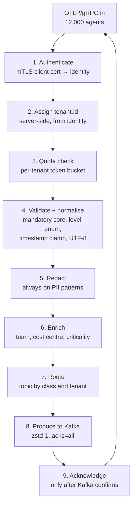
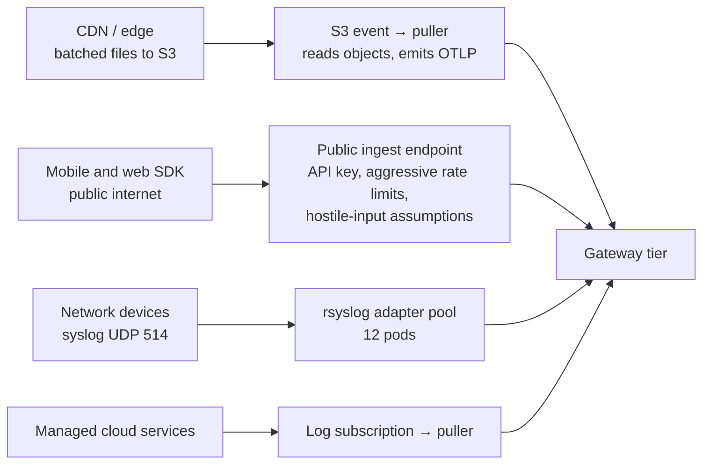

# Transport and the Gateway Tier

Stage 3. Twelve thousand agents have records ready and need to hand them to the platform. This
doc covers the wire — protocol, batching, compression, connections, authentication — and the
tier that receives it.

The theme is a fan-in problem. Twelve thousand senders, a handful of receivers, and a set of
failure modes that only appear at that ratio. A design that works beautifully for a hundred
agents will fall over at twelve thousand for reasons that have nothing to do with throughput:
**connection imbalance, reconnect storms, and retry amplification are all functions of the
fan-in ratio, not of the byte rate.** Scenario IDs are `T-nn`.

---

## Why have a gateway at all?

The obvious design skips it. Agents write to Kafka directly. Kafka is already a distributed,
replicated, high-throughput receiver — why put ninety pods in front of it?

It is a fair question and for small deployments the answer is "don't". Here is what changes at
twelve thousand agents.

**Credentials.** Direct-to-Kafka means every agent holds Kafka credentials and can produce to
topics. There is no practical way to constrain *which* topics or *which* tenant an agent may
write as, beyond ACLs you must now manage for 12,000 identities. A compromised node becomes a
compromised log platform — it can forge records attributed to any tenant, which defeats audit
logging entirely. The gateway makes `tenant.id` a **server-side** assertion derived from the
authenticated identity (doc 04), which is the whole basis of multi-tenant trust.

**Connection count.** Kafka producers hold a connection to every broker that leads a partition
they write to. 12,000 agents × 24 brokers is up to 288,000 connections, each with its own
buffers. Brokers spend their memory on connection state instead of page cache — and doc 01
showed page cache is the number that governs the cluster.

**Coupling.** Every agent now knows your broker addresses, your topic names and your partitioning
scheme. Changing any of them is a 12,000-host rollout. The gateway is an indirection layer whose
entire value is that the thing behind it can change.

**Backpressure semantics.** A Kafka producer's response to a full buffer is configured in the
producer. You now have that configuration in 12,000 places, and changing it during an incident is
impossible.

**Everything you want to do centrally.** Per-tenant quotas, PII redaction, schema validation,
routing to multiple destinations, sampling decisions. Doc 03 and doc 04 both concluded that these
belong after the network hop and before the buffer. That place is the gateway.

**The honest counter-argument.** A gateway is another tier to run, another hop of latency
(measured below at about 8 ms), and another thing that can be down. If you have a few hundred
agents, one tenant, and no redaction requirement, skip it — agents to Kafka is simpler and
simpler is worth a lot.

---

## Choosing a protocol

| Protocol | Framing | Compression | Backpressure | Where it fits |
|---|---|---|---|---|
| **OTLP over gRPC** | protobuf over HTTP/2 | per-message gzip or zstd | HTTP/2 flow control | **the default** |
| OTLP over HTTP | protobuf or JSON over HTTP/1.1 | `Content-Encoding` | status codes only | agents behind proxies that mangle HTTP/2 |
| Kafka protocol | Kafka's own | producer-level, batch | producer buffer | direct-to-Kafka, discussed above |
| Elastic bulk API | newline JSON over HTTP | `Content-Encoding` | status codes, `429` | when the destination is Elasticsearch |
| Syslog, RFC 5424 over TCP | octet-counted | none | TCP window | network devices and appliances |
| Syslog over UDP | datagram | none | **none** | legacy only, and lossy — see `T-12` |
| Fluentd forward | MessagePack over TCP | per-chunk | ack-based | within a Fluent ecosystem |

**Lantern uses OTLP over gRPC as the primary protocol**, with OTLP/HTTP as a fallback and syslog
adapters at the edge. Three reasons, in order of weight:

1. **HTTP/2 flow control gives real backpressure.** This is the property that matters most and
   the one most protocols lack. When the gateway cannot keep up, it stops advancing the stream
   window, and the agent's send call blocks *before* anything is dropped. Compare status-code
   backpressure — a `503` means the data you already sent is gone and you must retry it, which is
   how you get `T-03`. Flow control means you never sent it.
2. **One protocol for logs, metrics and traces**, so one authentication path, one set of
   connection tuning, one place to debug.
3. **Vendor neutrality.** Every backend worth using accepts OTLP now. Changing where logs go
   stops being a fleet-wide change.

The costs are real and worth naming: gRPC is harder to debug than newline-delimited JSON over
HTTP, it needs HTTP/2 support end to end (some corporate proxies and older load balancers break
it), and protobuf means you cannot `curl` your ingest endpoint to check it is alive. Keep the
OTLP/HTTP endpoint enabled partly for that reason.

---

## Batching, and where its numbers come from

Records are never sent one at a time. Batching is the difference between a functioning pipeline
and a network stack doing nothing but syscalls. But bigger batches are not simply better, and the
tradeoff is worth deriving rather than guessing.

### The three forces

**Per-batch overhead argues for large batches.** Each send costs a gRPC message frame, a protobuf
envelope, a TLS record, TCP/IP headers, and syscall and scheduling time. Roughly:

```
per-batch fixed cost ≈ 340 bytes of framing + ~80 µs of CPU
```

Compare it against the payload for different batch sizes on a p99 Lantern host at 4.1 MB/s
(about 8,300 records/s at 494 B):

```
batch of     1 record :  494 B payload,  340 B overhead  =  41% overhead.  8,300 sends/s
batch of    10        :    4.9 KB,       340 B           =   6.5%          830 sends/s
batch of   100        :   49.4 KB,       340 B           =   0.7%           83 sends/s
batch of 1,000        :  494 KB,         340 B           =   0.07%           8.3 sends/s
```

The returns flatten hard after about 100. Going from 100 to 1,000 buys 0.6% of bandwidth.

**Compression efficiency also argues for large batches**, and this one keeps paying longer.
Compressors work within a window and need repetition to find. A batch of 10 records gives LZ4
very little to work with:

```
batch of    10 records :  LZ4 ratio ≈ 1.6 : 1
batch of   100         :             ≈ 2.1 : 1
batch of 1,000         :             ≈ 2.2 : 1
batch of 10,000        :             ≈ 2.3 : 1
```

Between 10 and 100 the ratio improves by 31%, which is worth far more than the framing saving.
After 1,000 it is flat.

**Latency argues for small batches**, and this is the binding constraint. A batch is only sent
when it is full *or* when its timer fires. On a quiet host the timer always wins:

```
p50 Lantern host, 18 KB/s = 36 records/s
time to fill a batch of 1,000 = 1,000 ÷ 36 = 27.8 seconds
```

Twenty-eight seconds before the first record leaves the host. Doc 01's tail budget is 1.5 s at
p50. So the timer must be the primary control, and the size limit is a safety valve for busy
hosts.

### The resolution

```yaml
batch:
  max_records: 500          # ~247 KB — past the compression knee, below the memory cost
  max_bytes:   1048576      # 1 MB hard cap, so one huge record cannot make a huge batch
  timeout:     200ms        # the real control on quiet hosts
```

What this gives across the fleet:

```
p50 host   (36 rec/s):    timer fires first → 7 records per batch, every 200 ms
p90 host   (283 rec/s):   timer fires first → 57 records, every 200 ms
p99 host (8,300 rec/s):   size fires first  → 500 records, every 60 ms
max host (81,000 rec/s):  size fires first  → 500 records, every 6.2 ms
```

Note the consequence for the p50 host: 7-record batches compress at about 1.5:1 instead of 2.2:1.
**The majority of hosts get the worst compression**, because they are quiet. That is correct —
they are also the majority of *nothing*, contributing a negligible share of the bytes. Optimising
compression for the p50 host would cost latency everywhere for no bandwidth saving.

And note the max host: 6.2 ms per batch means 161 sends/s from one agent, which is fine, but it
is worth checking against the connection's ability to keep that many in flight — see the
window-size arithmetic below.

### The 200 ms is spent from the tail budget

Doc 12 assembles the full budget; record here that batching contributes **up to 200 ms at p50**
and that this is the single largest controllable term in it. Reducing it to 50 ms would quadruple
the send rate from quiet hosts — 12,000 hosts × 20 sends/s = 240,000 requests/s at the gateway
instead of 60,000 — for 150 ms of tail latency. Lantern judged 200 ms worth it. A platform whose
users demand sub-second tail should reconsider, and should expect to pay for it in gateway pods.

---

## Compression on the wire

Doc 01 established the ratios. The decision here is **where the CPU is spent**.

LZ4 at the agent costs `0.002 cores per MB/s` (doc 02) — negligible, 0.008 cores on a p99 host.
zstd-3 would give 4.6:1 instead of 2.2:1, halving bandwidth, at roughly 0.011 cores per MB/s, or
0.045 cores on a p99 host.

Across the fleet:

```
LZ4:     2,780 MB/s × 0.002 =   5.6 cores   →  wire rate 1.26 GB/s
zstd-3:  2,780 MB/s × 0.011 =  30.6 cores   →  wire rate 0.60 GB/s
```

Twenty-five extra cores to save 660 MB/s of network. Within a single availability zone, that
network is free and the cores are not, so LZ4 wins. **Across availability zones or regions it
inverts immediately**, because inter-AZ transfer is $0.01/GB in each direction:

```
660 MB/s saved × 86,400 s × 30 days = 1,710 TB/month
1,710,000 GB × $0.02 (both directions) = $34,200/month
```

Thirty-four thousand dollars a month against twenty-five cores at roughly $620 a month. **If any
part of your agent-to-gateway path crosses an availability zone, compress harder.** This is
`T-05`, and it is the most common surprise line item in a log platform's bill.

Lantern's answer: LZ4 at the agent, gateways pinned to the same AZ as their agents via topology-
aware routing, and zstd-1 applied at the gateway for the Kafka hop (which does cross AZs,
unavoidably, because Kafka replicas are spread for durability).

---

## Connections: the part that breaks at twelve thousand

This is where fan-in scale bites, and none of it is about throughput.

### Long-lived gRPC streams do not load-balance

The classic problem, `T-01`. A gRPC client opens one HTTP/2 connection and multiplexes every
request over it. An L4 load balancer distributes *connections*, and there is one, so it goes to
one backend and stays there for hours.

With 12,000 agents and 90 gateway pods you would expect 133 agents each. What you get, if pods
restart at different times, is this: pods that have been up longest accumulate connections,
because every agent that reconnects lands on whatever is available, and nothing ever moves an
established connection. After a few weeks of rolling restarts the distribution is badly skewed —
some pods at 400 agents, newly started pods at 5.

Three fixes, and you want at least two of them:

1. **An L7 proxy that balances requests, not connections.** Envoy, or a mesh sidecar, terminates
   HTTP/2 and distributes individual streams. This is the cleanest fix and it is what a service
   mesh is for. The cost is another hop.
2. **`MAX_CONNECTION_AGE` on the server.** gRPC's `GRPC_ARG_MAX_CONNECTION_AGE_MS` makes the
   server send `GOAWAY` after a set lifetime, forcing a clean reconnect that gets re-balanced.
   Set it to something like 30 minutes with a 5-minute grace, and **add jitter** — without
   jitter, every connection established during a deploy expires in the same second, which is
   `T-02`.
3. **Client-side load balancing.** The agent resolves all gateway endpoints and picks among them
   itself. Better distribution, at the cost of every agent needing service discovery, which is a
   new fleet-wide dependency and a new failure mode (`T-11`).

Lantern uses 1 and 2: Envoy in front, plus a 30-minute jittered max connection age as a backstop.

### The reconnect storm

`T-02`, and it is a self-inflicted thundering herd.

A gateway deploy rolls 90 pods. Each terminating pod drops its connections. Every affected agent
reconnects immediately. If the agents reconnect without jitter — and most defaults do — you get
thousands of TLS handshakes in the same instant.

```
12,000 agents ÷ 90 pods = 133 agents per pod
rolling deploy, 10 pods at a time:  1,330 agents reconnect simultaneously
each reconnect: TLS handshake ≈ 2 round trips + an RSA or ECDSA operation
at ~1.2 ms of CPU per mTLS handshake: 1,330 × 1.2 ms = 1.6 core-seconds, in a burst
```

1.6 core-seconds sounds small, and it is — that is the point. The failure is not CPU, it is
**synchronisation**. Those 1,330 agents now have their batch timers aligned, so they send at the
same instant forever after, converting a smooth 60,000 requests/s into periodic spikes. And if a
gateway pod is slow to start, the agents retry — together — and the retry storm is `T-03`.

The mitigations are the standard ones and they are all required:

- **Jittered reconnect with exponential backoff**: `min(30s, 100ms × 2^attempt) × uniform(0.5, 1.5)`.
- **Slow, jittered rolling deploys** of the gateway: `maxUnavailable: 1`, with a pause.
- **Connection draining**: `GOAWAY` with a grace period, so agents migrate before the pod stops
  accepting.
- **Jittered max connection age**, which continuously de-synchronises everything in normal
  operation so a deploy is not the only time connections move.

### Idle timeouts kill streams mid-batch

`T-07`. A load balancer with a 60-second idle timeout and an agent on a quiet host sending every
200 ms is fine — but an agent on a host with *no* traffic sends nothing, and after 60 seconds the
balancer silently drops the connection. The agent does not find out until its next send, which
fails, and depending on its retry configuration that batch may be lost.

Fix with **gRPC keepalive**, and make the numbers consistent across all three layers:

```
client keepalive time:        20s     # must be well under the LB idle timeout
client keepalive timeout:     10s
server keepalive time:        20s
server min ping interval:     10s     # must be BELOW the client's keepalive time
LB idle timeout:             120s     # must be ABOVE the keepalive interval
```

⚠️ The subtle failure: if the server's `min ping interval without data` is *above* the client's
keepalive interval, the server treats the client's keepalives as abuse and sends `GOAWAY` with
`ENHANCE_YOUR_CALM`. The connection dies repeatedly and the logs on both sides are unhelpful.
Set the server's minimum below the client's interval, always.

### Connection and stream budget

```
12,000 agents × 1 connection = 12,000 connections
÷ 90 gateway pods            = 133 per pod          — trivial
memory per HTTP/2 connection ≈ 64 KB of buffers
133 × 64 KB                  = 8.5 MB per pod       — negligible
```

Connections are not the resource problem here. Per-stream flow-control windows are, if you set
them badly:

```
default HTTP/2 stream window: 64 KB
max host sends 500-record batches of ~250 KB compressed to ~114 KB
114 KB > 64 KB → the send blocks mid-batch waiting for a window update
```

Raise the initial stream window to 1 MB and the connection window to 4 MB on both sides.
Otherwise your busiest hosts — the ones that matter — spend their time waiting for window
updates, and the symptom is latency that scales with host volume, which looks like a throughput
problem and is not.

---

## What the gateway does

Ninety pods, and their job in order:



Two design points carry most of the weight.

**Step 9 is the correctness anchor of the entire pipeline.** The gateway must not acknowledge
until Kafka has confirmed the write with `acks=all`. Acknowledging earlier makes the gateway a
place where data can vanish silently — the agent advances its checkpoint, the gateway pod dies
with the batch in memory, and nobody ever knows. This is `A-03` relocated one tier, and the
argument is the same: **the acknowledgement must chain all the way back to a durable store, or
your at-least-once guarantee has a hole in the middle of it.** Doc 15 traces the full chain.

**Steps 3 and 5 are why the gateway exists at all.** Quota enforcement needs a trusted view of
per-tenant rate that no agent can forge, and redaction needs to happen before data becomes
durable — once PII is in Kafka with six-hour retention and then in object storage with
thirteen-month retention, removing it is a project (doc 17).

### Sizing the gateway

Per MB/s of raw input, from the same decomposition as doc 02:

```
gRPC receive + decompress LZ4      0.004 cores per MB/s
protobuf decode                    0.012
validate + normalise               0.009
redaction regex scan               0.021    ← the dominant cost
enrich (cached lookups)            0.003
zstd-1 compress                    0.008
Kafka produce                      0.005
                                   -----
                                   0.062 cores per MB/s
```

```
2,780 MB/s × 0.062 = 172 cores at average
× 1.7 diurnal peak =  293 cores at peak
÷ 4 cores per pod  =   73 pods at peak
round up for AZ loss and headroom → 90 pods of 4 cores, 8 GB
```

**Redaction is a third of the cost**, which is worth knowing because it is the part people add
later without re-sizing. Doc 17 discusses making it cheaper — the main lever is applying
expensive patterns only to fields likely to contain them, rather than scanning every byte of
every record.

### Latency contribution

```
network, agent → gateway, same AZ         0.4 ms
TLS and gRPC framing                      0.3 ms
decompress + decode                       1.1 ms
validate, redact, enrich                  2.8 ms
produce to Kafka, acks=all, 3 AZs         3.2 ms
                                          ------
                                          7.8 ms
```

Roughly 8 ms, against a 200 ms batching delay. **The gateway is not where your tail latency
goes**, which is worth stating because it is where people look first.

---

## Authentication at twelve thousand agents

**mTLS with short-lived certificates.** Each agent has a client certificate whose subject encodes
its identity — cluster, node, and the tenant it is permitted to write as. The gateway maps that
identity to `tenant.id`, and the agent has no say in it.

Issuance should come from the platform's existing workload identity rather than being a new
system: SPIFFE/SPIRE, cert-manager with a node-attested issuer, or the cloud provider's instance
identity. What you want is a certificate that is **short-lived** (hours) and **automatically
renewed**, because the alternative is `T-06`.

### T-06 is worth pre-empting explicitly

A fleet-wide certificate expiry is one of the few failures that takes down 100% of ingest at
once, at a moment nobody chose. Long-lived certificates make it worse, not better: a one-year
certificate means the renewal path is exercised once a year, which means it does not work.

Four practices, all cheap:

- **Short lifetimes, automatic renewal.** A 24-hour certificate renewed at 12 hours means the
  renewal path runs twice a day and breaks loudly the first time it fails, on one agent, not on
  all of them.
- **Alert on the minimum remaining lifetime across the fleet**, not the average.
- **Stagger issuance** so expiry times are spread, never clustered.
- **A break-glass path** — a separate long-lived credential, stored offline, that lets you restore
  ingest while fixing the certificate authority. Test it quarterly. The reason this matters more
  here than elsewhere: when ingest is down you also cannot see the logs that would tell you why.

---

## Receiving from things that are not agents

31% of Lantern's bytes come from sources with no agent: CDN access logs, mobile clients, managed
cloud services, network hardware.



Two of these deserve specific warnings.

**The public ingest endpoint is a different security problem from everything else in this
collection.** It is reachable from the internet, its credentials are shipped inside mobile
applications and can be extracted, and the data is entirely attacker-controlled. Treat it
accordingly: a separate tenant space, hard per-key and per-IP rate limits, strict size caps, no
trust in any client-supplied timestamp or identity field, and — because an attacker who extracts
a key will use it — the ability to rotate a key without shipping a new application version. Doc
17 covers the rest.

**Syslog over UDP loses data silently and nothing can fix it.** No acknowledgement, no
retransmission, no sequence numbers. A dropped datagram is simply gone. `T-12`. Use TCP
(RFC 5424 with octet counting) wherever the device supports it; where it does not, size the
receive buffers generously (`net.core.rmem_max`), keep the adapter pool's CPU headroom high
because UDP drops happen in the kernel when the socket buffer fills, and **monitor
`netstat -su` receive errors** — that counter is the only evidence you will ever get.

---

## The transport failure catalogue

| Class | Scenarios |
|---|---|
| **A. Connections and balance** | `T-01`, `T-02`, `T-07`, `T-11` |
| **B. Amplification and overload** | `T-03`, `T-04`, `T-10` |
| **C. Cost, correctness, credentials** | `T-05`, `T-06`, `T-08`, `T-09`, `T-12` |

### T-01 · Connection imbalance

**What you see.** Gateway pod CPU ranging from 5% to 90% with identical configuration. Ingest
latency poor for some agents and fine for others, with no pattern by tenant or region.

**Mechanism.** L4 balancing of long-lived HTTP/2 connections. Described above.

**Confirm it.** Active connection count per gateway pod. A healthy fleet is within ±20% of the
mean; imbalance shows as a 50× spread. Correlate with pod age — the oldest pods will have the
most.

**Recover.** Restart the loaded pods, which forces their agents to redistribute. ⚠️ Restart them
**one at a time with a pause** — restarting several at once is `T-02`.

**Prevent.** L7 balancing, plus jittered `MAX_CONNECTION_AGE`.

### T-02 · Reconnect storm on deploy

**What you see.** A CPU spike on the gateway tier during every deploy, sometimes with a brief
ingest gap. Afterwards, periodic spikes in request rate that were not there before.

**Mechanism.** Synchronised reconnection, described above. The lasting damage is the
synchronisation of batch timers, not the handshake cost.

**Confirm it.** Request rate at the gateway, at 1-second resolution, before and after a deploy.
Synchronised agents show a sawtooth with a period equal to the batch timeout.

**Recover.** It de-synchronises on its own over hours as agents drift. Jittered max connection
age accelerates it.

**Prevent.** Jittered reconnect backoff at the agent, slow rolling deploys, connection draining,
and continuous jittered connection recycling so a deploy is not a special event.

### T-03 · Retry storm after a brief outage

**What you see.** The gateway recovers from a 30-second problem and is immediately overwhelmed
by a much larger problem lasting several minutes.

**Mechanism.** 12,000 agents buffered during the outage and now all flush at once. Each agent's
backlog is small; the aggregate is not:

```
30 s outage × 2.78 GB/s = 83 GB buffered across the fleet
flushed as fast as agents can send, against a tier sized for 4.73 GB/s peak
→ 83 GB ÷ 4.73 GB/s = 17.5 s of pure backlog, during which nothing new is accepted
→ agents time out, retry, and add to the load
```

This is a metastable failure in the sense of
[`../MicroservicesPOF/04-cascading-and-metastable-failures.md`](../MicroservicesPOF/04-cascading-and-metastable-failures.md):
removing the original trigger does not end it.

**Confirm it.** Gateway request rate far above the known ingest rate, with high error rates and
agents reporting retries.

**Recover.** Shed aggressively at the gateway — reject with a `RESOURCE_EXHAUSTED` carrying a
`retry-after` that agents honour. Counter-intuitively, **rejecting more makes recovery faster**,
because a rejected agent backs off while a timing-out agent retries.

**Prevent.** Rate-limit the agent's *send* rate, not just its batch size — an agent recovering
from a backlog must not send faster than roughly 1.5× its normal rate. This one setting converts
a 17.5-second stampede into a 60-second gentle catch-up. Add jittered backoff, and make the
gateway's shedding explicit rather than relying on timeouts.

### T-04 · Batch size wrong in either direction

**What you see.** *Too small:* gateway CPU dominated by per-request overhead, request rates an
order of magnitude above expectation. *Too large:* memory pressure at the gateway, latency
spikes, and one slow batch blocking a connection.

**Mechanism.** Derived above.

**Confirm it.** Records per batch, as a distribution at the gateway. It should be bimodal —
timer-driven small batches from quiet hosts, size-driven 500-record batches from busy ones.
A single mode at the maximum means the timer never fires and latency is worse than you think.

**Prevent.** The three-limit configuration above: records, bytes, and timeout, with bytes as the
safety valve against one pathological record.

### T-05 · Cross-zone transfer cost

**What you see.** A data-transfer line on the cloud bill comparable to the compute line. Often
discovered months later.

**Mechanism.** Agents in AZ-a sending to gateways in AZ-b at $0.01/GB each way. At 1.26 GB/s:

```
1.26 GB/s × 86,400 × 30 = 3,266 TB/month crossing zones
3,266,000 GB × $0.02    = $65,320/month
```

Sixty-five thousand dollars a month to send data to a machine in the same city.

**Confirm it.** Cloud cost explorer, filtered to inter-AZ transfer, and the gateway service's
topology configuration.

**Recover.** Enable topology-aware routing so agents prefer a gateway in their own zone.

**Prevent.** Topology-aware routing from day one, and compress harder on any hop that must cross
a zone. Note the tension with availability: zone-local routing means a zone's gateway failure
strands that zone's agents, so keep cross-zone as a fallback rather than forbidding it. Agents
buffer, so a brief failover is absorbed.

### T-06 · Fleet-wide certificate expiry

Described above. **What you see:** 100% of ingest failing simultaneously with TLS errors, and no
logs to debug it with.

**Recover.** The break-glass credential. This is why it exists and why it must be tested.

**Prevent.** Short lifetimes, automatic renewal, staggered issuance, alert on the fleet minimum.

### T-07 · Idle timeout kills quiet connections

**What you see.** Agents on low-traffic hosts showing periodic send failures roughly every idle
timeout. High-volume hosts unaffected.

**Mechanism.** A load balancer or firewall closing idle connections without telling the client.

**Confirm it.** Correlate failure intervals with the load balancer's idle timeout. The
correlation is usually exact.

**Prevent.** gRPC keepalive tuned consistently across client, server and balancer, with the
server's minimum ping interval **below** the client's keepalive interval.

### T-08 · Compression CPU saturates the gateway

**What you see.** Gateway CPU at its limit with throughput well below expectation. Profiling
shows most time in zstd.

**Mechanism.** A compression level chosen for ratio rather than speed. zstd-9 is 5× slower than
zstd-3 for 33% better ratio — a bad trade in a latency-sensitive tier. It is the right trade in
the archiver (doc 09), which writes once and reads rarely.

**Prevent.** zstd-1 to zstd-3 on hot paths, zstd-9+ only where data is written once and read
rarely. Benchmark on your own data — text-heavy logs behave differently from metadata-heavy ones.

### T-09 · Duplicates from retry

**What you see.** Records appearing two or three times, correlated with network problems.

**Mechanism.** An agent sends a batch, the acknowledgement is lost, the agent retries. The
gateway has no way to know it has seen this batch.

This is unavoidable and correct — the alternative is loss. What matters is that it is *bounded
and detectable*.

**Prevent.** A deterministic record identity assigned at the agent —
`hash(host_id, inode, byte_offset)` is exact and free — plus a batch-level idempotency key. The
gateway keeps a short-window set of recent batch keys (a few minutes is enough, since retries are
prompt) and drops exact repeats. Anything that slips through is handled downstream by doc 07's
deduplication. Doc 15 makes the full argument.

### T-10 · One tenant blocks the shared gateway

**What you see.** Several tenants report ingest delays. They share nothing but the gateway pool.

**Mechanism.** One tenant sends enormous batches or triggers expensive redaction, occupying
gateway worker threads. Head-of-line blocking at stage 3.

**Confirm it.** Gateway processing time per record, grouped by tenant. The offender is usually an
order of magnitude above the rest.

**Recover.** Rate-limit the tenant, or route it to a dedicated gateway pool.

**Prevent.** Per-tenant concurrency limits, not just rate limits — a bulkhead, so no tenant can
occupy more than a fixed share of workers. Doc 16 builds this properly, and doc
[`../MicroservicesPOF/03-resilience-patterns-and-their-own-failures.md`](../MicroservicesPOF/03-resilience-patterns-and-their-own-failures.md)
covers why the bulkhead itself needs care.

### T-11 · Agents holding stale endpoints

**What you see.** A subset of agents failing to connect after a gateway migration. They are
trying an address that no longer exists.

**Mechanism.** DNS cached past its TTL — by the agent, by the language runtime (the JVM's
infamous `networkaddress.cache.ttl`), or by a sidecar. Or a client-side load-balancing agent
whose discovery is stale.

**Prevent.** Respect DNS TTLs, keep them short (30 s) for the ingest endpoint, and re-resolve on
connection failure rather than reusing the cached address. Prefer a stable virtual IP or an
anycast address over relying on DNS changes to move traffic.

### T-12 · UDP syslog loss

**What you see.** Nothing, which is the whole problem. Records from network devices are
incomplete, and there is no error anywhere.

**Mechanism.** UDP. A full socket buffer, a congested link, or an MTU problem discards datagrams
with no signal.

**Confirm it.** `netstat -su` receive buffer errors on the adapter hosts, and — if the device
supports it — RFC 5424 sequence identifiers, which let you count gaps.

**Prevent.** TCP wherever possible. Where it is not: raise `net.core.rmem_max` and the socket
buffer, run the adapter pool with generous headroom, place adapters close to the devices, and
**publish the loss rate** so consumers of that data know its quality. A known-lossy source is
manageable; an assumed-lossless one that is not is a correctness bug in every analysis built on
it.

---

## What to take away

1. **A gateway exists for trust, not throughput.** Server-side tenant assignment, central quotas
   and redaction before durability, and decoupling 12,000 agents from your broker topology. If
   you have a few hundred agents and one tenant, skip it.
2. **Prefer a protocol with real backpressure.** HTTP/2 flow control means the sender blocks
   before data is lost; status-code backpressure means the data is already gone and must be
   retried, which is how retry storms start.
3. **Batching's binding constraint is latency on quiet hosts, not overhead on busy ones.** A
   1,000-record batch takes 28 seconds to fill on the median host. Use a short timer as the
   primary control and size as a safety valve.
4. **The majority of hosts get the worst compression, and that is correct** — they contribute a
   negligible share of the bytes.
5. **Compress lightly within a zone, heavily across one.** Twenty-five cores of zstd saves
   $34,000 a month the moment a hop crosses an availability zone.
6. **Long-lived gRPC connections do not balance.** Use L7 balancing plus a jittered maximum
   connection age; without the jitter you have simply scheduled a reconnect storm.
7. **Never acknowledge before the durable write.** The acknowledgement chain has to reach Kafka
   or your at-least-once guarantee has a silent hole in the middle.
8. **Rate-limit recovery, not just steady state.** An agent flushing a backlog must not exceed
   about 1.5× normal, or 12,000 agents recovering together become a worse outage than the one
   they are recovering from.
9. **Rejecting load makes recovery faster than timing out does**, because a rejected client backs
   off and a timing-out client retries.
10. **Certificate expiry is one of the few failures that is 100% and simultaneous.** Short
    lifetimes exercise the renewal path constantly; long ones guarantee it is broken when needed.
11. **The public mobile endpoint is a hostile-input system**, not a log receiver. Separate tenant
    space, hard limits, no trust in any client-supplied field, and rotatable keys.
12. **UDP syslog is lossy and nothing fixes it.** Use TCP where you can, and where you cannot,
    publish the loss rate so nobody builds an analysis on an assumption of completeness.

Next: [06-the-buffering-tier.md](06-the-buffering-tier.md), which is the durable queue everything
so far has been protecting.
