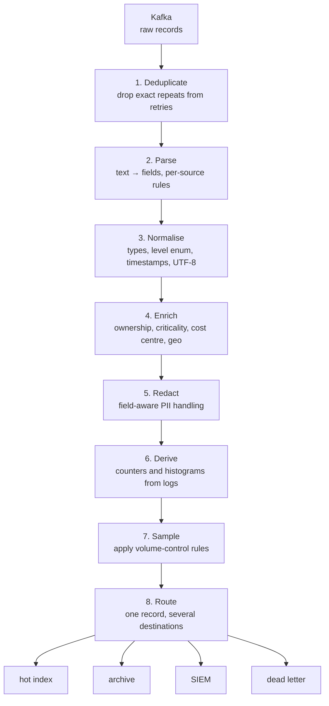
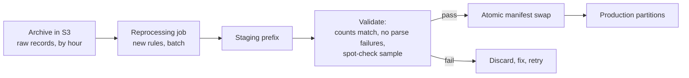

# The Processing Tier

Stage 5. Records are durable in Kafka. Between there and storage sits the tier that turns a
received record into a stored one: parse, deduplicate, enrich, normalise, derive, redact, route.

This is the most *changeable* part of the pipeline. The agent changes quarterly, the buffer
changes yearly, and the processing rules change several times a week — a new parser, a new
enrichment source, a new routing rule, a new redaction pattern. So the dominant design goal here
is not throughput. It is **making change safe**, and that turns out to drive almost every
decision in the doc. Scenario IDs are `P-nn`.

---

## What the tier actually does, in order

Order matters, and the reasons are not all obvious.



**Deduplicate first**, before anything expensive. A duplicate that survives to step 7 has cost
you seven steps of work and will corrupt every derived counter.

**Parse before enrich**, because enrichment keys off parsed fields. And parse before redact,
because field-aware redaction is enormously cheaper and more accurate than scanning raw text —
doc 05 measured redaction at a third of the gateway's CPU precisely because it was scanning
unparsed bytes there.

**Derive before sample.** This is the one people get wrong and it is worth stating plainly: if
you sample first and count second, your counts are wrong by the sampling factor, and if the
sampling rate is dynamic they are wrong by an amount that changes over time. **Count everything,
then keep some of it.** Doc 08 depends on this ordering.

**Route last**, so every destination gets a fully processed record and routing logic never has to
know about processing state.

---

## Stateless versus stateful, and why it decides your technology

Steps 2 through 8 are stateless: each record is processed on its own, with nothing remembered
between records. Step 1 is not — deduplication requires knowing what you have seen. Step 6 is
not either, if you want windowed aggregates.

That single distinction drives the technology choice more than throughput does.

**A stateless tier is a plain Kafka consumer.** Scale it by adding pods. A pod dying loses
nothing because there was nothing to lose. Deploys are trivial. Testing is trivial. The whole
class of problems around checkpointing, state backends, savepoints and exactly-once simply does
not exist.

**A stateful tier needs a stream processor.** Flink, Kafka Streams, Spark Structured Streaming.
You get windowing, joins, and exactly-once semantics — and you take on state backends, savepoint
management, backfill complexity, and a set of failure modes covered nowhere else in this
collection because they belong to the framework.

**The strong recommendation: keep the tier stateless and buy the two stateful things another
way.**

- **Deduplication** does not need a stream processor. A bounded probabilistic filter in each
  pod's memory, scoped to the partitions that pod owns, is enough — derived below.
- **Derived metrics** do not need windowed aggregation in the pipeline. Emit them to a metrics
  system, which is a purpose-built windowed aggregator you already run.

That leaves nothing stateful, and a stateless tier is perhaps a tenth the operational burden of
a Flink deployment. **If you find yourself reaching for Flink in a log pipeline, check first
whether you have accidentally started building a stream-analytics platform**, which is a
different product with a different owner — [`../DataPlatform.md`](../DataPlatform.md) is where
that belongs.

### When a stream processor *is* right

Three cases, and they are genuine:

- **Session reconstruction.** Joining a request's log records into one document, which needs a
  window keyed by trace ID and a timeout.
- **Real-time detection over sequences.** "Five failed logins then a success, from one IP,
  within two minutes." This is a pattern-matching problem over a stream and Flink's CEP is built
  for it.
- **Stream-to-stream joins.** Enriching logs with a rapidly changing stream rather than a
  slow-changing table.

Run these as **separate jobs reading the same topics**, not as part of the main pipeline. The
main pipeline stays stateless, simple and always available; the fancy jobs can fail without
taking log ingestion with them. That separation is worth more than the deduplication of effort
it costs.

---

## Deduplication without a stream processor

Doc 02's `A-02` and doc 05's `T-09` both concluded that at-least-once delivery produces
duplicates and that this is the correct trade. Here is where they get removed.

### The identity

Every record carries a deterministic ID assigned at the agent:

```
record_id = xxhash64(host_id || inode || byte_offset)
```

Exact, free to compute, and stable across retries — the same bytes at the same offset on the
same host always produce the same ID. It does **not** depend on content, so a record that is
legitimately identical to another (two identical log lines) still gets distinct IDs, which is
what you want.

### The filter

A duplicate arises from a retry, and retries are prompt — within seconds, at most minutes. So
the window can be small, which makes an in-memory structure viable.

A **counting Bloom filter** or a **cuckoo filter** over the last N minutes of IDs, per partition:

```
records/s per partition:  5.56M ÷ 300 partitions = 18,533/s
window: 10 minutes     =  18,533 × 600 = 11.1M records
Bloom filter at 1% false positive rate: ~9.6 bits per element
                       = 11.1M × 9.6 ÷ 8 = 13.3 MB per partition
a pod owning 4 partitions: 53 MB
```

Fifty-three megabytes per pod. Affordable.

### The false-positive question, which matters more than the memory

A Bloom filter's false positives mean **you will discard a small number of records that were not
duplicates**. At a 1% false-positive rate that is 1% of your data — completely unacceptable
against a 0.01% loss budget.

Read that again, because it is the trap: the false-positive rate applies to *every lookup*, not
to duplicates. Every one of the 5.56M records per second is tested, and 1% of the *non-duplicate*
ones will be wrongly reported as seen.

Two ways out:

**Tune the rate down.** At 0.001% (10⁻⁵), the filter needs about 24 bits per element:

```
11.1M × 24 ÷ 8 = 33.3 MB per partition, 133 MB per pod
loss from false positives: 5.56M/s × 10^-5 = 56 records/s = 0.001% of volume
```

Within budget, at 2.5× the memory. This is the pragmatic choice.

**Or use an exact structure.** A hash set of 64-bit IDs costs 8 bytes plus overhead — call it 24
bytes per entry in a compact open-addressed table:

```
11.1M × 24 = 267 MB per partition — too much
```

Too expensive at a 10-minute window, affordable at a 60-second one (27 MB), which covers the
overwhelming majority of retries. **A 60-second exact filter plus no probabilistic filter is a
defensible design**, and it is what Lantern uses: it accepts that a retry delayed past 60 seconds
produces a duplicate, and relies on the storage layer's idempotent writes (doc 09) to catch the
rest.

That layering is the general point: **deduplication is cheap for recent duplicates and expensive
for old ones, so handle recent ones here and make the storage write idempotent for the rest.**

### Partition affinity is required

The filter only works if all copies of a record land on the same pod. They do, because doc 06
keys by `pod.uid` and a retry carries the same key — so it lands on the same partition, which is
owned by one consumer. **This is a hidden dependency between the partitioning decision and the
deduplication design**, and if someone later changes the key to round-robin to "improve balance",
deduplication silently stops working. Write it down where the partitioning is configured.

---

## Enrichment, and the lookup problem

Enrichment attaches facts the record did not carry: which team owns this service, what its
criticality tier is, which cost centre to bill, what country an IP maps to, what a tenant's
display name is.

Every one of these is a **join against a slow-changing dimension table**, and the naive
implementation — look it up when you need it — is the most common way to make this tier fragile.

### Why the naive version fails

```
5.56M records/s × 1 lookup each = 5.56M lookups/s
against a service with a 3 ms p99
→ concurrency required = 5.56M × 0.003 = 16,680 in-flight requests
```

Sixteen thousand concurrent requests against a metadata service that normally sees a hundred.
And the moment it slows down, the log pipeline stalls — you have made an internal CRUD service a
hard dependency of log ingestion, which is `P-01` and is exactly the "slow dependency is worse
than a dead one" problem from
[`../MicroservicesPOF/02-synchronous-call-failures.md`](../MicroservicesPOF/02-synchronous-call-failures.md).

### The pattern that works

**Load the dimension into memory; refresh it periodically; never block on it.**

```
service ownership table:  12,400 services × ~200 bytes = 2.5 MB
tenant metadata:              40 tenants × ~2 KB       = 80 KB
criticality tiers:        12,400 entries × 40 bytes    = 500 KB
IP geolocation:           a 60 MB MaxMind-style database
                                                        --------
                                                        ~63 MB per pod
```

Sixty-three megabytes to eliminate 5.56 million lookups per second. Refresh every 60 seconds
from a snapshot in object storage — not from the source service, which keeps the source service
out of the critical path entirely.

Three rules make this safe:

1. **Start with the last known good snapshot on disk**, so a pod can start when the source is
   unavailable. Fail-static, the same principle as doc 02's enrichment rule.
2. **Never block on a refresh.** A failed refresh means you keep serving the old table and
   increment a staleness gauge. Alert when staleness exceeds, say, ten minutes.
3. **Handle misses explicitly.** A service not in the table gets `owner: unknown` and increments
   a counter — it does not get dropped, and it does not get a lookup.

### The staleness cost, which is real

Stale enrichment produces wrong answers quietly. A service that transferred ownership last week
is still attributed to the old team, so pages go to the wrong people and costs are billed
wrongly. `P-02`.

The defence is not fresher data — 60 seconds is already fresh — it is **recording when the
attribution was made**:

```json
{ "owner.team": "payments-core", "owner.resolved_at": "2026-09-30T14:20:00Z" }
```

Now a dispute about attribution is answerable, and a bulk re-attribution of historical data is
possible because you know which snapshot each record used. This is the doc 04 principle again:
when you derive something, record how.

---

## Deriving metrics from logs

Doc 00 argued that any aggregate computed from logs should have been a metric. Reality is that
plenty of useful aggregates only exist in logs — because the emitting code was not instrumented,
because the software is third-party, or because nobody anticipated the question.

The processing tier can produce them, and doing it here rather than at query time is worth a lot:

```
query-time:   scan 480 TB every time someone loads the dashboard
ingest-time:  compute once, store a few hundred time series
```

### What to derive

```
log_records_total{tenant, service, level}           — volume and error rate, always
log_bytes_total{tenant, service}                    — billing, always
http_requests_total{service, method, status_class}  — from access logs
http_request_duration_seconds{service, route}       — histogram, from access logs
log_parse_failures_total{service, parser}           — pipeline health
```

The first two are non-negotiable: they are how doc 16's quotas and doc 19's SLOs work, and they
must be derived *before* sampling so they describe reality rather than the sample.

### The cardinality trap

`P-04`, and it is the same failure as doc 04's `S-01` with a different blast radius.

A derived metric's cardinality is the product of its label cardinalities:

```
http_requests_total{service, method, status_class}
  12,400 services × 7 methods × 5 status classes = 434,000 series      — fine

add route:
  × 200 routes per service average                = 86,800,000 series  — fatal
```

Eighty-seven million series will destroy a Prometheus-style store. And unlike a log field
explosion, which raises costs gradually, **a metric cardinality explosion takes the metrics
system down in minutes** — and the metrics system is what you use to see that the log pipeline is
healthy.

Rules:

- **A fixed, reviewed allow-list of labels per derived metric.** Never derive labels from record
  content dynamically.
- **A hard cardinality cap per metric**, enforced at emission: beyond N series, extra label
  values collapse to `other` and a counter increments.
- **Never use an identifier as a label.** No user ID, trace ID, pod name, or request path with
  an ID embedded in it.

See [`../Observability/05-instrumentation-and-cardinality.md`](../Observability/05-instrumentation-and-cardinality.md)
for the full treatment; the point here is that the *log* pipeline is a new and unexpected way to
blow up the *metrics* pipeline, and the team that owns each is usually not the same.

---

## Routing: one record, several destinations

The last step. A single record may go to several places with different transformations:

```
every record            → archive (Parquet, full fidelity)
level >= INFO,
  and sampling kept it  → hot index (searchable)
logs.audit, or
  security-relevant     → SIEM (different schema, different retention)
parse failed            → dead letter
tenant opted in         → their own S3 bucket
```

### The rule that matters: destinations must not couple

`P-05`, and it is the failure that makes routing worth its own section.

If one writer implements all five destinations and the SIEM is slow, the archive write is delayed
too — one destination's problem has become every destination's. You have recreated the coupling
that doc 06 argued the buffer exists to prevent, one tier later.

Two ways to avoid it, and they are not equivalent:

**Separate consumer groups.** Each destination is its own consumer reading Kafka independently,
with its own offset and its own lag. Complete isolation, at the cost of reading the topic N times
— which doc 06 priced at 0.77 GB/s per group.

**One consumer, independent per-destination queues.** One read, fanned out into bounded queues
with independent backpressure. Cheaper, and the isolation is only as good as the queue bounds:
when a destination's queue fills you must decide whether to block the consumer (coupling
restored) or drop for that destination (isolation preserved, data lost for one destination).

**Lantern uses separate consumer groups for the destinations that must not be coupled** —
archive, index, SIEM — **and per-destination queues within each for variants.** The archive is
separate because it is the irreversible one; the SIEM is separate because it is owned by another
team and its availability is not Lantern's to control.

The general principle, which recurs: **spend a read to buy isolation whenever the destinations
have different owners or different criticality.**

---

## Reprocessing, which is the reason the tier is designed this way

Everything above — stateless, replayable, irreversible operations late — exists so that this
works:

> A parsing rule was wrong for six hours. Fix the rule, reset the offset, reprocess.

For that to be safe rather than terrifying, three properties must hold.

**1. Writes must be idempotent.** Reprocessing writes the same records again. If the storage
layer appends, you now have duplicates in permanent storage. The storage write must be keyed
by something stable so a rewrite replaces rather than adds — doc 09 covers this, and the
mechanism is that an output object's name is a deterministic function of its input range, so
rewriting produces the same object name and overwrites.

**2. Reprocessing must not disturb live ingest.** A reprocessing job reading six hours back is
exactly doc 06's `B-04` — a consumer outside the page-cache window, evicting everyone else's
pages. `P-07`.

The fix is to **reprocess from the archive, not from Kafka**, whenever the data has already been
archived. The archive is in object storage, which has no page cache to evict and infinite read
parallelism. Reprocess from Kafka only for data younger than the archiver's lag, which is
minutes.

**3. Reprocessing output must be separable.** Write reprocessed output to a staging location,
validate it, then swap. A reprocessing job that writes directly over production data and is
itself buggy has turned one problem into two.



The manifest swap is what makes it atomic: queries read a manifest listing the objects for each
partition, so replacing the manifest entry replaces the data for every subsequent query, with no
window where both versions are visible.

---

## Sizing

Per MB/s of raw input:

```
Kafka consume + decompress zstd-1        0.006 cores per MB/s
deduplicate (hash + filter)              0.003
parse                                    0.048    ← dominant
normalise                                0.009
enrich (in-memory lookups)               0.004
redact (field-aware)                     0.007    ← vs 0.021 unparsed at the gateway
derive metrics                           0.006
sample                                   0.001
serialise + route                        0.011
                                         -----
                                         0.095 cores per MB/s
```

```
2,780 MB/s × 0.095 = 264 cores at average
× 1.7 diurnal peak = 449 cores at peak
÷ 8 cores per pod  =  56 pods
+ headroom and AZ loss → 72 pods of 8 cores, 16 GB
```

Two observations.

**Parsing is half the tier**, same as at the agent. Every service that emits structured JSON
removes its share of that cost — which makes doc 04's argument a budget item rather than a
preference.

**Field-aware redaction is a third the cost of unparsed scanning** (0.007 versus 0.021). That is
an argument for moving as much redaction as possible from the gateway to here. The counter-
argument is that the gateway's redaction happens *before* the data is durable, and anything
redacted only here has already been written to Kafka in the clear. Doc 17 resolves it:
**a small always-on pattern set at the gateway for the highest-risk data, and the comprehensive
field-aware rules here** — accepting that the six-hour Kafka window holds unredacted secondary
PII and controlling access to Kafka accordingly.

---

## Making change safe

The stated design goal. Four mechanisms, and they are the real content of this doc.

**1. Rules are data, not code.** Parsers, enrichment mappings, redaction patterns and routing
rules live in a versioned store and are loaded at runtime. A change is a config push, not a
deploy. This is what makes a ten-minute fix possible.

**2. Every rule is unit-tested against fixtures in CI.** A parser has sample inputs and expected
outputs, committed alongside it. `P-09` — a rule deploy breaking parsing for everyone
simultaneously — is prevented here or not at all.

**3. Rules roll out progressively.** A new rule applies to 1% of matching records, then 10%, then
100%, with the parse-failure rate watched at each step. The pipeline runs both old and new for
the 1% and compares — which costs almost nothing and catches the class of bug where the new rule
"works" but produces different fields.

**4. Everything is reversible because the raw bytes survive.** The archive stores the record
*as received*, before parsing, so a rule that was wrong can be re-run against the original input.
Without this, "fix the rule and reprocess" is a sentence with no meaning.

It is not free, and doc 09 prices it: raw text compresses at 4.6:1 against the structured
columns' 11:1, so keeping raw for *everything* multiplies storage by 3.4. The version that is
actually worth buying is scoped — raw kept for the 48-hour hot window, plus every parse failure
permanently, plus a 2% sample — which costs about 5.3% of the hot tier and covers the window in
which parsing bugs are actually found.

That last point deserves emphasis because it is frequently optimised away by someone looking at
a storage bill. **Storing raw alongside parsed is what converts every future parsing mistake from
permanent to temporary.** Doc 09 details the layout.

---

## The processing failure catalogue

| Class | Scenarios |
|---|---|
| **A. Dependencies** | `P-01`, `P-02` |
| **B. Correctness** | `P-03`, `P-04`, `P-10` |
| **C. Coupling and change** | `P-05`, `P-07`, `P-09` |
| **D. Capacity** | `P-06`, `P-08` |

### P-01 · Enrichment lookup stalls the pipeline

**What you see.** Processing lag climbing across all partitions at once. CPU low. Threads waiting
on network.

**Mechanism.** A synchronous lookup per record against an external service. 5.56M/s against
anything with milliseconds of latency is unservable.

**Confirm it.** Thread state in the processor, and request rate at the metadata service — it
will be several orders of magnitude above normal.

**Recover.** Disable the enrichment via config; ship records with the field absent.

**Prevent.** In-memory dimension tables refreshed from an object-storage snapshot, never a
per-record lookup, never a dependency on a live service in the ingest path.

### P-02 · Stale enrichment, wrong attribution

**What you see.** Pages routed to a team that transferred the service away. Cost reports
disputed. Nothing errors.

**Mechanism.** The dimension table refresh failed and the pipeline kept serving the old copy —
which is the correct behaviour, made harmful by not being visible.

**Confirm it.** The staleness gauge: `now − last_successful_refresh`, per pod. Per pod matters —
one pod with a broken refresh produces a fraction of misattributed records, which is harder to
notice than all of them.

**Recover.** Fix the refresh. Optionally re-attribute historical records using
`owner.resolved_at` to identify which need it.

**Prevent.** Alert on the maximum staleness across pods, not the average. Stamp
`owner.resolved_at` on every enriched record.

### P-03 · The deduplication window is wrong

**What you see.** *Too small:* duplicates in storage, derived counters inflated. *Too large:*
processor memory growth, eventually OOM.

**Mechanism.** The window must exceed the maximum retry delay. Agent backoff caps at 30 s, but a
disk-buffered agent recovering from a long outage can replay data hours old, which no reasonable
window covers.

**Confirm it.** Duplicate rate measured at the storage layer — count records sharing a
`record_id` within a partition.

**Prevent.** A short exact window here (60 s) for the common case, plus idempotent storage writes
for the rest. Do not try to solve it entirely in the processor; the memory curve is bad and the
long tail is unbounded.

### P-04 · Derived-metric cardinality explosion

**What you see.** The metrics backend degrading or refusing writes. Dashboards for the *log*
pipeline going blank, which is the worst possible timing.

**Mechanism.** A label derived from record content with unbounded values.

**Confirm it.** Series count per metric name, trended. Any derived metric climbing monotonically
is this.

**Recover.** Drop the offending metric at the processor. ⚠️ Removing labels does not immediately
reduce the backend's load — existing series remain until they expire — so also shorten retention
on the affected metric if the backend supports it.

**Prevent.** A reviewed label allow-list per metric, a hard cardinality cap that collapses to
`other`, and never an identifier as a label.

### P-05 · A slow destination blocks a fast one

**What you see.** Archive lag rising when the only thing wrong is the SIEM.

**Mechanism.** Shared consumer, shared thread pool, unbounded coupling.

**Confirm it.** Per-destination write latency, and whether the lags move together. Lags that move
in lockstep for unrelated destinations are the tell.

**Prevent.** Separate consumer groups for destinations with different owners or criticality.
Where a shared consumer is used, bounded per-destination queues with an explicit drop policy —
and the drop must be per destination, never global.

### P-06 · Lag measured in records hides the problem

**What you see.** Lag looks stable at 400,000 records. Data is forty minutes stale.

**Mechanism.** Record-count lag means different things at different times of day, and different
things for topics with different record sizes. Exactly the argument in
[`../Kafka/06-lag-backpressure-and-poison-messages.md`](../Kafka/06-lag-backpressure-and-poison-messages.md).

**Prevent.** Export lag in **time** — `now − event_time_of_last_processed_record` — computed in
the consumer, per partition, and alert on the maximum across partitions rather than the sum.
Record-count lag is for capacity planning; time lag is for alerting.

### P-07 · Reprocessing disturbs live ingest

**What you see.** Starting a reprocessing job degrades the whole cluster: producer latency up,
all consumers slower.

**Mechanism.** Doc 06's `B-04`. The reprocessing consumer reads outside the page-cache window.

**Recover.** Stop the job. ⚠️ Do not parallelise it to finish faster — that makes the eviction
worse.

**Prevent.** Reprocess from the archive in object storage, not from Kafka, for anything older
than the archiver's lag. If Kafka reprocessing is unavoidable, apply a client read quota so the
job is rate-limited rather than the cluster being degraded.

### P-08 · Unbounded operator state

**What you see.** A stateful job's memory or state-backend size growing without limit.
Checkpoints taking longer each time until they time out.

**Mechanism.** A keyed state with no expiry — sessions keyed by trace ID where some traces never
complete, so their state is never cleaned up.

**Prevent.** Every keyed state needs a time-to-live. Every window needs a maximum lateness after
which it is closed and emitted regardless. And — the structural fix — keep the main pipeline
stateless, so this whole class is confined to the separate jobs where it can fail alone.

### P-09 · A rule deploy breaks everyone at once

**What you see.** Parse-failure rate jumping from 0.2% to 60% across all tenants within a minute
of a configuration change.

**Mechanism.** A shared rule — a normalisation step, a base parser, a redaction pattern — changed
and applied to 100% of traffic immediately.

**Confirm it.** Parse-failure rate against config-change timestamps. Keep those on the same
dashboard; the correlation is instant and unmistakable.

**Recover.** Roll the config back, which should be a single versioned pointer change taking
seconds. Then reprocess the affected window from the archive.

**Prevent.** Progressive rollout with automatic rollback on a parse-failure threshold. CI
fixtures for every rule. And treat the config store as a deployment artefact with the same review
requirements as code — because it is code, with a faster and less supervised path to production.

### P-10 · Late data after the window closed

**What you see.** Records with event times inside an already-exported window arriving after the
export ran. The analytics team's Monday figures differ from the same query run on Tuesday.

**Mechanism.** An agent buffered for hours and flushed. Doc 00's event-time versus ingest-time
problem, arriving at the tier that has to decide about it.

**Prevent.** This is a policy decision, not a bug, and it must be made explicitly:

- Partition by **ingest** time, so partitions close and never change. Late records land in a
  later partition, correctly.
- Publish a **watermark** — "all data with ingest time before T is complete" — and let consumers
  decide how long to wait.
- Set a **maximum lateness** (Lantern: 48 hours) beyond which a record's event time is clamped
  and flagged.

Doc 14 builds the export semantics on top of exactly these three, and doc 15 measures how much
data actually arrives late so the bound is chosen from data rather than from intuition.

---

## What to take away

1. **The processing tier's design goal is safe change, not throughput.** Rules change several
   times a week; everything else changes yearly.
2. **Order the steps deliberately.** Deduplicate before spending work, parse before enriching and
   redacting, and — the one people get wrong — **derive counters before sampling**, or every
   metric is wrong by a factor that moves.
3. **Keep the main pipeline stateless.** Deduplication and derived metrics do not need a stream
   processor, and a stateless tier is roughly a tenth the operational burden.
4. **Run genuinely stateful work as separate jobs on the same topics**, so their failures cannot
   take log ingestion with them.
5. **A Bloom filter's false-positive rate applies to every lookup, not to duplicates.** At 1% you
   would discard 1% of good data. Either tune to 10⁻⁵ or use a short exact window and make
   storage writes idempotent.
6. **Never look up per record.** Load dimension tables into memory from an object-storage
   snapshot, refresh on a timer, start from the last known good copy, and never block on a
   refresh.
7. **Stamp how you derived things.** `owner.resolved_at` turns an attribution dispute from an
   argument into a query.
8. **The log pipeline is an unexpected way to destroy your metrics pipeline.** Derived-metric
   labels need a reviewed allow-list and a hard cardinality cap, because that explosion is
   minutes to failure, not weeks to a higher bill.
9. **Spend a read to buy isolation.** Destinations with different owners or criticality get their
   own consumer groups; shared consumers couple their failures.
10. **Reprocess from the archive, not from Kafka.** Object storage has no page cache to evict, so
    a reprocessing job cannot degrade live ingest.
11. **Make reprocessing safe with idempotent, deterministically named writes and a staging-then-
    atomic-manifest-swap**, so a buggy reprocess does not become a second incident.
12. **Store the raw record alongside the parsed one — but scope it.** Universal raw retention
    costs 3.4× storage, because raw text cannot use the dictionary encoding that makes columnar
    cheap. Hot window plus all parse failures plus a 2% sample costs 5.3% and still makes every
    parsing mistake recoverable.

Next: [08-sampling-filtering-and-volume-control.md](08-sampling-filtering-and-volume-control.md),
which is the biggest cost lever in the entire collection.
