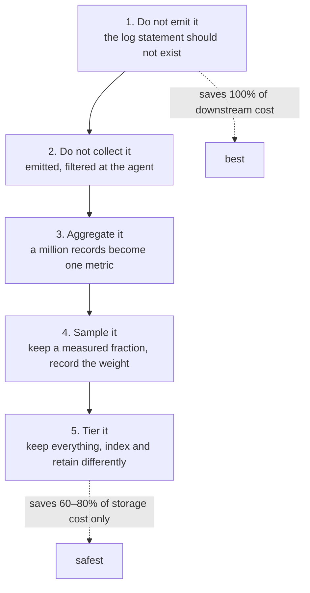
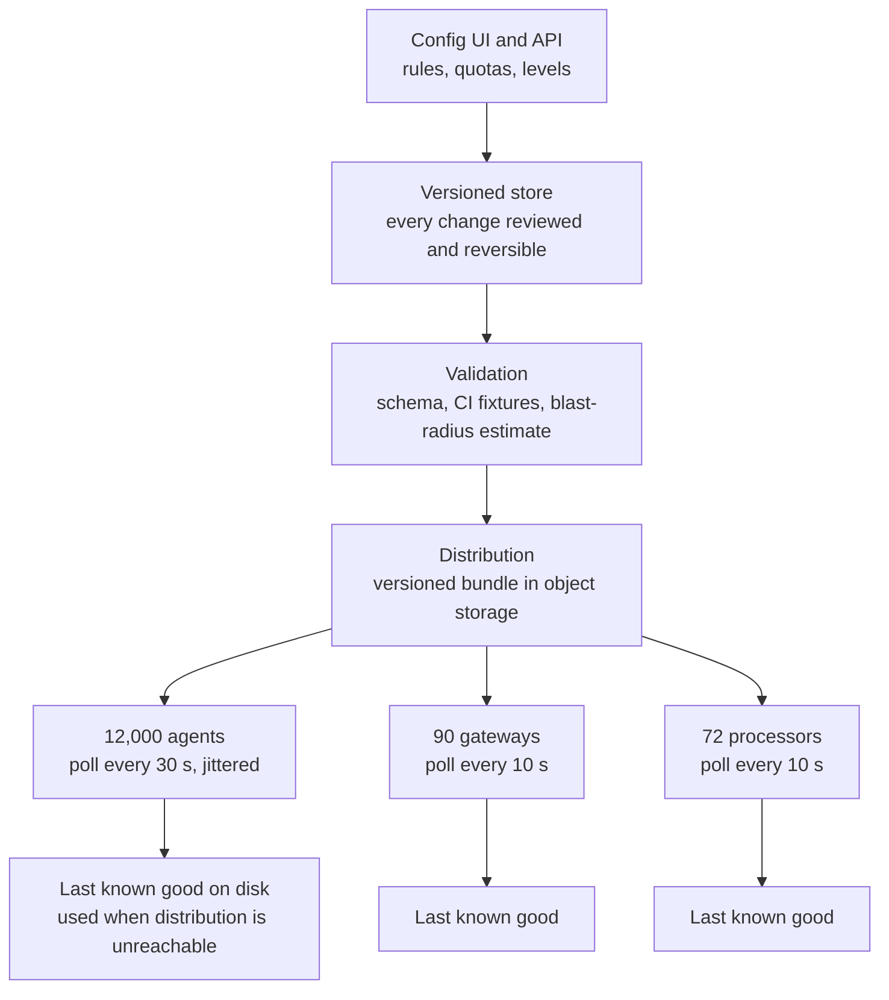

# Sampling, Filtering, and Volume Control

This is the highest-leverage doc in the collection. Everything else optimises how efficiently you
handle 10 TB per hour. This one is about handling less than 10 TB per hour, and the arithmetic is
not close: a 40% volume reduction saves more money than every other optimisation in this
collection combined, and 40% is achievable without losing anything anybody would miss.

It is also the most dangerous doc, because volume control means **deliberately not having data**,
and the failure mode is discovering that during an incident. So the second half is about doing it
in ways that are reversible, measurable, and honest about what was discarded. Scenario IDs are
`V-nn`.

---

## The money, first

Doc 20 assembles the full bill. The part that scales linearly with volume:

```
cross-zone network                   $106,272/month
hot tier and query nodes              $64,000/month
buffer tier (Kafka)                   $38,400/month
storage (warm + cold + requests)      $48,217/month
processing + gateway compute          $29,380/month
agents + compaction                    $7,511/month
                                     ----------------
volume-proportional cost             $293,780/month
                                      = $29,378 per TB/hr of sustained ingest
```

So every 1 TB/hr you do not ingest is about **$29,400 a month**, or $353,000 a year. Reducing
from 10 to 6 TB/hr saves $117,500 a month.

Now compare against the engineering options. Doubling compression efficiency — a hard project —
saves perhaps $40,000. Switching to a more efficient agent saves $5,700 (doc 03). Moving to a
cheaper storage tier saves maybe $15,000.

**Deleting data you do not need beats all of them together, and it is usually the easiest.**

---

## The hierarchy of interventions

Five levels, in order of decreasing value and increasing safety. Work down, not up: the cheap,
safe interventions at the bottom are where people start, and the expensive, valuable ones at the
top are where the money is.



### Level 1 — the log statement should not exist

The cheapest byte is the one never written. It also costs nothing downstream: no agent CPU, no
network, no buffer, no index, no storage, no query-time scanning.

Candidates, and at Lantern these turn out to be a large fraction of application-log volume:

- **Health-check access logs.** A Kubernetes liveness probe every 10 seconds against 140,000
  containers is **14,000 requests/s** of pure noise. If each produces an access log at 380 bytes,
  that is 5.3 MB/s = 46 GB/day = 1.4 TB/month for data that has never once been useful.
- **"Entering function X" / "Leaving function X".** Tracing exists. These are a worse version of
  it that costs more.
- **Logging inside loops.** One line per row of a result set. This is the single biggest source
  of accidental volume incidents.
- **Successful cache hits, successful validations, successful anything routine.** If it happens
  a million times an hour and nobody looks at it, it is a counter, not a log.
- **Duplicate logging at every layer.** A framework logs the request, middleware logs it, the
  handler logs it, the client logs the response. Four records for one event.

How to actually get this done, because "tell teams to log less" does not work: **give every team
a monthly report showing their top ten log statements by volume, with the source file and line
number, the cost of each, and how many times anyone has searched for it.** That last column is
the persuasive one. A statement producing 400 GB a month that has been matched by zero searches
in six months is an easy delete, and the team deletes it themselves.

Deriving the source location requires the emitting library to include it, which is a small
instrumentation change with a large payoff.

### Level 2 — emitted but not collected

Sometimes you cannot change the code — third-party software, a team with no capacity, a library
that logs on its own. Drop it at the agent, which saves everything except the application's own
CPU.

```yaml
# Fluent Bit, at the node
[FILTER]
    Name    grep
    Match   kube.*
    Exclude log ^.*GET /healthz.*$

[FILTER]
    Name    grep
    Match   kube.var.log.containers.*_kube-system_*
    Regex   level (WARN|ERROR|FATAL)
```

**Two cautions.** First, this is stage 2, before the durable buffer, so it is irreversible — a
rule that drops too much loses data permanently. Keep the rules few, obvious and heavily
reviewed, and prefer level 3 or 4 for anything subtle.

Second, **count what you drop, by rule**. An agent that silently discards 30% of a service's
output will eventually cause a two-hour investigation into "why are there no logs". Export
`records_dropped_total{rule}` and show it to the owning team.

### Level 3 — aggregate it

The best intervention for high-volume, low-information records, because it **loses no
information anybody was actually using**.

An access log for a successful request contains: the route, the status, the latency, the size.
Nobody reads individual successful access logs; they read aggregates of them. So aggregate at
ingest:

```
1,000,000 access-log records in a minute
  → http_requests_total{service, route, status_class}      +1,000,000
  → http_request_duration_seconds{service, route}          histogram
  → http_response_bytes_total{service, route}              +sum
  = a few dozen time-series updates instead of 1,000,000 stored records
```

**Keep the failures individually** — 4xx and 5xx are what people investigate — and aggregate the
successes. The split is usually around 98/2:

```
Lantern access logs:       1.25 GB/s
success rate:              97.8%
aggregate the successes:   1.25 × 0.978 = 1.22 GB/s eliminated
keep the failures:         1.25 × 0.022 = 27.5 MB/s retained
```

**That single change removes 44% of Lantern's total ingest.** It is by far the largest available
intervention, and the reason it is not universally applied is that it requires someone to decide
that successful access logs are not worth keeping individually — a decision people are
uncomfortable making because it feels like losing data.

The honest framing of that discomfort: you are trading the ability to answer "show me this exact
successful request from three hours ago" for $129,000 a month. Keep a small uniform sample —
0.5% — so that question remains answerable for a subset, and the trade becomes easy.

### Level 4 — sample it

Keep a measured fraction, record the weight, and accept statistical rather than exact answers.
This is the subtle one and it gets the rest of the doc.

### Level 5 — tier it

Keep everything, but index less of it and move it to cheaper storage faster. Saves storage and
indexing cost, not ingest, network or processing cost — so it is the weakest lever, and also the
one with no downside. Doc 09 covers it.

---

## Sampling, done correctly

Sampling is easy to do and easy to do in a way that silently corrupts every number derived from
the data afterwards. Four rules.

### Rule 1: record the weight, or your counts are fiction

If you keep 1 record in 100, that record **represents 100 records**. Store that:

```json
{ "body": "cart priced", "service": "pricing-api", "sample.rate": 0.01, "sample.weight": 100 }
```

Every count, sum and rate computed afterwards must multiply by the weight:

```sql
-- wrong: counts records you kept
SELECT service, count(*) FROM logs WHERE level='ERROR' GROUP BY service

-- right: estimates records that existed
SELECT service, sum(sample_weight) FROM logs WHERE level='ERROR' GROUP BY service
```

`V-01` is what happens when this is not done: after sampling is enabled, every dashboard built on
log counts drops by the sampling factor, and the first interpretation is always "traffic fell" or
"the pipeline is broken".

**Make the weight impossible to ignore.** Options, in order of robustness: a query layer that
rewrites `count(*)` into `sum(sample_weight)` automatically; a stored view that exposes only
weighted aggregates; or, at minimum, a warning in the UI whenever a result set contains any
record with a weight above 1.

### Rule 2: sample consistently, not independently

Independent random sampling at each service destroys traces. A request touching five services,
each keeping 10% independently:

```
P(all five kept) = 0.1^5 = 0.00001
```

One trace in a hundred thousand survives complete. `V-03`. Every other trace is a partial
fragment, which is worse than nothing — an engineer looking at three of five services will draw
conclusions about where the request went that are wrong.

**Consistent sampling** makes the decision a deterministic function of the trace ID:

```
keep = ( xxhash64(trace_id) mod 1_000_000 ) < ( rate × 1_000_000 )
```

Every service computes the same answer with no coordination. Ten percent of traces are kept
**completely**, and the rest are dropped completely. Same volume reduction, vastly more useful
output.

Use the trace ID where one exists and the request ID or session ID where one does not. What
matters is that the key is **shared across everything that must be kept together**.

### Rule 3: sample the common, keep the rare

Uniform sampling is the wrong shape for logs, because log value is inversely proportional to
frequency. The millionth identical `INFO` tells you nothing; the only `ERROR` in an hour is the
whole investigation. `V-02`.

**Dynamic sampling** varies the rate by key. Group records by a key — service, plus status, plus
error code, say — and set each group's rate from its own volume:

```
rate(key) = min(1.0, target_per_key / observed_rate(key))
```

With `target_per_key = 10` records per second:

```
key                                   observed     rate     kept
checkout-api / 200 / -                45,000/s    0.00022    10/s
checkout-api / 404 / not_found           380/s    0.0263     10/s
checkout-api / 500 / db_timeout            4/s    1.0          4/s
checkout-api / 500 / pool_exhausted      0.2/s    1.0        0.2/s
```

**Every distinct thing that is happening is represented, at roughly equal volume, and the rare
failures are kept completely.** Total volume for this service drops from 45,384/s to 24.2/s — a
99.9% reduction — while every error is fully retained.

This is the single most effective sampling technique there is, and it is underused because it
requires maintaining per-key rates. Which brings the fourth rule.

### Rule 4: bound the key space, and damp the feedback

Dynamic sampling maintains state per key, so the key space must be bounded — the same rule as doc
04's `S-01` and doc 07's `P-04`. Use a **fixed, reviewed key formula** (service, status class,
error code) and cap the number of tracked keys, collapsing overflow into a shared bucket.

And damp the rate adjustment, or you get `V-04`: a key's volume rises, the rate drops, the
observed rate (now sampled) falls, the rate rises again, oscillating with a period of the
adjustment interval. Two fixes, both needed:

- **Measure the observed rate *before* sampling**, not after. This is the doc 07 ordering rule
  and it removes the feedback loop entirely.
- **Move rates gradually** — exponentially weighted, adjusted at most every 30 seconds, and
  limited to a factor of 2 per step.

### Head versus tail sampling

**Head sampling** decides at the start, before knowing the outcome. Cheap, decided at the agent,
and it cannot be outcome-aware: you cannot "keep all requests that ended in an error" because you
do not yet know.

**Tail sampling** buffers everything for a request, waits for it to finish, then decides with
full knowledge. Enormously more useful — keep every error, every slow request, and 1% of the
rest — and much more expensive, because you must buffer every in-flight request and route all of
a request's records to the same decision point.

```
buffer for tail sampling:
  in-flight requests at Lantern ≈ 180,000
  average records per request    ≈ 9
  average record size            = 494 B
  buffer = 180,000 × 9 × 494 B   = 800 MB, plus a 30 s timeout window
```

Eight hundred megabytes is affordable — but the *routing* requirement is the hard part: every
record of a trace must reach the same decision-making pod, which means consistent hashing on
trace ID across the tail-sampling tier, and a rebalance of that tier drops in-flight decisions.

**The practical answer is both.** Head-sample aggressively for the obviously-uninteresting
(healthy access logs, `DEBUG` from healthy services), and tail-sample the rest so anything that
failed or was slow is kept whole.

### What must never be sampled

A short, explicit, enforced list:

```
level >= ERROR                    — never sampled
audit and security records        — never sampled, never dropped, separate quota
anything tagged sampling.exempt   — service teams may mark critical paths
financial and compliance records  — separate path entirely, doc 17
records already flagged anomalous — by any upstream detection
```

The enforcement must be in the pipeline, not in configuration a rule can override. A sampling
rule that accidentally matches `ERROR` records is one config typo away, and `V-06` — a quota
silently dropping audit logs — is a compliance incident, not an operational one.

---

## Quotas: the other half of volume control

Sampling reduces volume you chose to reduce. Quotas bound volume you did not choose — the 31×
incident spike, the debug statement in a loop, the new team that has not learned yet.

### The structure

Three levels, each with a different response:

```
1. Soft limit    (100% of committed volume)   → notify the owning team, no action
2. Hard limit    (150% of committed)          → sample aggressively, keep ERROR whole
3. Emergency     (300% of committed)          → drop all below WARN, page the team
```

The middle level is the important one and the reason a quota system is worth building. A naive
quota drops everything above a threshold, which during an incident discards exactly the records
that explain it. **A graded quota degrades the tenant's data quality instead of removing it**,
and it does so in the order established in doc 02: `TRACE`, `DEBUG`, low-value `INFO`, `INFO`,
`WARN`, and `ERROR` last.

### Where quotas are enforced

Everywhere, because each location catches something the others cannot:

| Where | Catches | Cannot catch |
|---|---|---|
| Agent, per container | one pod flooding a node (`A-09`) | a tenant's aggregate across pods |
| Gateway, per tenant | a tenant's aggregate, with trusted identity | anything already dropped at the agent |
| Processing, per service | a single service within a tenant | — |
| Storage, per tenant per day | cumulative overage from sustained excess | anything in-flight |

The gateway is the primary enforcement point because it is the first place with a trusted
`tenant.id` (doc 04) and a global view of that tenant's rate.

### Making a quota system politically survivable

A quota that drops a team's data will produce an argument. Four things make that argument
tractable, and they are as important as the mechanism:

1. **The team sees their usage against their limit, continuously**, not for the first time when
   they are throttled.
2. **Warnings arrive well before enforcement** — at the soft limit, with the top contributors
   named by source file and line.
3. **Raising a limit is quick and normal**, not an escalation. A team with a legitimate need
   should get more, and the request should be self-service up to some bound.
4. **Overage is billed, not just blocked.** A team willing to pay for 3× volume should be able
   to. This converts a policy fight into an economic decision, and economic decisions are made
   faster and with less resentment.

### Deriving Lantern's quota headroom

If every tenant's hard limit is 150% of committed volume, and all 40 tenants hit it
simultaneously, the platform must absorb 1.5× — which it cannot, because it is provisioned for
1.7× diurnal peak and that is already consumed.

The resolution is that quotas are **not** all exercisable at once, and the design must say so
explicitly:

```
committed volume, all tenants:      10 TB/hr
sum of hard limits (150% each):     15 TB/hr
platform capacity (1.7× diurnal):   17 TB/hr
worst realistic case:               one large tenant at 300% emergency
                                    = 10 + (1.6% × 2 × 10)  ≈ 10.3 TB/hr for Riverbend
                                    = 10 + (18% × 2 × 10)   ≈ 13.6 TB/hr for the largest
```

Thirteen point six is inside seventeen. **The platform is safe against any one tenant's
emergency, and not against all of them at once** — which is the correct and honest place to land,
and it should be written down rather than discovered. The mitigation for the correlated case is
platform-level shedding (doc 18), which drops `logs.access` globally before it drops anything
else.

---

## The control plane

Sampling rules, quotas, log levels and filters are configuration that must reach 12,000 agents,
90 gateways and 72 processors quickly and safely. That is a control plane, and it is a single
point of failure people forget to design (doc 00, and
[`../MicroservicesPOF/05-service-discovery-and-the-control-plane.md`](../MicroservicesPOF/05-service-discovery-and-the-control-plane.md)).



Five properties, each preventing a specific failure:

**Fail-static.** A component that cannot fetch configuration keeps using the last version it
successfully loaded. It never falls back to defaults, and never stops. The control plane being
down must not affect the data plane — otherwise a config-service outage becomes a total ingest
outage, which is `V-07` at its worst.

**Versioned and reversible.** Every change is a new immutable version; rollback is repointing to
the previous one. Seconds, not a redeploy.

**Validated before distribution.** Schema checks, CI fixtures (doc 07), and — the one that is
specific to this domain — a **blast-radius estimate**: "this rule matches 34% of platform volume
across 12 tenants". A human seeing that number before approving catches most of the bad changes.

**Progressive.** A new rule reaches 1% of agents, then 10%, then 100%, with volume and
parse-failure rates watched between stages. Automatic rollback on a threshold breach.

**Observable.** Every component reports the config version it is running. A histogram of versions
across the fleet shows a rollout progressing and — more usefully — shows the 40 agents stuck on
a version from three weeks ago because their polling broke.

### Jitter, again

Twelve thousand agents polling every 30 seconds is 400 requests/s, which is fine. Twelve thousand
agents polling at `:00` and `:30` is 12,000 requests in two seconds, twice a minute, which is
not. Jitter the poll interval by ±20% — the same lesson as doc 05's reconnect storm and
[`../K8s/cronJobs`](../K8s/cronJobs/README.md)'s thundering herd.

---

## Putting it together: what Lantern actually saves

Apply the hierarchy to the doc 01 source breakdown:

| Source | Before | Intervention | After |
|---|---|---|---|
| Edge and CDN access logs | 0.86 GB/s | aggregate successes, keep 4xx/5xx and 0.5% of successes | 0.031 GB/s |
| Service mesh access logs | 0.39 GB/s | aggregate successes, keep failures | 0.014 GB/s |
| Mobile and web telemetry | 0.50 GB/s | head-sample 25%, keep all errors | 0.128 GB/s |
| Batch and ETL (Spark) | 0.31 GB/s | drop executor `INFO` at the agent, keep driver | 0.062 GB/s |
| Application logs | 0.58 GB/s | dynamic sampling, keep all `ERROR` | 0.180 GB/s |
| Infrastructure | 0.14 GB/s | filter health checks and routine kubelet chatter | 0.070 GB/s |
| **Total** | **2.78 GB/s** | | **0.485 GB/s** |

```
reduction: 1 − (0.485 ÷ 2.78) = 82.5%
cost:      $293,780/month × 0.175 = $51,412/month
saving:                             $242,368/month  =  $2.9M/year
```

**An 82.5% reduction.** That number should be treated with suspicion, and here is the honest
accounting of what it costs:

- Individual successful access logs are gone except for a 0.5% sample. "Show me this exact
  successful request" is answerable for 1 in 200 requests. **This is the big one**, and it is the
  intervention most organisations reject.
- Mobile telemetry is a 25% sample, so client-side volume figures are estimates with a 4× weight.
- Spark executor `INFO` is gone, so debugging a job means turning it back on and rerunning.
- Application `INFO` is dynamically sampled, so "show me everything this service did" returns a
  representative subset, not everything.
- Every `ERROR`, every `WARN`, every audit record, and every trace that contained a failure is
  **fully retained**.

A more conservative programme — aggregate access logs but keep a 5% sample, sample applications
at a 100-per-key target instead of 10 — lands around 55% reduction and $162,000 a month, with
most of the discomfort removed. **Both are defensible; the point is to make the choice
explicitly, with the price of each concession visible**, rather than defaulting to "keep
everything" because nobody wanted to decide.

---

## The volume-control failure catalogue

| Class | Scenarios |
|---|---|
| **A. Statistical correctness** | `V-01`, `V-03`, `V-05`, `V-08` |
| **B. Keeping the wrong things** | `V-02`, `V-06`, `V-09` |
| **C. Control and visibility** | `V-04`, `V-07`, `V-10` |

### V-01 · Counts are wrong because weights were ignored

**What you see.** Dashboards drop by the sampling factor the moment sampling is enabled. Error
rates appear to fall. Someone concludes a deploy fixed something.

**Mechanism.** `count(*)` over sampled data counts what you kept.

**Confirm it.** Compare a log-derived count against the equivalent metric from the metrics
system. They should agree within a few percent; a clean factor-of-N divergence is this.

**Recover.** Rewrite queries to use `sum(sample_weight)`.

**Prevent.** Automatic rewriting in the query layer, or views that expose only weighted
aggregates. Never rely on every engineer remembering.

### V-02 · The rare error was sampled away

**What you see.** An investigation finds no trace of a failure a user definitely experienced.

**Mechanism.** Uniform sampling applied to a class containing rare events.

**Prevent.** Never sample `ERROR` and above. Use dynamic sampling so low-frequency keys are kept
at 100%. Provide `sampling.exempt` so teams can protect specific paths, and audit who uses it —
an exemption on a high-volume path is how the whole system gets bypassed.

### V-03 · Partial traces

**What you see.** A trace with three of eight spans. The gap looks like a service that was never
called.

**Mechanism.** Independent sampling per service. `0.1^5 = 0.00001`.

**Confirm it.** Distribution of span count per trace. A healthy system has a tight distribution
matching the call graph; independent sampling produces a broad one with a mode far below the
expected depth.

**Prevent.** Consistent sampling keyed on trace ID, with the same rate and same hash across all
services. Verify with a canary request through a known path.

### V-04 · Dynamic sampling oscillates

**What you see.** A key's sampling rate swinging between extremes every adjustment interval;
record volume sawtoothing.

**Mechanism.** The observed rate is measured *after* sampling, so reducing the rate reduces the
observation, which raises the rate. A control loop with its own output as its input.

**Prevent.** Measure before sampling (doc 07's ordering). Damp adjustments: exponentially
weighted average, 30-second minimum interval, at most 2× change per step.

### V-05 · Metrics derived after sampling

**What you see.** Log-derived metrics disagreeing with application-emitted metrics by the
sampling factor, and the disagreement moving as dynamic rates move.

**Mechanism.** Derivation placed after sampling in the pipeline.

**Prevent.** Derive before sample, always. This is a pipeline-ordering invariant worth asserting
in a test.

### V-06 · A quota drops audit logs

**What you see.** Nothing, until an audit. Then a gap in the security record, which is a
compliance finding rather than an operational one.

**Mechanism.** A tenant hit its quota and the enforcement was volume-based without regard to
record class.

**Confirm it.** Cross-check audit record counts against an independent source — the number of
authentication events the identity service recorded, for instance.

**Prevent.** Audit and security records on a separate topic (doc 06's `logs.audit`), a separate
quota, and exemption from every sampling and shedding path — enforced in code, not
configuration. This is the one place in the collection where "never drop" is the right policy,
and the cost is trivial because the volume is 0.07% of the platform.

### V-07 · A bad rule reaches everything at once

**What you see.** Platform-wide volume collapsing, or spiking, within a minute of a config
change.

**Mechanism.** A rule with a broader match than intended, distributed to 100% immediately.

**Recover.** Roll back the config version. Then assess: if volume *collapsed*, data was dropped
irreversibly at the agent and is gone; if it was dropped after the buffer, reprocess.

**Prevent.** Blast-radius estimate shown before approval. Progressive rollout with automatic
rollback. And keep agent-level filtering minimal, so the irreversible layer has the fewest and
simplest rules.

### V-08 · A rate change invalidates historical comparison

**What you see.** A year-over-year or week-over-week comparison showing a step change that
corresponds to a sampling change, not to reality.

**Mechanism.** Weighted counts are correct at every instant, but if the weight is not stored the
history cannot be re-weighted. Or the weight is stored and the comparison query does not use it.

**Prevent.** Always store `sample.rate` per record, never as external metadata — the record must
carry its own weight so it remains interpretable forever. Keep a changelog of sampling policy
with timestamps, and surface a marker on any chart crossing a policy change.

### V-09 · Dropped at the source, needed for an investigation

**What you see.** A security or compliance investigation needs data that was filtered at the
agent six weeks ago.

**Mechanism.** Level 2 intervention is irreversible.

**Prevent.** Keep agent-level dropping to categories that are provably worthless (health checks
with a 200 status). Anything with a plausible investigative use should be sampled or tiered
instead, so a fraction survives. And have a documented **emergency capture mode**: a control-plane
switch that disables all sampling and filtering for a named service or tenant, taking effect in
under a minute. Its existence changes the risk calculus of every other decision here, because
"we can turn it all back on" makes aggressive defaults safe.

### V-10 · Nobody knows what is being dropped

**What you see.** A question with no answer: "are we keeping payment-api's debug logs?" Nobody
is sure, and finding out means reading four configuration layers.

**Mechanism.** Volume control applied at five stages by three teams, with no consolidated view.

**Prevent.** A single **"what happens to my logs" view**, per service: for a given service, show
every rule that applies at every stage, the effective sampling rate by level, the current quota
and usage, and the measured retained fraction. One page. This is unglamorous and it is the
difference between a volume-control system people trust and one they route around.

Alongside it, publish the measured end-to-end retention ratio per service — `records stored ÷
records emitted` — which is the empirical answer rather than the configured one, and which
catches every case where the configuration does not do what it says.

---

## What to take away

1. **Volume reduction beats every other optimisation combined.** At about $29,400 per TB/hr per
   month, an 82.5% reduction is $2.9M a year — more than compression, agent choice and storage
   tiering put together.
2. **Work down the hierarchy: do not emit, do not collect, aggregate, sample, tier.** The value
   decreases and the safety increases as you go; most teams start at the bottom and never reach
   the top, which is where the money is.
3. **Aggregating successful access logs is the single largest lever** — 44% of Lantern's total
   ingest — and it is rejected for emotional rather than technical reasons. Keep a 0.5% sample
   and the trade becomes easy.
4. **Give teams a monthly report of their top statements by volume, with source location and
   the number of times anyone searched for each.** The search column is what makes deletion
   happen.
5. **Always store the sampling weight in the record**, and make the query layer use it
   automatically. A count over sampled data without weights is fiction.
6. **Sample consistently on trace ID, never independently per service** — five services at 10%
   independently keeps one trace in a hundred thousand whole.
7. **Sample the common and keep the rare.** Dynamic per-key rates targeting a fixed records-per-
   second give 99.9% reduction while retaining every distinct failure.
8. **Measure rates before sampling**, or the control loop oscillates and every derived metric is
   wrong.
9. **Graded quotas degrade data quality; naive quotas delete the incident.** Shed `TRACE`,
   `DEBUG` and routine `INFO` in order, and never `ERROR`.
10. **Audit and security records are never sampled, never dropped, and enforced in code** — they
    are 0.07% of volume and 100% of your compliance position.
11. **The control plane must be fail-static, versioned, validated with a blast-radius estimate,
    progressive, and observable.** A config service outage must never become an ingest outage.
12. **Build the emergency capture switch.** Being able to turn all sampling off for one service
    in under a minute is what makes aggressive defaults defensible everywhere else.

Next: [09-storage-tiers-and-file-formats.md](09-storage-tiers-and-file-formats.md), where what
survives all of this finally lands on disk.
