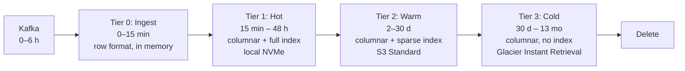
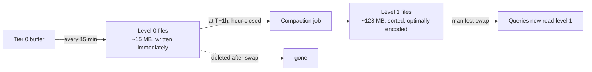

# Storage Tiers and File Formats

Stage 6, first half. Records have been parsed, enriched and sampled. Now they have to land
somewhere that is cheap enough to keep for thirteen months and fast enough to search in two
seconds — which are contradictory requirements, and the resolution is that **no single tier does
both**. Scenario IDs are `W-nn`.

This doc covers where bytes go and in what shape. Doc 10 covers how you find them without
reading everything.

---

## Why tiers, derived rather than assumed

Doc 00 gave the query-age distribution. Put it next to the data volume and the argument makes
itself:

| Data age | Share of queries | Volume stored | Queries per stored TB |
|---|---|---|---|
| 0–15 min | 48% | 227 GB | **2,114** |
| 15 min – 1 h | 24% | 682 GB | 352 |
| 1 h – 24 h | 16% | 21.8 TB | 7.3 |
| 1–7 days | 7% | 131 TB | 0.53 |
| 7–30 days | 3% | 502 TB | 0.06 |
| 30 d – 13 mo | 2% | 8,066 TB | **0.0002** |

Check one row: 15 minutes of storage is `253 MB/s × 900 s = 228 GB`. ✓

**The ratio between the top and bottom rows is ten million to one.** Data under fifteen minutes
old is queried ten million times more per terabyte than data over a month old. There is no single
storage configuration that is sensible for both: anything fast enough for the top row is
unaffordable for the bottom, and anything cheap enough for the bottom is unusable for the top.

That is the entire argument for tiering, and it says something stronger than "use cheaper storage
for old data". It says **the tiers should use different technology, different formats, different
indexes and possibly different query engines**, because they are serving workloads that differ by
seven orders of magnitude.

---

## The four tiers



### Tier 0 — ingest buffer, 0 to 15 minutes

The freshest data, where half the queries go. It cannot be columnar, because columnar formats
need a batch of rows to be worth writing, and batching means waiting.

**Row-oriented, in memory, on the writer nodes**, with a write-ahead log on local disk for
crash recovery. Records are appended as they arrive and are queryable immediately. Every 15
minutes (or when a size threshold is hit) the buffer is converted to columnar and handed to
tier 1.

```
15 min × 253 MB/s = 228 GB compressed, or ~1.05 TB uncompressed in memory
across 24 writer nodes = 44 GB per node
```

Forty-four gigabytes of memory per node is affordable on a 128 GB instance, and it buys
**sub-second freshness for 48% of queries**. This tier is the single reason the platform feels
fast, and it is the tier most often omitted from designs.

Replication: each record goes to two writers in different zones, deduplicated on read by
`record_id`. Losing a writer loses nothing; losing two in the same 15 minutes loses at most 15
minutes of tier-0 data, which is still recoverable from Kafka.

### Tier 1 — hot, 15 minutes to 48 hours

```
48 h × 253 MB/s = 43.7 TB, columnar, fully indexed
```

Local NVMe on the query nodes. Columnar (Parquet), with the full index set from doc 10 — sparse
min/max, Bloom filters on identifiers, n-gram filters for substring search. This is where the
interactive search experience lives.

Index overhead is roughly 22% on top of the data (derived in doc 10), so:

```
43.7 TB × 1.22 = 53.3 TB
× 2 replicas    = 106.6 TB
÷ 12 TB usable per i3en.6xlarge = 9 nodes minimum
run 16 for query parallelism and headroom
```

Note that **query parallelism, not capacity, sets the node count** — 9 nodes could hold it, and
16 are run so a single query has 16 machines' worth of I/O and CPU behind it. Doc 11 derives the
parallelism requirement.

### Tier 2 — warm, 2 to 30 days

```
28 d × 21.8 TB/day = 611 TB in S3 Standard
```

Same Parquet files, moved to object storage. **Sparse indexes only** — min/max statistics and
Bloom filters, which live in the file footer and cost nothing extra. The expensive n-gram indexes
are dropped, because 3% of queries do not justify carrying them on 611 TB.

Queries here are seconds to tens of seconds rather than sub-second, and that is the right trade:
the alternative is $180,000 a month of NVMe to make 3% of queries faster.

### Tier 3 — cold, 30 days to 13 months

```
370 d × 21.8 TB/day = 8.07 PB in S3 Glacier Instant Retrieval
```

No index beyond what is in the Parquet footer. Retrieval is immediate (Instant Retrieval, not
the archival tiers with hours of latency) but **read requests cost 10× Standard's**, which
changes how you query it — doc 11 covers the admission control that prevents someone
accidentally scanning a petabyte.

The reason this tier exists is compliance, not debugging. Nobody debugs an eleven-month-old log.

### The cost, assembled

| Tier | Volume | Medium | Unit cost | Monthly |
|---|---|---|---|---|
| 0 | 228 GB | memory on existing nodes | — | ~$0 marginal |
| 1 | 106.6 TB | local NVMe, 16 × i3en.6xlarge | $1,600/node | $25,600 |
| 2 | 611 TB | S3 Standard | $0.023/GB-mo | $14,053 |
| 3 | 8,066 TB | S3 Glacier IR | $0.004/GB-mo | $32,264 |
| | | | **total** | **$71,917** |

Tier 1 is 1.2% of the bytes and 36% of the cost. That ratio is what tiering is for, and it is
also the thing to watch: **any pressure to extend the hot window is enormously expensive.**
Going from 48 hours to 7 days:

```
7 d × 21.8 TB/day × 1.22 index × 2 replicas = 372 TB
÷ 12 TB per node = 31 nodes, vs 16
extra cost: 15 × $1,600 = $24,000/month
```

Twenty-four thousand a month to make the 7% of queries in the 1–7 day range fast. Usually not
worth it — but this is exactly the kind of decision that should be made with the number in front
of you rather than by feel.

---

## Partitioning: the decision everything else depends on

**Partitioning is how the query engine avoids reading things.** Doc 01's pruning chain started
with a factor of 192 from time alone, and that factor exists only because data is physically
laid out by time. Choose the layout wrong and no amount of indexing recovers it.

### The layout

```
s3://lantern-logs/
  v1/
    dt=2026-09-30/
      hr=14/
        tenant=riverbend/
          class=app/
            part-00000-a3f9c2e1.parquet
            part-00001-b7d40e88.parquet
          class=access/
            ...
        tenant=corridor/
          ...
```

Four partition keys, in this order, and the order is the design:

**1. `dt` (date) and 2. `hr` (hour) — by *ingest* time.** Time is first because every query is
time-bounded, so it prunes the most. Ingest time rather than event time because ingest-time
partitions **close** — nothing will ever be added to `hr=14` after 15:00, which makes the data
immutable, exports reproducible (doc 14) and compaction safe. Doc 00 made this argument; this is
where it is cashed in.

**3. `tenant`.** Second because it is the hardest security boundary — a query for one tenant
should be physically incapable of reading another's bytes, and path-level separation makes that
an access-control rule rather than a filter the engine must be trusted to apply.

**4. `class`.** The doc 06 topic classes. Separates the 45% of volume nobody searches
interactively from the 21% that is searched constantly, so an application-log query never
considers an access-log file.

### Why `service` is not a partition key

It is tempting — it is the second-most-common filter after time. The arithmetic says no:

```
partitions/day = 24 hr × 40 tenants × 5 classes × 12,400 services = 59,520,000
```

Sixty million directories a day, most holding a single small file. This is `W-01`, the small-file
problem, in its purest form.

Instead, `service.name` is the **sort key within a file** (below), which gives most of the
pruning benefit through min/max statistics at zero partitioning cost.

The general rule, which is the most portable thing in this doc:

> **Partition on the dimensions that every query filters on, and sort on the dimensions that
> most queries filter on.** Partitioning has a fixed cost per distinct value; sorting does not.

### Sort order within a file

Rows inside each Parquet file are sorted by:

```
service.name, level, ts
```

This does three things:

- **Min/max pruning on `service.name`.** Each row group records its minimum and maximum
  `service.name`; a query for `payment-api` skips every row group whose range excludes it. With
  sorted data, one service occupies contiguous row groups, so the pruning is near-perfect. With
  unsorted data, every row group contains every service and min/max prunes nothing. **Sorting is
  what makes statistics useful** — this is the single most under-appreciated fact about columnar
  storage.
- **Better compression.** Adjacent rows share a service name and level, so run-length encoding
  works. Sorting improves the compression ratio by roughly 15% over unsorted, for free.
- **`level` second** gives the doc 01 factor of 6 the same treatment.

`ts` is last because within one service and level, time ordering helps compression slightly and
costs nothing.

### Object size and the two-tier write

Doc 01 derived the conflict: 60-second flushes give 11.5M objects a day at 1.9 MB; hourly flushes
give 192,000 at 113 MB. The resolution is write small, compact large.



```
level 0:  flushed every 15 min, split by tenant and class
          size ≈ 253 MB/s × 900 s ÷ 200 (tenant × class combinations, weighted) ≈ 15 MB
          count = 4 flushes/hr × 24 × 200 = 19,200 level-0 files/day

level 1:  compacted to a 128 MB target
          count = 21.8 TB/day ÷ 128 MB = 170,300 level-1 files/day
```

A hundred and seventy thousand files a day sounds like a lot until you compare it against the
11.5 million that 60-second flushing would have produced — a **67× reduction**. Over 30 days of
warm retention that is 5.1 million objects, which a metadata catalogue handles comfortably.

**Why 128 MB?** Three constraints meeting:

- Below about 64 MB, per-file overhead (footer, dictionaries, statistics) becomes a material
  fraction and dictionaries are too small to be effective.
- Above about 512 MB, a single file cannot be processed in parallel usefully, and a query that
  needs one row group must still fetch a large footer.
- S3 throughput per object caps around 100 MB/s for a single stream, so a 128 MB file reads in
  ~1.3 s; larger files need ranged parallel reads to stay fast.

128 MB with 8 row groups of 16 MB each is the standard answer and it is standard for good
reasons.

**You pay for the data twice.** Level 0 is written, then read, then rewritten as level 1. That is
an extra 253 MB/s of write and read:

```
compaction compute: 253 MB/s read + decode + sort + encode + 253 MB/s write
                  ≈ 0.04 cores per MB/s = 111 cores
S3 requests:        19,200 PUT + 19,200 GET + 170,300 PUT per day
                  ≈ $1.00/day in requests
```

A hundred and eleven cores — about $2,800 a month — to avoid 11.5 million objects a day. Easily
worth it, and doc 20 includes it in the bill.

---

## File format

### The candidates

| Format | Shape | Compression | Pruning | Where it fits |
|---|---|---|---|---|
| **JSON Lines** | row | whole-file gzip/zstd | none | tier 0 write-ahead log only |
| **Avro** | row | per-block | none | inter-system transfer |
| **Parquet** | columnar | per-column, dictionary + zstd | row-group min/max, Bloom | **tiers 1–3** |
| **ORC** | columnar | per-column, with built-in indexes | stripe min/max, Bloom | equivalent to Parquet; pick by ecosystem |
| **Lucene segments** | inverted index | per-field | exact term lookup | Elasticsearch's format; doc 10 |
| **Loki chunks** | row, per-stream | gzip/snappy per chunk | label index only | Loki's format; doc 20 |

**Parquet for tiers 1 through 3.** Doc 01 derived the 11:1 ratio and explained why it comes from
layout rather than algorithm. The additional reasons:

- **Column projection.** A query selecting `ts, service, body` reads three columns, not the
  whole record. For a 40-column schema that is often a 10× I/O reduction before any filtering.
- **Predicate pushdown into row groups**, using footer statistics — the mechanism the sort order
  above exists to enable.
- **Everything reads it.** Spark, Trino, DuckDB, ClickHouse, Athena, pandas. Tier 3 in Parquet
  means the compliance team can query it with whatever they already have, which matters more than
  it sounds.

### Schema within the file

Three groups of columns:

```
fixed core        ts, ingest_ts, level, service.name, service.namespace,
                  deployment.environment, host.name, k8s.pod.uid, tenant.id,
                  trace.id, span.id, record_id, sample.rate
                  → typed, always present, never null

promoted          http.response.status_code, http.route, duration_ms,
                  error.type, error.code, db.system, ...
                  → typed columns for fields that appear in >1% of a tenant's records
                    and are known to be filtered on

body              the message string

attributes        MAP<STRING, STRING> — everything else
                  → one column, arbitrary keys, no schema explosion

raw               the original bytes as received, before parsing
```

**The promoted set is per tenant and computed from query history.** A field that half a tenant's
queries filter on gets a column; one that nobody filters on stays in the map. This is measured
monthly and applied at compaction, so promotion is retroactive for data still in the warm tier.

**The `attributes` map is what makes doc 04's `S-01` survivable.** Unbounded keys go here and
cost one column, not fifty thousand. Querying a map value is slower than querying a column —
roughly 4× — which is exactly the right incentive.

**The `raw` column** is doc 07's insurance — the original bytes, so any future parsing mistake
is fixable by reprocessing. It is worth pricing carefully, because the intuition ("raw text is
just one more column") is badly wrong.

The reason is that raw text and structured columns compress at completely different ratios. The
structured columns get 11:1 because the service names, levels and hostnames dictionary-encode.
The raw column is a single high-entropy text blob — the same information, but interleaved, so
none of that applies and it manages only 4.6:1.

```
one record, original                    494 bytes
stored as structured columns   494 ÷ 11  =  44.9 bytes
stored as a raw text column    494 ÷ 4.6 = 107.4 bytes
both                                     = 152.3 bytes

overhead of keeping raw:  152.3 ÷ 44.9 = 3.4×
```

**Keeping raw for everything multiplies storage by 3.4** — the raw copy costs more than twice
what the structured copy does, because it cannot use the encoding that made the structured copy
cheap. On 8 PB that is not insurance, it is a second platform.

So scope it. What Lantern does:

```
raw kept for: tier 1 only (48 h), and only for records that failed to parse cleanly
              plus a 2% uniform sample of everything

tier 1 with raw:  43.7 TB × (1 + 0.02 × 2.4 + 0.002 × 2.4) = 46.0 TB   (+5.3%)
tiers 2 and 3:    no raw, except parse failures
```

A 5.3% overhead on the hot tier only, which buys the ability to reprocess anything from the last
48 hours — and 48 hours is the window in which a parsing bug is actually discovered, because a
parsing bug shows up as a parse-failure rate or a missing field that someone notices the same
day. Beyond that window the parse failures themselves are still retained in full, and the 2%
sample is enough to validate a new rule against historical data before applying it.

**This is the honest version of "store raw alongside parsed": scoped, sampled and time-bounded.**
Universal raw retention is a proposal that sounds prudent and costs 3.4× — always price it before
agreeing to it.

### Compression per tier

```
tier 0:  LZ4       — in memory, decompression speed dominates
tier 1:  zstd-3    — 11:1 with dictionaries, ~1.2 GB/s decompress
tier 2:  zstd-9    — 12.4:1, written once at compaction, 1.1 GB/s decompress
tier 3:  zstd-19   — 13.1:1, written once at transition, ~0.9 GB/s decompress
```

The ratios converge because **the dictionary encoding is doing most of the work and the entropy
coder is doing the rest**. Going from zstd-3 to zstd-19 gains 19% for 15× the compression CPU —
worth it on 8 PB written once, not worth it on the hot tier.

```
tier 3 saving from zstd-19 vs zstd-3:  8,066 TB × (1 − 11/13.1) = 1,293 TB
                                        × $0.004/GB = $5,172/month
recompression cost at transition:       253 MB/s ÷ 8 MB/s per core = 32 cores = $800/month
```

Net $4,372 a month for a one-line change. Worth doing.

---

## The metadata catalogue

Sixty million objects across all tiers, and the query engine needs to know which to read. That
index of objects is the catalogue, and at this scale it is a real system rather than a
directory listing.

### Why `LIST` does not work

```
warm tier: 5.1M objects
S3 LIST returns 1,000 keys per request
listing one day's warm data: 170,300 objects ÷ 1,000 = 171 requests, sequential
at ~40 ms each = 6.8 seconds — before reading a single byte
```

Seven seconds of listing for a query with a two-second budget. And S3 listing is
**eventually consistent for the LIST operation's completeness under concurrent writes**, which
means a query might not see an object written moments ago. `W-11`.

### The catalogue

A transactional table — Iceberg, Delta Lake, or a purpose-built one on Postgres — holding one
row per object:

```sql
CREATE TABLE manifest (
  partition_dt    date,
  partition_hr    smallint,
  tenant          text,
  class           text,
  object_key      text,
  level           smallint,     -- 0 = uncompacted, 1 = compacted
  row_count       bigint,
  byte_size       bigint,
  min_ts          timestamptz,  -- event-time range, for event-time queries
  max_ts          timestamptz,
  min_service     text,         -- for min/max pruning without opening the file
  max_service     text,
  min_ingest_ts   timestamptz,
  max_ingest_ts   timestamptz,
  storage_tier    smallint,
  created_at      timestamptz,
  PRIMARY KEY (partition_dt, partition_hr, tenant, class, object_key)
);
```

Three things this gives you that a listing cannot:

**Pruning before I/O.** `min_service`/`max_service` in the catalogue means the planner eliminates
objects without opening them. For a single-service query over 48 hours this alone is often a 40×
reduction in objects considered.

**Atomic swaps.** Compaction writes level-1 objects, then in one transaction inserts the new rows
and deletes the level-0 rows. Queries see one or the other, never both. This is what makes
compaction and reprocessing safe (`W-07`, doc 07's manifest swap).

**Event-time bounds on ingest-time partitions.** `min_ts`/`max_ts` are the *event*-time range of
records in an ingest-time-partitioned file. A search for event time 14:00–14:05 can skip a 19:30
ingest partition whose records all have event times after 19:00 — recovering much of the cost of
the ingest-time/event-time split from doc 00.

### Sizing the catalogue

```
rows: 170,300/day × 400 days retention = 68.1M rows
row size ≈ 320 bytes
total ≈ 21.8 GB, plus indexes ≈ 35 GB
```

Thirty-five gigabytes fits in one Postgres instance's memory. **The catalogue is not a big-data
problem and should not be built as one** — a single well-indexed relational database with a
read replica is the right answer, and treating it as such avoids an enormous amount of
complexity. Watch it as it grows; at ten times this size the calculus changes.

`W-04` is what happens if you get this wrong: the catalogue becomes the bottleneck for every
query, and because it is on the query path, its latency is added to every search.

---

## Retention and deletion

### Lifecycle

Object-storage lifecycle policies handle tier transitions, which is one fewer thing to operate:

```json
{ "Rules": [
  { "Id": "warm-to-cold",
    "Filter": {"Prefix": "v1/"},
    "Transitions": [{"Days": 30, "StorageClass": "GLACIER_IR"}] },
  { "Id": "expire",
    "Filter": {"Prefix": "v1/"},
    "Expiration": {"Days": 400} }
]}
```

Two cautions.

**The lifecycle policy and the catalogue must agree.** S3 deletes an object; the catalogue still
has a row for it; a query plans to read it and gets a 404. Run a reconciliation job daily that
removes catalogue rows for expired objects, and **alert on any read that 404s** — that is either
this or something worse.

**Lifecycle transitions cost money per object.** Glacier IR transition is $0.02 per 1,000
objects:

```
170,300 objects/day × $0.02/1,000 = $3.41/day = $102/month
```

Small, but it scales with object count — another reason the 128 MB target matters.

### Deletion for compliance

Doc 17 covers the policy. The mechanical problem is worth naming here: **object storage is
immutable, and a right-to-erasure request needs one user's records removed from files containing
millions of other users' records.**

You cannot edit a Parquet file. The three options:

1. **Rewrite the affected files.** Correct, and expensive — one user's records may be spread
   across thousands of files spanning months.
2. **Crypto-shredding.** Encrypt per-subject fields with a per-subject key; delete the key.
   The bytes remain and are unreadable. Fast, cheap, and legally accepted in most
   interpretations. Requires designing for it in advance.
3. **Do not store it.** Redact at ingest so there is nothing to erase.

**In that order of preference, reversed: prefer 3, then 2, then 1.** Doc 17 makes the full
argument; the storage-design consequence is that **crypto-shredding must be designed in at
format-definition time**, because retrofitting per-field encryption to 8 PB is not possible.

---

## The storage failure catalogue

| Class | Scenarios |
|---|---|
| **A. File layout** | `W-01`, `W-02`, `W-03`, `W-10` |
| **B. Catalogue and consistency** | `W-04`, `W-07`, `W-11` |
| **C. Cost and lifecycle** | `W-05`, `W-06`, `W-09` |
| **D. Evolution** | `W-08` |

### W-01 · The small-file problem

**What you see.** Query latency far worse than the data volume suggests. Object-storage request
costs comparable to storage costs. Query planning taking longer than execution.

**Mechanism.** Millions of small objects. Each read is a separate request with fixed latency
(~30 ms for the first byte), so 10,000 small files take 10,000 × 30 ms of latency that no amount
of bandwidth fixes. Per-file dictionaries are small, so compression is worse. And planning must
consider every file.

**Confirm it.** Average object size per partition, and the distribution. Anything below 16 MB
at scale is this.

**Recover.** Run compaction on the affected partitions.

**Prevent.** The two-tier write-then-compact design. Alert on compaction lag and on the count of
level-0 files older than two hours.

### W-02 · The layout does not match the queries

**What you see.** Queries scanning far more data than they should. Pruning ratios near 1.

**Mechanism.** Partitioned by something queries do not filter on, or not sorted by what they do.
The classic version: partitioned by `service` when most queries are cross-service investigations
by trace ID.

**Confirm it.** Log `bytes_scanned ÷ bytes_returned` per query and look at the distribution. A
healthy interactive query is in the thousands; a badly pruned one is in the tens.

**Recover.** Re-sort and re-partition through compaction — expensive but possible for the warm
tier, not for 8 PB of cold.

**Prevent.** Derive the layout from actual query logs, not from intuition, and re-derive it
every few months. Partition on what *every* query filters (time, tenant), sort on what *most*
queries filter (service, level).

### W-03 · Compaction falls behind

**What you see.** Level-0 file count growing. Query latency degrading gradually over days.

**Mechanism.** Compaction is a batch job competing for resources; a volume increase or a resource
cut makes it fall behind, and it compounds because more level-0 files means more work per cycle.

**Confirm it.** Count and age of level-0 files. A healthy system has none older than two hours.

**Recover.** Scale the compaction pool. ⚠️ Compact **oldest first**: those files are what the
majority of slow queries are hitting, and newest-first makes the visible problem worse.

**Prevent.** Size compaction for peak, not average. Alert on the age of the oldest uncompacted
file, not the count — count is a capacity signal, age is a health signal. Same distinction as
doc 07's `P-06`.

### W-04 · The catalogue becomes the bottleneck

**What you see.** Every query slow by a constant amount. Database CPU high with simple queries.

**Mechanism.** Missing index, or an unbounded table, or the planner issuing one query per
partition instead of one query for all.

**Confirm it.** Time spent in planning versus execution, per query.

**Prevent.** Index on `(partition_dt, partition_hr, tenant, class)`. Partition the catalogue
table by date so old rows are cheap to drop. A read replica for planning. And re-examine
whenever object count grows tenfold.

### W-05 · Object-storage request throttling

**What you see.** `503 SlowDown` from S3 during heavy queries or heavy writes.

**Mechanism.** S3 scales request rate per prefix — roughly 3,500 writes/s and 5,500 reads/s per
partitioned prefix. A layout concentrating writes on one prefix hits it.

```
170,300 writes/day spread over 24 h = 2/s   — fine
but compaction writing a day's files in 30 min, all under dt=2026-09-30/:
  170,300 ÷ 1,800 s = 95/s under one prefix  — still fine
a backfill rewriting 30 days in an hour:
  5.1M ÷ 3,600 = 1,417/s under prefixes sharing dt= structure — approaching it
```

**Prevent.** The `dt=`/`hr=`/`tenant=` structure already spreads the key space well, because S3
partitions on key prefixes and these vary early. Avoid layouts where all keys share a long
common prefix. Rate-limit backfills. Implement retry with exponential backoff on `503 SlowDown`
— it is an expected response, not an error.

### W-06 · Retention deletion silently does not happen

**What you see.** Storage cost rising steadily with flat ingest. Discovered in a cost review
months later.

**Mechanism.** A lifecycle rule with a filter that does not match the actual prefix — a common
typo, since the rule is configured once and never observed. Or versioning enabled, so
"deletions" create delete markers and the versions remain.

**Confirm it.** Total bucket size against the expected `21.8 TB/day × 400 days = 8.7 PB`. If
actual materially exceeds expected, this is it. Check for non-current versions explicitly.

**Recover.** Fix the rule, and add an explicit lifecycle rule for non-current versions.

**Prevent.** Alert on total bucket size against the computed expectation. This is one number and
it catches the entire class.

### W-07 · Reprocessing creates duplicate objects

**What you see.** Row counts doubling for a reprocessed window. Aggregates wrong.

**Mechanism.** Reprocessing wrote new objects without removing the old ones, and both are in the
catalogue.

**Prevent.** Deterministic object naming — the key is a function of `(partition, input offset
range, rule version)` — plus the catalogue transaction that inserts new rows and deletes old
ones atomically. Never append to a partition without a transaction.

### W-08 · Schema evolution breaks reading old files

**What you see.** Queries failing or returning nulls for files older than some date.

**Mechanism.** A column was renamed, retyped, or removed. Parquet handles added and removed
columns gracefully (missing columns read as null); it does not handle a type change.

**Prevent.** The doc 04 type registry, applied at the storage layer: once a column has a physical
type, that binding is permanent. A genuinely necessary type change creates a **new column**, with
the query layer coalescing the two for a transition period. Store a `schema_version` in the
catalogue so the reader knows what to expect.

### W-09 · Cold retrieval costs more than expected

**What you see.** A large S3 request bill after someone ran a broad historical query.

**Mechanism.** Glacier IR retrieval is $0.03/GB. A query scanning 100 TB of cold data:

```
100,000 GB × $0.03 = $3,000 for one query
```

Three thousand dollars, from one person pressing enter.

**Prevent.** Query admission control with a cost estimate shown before execution and a hard
per-query cap (doc 11). Require explicit confirmation above a threshold. Charge it to the
requesting team's budget, which makes the cost visible to the person choosing to incur it.

### W-10 · One partition is enormous

**What you see.** One hour's partition for one tenant is 40× its neighbours. Queries touching it
are slow; compaction for it takes hours.

**Mechanism.** An incident spike. Doc 01's 31× figure, landing in one partition.

**Confirm it.** Bytes per partition, trended.

**Prevent.** Split oversized partitions during compaction by adding a bucket suffix
(`part=0`…`part=n`) when a partition exceeds a threshold. The catalogue tracks the split so
queries read all buckets. This keeps individual file counts and sizes sane regardless of input
skew.

### W-11 · Listing misses recently written objects

**What you see.** A query for the last few minutes returns incomplete results, then returns
complete results when rerun.

**Mechanism.** Relying on `LIST` for object discovery. S3 provides strong read-after-write
consistency for `GET` but `LIST` completeness under concurrent writes is not something to build
correctness on.

**Prevent.** Never discover objects by listing. The catalogue is the source of truth, updated
transactionally by the writer. Listing is for reconciliation jobs only, and even then as a check
rather than an authority.

---

## What to take away

1. **Data under 15 minutes old is queried ten million times more per terabyte than data over a
   month old.** That ratio, not cost alone, is why tiers must use different technology rather
   than one system with a retention setting.
2. **Tier 0 — a row-oriented in-memory buffer for the first 15 minutes — is what makes the
   platform feel fast**, and it is the tier most often left out of designs. It serves 48% of
   queries.
3. **Partition by ingest time so partitions close**, which makes data immutable, exports
   reproducible and compaction safe. Keep event-time bounds in the catalogue so event-time
   queries can still prune.
4. **Partition on what every query filters; sort on what most queries filter.** Partitioning
   costs per distinct value; sorting does not. `service` as a partition key is 60 million
   directories a day.
5. **Sorting is what makes column statistics useful.** Unsorted data has every value in every
   row group, so min/max prunes nothing — the statistics exist either way and only sorting makes
   them selective.
6. **Write small for freshness, compact to 128 MB for efficiency.** You pay for the data twice,
   about $2,800 a month, to avoid 11.5 million objects a day.
7. **Storing raw alongside parsed triples storage, not 18%.** Scope it: hot tier only, plus all
   parse failures, plus a 2% sample — 5.3% overhead for the window in which parsing bugs are
   actually found.
8. **Use a transactional catalogue, never object listing.** It prunes before I/O, makes
   compaction and reprocessing atomic, and at 68 million rows it is a single Postgres instance,
   not a big-data problem.
9. **Heavier compression on cold data is nearly free money** — zstd-19 on 8 PB nets $4,372 a
   month for a configuration change, because the data is written once and read almost never.
10. **Alert on the age of the oldest uncompacted file, not the count.** Age is a health signal;
    count is a capacity signal.
11. **One broad cold query can cost $3,000.** Cost estimation and admission control are not
    optional at petabyte scale.
12. **Design crypto-shredding in at format-definition time.** Retrofitting per-field encryption
    to 8 PB so you can honour an erasure request is not something you can do later.

Next: [10-indexing-strategies.md](10-indexing-strategies.md), which is how you find a record in
all of this without reading it.
