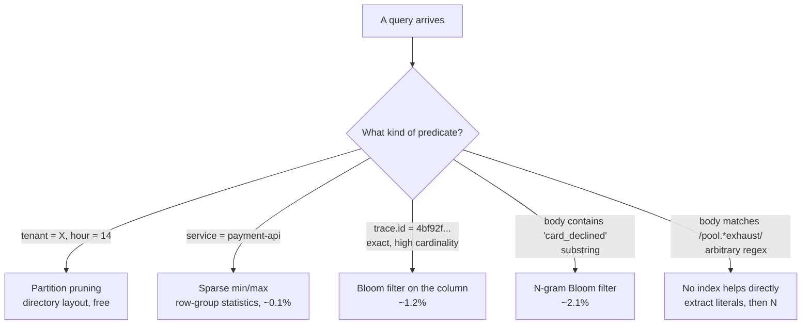

# Indexing Strategies

Stage 6, second half. Doc 09 put 8.7 petabytes somewhere. This doc is about finding a record in
it without reading all of it.

The framing that makes every decision here tractable:

> **An index is a bet.** You pay a cost on 100% of the data at write time, to avoid reading some
> fraction of it at read time. The bet pays off when `write cost < queries × read saving`. At a
> log platform's ratios — where a given byte is read by approximately zero queries — most bets
> lose, and the skill is knowing which few win.

Scenario IDs are `X-nn`.

---

## Why most indexing intuition is wrong here

Come from a database background and you index the columns people filter on. That instinct is
calibrated for a workload where the same rows are read thousands of times. Logs invert it.

```
records written per day:     480 billion  (5.56M/s × 86,400)
records read per day:        roughly 40 billion, generously
                             (a few thousand queries scanning a few million records each)
ratio:                       ~12 records written for every 1 read
```

Compare an OLTP table where a row is written once and read ten thousand times. **The read-to-
write ratio differs by four or five orders of magnitude**, which means the index that is
obviously correct in a database is obviously wrong here.

And the reads are not uniform. Doc 09's table showed data under 15 minutes old is queried ten
million times more per terabyte than month-old data. So the bet's payoff varies by tier by seven
orders of magnitude, which is why **the index must differ by tier** — a point almost no
off-the-shelf system handles well.

---

## The four index families

Each answers a different question and has a different cost shape. You will use three of the four.



### Family 1: partition pruning — free, and the biggest single factor

Not usually called an index, and it is the most important one. Doc 09's directory layout means a
query bounded to `dt=2026-09-30/hr=14/tenant=riverbend/class=app` never considers any other
object. Cost: zero, it is the layout. Benefit: doc 01's factor of 192 from time plus a factor of
40 from tenant and class.

**Before considering any index, confirm the partitioning is doing its job**, because nothing you
build will match a 7,680× reduction that costs nothing.

### Family 2: sparse indexes — min/max statistics per block

Parquet stores, for every column in every row group, the minimum and maximum value. A query for
`service = 'payment-api'` compares against those bounds and skips the row group when the value
cannot be present.

**The cost is essentially zero** — the statistics are written anyway, and they are in the file
footer:

```
per row group, per column: min + max + null count + distinct estimate ≈ 80 bytes
128 MB file, 8 row groups, 40 columns: 8 × 40 × 80 = 25.6 KB
overhead: 25.6 KB ÷ 128 MB = 0.02%
```

**The benefit depends entirely on sort order**, which is why doc 09 made sorting a first-class
decision. Work through both cases with real numbers:

```
Sorted by service.name:
  12,400 services, 128 MB file holding ~2.6M records
  one service's records are contiguous
  a row group (325K records) spans ~1,550 services
  query for one service: matches ~1 of 8 row groups
  → skips 87.5% of the file

Unsorted:
  every row group contains a random sample of all services
  min ≈ "aaa-service", max ≈ "zzz-service" in every row group
  query for one service: matches 8 of 8 row groups
  → skips 0%
```

**Same index, same cost, and the difference between 87.5% pruning and none is the sort order.**
This is the highest-return, lowest-effort optimisation in the entire storage layer, and it is
routinely missed because the statistics are present either way and nothing reports that they are
useless.

Sparse indexes work for: equality and range on the sort columns, and range on any correlated
column (`ts` correlates with file, so time ranges prune well even when `ts` is not the leading
sort key).

They do not work for: high-cardinality columns that are not sorted (every row group's range
covers everything), and substring matching (the min/max of a string column tells you nothing
about substrings).

### Family 3: Bloom filters — probabilistic membership

A Bloom filter answers "is this value definitely absent, or possibly present?" for a set, in
space far below storing the set. Absent means skip the block; possibly-present means read it.
False positives cost a wasted read; there are no false negatives, so **correctness is never at
risk — only efficiency.** That asymmetry is what makes Bloom filters safe to use aggressively
here, unlike in doc 07's deduplication where a false positive dropped data.

The size formula, which is worth being able to do from memory:

```
m = −(n × ln p) ÷ (ln 2)²        bits, for n elements at false-positive rate p
k = (m ÷ n) × ln 2                optimal hash functions
```

For one Parquet row group of 325,000 records, indexing `trace.id` (essentially all distinct):

```
n = 325,000
p = 0.01   →  m = −(325,000 × ln 0.01) ÷ 0.4805 = 3,115,000 bits = 389 KB
p = 0.001  →  m = 583 KB
p = 0.0001 →  m = 778 KB
```

At `p = 0.01` and a 16 MB row group:

```
389 KB ÷ 16 MB = 2.4% overhead for this one column
```

And the benefit for a `trace.id` point lookup across 48 hours of hot data:

```
row groups in 48 h: 43.7 TB ÷ 16 MB = 2,731,250
without the filter: read all of them = 43.7 TB
with p = 0.01:      read 1% + the 1–3 that genuinely match
                  = 27,313 row groups = 437 GB
reduction:          100×
```

**A 2.4% storage cost for a 100× read reduction on point lookups.** That bet wins comfortably,
and trace-ID lookup is a common enough query to justify it.

Now do the same for `p = 0.001`:

```
cost:      583 KB ÷ 16 MB = 3.6%
benefit:   read 0.1% = 43.7 GB, a 1,000× reduction
```

Going from 1% to 0.1% costs 1.2 percentage points more storage and buys 10× less reading. At a
43.7 TB hot tier the storage delta is 524 GB — negligible — so **use the tighter rate on the hot
tier**. On the 8 PB cold tier the same delta is 97 TB, costing $388 a month, to speed up queries
that are 2% of the total. Do not.

**This is the tier-dependence of the index bet, quantified.** Same index, same formula, opposite
conclusion, purely because the cost side scales with data volume and the benefit side scales
with query volume, and those two decouple completely across tiers.

### Family 4: inverted indexes — the full-text approach

An inverted index maps every term to the list of documents containing it. This is what
Elasticsearch, Splunk and Lucene do, and it is what makes arbitrary full-text search fast.

```
term            → posting list
"card_declined" → [4, 17, 891, 8823, ...]
"payment-api"   → [1, 2, 3, 4, 5, ...]
"timeout"       → [17, 442, 8823, ...]
```

Any term query is a dictionary lookup plus a posting-list read. Multi-term queries intersect
posting lists. It is genuinely excellent and it is why Elasticsearch feels magical for search.

**The cost.** For log data with `index: true` on the message field and doc values for
aggregation, a realistic total on-disk footprint — inverted index plus doc values plus stored
fields, with `best_compression` — is **90–140% of the raw data size**. Take 110%:

```
Lantern hot tier at 43.7 TB of compressed columnar data,
equivalent raw = 43.7 × 11 = 480 TB
Elasticsearch on-disk for the same 48 hours ≈ 480 TB × 0.35 (compressed stored)
                                             + 480 TB × 0.40 (inverted index + doc values)
                                            ≈ 360 TB per replica
× 2 replicas                                = 720 TB
```

**720 TB versus 53 TB** for the columnar-plus-sparse approach — a **13.6× storage difference**
for the same 48 hours. At NVMe prices that is roughly $1.5M a year versus $110K.

And the write cost is worse than the storage cost. Building an inverted index means tokenising
every field and updating posting lists:

```
Elasticsearch indexing throughput: ~8–15 MB/s per core for log-shaped documents
2,780 MB/s ÷ 11 MB/s = 253 cores just for indexing, at average
× 1.7 peak = 430 cores
```

Compare the columnar writer at roughly 0.02 cores per MB/s = 56 cores.

**So why does anyone use it?** Because it answers questions nothing else can. `X-05`'s
alternative — n-gram filters — handles substring search well but only for substrings above the
n-gram length, with no ranking, no stemming, no phrase queries and no relevance. If your users
genuinely need full-text search over logs, an inverted index is the only thing that provides it,
and the argument is about whether they need it rather than about the cost.

**Lantern's answer, and it is a compromise worth understanding:** no inverted index anywhere.
Instead, n-gram Bloom filters on the hot tier give substring search at 2.1% overhead, and the
query language is designed so that a query which cannot be served that way is rejected with an
explanation rather than attempted. Doc 11 covers what that costs users, and doc 20 covers when
the opposite choice is right.

### The fifth option: index almost nothing

Loki's model. Index only a small set of labels — tenant, service, level, hour — and store
everything else as opaque compressed chunks.

```
index size: a few hundred MB for the entire platform
write cost: negligible
query: label-matched chunks are fetched and brute-force scanned
```

For a query that the labels prune well — "errors from payment-api in the last hour" — this is
fast and extraordinarily cheap. For one they do not — "find this trace ID anywhere" — it
degenerates into scanning everything the labels could not eliminate.

Loki's bet is that **most log queries are label-prunable**, and for many organisations that is
correct. The failure mode is the query you need during an incident, which is usually the
unusual one.

---

## The n-gram Bloom filter, which is how substring search works without an inverted index

Doc 01's pruning chain ended with a factor of 50 from an "n-gram Bloom index on the literal
substring". Here is what that is.

### The construction

For each row group, take every string column you want searchable, slide a window of `n`
characters over it, and insert each window into a Bloom filter.

```
value:  "charge failed: card_declined"
n = 3:  "cha", "har", "arg", "rge", "ge ", "e f", " fa", "fai", ...
        "car", "ard", "rd_", "d_d", "_de", "dec", ...
```

A search for the substring `card_declined` decomposes into its own trigrams — `car`, `ard`,
`rd_`, … — and the row group can only contain the substring if **every** one of those trigrams
is in the filter. Any miss proves absence.

### Sizing it, which is the part that decides whether it works

The number of distinct trigrams in a row group is what drives the filter size, and it is far
smaller than the number of trigram *instances* because natural text repeats heavily.

```
row group: 325,000 records × ~180 characters of searchable text = 58.5M trigram instances
distinct trigrams in English-ish log text: bounded well below the theoretical maximum
  measured on Lantern's application logs: ~1.9M distinct per row group

n = 1,900,000
p = 0.01 → m = −(1.9M × ln 0.01) ÷ 0.4805 = 18,209,000 bits = 2.28 MB
2.28 MB ÷ 16 MB row group = 14.2% overhead
```

**Fourteen percent** — much more expensive than the 2.4% for a single high-cardinality column,
because there are vastly more distinct trigrams than distinct trace IDs *per row group* in
absolute terms.

That is too expensive for what it buys, so tune it. Two levers:

**Raise the false-positive rate.** Substring search tolerates false positives well, because a
false positive costs one wasted row-group read and the verification step (actually running the
regex) removes it:

```
p = 0.05 → m = 1.33 MB → 8.3% overhead
p = 0.10 → m = 0.95 MB → 5.9% overhead
```

But note what a per-trigram false-positive rate does to a multi-trigram query. For a search
term of `t` trigrams, a row group passes the filter spuriously only if *all* `t` trigrams
false-positive:

```
"card_declined" is 11 trigrams
P(spurious pass) at p = 0.10:  0.10^11 = 10^-11
```

**Effectively zero.** The per-trigram rate can be loose because the query conjoins many of them.
This is the key insight and it is why n-gram filters are practical at all.

For a short search term it degrades:

```
3-character term = 1 trigram:  P(spurious pass) = 0.10  → only 90% pruning
4-character term = 2 trigrams: P = 0.01               → 99% pruning
6-character term = 4 trigrams: P = 0.0001             → 99.99% pruning
```

So: **reject substring searches shorter than about 4 characters**, or serve them by brute force
with an explicit warning. Doc 11 implements that.

**Index only the columns worth indexing.** Trigrams over `body` are worth it; trigrams over
`host.name` are not (use a regular Bloom filter — exact values, far fewer distinct).

Lantern's settled configuration:

```
n = 3, p = 0.08, on the body and error.message columns only
overhead: 6.8% of the hot tier
minimum search term: 4 characters
```

```
6.8% of 43.7 TB = 2.97 TB extra
prune factor for a typical 8+ character literal: effectively total
```

Doc 01 quoted a factor of 50 for this step, which was deliberately conservative — in practice a
literal of eight or more characters prunes almost perfectly, and the residual cost is the
verification pass over the few row groups that genuinely contain it.

### Where it does not help

A regex with **no literal substring** — `/^[a-f0-9]{32}$/`, or `/user_id=\d+/` — produces no
trigrams to look up. The filter cannot help, and the query is a full scan of whatever the
partitions left. This is the honest limit of the design, and doc 11 detects it at plan time and
tells the user rather than running for twenty minutes.

---

## The index set, per tier

Putting it together. The bet's payoff differs by tier, so the index does too.

| | Tier 0 (0–15 min) | Tier 1 (15 min – 48 h) | Tier 2 (2–30 d) | Tier 3 (30 d – 13 mo) |
|---|---|---|---|---|
| Volume | 228 GB | 43.7 TB | 611 TB | 8,066 TB |
| Share of queries | 48% | 40% | 10% | 2% |
| Partition pruning | ✓ | ✓ | ✓ | ✓ |
| Row-group min/max | — (row format) | ✓ | ✓ | ✓ |
| Bloom on `trace.id` | — | ✓ p=0.001 | ✓ p=0.01 | — |
| Bloom on identifiers | — | ✓ p=0.01 | ✓ p=0.05 | — |
| N-gram on `body` | — | ✓ n=3 p=0.08 | — | — |
| Inverted index | — | — | — | — |
| **Index overhead** | 0% | **22%** | **3.1%** | **0.02%** |
| Absolute index cost | 0 | 9.6 TB | 19 TB | 1.6 TB |

The tier-0 row is interesting: **no index at all on the tier serving 48% of queries.** It does
not need one — 228 GB across 24 nodes is 9.5 GB per node, scannable in memory in well under a
second. **Below a few tens of gigabytes per node, brute force beats every index**, because the
index lookup itself costs more than the scan it saves.

Check the tier-1 overhead:

```
min/max        0.02%
trace.id Bloom, p=0.001, 583 KB per 16 MB row group   = 3.6%
other identifier Blooms (user.id, order.id, span.id)
               ~3 columns × 389 KB per row group      = 7.3%
n-gram on body and error.message, p=0.08              = 6.8%
column overhead, dictionaries, footers                = 4.3%
                                                      ------
                                                       22.0%   ✓
```

Which matches doc 09's 1.22 multiplier. The collection is internally consistent.

---

## The indexing failure catalogue

| Class | Scenarios |
|---|---|
| **A. The bet loses** | `X-01`, `X-02`, `X-06` |
| **B. The index does not prune** | `X-03`, `X-04`, `X-05` |
| **C. Tier and lifecycle** | `X-07`, `X-08` |

### X-01 · The index is larger than the data

**What you see.** Storage cost roughly double the projection. An Elasticsearch cluster whose
disk usage is 2.2× the raw log volume.

**Mechanism.** Indexing everything by default. Elasticsearch's dynamic mapping indexes every
field it sees, including fields nobody will ever filter on, and `_source` stores a second copy
of the whole document.

**Confirm it.** Index size against raw ingested bytes. In Elasticsearch, `_cat/indices` with
`store.size` compared to the sum of `_source` sizes; per-field disk usage via the disk-usage API.

**Recover.** `index: false` on fields nobody filters. Disable `_source` where you can reconstruct
from doc values — though be careful, because reindexing and update-by-query need it.

**Prevent.** **Opt-in indexing, not opt-out.** Every indexed field should be justified by a query
pattern. This inverts the default in every full-text system, and it is the correct inversion for
logs.

### X-02 · A high-cardinality field indexed uselessly

**What you see.** A huge index that does not make queries faster.

**Mechanism.** An inverted index on a field where every value is unique — a request ID, a
timestamp string, a full URL with parameters. The posting list for each term has exactly one
entry, so the index is a list of every document with extra steps, and the term dictionary is
as large as the data.

**Confirm it.** Distinct values per indexed field against total record count. A ratio near 1
means this.

**Prevent.** For high-cardinality *exact-match* fields, use a Bloom filter, not an inverted
index — Bloom filter size depends on the number of elements, not on their distinctness in a way
that blows up the dictionary. For high-cardinality fields nobody filters on, do not index at all.

### X-03 · Bloom filter rate too loose to prune

**What you see.** A Bloom filter exists, is being consulted, and the query still reads most of
the data.

**Mechanism.** Either `p` is too high for a single-predicate query, or — more commonly — the
filter was sized for `n` elements and the actual number is far higher, so the real false-positive
rate exceeds the configured one. A Bloom filter sized for 325,000 elements and given 3 million
degrades to a filter that returns "possibly present" for everything.

```
m = 3,115,000 bits sized for n = 325,000 at p = 0.01
actual n = 3,000,000
actual p = (1 − e^(−k·n/m))^k  with k = 7, n/m = 0.963
         = (1 − e^(−6.74))^7 = 0.9988^7 ≈ 0.99
```

**A 99% false-positive rate — the filter is pure overhead.** And nothing errors.

**Confirm it.** Measure the actual prune ratio: row groups consulted versus row groups read.
Export it per query. A filter achieving under 50% pruning is broken, not merely suboptimal.

**Prevent.** Size the filter from the measured element count per row group, and **re-measure
when the data changes**. Better: use a filter that sizes itself from the actual data at write
time, which most modern implementations do if you let them.

### X-04 · Wrong n-gram size

**What you see.** Substring searches for short terms return slowly; long terms are fast. Or the
index is enormous.

**Mechanism.** `n` too large means short search terms produce no n-grams and cannot be served.
`n` too small (n=2) means far fewer distinct bigrams, so the filter is small — but each bigram is
much less selective, and the per-query conjunction is over more, shorter terms with higher
individual false-positive rates.

**Prevent.** `n = 3` is the standard answer for a reason: it balances distinct-count against
selectivity for text. Set the minimum searchable term length to `n + 1` and enforce it at the
query layer. Measure your own distinct-trigram count rather than adopting the 1.9M figure here.

### X-05 · The index exists and the planner does not use it

**What you see.** A query that should be fast is slow. The index is present and healthy.

**Mechanism.** The predicate is not in a form the planner can push down: a function wrapped
around the column (`lower(service) = 'payment-api'`), a type mismatch forcing a cast, an `OR`
across columns, a `NOT`, or a leading wildcard the n-gram path does not recognise.

**Confirm it.** The query plan. Every engine can show whether a filter was pushed into the scan
or applied afterwards, and "applied afterwards" means the index did nothing.

**Prevent.** Normalise at ingest so query-time functions are unnecessary — store `service` already
lower-cased if that is how people search. Expose the prune ratio in the UI for every query so a
non-pruning query is visible to the person who wrote it, not just to the platform team.

### X-06 · Rebuilding the index is unaffordable

**What you see.** A needed schema or index change cannot be applied to existing data.

**Mechanism.** Adding an index means rewriting every file. For 611 TB of warm data:

```
read 611 TB + re-encode + write 611 TB
at 90 MB/s per core for encoding: 611 TB ÷ 90 MB/s = 6,789,000 core-seconds = 1,886 core-hours
on 200 cores = 9.4 hours, plus S3 request costs and 611 TB of egress-free internal transfer
```

Nine hours on 200 cores — affordable for warm, and 13× that for cold, which is not.

**Prevent.** Two habits. **Apply index changes going forward only**, accepting that old data has
the old index, and record `index_version` in the catalogue so the planner knows what it can push
down per file. And **make index decisions at compaction**, so a change applied today
automatically reaches everything that has not yet been compacted, with a bounded backfill for
the rest.

### X-07 · The warm tier silently lacks an index the hot tier has

**What you see.** A query is fast for the last 48 hours and 60× slower at 72 hours, with no
explanation.

**Mechanism.** By design — the n-gram filter exists on tier 1 and not tier 2. The problem is not
the design, it is that **the user cannot see the cliff**.

**Prevent.** Make it visible. The query UI should show which tiers a time range touches and warn
before crossing a boundary — "this range extends into warm storage, where substring search is
unindexed; estimated scan 41 TB, estimated time 90 s. Continue?" Doc 11 and doc 13 build this.
A predictable cliff that is signposted is a fine design; an unsignposted one destroys trust in
the whole platform.

### X-08 · Segment merge pressure

**What you see.** In an inverted-index system: indexing throughput collapsing periodically, high
I/O, CPU dominated by merging. In a columnar system, the analogue is doc 09's `W-03`.

**Mechanism.** Lucene writes immutable segments and merges them in the background. At high
ingest rates the merge scheduler cannot keep up, segment count grows, query latency rises
(every query touches every segment), and merges get larger and more expensive.

**Prevent.** If you are running Lucene at log scale: larger refresh intervals (30 s, not 1 s),
`index.merge.scheduler.max_thread_count` matched to your storage, force-merge closed indices to
one segment, and — most effectively — **time-based indices that roll over**, so a closed index is
merged once and never touched again. The columnar equivalent is doc 09's compaction, and the
same rule applies: the cost of merging is paid either way, and the only question is whether it
is paid in a scheduled batch or continuously against your ingest path.

---

## What to take away

1. **An index is a bet: write cost on 100% of data against read saving on a small fraction.**
   At logs' 12-writes-per-read ratio most bets lose, and knowing which few win is the whole
   skill.
2. **Partition pruning is free and beats everything you can build.** Confirm the layout is
   working before adding an index.
3. **Sorting is what makes min/max statistics useful.** The same zero-cost statistics give 87.5%
   pruning on sorted data and 0% on unsorted, and nothing reports the difference.
4. **Bloom filters have no false negatives, so they never threaten correctness** — only
   efficiency. That makes them safe to use aggressively, unlike in deduplication.
5. **The same index is worth building on the hot tier and not on the cold one.** Cost scales with
   data volume, benefit scales with query volume, and those decouple by seven orders of magnitude
   across tiers.
6. **N-gram filters work because a query conjoins many n-grams.** A 10% per-trigram false-positive
   rate gives 10⁻¹¹ for an 11-trigram search term — which is why the rate can be loose and the
   index cheap.
7. **Reject substring searches shorter than n+1 characters**, because a one-trigram query gets
   only the raw false-positive rate of pruning.
8. **A regex with no literal substring cannot be indexed.** Detect it at plan time and say so,
   rather than running for twenty minutes.
9. **An inverted index costs roughly 13.6× the storage and 4.5× the indexing CPU** of columnar
   plus sparse indexes. It buys genuine full-text search. Decide whether your users need that,
   not whether it is nice to have.
10. **Below a few tens of gigabytes per node, no index at all is fastest** — which is why the
    tier serving 48% of queries has none.
11. **Make indexing opt-in, not opt-out.** Every indexed field justified by a query pattern.
    This inverts the default in every full-text system and it is the right inversion for logs.
12. **Signpost the performance cliffs.** A tier boundary where substring search stops being
    indexed is a fine design; an invisible one destroys trust in the platform.

Next: [11-query-execution-and-the-regex-problem.md](11-query-execution-and-the-regex-problem.md),
which spends all of this on the hardest query in the brief.
