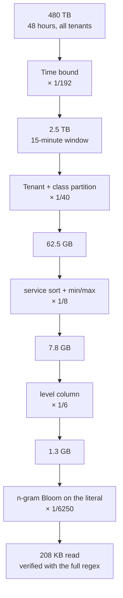
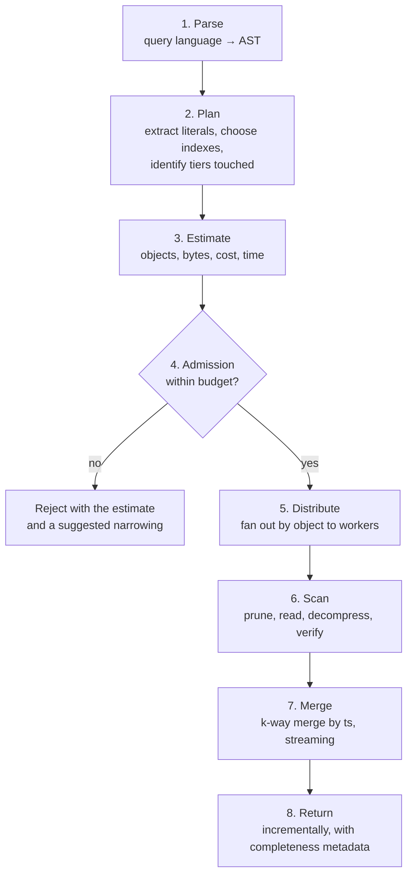

# Query Execution and the Regex Problem

Stage 7, and the hardest requirement in the brief: *"allow regex queries for exact data retrieval
in real time."*

Doc 01 showed the naive reading of that requirement costs 192,000 CPU cores for a single query.
This doc turns it into something buildable — by deriving why brute force fails, extracting the
structure a regular expression actually gives you, and building a query engine whose central
feature is knowing what it cannot do. Scenario IDs are `Q-nn`.

---

## Why brute force fails, precisely

Start with the honest number, because every design decision follows from its size.

### The scan rate of a single core

Three things happen per byte: read it, decompress it, match it.

```
read from local NVMe, sequential:        ~2.0 GB/s per core (rarely the limit)
zstd-3 decompression:                    ~1.2 GB/s per core of output
RE2 match, simple literal pattern:        ~800 MB/s per core
RE2 match, pattern with alternation:      ~180 MB/s per core
RE2 match, pattern with bounded repeats:  ~90 MB/s per core

combined for a moderate pattern, pipelined:
  1/(1/1200 + 1/350) ≈ 271 MB/s of raw bytes per core
```

Call it **250 MB/s of raw bytes per core**, which is what doc 01 used.

### Against 48 hours

```
48 h of raw log volume = 2.78 GB/s × 172,800 s = 480 TB

480 × 10^12 ÷ 250 × 10^6 = 1,920,000 core-seconds
                          = 22.2 core-days
```

For a 10-second answer: **192,000 cores**. For a 60-second answer: 32,000 cores. For a
five-minute answer: 6,400 cores — which is a 400-node cluster dedicated to one query.

At $0.034 per core-hour, the 10-second version costs:

```
1,920,000 core-seconds ÷ 3,600 × $0.034 = $18.13 per query
```

Eighteen dollars is not the problem. **The problem is that 192,000 cores do not exist, and if
they did, two people querying simultaneously would need 384,000.** Brute force is not expensive;
it is unavailable.

### What this means for the requirement

The requirement as stated is unbuildable, and the professional response is to say so and
renegotiate, not to build something that appears to work and times out during incidents. The
buildable version:

> Regex search over a **time-and-scope-bounded** slice, with **a cost estimate shown before
> execution**, a **hard per-query resource ceiling**, and **explicit reporting when results are
> partial**.

Every one of those four clauses is load-bearing, and the rest of this doc builds them.

---

## The pruning chain, in full

Doc 01 gave the summary. Here is each step with its mechanism, its factor, and — importantly —
what makes it *fail*.



### Step 1 — time, factor 192

48 hours to 15 minutes. **Free**, from doc 09's partitioning.

**Fails when:** the user does not bound the time, or bounds it to "last 7 days" out of caution.
The single highest-leverage thing the query interface does is **default to a narrow window and
make widening it a deliberate act with a visible cost.** Defaulting to "last 15 minutes" rather
than "last 24 hours" changes the platform's total query cost by two orders of magnitude, and
costs users almost nothing because most searches genuinely are about now.

### Step 2 — tenant and class, factor 40

One tenant's application logs out of forty tenants across five classes. **Free**, from
partitioning. The tenant part is implicit — a user only has access to their own — so the
realised factor depends on class selection.

**Fails when:** a platform-team user queries across all tenants, which is legitimate and must
therefore be a distinct, gated operation with its own budget.

### Step 3 — service, factor 8

Min/max row-group statistics over sorted data. Doc 10 derived 87.5% pruning. **Costs 0.02%.**

**Fails when:** the data is not sorted (doc 10's central warning), or the query does not name a
service. A query with no service filter is common and legitimate — "find this trace ID anywhere"
— and simply does not get this factor.

### Step 4 — level, factor 6

A low-cardinality dictionary column, sorted second. Only applies when the user filters on level,
which for error investigations they usually do.

### Step 5 — the n-gram Bloom filter, the big one

This is where a regular expression stops being opaque.

---

## Extracting literals from a regular expression

The central technique of the whole doc. A regex looks unindexable because it describes a
*language*, not a value. But most useful regexes contain **mandatory literal substrings** — text
that must appear in any matching string — and those can be looked up in an n-gram index.

### The idea, worked through

```
regex:                    /charge failed.*card_declined/
mandatory literals:       "charge failed" AND "card_declined"
→ a row group can only match if it contains BOTH
→ look up both in the n-gram filter, intersect

regex:                    /(timeout|refused) connecting to (redis|postgres)/
mandatory literals:       ("timeout" OR "refused") AND " connecting to " AND ("redis" OR "postgres")
→ a boolean expression over n-gram lookups, still highly selective
→ the guaranteed part, " connecting to ", is by itself 13 trigrams

regex:                    /pool.*exhaust/
mandatory literals:       "pool" AND "exhaust"
→ both usable

regex:                    /^[a-f0-9]{32}$/
mandatory literals:       none
→ no pruning possible. Full scan of whatever survived steps 1–4.

regex:                    /user_id=\d+/
mandatory literals:       "user_id="
→ one literal, 8 characters, 6 trigrams — good selectivity
```

### How to compute it

This is a known, solved problem — the technique behind Google Code Search, and described by Russ
Cox in the context of `codesearch` and RE2. The algorithm walks the parsed regex tree and
computes, for each node, a boolean query over required substrings:

```
literal "abc"        → {exact: {"abc"}}
concat(x, y)         → cross product of exacts, or AND of the match queries
alternate(x, y)      → OR of the match queries
star(x), quest(x)    → ANY  (zero occurrences allowed, so nothing is required)
plus(x)              → the match query of x  (at least one occurrence)
charclass [a-f]      → ANY if large, OR of exacts if small
repeat{n,m}(x)       → the match query of x when n ≥ 1, else ANY
```

The output is a boolean expression over string literals, which then decomposes into trigrams for
the Bloom lookup. Anything that evaluates to `ANY` contributes no pruning — which is exactly the
`/^[a-f0-9]{32}$/` case, and the planner now *knows* that before running anything.

**That knowledge is the most valuable output of the whole exercise.** Not the pruning — the
ability to tell the user, at plan time, "this pattern has no indexable literal; it will scan
1.3 GB / 41 TB / 8 PB; do you want to continue?"

### The selectivity, quantified

Doc 10 established that the per-trigram false-positive rate is 0.08 and that a term of `t`
trigrams passes spuriously with probability `0.08^t`:

```
"card_declined"  = 11 trigrams → 0.08^11  = 8.6 × 10^-13
"pool"           =  2 trigrams → 0.08^2   = 0.0064
"timeout"        =  5 trigrams → 0.08^5   = 3.3 × 10^-6
```

Against 1.3 GB surviving step 4, at 16 MB row groups that is 81 row groups:

```
"card_declined":  81 × 8.6e-13 spurious + the 1–2 that truly match  →  read ~2 row groups = 32 MB
"pool":           81 × 0.0064   = 0.5 spurious + true matches       →  read ~3 row groups = 48 MB
```

Doc 01's figure of 208 MB after a factor of 50 was deliberately conservative; a realistic
multi-trigram literal does substantially better. **Either way the query reads tens of megabytes
instead of 480 terabytes, and the reduction is between 10⁴ and 10⁷.**

### Then verify

The Bloom filter says "possibly contains these trigrams". It does not say the regex matches —
the trigrams could appear in different records, or in an order the pattern forbids. So the final
step runs the actual regex over the surviving row groups. That is the 32 MB scan, which at
250 MB/s per core is 128 ms on one core.

**Always verify.** A system that returns Bloom-filter candidates as results is returning wrong
answers, and this is a real mistake people make when the filter's selectivity is high enough that
the errors are rare.

---

## Use RE2, not PCRE

A detail with outsized consequences at this scale.

**PCRE-style backtracking engines** (Perl, Python's `re`, Java's default, JavaScript) can take
exponential time on certain patterns. The classic:

```
pattern: /(a+)+b/    input: "aaaaaaaaaaaaaaaaaaaaaaaaaaaaaa"  (30 a's, no b)
time: ~2^30 steps
```

A user can type that into your search box. On a single 128 MB row group it will not finish, will
occupy a core indefinitely, and — because you distributed the query — it will do so on every
node simultaneously. **One user's regex becomes a cluster-wide denial of service**, `Q-04`. This
is not hypothetical; it is the standard way regex search endpoints fall over, and it has a name:
regular expression denial of service.

**RE2** (and Rust's `regex`, and Go's `regexp`, which is RE2) guarantees linear time in the input
length by simulating the automaton rather than backtracking. It refuses to compile patterns that
would need too much memory. The cost is that it does not support backreferences (`\1`) or
lookaround (`(?=...)`, `(?<=...)`), because those are what make the linear-time guarantee
impossible.

**Take the trade.** Backreferences in a log search are vanishingly rare, and the alternative is
an endpoint any user can accidentally weaponise. Where a user genuinely needs lookaround, the
answer is usually two predicates combined with `AND`, which the planner handles better anyway.

Additional guards even with RE2:

```
max compiled program size:  10 MB   (RE2's default is 8 MB; be explicit)
max pattern length:         4 KB
per-row-group time budget:  enforced, with the query aborting rather than the node stalling
```

---

## The query lifecycle



### Step 3 is the one that distinguishes a usable platform

Before executing, the planner knows: the objects the catalogue matched, their total bytes, which
tiers they are in, and the expected prune factor from the indexes. From that:

```
estimated bytes scanned  = Σ object bytes × expected prune ratio
estimated core-seconds   = bytes ÷ 250 MB/s
estimated wall time      = core-seconds ÷ available parallelism
estimated dollar cost    = core-seconds × $0.034/3600
                         + (Glacier IR bytes × $0.03/GB)
```

Show it to the user before running anything above a threshold:

```
This query will scan approximately 41 TB across warm storage.
  Estimated time:  94 seconds
  Estimated cost:  $12.40 (charged to team payments-core)
  Why so large:    the pattern /^[a-f0-9]{32}$/ has no indexable literal,
                   and no service filter was given.
  Suggestions:     add service:payment-api      → ~5.1 TB, 12 s
                   narrow to the last 4 hours   → ~3.4 TB, 8 s
                   search for a literal instead of a character class
[ Run anyway ]  [ Apply suggestions ]
```

This single screen does more for a log platform's health than any optimisation. It converts an
accidental cluster-wide event into a decision, it teaches users how the system works, and it
makes cost visible to the person choosing to incur it. Doc 13 designs the rest of the interaction.

### Step 5 — distribution, and the unit of work

The unit is the **object**, not the partition or the node. A query's matched objects are placed
in a work queue and workers pull from it. Pull, not push, and the reason is stragglers.

```
query matches 4,200 objects
16 query nodes × 8 workers = 128 workers
push assignment: 4,200 ÷ 128 = 32.8 objects each, fixed
  → the node holding the one pathological object finishes last, and everyone waits
pull assignment: workers take the next object when free
  → a slow object delays the query by at most the time for one object
```

With 128 MB objects at 250 MB/s per core, one object is ~0.5 s. **So the worst-case straggler
penalty is half a second**, which is why the 128 MB target from doc 09 matters to the query tier
as much as to the storage tier.

### Step 7 — merging, and why it must stream

Results must come back sorted by time, and they come from 128 workers in arbitrary order. A
naive implementation collects everything and sorts — which means memory proportional to the
result set, and no output until the slowest worker finishes.

**Stream instead.** Each worker returns its results already sorted (they are, because the file is
sorted by `ts` within a service). The coordinator does a k-way merge with a heap of 128 entries,
emitting the earliest available record as soon as it is safe to do so — which is when every
worker has either produced a record at least that recent or signalled completion.

```
memory at the coordinator: 128 workers × one buffered batch (1,000 records) × 494 B = 63 MB
time to first result: as soon as all workers have produced one batch, not when all are done
```

### Step 8 — completeness metadata, which is non-negotiable

Every result set carries:

```json
{
  "complete": false,
  "reason": "byte_budget_exceeded",
  "objects_matched": 4200,
  "objects_scanned": 1180,
  "bytes_scanned": 151000000000,
  "time_range_covered": {"from": "2026-09-30T13:45:00Z", "to": "2026-09-30T14:00:00Z"},
  "time_range_requested": {"from": "2026-09-30T10:00:00Z", "to": "2026-09-30T14:00:00Z"},
  "tiers_touched": ["hot", "warm"]
}
```

**A partial result presented as complete is the worst thing a log platform can do.** An engineer
searching for evidence of a failure, finding none, and concluding it did not happen, when in fact
the search gave up at 28% — that is a wrong answer delivered with confidence, and it will cost
someone hours. `Q-02`.

Note `time_range_covered`: when a query is truncated, truncate it **from the newest backwards**,
so the user gets a complete answer for a shorter window rather than a random sample of a longer
one. A complete answer for 15 minutes is useful; 28% of 4 hours is not.

---

## Admission control and isolation

One query must not degrade the platform for everyone. Four mechanisms, each catching a different
case.

**1. Per-query resource ceilings.**

```
max_bytes_scanned:      500 GB      (hot and warm), 50 GB (cold, because retrieval is priced)
max_execution_time:     120 s
max_concurrent_workers: 64          (half the pool, so one query never owns everything)
max_result_records:     100,000     (beyond this, use export — doc 14)
```

**2. Per-tenant concurrency limits.** A bulkhead: no tenant may hold more than N workers. Rate
limits alone are insufficient because a few enormous queries starve everyone without exceeding
any rate.

**3. A queue with priority classes.**

```
interactive (a human is waiting)    highest, short queue, fails fast
scheduled   (dashboards, reports)   medium
export      (doc 14)                lowest, long queue, may wait minutes
```

When the interactive queue is full, **reject rather than queue**. A human waiting 40 seconds for
a query to start will press the button again, and doc 00's `F → H → F` loop is exactly this.
Rejecting with "the system is busy, try in 30 seconds" is both more honest and more stable —
the same conclusion as doc 05's `T-03`.

**4. Cost attribution.** Every query's estimated and actual cost is recorded against a team. A
monthly report showing which teams' queries cost what changes behaviour more than any limit,
because it makes an invisible externality visible.

---

## Caching, and why the obvious cache does not work

Caching query *results* has poor returns here. Log queries are rarely repeated verbatim —
engineers iterate, changing the pattern or shifting the window each time — and the underlying
data for recent windows is still changing.

Three caches that do work:

**Catalogue and metadata caching.** Object lists and statistics per partition. Small, reused
constantly, and it removes the catalogue from the critical path of every query. Highest return
of the three.

**Row-group footer caching.** Parquet footers hold the statistics and Bloom filters. Reading a
footer costs a round trip; caching them means the pruning phase touches no storage at all.

```
48 h hot tier: 2,731,250 row groups... at 16 MB each in 128 MB files = 341,406 files
footers ≈ 40 KB each = 13.7 GB
```

Thirteen gigabytes of footer cache across 16 query nodes is 855 MB each. **Cache all of it** —
this makes the entire pruning phase a memory operation.

**Decompressed block caching**, for iterative refinement. When a user changes only the pattern
and keeps the window, the same blocks are read again. An LRU of decompressed blocks makes the
second query several times faster, which is exactly the interaction pattern doc 13 describes.

What not to cache: results, and anything keyed on a time range that includes "now", because it
is stale before it is used.

---

## Sizing the query tier

```
target: p95 interactive query under 3 s
typical interactive query after pruning: 1.3 GB scanned
1,300 MB ÷ 250 MB/s per core = 5.2 core-seconds
÷ 3 s target = 1.7 cores... 
```

That would suggest two cores per query, which is obviously too few — and the reason is that the
average is not what you size for. Size for the distribution:

```
p50 query:   180 MB scanned →  0.7 core-seconds
p90 query:   4.2 GB         → 16.8 core-seconds → 6 cores for 3 s
p99 query:   71 GB          →  284 core-seconds → 95 cores for 3 s
p99.9 query: 500 GB (the ceiling) → 2,000 core-seconds → 64 workers × 31 s
```

```
concurrent interactive queries at peak: 45
weighted core-seconds per query: 0.7×0.5 + 16.8×0.4 + 284×0.09 + 2000×0.01 = 52.6
45 queries/s arriving? No — 45 concurrent, averaging 2.5 s each = 18 queries/s
18 × 52.6 = 947 cores sustained
```

Nine hundred and fifty cores, which at 24 cores per node is 40 nodes — more than the 16 that
doc 09 sized for storage capacity. **The query tier is sized by query load, not by data volume**,
and the two must be reconciled:

```
storage requirement:  16 nodes (43.7 TB hot × 1.22 index × 2 replicas ÷ 12 TB)
query requirement:    40 nodes
→ run 40 nodes, which over-provisions storage 2.5× and is fine,
  or separate compute from storage and scale them independently
```

The second option is what you want above this scale, and it is what tier 2 already is —
S3-backed, so query nodes are stateless and scale on load alone. **The hot tier's local storage
is what couples them**, and that coupling is the price of tier 1's speed.

---

## The query failure catalogue

| Class | Scenarios |
|---|---|
| **A. Honesty** | `Q-01`, `Q-02`, `Q-06` |
| **B. Resource safety** | `Q-03`, `Q-04`, `Q-05` |
| **C. Correctness** | `Q-07`, `Q-08`, `Q-09` |

### Q-01 · A query that cannot finish is attempted anyway

**What you see.** Queries running for minutes then timing out. Users retrying with wider ranges
because "maybe it needs more data".

**Mechanism.** No plan-time estimate, so an unservable query is indistinguishable from a slow one
until it fails.

**Prevent.** The estimate screen above. Reject before execution, with the reason and concrete
suggestions. The suggestions matter — "narrow your query" teaches nothing; "add
`service:payment-api` → 5.1 TB, 12 s" teaches the user how the system works.

### Q-02 · Partial results presented as complete

**What you see.** An engineer concludes an event did not happen. It did.

**Mechanism.** The query hit a limit and returned what it had, with no indication.

**Confirm it.** Whether your API returns a completeness flag at all, and whether the UI shows it.

**Prevent.** Completeness metadata on every response, prominent in the UI — a banner, not a
footnote. Truncate newest-first so a partial result is at least complete for a shorter window.
And log every truncated query, because a high truncation rate means the defaults are wrong.

### Q-03 · One query starves the cluster

**What you see.** All queries slow. One user's enormous query is running.

**Mechanism.** No per-query worker cap, so one query's fan-out occupies every worker.

**Prevent.** `max_concurrent_workers` at half the pool. Per-tenant concurrency bulkheads. A
priority queue so interactive queries are not stuck behind a scheduled report.

### Q-04 · Catastrophic backtracking

**What you see.** Workers pinned at 100% CPU, not progressing, not timing out cleanly. Repeated
across every node.

**Mechanism.** A backtracking regex engine on a pathological pattern. Exponential time.

**Prevent.** RE2 or an equivalent linear-time engine — this eliminates the class rather than
mitigating it. Plus a compiled-program size limit, a pattern length limit, and a per-row-group
time budget as defence in depth.

### Q-05 · An accidental petabyte scan

**What you see.** A $3,000 line on the S3 bill (doc 09's `W-09`), or a query that takes an hour.

**Mechanism.** A wide time range reaching the cold tier, where retrieval is priced per gigabyte.

**Prevent.** Tier-aware cost estimation, a much lower byte ceiling for cold, explicit
confirmation to query cold at all, and charging it to the requesting team.

### Q-06 · The index cliff is invisible

Doc 10's `X-07`, from the query side. **What you see:** a query is fast for 48 hours and 60×
slower at 72. **Prevent:** show which tiers a range touches, before running.

### Q-07 · Event-time search misses late data

**What you see.** A search for 14:00–14:05 by event time returns fewer records than a search of
the ingest partition for 14:00–14:05.

**Mechanism.** Doc 00's split. A record emitted at 14:02 and ingested at 19:30 lives in the 19:00
ingest partition. An event-time query that only scans the 14:00 partition misses it.

**Prevent.** The planner expands event-time queries across ingest partitions up to the maximum
lateness bound, using the catalogue's `min_ts`/`max_ts` (doc 09) to skip partitions that cannot
contain the range. Report the expansion in the query plan so the user understands why a
five-minute search read four hours of partitions.

### Q-08 · Duplicates in results

**What you see.** The same record twice in a result set.

**Mechanism.** Tier 0 replication (two writers) combined with a tier-0/tier-1 overlap window, or
a reprocessed partition where the swap has not completed.

**Prevent.** Deduplicate on `record_id` in the merge step — it is a cheap addition to the k-way
merge since records arrive sorted. Make tier boundaries exclusive on one side, and make the
manifest swap atomic (doc 09).

### Q-09 · Sorted output is not actually sorted

**What you see.** Results out of order, particularly around tier boundaries.

**Mechanism.** The k-way merge emitted a record before all workers had reported past that
timestamp — usually because a worker's "no more data before T" signal was missing, so the merge
could not know it was safe to emit.

**Prevent.** Every worker must send a watermark with each batch: "I have produced everything at
or before T". The coordinator only emits records at or before the minimum watermark across all
active workers. This is standard streaming-merge discipline and it is easy to get subtly wrong,
so test it with deliberately skewed worker latencies.

---

## What to take away

1. **"Real-time regex over all logs" is unbuildable at 10 TB/hr** — 192,000 cores for a
   ten-second answer. The professional response is to renegotiate the requirement, not to build
   something that times out during incidents.
2. **The buildable version has four clauses**: time-and-scope bounded, cost estimated before
   execution, hard resource ceiling, and explicit reporting when results are partial.
3. **The pruning chain is 10⁴ to 10⁷**, and every step is a design decision made earlier —
   partitioning, sorting, the level enum, the n-gram filter.
4. **A narrow default time window is the highest-leverage thing the query interface does.**
   Defaulting to 15 minutes instead of 24 hours changes total platform query cost by two orders
   of magnitude.
5. **A regex contains mandatory literal substrings, and they are extractable.** Walking the
   parse tree yields a boolean expression over literals that maps directly onto n-gram lookups.
6. **The most valuable output of literal extraction is knowing when there are none** — that is
   what lets you tell the user, before running, that this query will scan 41 TB.
7. **Always verify with the real regex after the filter.** Bloom candidates are not results.
8. **Use RE2, not a backtracking engine.** One user typing `/(a+)+b/` into a search box is
   otherwise a cluster-wide outage, and the lost features (backreferences, lookaround) are
   almost never needed for logs.
9. **Distribute by object with pull-based assignment**, so the straggler penalty is one object —
   half a second at the 128 MB target — rather than one node's whole share.
10. **Reject rather than queue interactive queries under load.** A human waiting will retry, and
    that is the retry-amplification loop that turns a slow period into an outage.
11. **Cache footers and catalogue metadata, not results.** Thirteen gigabytes of footers makes
    the entire pruning phase a memory operation; results are rarely reused because people
    iterate.
12. **The query tier is sized by query load, not by data volume** — 40 nodes for load against 16
    for capacity. Above this scale, separate compute from storage so they scale independently.

Next: [12-flow-one-live-tail.md](12-flow-one-live-tail.md), the first of the three flows the
brief asked for.
