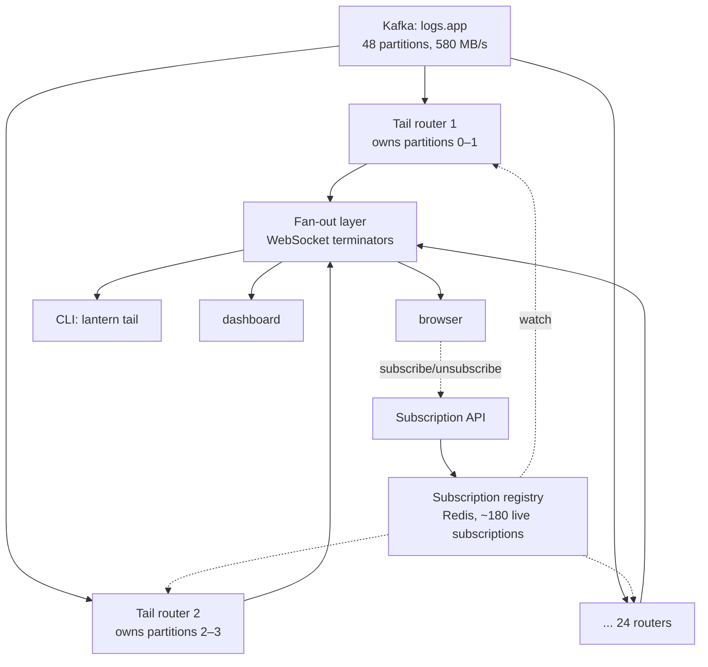

# Flow One: Live Tail

*"Teams should be able to see the data in real time for debugging."*

The first of the three flows in the brief, and the one with the tightest latency requirement and
the loosest correctness requirement. Somebody is watching lines scroll past while they change a
config and reload a page. They need to see the effect within a second or two. If one line in a
thousand is missing, they will never know and it will not matter.

That combination — **seconds of latency, best-effort delivery** — makes live tail architecturally
different from everything else in this collection, and it is why it gets its own consumer group,
its own tier and its own topic slice. Scenario IDs are `L-nn`.

---

## The latency budget, spent

Doc 01 committed to **p50 under 1.5 s and p99 under 4 s** from `log.Info()` returning to a line
appearing in a browser. Here is where it goes.

```
                                              p50        p99      notes
application writes to stdout                 0.1 ms     2 ms     pipe write
container runtime writes the file            0.3 ms    15 ms     can block — doc 02 A-13
agent notices (inotify + read)                 8 ms   120 ms     scan fallback interval
agent multiline flush timeout                  0 ms   2000 ms    only for multiline sources
agent batch timer                            100 ms   200 ms     doc 05: the largest term
network, agent → gateway (same AZ)             0.4 ms    3 ms
gateway processing                             7.8 ms   28 ms    doc 05
Kafka produce, acks=all across 3 AZs           3.2 ms   22 ms
tail router consume (fetch.min.bytes=1)        6 ms     40 ms
subscription match + filter                    0.4 ms    4 ms
router → browser WebSocket push               12 ms    85 ms     public internet or VPN
browser render                                16 ms   120 ms     one frame, or more under load
                                             -------  --------
total                                        154 ms   2,639 ms
```

**The p50 is 154 milliseconds — ten times better than the 1.5 s target.** The p99 is 2.6 s,
inside the 4 s budget, and it is dominated by one term.

### The multiline flush timeout is the whole p99

Two thousand milliseconds of a 2,639 ms p99. Doc 02 explained why it exists: the agent cannot
know a multiline record has ended until the next record starts, so for the last record before a
pause it must wait for a timeout.

Three things follow.

**For single-line sources this term is zero**, so their p99 is 639 ms. The 4-second budget is
comfortable for the majority of traffic and tight only for the minority that needs multiline
reassembly.

**Reducing the timeout to 500 ms** takes the p99 to 1,139 ms, at the cost of occasionally
splitting a slowly written stack trace. That is often the right trade for live tail specifically
— and it can be **made per-source**, so the payment service with the important stack traces keeps
2 s and the noisy batch service gets 500 ms.

**The real fix is upstream**, and it is doc 04's: an application that emits its stack trace as a
JSON field has no multiline records, so it has no flush timeout, so its p99 is 639 ms. This is
the third time that one convention has paid off — it eliminates `A-04`, it removes the largest
term in the tail budget, and it improves compression.

### The batch timer is the second-largest term

200 ms at p99, from doc 05. Reducing it to 50 ms would take the p99 to 2,489 ms and multiply
gateway request rate by four. Doc 05 judged it not worth it.

But there is a cheaper option: **reduce the batch timer only for sources that are actively being
tailed.** The control plane knows which services have live subscriptions (the tail router tells
it). Pushing a 50 ms batch timeout to just those agents, for the duration of the subscription,
costs almost nothing:

```
services actively tailed at peak: ~40 of 12,400
agents affected: those running pods of those services, ~900 of 12,000
extra gateway requests: 900 × (20 − 5) = 13,500 req/s on a tier handling 60,000
```

A 22% increase in gateway request rate while somebody is debugging, in exchange for 150 ms. That
is the kind of targeted, temporary, control-plane-driven optimisation that a log platform can
afford and a static configuration cannot express.

---

## The architecture

The naive design gives each browser session its own Kafka consumer. Doc 01 explained why that
fails: 180 consumer groups, a rebalance per session, and consumers landing at offsets outside
the page-cache window, which is doc 06's `B-04` inflicted deliberately.

The shared design:



Four components, and each exists for a specific reason.

### 1. The routers consume once and match many

Twenty-four routers share the 48 partitions of `logs.app`. Each reads its partitions once,
regardless of how many people are subscribed.

```
logs.app: 580 MB/s ÷ 24 routers = 24 MB/s per router
         = 1.17M records/s ÷ 24 = 48,800 records/s per router
```

Note the topic choice paying off. Doc 06 separated `logs.app` (21% of bytes) from `logs.access`
(45%). The routers read 580 MB/s instead of 2.78 GB/s — a **4.8× reduction** that costs nothing
because the separation was needed anyway.

### 2. Subscriptions are indexed, not scanned

Doc 01's derivation, in full. The naive match is every record against every subscription:

```
5.56M records/s × 180 subscriptions = 1.0 billion predicate evaluations/s
```

Unaffordable. But subscriptions are not uniform — essentially all of them name a service,
because that is how people debug. So index the subscriptions by service:

```python
# In each router, maintained from the subscription registry.
subscriptions_by_service: dict[str, list[Subscription]]

def on_record(rec):
    for sub in subscriptions_by_service.get(rec.service, EMPTY):
        if sub.matches(rec):          # level, keywords, regex, trace_id
            sub.send(rec)
```

```
services with at least one subscriber at peak: ~40
average subscribers per subscribed service:     4.5
share of records belonging to a subscribed service: 40 ÷ 12,400 services,
  but weighted by volume — subscribed services are the interesting ones,
  so they carry ~29% of logs.app volume

evaluations/s = 1.17M records/s × 0.29 × 4.5 = 1.53M/s
per router    = 1.53M ÷ 24 = 63,700/s
```

Sixty-four thousand predicate evaluations per second per router. Ordinary.

**The dictionary lookup is what does the work.** For the 71% of records whose service has no
subscriber, the cost is one hash lookup returning empty — about 20 nanoseconds. This is an index
over the *subscriptions*, which is the same idea as an index over the data applied to the other
side of the join, and it is the reason live tail is affordable at all.

Doc 01 estimated 7.2M evaluations/s using a flatter assumption about which services are
subscribed; 1.53M is the figure with the volume weighting, and both are comfortably within
budget. The important quantity is not the exact number, it is that **it scales with subscribed
services rather than with total subscriptions × total records.**

### 3. The fan-out layer terminates connections

Separate from the routers, because their lifecycles differ. Routers are stateful with respect to
Kafka partitions; connection terminators are stateful with respect to browsers. Mixing them means
a Kafka rebalance drops WebSocket connections, and a browser reconnecting triggers a Kafka
rebalance.

The routers push matched records to terminators over internal connections keyed by subscription
ID. A terminator holds the WebSocket and owns the slow-consumer problem below.

### 4. The subscription registry

Redis, holding ~180 live subscriptions with a TTL:

```json
{
  "sub_id": "s_8f2a91",
  "user": "vkumar",
  "tenant": "riverbend",
  "service": "payment-api",
  "filters": {"min_level": "WARN", "contains": "card_declined"},
  "terminator": "fanout-7",
  "created": "2026-09-30T14:18:02Z",
  "expires": "2026-09-30T14:48:02Z"
}
```

**The TTL is important and is a lesson from every long-lived-subscription system.** A browser
tab left open overnight, or one closed without a clean disconnect, leaves a subscription that
consumes router CPU forever. A 30-minute TTL with the client renewing while the tab is visible
means abandoned subscriptions clean themselves up. `L-05`.

Routers watch the registry and rebuild their `subscriptions_by_service` index on change. At 180
subscriptions with a handful of changes per minute this is trivial; the index rebuild is
microseconds.

---

## Filter pushdown, and how far to push

A subscription's filter can be evaluated at four places, and the earlier it runs the less data
moves.

```
1. At the agent        — requires pushing the filter to specific hosts
2. At the gateway      — before Kafka
3. At the router       — the default
4. In the browser      — send everything, filter client-side
```

**The browser is the wrong answer** and is what naive implementations do. A service producing
15 MB/s of logs, with a subscriber filtering for one string, means 15 MB/s to one browser over
the internet. It will not keep up, and `L-01` follows.

**The router is the right default.** Records are already decoded there, filtering is cheap, and
only matches cross the last hop.

**Pushing to the agent is worth it for one case**: a very high-volume service where the filter
is extremely selective, and the operator is willing to trade. Example:

```
service: catalog-api, 84 MB/s across 340 pods
subscription filter: level >= ERROR AND contains "inventory"
match rate: 0.003%

without pushdown: 84 MB/s crosses the network, hits Kafka, is read by a router
with pushdown:    the agent evaluates the filter and sends only matches to a
                  side-channel topic — 2.5 KB/s
```

The saving is real and the cost is a control-plane push to 340 agents with a mandatory expiry.
Lantern supports it as an explicit "high-volume tail" mode, not as the default, because it adds
a fleet-wide config change to what should be a read-only operation — and a bug in that path
affects ingestion, not just tailing.

**The general rule:** push filters down when the selectivity times the volume justifies the
coupling, and never by default.

---

## The slow consumer, which is the defining problem of this flow

A browser cannot keep up. Either the network is slow, the tab is backgrounded, the volume is
high, or the user's machine is busy. TCP backpressure propagates to the WebSocket, whose send
buffer fills, and now the terminator holds unbounded memory for one user.

Twenty such users and the terminator is out of memory. `L-01`.

### The options, and the one to pick

Doc 00's four choices, in this context:

1. **Block** — the router stops consuming Kafka. **Never**: one slow browser stops live tail for
   everyone on that router, and the router falls out of the page-cache window (doc 06's `B-04`),
   degrading the whole Kafka cluster. This is the catastrophic option and it is what an
   unbounded-queue implementation does by accident.
2. **Buffer without limit** — out of memory, same outcome, slower.
3. **Drop oldest** — the user sees a gap and then current data.
4. **Disconnect** — the user is told and can reconnect.

**Drop oldest, then disconnect if it persists.** The reasoning: a tailing user wants *current*
data. Old buffered lines are worthless to them; if they wanted history they would have used
search. So:

```
per-subscription buffer: 2,000 records (~1 MB)
when full:               drop the oldest, increment dropped_count
every 5 s:               send a control frame with the dropped count
if dropped > 50,000 in 60 s: disconnect with a clear reason
```

### Tell the user

The gap must be visible in the stream, not in a log the user never sees:

```
14:23:01.847  ERROR  payment-api  charge failed: card_declined
14:23:01.852  ERROR  payment-api  charge failed: card_declined
──────── 4,182 lines dropped — your client cannot keep up ────────
14:23:04.113  ERROR  payment-api  charge failed: insufficient_funds
```

**An invisible gap is a correctness failure**, for the same reason doc 11's partial results are:
the user draws a conclusion from absence. A visible gap is an honest degradation, and it also
tells them to narrow their filter, which is the actual fix.

### Adaptive sampling as a middle option

Before dropping, downsample. If a subscription's match rate exceeds what the client can take,
send a deterministic sample and label it:

```
matched 12,400 records/s, client can take ~800/s
→ send a 1-in-16 sample, marked "sampled 1:16"
```

For "is my config change working?" — the most common tail use — a 1-in-16 sample answers the
question perfectly. Better than a gap, and far better than a disconnect.

---

## Reconnection

WebSockets drop: laptop lid, network change, terminator deploy. The client reconnects, and the
question is what happens to the records in between.

**Do not try to replay them.** A gap-free tail would require the terminator to buffer per
disconnected subscription, which is unbounded state for a client that may never return — and
live tail is explicitly best-effort.

Instead:

```
1. client reconnects with its subscription ID and the timestamp of the last record it saw
2. terminator re-registers the subscription and resumes from the live tail
3. the stream carries a gap marker with the duration
4. the UI offers: "12 s gap — [search this window]" linking to Flow 2 for the same
   filter over the gap
```

That last point is the good part. **The gap is handed to the flow that is designed for
completeness.** Live tail stays simple and best-effort; search stays complete and slower; the
user gets both without either system compromising.

---

## The CLI, which matters more than the UI

Most tail usage at Lantern is not the web UI — it is:

```bash
lantern tail --service payment-api --level ERROR | grep card_declined
lantern tail --trace 4bf92f3577b34da6a3ce929d0e0e4736
lantern tail --service checkout-api --since 5m --follow
```

This is worth designing for deliberately, because it changes some requirements:

- **Line-oriented plain text on stdout**, so `grep`, `jq`, `awk` and `tee` work. A tail that only
  exists in a browser forces people back to `kubectl logs`, which is the failure mode this
  entire platform exists to replace.
- **Exit codes and signal handling**, so it composes in scripts.
- **`--since` reads from the search path** and then switches to the live stream. Two flows
  behind one command, with the seam hidden.
- **Backpressure is trivially correct** — if the consuming process is slow, the pipe blocks, the
  CLI's read blocks, and the terminator sees the same slow-consumer signal. Nothing special
  needed.

The `--since 5m --follow` combination deserves a note because it is where the seam is most
visible. The CLI queries the search path for the last 5 minutes, then subscribes to live, and
must deduplicate the overlap on `record_id` (doc 11's `Q-08`). Getting this right is what makes
it feel like one thing.

---

## The live-tail failure catalogue

| Class | Scenarios |
|---|---|
| **A. Consumers** | `L-01`, `L-02`, `L-05` |
| **B. The router tier** | `L-03`, `L-04`, `L-07` |
| **C. Correctness of the experience** | `L-06`, `L-08` |

### L-01 · A slow consumer takes down the tier

**What you see.** Terminator pods OOMKilled. Live tail broken for everyone on that pod.

**Mechanism.** Unbounded per-subscription buffering. One browser on a hotel network subscribes
to a high-volume service.

**Confirm it.** Per-subscription buffer depth, and the distribution. One subscription orders of
magnitude above the rest is the offender.

**Recover.** Disconnect the offending subscription.

**Prevent.** Bounded buffers with drop-oldest, adaptive sampling before dropping, and an
automatic disconnect on sustained drops. Never block the router.

### L-02 · The browser cannot render fast enough

**What you see.** The tab freezes. The user reports "the UI is broken", not "too much data".

**Mechanism.** The network delivered fine; the DOM cannot absorb 8,000 lines/s. Each line is
elements, layout and paint.

**Prevent.** Virtualised rendering (only visible rows in the DOM), a fixed-size ring buffer in
the client (10,000 lines), batched updates on `requestAnimationFrame` rather than per message,
and a client-side rate cap that pauses rendering and shows "receiving 8,400 lines/s — paused,
[resume] [narrow filter]". **A UI that cannot say "this is too fast for you" will be blamed for
the volume it was asked to display.**

### L-03 · A Kafka rebalance interrupts every subscription

**What you see.** All live tails on a router stutter for several seconds when any router is
deployed.

**Mechanism.** Routers are a consumer group. A member joining or leaving rebalances partitions,
stopping consumption group-wide.

**Prevent.** Cooperative sticky assignment so only affected partitions move. Static group
membership (`group.instance.id`) so a rolling restart within `session.timeout.ms` does not
rebalance at all. And keep routers separate from terminators, so a router restart does not drop
WebSocket connections — the terminator buffers for the second or two the router is absent.

### L-04 · The router falls behind

**What you see.** Tail latency rising from 150 ms to tens of seconds. Nothing else is wrong.

**Mechanism.** Volume spike, or expensive subscription predicates — a subscriber with an
unanchored regex against a high-volume service.

**Confirm it.** Router consumer lag in *time*, and CPU time per subscription.

**Recover.** Scale routers, or throttle the expensive subscription.

**Prevent.** Cap regex complexity in subscriptions (RE2, small program size, as doc 11).
Per-subscription CPU accounting with a cap. And alert on router lag hard — the tolerance from
doc 06 is **5 seconds**, far tighter than any other consumer, because the whole product promise
is latency.

### L-05 · Abandoned subscriptions accumulate

**What you see.** Subscription count climbing steadily, never falling. Router CPU rising over
weeks.

**Mechanism.** Tabs closed without a clean disconnect; clients that crashed.

**Prevent.** TTL with client renewal, tied to page visibility so a backgrounded tab stops
renewing. Reap aggressively — a subscription costs CPU on every record for its service, so an
abandoned one on a busy service is expensive.

### L-06 · The user does not know they are missing data

**What you see.** An engineer concludes a code path did not execute. It did; their client
dropped it.

**Mechanism.** Silent dropping.

**Prevent.** Inline gap markers with counts, as above. Never drop silently. This is the same
principle as doc 11's completeness metadata and doc 04's flag-when-you-guess — **the collection's
recurring rule: make degradation visible.**

### L-07 · Tail traffic degrades ingestion

**What you see.** Producer latency at the gateway rising when many people tail.

**Mechanism.** Routers reading Kafka compete with writes. If a router is outside the page-cache
window, its reads hit disk — doc 06's `B-04`.

**Confirm it.** Broker disk read bytes, which should be ~0.

**Prevent.** Routers must never lag; the 5-second alert threshold exists for this as much as for
the user experience. Kafka client quotas on the router group as a backstop so it cannot consume
unbounded read bandwidth even when catching up.

### L-08 · Tailing shows records that search cannot find

**What you see.** A user sees a line in the tail, searches for it thirty seconds later, and gets
nothing.

**Mechanism.** Different paths. Live tail reads from Kafka directly; search reads from tier 0,
which is populated by a different consumer. If the indexer lags, or a sampling rule applies to
the storage path but not the tail path, they disagree.

This is genuinely confusing for users and it erodes trust in the platform more than a slow query
does.

**Prevent.** Apply sampling **before** the fork, so both paths see the same records — which
means sampling belongs in the processing tier (doc 07) and the tail router must read the
*post-sampling* topic, not the raw one. Where they must differ, say so in the UI: "live tail
shows unsampled data; search shows the 1:16 sample". And alert when indexer lag exceeds the
tail-to-search consistency window, because that is when this becomes common.

---

## What to take away

1. **Live tail is seconds of latency and best-effort delivery** — the opposite correctness
   profile from search, which is why it gets its own consumer group, tier and topic slice.
2. **The p50 budget is 154 ms against a 1.5 s target**, and the p99 is dominated by one term:
   the multiline flush timeout, at 2 s of a 2.6 s total.
3. **Structured logging removes the largest term in the tail latency budget**, because a stack
   trace in a JSON field is not a multiline record. Third distinct payoff from one convention.
4. **Never give each session its own Kafka consumer.** 180 consumer groups means 180 rebalances
   and consumers landing outside the page-cache window, which degrades the whole cluster.
5. **Index the subscriptions by service.** A billion evaluations per second becomes 1.5 million,
   and the 71% of records with no subscriber cost one empty hash lookup.
6. **Separate routers from connection terminators**, so a Kafka rebalance does not drop
   WebSockets and a browser reconnect does not trigger a rebalance.
7. **Give subscriptions a TTL with client renewal tied to tab visibility.** Abandoned
   subscriptions cost CPU on every record for their service, forever.
8. **Filter at the router by default; push to the agent only for high-volume, highly selective
   cases**, and treat that as an explicit mode because it turns a read into a fleet config
   change.
9. **For a slow consumer: sample, then drop oldest, then disconnect — never block.** Blocking
   the router stops tail for everyone and drags the Kafka cluster out of its page cache.
10. **Show the gap inline with a count.** An invisible gap makes the user conclude something did
    not happen; a visible one tells them to narrow their filter.
11. **Hand gaps to the search flow.** Live tail stays simple and best-effort, search stays
    complete and slower, and the user gets both without either compromising.
12. **The CLI matters more than the UI.** A tail that only exists in a browser sends people back
    to `kubectl logs`, which is what the platform exists to replace.

Next: [13-flow-two-interactive-search.md](13-flow-two-interactive-search.md), the flow with the
opposite requirements.
