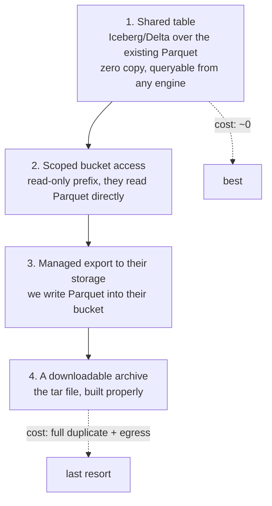
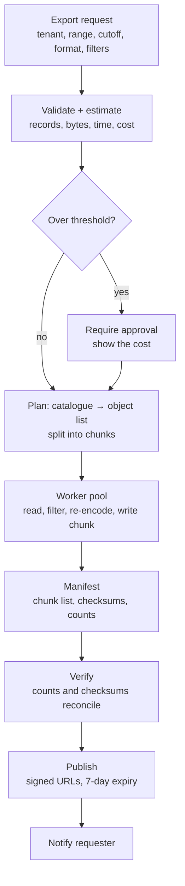

# Flow Three: Bulk Export for Analytics

*"The analytics team can look at data from 24–48 hrs, which they receive in the form of a tar
file."*

The third flow, and the one whose stated requirement most deserves to be questioned before it is
built. This doc does both: it works out what the analytics team actually needs and why a tar
file is usually the wrong shape for it, and then — because "a tar file" is frequently a hard
requirement for reasons that are real even when they are not technical — it builds a correct one.

The hard part is not moving bytes. It is **defining what "the last 24 to 48 hours" means** when
records arrive late, and making the answer reproducible. Scenario IDs are `E-nn`.

---

## Arguing with the requirement, briefly and then constructively

Take the requirement literally and price it. Riverbend's share, for 48 hours:

```
Riverbend: 159 GB/hr raw × 48 = 7.6 TB raw
as a gzipped tar of JSON:   7.6 TB ÷ 4.1 = 1.85 TB
as Parquet + zstd:          7.6 TB ÷ 11  = 694 GB
```

Now the downstream experience:

```
download 694 GB at 1 Gbps sustained = 5,552 s = 1.5 hours   (and 1 Gbps is optimistic)
download 1.85 TB of tar.gz          = 4.1 hours
decompress and load 7.6 TB of JSON into anything            = hours more
disk required on the analyst's side                         = 7.6 TB
repeat tomorrow                                             = every day
```

And three problems that are worse than the time:

**It is not reproducible.** Rerun yesterday's export today and you get different bytes, because
late-arriving records have landed. Any analysis built on it cannot be re-derived, which for an
analytics team is a serious defect.

**It has no schema contract.** A tar of JSON lines has whatever fields the producers happened to
emit. Every consumer writes their own parsing, and every schema change breaks all of them
silently.

**It duplicates data that already exists.** Doc 09 already wrote this data to object storage, in
Parquet, partitioned by time and tenant, catalogued. The export copies it into a worse format so
it can be copied back into a better one.

### What they usually actually want

Ask, and the answer is almost always one of these four, none of which is a tar file:

1. **"We want to run SQL over the last two days of logs."** They want a *table*, not a file.
2. **"We want to join logs against our own data in our warehouse."** They want the data
   *in the warehouse*, or queryable from it.
3. **"We want to train a model / run a batch job on it."** They want it in object storage in a
   format Spark reads — which is exactly what doc 09 already produced.
4. **"Our tooling only reads local files."** This one is real, and it is the case where a file
   is genuinely correct.

### The four things to offer, in order of preference



**Option 1 is nearly free** because the data is already Parquet in object storage with a
catalogue. Exposing it as an Iceberg table means Spark, Trino, Athena, DuckDB and Snowflake can
all query it in place, with schema evolution handled, with time-travel to a specific snapshot —
which solves reproducibility outright — and with no copy. The work is registering the existing
files in an Iceberg metadata layer, which is days of effort, not months.

**Option 4 is what the brief asked for**, and the rest of this doc builds it — because sometimes
the analytics team is a partner organisation, or an auditor, or a system that genuinely cannot
reach your object storage, and "use Iceberg instead" is not an available answer.

The right posture: **offer 1 through 3, build 4 properly, and make the cost of 4 visible** so the
choice is informed rather than habitual.

---

## The consistency boundary, which is the actual hard problem

"The last 24 to 48 hours" is not well defined, and getting this wrong produces exports that
disagree with each other and with the search UI, which destroys trust in both.

### The ambiguity

Three different sets of records could be called "the 14:00 hour":

```
A. every record whose EVENT time is in 14:00–15:00
B. every record whose INGEST time is in 14:00–15:00
C. every record whose event time is in 14:00–15:00 AND that had arrived by some cutoff
```

**A is unbounded.** A record with event time 14:30 could arrive at 20:00 tomorrow from an agent
whose host was partitioned. You can never say set A is complete, so an export of it is never
final.

**B is exact and reproducible** — doc 09 partitions by ingest time precisely so it closes — but
it is **not what an analyst means**. Their query says "requests between 14:00 and 15:00", and
set B contains records from 13:40 that arrived late and excludes records from 14:55 that arrived
at 15:02.

**C is what they mean**, and it requires stating the cutoff explicitly.

### The watermark

Define, and publish, a **completeness watermark**:

> `W(t)` = the event time before which the platform asserts it has received essentially all
> records, as of now.

Computed as the minimum, across all active sources, of the event time of the most recent record
received from that source — the standard streaming watermark, with one adjustment that matters
here. A source that has genuinely stopped (a pod that was deleted) would otherwise hold the
watermark back forever, so sources are **excluded from the minimum after an idle timeout**, and
the exclusion is counted and visible.

At Lantern the watermark typically sits **90 seconds behind real time** and degrades during
incidents.

### The export contract

With a watermark, the export can state exactly what it contains:

```json
{
  "export_id": "exp_2026-09-30_riverbend_a7f3",
  "event_time_range": { "from": "2026-09-29T00:00:00Z", "to": "2026-09-30T00:00:00Z" },
  "completeness_cutoff": "2026-09-30T04:00:00Z",
  "watermark_at_cutoff": "2026-09-30T03:58:31Z",
  "late_records_excluded_estimate": 1247,
  "late_records_excluded_fraction": 0.0000019,
  "reproducible": true,
  "record_count": 655280400,
  "sha256_manifest": "..."
}
```

Read what this says: *these are the records with event time in the stated day that had arrived
by 04:00 the following morning; roughly 1,247 records with event times in that day arrived later
and are not included; rerunning this export with the same parameters will produce the same
bytes.*

**That last clause is the valuable one**, and it is only true because the cutoff is part of the
export's identity. An export defined as "yesterday, as of whenever you run it" is not
reproducible; one defined as "yesterday, as of 04:00" always is.

### Choosing the cutoff, from data

Doc 15 measures the distribution of `ingest_ts − ts`. At Lantern:

```
p50    0.9 s
p90    2.4 s
p99    41  s
p99.9  18  min
p99.99  4.2 hr
max    31  hr     (one agent, a node partitioned over a weekend)
```

A cutoff of 4 hours after the window closes captures 99.99% of records. Going to 31 hours
captures essentially everything and delays the export by more than a day — which is usually a
worse trade than losing 0.0002% of records.

**Make it a per-consumer choice**, because it genuinely differs:

```
analytics dashboards:  4 hours after  (fresh, 99.99% complete)
billing reconciliation: 36 hours after (slow, essentially 100% complete)
compliance archive:     7 days after, plus a monthly amendment pass
```

### Amendments, for consumers who need eventual completeness

For the cases where 0.0002% matters, publish an **amendment**: a small supplementary export
containing records for a closed window that arrived after its cutoff.

```
exp_2026-09-29_riverbend_a7f3           the day, as of +4 h      655,280,400 records
exp_2026-09-29_riverbend_a7f3.amend.1   late arrivals, as of +48 h     1,247 records
```

The consumer decides whether to apply amendments. This keeps the primary export fast and
reproducible while still offering eventual completeness — and it is honest, which the
alternative (silently rewriting yesterday's export) is not. `E-03`.

---

## Building the export



### Chunking is not optional

A single 694 GB artefact is unusable. If the download fails at 90%, it restarts. If the producing
job fails at 90%, it restarts. Chunk it:

```
chunk target: 4 GB compressed
chunks for Riverbend's 48 hours: 694 GB ÷ 4 GB = 174 chunks
```

Each chunk is independently downloadable, independently verifiable, and independently
regenerable. Chunk boundaries follow **partition boundaries** (hour × class), never record
boundaries mid-file, so a chunk is a set of whole source objects and regenerating one is
deterministic.

### The manifest

```json
{
  "export_id": "exp_2026-09-30_riverbend_a7f3",
  "format": "parquet-zstd",
  "schema_version": "v3.2",
  "schema_url": "https://lantern/schemas/logs/v3.2.json",
  "chunks": [
    { "n": 1, "key": "exp_.../part-0001.parquet", "bytes": 4294967296,
      "records": 3771264, "sha256": "9f2a...", "event_time_min": "...", "event_time_max": "..." }
  ],
  "total_records": 655280400,
  "total_bytes": 694000000000,
  "completeness_cutoff": "2026-09-30T04:00:00Z",
  "generated_at": "2026-09-30T04:12:07Z",
  "generator_version": "exporter-2.4.1"
}
```

Four fields earn their place:

- **Per-chunk `records` and `sha256`** let the consumer verify each chunk independently and
  re-request just the corrupt one. Without them, a truncated download is silent data loss on
  their side, which becomes your bug report.
- **`total_records`** is the reconciliation number. The consumer sums their loaded rows and
  compares. Every bulk-transfer system that lacks this eventually has an incident where a
  consumer has been silently short for months. `E-01`.
- **`schema_version` with a URL** makes the contract explicit and versioned.
- **`generator_version`** means a bug in the exporter is traceable to the exports it produced.

### Format

Offer Parquet by default and the requested format on request:

| Format | Size for 48 h | Load time into Spark | When |
|---|---|---|---|
| **Parquet + zstd** | 694 GB | minutes, column-projected | the default |
| JSON Lines + gzip | 1.85 TB | hours, full parse | legacy tooling |
| CSV + gzip | 1.4 TB | hours, and lossy | never, if avoidable |
| Avro | 1.1 TB | fast | streaming consumers |

The gap between Parquet and JSON is **2.7× in bytes and roughly 20× in load time**, because a
Parquet consumer reads only the columns it needs and skips row groups. If the analytics team's
job reads five of forty columns:

```
Parquet: 694 GB × (5 ÷ 40 by column size, roughly) ≈ 110 GB actually read
JSON:    1.85 TB decompressed to 7.6 TB and fully parsed
```

**A 70× difference in work for the same query.** This is the strongest argument for pushing
option 1 or 2 from the hierarchy above, and it is worth putting in front of whoever asked for
the tar.

### CSV deserves a specific warning

Log bodies contain commas, quotes and newlines. CSV escaping handles them, and roughly half of
all CSV consumers do not implement the escaping correctly. **A CSV export of log data will
silently corrupt records in the consumer's parser**, and the corruption will be attributed to
your export. If CSV cannot be avoided, escape strictly, state the dialect in the manifest, and
include a deliberately adversarial record as the first row so a broken parser fails immediately
rather than subtly.

### Building the tar, since that was the ask

```
exp_2026-09-30_riverbend_a7f3/
  MANIFEST.json
  SCHEMA.json
  README.txt
  data/
    part-0001.parquet
    ...
    part-0174.parquet
```

Tarred but **not** compressed at the tar level — the Parquet files are already compressed, so
`tar.gz` over them wastes CPU for under 1% gain, and it destroys random access into the archive.

For very large exports, **do not produce a single tar at all**: produce the chunk files plus the
manifest, and offer a tar only when the total is under about 50 GB. Above that, a single archive
is a liability — one failed byte and the whole thing is refetched.

### Delivery

**Signed URLs with a 7-day expiry**, one per chunk, plus one for the manifest. Not a
long-lived credential, not a shared bucket, not email.

```
each chunk URL: valid 7 days, single tenant, read-only, IP-restricted where feasible
download is logged: who, when, which chunks, bytes transferred
```

Egress cost is real and worth stating:

```
694 GB × $0.09/GB (internet egress) = $62.46 per export
daily, for 40 tenants                = $2,498/day = $74,952/month
```

**Seventy-five thousand dollars a month in egress alone**, for data that already exists in
object storage they could read in place. This number is the most persuasive argument in the whole
doc for options 1 through 3, and it should be on the export request screen.

Within the same cloud, writing to the consumer's bucket in the same region is free — which makes
option 3 dramatically cheaper than option 4 for no loss of function. Offer it first.

---

## Scheduling and resource isolation

Exports are enormous and not urgent. They must never compete with interactive search.

```
priority class:        lowest (doc 11's queue)
worker pool:           separate from the interactive pool
schedule:              default 04:00 local for the tenant, off the diurnal peak
concurrency:           max 2 concurrent exports platform-wide
rate limit:            an export reads at most 500 MB/s from object storage
```

**A separate pool, not just a lower priority.** Priority within a shared pool still means an
export's memory allocation and page-cache pressure affect interactive queries. Physical
separation is the only isolation that holds under load — the same bulkhead argument as doc 05's
`T-10` and doc 16.

Sizing:

```
694 GB output, read 694 GB of source Parquet, re-encode with filters applied
at 90 MB/s per core for decode + filter + encode:
  694,000 MB ÷ 90 MB/s = 7,711 core-seconds
on 32 cores = 241 s = 4 minutes
```

Four minutes of 32 cores for a 48-hour tenant export. **Exports are cheap to produce and
expensive to deliver**, which is the opposite of most people's intuition and is worth saying out
loud when someone proposes producing them more often.

---

## The export failure catalogue

| Class | Scenarios |
|---|---|
| **A. Correctness of contents** | `E-01`, `E-02`, `E-03` |
| **B. Delivery** | `E-04`, `E-05`, `E-06` |
| **C. Resource and cost** | `E-07`, `E-08` |

### E-01 · The consumer is silently short

**What you see.** Nothing, for months. Then an analysis that disagrees with a dashboard, and an
investigation finds the consumer has been loading 94% of each export since a change in March.

**Mechanism.** A chunk failed to download, or failed to parse, and the consumer's loader logged
a warning nobody read.

**Confirm it.** `total_records` in the manifest against the consumer's loaded row count.

**Prevent.** Make reconciliation part of the contract, not an option: per-chunk record counts
and checksums, a total, and — most effectively — **a loader library you provide** that verifies
and fails loudly. Do not rely on every consumer implementing verification correctly.

### E-02 · Two exports of the same window disagree

**What you see.** The analytics team re-runs last Tuesday's export and gets a different record
count. Their pipeline is now non-deterministic.

**Mechanism.** No completeness cutoff, so the export includes whatever had arrived at run time.

**Prevent.** The cutoff is part of the export's identity. Same parameters, same bytes, always.
Publish `reproducible: true` and mean it — and where an export genuinely cannot be reproduced
(source data has since been deleted by retention), say `reproducible: false` with the reason.

### E-03 · Late records are invisible

**What you see.** An analysis that undercounts a window, with no indication that anything is
missing.

**Mechanism.** Records arriving after the cutoff are excluded, correctly, and silently.

**Prevent.** The `late_records_excluded_estimate` field, and the amendment mechanism. Making the
number visible lets the consumer decide whether 0.0002% matters for their use, which is their
call and not yours.

### E-04 · The download fails and restarts from zero

**What you see.** A consumer cannot complete a download over a flaky link. Days of retrying.

**Prevent.** Chunking into 4 GB parts, each independently retryable. Support HTTP range requests
so a partial chunk resumes. Never ship a single multi-hundred-gigabyte artefact.

### E-05 · Signed URLs expire mid-transfer

**What you see.** A download fails at 80% with a 403.

**Mechanism.** A 1-hour URL expiry against a 4-hour download.

**Prevent.** Expiry measured in days, not hours. A refresh endpoint that reissues URLs for an
export the caller is still entitled to. And — the detail people miss — **the expiry check happens
at request start, not continuously**, for most object stores; so a chunk that started before
expiry completes. Verify that for your provider rather than assuming.

### E-06 · An export leaks data across tenants

**What you see.** A tenant finds another tenant's records in their export. A serious incident.

**Mechanism.** A filter bug, or an export job parameterised with the wrong tenant, or a chunk
from a previous export left in a reused prefix.

**Prevent.** Defence in depth, because this is the failure that must not happen:
**path-scoped reads** (doc 09's tenant partitioning means the job is only given one tenant's
objects); **a verification pass** that asserts every record in the output carries the expected
`tenant.id` before publishing; **a fresh, uniquely named output prefix per export**, never
reused; and signed URLs scoped to that prefix. The verification pass costs a full read of the
output and is worth it — four minutes of CPU against a breach.

### E-07 · An export starves interactive queries

**What you see.** Search latency degrading every morning at 04:00.

**Mechanism.** Exports sharing the interactive worker pool.

**Prevent.** A physically separate pool, a read rate limit, concurrency caps, and scheduling off
the peak. Priority alone is insufficient.

### E-08 · The egress bill

**What you see.** A data-transfer line larger than the storage line.

**Mechanism.** $62 per export per tenant per day, compounding across 40 tenants.

**Prevent.** Show the cost on the request screen. Offer same-region delivery to the consumer's
bucket, which is free and functionally identical. Offer the shared-table option, which is free
and better. Charge egress to the requesting team. **Most daily full exports exist because nobody
ever told the requester what it cost**, and the majority convert to option 1 or 2 within a week
of finding out.

---

## What to take away

1. **Argue with the requirement before building it.** "A tar file" is usually a proxy for "we
   want to run SQL over this", and a shared Iceberg table over the Parquet you already have
   costs nothing and is better in every dimension.
2. **Offer four options in order** — shared table, scoped bucket read, managed write to their
   bucket, downloadable archive — and make the cost of the last one visible.
3. **"The last 48 hours" is ambiguous and the ambiguity is the hard part.** Event time is
   unbounded, ingest time is exact but not what anyone means, and only "event time, as of a
   stated cutoff" is both meaningful and reproducible.
4. **Publish a completeness watermark**, exclude idle sources from it with a visible count, and
   make the cutoff part of the export's identity — that one decision is what makes exports
   reproducible.
5. **Choose the cutoff from the measured lateness distribution.** Four hours captures 99.99% at
   Lantern; waiting for the 31-hour maximum delays everything by a day to gain 0.0002%.
6. **Offer amendments rather than rewriting.** Silently changing yesterday's export is worse than
   excluding late records, because it breaks the reproducibility you just promised.
7. **Chunk at 4 GB on partition boundaries**, with per-chunk counts and checksums, so a failure
   costs one chunk and a consumer can verify independently.
8. **`total_records` in the manifest is the reconciliation number.** Every bulk transfer without
   one eventually has a consumer who has been silently short for months.
9. **Parquet over JSON is 2.7× in bytes and around 70× in work** for a consumer reading a subset
   of columns. Lead with that number when someone asks for JSON.
10. **Never export CSV if you can avoid it.** Log bodies contain commas, quotes and newlines, and
    half of all CSV parsers get the escaping wrong — silently, in the consumer, blamed on you.
11. **Exports are cheap to produce and expensive to deliver** — four minutes of CPU, $62 of
    egress. That ratio should shape which options you promote.
12. **Give exports a physically separate worker pool.** Priority within a shared pool still lets
    a 694 GB job degrade interactive search, and interactive search is what people use during
    incidents.

Next: [15-delivery-guarantees-and-data-loss.md](15-delivery-guarantees-and-data-loss.md), which
asks the question every previous doc has deferred: how much are we actually losing?
