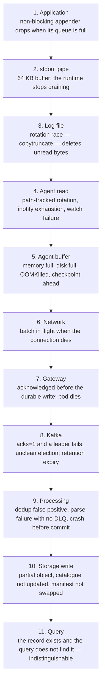

# Delivery Guarantees and Data Loss

Doc 00 made a claim that every doc since has assumed: **log loss is silent.** There is no
acknowledgement path back to the application, no user waiting, no error. A pipeline that drops
4% of records behaves, from every observable angle, exactly like one that drops none.

This doc is about making that observable. It enumerates the eleven places records die, derives
what guarantee is achievable end to end, and — the substantial part — sets out three techniques
for *measuring* loss, because a platform that cannot state its loss rate does not have a loss
rate of zero. It has an unknown one. Scenario IDs are `D-nn`.

---

## Why "we don't lose logs" is always false

Every log platform team, asked whether they lose data, says "not really". The claim is never
based on measurement, because measurement is genuinely hard, and it is always wrong in the same
way: they are thinking about the *stage* they own, and loss happens across a chain of eleven.

Here is the chain, with what each stage's failure looks like:



**Stage 11 is the one people forget**, and it matters because from the user's point of view it
is identical to loss. A record that is in storage but excluded by a pruning bug, an event-time
expansion that did not go back far enough (doc 11's `Q-07`), a field-level access rule silently
dropping a column — the engineer concludes the data is not there. **For measurement purposes,
"stored but unfindable" is loss**, and the canary technique below tests the whole chain
including it, which is why it is the most valuable of the three.

---

## What guarantee is actually achievable

### Not exactly-once

Exactly-once end to end would require a transaction spanning the application's logging call and
the storage write. There is no such transaction and there cannot be, because the application's
`log.Error()` returns `void` before anything has happened.

Any claim of exactly-once in a log pipeline means one of two lesser things: exactly-once *within
one stage*, or at-least-once plus deduplication. The second is honest and achievable; the first
is true and not very useful.

### Not lossless, either

Doc 00's four options — block, drop newest, drop oldest, spill to disk — have no combination
that is both lossless and non-blocking. Lossless means blocking, and blocking means an
application outage caused by the logging system, which is a worse failure than losing logs.

So the honest statement is:

> **At-least-once delivery, conditional on the agent staying alive and its disk buffer not
> filling, with deduplication downstream, and a measured loss rate under 0.01%.**

Every clause in that sentence is load-bearing, and a platform that cannot say all of it should
say less rather than rounding up to "we don't lose logs".

### The acknowledgement chain

At-least-once holds only if every handoff acknowledges after durability, never before. Trace it:

```
agent reads bytes at offset N
  → agent sends batch
    → gateway receives, validates, produces to Kafka with acks=all
      → Kafka leader + 1 follower have it on disk  ← THE durability point
    ← gateway acknowledges to the agent
  ← agent advances its checkpoint past N
```

**The durability point is `acks=all` with `min.insync.replicas=2`.** Everything before it is
recoverable by retry; everything after it is Kafka's problem. Two rules follow, and violating
either creates silent loss:

- **The gateway must not acknowledge before the Kafka write is confirmed** (doc 05's step 9).
  Acknowledging on receipt makes the gateway a black hole during a crash.
- **The agent must not advance its checkpoint before the acknowledgement** (doc 02's `A-03`).

Downstream of Kafka, the chain continues per consumer:

```
consumer reads offset M
  → processes
    → writes to storage, confirmed
      → catalogue transaction commits   ← durability point for the storage path
    ← consumer commits offset M
```

**Commit the Kafka offset after the storage write, never before.** A consumer that commits first
and writes second loses everything in flight when it dies. This is the same rule, one tier down,
and it is violated constantly because auto-commit is the default in most Kafka clients.

---

## Measuring loss: three techniques

None of these is sufficient alone. Run all three; they catch different things.

### Technique 1: stage counters that must reconcile

Every stage exports a count of records in and records out. In steady state, adjacent stages must
agree within the in-flight window.

```
agent.records_read_total          ← lines read from files, after multiline reassembly
agent.records_sent_total
agent.records_dropped_total{reason}
gateway.records_received_total
gateway.records_rejected_total{reason}
gateway.records_produced_total
processor.records_consumed_total
processor.records_deduplicated_total
processor.records_dropped_total{reason}
storage.records_written_total
```

The reconciliation, per tenant per minute:

```
agent.read − agent.dropped               should equal   gateway.received       (± in flight)
gateway.received − gateway.rejected      should equal   gateway.produced
gateway.produced                         should equal   processor.consumed     (± lag)
processor.consumed − dedup − dropped     should equal   storage.written
```

**Strengths.** Cheap, continuous, covers everything from stage 4 onward, and — most valuably —
it *localises* the loss to a stage.

**Weaknesses, and they are significant.** It cannot see stages 1 through 3, because the agent's
`records_read` is its first observation and it has no idea what it never saw. And it is only as
correct as the counters: a stage that drops records in a code path that does not increment
`dropped` produces a discrepancy you will attribute to clock skew or in-flight records. **Every
`return` and `continue` on a record path must increment a counter**, and the way to enforce that
is a test that asserts in ≡ out + dropped for a synthetic workload with injected faults.

### Technique 2: per-stream sequence numbers

The agent assigns a monotonically increasing sequence number per stream (per container, per
stdout/stderr channel):

```json
{ "stream.id": "8e21f4a7-stdout", "stream.seq": 8814027, "body": "..." }
```

At the storage layer, for each stream, check that the sequence numbers form an unbroken run. A
gap is loss. A repeat is a duplicate.

```sql
SELECT stream_id,
       max(seq) - min(seq) + 1 AS expected,
       count(DISTINCT seq)     AS actual,
       max(seq) - min(seq) + 1 - count(DISTINCT seq) AS gap
FROM logs
WHERE dt = '2026-09-30' AND hr = 14
GROUP BY stream_id
HAVING gap > 0
```

**Strengths.** Exact, per stream, and it localises loss to a *source* rather than a stage —
which is what you need when loss is concentrated rather than uniform. It also detects
duplicates and reordering for free.

**Weaknesses.** It costs bytes on every record:

```
stream.id  16 bytes (as a UUID; 8 if hashed)
stream.seq  8 bytes
overhead:  24 bytes on a 494-byte record = 4.9% before compression
```

Both columns compress extremely well — `stream.id` dictionary-encodes to near nothing, and
`stream.seq` is a monotonic integer that delta-encodes to about 1 bit per row — so **the stored
cost is under 0.3%.** That is cheap enough to do unconditionally, and Lantern does.

It also cannot see loss before the agent (stages 1–3), since the agent assigns the number.

And there is a subtlety worth flagging: **an agent restart resets nothing but must not reuse
sequence numbers**, or gaps and duplicates become indistinguishable. Persist the sequence
alongside the file checkpoint, and on an unclean restart jump forward by a safe margin and emit
a marker record so the analysis knows the discontinuity is expected rather than loss.

### Technique 3: canary records

The only technique that measures the **whole chain, end to end, including the query layer**.

A small service on every node emits a synthetic record every second:

```json
{
  "body": "lantern canary",
  "canary.node": "ip-10-0-3-47",
  "canary.seq": 1790778181,
  "canary.emitted_at": "2026-09-30T14:23:01.000Z",
  "service.name": "lantern-canary"
}
```

A verifier queries — **through the normal query path, as a normal user** — for the last five
minutes of canaries and checks that every expected sequence number for every node is present.

```
12,000 nodes × 1 canary/s = 12,000 records/s
              = 5.9 MB/s = 0.21% of platform volume
```

**Strengths, and they are decisive.** It measures what a user actually experiences. It covers
every stage including the application-to-agent handoff and the query path. It gives a single,
honest, publishable number: "99.994% of canaries emitted in the last 24 hours were retrievable
through search." And because canaries are per node, loss localises to hosts.

**Weaknesses.** It measures the canary's path, not every path — a canary emitting single-line
records will not detect a multiline reassembly failure, and a canary going through the default
pipeline will not detect a bug affecting one tenant's parsing rules. Mitigate by making canaries
*representative*: several variants, including a multiline one, a large one, a high-cardinality
one, and one per tenant that traverses that tenant's actual rules.

It also costs 0.21% of capacity, which is the cheapest insurance in the collection.

### What each technique catches

| Loss location | Stage counters | Sequence numbers | Canaries |
|---|---|---|---|
| 1–3: application, pipe, file | no | no | **yes** |
| 4: agent read | no (it is the origin) | **yes** | **yes** |
| 5: agent buffer | **yes** | **yes** | **yes** |
| 6: network | **yes** | **yes** | **yes** |
| 7: gateway | **yes** | **yes** | **yes** |
| 8: Kafka | **yes** | **yes** | **yes** |
| 9: processing | **yes** | **yes** | **yes** |
| 10: storage write | **yes** | **yes** | **yes** |
| 11: query | no | no | **yes** |
| Localises to a stage | **yes** | no | no |
| Localises to a source | no | **yes** | **yes** |
| Latency to detect | seconds | minutes | ~1 minute |

**Canaries catch everything and localise to nothing; counters localise to a stage; sequence
numbers localise to a source.** Use canaries as the alert and the published SLI, then counters
and sequences as the diagnostic.

---

## The loss budget

Doc 01 committed to under 0.01% end to end. Allocate it, because an unallocated budget means
every stage assumes it has all of it:

```
stage 1–3, application and file            0.0020%   mostly non-blocking appender drops
stage 4–5, agent                           0.0030%   restarts, buffer overruns
stage 6–7, network and gateway             0.0005%   rejected batches, pod terminations
stage 8, Kafka                             0.0001%   essentially zero with acks=all, RF3
stage 9, processing                        0.0020%   dedup false positives, poison records
stage 10, storage                          0.0004%   failed writes, retried
stage 11, query                            0.0020%   pruning bugs, expansion gaps
                                          --------
total budget                               0.0100%
```

At 5.56M records/s, 0.01% is **556 records per second** — about 48 million a day. Stated that
way it sounds enormous, and that reaction is worth sitting with: **0.01% loss is a lot of
records in absolute terms and a very good loss rate in relative terms**, and both are true.
Which framing matters depends on the record: 48 million routine `INFO` lines is fine, and one
missing audit record is not, which is why doc 08 puts audit on a separate path with a different
guarantee rather than a better rate on the same path.

**Alert on the budget being consumed, not on a raw rate.** Same discipline as an SLO error
budget — see
[`../Observability/04-slis-slos-and-error-budgets.md`](../Observability/04-slis-slos-and-error-budgets.md).
A brief spike that uses 3% of the monthly budget is not a page; a sustained rate that will
exhaust it in four days is.

---

## Duplicates: the other side

At-least-once means duplicates, and they must also be measured and bounded.

```
measurement: records sharing a record_id within a partition
             (doc 07's xxhash64(host_id || inode || byte_offset))

Lantern's measured steady-state duplicate rate: 0.004%
during a gateway rolling deploy:                0.31% for ~90 seconds
during a network partition and recovery:        up to 2.1%
```

Duplicates matter differently for different consumers, and the right response is different for
each:

- **Search.** Mostly harmless; two identical lines look like the application logged twice.
  Deduplicate in the merge step (doc 11's `Q-08`) so it does not confuse anyone.
- **Derived metrics.** Actively wrong — a 2% duplicate rate inflates every count by 2%.
  Deduplicate before deriving (doc 07's ordering).
- **Billing.** Wrong, and it is a charge dispute. Bill on deduplicated counts.
- **Security detection.** "Five failed logins" becomes "five failed logins" from three
  duplicated events. Detection rules must deduplicate on `record_id`.

**Publish the duplicate rate alongside the loss rate.** A platform reporting one and not the
other is giving half a picture, and the half it omits is usually the one that got worse when
somebody tightened the other.

---

## Ordering

What is actually guaranteed, stated plainly because it is frequently overstated:

| Scope | Guarantee | Why |
|---|---|---|
| Within one stream (container + channel) | **ordered** | one file, one agent, one Kafka partition |
| Within one pod, across stdout and stderr | **not ordered** | two streams, interleaved by the runtime |
| Within one service, across pods | **not ordered** | different partitions |
| Across services | **not ordered** | and meaningless to ask |
| By event time, globally | **not ordered** | clock skew makes it undefinable |

The one people are surprised by is stdout versus stderr within a single container. A program
writing an error to stderr and a message to stdout in that order may have them recorded in
either order, because they are separate pipes with separate buffers. **If ordering between them
matters, write both to one stream** — which is another argument for structured logging to stdout
only.

For reconstruction, order by `(stream.id, stream.seq)` within a stream and by `ts` across
streams, accepting that cross-stream ordering is approximate to within the clock skew.

---

## The loss and delivery failure catalogue

| Class | Scenarios |
|---|---|
| **A. Silent loss** | `D-01`, `D-02`, `D-03` |
| **B. Measurement failures** | `D-04`, `D-05` |
| **C. Duplicates and ordering** | `D-06`, `D-07` |

### D-01 · The acknowledgement chain has a gap

**What you see.** Loss that only occurs during restarts and deploys, and only shows up in
sequence-gap analysis because it is a fraction of a percent.

**Mechanism.** One handoff acknowledges before durability. The usual culprits, in order of
frequency: Kafka consumer auto-commit (commits on poll, before processing); a gateway that
acknowledges on receipt; an agent that checkpoints on send.

**Confirm it.** Kill `-9` each component under load and reconcile counts across the restart.
Every component should show **duplicates, not gaps**. A gap means that component's
acknowledgement is premature.

**Recover.** Nothing to recover; the data is gone.

**Prevent.** Audit each handoff explicitly, and test it with fault injection rather than
reasoning about it. `enable.auto.commit=false` on every consumer, with explicit commits after
the durable write.

### D-02 · Acks=1 and a leader failure

**What you see.** A small, sharp loss coinciding exactly with a Kafka broker failure.

**Mechanism.** `acks=1` means the leader confirmed and followers may not have. The leader dies
before replicating; the new leader never had those records.

**Confirm it.** Producer config, and correlation of sequence gaps with leader-election events.

**Prevent.** `acks=all` with `min.insync.replicas=2`, and `unclean.leader.election.enable=false`
(doc 06). The throughput cost is a few milliseconds of latency per batch, which against a 200 ms
batch timer is nothing.

### D-03 · Retention expiry during a consumer outage

Doc 06's `B-01`, listed here because it is a loss mechanism and not only a buffer one. **The
archiver is the consumer whose outage causes permanent loss**, and alerting on
`time_until_unrecoverable` rather than on lag is the prevention.

### D-04 · Counters do not reconcile and nobody knows why

**What you see.** A persistent 0.4% discrepancy between two stages that never resolves.

**Mechanism.** Usually one of three: a drop path that does not increment a counter; counters
sampled at different instants so in-flight records appear as loss; or one stage counting batches
and another counting records.

**Confirm it.** Compare over a long window (an hour), where in-flight becomes negligible. A
discrepancy that persists over an hour is real; one that appears at one-minute resolution and
vanishes at one hour is a timing artefact.

**Prevent.** Every drop path increments a counter — enforced by a fault-injection test that
asserts the identity. Counters with the same units at every stage. And reconcile over windows
long enough that in-flight does not dominate.

### D-05 · Canaries pass while real data is lost

**What you see.** 99.999% canary success and users reporting missing logs.

**Mechanism.** The canary is not representative. It is single-line, small, from a service with
no sampling rules, in one tenant, going through a default path. The loss is in a multiline
reassembly bug, or one tenant's parser, or the sampling configuration.

**Prevent.** Canary *variants*: multiline, oversized (near the truncation limit), high-field-
count, non-UTF-8, and one canary per tenant traversing that tenant's actual rules. Report success
per variant, so a failing variant names the bug.

### D-06 · Duplicates inflate a derived metric

**What you see.** A log-derived error count 2% above the application's own counter, correlated
with a network event.

**Mechanism.** Derivation before deduplication, or a deduplication window shorter than the retry
delay.

**Prevent.** Deduplicate first (doc 07's ordering). Measure the duplicate rate continuously and
publish it. For metrics that must be exact, derive from the application's own instrumentation
rather than from logs — which is doc 00's original point.

### D-07 · Interleaved stdout and stderr confuse an investigation

**What you see.** An error appearing to precede the operation that caused it.

**Mechanism.** Two streams, ordered independently. Not a bug in the pipeline.

**Prevent.** Log to one stream. Where you cannot, make the ordering ambiguity visible: the UI
should not present records from different streams as a single ordered sequence without
indicating that cross-stream order is approximate. Sub-millisecond timestamps help but do not
resolve it, because the timestamps come from different buffers flushed at different times.

---

## What to take away

1. **"We don't lose logs" is always false and never measured.** Records die at eleven distinct
   places, and each team is thinking about the one they own.
2. **"Stored but unfindable" is loss**, from the user's point of view. Any measurement that
   stops at the storage write is measuring the wrong thing.
3. **Exactly-once is not achievable and not honest.** The achievable guarantee is at-least-once,
   conditional on the agent surviving, with downstream deduplication and a measured rate — and
   every clause matters.
4. **The durability point is `acks=all` with `min.insync.replicas=2`.** Every handoff before it
   must retry; no handoff may acknowledge before it.
5. **Commit Kafka offsets after the storage write, never before** — and `enable.auto.commit` is
   the most common violation, because it is the default.
6. **Run all three measurement techniques.** Canaries catch everything including the query layer
   but localise to nothing; stage counters localise to a stage; sequence numbers localise to a
   source.
7. **Sequence numbers cost 4.9% of raw bytes and under 0.3% stored**, because both columns
   compress almost perfectly. Cheap enough to run unconditionally.
8. **Canaries cost 0.21% of capacity and are the only thing that measures what a user
   experiences.** Make them representative, or they will pass while real data is lost.
9. **Allocate the loss budget across stages**, or every stage assumes it has all of it. And
   alert on budget burn rate, not on an instantaneous rate.
10. **0.01% loss is 48 million records a day and an excellent loss rate.** Both framings are
    true, which is why audit data gets a separate path rather than a better number on the same
    one.
11. **Publish the duplicate rate next to the loss rate.** Reporting one without the other hides
    the one that got worse when you improved the other.
12. **Ordering exists only within a stream.** Not across stdout and stderr in the same container,
    which surprises people, and which is another reason to write everything to one stream.

Next: [16-multi-tenancy-isolation-and-quotas.md](16-multi-tenancy-isolation-and-quotas.md),
which is about stopping one tenant's problem from becoming everyone's.
