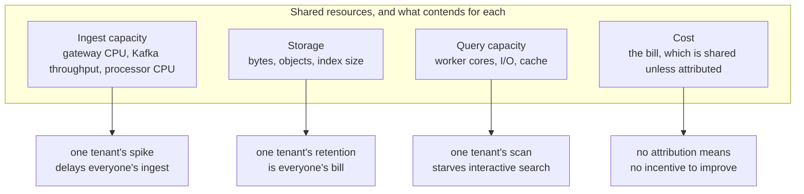
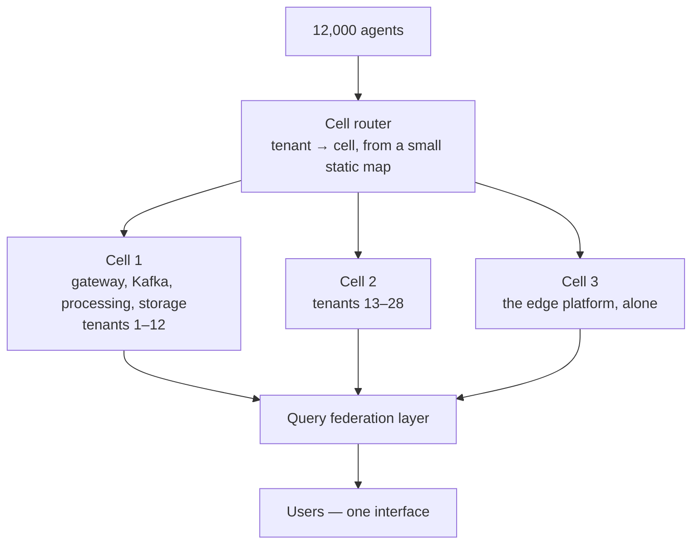

# Multi-Tenancy, Isolation, and Quotas

Forty business units share Lantern. Every one of them can, by accident, take it down for the
other thirty-nine — and unlike most shared systems, the way they do it is not a bug in their
code but a normal consequence of their code failing. A service that starts erroring logs thirty
times more; that is the system working as designed, and it is also a 31× load spike on a shared
platform.

This doc is about containing that. Scenario IDs are `M-nn`.

The organising question throughout: **for each shared resource, what stops one tenant from
taking all of it, and what happens to that tenant when the stop engages?** Both halves matter.
A system that only answers the first has a protection mechanism that operators disable during
incidents, because the answer to the second was "their data disappears".

---

## What a tenant is, and why the definition matters

At Lantern a tenant is a **business unit** — Riverbend, the identity platform, the data
platform, and 37 others. Not a service, not a team, not a customer.

The choice of granularity is a real trade:

**Too coarse** (one tenant per company) and there is no isolation at all. **Too fine** (one
tenant per service, 12,400 of them) and quota administration becomes a full-time job, per-tenant
overhead multiplies, and the storage partition count explodes — doc 09 showed `service` as a
partition key produces 60 million directories a day.

**Business unit is the right granularity because it matches the budget.** A tenant needs an
owner who can be told "you are over your limit" and who has the authority to do something about
it. Below the business-unit level there is no such person; above it, there is no such
conversation.

Within a tenant, `service.name` provides a second level of accounting without a second level of
isolation — you can attribute cost and apply per-service rate limits, but the isolation boundary
is the tenant.

### The skew you should expect

Tenant volume is never uniform, and designs that assume it is fail immediately. Lantern's
distribution, which is typical:

```
largest tenant (edge and CDN platform)   18%  =  1.80 TB/hr
2nd                                      11%
3rd                                       9%
top 5                                    52%
top 10                                   71%
Riverbend (11th)                        1.6%  =  159 GB/hr
smallest 20 tenants combined              4%
ratio, largest to median                 62×
```

This matches the pattern in [`../DataPlatform.md`](../DataPlatform.md), where one tenant at 18%
of traffic breaks uniform partitioning outright. **Any mechanism that allocates equally — equal
partitions, equal quotas, equal worker shares — is wrong before you start.** Allocate
proportionally to committed volume, and make the largest tenant's failure the design case.

---

## The four things that must be isolated



They fail differently and need different mechanisms. Taking them in turn.

---

## Isolating ingest

### The mechanism: a token bucket per tenant at the gateway

```
rate      = committed volume, in bytes/s
burst     = 60 seconds of committed volume
refill    = continuous
```

A token bucket rather than a fixed window, because logs are bursty at second resolution and a
fixed window either rejects legitimate bursts or allows a full window's volume in a millisecond.
Sixty seconds of burst lets a service's normal variation through and still bounds the damage.

For Riverbend:

```
committed:  159 GB/hr = 44.2 MB/s
burst:      44.2 × 60 = 2.65 GB
```

### The graded response, which is the part that matters

Doc 08 introduced it; here is the full behaviour, because this is what makes a quota system
something operators trust rather than disable.

```
Level 0  ≤100% of committed    normal
Level 1  100–150%              accept everything, notify the owner, bill the overage
Level 2  150–300%              drop TRACE and DEBUG; sample INFO to fit; keep WARN+ whole
Level 3  >300%                 drop everything below WARN; page the tenant's on-call;
                               keep ERROR, FATAL and audit whole
Level 4  >300% for >15 min     platform on-call engaged; consider a dedicated pool
```

Work through what this does to the 31× spike from doc 01, on a tenant committed to 44.2 MB/s:

```
spike to 31× = 1,370 MB/s arriving
level 3 engages
records at WARN and above in a failing service: typically 60% of its output
                                                = 822 MB/s still accepted

Hmm — that is still 18.6× committed, which the platform cannot absorb.
```

So level 3 alone is insufficient for the extreme case, and the design needs one more step. The
missing piece is a **hard ceiling on accepted bytes regardless of level**:

```
Level 5  absolute ceiling at 5× committed = 221 MB/s
         above this, sample even ERROR records, preserving:
           - one record per distinct (service, error.code) per second, guaranteed
           - a weighted sample of the rest
           - audit records, always, no ceiling (0.07% of volume, doc 08)
```

**"One record per distinct error per second, guaranteed" is the key idea.** During a 31× spike
the tenant is not producing 31× as much *information* — it is producing the same few errors
repeated. Keeping one of each per second preserves essentially all of the diagnostic value at
0.4% of the volume. This is doc 08's dynamic sampling, applied as an emergency control rather
than a steady-state policy.

The sampled records carry their weight (doc 08's `V-01`), so counts remain correct, and the UI
shows a prominent banner: *"payments was rate-limited from 14:02; ERROR records sampled 1:38;
counts are weighted estimates."*

### Where else ingest isolation is needed

The gateway is the primary point, but it cannot catch everything:

| Point | Catches | Mechanism |
|---|---|---|
| Agent, per container | one pod flooding a node (`A-09`) | 2 MB/s default cap, drop and count |
| Gateway, per tenant | the aggregate, with trusted identity | graded token bucket, above |
| Gateway, per connection | one misbehaving agent | concurrency bulkhead |
| Kafka | a tenant monopolising a partition | client quotas by principal |
| Processor, per tenant | expensive parsing rules | CPU accounting, concurrency cap |

**The per-connection concurrency bulkhead is easy to omit and important.** Rate limiting alone
does not stop one tenant occupying every gateway worker thread with slow, large requests —
doc 05's `T-10`. Cap the number of in-flight requests per tenant at, say, 10% of the pool, so no
tenant can hold more than that regardless of their rate.

---

## Isolating storage

Storage contention is not about throughput — object storage is effectively infinite — it is
about **cost and about the catalogue**.

```
per-tenant storage quota: bytes stored × retention, checked daily
per-tenant object count:  capped, to protect the catalogue
per-tenant field count:   2,000 distinct attribute keys (doc 04's S-01)
```

The field-count cap is the one that protects other tenants: doc 04 showed 50,000 sprawling keys
from one tenant adding 13% to the *whole platform's* storage through per-column overhead in
shared files. Note "shared files" — that only happens if tenants share Parquet files. Doc 09
partitions by tenant, so they do not, which means one tenant's field explosion costs only that
tenant. **Partitioning by tenant is a cost-isolation mechanism as much as a security one**, and
that is a good example of a boundary paying for itself twice.

Storage overage is billed rather than blocked. Blocking a storage write means dropping data that
has already been ingested, processed and paid for, which is the worst possible moment to discard
it.

---

## Isolating query capacity

The hardest of the four, because query cost is unpredictable before execution and enormous in
its range — doc 11 measured p50 at 0.7 core-seconds and p99.9 at 2,000.

### Four mechanisms, all required

**1. Per-query ceilings** (doc 11): bytes scanned, execution time, workers, result size.

**2. Per-tenant concurrency bulkheads.** No tenant holds more than `max(2, 15% of pool)` workers.
A bulkhead, not a rate limit, because a few enormous queries starve everyone without exceeding
any rate.

**3. Weighted fair queuing.** When the queue is non-empty, dispatch in proportion to committed
volume rather than first-come-first-served — otherwise a tenant submitting 50 queries gets 50
slots while a tenant submitting one waits behind them.

A deficit round-robin scheduler over per-tenant queues does this in a few dozen lines:

```
each tenant has a deficit counter, incremented each round by its weight
a tenant may dispatch while its deficit exceeds the cost of its head query
cost is the plan-time estimate from doc 11
```

**The plan-time estimate is what makes fair scheduling possible.** Without it you are scheduling
by query count, and one tenant's 40 TB scan counts the same as another's 200 MB one.

**4. Priority classes within a tenant**, so a tenant's own scheduled reports do not starve their
own interactive searches. Interactive > scheduled > export, with exports on a physically
separate pool (doc 14).

### The cache is a shared resource too

Doc 11's footer and block caches are shared, and a tenant running large scans evicts everyone
else's working set — the same page-cache eviction problem as doc 06's `B-04`, one tier up.

**Partition the block cache by tenant**, proportionally to committed volume. It is less
efficient than a global LRU when load is uneven, and it means a tenant's scan cannot destroy
another's cache hit rate. For a shared platform that trade is correct; for a single-tenant
system it would not be. `M-06`.

---

## Cost attribution, which changes behaviour more than any limit

Every mechanism above is a constraint. Attribution is an incentive, and incentives work better.

### What to attribute

```
ingest:      bytes received × $/GB          (gateway + Kafka + processing)
storage:     TB-months per tier             (hot, warm, cold priced separately)
indexing:    bytes indexed × $/GB           (the largest line, and the most controllable)
query:       core-seconds + cold retrieval bytes
export:      egress GB
```

For Riverbend:

```
ingest    159 GB/hr × 730 h = 116 TB/month
          at $0.42/GB ingested (derived in doc 20)     = $48,720
storage   hot 0.70 TB, warm 9.8 TB, cold 129 TB        =    $920
query     1,240 queries/month × 18 core-seconds avg    =     $22
export    none (uses the shared table)                 =      $0
                                                        --------
                                                        $49,662/month
```

**Ingest dominates — 98% of it.** That is the number to show a team, and it makes doc 08's
volume hierarchy immediately compelling in a way that no policy document does.

### Showback before chargeback

Publish the numbers before charging for them. Three months of a monthly report showing each
tenant their cost, their trend, and their top ten contributing log statements, typically
produces a 20–35% voluntary reduction — because most excess volume is accidental and nobody
had told anyone.

Then charge. The report makes the charge unsurprising, which is most of what makes chargeback
politically survivable.

### The report that works

Per tenant, monthly, one page:

```
Riverbend — September 2026

Total: $49,662  (↑ 12% from August)

Top contributors to the increase:
  1. checkout-api  DEBUG at src/pricing/engine.go:204   +$4,100   (new, Sept 8)
  2. catalog-api   access logs, unsampled               +$1,900
  3. payment-api   ERROR volume up 3×                     +$700   (see INC-4471)

Searches against your logs this month:       1,240
Log statements never matched by any search:  312 of 4,880  ($8,200/month)
  Top 5 unsearched by cost: [list with file:line]

Estimated saving if you adopt the platform default sampling: $14,300/month
  [one-click: apply default sampling]
```

Three things make this work, and they are not obvious:

- **`file:line` attribution** makes it a five-minute fix rather than an investigation.
- **"Never matched by any search"** is the persuasive column. `$8,200/month` for statements
  nobody has ever looked at is an easy decision. This requires the search-audit log from doc 13.
- **The one-click action** removes the last excuse. A report with a recommendation and no action
  produces agreement and no change.

---

## When to stop sharing: cells

Everything above is soft multi-tenancy — shared infrastructure with logical isolation. It fails
in four situations, and recognising them is worth more than perfecting the mechanisms.

**1. A tenant with a genuinely different profile.** The edge platform at 18% of volume, almost
entirely access logs, never interactively searched. Its access pattern shares nothing with the
others, and giving it a dedicated ingest and storage path makes both simpler.

**2. Regulatory separation.** A tenant whose data must reside in a specific jurisdiction, or
under different access controls, or on hardware nobody else touches. Soft isolation is a policy;
regulators often want a boundary.

**3. A tenant whose incidents keep affecting others.** If a tenant has hit level 3 three times
this quarter, the mechanisms are working and the sharing is not. Move them.

**4. Scale.** Beyond roughly 30 TB/hr the blast radius of the whole platform becomes the
argument, independent of any tenant — see
[`../MicroservicesPOF/13-isolation-cells-regions-and-blast-radius.md`](../MicroservicesPOF/13-isolation-cells-regions-and-blast-radius.md).



**The cost of cells is real and should not be understated.** Capacity is stranded (each cell
needs its own headroom, so total headroom is N × per-cell rather than shared), operations
multiply, cross-cell queries need federation, and the cell router becomes a control plane whose
failure affects everything. Doc 22 covers when the trade tips.

The one piece worth building early even in a single-cell system: **make the tenant-to-cell
mapping explicit from day one**, even when every tenant maps to `cell-1`. Retrofitting a routing
layer is far harder than having a trivial one that later becomes non-trivial.

---

## The multi-tenancy failure catalogue

| Class | Scenarios |
|---|---|
| **A. Ingest contention** | `M-01`, `M-02`, `M-03` |
| **B. Query contention** | `M-04`, `M-05`, `M-06` |
| **C. Governance** | `M-07`, `M-08` |

### M-01 · One tenant's incident delays everyone's ingest

**What you see.** Ingest latency up platform-wide. One tenant's volume at 20× normal.

**Mechanism.** No effective per-tenant limit, or a limit set so far above committed volume that
it never engages.

**Confirm it.** Bytes received per tenant, at one-minute resolution, sorted.

**Recover.** Apply an emergency limit to the tenant. It should be a config push taking effect in
seconds, not a deploy.

**Prevent.** The graded token bucket with the absolute ceiling at 5× committed. Test it — most
quota systems are configured and never exercised, and the first time they engage is during the
incident they were built for, which is the worst time to discover the level-3 behaviour drops
something important.

### M-02 · The quota engages and destroys the incident data

**What you see.** A tenant hits their limit during an outage; the logs that would explain the
outage were dropped.

**Mechanism.** Volume-based dropping with no regard to record class. This is the failure that
causes operators to disable quota systems permanently, so it matters more than its frequency
suggests.

**Prevent.** Graded response by level. The absolute ceiling preserves one record per distinct
error per second. And — the part that builds trust — **tell the tenant exactly what was dropped
and what was kept**, in the UI, at the top of their search results, for the affected window.

### M-03 · The limit is per tenant and the problem is per service

**What you see.** A tenant is well within their limit and one of their services is starved,
because another of their services is consuming the whole allowance.

**Mechanism.** One level of accounting. Common, and it turns a tenant-level protection into an
intra-tenant unfairness.

**Prevent.** Per-service sub-limits within a tenant's allocation, defaulting to proportional
shares and adjustable by the tenant themselves. The platform enforces the tenant total; the
tenant allocates within it. **Pushing the intra-tenant decision to the tenant is both correct
and removes you from an argument you cannot resolve.**

### M-04 · One query starves the query tier

Doc 11's `Q-03`. The multi-tenant addition: per-tenant concurrency bulkheads and weighted fair
queuing, so a tenant submitting many queries does not get proportionally more service.

### M-05 · Scheduled reports collide

**What you see.** Query latency spiking at the top of every hour.

**Mechanism.** Every tenant's scheduled dashboards and reports run at `:00`. The
thundering-herd pattern from [`../K8s/cronJobs`](../K8s/cronJobs/README.md), applied to queries.

**Prevent.** Jitter scheduled query start times by a hash of the tenant and report ID. Refuse
to accept a schedule that specifies an exact minute; assign one. Run scheduled queries on a
separate, lower-priority pool.

### M-06 · Cache poisoning between tenants

**What you see.** Query latency degrading for several tenants whenever one runs large scans.

**Mechanism.** A shared LRU block cache. One tenant's scan of cold data evicts everyone's hot
working set.

**Confirm it.** Cache hit rate per tenant, correlated with other tenants' scan volume.

**Prevent.** Partition the cache by tenant proportionally to committed volume. Accept the lower
aggregate efficiency; predictability is worth more in a shared system.

### M-07 · Cost is invisible, so nobody optimises

**What you see.** Platform cost growing 40% a year with no corresponding growth in value. Every
conversation about it is a platform-team problem.

**Mechanism.** No attribution, so log volume is free at the point of use and expensive in
aggregate — a textbook tragedy of the commons.

**Prevent.** Showback for three months, then chargeback. With `file:line` attribution and the
"never searched" column, which are what turn a bill into an action.

### M-08 · A tenant can forge another tenant's identity

**What you see.** Records attributed to the wrong tenant; in the worst case, a tenant able to
read another's data.

**Mechanism.** `tenant.id` taken from the client rather than derived from the authenticated
identity. Doc 04 flagged this; it belongs here too because it is the multi-tenancy failure with
the worst consequences.

**Confirm it.** Read the gateway code path that sets `tenant.id`. If the field is ever copied
from the payload, this is live.

**Prevent.** Server-side assignment from the mTLS identity, always. Strip any client-supplied
`tenant.id` before processing, and count how often one was present — a non-zero count is either
a misconfigured agent or someone testing your boundary, and both are worth knowing about.

---

## What to take away

1. **A tenant is a business unit, because a tenant needs an owner with a budget.** Finer
   granularity has nobody to have the conversation with; coarser has no isolation.
2. **Expect 62× skew between the largest and median tenant.** Any mechanism that allocates
   equally is wrong before you start; allocate proportionally to committed volume.
3. **For every shared resource, answer two questions**: what stops one tenant taking all of it,
   and what happens to that tenant when the stop engages. Systems that only answer the first get
   disabled during incidents.
4. **Graded quotas, with an absolute ceiling that preserves one record per distinct error per
   second.** During a 31× spike a tenant is not producing more information, just more copies —
   so 0.4% of the volume preserves essentially all the diagnostic value.
5. **Rate limits do not stop resource monopolisation; bulkheads do.** Cap in-flight requests and
   concurrent query workers per tenant, not just rate.
6. **Partitioning storage by tenant is a cost-isolation mechanism as well as a security one** —
   it confines one tenant's field explosion to that tenant's files.
7. **Weighted fair queuing needs a plan-time cost estimate.** Without it you are scheduling by
   query count, and a 40 TB scan counts the same as a 200 MB one.
8. **Partition the query cache by tenant.** Lower aggregate efficiency, and one tenant's scan
   cannot destroy another's hit rate.
9. **Attribution changes behaviour more than limits do.** Showback for three months typically
   produces a 20–35% voluntary reduction, because most excess is accidental.
10. **The persuasive column is "never matched by any search".** `$8,200/month for statements
    nobody has ever looked at` is an easy decision; "please log less" is not.
11. **Push the intra-tenant allocation decision to the tenant.** The platform enforces the total;
    the tenant divides it. This is correct and it removes you from an argument you cannot settle.
12. **Make the tenant-to-cell mapping explicit from day one**, even when every tenant maps to
    one cell. Retrofitting a routing layer is far harder than growing a trivial one.

Next: [17-security-compliance-and-pii.md](17-security-compliance-and-pii.md), which is about the
data you wish you had not collected.
