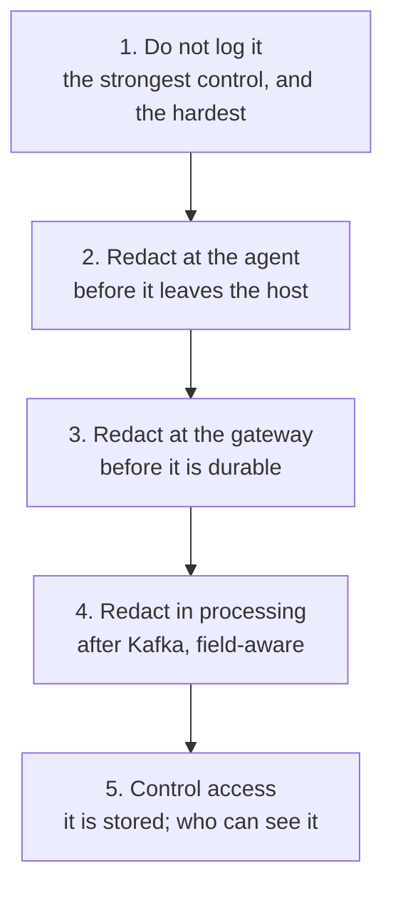

# Security, Compliance, and Personal Data

Your log platform is probably the largest uncontrolled collection of personal data in your
organisation, and almost certainly the one with the loosest access controls. It was not designed
that way. It happened because logging is the one place where every engineer, in every service,
can write arbitrary data to permanent storage with no review, no schema, and no approval.

That is the problem this doc is about. It covers what ends up in logs that should not, where to
stop it, what the stopping costs, who should be able to read what, and how to honour a deletion
request against 8 petabytes of immutable object storage. Scenario IDs are `C-nn`.

One framing worth holding throughout: **every other data store in your company has an owner who
decided what goes in it. Logs do not.** Every control here is a substitute for that missing
decision.

---

## What is actually in there

Not hypothetical. This is what a classification pass over a real log corpus finds, and the
proportions are consistent across organisations.

| Class | How it gets there | Typical prevalence |
|---|---|---|
| **Direct identifiers** — email, phone, name | `log.Info("sending to " + user.Email)` | 2–8% of application records |
| **Indirect identifiers** — user ID, session, device ID | deliberate, and usually correct | 40–70% |
| **IP addresses** | every access log | ~45% of all records |
| **Authentication material** — tokens, keys, cookies | request headers logged wholesale | 0.1–2% |
| **Payment data** — card numbers, IBANs | request bodies logged on error | rare, catastrophic |
| **Health, biometric, special-category** | domain-dependent | rare, catastrophic |
| **Free-text user content** | error messages quoting user input | 1–5% |
| **Internal secrets** — connection strings, credentials | configuration dumped at startup | 0.01%, and it only takes one |

Two rows deserve comment before the mechanics.

**IP addresses are personal data** under GDPR and several other regimes, and they are in 45% of
your records. This single fact means "we don't log personal data" is false for essentially every
platform, and treating it as true means none of the controls below get built.

**"Request bodies logged on error" is the highest-risk pattern in the list.** It is well
intentioned — an engineer wants to see what the client sent when validation failed — and it
means that the moment a payment endpoint starts failing, card numbers begin flowing into
permanent storage at the rate of the failures. **The risk is highest exactly when the system is
unhealthy**, which is the same property as everything else in this collection.

---

## Where to stop it: five places, decreasing in value



The cut point that matters is between 3 and 4: **the gateway is the last place before the data
becomes durable.** Anything redacted at step 4 has already been written to Kafka in the clear
and lives there for six hours, and anything redacted at step 5 is not redacted at all.

### 1. Do not log it

Type-level prevention beats pattern matching, and it is worth pushing for even though it is
slow.

```go
// A type the logger cannot accidentally serialise.
type Email string
func (e Email) String() string      { return "[redacted-email]" }
func (e Email) MarshalJSON() ([]byte, error) { return []byte(`"[redacted-email]"`), nil }
func (e Email) Reveal() string      { return string(e) }   // deliberate, greppable, reviewable
```

Now `log.Info("sending to", "addr", user.Email)` emits `[redacted-email]` and the only way to
log the real value is to call `.Reveal()`, which shows up in code review and in a repository-wide
grep.

This is far stronger than any downstream control because it is **correct by construction rather
than by detection**, and detection is where the rest of this doc spends its effort precisely
because construction is not available for code you do not own.

Supporting controls: a linter rule rejecting whole-struct logging of types containing sensitive
fields, and a CI check that flags new logging statements inside handlers for regulated
endpoints.

### 2 and 3. Redaction at the agent and gateway

Pattern matching. This is the workhorse and it is imperfect in both directions.

```yaml
redaction_rules:
  - name: credit_card
    pattern: '\b(?:\d[ -]*?){13,19}\b'
    validate: luhn                      # the critical part — see below
    action:  tokenise
    class:   payment

  - name: email
    pattern: '\b[A-Za-z0-9._%+-]+@[A-Za-z0-9.-]+\.[A-Za-z]{2,}\b'
    action:  hash
    class:   direct_identifier

  - name: bearer_token
    pattern: '(?i)\b(bearer|token|authorization)\s*[:=]\s*\S{20,}'
    action:  drop_value
    class:   credential

  - name: aws_key
    pattern: '\b(AKIA|ASIA)[0-9A-Z]{16}\b'
    action:  drop_value
    class:   credential
    alert:   true                       # a leaked key is an incident, not a redaction
```

**The `validate: luhn` line is what separates a usable rule from an unusable one.** A bare
13-to-19-digit pattern matches order IDs, trace IDs, timestamps in nanoseconds, and phone
numbers. Measured on Lantern's corpus:

```
pattern alone:              1.4% of records match       → 78,000 records/s redacted
pattern + Luhn checksum:    0.003% match                → 167 records/s
```

**A 467× reduction in false positives from one checksum.** Without it, you are destroying 78,000
legitimate records per second — and a redaction system that damages data becomes one that teams
demand exemptions from, which is how the whole programme dies.

### The four actions, and when each is right

| Action | Result | Reversible | Use for |
|---|---|---|---|
| `drop_value` | `password=[redacted]` | no | credentials, secrets |
| `hash` | `user@x.com` → `sha256:9f2a...` | no, but **joinable** | identifiers you need to correlate on |
| `tokenise` | → `tok_8814027`, real value in a vault | yes, with authorisation | data a small group must sometimes see |
| `partial` | `4111********1111` | no | when the shape aids debugging |

**Hashing is the underrated one.** Hashing an email with a platform-wide salt means you can
still answer "show me every record for this user" — by hashing the email at query time and
searching for the hash — without the address being in storage. You keep the correlation, you
lose the identification. For most debugging that is the whole requirement.

The caveat: **hashing a low-entropy value is not anonymisation.** A hashed phone number is
reversible by brute force in seconds — there are only about 10¹⁰ of them. Use a keyed hash
(HMAC) with a secret the log platform holds and the analyst does not, and rotate it on a
schedule, accepting that rotation breaks correlation across the boundary.

### Redaction's cost, and the resulting placement

Doc 05 measured unparsed regex scanning at 0.021 cores per MB/s — a third of the gateway's
budget. Doc 07 measured field-aware redaction at 0.007, because it only scans fields that could
plausibly contain the pattern.

```
gateway, scanning everything:  2,780 MB/s × 0.021 = 58 cores
processor, field-aware:        2,780 MB/s × 0.007 = 19 cores
```

The cheaper option is after Kafka, which means unredacted data sits in the buffer for six hours.
**Lantern's split, and the reasoning:**

```
At the gateway (before durability), 6 rules, always on:
    credentials, API keys, private key blocks, payment card with Luhn,
    national identifiers with checksum, and the always-alert patterns
  cost: ~11 cores, because these patterns are cheap and anchored

In processing (after Kafka), the comprehensive field-aware set:
    email, phone, IP handling, names, addresses, free-text scanning
  cost: ~19 cores
```

And the consequence is accepted explicitly rather than ignored: **the Kafka buffer contains
unredacted secondary personal data for up to six hours, so Kafka is treated as a system of
record for access-control purposes** — encrypted at rest, access restricted to the pipeline's
own service identities, no human read access without a break-glass procedure that is logged.

That is the honest engineering position. The alternative — claiming everything is redacted at
the edge — is either false or costs 58 cores and a large false-positive problem in the
latency-sensitive tier.

---

## Detection is imperfect in both directions, and both matter

**False positives** damage data. An order ID redacted as a card number makes a record useless
and produces an exemption request.

**False negatives** leak. The patterns that catch 99% of credit cards catch far less of
"personal data" in general, because names, addresses and free-text content have no reliable
pattern. **There is no regex for a name.**

Measured detection rates on a realistic corpus:

```
credential patterns (structured prefixes)        99.7% recall,  0.02% false positive
credit card with Luhn                            98.1% recall,  0.003%
email                                            99.4% recall,  0.1%
phone number, international formats              71%   recall,  2.3%
national identifier, with checksum               94%   recall,  0.01%
person name in free text                         ~40%  recall,  8%     ← unusable
street address in free text                      ~35%  recall,  6%     ← unusable
```

The last two rows are the honest limit. **Pattern-based redaction works for structured
identifiers and does not work for free-text personal data.** Anyone promising otherwise is
selling something.

So the strategy has to be layered rather than relying on detection:

1. **Structured fields are classified, not detected.** A field named `user.email` is tagged as
   a direct identifier in the schema registry, and handled by class. This is exact and cheap,
   and it is why doc 04 argued that **structure is a privacy control** — a declared field can be
   governed; an interpolated one can only be guessed at.
2. **Free-text bodies are pattern-scanned** for the classes where detection works, and
   otherwise treated as **potentially containing anything**, which drives the access control
   below.
3. **Teams declare** what their service logs, as part of onboarding, and that declaration is
   audited against samples.
4. **Sampled human review.** A small sample of records per service per month, reviewed for
   unexpected content. Unglamorous, and the only thing that finds the categories nobody
   predicted.

---

## Access control

Because detection is imperfect, access control is not a backstop — it is a primary control.

### Three dimensions

**Tenant.** Structural, from doc 09's path partitioning. A query is never given another
tenant's objects, so a bug in the engine cannot leak across the boundary. **Pathing is a
boundary; filtering is a policy**, and boundaries survive bugs.

**Field class.** Within a tenant, restricted classes require a role:

```
class                  default access        elevated access
direct_identifier      hashed only           plaintext, audited, time-limited
payment                token only            detokenise, audited, approval required
credential             never                 never — these are dropped, not stored
special_category       none                  named individuals only, logged, reviewed
```

The planner drops restricted columns from the projection based on the caller's role, **and tells
the user it did so** (doc 13). Silently omitting fields produces wrong conclusions, which is the
recurring failure this collection keeps returning to.

**Service and environment.** Not everyone needs production logs from every service. Default
access to your own team's services plus a broad read-only role for shared infrastructure;
anything more is requested.

### Auditing log access

**Every query is logged**: who, when, the query text, the tenant, the record count returned,
whether restricted fields were accessed.

Two reasons, and the second is the one people do not anticipate:

- **It is a compliance requirement** in most regulated contexts — you must be able to say who
  looked at a data subject's records.
- **It is operationally invaluable.** Doc 08's "never matched by any search" report, doc 11's
  cost attribution, doc 13's expensive-query-shape detection, and doc 16's showback all come
  from this one log. Build it for compliance; you will use it for everything else.

⚠️ **The audit log must not go into the same log platform it audits**, or a compromise of the
platform lets an attacker erase the evidence of their access. Separate store, separate
credentials, append-only, different retention.

### The break-glass path

There are genuine emergencies requiring access beyond normal roles. Design the path rather than
having people improvise:

```
request → stated reason, scoped to a tenant, service and time window
        → approval from a second person (not the requester's manager — a security role)
        → time-limited grant, 4 hours maximum
        → every query under the grant marked and separately logged
        → automatic review notification to the data protection owner
```

The value is not that it prevents misuse. It is that it makes emergency access **fast enough
that nobody routes around it**. A break-glass procedure that takes two days produces shared
service accounts, and shared service accounts produce nothing auditable at all.

---

## Retention and the right to erasure

### Retention is a decision, not a default

```
class                              retention    driver
application logs, general          30 days      operational value decays
audit and security                 13 months    regulatory
payment-adjacent                   7 years      financial regulation, in a separate store
access logs                        90 days      security investigation window
debug and trace                    7 days       no value beyond the immediate
records containing personal data   minimise     data-protection principle
```

**Longer retention is a liability, not an asset.** Every additional month is more data to
breach, more to search under legal discovery, more to erase on request, and more cost. Doc 09's
8 PB cold tier exists because of the 13-month audit requirement, not because anyone wanted it.

The question to ask of any retention period: *what specific thing becomes impossible if this is
shorter?* If nobody can answer, shorten it.

### Erasure against immutable storage

A data subject requests deletion. Their records are spread across thousands of Parquet files
spanning thirteen months, each containing millions of other subjects' records. You cannot edit
a Parquet file.

**Option 1 — rewrite.** Find every affected file, read it, filter, rewrite, swap the catalogue
entry.

```
a moderately active user over 13 months: records in perhaps 40,000 files
those files total perhaps 5 TB
read + rewrite: 5 TB ÷ 90 MB/s per core = 15.4 core-hours per request
```

Fifteen core-hours per erasure request. At a few hundred requests a month that is affordable; at
scale it is not, and it is slow — days, not the hours a regulator may expect.

**Option 2 — crypto-shredding.** Encrypt personal fields with a per-subject key at ingest; on
erasure, delete the key. The ciphertext remains and is unreadable.

```
at ingest:   personal fields encrypted with key_id = hash(subject_id)
             the key lives in a key store, referenced not embedded
on erasure:  delete the key. Every record's personal fields become unrecoverable
cost:        one key-store deletion. Milliseconds.
```

This is the only approach that scales, and it is widely accepted as satisfying erasure
obligations, though you should get that confirmed for your jurisdiction rather than taking it
from a document.

**It must be designed in from the start.** Doc 09 made this point: retrofitting per-field
encryption to 8 PB is not a project you can complete. If there is one thing in this doc to act
on before the platform is built, it is this.

**Option 3 — do not store it.** Redaction at ingest means there is nothing to erase. This is why
the hierarchy at the top of the doc puts redaction above access control: **redaction is also an
erasure strategy.**

### Legal hold conflicts with erasure

Data under legal hold must not be deleted; a data subject requests deletion. These genuinely
conflict, and the resolution is legal rather than technical — but the *system* must be able to
express it:

```
per-object, per-subject hold markers
erasure requests check holds and produce a deferred-erasure record
when the hold lifts, the deferred erasure executes automatically
every deferral is logged with its reason
```

The failure to avoid is an erasure request that is quietly not honoured because an operator saw
a hold and moved on. Make deferral explicit, tracked and self-executing.

---

## The platform as an attack target

Three directions, and the third is rarely considered.

### Logs as a target

An attacker who reads your logs gets: session tokens (if not redacted), internal architecture,
user identifiers, and a map of what your detection does and does not see. Access control above
is the defence, plus encryption at rest and in transit throughout.

### Logs as an injection vector — `C-06`

An attacker controls part of a log record — a username, a user agent, a URL — and the record is
later rendered or parsed by something else.

```
username: "admin\n2026-09-30T14:23:01Z INFO auth: login successful for user=root"
```

If logs are line-oriented text, that one field forges a second log line. The attacker has
written to your audit trail.

Worse, in a viewer that renders HTML:

```
username: ""
```

Stored cross-site scripting in the log viewer, executing with the session of whoever is
investigating — which is, by definition, someone with elevated access.

**Defences, all required:**

- **Structured formats end to end.** A JSON-encoded field cannot contain an unescaped newline;
  the encoder handles it. This eliminates forgery outright, and is the fourth distinct payoff
  from structured logging in this collection.
- **Escape at render, always.** Never `innerHTML` in a log viewer. This is basic and it is
  missed, because a log viewer feels like an internal tool.
- **Strip control characters at ingest**, count them, and flag records that contained them.
  A record containing `\x1b[` is attempting terminal escape injection against whoever `cat`s it.
- **Never execute log content.** Sounds obvious; a surprising number of log-processing pipelines
  evaluate expressions from record content.

### The platform's own credentials — `C-07`

The log platform holds: read access to every host, credentials to object storage, a key store
for tokenisation, and a database with everything anyone ever searched for. **It is a high-value
target with access to everything, and it is usually classified as internal tooling.**

Treat it as tier-1 infrastructure: separate cloud accounts or projects, the strictest identity
controls you run, mandatory review on its configuration changes, and its own audit trail stored
outside itself.

---

## The security and compliance failure catalogue

| Class | Scenarios |
|---|---|
| **A. Data that should not be there** | `C-01`, `C-02`, `C-03` |
| **B. Controls that fail** | `C-04`, `C-05` |
| **C. The platform as a target** | `C-06`, `C-07`, `C-08` |

### C-01 · Credentials in logs

**What you see.** A secret scanner, or an external researcher, finds an API key in a log. Now
every key that service handled must be rotated, and you cannot prove which were exposed.

**Mechanism.** A service logs its configuration at startup, or logs request headers wholesale,
or logs an exception whose message includes a connection string.

**Confirm it.** Run credential patterns over a sample of every service's records. Do this
proactively; do not wait to be told.

**Recover.** ⚠️ **Rotate first, delete second.** Deleting the log does not un-expose the key,
and the time spent deleting is time the key is still valid. Then purge from every tier, which
requires finding it in Kafka (6 h), hot (48 h), warm (30 d) and cold (13 mo) — write the purge
tooling before you need it.

**Prevent.** Always-on credential patterns at the gateway, before durability, with alerting —
a detected credential is an incident, not a redaction. Structured logging so headers are never
dumped wholesale. And a denylist of header names that are never logged, applied in the HTTP
framework rather than in each service.

### C-02 · Payment data logged during an incident

**What you see.** During a payment outage, request bodies were logged for debugging. They
contain card numbers.

**Mechanism.** An engineer added body logging to diagnose, deployed it, and it worked as
intended. The scope of the exposure is proportional to the length of the incident.

**Prevent.** Card patterns with Luhn validation at the gateway, always on, never exempt. A
platform rule that request and response bodies are never logged in production for regulated
endpoints — enforced in the shared HTTP middleware, not by policy. And give engineers a
sanctioned alternative: a short-lived, access-controlled, separately stored body capture they
can enable for ten minutes, so the need is met without the default being unsafe.

That last point generalises. **Most policy violations in logging are someone meeting a real need
the sanctioned path did not serve.** Providing the path is more effective than forbidding the
violation.

### C-03 · Personal data with no plan for erasure

**What you see.** An erasure request arrives, and the answer is "we cannot do that within
13 months".

**Prevent.** Crypto-shredding designed in at format definition. A subject-identifier index so
you can find a subject's records without scanning 8 PB. And minimise: the cheapest erasure is
of data you never kept.

### C-04 · Redaction damages legitimate data

**What you see.** Teams reporting that order IDs, trace IDs or product codes appear as
`[redacted]`. Exemption requests. Eventually, someone disables a rule in production.

**Mechanism.** Patterns without validation. The 1.4%-versus-0.003% figure above.

**Confirm it.** Per-rule match rate as a share of records, and a sample of matches reviewed by
the owning team.

**Prevent.** Checksum validation (Luhn, national-ID check digits) wherever the format allows.
Field-aware application — do not scan `trace.id` for credit cards. Per-rule false-positive
monitoring with an alert when a rule's match rate jumps. And a fast exemption path, because a
slow one produces a disabled rule.

### C-05 · A redaction rule stops working after a format change

**What you see.** A previously redacted class appears in the clear, starting from some deploy.

**Mechanism.** The service changed how it formats the field; the pattern no longer matches. The
rule reports zero matches, which looks identical to "there is nothing to redact".

**Prevent.** **Alert on a redaction rule's match rate falling to zero** where it was previously
non-zero. This is the same principle as doc 13's `Q-13` and doc 04's `S-10`: **a control that
silently stops working looks exactly like a system with no problem.** Also run canary records
containing synthetic patterns of each class, end to end, and assert they arrive redacted —
doc 15's canary mechanism, applied to a security control.

### C-06 · Log injection

Described above. **Prevent:** structured encoding end to end, escaping at render, control-
character stripping at ingest with a count.

### C-07 · The platform is compromised

**What you see.** An attacker with access to the log platform has everything.

**Prevent.** Tier-1 treatment. Separate accounts, strongest identity controls, audit trail
stored outside the platform, and — the specific one people miss — **the platform's own
credentials scoped as narrowly as the function allows**. The archiver needs write access to one
prefix, not the bucket. The query tier needs read access, not write. A single over-broad role is
how a limited compromise becomes total.

### C-08 · The audit log is in the audited system

**What you see.** After an incident, the access logs that would show what the attacker read have
been deleted — by the attacker.

**Mechanism.** Log-access audit records stored in the log platform.

**Prevent.** Separate store, separate credentials, append-only (object lock or equivalent), and
independent retention. This is a small amount of work and it is the difference between knowing
and not knowing what happened.

---

## What to take away

1. **Logs are the largest uncontrolled personal-data store in most organisations**, because
   logging is the only place where anyone can write anything to permanent storage with no
   review. Every control here substitutes for that missing decision.
2. **IP addresses are personal data and are in 45% of your records**, so "we don't log personal
   data" is false everywhere, and believing it means none of these controls get built.
3. **"Log the request body on error" is the highest-risk pattern**, and the risk peaks exactly
   when the system is failing.
4. **The gateway is the last place before durability.** Anything redacted later has already been
   written to Kafka in the clear — which is a defensible position, but only if you then treat
   Kafka as a system of record for access control.
5. **Checksum validation is what makes pattern redaction usable** — Luhn takes credit-card false
   positives from 1.4% of records to 0.003%, a 467× improvement, and a redaction system that
   damages data gets disabled.
6. **Hashing keeps correlation and drops identification**, which is what most debugging actually
   needs. Use a keyed hash, because hashing a low-entropy value is not anonymisation.
7. **There is no regex for a name.** Pattern detection works for structured identifiers at
   99%+ and for free-text personal data at ~40%, which is unusable. Classify declared fields;
   treat free text as potentially containing anything.
8. **Structure is a privacy control** — a declared field can be governed by class; an
   interpolated one can only be guessed at.
9. **Pathing is a boundary; filtering is a policy.** Tenant isolation must be structural so it
   survives a bug in the query engine.
10. **Build the audit log for compliance and you will use it for everything** — cost attribution,
    the never-searched report, expensive-query detection, showback. Store it outside the platform
    it audits.
11. **Design crypto-shredding in before you build.** Rewriting files is 15 core-hours per erasure
    request and retrofitting per-field encryption to 8 PB is not possible.
12. **Alert when a redaction rule's match rate falls to zero.** A control that silently stopped
    working is indistinguishable from a system with nothing to redact — and it is the third time
    in this collection that "exactly zero" turns out to be a lie.
13. **Most policy violations are someone meeting a real need the sanctioned path did not serve.**
    Provide a short-lived, audited, access-controlled body-capture mechanism and the unsafe
    default disappears.

Next: [18-failure-modes-and-the-operations-playbook.md](18-failure-modes-and-the-operations-playbook.md),
for when the log platform is itself the incident.
