# When the Log Platform Is the Incident

Every previous doc has covered failures inside one stage. This one covers the platform failing
as a whole, and it starts from the property that makes that different from every other outage
you handle:

> **You cannot debug the logging system with logs.**

Everything you have learned about incident response assumes you can look at what happened. Here
you cannot, and the habit of reaching for the log search is so ingrained that people lose
several minutes to it before they remember. Scenario IDs are `O-nn`.

---

## The meta-problem, and what to build instead

Three things fill the gap, and all three must exist before the incident.

### 1. Metrics, in a completely separate system

The log pipeline's own telemetry must not depend on the log pipeline. Every component exports
Prometheus-style metrics to a metrics system with **no shared infrastructure** — different
cluster, different storage, different alerting path.

Doc 19 specifies what to export. The requirement here is only the separation, and it is easy to
violate accidentally: a metrics system whose alerting rules are stored in the same config
service the log pipeline uses has a shared dependency, and you will discover it at the worst
moment.

### 2. A break-glass log path

A second, deliberately primitive path that bypasses everything:

```
agent  →  a local file on the node, always written, 100 MB ring buffer
       →  readable by `kubectl exec` or SSH, no pipeline involvement

critical components (gateway, processor, indexer)
       →  stderr to the container runtime, collected by the cloud provider's
          own log collector, into a separate destination we do not operate
```

The second half is the important one. **The log platform's own components must send their logs
somewhere the log platform does not control** — the cloud provider's managed logging, a small
separate Elasticsearch, anything with an independent failure domain. It costs almost nothing
(these components produce a few MB/s) and it is the only thing that lets you read a stack trace
from the gateway while the gateway is broken.

### 3. A dashboard that works from one glance

One page, no drill-downs, answering: is data arriving, is it moving, is it queryable, and where
is it stuck. Doc 19 builds it. The constraint that shapes it: **it must be usable by someone
who did not build the platform, at 03:00, on a phone.**

---

## How the platform fails as a whole

Individual components fail in ways their own docs covered. The platform-level failures are
different: they involve interaction, and they are the ones where the obvious action makes things
worse.

### The four platform-level shapes

```mermaid
flowchart TB
    subgraph S1["1. Ingest overload"]
        A1["volume spikes"] --> A2["gateway saturates"] --> A3["agents buffer"] --> A4["agent disks fill"] --> A5["nodes degrade"]
    end
    subgraph S2["2. Downstream stall"]
        B1["indexer or archiver stops"] --> B2["Kafka lag grows"] --> B3["retention horizon approaches"] --> B4["permanent loss"]
    end
    subgraph S3["3. Query overload"]
        C1["incident starts"] --> C2["everyone queries"] --> C3["queries slow"] --> C4["people retry and widen"] --> C2
    end
    subgraph S4["4. Correlated failure"]
        D1["one change"] --> D2["every component"] --> D3["total outage"]
    end
```



**Shape 1 — ingest overload** propagates *backwards* into the application estate, which is the
dangerous part. The logging system running out of capacity should not be able to degrade the
services it observes, and doc 02's `A-06` and `A-13` are the mechanisms by which it can.

**Shape 2 — downstream stall** is quiet. Nothing user-visible happens for hours, and then data
is permanently gone at the retention horizon. The archiver is the specific danger (doc 06).

**Shape 3 — query overload** is self-sustaining. Doc 00's feedback loop: slow queries cause
retries cause slower queries. It does not end when the original trigger does.

**Shape 4 — correlated failure** is the one that produces total outages: a config push, a
certificate expiry, a bad agent rollout, a schema change. Doc 05's `T-06` and doc 08's `V-07`.
Note that these are all *changes*, which matches the finding in
[`../MicroservicesPOF/11-deploys-config-and-schema-change.md`](../MicroservicesPOF/11-deploys-config-and-schema-change.md)
— the trigger of an outage is usually a change, even though its duration is usually a feedback
loop.

---

## Backpressure: deciding in advance who suffers

When a tier cannot keep up, something must give. The choice must be made at design time, because
the choices available during an incident are worse.

### The propagation chain, and the designed response at each hop

| Tier saturated | Naive response | Designed response | Why |
|---|---|---|---|
| Storage writer | block the processor | **buffer in Kafka, alert** | Kafka has 6 h; this is what it is for |
| Processor | block consumption | **buffer in Kafka, scale, shed by class** | same |
| Kafka | reject producers | **gateway sheds by class, oldest tenants over quota first** | preserves the buffer for what matters |
| Gateway | reject agents | **shed by class, then reject with `retry-after`** | rejection with backoff beats timeout |
| Agent | fill disk | **spill to a bounded volume, then drop by level** | must never affect the node |
| Application | block on stdout | **never** — non-blocking appender | a logging outage must not be a service outage |

The rightmost column is one principle applied at each hop: **push backpressure towards the
cheapest place to lose data, and never let it reach the application.**

### The platform-wide shedding order

When the platform as a whole is over capacity — not one tenant, everyone — shed in this order.
It should be a single control-plane switch with five positions, tested quarterly.

```
Level 1  drop TRACE and DEBUG platform-wide          recovers  8% of volume
Level 2  drop successful access logs (2xx, 3xx)      recovers 41%   ← the big one
Level 3  sample INFO at 1:10 platform-wide           recovers 28%
Level 4  drop everything below WARN                  recovers 18%
Level 5  ERROR and audit only                        recovers  4%
```

Check that these compose to something useful:

```
at level 2:  100% − 8% − 41% = 51% of normal volume  = 1.42 GB/s
at level 4:  100% − 8% − 41% − 28% − 18% = 5%        = 0.14 GB/s
```

**Level 2 alone halves the load**, which is enough for almost every real overload, and it costs
you individually-retrievable successful access logs — which doc 08 already argued are the
lowest-value data in the platform. That is not a coincidence; the shedding order and the volume
hierarchy are the same ranking, and building one gives you the other.

Two properties the switch must have:

- **Audit and security records are exempt at every level** (doc 08's `V-06`). Enforced in code.
- **It is announced.** Every user's UI shows a banner: *"Platform shedding at level 2 since
  14:12. Successful access logs are not being retained."* An engineer debugging during a
  shedding event who does not know about it will draw wrong conclusions, and that is worse than
  the shedding.

---

## Triage: the first five minutes

An alert fires. This order, because it eliminates the most possibilities fastest.

```
1. Is data arriving?          gateway.records_received_total, rate, by tenant
                              → zero or collapsed:  agents, network, certificates, DNS  → O-01
                              → spiking:            volume incident                     → O-02

2. Is data moving?            consumer lag, in TIME, per group
                              → archiver lagging:   ⚠️ HIGHEST PRIORITY — irreversible  → O-03
                              → indexer lagging:    search is stale, recoverable        → O-04

3. Is data queryable?         canary success rate (doc 15)
                              → canaries failing but ingest fine: query path            → O-05

4. What changed?              config version histogram, deploy markers, cert expiry
                              → a change in the last hour is the cause until disproven

5. Who is affected?           per-tenant breakdown of whichever signal is bad
                              → one tenant:  their problem, contain it
                              → everyone:    platform problem, consider shedding
```

**Step 2's priority ordering is the one to internalise.** Indexer lag means search is stale and
users complain; it is recoverable and it is loud. Archiver lag means a countdown to permanent
data loss; it is silent and nobody complains until it is too late. **Fix the silent one first**,
even though the loud one is generating the pages.

The framing for the archiver, which should be on the dashboard as a number:

```
time_until_unrecoverable = kafka_retention − archiver_lag_time
```

Below two hours, that is the whole incident regardless of what else is happening.

---

## Runbooks for the four that matter

### Runbook 1 — ingest has stopped

**Symptom.** `gateway.records_received_total` rate at or near zero.

```
1. Scope it.  All tenants or one? All zones or one?
              → one tenant:  their agents or their network. Contact them, stop.
              → all:         continue.

2. Certificates.  Check the fleet-minimum remaining lifetime.
                  → expired:  invoke break-glass credentials (doc 05's T-06). This is the
                              single most common cause of a total, simultaneous ingest stop.

3. DNS and endpoints.  Resolve the ingest endpoint from a node. Check for a recent change.

4. Gateway health.  Pods running? Read their stderr via the break-glass path, NOT the log
                    platform. Check for a crash loop.

5. Config.  Version histogram across gateways. A bad config reaching all of them is O-06.
            → roll back the config version. Seconds, not a deploy.

6. Kafka.  If the gateway cannot produce, it will not accept. Check under-replicated
           partitions and min.insync.replicas.

Throughout:  agents are buffering. You have roughly 20 minutes at the p99 host before
             disks fill (doc 02), longer for typical hosts. That is the clock.
```

⚠️ **Do not restart agents to "clear" anything.** They hold buffered data; a restart on a
misconfigured agent discards it. Fix the far end first.

### Runbook 2 — the archiver has stopped

**Symptom.** `time_until_unrecoverable` falling.

```
1. How long have you got?   retention − archiver_lag_time. This sets everything else.

2. Why is it stopped?       crash loop, poison record (B-08), storage credentials,
                            object-store throttling (W-05), catalogue unavailable.

3. If under 2 hours:        BUY TIME FIRST, diagnose second.
                            a. Increase Kafka retention. Dynamic config, effective on the
                               next segment roll. Check disk headroom first (B-05).
                            b. If disk cannot take it: start a minimal "raw dump" consumer
                               that writes raw Kafka batches to object storage with no
                               processing. Ugly, fast to deploy, and fully recoverable later.
                               This is the single highest-value emergency tool to have
                               pre-built — write it now, not during the incident.

4. Then fix the archiver.   If a poison record: skip the offset, record which one, recover
                            it from the raw dump afterwards.

5. Catch up.                ⚠️ Do NOT scale the archiver up aggressively. A large parallel
                            read of cold offsets evicts the page cache and degrades the whole
                            cluster (B-04). Scale modestly, apply a Kafka client read quota,
                            and accept a slower recovery.
```

### Runbook 3 — query overload

**Symptom.** Query latency up, queue depth up, often during an application incident.

```
1. Recognise the loop.  This is self-sustaining (doc 00). It will not resolve when the
                        original trigger does.

2. Shed queries, hard.  Reject rather than queue. A rejected user waits; a queued user
                        retries and doubles the load.

3. Find the expensive ones.  Rank running queries by estimated cost. Usually a handful
                             account for most of the load — often the same shape,
                             copy-pasted from a channel (Q-12).

4. Kill them.  Individually, with a message to the user explaining why and what to run
               instead. Killing without explanation produces an immediate resubmission.

5. Narrow the defaults.  Temporarily reduce the default time range and the per-query byte
                         ceiling, via the control plane. This reduces load from every future
                         query rather than fighting the current ones.

6. Protect ingest.  Confirm the query tier is not degrading Kafka or storage. If query nodes
                    share anything with the write path, isolate.
```

### Runbook 4 — a volume incident

**Symptom.** Ingest 3× or more above normal.

```
1. One tenant or many?   Per-tenant rate, sorted. Almost always one, and usually one service.

2. Is their quota working?  If it engaged, the platform is fine and the tenant is degraded —
                            which is the system working. Tell them and move on.
                            If it did not, the limit is wrong. Apply an emergency limit now.

3. Find the source.  Records per second by service, then by log statement (which needs
                     source-location attribution — doc 08).

4. Contact the owner.  They can usually fix it in one deploy, or with a dynamic log-level
                       change, which is faster (doc 04).

5. If platform-wide capacity is threatened:  invoke the shedding switch. Level 2 halves the
                                             load and costs the least valuable data.

6. Afterwards.  Why did the quota not catch it? That is the actual finding, and the fix is
                the limit, not the tenant.
```

---

## The platform failure catalogue

| Class | Scenarios |
|---|---|
| **A. Total outages** | `O-01`, `O-06`, `O-07` |
| **B. Silent degradation** | `O-03`, `O-08`, `O-09` |
| **C. Loops and cascades** | `O-02`, `O-05`, `O-10` |
| **D. Recovery hazards** | `O-04`, `O-11` |

### O-01 · Total ingest stop

**Mechanism.** Certificate expiry (`T-06`), a bad config reaching everything (`V-07`), DNS, or
a Kafka cluster that cannot accept writes.

**Confirm it.** Received rate at zero across all tenants and zones. The uniformity is the tell —
a partial cause produces a partial outage.

**Recover.** Runbook 1. **The clock is the agents' disk buffers**, and it is not the same for
every host: the p99 host has ~20 minutes, the median has days.

**Prevent.** Short-lived auto-renewed certificates, progressive config rollout, fail-static
components, and a tested break-glass credential.

### O-02 · Ingest overload propagates to the applications

**What you see.** Application latency rising on nodes where the log agent is struggling.

**Mechanism.** Doc 02's `A-13` — a full disk makes the runtime stop draining stdout, and the
application blocks writing to it. The logging system has caused an application outage.

**Confirm it.** Node disk usage correlated with application latency, and thread dumps showing
writes to fd 1.

**Recover.** Free disk on the affected nodes. ⚠️ Not by deleting the agent's buffer while it is
running (doc 02's `A-06`) — restart the agent first, which releases deleted inodes immediately.

**Prevent.** The agent's buffer on a separate volume, hard-capped at 85%. Non-blocking appenders
in application logging libraries. This is the failure the whole platform must never cause, and
it is worth a dedicated gameday.

### O-03 · The archiver stopped and nobody noticed

**What you see.** Nothing, until the retention horizon.

**Prevent.** Alert on `time_until_unrecoverable`, not on lag. Make the archiver the simplest,
most dependency-free component in the platform. Give it its own priority class and its own
alerting route. And have the raw-dump emergency consumer pre-built.

### O-04 · Recovery is worse than the outage

**What you see.** The platform recovers from a 30-second problem and then has a 20-minute one.

**Mechanism.** Doc 05's `T-03` — 12,000 agents flush their buffers simultaneously.

```
5-minute outage × 2.78 GB/s = 834 GB buffered across the fleet
flushed at whatever rate agents can manage, against a tier sized for 4.73 GB/s
```

**Recover.** Shed at the gateway with `retry-after`, which is more effective than letting agents
time out.

**Prevent.** Rate-limit the agent's *recovery* send rate to about 1.5× normal. One setting,
and it converts a stampede into a gentle catch-up.

### O-05 · The query retry loop

Doc 00's `F → H → F`. **Prevent:** reject rather than queue, show queue position so users know
waiting is working, and disable automatic retry in the client.

### O-06 · A config push breaks everything simultaneously

**Prevent.** Blast-radius estimate before approval, progressive rollout, automatic rollback on a
threshold, and — the one that saves you — **fail-static components that keep the last good
config** rather than falling back to defaults.

### O-07 · An agent rollout breaks the fleet

**What you see.** Ingest declining as a DaemonSet rollout progresses.

**Prevent.** Canary the agent on 1% of nodes for 24 hours, then 10%, then the rest. Automatic
rollback on ingest rate or error rate. And **keep the previous version's image on nodes** so a
rollback does not require a registry pull — during a bad rollout the registry is often also
under stress.

### O-08 · Silent partial loss

**What you see.** Nothing. Found by canaries or sequence-gap analysis, or not at all.

**Prevent.** Doc 15, in full. This is the failure class that justifies the whole measurement
programme.

### O-09 · The dashboard is wrong

**What you see.** All green during an obvious outage.

**Mechanism.** Metrics derived from the log pipeline (doc 07's derived metrics) rather than from
the components themselves. When the pipeline stops, derived metrics stop, and a stopped metric
often renders as "no data", which many dashboards display as fine.

**Prevent.** Component-exported metrics, never log-derived, for anything on the platform health
dashboard. Alert on **absence of data**, not only on bad values — a missing metric is a failure,
not a blank space. This is the fourth appearance of "zero is usually a lie" in this collection.

### O-10 · A downstream consumer degrades the whole cluster

Doc 06's `B-04`. **Confirm:** broker disk read bytes, which should be near zero. **Recover:**
throttle the lagging consumer; ⚠️ do not scale it up.

### O-11 · Reprocessing during recovery makes it worse

**What you see.** During recovery from an incident, someone starts a reprocessing job and the
platform degrades again.

**Mechanism.** Doc 07's `P-07`. The reprocessing consumer reads cold offsets and evicts the
page cache while everything else is still catching up.

**Prevent.** A policy that reprocessing runs only when all consumer lag is normal, enforced by
the reprocessing tool refusing to start otherwise. Reprocess from the archive, not from Kafka.

---

## Gamedays

Every mechanism in this doc is untested until it is exercised. A quarterly programme, in
increasing order of how much it will teach you:

| Exercise | What it validates | Expected surprise |
|---|---|---|
| Kill the gateway tier for 5 minutes | agent buffering, recovery rate limiting | the recovery stampede is worse than expected |
| Stop the archiver for 4 hours | the `time_until_unrecoverable` alert, the raw-dump tool | nobody noticed without the alert |
| Fail an availability zone | rack awareness, `min.insync.replicas`, capacity | one component was not zone-aware |
| Fill an agent's disk | the 85% cap, separate volume, `A-13` prevention | the buffer was on the root volume |
| Expire a certificate in staging | break-glass, the renewal path | break-glass had not been tested and did not work |
| Push a deliberately bad config | blast-radius estimate, progressive rollout, rollback | rollback took longer than expected |
| Run the 31× volume spike | quotas, graded response, shedding | the quota was set too high to engage |
| Invoke shedding level 2 in production | the switch, the user-facing banner | the banner was not wired up |
| Query overload: 50 concurrent large queries | admission control, fair queuing, isolation | exports shared a pool with search |

**The last column is not a joke.** Each of those is a finding that shows up reliably the first
time a team runs the corresponding exercise. The value of a gameday is not proving the mechanism
works — it is finding the one place it was never connected.

For the wider discipline see
[`../MicroservicesPOF/15-testing-for-failure-chaos-and-gamedays.md`](../MicroservicesPOF/15-testing-for-failure-chaos-and-gamedays.md).

---

## What to take away

1. **You cannot debug the logging system with logs.** Build three things before you need them:
   metrics in a fully separate system, a break-glass path that sends the platform's own logs
   somewhere it does not control, and a single-glance dashboard.
2. **The platform fails in four shapes** — ingest overload propagating backwards, a quiet
   downstream stall, a self-sustaining query loop, and correlated failure from a change. The
   last is the most common trigger; the third is the hardest to stop.
3. **Decide backpressure at design time.** Push it towards the cheapest place to lose data and
   never let it reach the application. The logging system causing a service outage is the one
   failure that is never acceptable.
4. **Build a five-level shedding switch and test it quarterly.** Level 2 — dropping successful
   access logs — halves platform load on its own, and it costs the least valuable data, because
   the shedding order and the volume hierarchy are the same ranking.
5. **Announce shedding in the UI.** An engineer debugging during an unannounced shedding event
   will reach wrong conclusions, which is worse than the shedding itself.
6. **Fix the silent failure before the loud one.** Indexer lag pages you and is recoverable;
   archiver lag is quiet and becomes permanent loss.
7. **Put `time_until_unrecoverable` on the dashboard.** When it is under two hours it is the
   whole incident, regardless of what else is happening.
8. **Pre-build the raw-dump consumer** — a minimal job that writes raw Kafka batches to object
   storage with no processing. It is the highest-value emergency tool in the platform and it
   must exist before the incident, not be written during it.
9. **Rate-limit recovery, not just steady state.** A five-minute outage buffers 834 GB across
   the fleet, and letting it flush at full speed produces a worse outage than the original.
10. **Reject rather than queue under query overload.** A rejected user waits; a queued user
    retries and doubles the load.
11. **Never derive platform-health metrics from the log pipeline.** When the pipeline stops, the
    metrics stop, and a stopped metric usually renders as green.
12. **Gamedays find the one place a mechanism was never connected.** Every exercise in the table
    has a reliable first-time finding, and none of them is "the mechanism does not work" — it is
    always "the mechanism was not wired up".

Next: [19-observability-of-the-log-pipeline.md](19-observability-of-the-log-pipeline.md), which
specifies the signals all of this depends on.
