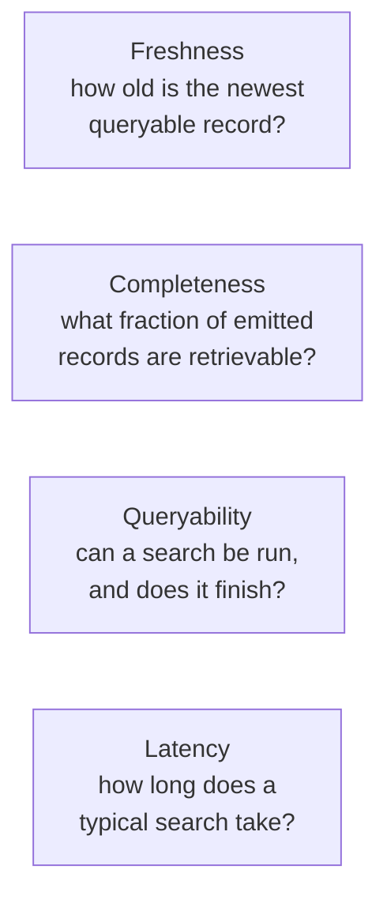

# Observing the Log Pipeline Itself

Doc 18 established that you cannot debug the logging system with logs. This doc specifies what
to use instead: the four signals that describe a log platform's health, the SLOs built on them,
the alerts that are worth waking someone for, and — the part usually missing — **which metrics
mislead during which failure.**

It does not re-teach RED, USE, SLIs or error budgets. Those are in
[`../Observability`](../Observability/README.md), using the same Riverbend system. What is here
is those methods applied to a pipeline whose defining property is that its failures are silent.

No new scenario IDs; this doc is how you detect the ones in every other doc.

---

## Four signals, and why the usual ones are not enough

A log platform is a pipeline, not a request-response service, so the RED method — rate, errors,
duration — applies to each component but does not describe the *product*. A gateway can have
perfect RED numbers while the platform is useless, because the data is arriving, being accepted,
and going nowhere findable.

The four signals that describe the product:



**Freshness** is the pipeline's throughput health expressed in the unit users care about. It is
not consumer lag — lag is a component metric; freshness is measured at the other end.

**Completeness** is doc 15's loss rate, and it is the signal no other system has an analogue
for, because no other system loses data silently.

**Queryability** and **latency** are the serving side. They are separable and both matter: a
platform where every query succeeds in 90 seconds and one where 30% fail in 2 seconds are both
broken, differently.

---

## Defining each signal precisely

Vague SLIs produce arguments during incidents, so each of these is defined as a specific
measurement with a specific source.

### Freshness

> **The age of the newest record retrievable through the normal query path, measured per tenant
> per minute.**

Measured from canaries (doc 15): query for the most recent canary from each node, take the
age of the newest.

```
freshness = now − max(canary.emitted_at) over canaries retrievable by search
```

Two things to notice about this definition.

**It measures through the query path**, not through the write path. A record in storage that
the index cannot find yet is not fresh, and defining it any other way hides doc 11's stage-11
failures.

**It is per tenant.** A platform-wide median hides the tenant whose partition is stuck. Alert on
the maximum across tenants, chart the distribution.

```
Lantern normal:  p50 1.2 s, p95 3.8 s, p99 11 s
```

### Completeness

> **The fraction of records emitted that are retrievable through the normal query path,
> measured over a rolling hour.**

Three measurements, from doc 15, reported separately because they cover different stages:

```
canary_completeness    = canaries retrieved ÷ canaries emitted        → the headline SLI
sequence_completeness  = 1 − (sequence gaps ÷ expected records)       → localises to a source
counter_reconciliation = storage.written ÷ gateway.received           → localises to a stage
```

```
Lantern normal:  canary 99.994%, sequence 99.991%, counter 99.997%
```

**The three disagreeing is itself diagnostic.** Canary worse than sequence means the query path
is losing things. Sequence worse than counter means loss is concentrated in specific streams
rather than uniform. Counter worse than the others means a stage is dropping records it is not
counting.

### Queryability

> **The fraction of queries that return a complete result within their resource ceiling.**

```
queryability = (queries completing with complete=true) ÷ (all queries)
```

Note what this excludes: a query rejected at admission for being too expensive is **not** a
failure — it is the system working, and counting it as an error would push you to remove
admission control. Count rejections separately and watch them, because a rising rejection rate
means the defaults or the capacity are wrong.

```
Lantern normal:  99.4% complete, 0.4% rejected at admission, 0.2% failed
```

### Query latency

> **Wall time from submission to complete result, split by tier touched.**

Split by tier, always. A single distribution mixing tier-0 queries (300 ms) with cold-tier scans
(90 s) has a meaningless p99.

```
Lantern normal:
  tier 0 only (≤15 min):    p50 0.28 s   p95 0.6 s    p99 1.1 s
  tier 1 (≤48 h):           p50 1.4 s    p95 4.2 s    p99 9  s
  tier 2 (≤30 d):           p50 8 s      p95 31 s     p99 74 s
  tier 3 (cold):            p50 52 s     p95 220 s    p99 600 s
```

---

## The SLOs

```
Freshness      95% of minutes with p95 tenant freshness < 10 s      (30-day window)
Completeness   canary completeness > 99.99% over 30 days
Queryability   99% of queries complete within their ceiling         (30-day window)
Latency        95% of tier-1 queries complete within 5 s            (30-day window)
Availability   99.9% of minutes accepting ingest                    (30-day window)
```

### Why the completeness target is 99.99% and not higher

Doc 15 budgeted 0.01% loss. Stated as an SLO that is 99.99%, and the arithmetic of what it
permits is worth seeing:

```
0.01% of 5.56M records/s = 556 records/s = 48 million records/day
```

Forty-eight million records a day, and it is a good number. The instinct to demand 99.999%
should be resisted, because the cost curve is brutal:

```
99.99%   the current design
99.999%  requires eliminating agent-restart loss (synchronous checkpointing: −30% agent
         throughput), eliminating dedup false positives (exact structures: 5× memory),
         and eliminating application-side appender drops (blocking appenders: application
         latency risk)
```

**The last item is the disqualifying one.** Going from four nines to five means blocking
applications when logging is slow, which trades a logging problem for a service outage. That is
the wrong trade at any loss rate, and it is why the budget stops where it does.

### Why availability is only 99.9%

Three nines is 43 minutes a month of not accepting ingest. That sounds slack for a platform this
important, and it is deliberate: **agents buffer.** A 20-minute ingest outage costs nothing as
long as the agents' disk buffers hold, which doc 02 showed they do for 20 minutes at the p99
host and far longer for typical ones.

**The buffer is what lets the ingest SLO be loose**, and that is worth stating explicitly
because it is a real architectural payoff. A platform without agent-side durability would need
99.99% here, which is roughly ten times the operational cost.

---

## The dashboard

One page. Doc 18's constraint: usable by someone who did not build the platform, at 03:00, on a
phone.

```
┌─ LANTERN PLATFORM HEALTH ─────────────────────────────────────────────┐
│                                                                        │
│  INGEST          2.81 GB/s  ▁▂▃▅▆▅▃▂▁▂▃▅  ✓ within 8% of 7-day normal │
│  FRESHNESS         p95 3.1s  ▁▁▂▁▁▁▂▁▁▁▁▁  ✓ SLO 10s                  │
│  COMPLETENESS     99.996%                  ✓ SLO 99.99%               │
│  QUERYABILITY       99.6%                  ✓ SLO 99%                  │
│                                                                        │
│  ⚠ TIME UNTIL UNRECOVERABLE      5h 12m    ✓ archiver lag 48m         │
│                                                                        │
│  ── where is it stuck ────────────────────────────────────────────────│
│  agents reporting      11,984 / 12,000     ✓                          │
│  agent buffer p99            4.1%          ✓                          │
│  gateway accept rate        99.98%         ✓                          │
│  kafka under-replicated          0         ✓                          │
│  broker disk read          0.2 MB/s        ✓  (near zero = healthy)   │
│  consumer lag (time)   idx 12s · arc 48m · tail 0.8s · met 4s  ✓      │
│  compaction oldest L0        41m           ✓                          │
│  catalogue p99              18ms           ✓                          │
│                                                                        │
│  ── recent changes ───────────────────────────────────────────────────│
│  14:02  config v8841 → v8842  (sampling: catalog-api)  100% rolled    │
│  11:30  gateway 2.9.1 → 2.9.2                          complete       │
│  certificates: fleet minimum 19h 40m                                  │
│                                                                        │
│  ── per tenant (worst 5 by freshness) ────────────────────────────────│
│  edge-platform  4.2s   riverbend 2.1s   identity 1.9s   ...           │
└────────────────────────────────────────────────────────────────────────┘
```

Five design decisions in that layout, each from a failure in doc 18:

**The four SLIs at the top, with their SLO thresholds.** Not component metrics. Someone who does
not know the architecture can read the top block and know whether users are affected.

**`TIME UNTIL UNRECOVERABLE` is a first-class element**, not buried in a lag chart. It is the
only number on the page counting down towards permanent damage.

**"Broker disk read — near zero = healthy"** is annotated because it is counter-intuitive.
Doc 06's `B-04` is invisible to anyone who does not know that a healthy Kafka cluster reads
almost nothing from disk, and a dashboard that does not say so will not help at 03:00.

**Lag in time, never in records** (doc 07's `P-06`).

**Recent changes on the same page.** Doc 18's triage step 4 is "what changed", and the answer
being one scroll away rather than in another tool saves minutes.

---

## The alerts

Eleven. Fewer than you expect, because most component-level conditions are diagnostic rather
than actionable.

### Page immediately

```
1.  time_until_unrecoverable < 2h
    → permanent data loss is approaching. Highest priority, always.

2.  ingest rate < 20% of the 7-day same-hour baseline, for 3 minutes
    → total or near-total ingest failure. Baseline-relative, so it works at 04:00.

3.  canary completeness < 99.9% over 15 minutes
    → material silent loss, right now.

4.  freshness p95 > 60s for 5 minutes
    → the pipeline is stalling; search is becoming useless.

5.  queryability < 90% over 10 minutes
    → the platform is effectively down for users even if ingest is fine.

6.  fleet minimum certificate lifetime < 4h
    → a total outage is scheduled. Page before it happens, not after.
```

### Notify during working hours

```
7.  error-budget burn rate implies exhaustion before the window ends
    → the slow-burn version of 1–5. See ../Observability/04.

8.  agent buffer p99 > 40%
    → the fleet is absorbing something. Early warning for 2 and 4.

9.  compaction oldest level-0 file > 3h
    → query performance degrading gradually (W-03).

10. any tenant at quota level 3 for > 15 minutes
    → their data is degraded; someone should know.

11. a redaction rule's match rate falls to zero having been non-zero
    → a security control has silently stopped working (C-05).
```

### What is deliberately not an alert

Worth stating, because each is a tempting one that produces noise without action:

- **Individual component CPU or memory.** Diagnostic. Alert on the effect, not the cause.
- **Individual agent failures.** 12,000 agents means some are always broken. Alert on the
  *count* of non-reporting agents exceeding a baseline, not on any one.
- **Kafka lag in records.** Time lag only.
- **Query rejections at admission.** The system working. Chart it; alert only if the rate
  changes sharply, which means the defaults or capacity shifted.
- **Parse failure rate above a fixed number.** Alert on the *change*, per tenant — every
  platform has a steady baseline of unparseable records and a fixed threshold either fires
  constantly or never.

---

## What misleads during each failure

The most useful table in this doc, and the one that takes an incident to learn otherwise.

| Failure | The metric that looks fine | Why | What to look at |
|---|---|---|---|
| Agent not shipping (`A-01`, `A-14`) | gateway accept rate — 100% | it only measures what arrived | agents reporting; per-node record rate against baseline |
| Archiver stopped (`O-03`) | freshness, queryability, latency — all normal | search reads the hot tier, which is fine | `time_until_unrecoverable` |
| Silent partial loss (`D-01`) | everything | that is the definition | canary completeness, sequence gaps |
| Query path broken (`Q-07`) | ingest, freshness-by-write, lag — all normal | data is arriving and being stored | canary completeness measured *through search* |
| Field explosion (`S-01`) | ingest rate, record count — flat | volume in records did not change | distinct attribute keys per tenant; storage cost per TB ingested |
| Sampling misconfigured (`V-07`) | ingest rate — *improved* | dropping data looks like efficiency | records stored ÷ records emitted, per service |
| One tenant starved (`M-03`) | platform aggregates — all normal | one tenant is 1.6% of the total | per-tenant freshness and completeness, worst-of |
| Page-cache eviction (`B-04`) | consumer lag — briefly normal | degradation precedes lag | broker disk read bytes |
| Compaction behind (`W-03`) | everything, for days | it degrades gradually | age of the oldest level-0 file |
| Redaction rule broken (`C-05`) | redaction match count — zero | zero looks like nothing to redact | change in match rate, not its value |

**Rows 6 and 10 share a shape and it is the one worth internalising: a control silently ceasing
to operate produces a metric that reads as healthy.** Dropping data looks like efficiency; a
broken redaction rule looks like clean data; a stopped detection rule looks like no threats.
This is the fifth time in this collection that **zero turns out to be a lie**, and the general
countermeasure is the same every time: **alert on the change from a known baseline, not on the
absolute value.**

---

## Cost as an observability signal

Cost is a leading indicator of several failures and is usually watched monthly, by someone else.

```
$ per TB ingested        rising → field explosion, index growth, tier misconfiguration
$ per query              rising → pruning degraded, sort order wrong, compaction behind
storage $ vs ingest $    diverging → retention not deleting (W-06), or versioning on
egress $                 rising → someone started a daily full export (E-08)
```

Put these on a weekly dashboard with the ingest volume alongside, so a cost rise can immediately
be classified as "we ingested more" or "something is wrong". **Cost per TB ingested is the
single best summary metric for the platform's efficiency**, and it catches a class of problem
that no operational metric does — because field explosion, index bloat and failed deletion all
present as "everything is working, and it costs more".

---

## What to take away

1. **Four signals describe the product** — freshness, completeness, queryability, latency. RED
   per component describes the parts and can be perfect while the platform is useless.
2. **Measure freshness through the query path**, not the write path. A record in storage that
   search cannot find is not fresh, and any other definition hides the failures that matter
   most to users.
3. **Report all three completeness measurements separately.** Their disagreement is diagnostic:
   canary worse than sequence means the query path; sequence worse than counter means
   concentrated rather than uniform loss.
4. **A query rejected at admission is not a failure.** Counting it as one pushes you to remove
   admission control, which is the mechanism protecting everyone else.
5. **Split query latency by tier.** A p99 mixing 300 ms tier-0 queries with 90-second cold scans
   describes nothing.
6. **99.99% completeness is the right target**, because five nines requires blocking
   applications when logging is slow — trading a logging problem for a service outage.
7. **Agent buffering is what lets the ingest availability SLO be 99.9%** rather than 99.99%.
   That is a real architectural payoff and it should be named as one.
8. **Put `time_until_unrecoverable` on the dashboard as a first-class element.** It is the only
   number counting down towards permanent damage.
9. **Annotate the counter-intuitive metrics.** "Broker disk read — near zero is healthy" is
   useless knowledge at 03:00 unless it is written on the page.
10. **Eleven alerts, and six of them page.** Most component conditions are diagnostic; alert on
    the effect, not the cause, and on the count of failures rather than on any one of 12,000
    agents.
11. **A control that silently stops operating produces a healthy-looking metric.** Dropped data
    looks like efficiency; a dead redaction rule looks like clean data. Alert on change from
    baseline, never on absolute value.
12. **Cost per TB ingested is the best single efficiency metric**, and it catches the class of
    problem — field explosion, index bloat, failed deletion — where every operational signal
    says the system is working.

Next: [20-build-vs-buy-and-stack-choices.md](20-build-vs-buy-and-stack-choices.md), which puts
the whole bill together and compares it against buying.
