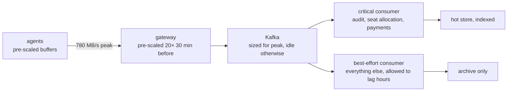

# Case Studies

Five systems whose logging problems barely overlap, each walked from its scale to its
architecture to two or three incidents. Scale figures come from
[`../../system-design-notes`](../../../system-design-notes) and from the systems already used in
[`../MicroservicesPOF`](../MicroservicesPOF/README.md), so the collections agree.

Incidents are numbered `CS-1` through `CS-9` and are cited by the interview bank (doc 23) and
the playbook (doc 24).

| Case | System | Its defining logging problem |
|---|---|---|
| 1 | **Riverbend** — marketplace, 3.8 TB/day | The scale most teams are at, and the migration off Elasticsearch |
| 2 | **Gateline** — ticketing, 5K → 500K QPS in 10 s | A 100× step function on a schedule, hitting a pipeline sized for the baseline |
| 3 | **Waypoint** — ride hailing | Mobile clients you do not control, and a lossy path next to an audit path |
| 4 | **Corridor** — professional network | The boundary between "logs" and "the event platform", and what happens when it blurs |
| 5 | **Northlight** — 100,000-sidecar mesh | The infrastructure that observes everything is also the biggest thing producing logs |

---

## Case 1 — Riverbend: the scale you are probably at

### The system

240 services, 38 namespaces, 380 nodes, 3,100 pods on EKS. 412 CronJobs. Doc 01 derived its log
volume:

```
85,000 records/s steady, 320,000/s at flash-sale peak
44.2 MB/s = 159 GB/hr = 3.8 TB/day
peak 166 MB/s = 599 GB/hr
retention: 7 days searchable, 90 days archived (no 13-month requirement)
42 engineers, ~15 concurrent users at peak
```

**This is the interesting scale**, because almost everything in this collection is optional
here and the standard advice — "just run Elasticsearch" — is correct right up until it is not.

### What they ran, and why it stopped working

A nine-node Elasticsearch cluster with Filebeat, a hot-warm architecture, and Kibana. It worked
for three years. Then:

```
year 1:  1.1 TB/day,  9 nodes,  comfortable
year 2:  2.3 TB/day, 14 nodes,  occasional pressure at peak
year 3:  3.8 TB/day, 22 nodes,  weekly incidents
```

The cost curve and the incident curve both bent, and the reasons were specific rather than
general:

```
disk:        3.8 TB/day × 7 days × 1.1 (ES on-disk ratio) × 2 replicas = 58.5 TB
             on i3.2xlarge (1.9 TB usable): 31 nodes for storage alone
indexing:    166 MB/s at peak ÷ 11 MB/s per core = 15 cores at peak, sustained
             — which is fine, and was not the problem
mapping:     4,100 fields and climbing (doc 04's S-01, from three teams)
merges:      segment merge pressure at peak causing indexing stalls (X-08)
```

**The binding constraint was not volume — it was that a flash sale multiplies volume by 3.8×
for twenty minutes**, and Elasticsearch's indexing pipeline does not degrade gracefully under
that. Indexing queues fill, bulk requests are rejected, Filebeat retries, and the cluster spends
the sale being unusable — during a sale, which is when the business most wants to see it.

### CS-1 · The flash sale that made logs unavailable

**What happened.** 11:00, flash sale opens. Traffic to `checkout-api` goes from 640 to 3,400
req/s and catalogue reads from 5,000 to 42,000/s. Log volume goes from 44 to 166 MB/s.

Elasticsearch bulk queues fill within 90 seconds. Rejections begin. Filebeat retries, which
increases the load. By 11:04 the cluster is rejecting 60% of bulk requests, Kibana queries time
out, and the team debugging a genuine checkout problem cannot see any logs.

At 11:09 a node hits its heap limit and leaves the cluster. Shard reallocation begins, which
consumes I/O the cluster does not have, and two more nodes follow. The cluster is red at 11:14.

**The mechanism**, and it is doc 00's property 4 exactly:

```
ingest 3.8× normal        ← the sale
+ query load 6× normal    ← everyone watching the sale
+ retry amplification     ← Filebeat retrying rejected bulks
= a cluster that was adequate at average and is 40% short at peak
```

**What it cost.** Three hours of no log visibility, spanning the sale and the incident inside
it. Filebeat's disk buffers held most of the data, so once the cluster recovered the backlog
replayed — over four hours, during which the cluster was again at capacity and search was slow.
`O-04`.

**What they did.**

*Immediately:* raised bulk queue sizes (which made it worse — a longer queue means longer
latency and more retries before rejection, doc 18's point about the obvious action), then
reduced Filebeat's retry aggressiveness and let it buffer, which worked.

*Within a week:* introduced a **Kafka buffer** between Filebeat and Elasticsearch. Six brokers,
six hours retention — the cluster from [`../Kafka`](../Kafka/README.md). This alone eliminated
the class: a sale now produces consumer lag rather than rejection, and lag recovers by itself.

Doc 06's whole argument, learned the hard way.

*Within a quarter:* migrated storage and query to ClickHouse, keeping Elasticsearch only for
the two teams with genuine full-text needs.

### The migration, and its numbers

```
                    before (ES)      after (ClickHouse)
storage, 7 days     58.5 TB          4.9 TB
nodes               22 × i3.2xlarge  6 × i3en.2xlarge
monthly cost        $13,860          $3,200
p50 query           0.8 s            0.4 s
p99 query           14 s             3.1 s
full-text search    yes              literal + n-gram only
migration effort    ~5 engineer-months
```

**The 12× storage reduction is the headline and the substring-search regression is the cost.**
Two teams pushed back hard, and the resolution was to keep a small Elasticsearch cluster
indexing only those two services — 140 GB/day, three nodes — rather than force the whole estate
onto one model.

That compromise is worth generalising: **the right architecture for 95% of your volume is often
wrong for 5% of it, and running two things for a reason is better than running one thing
badly.**

### CS-2 · The field explosion that tripled the bill

**What happened.** Over six weeks, storage cost rose 40% while ingest volume was flat.

**Mechanism.** Doc 04's `S-01`. A pricing service logged per-SKU detail as a map:

```json
{ "msg": "cart priced", "items": { "SKU-4471": 3, "SKU-9928": 1 } }
```

Riverbend has 2.4 million SKUs. Within six weeks the schema had 380,000 columns, and per-column
overhead in Parquet footers dominated.

**Confirmed by** distinct attribute keys per service per day, which had been climbing
monotonically for six weeks with nobody watching it.

**Fixed by** restructuring to an array of objects — two columns instead of 380,000 — and
compacting the affected partitions to physically drop the columns. Prevented by a 2,000-key cap
per tenant and a daily new-key report.

**What makes this a good case study** is that every operational signal was green throughout.
Ingest was flat, latency was normal, no errors. Only the cost curve moved, which is doc 19's
closing point: **cost per TB ingested is the metric that catches the problems no operational
signal sees.**

---

## Case 2 — Gateline: a 100× step function on a schedule

### The system

Mega-event ticketing, Ticketmaster-shaped. From
[`../MicroservicesPOF/18-case-ticketing-gateline.md`](../MicroservicesPOF/18-case-ticketing-gateline.md):

```
baseline                    5,000 QPS
at sale open                500,000 QPS within 10 seconds
sustained after admission   333,000 req/s for 30 seconds
10M users in the first 2 minutes, 100,000 seats
```

Log volume:

```
baseline:   5,000 req/s × 2.1 records/req × 480 B   = 5.0 MB/s
sale open:  500,000 × 2.1 × 480                     = 504 MB/s
            plus waiting-room and rejection records at ~3× the normal per-request rate
            because every rejected request logs its rejection
actual measured peak:                                 780 MB/s
peak-to-baseline ratio:                               156×
```

**A 156× step function, on a schedule you know in advance.** That last clause is what makes
Gateline different from every other system here, and it changes the whole design.

### The architecture, shaped entirely by the step



Four decisions, each a direct consequence of "the spike is scheduled":

**1. Pre-scale, do not autoscale.** Doc 01's argument that you cannot provision for the spike
does not apply when you know when it is. An autoscaler responds in minutes; the spike arrives
in ten seconds.

```
T−45 min:  scale gateway 4 → 80 pods, processors 6 → 90, query nodes 8 → 24
T−30 min:  verify all are Ready, warm connections, pre-load caches
T−10 min:  freeze all deploys and config changes
T+30 min:  begin scaling down, slowly
```

**2. Kafka sized for the peak permanently**, because it cannot be scaled quickly — adding
brokers means partition reassignment, which moves terabytes. Gateline runs 12 brokers at 4%
utilisation for 99% of the time, which looks wasteful and is the correct answer.

**3. Split the consumers by criticality at the topic level.** Seat-allocation and payment
records go to a topic with its own consumer group, dedicated capacity and a 30-second lag
target. Everything else goes to a topic whose consumer is explicitly allowed to lag for hours.

**This is doc 06's topic-by-class argument at its most extreme**, and it is what makes the
design survivable: the 780 MB/s peak is 96% best-effort data, and letting it lag costs nothing.

**4. Pre-emptive shedding.** Doc 18's shedding switch is set to level 2 *before* the sale opens,
not in response to load. Successful access logs and `DEBUG` are dropped from T−5 to T+15 by
default, recovering 49% of the peak before it arrives.

### CS-3 · The waiting room logged every poll

**What happened.** A sale opened and log volume hit 2.1 GB/s instead of the expected 780 MB/s.
Gateway rejected 64% of batches; agents buffered; some agent disks filled within eight minutes.

**Mechanism.** The waiting-room service polls: every waiting client checks its position every
3 seconds. With 10 million users waiting:

```
10,000,000 users ÷ 3 s = 3.33M polls/s
each poll logged one access record at 380 B = 1.27 GB/s
```

**The waiting room, whose entire purpose is to absorb load, was the largest log producer in the
system** — and it was producing records that are individually worthless, since a poll returning
"position 84,201" is not something anyone will ever search for.

**Fixed by** not logging successful polls at all, and emitting a counter instead
(doc 08's level 3 — aggregate). Volume from the waiting room went from 1.27 GB/s to effectively
zero, and the information content did not change, because a rate is what anyone would have
wanted from it.

**The generalisable lesson.** In a system with an admission-control tier, **the admission tier
is usually the biggest log producer and the least useful one**, because it handles the traffic
the rest of the system was protected from. Check it first.

### CS-4 · Pre-scaling the wrong tier

**What happened.** Everything was pre-scaled. The sale opened. Ingest held, processing held, and
search was unusable for twenty minutes.

**Mechanism.** Query nodes were scaled from 8 to 24 — a 3× increase — while query *load* went up
11×, because forty engineers and the entire incident-response organisation were all searching
simultaneously. Doc 00's property 4.

The pre-scaling plan had been derived from ingest volume. Query load is driven by **people**,
and the number of people watching a sale does not scale with the sale's traffic — it scales with
the sale's importance.

**Fixed by** scaling query capacity from the expected number of *humans*, not from data volume,
and by pre-warming the block and footer caches at T−30 by running a representative query set.
Cold caches were a third of the problem: the first query after a scale-up reads footers from
object storage.

---

## Case 3 — Waypoint: clients you do not control

### The system

Ride hailing, Uber-shaped. From
[`../MicroservicesPOF/19-case-ride-hailing-waypoint.md`](../MicroservicesPOF/19-case-ride-hailing-waypoint.md)
and [`../../system-design-notes/uberHLD.md`](../../../system-design-notes/uberHLD.md):

```
130M monthly users, 25M trips/day
750,000 GPS writes/s (3M drivers at 1 per 4 s), 1.2M/s at rush hour
290 trip requests/s average, 1,000/s peak
260,000 concurrent active trips
```

Two log populations with opposite requirements:

```
server-side logs:   4,000 services, ~1.9 GB/s   — normal, agent-collected
mobile client logs: 5M devices, ~0.9 GB/s       — the interesting problem
```

### The mobile problem

Mobile telemetry is a different system from everything in docs 02 through 07, and treating it
as "logs with a different transport" causes every failure below.

| | Server agent | Mobile client |
|---|---|---|
| You control the code | yes | **only after an app release** |
| You control the config | in seconds, via the control plane | only after an app release |
| The network | your VPC | 3G in a tunnel |
| Buffer | 5 GB of disk | maybe 10 MB, and the OS may reclaim it |
| Clock | NTP-synchronised | **user-settable** |
| Trust | mTLS workload identity | **an API key extractable from the binary** |
| Lateness | seconds | **days** — a phone offline for a week |

Five consequences, each a design decision:

**1. The API key is public.** It is in the binary. Assume it is extracted. Hard per-key and
per-IP rate limits, a separate tenant space, no trust in any client-supplied field, and the
ability to rotate without an app release. Doc 05's public endpoint warning, made concrete.

**2. Client timestamps are untrustworthy.** A user with a wrong clock produces records dated
2019. Doc 04's clamping is mandatory here rather than defensive: keep `ts_reported`, clamp `ts`
to the ingest-time window, flag it. Waypoint measures 0.4% of mobile records with clocks off by
more than an hour.

**3. Lateness is measured in days.** Doc 14's watermark and maximum-lateness bound must be set
from the mobile distribution, which has a fat tail:

```
mobile: p50 8 s, p90 45 s, p99 22 min, p99.9 6.1 hr, p99.99 4.2 days
server: p50 0.9 s, p90 2.4 s, p99 41 s, p99.9 18 min
```

Waypoint sets a 7-day maximum lateness for mobile and 48 hours for server, and **partitions them
separately** so a 5-minute server-log query does not have to scan 7 days of partitions to catch
mobile stragglers. Doc 11's `Q-07`, avoided by separation rather than by cleverness.

**4. Sampling must happen on the device.** The network is the expensive resource, and once a
record has been uploaded the cost is paid. Sampling decisions are pushed to the client via a
config the app fetches at launch — which means changes take effect over hours as apps restart,
not seconds.

**5. You cannot fix a bad client.** A version shipped with a logging bug will keep sending for
months, because users do not update. Waypoint's mitigation is a **server-side kill switch keyed
on app version**: the gateway can reject or downsample a specific version's telemetry, which is
the only lever that works on a timescale shorter than an app-store release cycle.

### The lossy-versus-lossless split

Waypoint's defining property in the MicroservicesPOF collection is two correctness philosophies
in one request path, and it appears in logging too:

```
GPS pings              750,000/s   lossy is fine — a missing ping is invisible
trip state changes     ~3,000/s    lossy is not fine — this is the trip's history
payment events         ~300/s      lossy is a financial discrepancy
```

**Three paths, not one pipeline with priorities.** GPS goes to the normal log pipeline with
aggressive sampling. Trip state and payments go to `logs.audit` with no sampling, separate
quota, separate retention and a separate consumer whose lag alerts page immediately.

The alternative — one pipeline with a priority field — fails the moment anyone writes a shedding
rule that does not check the field. **Separate paths are a structural guarantee; priority fields
are a convention**, and this is the same distinction as doc 09's "pathing is a boundary,
filtering is a policy".

### CS-5 · A client release multiplied telemetry by nine

**What happened.** App version 8.41 shipped on a Tuesday. Over the next four days, as adoption
grew, mobile telemetry went from 0.9 GB/s to 8.1 GB/s. The platform absorbed it for two days
and then began shedding.

**Mechanism.** A debug logging statement inside the location-update handler, which runs every
four seconds per active driver. Left enabled by a merge that reverted a feature flag default.

**Why it was slow to detect.** Adoption is gradual, so volume rose 20% a day rather than
spiking. Every alert was rate-of-change-based with a 1-hour window, and 20% a day is 0.8% an
hour — below every threshold.

**Fixed by** the version kill switch, applied within twenty minutes of diagnosis. The fix
shipped in 8.42 eleven days later.

**What they changed.** Added **per-app-version volume tracking** with an alert on a new
version's per-device rate exceeding the previous version's by more than 50% — which detects this
on day one at 2% adoption, rather than on day four at 60%. **Normalising by device count rather
than watching absolute volume is the entire fix**, and it generalises: when a population is
growing, watch the per-member rate.

---

## Case 4 — Corridor: where logs stop being logs

### The system

Professional network, LinkedIn-shaped. From
[`../../system-design-notes/LinkedIn`](../../../system-design-notes/LinkedIn/README.md):

```
1B members, ~100M DAU
hundreds of billions of tracking events/day
hundreds of TB/day raw, ~10× that after enrichment
thousands of Kafka topics across hundreds of clusters
```

### The problem: two systems that look identical

Corridor runs a log platform and a tracking-event platform. They have the same shape — agents,
Kafka, processing, columnar storage, SQL — and completely different contracts:

| | Log platform | Event platform |
|---|---|---|
| Schema | loose, evolves freely | **strict, registered, versioned, reviewed** |
| Correctness | 99.99% is fine | **exactly-once, reconciled, auditable** |
| Retention | 30 days | **years** |
| Consumers | humans debugging | **models, dashboards, finance, regulators** |
| Cost of a wrong number | an hour of confusion | **a restated metric** |
| Latency | seconds | minutes is fine |
| Governance | a style guide | a data contract with an owner |

**The failure mode is drift between them**, in one direction: a team needs an event, the event
platform requires a schema review and a two-week process, the log platform accepts anything
immediately. So they log it. Six months later a dashboard the business depends on is computed
from log records that were sampled at 1:8 last Tuesday.

### CS-6 · A business metric built on sampled logs

**What happened.** A quarterly revenue-adjacent figure came in 12% below the previous quarter.
Three days of investigation found no business cause.

**Mechanism.** The metric was computed from log records. Doc 08's dynamic sampling had been
enabled for that service six weeks earlier. The query used `count(*)` rather than
`sum(sample_weight)`. Doc 08's `V-01`, with a financial consequence.

**Why it took three days.** Nobody involved in the investigation knew the number came from
logs. It appeared in a dashboard, sourced from a table, populated by a job, reading a log table.
Four hops from the sampling decision to the business.

**Fixed immediately** by the weighted query, and structurally by three things:

1. **Automatic weight application in the query layer** (doc 08's recommendation) so `count(*)`
   over sampled data is impossible to get wrong.
2. **A "derived from logs" marker propagated through the lineage**, so any dashboard whose
   lineage touches the log platform carries a visible quality caveat.
3. **A promotion path.** Any metric used in a business report must be sourced from the event
   platform, and the log platform's job is to make promotion easy — a tool that takes a log-based
   query and generates the event-platform schema and instrumentation for it.

**That third item is the real fix**, and it is a process fix rather than a technical one. The
drift happened because the correct path was slow and the incorrect one was instant. **Making the
correct path fast beats forbidding the incorrect one**, which is the same conclusion as doc 17's
sanctioned-body-capture argument.

### CS-7 · The boundary enforced by cost

Corridor's second intervention was purely economic and worked better than any policy.

Log-platform records were free to the emitting team. Event-platform records were charged. So the
log platform grew at 60% a year, mostly from teams using it as a cheap event bus.

They introduced doc 16's chargeback, with one deliberate asymmetry: **log records with more than
20 structured fields and no free-text body are billed at the event-platform rate.** That shape —
lots of fields, no message — is what a business event looks like, and a log record does not look
like that.

```
before:  log platform growing 60%/year, event platform 12%/year
after:   log platform growing 9%/year, event platform 31%/year
```

Teams moved, because the price signal made the correct path the cheaper one. No policy was
written and no exception process was needed.

**The heuristic generalises:** when two systems overlap and one is free, the free one absorbs
the other's traffic regardless of what any document says.

---

## Case 5 — Northlight: the observer is the biggest producer

### The system

Streaming platform with a service mesh, Netflix-shaped. From
[`../MicroservicesPOF/21-case-service-mesh-northlight.md`](../MicroservicesPOF/21-case-service-mesh-northlight.md):

```
100,000+ Envoy sidecars, ~2,500 services
5–200 upstream clusters per service
~100 endpoint mutations/s fleet-wide
```

### The arithmetic that defines the case

Every sidecar writes an access log for every request it proxies — inbound and outbound.

```
internal RPCs across the mesh:                    4.2M/s
each RPC is logged twice (client sidecar + server sidecar)
                                                  8.4M access records/s
at 420 B each                                     3.53 GB/s
```

Application logs from the same 2,500 services: about 0.6 GB/s.

**The mesh produces 5.9× more log volume than the applications it is observing.**

That ratio is not a Northlight peculiarity; it is structural. A mesh sees every hop, including
the ones the application does not consider an event, and it sees each hop twice. Any organisation
adopting a mesh should expect its log volume to roughly quintuple, and almost none plan for it.

### The three interventions

**1. Sample mesh access logs at the sidecar, aggressively and by outcome.**

```
successful requests (2xx, 3xx), fast:     sample 1:1000
successful but slow (> p99 for the route): keep 100%
4xx:                                       sample 1:10
5xx:                                       keep 100%
any request in a trace containing a 5xx:   keep 100% (tail-sampled)

resulting volume: 3.53 GB/s → 0.11 GB/s      a 97% reduction
```

Envoy supports this natively through its access-log filters, so it costs nothing to configure
and — critically — **the sampling happens before the record is written**, so it does not consume
sidecar CPU or node disk.

**2. Emit metrics instead, from the sidecar.** Envoy already produces RED metrics per route and
per upstream. The aggregate questions — request rate, error rate, latency distribution — are
answered from metrics at a fraction of the cost, and doc 00's rule applies: if you are
aggregating logs, it should have been a metric.

**3. Keep the duplicate, deliberately.** Client-side and server-side records for the same
request look redundant and are not: the difference between them is where the time went and
whether the request arrived at all. A client record with no matching server record is a
dropped request, which no server-side log can show you.

So Northlight keeps both for the 100%-retained categories and only the server side for the
sampled ones. **The duplicate is the diagnostic**, and deduplicating it would remove the signal.

### CS-8 · A control-plane push made every sidecar log

**What happened.** An xDS configuration push changed the access-log format for all 100,000
sidecars. The new format accidentally removed the sampling filter. Log volume went from
0.11 GB/s to 3.53 GB/s in under ninety seconds, fleet-wide.

**Why it was so fast.** This is the property that makes a mesh dangerous: **a control-plane push
is simultaneous across 100,000 instances.** There is no gradual rollout unless someone built
one, and the log pipeline's own progressive-rollout machinery (doc 08) does not apply, because
the change came from the mesh's control plane, not the log platform's.

**What broke.** The log gateway saturated in two minutes. Node disks began filling. Two nodes
hit `DiskPressure` and evicted pods — doc 18's `O-02`, the logging system causing an application
outage.

**Recovery.** Rolling back the xDS config, which took four minutes to propagate. Then twenty
minutes of recovery stampede from 100,000 sidecar buffers flushing.

**What they changed.**

- **Progressive xDS rollout** for any change touching access-log configuration — 1%, 10%, 100%
  with automatic rollback on a fleet volume threshold. The mesh team had progressive rollout for
  routing changes and not for logging changes, because logging was not considered risky.
- **A volume circuit breaker at the gateway**: if fleet-wide ingest exceeds 2× the trailing
  1-hour average within 5 minutes, automatically engage shedding level 2 and alert. This is an
  automatic response, not a human one, because ninety seconds is faster than a page.
- **Node disk reservation** so the agent's buffer cannot reach the threshold that triggers
  eviction.

**The generalisable lesson.** **Any system with a control plane that pushes to tens of thousands
of instances can multiply your log volume faster than you can respond.** The mesh, the feature-
flag service, the configuration service, and the log platform's own control plane are all in
this category. Each needs progressive rollout on *logging-affecting* configuration, and the log
platform needs an automatic volume circuit breaker because human response is too slow.

### CS-9 · Tracing the mesh with the mesh's own logs

**What happened.** A latency regression appeared across many services with no deploy to explain
it. The investigation needed to compare client-side and server-side timings per hop — exactly
what the duplicate access logs provide.

Except those records were sampled at 1:1000 for successful requests, and the regression was in
successful requests.

**The tension.** The sampling that made the mesh affordable removed the data needed for the one
investigation that only mesh logs can support.

**Resolved by** a **targeted unsampling** capability: an operator can raise the sampling rate for
a specific route or upstream pair, fleet-wide, for a bounded period.

```
lantern mesh-capture --route /v2/playback --duration 10m --rate 1.0
  → xDS push to the affected sidecars only
  → 40 MB/s for 10 minutes, then automatic reversion
  → results available in the normal search path
```

**The expiry is the essential part**, for the reason doc 04 gave about dynamic log levels: the
most common cause of a sustained volume increase is a temporary elevation nobody turned off.

---

## What the five cases have in common

Read together, four things recur that no single case makes obvious.

**1. The biggest log producer is usually infrastructure, not applications.** Gateline's waiting
room, Northlight's mesh, and Lantern's edge access logs. In each case the component producing
the most records is the one handling traffic the applications were shielded from — and in each
case those records are individually worthless and collectively valuable, which means aggregate
them.

**2. The incident is usually a change, and the duration is usually a loop.** CS-1 (a sale, plus
retry amplification), CS-5 (a release, plus gradual adoption defeating alerts), CS-8 (a config
push, plus a recovery stampede). Doc 18's shape 4 into shape 1. This matches
[`../MicroservicesPOF`](../MicroservicesPOF/README.md)'s finding exactly, which is reassuring:
the same physics applies to the pipeline as to the systems it observes.

**3. Structural separation beats configuration.** Waypoint's three paths, Northlight's targeted
capture, Gateline's split topics, Corridor's cost asymmetry. In every case a convention was
replaced by a boundary, and the boundary held when the convention would not have.

**4. The price signal outperforms the policy.** Corridor's field-count pricing moved more
behaviour than any document. Doc 16's showback produces 20–35% voluntary reduction. **Where you
can make the correct path the cheaper path, do that instead of writing a rule.**

---

## What to take away

1. **At a few TB/day, "just run Elasticsearch" is correct until a peak arrives** — Riverbend's
   cluster handled 3.8 TB/day average and fell over at a 3.8× twenty-minute sale, because
   indexing does not degrade gracefully.
2. **Adding a Kafka buffer eliminated an entire incident class at Riverbend**, converting
   rejection into lag. That is doc 06's argument, and it was learned by outage.
3. **Running two stacks for a reason beats running one badly.** Riverbend kept a small
   Elasticsearch for the two teams with real full-text needs rather than forcing everyone onto
   one model.
4. **Cost was the only signal that detected Riverbend's field explosion.** Ingest, latency and
   error rates were all normal for six weeks.
5. **When the spike is scheduled, pre-scale rather than autoscale** — and size the query tier
   from the number of humans watching, not from the data volume, because those scale
   differently.
6. **In a system with admission control, the admission tier is the biggest and least useful log
   producer.** Gateline's waiting room produced 1.27 GB/s of position-check records.
7. **Mobile clients are a different system**, not a transport variant: public credentials,
   untrustworthy clocks, lateness in days, sampling that takes hours to change, and bad versions
   you cannot fix.
8. **When a population is growing, alert on the per-member rate**, not the total. Waypoint's 9×
   telemetry increase was invisible to every rate-of-change alert because adoption was gradual.
9. **Separate paths are a structural guarantee; priority fields are a convention.** Waypoint
   runs three pipelines rather than one with a criticality field, and that is why its audit path
   has never been shed.
10. **A service mesh produces roughly 5.9× the log volume of the applications it observes**, and
    almost nobody plans for it when adopting one.
11. **A control plane that pushes to 100,000 instances can multiply your volume in ninety
    seconds** — faster than a human can respond. That needs an automatic circuit breaker, and it
    needs progressive rollout on logging-affecting config, which teams apply to routing changes
    and not to logging ones.
12. **The price signal outperforms the policy.** Corridor stopped log-platform growth from 60% a
    year to 9% by pricing event-shaped records at event-platform rates, with no policy and no
    exception process.

Next: [22-scaling-to-10x-and-100x.md](22-scaling-to-10x-and-100x.md), which asks what breaks
next.
