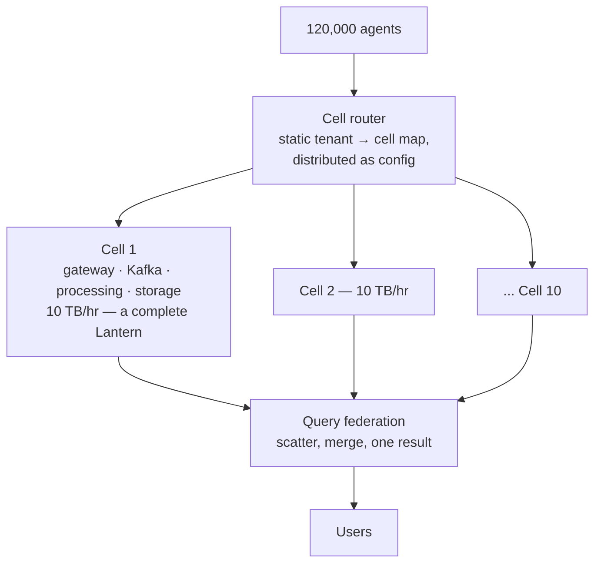

# Scaling Up, and Scaling Down

Lantern is 10 TB/hr. This doc asks what breaks at 1, at 100, and at 1,000 — and, going the other
way, what you should delete if you are at 0.1.

The useful framing is not "how do I make this bigger". It is: **which of these components stops
being the right shape, and at what multiple?** Most of the architecture is scale-invariant. A
small number of decisions have thresholds, and knowing where those thresholds are tells you
which parts of your current design have a shelf life.

---

## The scale-invariant parts

These are the same at every volume in this doc, and it is worth naming them first so the rest
is a short list rather than a long one.

- **The seven stages** (doc 00). Emit, collect, transport, buffer, process, store, serve. At
  100 GB/day several stages are one process; at 1 PB/hr they are separate fleets. The stages
  themselves do not change.
- **Event time versus ingest time**, and partitioning by the latter.
- **The at-least-once acknowledgement chain**, and the rule that nothing acknowledges before
  durability.
- **Tiering driven by the query-age decay curve.** The absolute volumes move; the ten-million-
  to-one ratio between fresh and old does not.
- **Volume control as the primary cost lever.** The percentages are remarkably stable across
  scales — successful access logs are 40-odd percent of volume whether you have ten services or
  ten thousand.
- **Make degradation visible.** Every scale.

---

## 1 TB/hr — one tenth

24 TB/day. A large single product, or a mid-sized company. What you should *remove* from
Lantern's design:

| Component | At 10 TB/hr | At 1 TB/hr |
|---|---|---|
| Gateway tier | 90 pods, required | **optional** — agents can produce to Kafka directly |
| Kafka | 24 brokers | 5 brokers |
| Processing | 72 pods, separate tier | **merge into the gateway or the indexer** |
| Tier 0 (in-memory) | 24 nodes | **merge into tier 1** — 23 GB is small enough |
| Compaction | 111 cores, continuous | a periodic batch job |
| Catalogue | Postgres HA + replica | a single Postgres |
| Cells | one, with routing scaffolded | one, no routing |
| Tenants | 40, full quota machinery | **often one** — skip quotas entirely |
| Team | 6.5 engineers | **1.5** |

**The two things to keep even at this scale**, because their absence is what produces the
Riverbend incident in doc 21's `CS-1`:

- **The Kafka buffer.** It is the single highest-value component per dollar at any scale above
  about 100 GB/day, because it converts every downstream failure from data loss into lag.
- **Volume control.** The percentages are the same, so the proportional saving is the same.

**What to drop without hesitation:** the gateway tier if you have one tenant (its value is
trust boundaries and central policy, and with one tenant there is no boundary), tier 0 (24 GB/hr
means the hot tier is small enough to be fast anyway), and the entire quota and showback
apparatus.

### The 100 GB/day threshold, below which almost none of this applies

```
100 GB/day = 1.2 MB/s = 2,400 records/s
```

At this volume: use a hosted service, send agents directly to it, and stop. The whole collection
above describes costs you have not incurred. A single-node Elasticsearch, a small Loki, or a
SaaS subscription at $300 a month all work, and the engineering time to build anything exceeds
three years of subscription within the first week.

**The break-even where building starts to make sense is around 2–5 TB/day**, which is roughly
where one engineer's fully loaded cost equals the SaaS bill.

---

## 100 TB/hr — ten times

2.4 PB/day, 55.6M records/s. This is the largest tier of public internet companies. What breaks,
in the order it breaks.

### 1. Kafka partition count and cluster size — breaks first

```
0.77 GB/s × 10 = 7.7 GB/s into the buffer
brokers by page-cache residency (doc 06's binding constraint):
    residency = 150 GB ÷ (7.7 × 3 ÷ N GB/s) = 6.49 × N seconds
    for 1,800 s (30 min):  N = 277 brokers
partitions at 25 MB/s each: 7,700 ÷ 25 = 308, × 2 headroom = 616... 
```

Wait — 616 partitions across 277 brokers is only 2.2 per broker, which is far too few for
parallelism. Recompute from the consumer side, which is what actually sets partition count:

```
a consumer thread handles ~25 MB/s of parsing work
7.7 GB/s ÷ 25 MB/s = 308 consumer threads minimum, so ≥ 308 partitions
with 2× headroom and round numbers:            720 partitions
× RF 3 = 2,160 replicas ÷ 277 brokers = 7.8 replicas per broker
```

Comfortable on partition count, and **277 brokers in one cluster is not comfortable** —
controller metadata, rolling restarts measured in days, and a blast radius covering everything.

**The transition: multiple Kafka clusters, sharded by tenant or by class.** Six clusters of 46
brokers each. This is the first genuine architectural change, and it forces a routing decision
at the gateway, which is the seed of cells.

### 2. The catalogue — breaks second

```
objects/day: 21.8 TB × 10 ÷ 128 MB = 1.7M/day
× 400 days retention = 680M rows
```

Doc 09 said "a single Postgres, and do not build it as a big-data problem". At 680 million rows
and a write rate of 20/s with query-path reads on every search, that advice expires.

**The transition: a purpose-built catalogue** — Iceberg's metadata layer, or a partitioned,
sharded store. Iceberg is the right answer here because it is designed for exactly this and
brings the shared-table export benefit (doc 14) with it.

### 3. Query fan-out — breaks third

Doc 11 distributes by object with pull-based assignment. At 10×:

```
a 48-hour single-service query now matches ~42,000 objects
at 128 MB and 0.5 s each: 21,000 core-seconds
for a 3-second answer: 7,000 workers
```

Seven thousand workers per query is not a fan-out, it is a cluster. Two changes:

- **Larger objects.** 512 MB instead of 128 MB, accepting a 2-second straggler penalty instead
  of half a second. Object count drops 4×.
- **A two-level fan-out.** A coordinator per partition-group, each fanning out to workers,
  rather than one coordinator addressing 7,000 workers directly. Single-level fan-out stops
  working somewhere around 500–1,000 workers because the coordinator's own bookkeeping becomes
  the bottleneck.

### 4. The control plane — breaks fourth

120,000 agents polling a config service. At a 30-second interval that is 4,000 requests/s, which
is fine — but the *distribution* problem is not:

```
a config bundle is ~2 MB
120,000 agents × 2 MB per fetch = 240 GB per rollout
```

**The transition: content-addressed config in object storage with a CDN, and delta updates.**
Agents fetch a small version pointer and only download changed fragments. This is the same shape
as a mesh's xDS incremental protocol, and for the same reason.

### 5. Cells — the transition that subsumes the others

At some point between 20 and 50 TB/hr the answer to every one of the above is the same: **stop
making one system bigger and run several.**



**Each cell is exactly the Lantern in this collection.** That is the point: you already know how
to operate one, you already have the runbooks, and the blast radius of any failure is one tenth.

What cells cost, stated honestly because it is substantial:

- **Stranded capacity.** Each cell needs its own headroom. Ten cells at 1.7× peak headroom is
  ten separate 70% margins rather than one shared one, and you cannot lend capacity between
  them quickly.
- **Query federation.** Cross-cell queries scatter to every cell and merge. For a tenant in one
  cell this is free; for platform-wide queries it is a distributed query engine, which is real
  work.
- **The cell router is a new control plane** whose failure affects everything, which is
  precisely the class of failure doc 18 warns about.
- **Operations multiply.** Ten of everything to upgrade, patch and monitor. This is manageable
  only if cell operations are fully automated, which means the automation is now a prerequisite
  rather than a nice-to-have.

**Assign tenants to cells, never hash them**, and keep a tenant entirely within one cell.
Hashing spreads a tenant across cells, which means every one of their queries is federated and
every cell shares their risk. Assignment also lets you place a problematic tenant alone
(doc 16).

See
[`../MicroservicesPOF/13-isolation-cells-regions-and-blast-radius.md`](../MicroservicesPOF/13-isolation-cells-regions-and-blast-radius.md)
for the general treatment.

---

## 1 PB/hr — a hundred times

24 PB/day, 556M records/s. Three or four organisations in the world. The interesting thing is
that the architecture does not change further — it is cells, more of them — but **three
assumptions that held everywhere above finally break.**

### Assumption 1: "storage is cheap"

```
24 PB/day raw ÷ 11 compression = 2.18 PB/day stored
30 days warm:    65 PB   × $0.023/GB-mo  = $1.50M/month
13 months cold: 807 PB   × $0.004/GB-mo  = $3.23M/month
```

Nearly five million dollars a month in storage, which changes the retention conversation from
a policy question to a board-level one. At this scale:

- **Retention is negotiated per class with finance in the room.** Thirteen months for everything
  is no longer a default anyone accepts.
- **Self-managed storage becomes competitive with cloud object storage**, which is not true at
  any smaller scale. At 800 PB the cloud's margin is worth building a storage team for.
- **Compression research pays for itself.** A 10% ratio improvement is $470,000 a month, which
  funds a team.

### Assumption 2: "network within a region is free or cheap"

Doc 20 showed cross-zone transfer at 35% of the bill at 10 TB/hr. At 100× it is the dominant
cost by a wide margin, and the response is architectural rather than a tuning setting:

- **Zone-local everything.** Agents, gateways, processing and the local Kafka replica all in one
  zone, with only replication crossing.
- **Rethink replication.** At this scale, erasure coding across zones instead of full
  replication cuts cross-zone bytes substantially, at the cost of reconstruction latency on
  read. Kafka does not do this; a purpose-built buffer might.
- **This is the point where a custom buffer stops being madness.** At 10 TB/hr, replacing Kafka
  is a bad idea. At 1 PB/hr the network bill funds a team to build something zone-aware, and
  several organisations at this scale have done exactly that.

### Assumption 3: "the metadata fits in a database"

```
objects/day: 2.18 PB ÷ 512 MB = 4.3M/day
× 400 days = 1.7 billion objects
```

The catalogue is now a large distributed system in its own right, with its own sharding,
availability and consistency story. It also becomes a *latency* problem: query planning that
touches a distributed catalogue is a distributed query before you have read any data.

**The transition: hierarchical metadata.** A small top-level index of partition groups, with
per-partition manifests stored alongside the data in object storage and read only when that
partition is selected. The planner reads one small index and then a handful of manifests, rather
than querying a global catalogue. This is what Iceberg's manifest-list structure does, and at
this scale it is not optional.

---

## The thresholds, collected

The practical output of this doc: **where each decision expires.**

| Decision | Good until | What replaces it |
|---|---|---|
| Send agents straight to the backend | ~100 GB/day | a Kafka buffer |
| Buy rather than build | ~2–5 TB/day | the build-vs-buy analysis in doc 20 |
| No gateway tier | first additional tenant | a gateway with server-side tenant assignment |
| Single Elasticsearch cluster | ~2 TB/day | columnar storage with sparse indexes |
| Merge processing into the gateway | ~3 TB/hr | a separate processing tier |
| No tier 0 | ~2 TB/hr | an in-memory ingest buffer |
| One Kafka cluster | ~30 TB/hr | multiple clusters, sharded by class or tenant |
| Postgres catalogue | ~200M objects | Iceberg or a purpose-built catalogue |
| Single-level query fan-out | ~500 workers | a two-level coordinator tree |
| Config as a full bundle | ~50,000 agents | content-addressed, delta, CDN-distributed |
| One cell | ~20–50 TB/hr | cells with a static tenant map |
| Cloud object storage | ~500 PB | evaluate self-managed |
| Kafka as the buffer | ~500 TB/hr | a zone-aware, erasure-coded custom buffer |

**Two things to notice about this table.**

First, **most of the thresholds are far above where most readers are.** If you are under 5 TB a
day, four rows apply to you and the rest are things to not build.

Second, **the thresholds are not evenly spaced.** There is a cluster of transitions between 2
and 5 TB/day (build vs buy, Elasticsearch, gateway) and another between 20 and 50 TB/hr (cells,
multiple Kafka clusters, catalogue). Between those bands, a single architecture serves a 20×
range without structural change — which is why Lantern's design is described once and works
across an order of magnitude.

---

## Planning for the next multiple

Four habits that make the next transition cheap, and they cost almost nothing now.

**1. Scaffold the routing you do not need yet.** Doc 16's advice: a tenant-to-cell map where
every tenant maps to `cell-1`. Retrofitting a routing layer into a running platform is far
harder than growing a trivial one, and the same applies to the Kafka-cluster map and the
storage-location map.

**2. Keep the catalogue behind an interface.** Every query goes through a `findObjects(filter)`
call, never a direct SQL query. Replacing Postgres with Iceberg then touches one module rather
than every query path.

**3. Measure the ratios, not the absolutes.** Partitions per broker, objects per query, workers
per query, bytes per core, page-cache residency in minutes. **The absolute numbers tell you
where you are; the ratios tell you how far the current design goes**, and a ratio trending
towards a known threshold is a year of warning.

**4. Keep the shape of a cell in your head as you build.** Every time you add a component, ask
whether ten of it would be operable. If the answer needs a human, automate it now while there is
one.

---

## What to take away

1. **Most of the architecture is scale-invariant.** The seven stages, event versus ingest time,
   the acknowledgement chain, tiering by query decay, and volume control are the same at every
   volume in this doc.
2. **Below 100 GB/day, buy a service and stop.** Everything in this collection describes costs
   you have not incurred, and building anything exceeds three years of subscription in the first
   week.
3. **The build-vs-buy break-even is around 2–5 TB/day**, where one engineer's fully loaded cost
   equals the subscription.
4. **Keep the Kafka buffer even when small.** It is the highest-value component per dollar at
   any volume above about 100 GB/day, because it converts every downstream failure into lag.
5. **At 10×, Kafka's cluster size breaks first** — 277 brokers for page-cache residency, which
   is beyond one cluster's practical limit. The transition is multiple clusters, which seeds
   cells.
6. **Single-level query fan-out stops working around 500–1,000 workers**, when the coordinator's
   bookkeeping becomes the bottleneck. Larger objects and a two-level tree are the answer.
7. **Cells subsume every other 10× transition**, and each cell is exactly the system you already
   know how to run. The cost is stranded capacity, query federation, a new control plane, and
   fully automated operations as a prerequisite rather than a goal.
8. **Assign tenants to cells, never hash them.** Hashing federates every query and spreads every
   tenant's risk across every cell.
9. **At 100×, three assumptions break**: storage is cheap (five million a month), intra-region
   network is cheap (it dominates), and metadata fits in a database (1.7 billion objects).
10. **The thresholds cluster.** Between 2 and 5 TB/day and again between 20 and 50 TB/hr; in
    between, one architecture serves a 20× range, which is why this collection describes one
    design rather than five.
11. **Scaffold routing you do not need, and keep the catalogue behind an interface.** Both cost
    nothing now and are the expensive parts of the transition later.
12. **Track ratios, not absolutes.** Partitions per broker, workers per query, residency in
    minutes. A ratio trending towards a known threshold is a year of warning; an absolute number
    is only ever a snapshot.

Next: [23-staff-interview-questions.md](23-staff-interview-questions.md).
