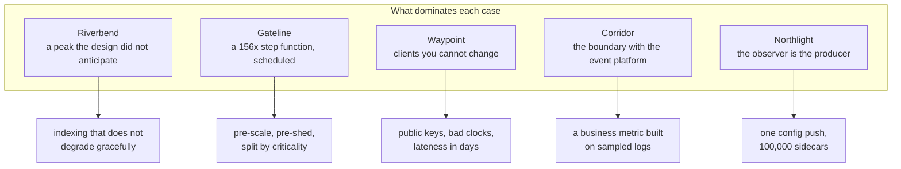

# Building a Scalable Log Collector — 10 TB per Hour, End to End

A staff-level collection on the system that sits between `log.Error()` and a search box: how a
log record gets off twelve thousand machines, survives the network, becomes durable, becomes
findable, and stays affordable for thirteen months — and every way that goes wrong.

It is built around one concrete brief, worked completely:

> Design a log aggregation service that handles **10 TB/hr** from thousands of services,
> supporting **real-time viewing for debugging**, **regex queries for exact retrieval in real
> time**, and a **bulk export of the last 24–48 hours** for an analytics team.

That brief comes from
[`../../system-design-notes/logProcessingAndAggregation.md`](../../../system-design-notes/logProcessingAndAggregation.md),
which sketches the ingestion path and the first flow and stops. This collection completes it,
and disagrees with it in a few places where the arithmetic did not survive being finished —
each disagreement is marked and derived.

The organising idea is this. Almost every design for a log platform is a design for **moving
bytes**, and moving bytes is the easy part. The hard parts are:

- **Log loss is silent.** There is no acknowledgement path back to the application, so a
  pipeline dropping 4% of records is indistinguishable from one dropping none — until somebody
  concludes a code path never executed.
- **The platform is most loaded exactly when it is most needed.** Failing services log thirty
  times more; engineers query six times more; both spikes land in the same minute, and the data
  that gets dropped is the data that would have explained the incident.
- **Volume is set by people who are not you**, and a single line of code inside a loop can move
  it two orders of magnitude on a Thursday afternoon.
- **You cannot debug the logging system with logs.**

Everything here that looks like paranoia is a response to one of those four.

## Who this is for

Read this if two or more are true:

- You run a logging platform above roughly a terabyte a day, or you are about to.
- Your log bill has grown faster than your traffic and nobody can say exactly why.
- Someone has asked you for "real-time regex search over all our logs" and you suspect the
  answer is more complicated than yes.
- You have had an incident where the logs for the incident window were missing, and the
  postmortem said "the pipeline was under load" and stopped there.
- You are choosing between Elasticsearch, Loki, ClickHouse, a lakehouse and a vendor, and the
  comparisons you can find are written by people selling one of them.
- You are preparing for a design interview where this question comes up, which it does.

**If you produce under 100 GB a day, stop here.** Use a hosted service, send your agents
straight to it, and read
[24-golden-defaults-and-checklists.md](24-golden-defaults-and-checklists.md) for the
onboarding checklist. Everything else in this collection is the cost of scale and
multi-tenancy, and you have not bought either.

## Start here, in this order

1. **[00-what-a-log-collector-is-and-why-it-is-hard.md](00-what-a-log-collector-is-and-why-it-is-hard.md)**
   — read this first even if you have run a logging stack for years. It defines the vocabulary
   everything else uses without re-explaining: the seven stages, event time versus ingest time,
   the four options when you cannot keep up, and the fifteen failure classes.
2. **[01-requirements-and-the-capacity-model.md](01-requirements-and-the-capacity-model.md)** —
   every number the collection reuses, derived in visible steps. When a later doc says "recall
   the 26-minute page-cache residency", it means an arithmetic step on that page.
3. **[08-sampling-filtering-and-volume-control.md](08-sampling-filtering-and-volume-control.md)**
   — if you read only one more, read this one. It is worth more money than everything else
   combined, and it changes the answer to every other decision in the collection.
4. Then read in whatever order matches your problem. Docs cross-reference rather than assuming
   you read them in sequence.

If something is **broken right now**, go to
[24-golden-defaults-and-checklists.md](24-golden-defaults-and-checklists.md) for the triage
order, then to [18](18-failure-modes-and-the-operations-playbook.md) for the runbooks. If you
are **choosing a stack**, go to [20](20-build-vs-buy-and-stack-choices.md). If you are
**preparing for an interview**, read 00, 01, 11, then the case closest to your domain in
[21](21-case-studies.md), then [23](23-staff-interview-questions.md).

## Topics

### Part 1 — Foundations

| Doc | Covers |
|-----|--------|
| [00-what-a-log-collector-is-and-why-it-is-hard.md](00-what-a-log-collector-is-and-why-it-is-hard.md) | The seven stages; why logs differ from metrics and traces in cost shape; line versus record versus event versus stream; the four hard properties; event time versus ingest time and why you need both; the two decisions that define the architecture; the fifteen failure classes |
| [01-requirements-and-the-capacity-model.md](01-requirements-and-the-capacity-model.md) | The five ambiguities to resolve before any arithmetic; Riverbend's and Lantern's volumes derived from first principles; compression ratios and why layout beats algorithm; buffer, storage, query and tail sizing; the full reference table |

### Part 2 — Getting records off the machine

| Doc | Covers |
|-----|--------|
| [02-the-agent-on-the-host.md](02-the-agent-on-the-host.md) | `A-01…A-14`: CRI log format and the 16 KB split; inode tracking and the two kinds of rotation; multiline reassembly; enrichment without a control-plane dependency; buffer sizing across a fleet spanning 2,200× in rate; CPU throttling and OOM during the spike the agent exists for |
| [03-agent-technology-choices.md](03-agent-technology-choices.md) | Fluent Bit, Vector, the OTel Collector, Filebeat, Fluentd, Alloy, rsyslog — the five properties that actually differentiate them, what each costs across 12,000 hosts, and the six tests to run on any candidate |
| [04-the-log-record-schema-and-parsing.md](04-the-log-record-schema-and-parsing.md) | `S-01…S-13`: the mandatory core and the open body; where to parse and why the answer is "in four places"; field explosion derived; timestamps, zones and clamping; levels as an enum and dynamic level control; designing the message body |
| [05-transport-and-the-gateway-tier.md](05-transport-and-the-gateway-tier.md) | `T-01…T-12`: why a gateway exists at all; protocol choice and real backpressure; batching arithmetic; the connection problems that only appear at 12,000-to-90 fan-in; mTLS at fleet scale; receiving from things that are not agents |

### Part 3 — The middle of the pipeline

| Doc | Covers |
|-----|--------|
| [06-the-buffering-tier.md](06-the-buffering-tier.md) | `B-01…B-10`: the four things a buffer buys; why one topic per service fails at 8,000 services; topics by consumer class; partition keys and skew; sizing on page-cache residency rather than disk; Redpanda, Pulsar, Kinesis and object storage as alternatives |
| [07-the-processing-tier.md](07-the-processing-tier.md) | `P-01…P-10`: the step order and why derive-before-sample matters; keeping the tier stateless; deduplication without a stream processor; enrichment without a live dependency; deriving metrics and the cardinality trap; making reprocessing safe |
| [08-sampling-filtering-and-volume-control.md](08-sampling-filtering-and-volume-control.md) | `V-01…V-10`: the five-level intervention hierarchy; aggregating successful access logs (44% of ingest); consistent, dynamic and tail sampling; graded quotas; the control plane; an 82.5% reduction costed and its concessions named |

### Part 4 — Making it findable

| Doc | Covers |
|-----|--------|
| [09-storage-tiers-and-file-formats.md](09-storage-tiers-and-file-formats.md) | `W-01…W-11`: the 10,000,000:1 query-density ratio that forces tiering; partitioning and sort order; write-small-compact-large; Parquet layout, the attributes map, and what keeping raw actually costs; the transactional catalogue; erasure against immutable storage |
| [10-indexing-strategies.md](10-indexing-strategies.md) | `X-01…X-08`: an index as a bet, and why most bets lose at logs' read-to-write ratio; sparse, Bloom, n-gram and inverted indexes derived with the arithmetic; why the same index is right on one tier and wrong on another; the per-tier index set |
| [11-query-execution-and-the-regex-problem.md](11-query-execution-and-the-regex-problem.md) | `Q-01…Q-09`: why brute force is 192,000 cores; the pruning chain step by step; extracting mandatory literals from a regular expression; RE2 versus catastrophic backtracking; admission control, streaming merge, and completeness metadata |

### Part 5 — The three flows the brief asked for

| Doc | Covers |
|-----|--------|
| [12-flow-one-live-tail.md](12-flow-one-live-tail.md) | `L-01…L-08`: the latency budget spent term by term; indexing the subscriptions rather than scanning them; separating routers from connection terminators; the slow-consumer problem and why you sample, then drop oldest, then disconnect, but never block |
| [13-flow-two-interactive-search.md](13-flow-two-interactive-search.md) | `Q-10…Q-14`: what an engineer actually does (seven queries in nine minutes); query-language design for search rather than for querying; the histogram and field distributions as the next-question engine; the five causes of "no results" |
| [14-flow-three-analytics-export.md](14-flow-three-analytics-export.md) | `E-01…E-08`: why a tar file is usually the wrong answer and what to offer instead; the completeness watermark that makes an export reproducible; chunking, manifests and reconciliation; format choice, and why CSV silently corrupts log data |

### Part 6 — Correctness and operations

| Doc | Covers |
|-----|--------|
| [15-delivery-guarantees-and-data-loss.md](15-delivery-guarantees-and-data-loss.md) | `D-01…D-07`: the eleven places records die; what guarantee is actually achievable and the honest sentence that states it; three measurement techniques and what each catches; the loss budget; duplicates; what ordering really guarantees |
| [16-multi-tenancy-isolation-and-quotas.md](16-multi-tenancy-isolation-and-quotas.md) | `M-01…M-08`: tenant granularity and the 62× skew to expect; graded quotas with a ceiling that preserves one record per distinct error; bulkheads over rate limits; weighted fair query scheduling; cost attribution and the report that changes behaviour; when to stop sharing |
| [17-security-compliance-and-pii.md](17-security-compliance-and-pii.md) | `C-01…C-08`: what is actually in there; five places to stop it; checksum validation and the 467× false-positive reduction; why there is no regex for a name; access control, audit, and break-glass; crypto-shredding; log injection and the platform as a target |
| [18-failure-modes-and-the-operations-playbook.md](18-failure-modes-and-the-operations-playbook.md) | `O-01…O-11`: what to build because you cannot debug logging with logs; the four platform-level failure shapes; designed backpressure at every hop; the five-level shedding switch; triage order; four runbooks; a gameday programme with its reliable first-time findings |
| [19-observability-of-the-log-pipeline.md](19-observability-of-the-log-pipeline.md) | Freshness, completeness, queryability, latency — defined precisely; the SLOs and why completeness stops at four nines; the single-glance dashboard; eleven alerts; **which metric misleads during which failure**; cost as a health signal |

### Part 7 — Deciding, and practising

| Doc | Covers |
|-----|--------|
| [20-build-vs-buy-and-stack-choices.md](20-build-vs-buy-and-stack-choices.md) | The full bill — $302,780/month, $0.042/GB, with cross-zone network at 35% of it; SaaS list prices at this volume; why volume control flips the build-versus-buy answer; Elasticsearch, Loki, ClickHouse and lakehouse compared with numbers; a seven-step decision procedure |
| [21-case-studies.md](21-case-studies.md) | `CS-1…CS-9` across five systems: Riverbend's migration off Elasticsearch, Gateline's 156× scheduled step function, Waypoint's uncontrollable mobile clients, Corridor's log-versus-event boundary, Northlight's mesh producing 5.9× the volume of the applications it observes |
| [22-scaling-to-10x-and-100x.md](22-scaling-to-10x-and-100x.md) | What is scale-invariant; what to delete at 1 TB/hr; what breaks first at 100 and at 1,000; cells and what they genuinely cost; **the threshold table** — where each decision in this collection expires |
| [23-staff-interview-questions.md](23-staff-interview-questions.md) | Eighteen questions with model answers and the follow-ups a strong answer invites, plus the five patterns that distinguish a strong answer from a complete one |
| [24-golden-defaults-and-checklists.md](24-golden-defaults-and-checklists.md) | Triage order; the annotated golden configuration for every tier; a twenty-question design review; a service onboarding checklist; **what to build at your scale** in three tiers; the numbers worth remembering |

## The running systems

Abstract examples make these docs harder, not easier. Every number below is fixed and reused
throughout, so when doc 12 says "recall Riverbend's 320,000 records per second at peak" it means
this table, and doc 12's arithmetic reconciles with doc 01's.

Scale figures come from [`../../system-design-notes`](../../../system-design-notes) and from the
systems already used in [`../MicroservicesPOF`](../MicroservicesPOF/README.md), so the
collections agree with each other.

**Lantern** is the platform — the 10 TB/hr system the brief describes, and the subject of docs
00 through 20.

**Riverbend** is its largest application tenant: the same online marketplace as
[`../K8s/cronJobs`](../K8s/cronJobs/README.md), [`../Observability`](../Observability/README.md),
[`../Kafka`](../Kafka/README.md) and [`../MicroservicesPOF`](../MicroservicesPOF/README.md).
Having both matters because they make opposite points — Riverbend is the scale most readers
operate at and where "just run Elasticsearch" is right; Lantern is the scale at which every
instinct from Riverbend is wrong.

| System | Shape | Scale that matters for the log pipeline |
|---|---|---|
| **Lantern** | The log platform | **10 TB/hr = 2.78 GB/s = 5.56M records/s** at ~494 B. Peak 1.7× diurnal; worst single-service incident spike **31×**. 12,000 hosts, 140,000 containers, 40 tenants, 12,400 services. 24 Kafka brokers, 26-minute page-cache residency. 21.8 TB/day stored; 43.7 TB hot, 611 TB warm, 8.07 PB cold. 180 concurrent tail sessions, ~18 queries/s |
| **Riverbend** | Online marketplace, EKS | 240 services, 38 namespaces, 380 nodes, 3,100 pods, 412 CronJobs. **85,000 records/s steady → 320,000/s at flash sale**; 44.2 MB/s = 3.8 TB/day. 1.6% of Lantern, 6.0% at peak |
| **Gateline** | Mega-event ticketing | 5,000 QPS baseline → **500,000 QPS in 10 seconds**. Log volume 5 MB/s → 780 MB/s, a **156× step function on a schedule** |
| **Waypoint** | Ride hailing | 750,000 GPS writes/s, 25M trips/day. Server logs 1.9 GB/s alongside **0.9 GB/s from 5M mobile clients you do not control** — public credentials, untrustworthy clocks, lateness in days |
| **Corridor** | Professional network | Hundreds of billions of tracking events/day. The case is the **boundary between the log platform and the event platform**, and what happens when a business metric ends up on the wrong side of it |
| **Northlight** | Streaming platform, 100,000-sidecar mesh | 4.2M internal RPCs/s, each logged twice. **3.53 GB/s of mesh access logs against 0.6 GB/s of application logs — the observer produces 5.9× what it observes** |

## Conventions used across docs

**Scenario IDs.** Every failure has an ID whose letter names the owning doc. They are the
cross-reference spine — the case studies, the interview bank and the playbook cite them rather
than re-explaining.

| Prefix | Doc | Class |
|---|---|---|
| `A-nn` | 02 | **A**gent and host collection |
| `S-nn` | 04 | **S**chema, parsing, and structure |
| `T-nn` | 05 | **T**ransport and gateway |
| `B-nn` | 06 | **B**uffer tier |
| `P-nn` | 07 | **P**rocessing tier |
| `V-nn` | 08 | **V**olume control: sampling and quotas |
| `W-nn` | 09 | Storage: **w**riting, formats, lifecycle |
| `X-nn` | 10 | Inde**x**ing |
| `Q-nn` | 11, 13 | **Q**uery execution and search |
| `L-nn` | 12 | **L**ive tail |
| `E-nn` | 14 | **E**xport and bulk delivery |
| `D-nn` | 15 | **D**elivery guarantees and loss |
| `M-nn` | 16 | **M**ulti-tenancy and isolation |
| `C-nn` | 17 | **C**ompliance, security, personal data |
| `O-nn` | 18 | **O**perating the platform as a whole |

Case-study incidents are `CS-1` … `CS-9` (doc 21).

**Each scenario follows the same five headings**, so you can skim to the part you need:

- **What you see** — the symptom, from the point of view of whoever gets paged.
- **Mechanism** — why it happens, derived rather than asserted.
- **Confirm it** — the query, command or measurement that distinguishes this from the three
  other things it looks like.
- **Recover** — what to do in the next ten minutes.
- **Prevent** — the design or configuration change, and what that change costs.

**Every doc ends with a numbered "What to take away."** If you are revisiting a doc, read that
first.

**Numbers are derived in visible steps.** Where a doc says a query needs 192,000 cores, the
arithmetic that produced it is on the page. Check it against your own figures rather than
adopting the conclusion — and where two docs disagree, the later one shows why (doc 06's
page-cache residency is the clearest example: an apparently unrelated compression decision moves
it from 16 minutes to 26).

**⚠️ marks a step that can make an ongoing incident worse.** These appear in recovery procedures
where the obvious action is the wrong one.

## Related collections in this repo

This collection deliberately does not re-derive material that already exists here. It cites
instead:

- [`../Kafka`](../Kafka/README.md) — broker, replication, producer, consumer and delivery-
  semantics failures in depth. Doc 06 covers the *architectural* role of the buffer and the
  parts specific to log workloads, and points there for the internals.
- [`../Observability`](../Observability/README.md) — RED, USE, SLIs, SLOs, error budgets and
  cardinality. Doc 19 applies those methods to a pipeline whose failures are silent, rather than
  re-teaching them.
- [`../MicroservicesPOF`](../MicroservicesPOF/README.md) — retry amplification, metastable
  failure, control planes, bulkheads and cells. The log pipeline exhibits all of them and the
  case studies share its running systems.
- [`../K8s/cronJobs`](../K8s/cronJobs/README.md) — the thundering-herd and scheduled-work
  material that docs 08 and 16 borrow for config polling and scheduled queries.
- [`../ErrorHandling.md`](../ErrorHandling.md) — the discipline of turning silent failures into
  loud ones, which is the philosophy underneath this entire collection.
- [`../DataPlatform.md`](../DataPlatform.md) — tenant skew, partitioning under skew, and the
  analytical-pipeline material doc 21's Corridor case depends on.
- [`../../system-design-notes/Clickhouse`](../../../system-design-notes/Clickhouse/README.md)
  and [`../../system-design-notes/Druid`](../../../system-design-notes/Druid/README.md) — the
  columnar-engine internals that docs 09 and 10 assume.
