# Kafka, Amazon SQS, NATS JetStream and Redpanda — a Principal-Level Comparison

**What this document is for.** You have to decide which messaging system a workload should run
on. More often, at principal level, the real question is bigger: how many messaging systems should
your company run at all, which workloads justify adding a new one, and how hard would it be to
undo the choice in three years? This document compares the four systems that keep coming up in
that conversation — **Apache Kafka**, **Amazon SQS**, **NATS JetStream**, and **Redpanda** — on
where each one fits, what each one costs, how each one fails, how each one is operated day to day,
and what each one's "acknowledged" actually promises.

**Versions in scope** (as of November 2026): Apache Kafka 4.2, Redpanda 25.3 and 26.1, NATS Server
2.14, and Amazon SQS as documented in late 2026. Prices are AWS `us-east-1` list prices, rounded;
check current prices before you reuse any dollar figure in a real proposal.

---

## How to read this document

These four systems are usually compared as if they were four brands of the same product, with a
table of throughput numbers and a row of ticks. They are not the same product. Two of them (Kafka
and Redpanda) are **distributed logs** that speak the same wire protocol. One (SQS) is a **managed
queue**. One (NATS JetStream) is a **subject-based messaging system with a persistence layer added
on top**. If you compare their throughput before you understand that difference, you will choose
the fastest system for a workload whose real requirement was something else entirely — replay, or
per-message retries, or surviving a flaky network link in a warehouse.

So the method here is the one used in the other long documents in this repository:

1. **Build the mental models first** (Parts 2–6). You cannot reason about a trade-off until you
   can see the mechanism that creates it.
2. **Compare along one axis at a time** (Parts 7–19): message lifecycle, durability, ordering,
   failure handling, scaling, performance, availability, operations, disaster recovery, security,
   ecosystem, cost, licensing.
3. **Decide** (Parts 20–23), using a decision procedure you can reuse, and show where it lands for
   a real-looking company.

Every comparison uses **one running system** — Riverbend, an online marketplace with five
messaging workloads of very different shapes — so that every number is derived from something
concrete rather than asserted. Every number is worked out in visible steps. Where a figure comes
from public benchmarks or operating experience rather than arithmetic, the document says so and
gives a range rather than a single point.

**A note on performance numbers.** Throughput and latency depend heavily on hardware, message
size, batching, durability settings, and how long the test ran. The ranges in Part 12 are typical
of well-configured deployments on current cloud hardware; they are not guarantees. Riverbend's
own measurements are illustrative numbers for a fictional company. Part 12 also explains how to run
a benchmark that will not mislead you.

---

## Index

- [Part 0 — What you are actually choosing when you choose a messaging system](#part-0--what-you-are-actually-choosing-when-you-choose-a-messaging-system)
- [Part 1 — The running system: Riverbend and five workloads with different shapes](#part-1--the-running-system-riverbend-and-five-workloads-with-different-shapes)
- [Part 2 — Two mental models: the log and the queue, and where subjects fit](#part-2--two-mental-models-the-log-and-the-queue-and-where-subjects-fit)
- [Part 3 — Kafka: how the machine works](#part-3--kafka-how-the-machine-works)
- [Part 4 — Redpanda: the same protocol on a different machine](#part-4--redpanda-the-same-protocol-on-a-different-machine)
- [Part 5 — NATS JetStream: subjects first, persistence second](#part-5--nats-jetstream-subjects-first-persistence-second)
- [Part 6 — Amazon SQS: the queue you do not operate](#part-6--amazon-sqs-the-queue-you-do-not-operate)
- [Part 7 — One message, four journeys](#part-7--one-message-four-journeys)
- [Part 8 — Durability: what "acknowledged" actually promises in each system](#part-8--durability-what-acknowledged-actually-promises-in-each-system)
- [Part 9 — Ordering, delivery guarantees, and exactly-once](#part-9--ordering-delivery-guarantees-and-exactly-once)
- [Part 10 — When processing fails: retries, poison messages, and dead letters](#part-10--when-processing-fails-retries-poison-messages-and-dead-letters)
- [Part 11 — Scaling consumers and fanning out to many readers](#part-11--scaling-consumers-and-fanning-out-to-many-readers)
- [Part 12 — Performance: throughput, latency, and how to read a benchmark](#part-12--performance-throughput-latency-and-how-to-read-a-benchmark)
- [Part 13 — Availability: what each system does when hardware fails](#part-13--availability-what-each-system-does-when-hardware-fails)
- [Part 14 — Day-2 operations and maintenance](#part-14--day-2-operations-and-maintenance)
- [Part 15 — Multi-region and disaster recovery](#part-15--multi-region-and-disaster-recovery)
- [Part 16 — Security and multi-tenancy](#part-16--security-and-multi-tenancy)
- [Part 17 — Ecosystem and integration](#part-17--ecosystem-and-integration)
- [Part 18 — Cost, derived for Riverbend](#part-18--cost-derived-for-riverbend)
- [Part 19 — Licensing, governance, and vendor risk](#part-19--licensing-governance-and-vendor-risk)
- [Part 20 — Where each system is the right answer, and where it is not](#part-20--where-each-system-is-the-right-answer-and-where-it-is-not)
- [Part 21 — A decision procedure you can reuse](#part-21--a-decision-procedure-you-can-reuse)
- [Part 22 — Riverbend's decision, workload by workload](#part-22--riverbends-decision-workload-by-workload)
- [Part 23 — Migrating between these systems](#part-23--migrating-between-these-systems)
- [Part 24 — Anti-patterns that show up in design reviews](#part-24--anti-patterns-that-show-up-in-design-reviews)
- [Part 25 — Questions a principal engineer should be able to answer](#part-25--questions-a-principal-engineer-should-be-able-to-answer)
- [Appendix A — The full comparison table](#appendix-a--the-full-comparison-table)
- [Appendix B — Golden starting configurations](#appendix-b--golden-starting-configurations)
- [What to take away](#what-to-take-away)

---

## Part 0 — What you are actually choosing when you choose a messaging system

There is a recognisable progression in how engineers approach this decision, and it is worth
naming because it tells you what to aim for.

- **An early-career engineer asks: which one is fastest?** They open benchmark charts and pick
  the system with the highest bar. This fails because almost no workload is limited by the
  broker's maximum throughput. Riverbend's image-thumbnail jobs arrive at 18 per second on
  average. Every system in this document can handle 18 messages per second on a laptop.
- **A senior engineer asks: which one fits this use case?** They notice that a job queue and an
  event stream are different shapes, and they match the shape. This is much better, and it is
  where most good decisions are made.
- **A staff engineer asks: how does each one fail, and who carries that failure?** They want to
  know what happens to an acknowledged message when a machine loses power, what happens to the
  queue when one message crashes every consumer that touches it, and who gets paged at 03:00
  when the disk fills.
- **A principal engineer asks: how many of these should the company run, and how reversible is
  each choice?** Every messaging system you add is a separate on-call skill set, a separate set of
  dashboards, a separate upgrade calendar, and a separate security review. The fourth system is
  rarely justified by a single workload. At the same time, forcing every workload onto one system
  produces its own failures — a job queue built on a log, or a replayable event history built on a
  queue. The principal job is to keep the number of systems small while still matching each
  important workload to a system whose natural shape fits it.

When you choose a messaging system, you are making five decisions at once, and it helps to
separate them because the four systems differ on each one independently:

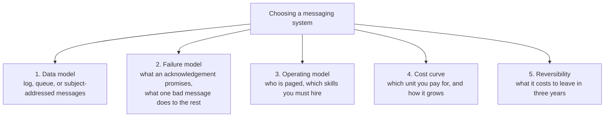

1. **The data model** decides what the system can do natively and what you will have to build.
   A log keeps messages after they are read, so a new consumer can read last week's data. A
   queue deletes a message once it has been processed, so it cannot. Part 2 derives every
   downstream property from this one difference.
2. **The failure model** decides what goes wrong silently. Each system has defaults that are
   weaker than most teams assume, and they are different defaults in each system (Part 8).
3. **The operating model** decides your headcount. SQS has no servers for you to run. Kafka has
   brokers, controllers, disks, a JVM, and a rebalancing tool, and each one needs someone who
   understands it.
4. **The cost curve** decides when the choice stops being cheap. SQS charges per request, so its
   bill grows in a straight line with traffic. Self-run systems charge for machines, disks,
   cross-zone network traffic, and people, so their bill is mostly fixed until you outgrow the
   cluster. Those two curves cross, and Part 18 calculates where.
5. **Reversibility** decides how much the first four mistakes will cost to fix. Redpanda speaks
   Kafka's protocol, so moving between those two is a reconfiguration plus a data copy. Moving
   from SQS to Kafka changes how every consumer is written.

The landscape on the two axes that matter most for a first comparison — "does it keep messages after they
are read?" and "who operates it?" — looks like this:

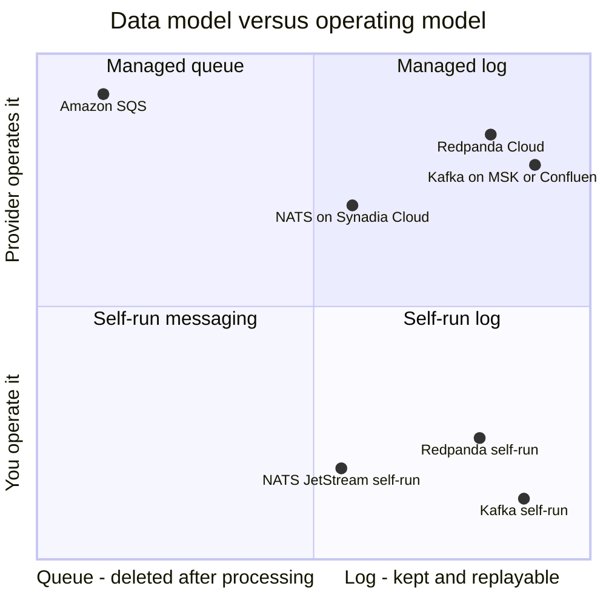

NATS JetStream sits in the middle of the horizontal axis on purpose. A JetStream stream is a log,
but a JetStream consumer can be configured to behave like a work queue that deletes each message
once it is acknowledged. It is the only one of the four that is designed to be both, and Part 5
explains what that flexibility costs.

This document is about the four named systems, but you should know that the boundary is blurring.
Kafka 4.2 added **share groups** (queue-style consumption on top of a Kafka topic). SQS FIFO adds
ordering to a queue. Several newer systems (WarpStream, AutoMQ, Bufstream, and the accepted but not
yet production-ready Kafka proposal KIP-1150 for "diskless topics") speak the Kafka protocol while
storing data directly in object storage such as S3. The mental models in Part 2 still apply to all
of them; only the cost and latency numbers move.

---

## Part 1 — The running system: Riverbend and five workloads with different shapes

**Riverbend** is the online marketplace used throughout this repository's Kafka collection
([`Kafka/README.md`](Kafka/README.md)). Buyers place orders, sellers list items, and Riverbend runs
fulfillment warehouses. Its platform team is five engineers. Everything runs in AWS `us-east-1`
across three availability zones (AZs) — physically separate data centres in the same region,
connected by fast links that AWS charges for when traffic crosses between them.

Today Riverbend runs one Kafka cluster, `riverbend-events`: six brokers on `m5.2xlarge` instances
with 2 TB of `gp3` disk each, three dedicated KRaft controllers, Kafka 3.7. The cluster is up for
renewal — the team must either upgrade it to Kafka 4.2 and keep putting everything on it, move
some or all of it to something else, or both. That is the decision this document works through.

Riverbend has five messaging workloads. They were chosen because each one has a different shape,
and the shape — not the volume — is what decides the right system.

### W1 — `orders.created`: the order event history

Every change to an order (created, paid, packed, shipped, delivered, refunded) is published as an
event keyed by order ID. Riverbend handles about 240,000 orders per hour at average load and
publishes about 9.6 lifecycle events per order:

```
240,000 orders/hour ÷ 3,600 s/hour = 66.7 orders/s
66.7 orders/s × 9.6 events/order   = 640 events/s average
peak (evening sales)               = 3,400 events/s
average event size                 = 1.1 KB
bytes per second, average          = 640 × 1.1 KB = 704 KB/s ≈ 0.7 MB/s
```

**Eleven independent consumers** read it: billing, search indexing, recommendations, the data
warehouse loader, fraud, email notifications, seller payouts, and four others. Two properties
matter more than volume:

- **Per-order ordering.** If "refunded" is processed before "paid" for order `ord_8823190`, the
  seller payout service pays a seller for a refunded order.
- **Replay.** When the recommendations team ships a new model, it needs to re-read the last 72
  hours of events. When a consumer has a bug that corrupted its output, it needs to rewind and
  re-process.

### W2 — `clickstream.events`: the high-volume stream

Every page view, search, and click from the website and apps:

```
average rate     = 34,000 events/s
peak rate        = 34,000 × 2.67 (Riverbend's peak-to-average ratio) ≈ 91,000 events/s
average size     = 1.19 KB
bytes, average   = 34,000 × 1.19 KB = 40.4 MB/s
bytes, peak      = 91,000 × 1.19 KB ≈ 108 MB/s
monthly volume   = 40.4 MB/s × 2,628,000 s (730 hours) ≈ 106 TB per month
```

This is 94% of all bytes Riverbend moves. Three consumers read it: a Flink job that builds user
sessions, an ad-attribution service, and an archiver that writes everything to S3. Losing a few
events is tolerable (it is analytics, not money). Ordering is not required. Replay over 24 hours is
needed when the Flink job is redeployed.

### W3 — `thumbnail-jobs`: a work queue

When a seller uploads a photo, a job resizes it into six sizes. Each job takes 4 seconds at the
median and 40 seconds at the 99th percentile (a 60-megapixel image from a professional camera).

```
average rate             = 18 jobs/s
burst                    = 900 jobs/s when a large seller bulk-imports a catalogue
largest observed import  = 50,000 photos
overnight                = close to zero
```

To finish a 50,000-photo import in 10 minutes you need:

```
total work      = 50,000 jobs × 4 s median = 200,000 worker-seconds
time available  = 10 min × 60 = 600 s
workers needed  = 200,000 ÷ 600 ≈ 333 concurrent workers
```

So the worker pool must scale from roughly zero to roughly 333 and back. Each job must be retried
if a worker crashes, and a job that fails every time (a corrupt image) must be set aside rather
than retried forever. No ordering, no replay — once a thumbnail exists, nobody needs the job again.

Today this runs on a Redis list (workers call `BRPOP`). In March, the Redis primary failed over to
a replica that was a few seconds behind, and 3,100 jobs vanished without any error. That incident
is why W3 is on the table.

### W4 — warehouse scanning: messaging at the edge

Riverbend has 14 fulfillment warehouses with about 2,600 handheld scanners in total. Every scan of a
package or shelf location is a small message (about 300 bytes). At peak, each scanner sends about
four scans a minute:

```
2,600 scanners × 4 scans/min ÷ 60 s/min ≈ 173 scans/s across all warehouses
```

The volume is trivial. The difficulty is the network. Each warehouse connects to AWS over a WAN
link that drops several times a week for 5 to 40 minutes. During an outage, scanning must not
stop, and scanners must still be able to ask "which shelf does this SKU go on?" and get an answer.
A warehouse has about 186 scanners (2,600 ÷ 14), so a 40-minute outage produces:

```
186 scanners × 4 scans/min × 40 min = 29,760 scans that must be buffered and delivered later
```

Today scanners call a central HTTP API directly and keep unsent scans in device memory. When a
device reboots during an outage, its unsent scans are lost.

### W5 — `inventory.reservations`: the latency-sensitive path

During checkout, Riverbend reserves inventory: checkout publishes a `reserve` command, the
inventory service decides, and publishes `reserved` or `rejected`, which checkout waits for. That is
**two broker hops inside a customer-facing request**.

The inventory service is **event-sourced**: it does not keep its stock counts only in a database.
It snapshots its state every 10 minutes and, after a restart, rebuilds by replaying the reservation
log from the last snapshot. So W5 needs a replayable log with per-SKU ordering (24-hour retention is
plenty), not just a fast pipe.

```
average rate = 300 commands/s, peak = 1,600 commands/s
size         = 0.5 KB
checkout SLO = 99% of checkouts complete in under 800 ms
budget for the reservation round trip = 60 ms
budget per broker hop (99.9th percentile) = 15 ms
```

On the shared `riverbend-events` cluster, W5 normally meets this. But twice last quarter its
99.9th-percentile produce latency jumped to between 120 and 400 ms for about 20 minutes. Both times,
the cause was the clickstream archiver catching up after an S3 outage: it read hours of old
clickstream data from disk, which pushed W5's recent data out of the operating system's memory
cache and saturated the disks. This is a real and well-known Kafka failure — one workload's
catch-up reads hurting another workload's write latency on a shared cluster — and Part 12 explains
the mechanism.

### The five shapes side by side

| | W1 orders | W2 clickstream | W3 thumbnails | W4 warehouse scans | W5 reservations |
|---|---|---|---|---|---|
| Average rate | 640/s | 34,000/s | 18/s | ~173/s at peak | 300/s |
| Peak rate | 3,400/s | ~91,000/s | 900/s | ~173/s | 1,600/s |
| Message size | 1.1 KB | 1.19 KB | 2 KB | 300 B | 0.5 KB |
| Consumers | 11 independent | 3 independent | 1 worker pool | 3 (inventory, WMS, analytics) | 1, plus a reply |
| Ordering needed | Per order | No | No | Per scanner | Per SKU |
| Replay needed | Yes, 72 h | Yes, 24 h | No | Audit, 7 days | Yes, since last snapshot |
| Latency need | Seconds | Minutes | Minutes | Sub-second, locally | 15 ms per hop at p99.9 |
| Hard part | Fan-out + replay + order | Volume and cost | Bursts, retries, scale to zero | Unreliable network | Tail latency |

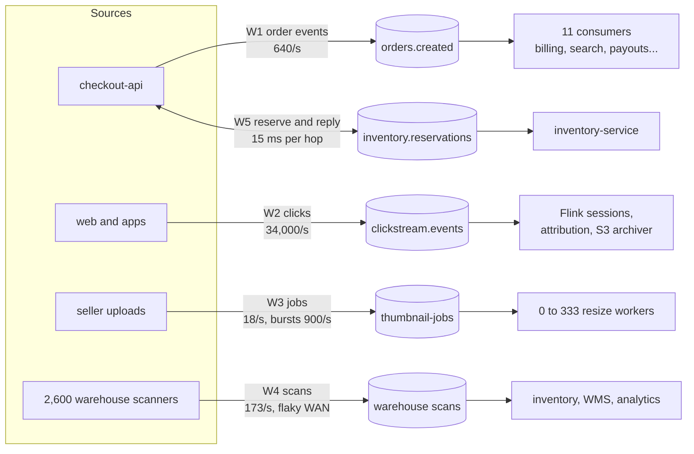

Keep these five in mind. By Part 22, you will see that they do not all land on the same system,
and that the hardest part of the decision is not matching each workload but deciding how many
systems the platform team can afford to run well.

---

## Part 2 — Two mental models: the log and the queue, and where subjects fit

Before looking at any one product, you need two mental models. Almost every difference between
these four systems follows from which model a system is built on.

### The queue: a message exists until someone deletes it

Picture a pile of job tickets on a desk. A worker takes the top ticket, does the job, and throws
the ticket away. If the worker drops dead halfway through, someone eventually notices the ticket
was never finished and puts it back on the pile.

That is a **queue**. In SQS terms:

- A producer **sends** a message; it sits in the queue.
- A consumer **receives** it. The message is not deleted; it becomes **invisible** to other
  consumers for a period called the **visibility timeout** (30 seconds by default).
- If the consumer finishes, it **deletes** the message. It is gone forever.
- If the consumer crashes or takes too long, the visibility timeout expires and the message
  becomes visible again for another consumer to receive.

The system's bookkeeping is **per message**: for each message, is it visible, invisible until a
certain time, or deleted?

### The log: messages stay, and each reader keeps a bookmark

Now picture a ledger book where every entry is written on the next line and nothing is ever erased
(until old pages are torn out after, say, three days). Several accountants read the same book.
Each one keeps a bookmark showing which line they have reached. Reading does not change the book.
A new accountant can start from page one. An accountant who made a mistake can move their bookmark
back and read again.

That is a **log**. In Kafka terms:

- A producer **appends** a record to the end of a **partition** (one ordered sequence of records;
  a topic is split into many partitions so the work can be spread across machines).
- Each record gets a sequential number called an **offset**.
- Each **consumer group** (one logical reader, possibly many processes) stores one number per
  partition: the offset it has processed up to. That number is its **committed offset**.
- Records are deleted by **retention** — after a configured time or size — not by being read.

The bookkeeping is **per reader per partition**: one integer.

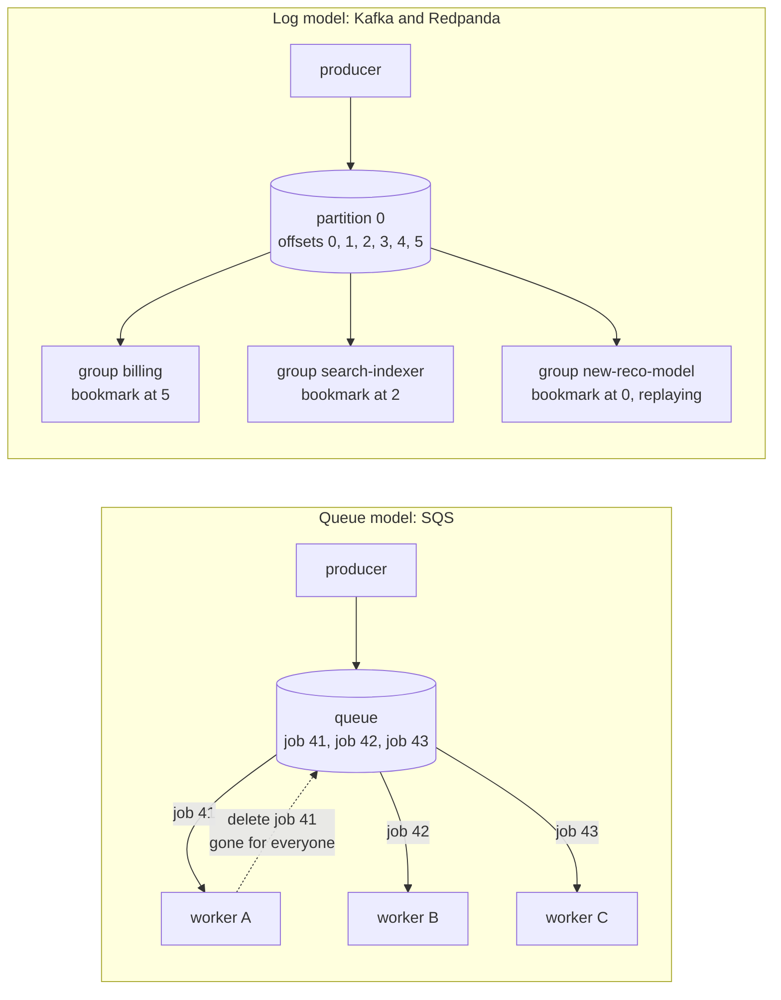

### Every important property follows from that one difference

It is worth deriving these rather than memorising them, because once you see why, you can predict
how any new system will behave.

**Replay.** A log keeps records after they are read, so any reader can go back. A queue deletes
on processing, so a message that has been processed cannot be read again. *If you need a new
consumer to see yesterday's data, you need a log* — or you need to be able to rebuild that data
from some other source of truth, such as a database.

**Fan-out (many independent readers).** In a log, adding a reader costs one more bookmark; the data
is stored once. In a queue, a deleted message is gone for everyone, so to give 11 services their
own copy you need 11 queues and something that copies each message into all of them (in AWS, an
SNS topic in front of the queues). Storage and request cost scale with the number of readers.

**Ordering.** A log's partition is an ordered sequence, and a reader processes it in order because
it only tracks one bookmark. A queue hands messages to whichever worker asks next, and a message
that fails reappears later, after messages that were behind it. *Ordering is natural in a log and
has to be added to a queue* (SQS FIFO adds it, at a cost in throughput).

**Parallelism.** In a queue, any worker can take any message, so you can add workers without limit.
In a log, one partition is read by at most one process in a consumer group at a time — because there
is only one bookmark per partition, two processes reading the same partition would fight over it.
So *a log's consumer parallelism is capped by its partition count*. Riverbend's `orders.created`
has 24 partitions, so no consumer group can usefully run more than 24 processes.

**A message that keeps failing.** In a queue, a bad message is just one message: it fails, becomes
visible again, fails again, and after a set number of attempts is moved to a **dead-letter queue**
(DLQ) — a separate queue for messages that could not be processed. The rest of the queue keeps
flowing. In a log, the bookmark cannot move past a record until it has been handled, so *one bad
record blocks everything behind it in that partition* — this is called **head-of-line blocking**.
You have to build the "skip it and set it aside" logic yourself.

**Bookkeeping cost.** A queue tracks state for every in-flight message (SQS allows up to 120,000
in-flight messages per queue, each with its own timer). A log tracks one integer per reader per
partition. This is why logs handle very high throughput cheaply, and why queues handle per-message
retry naturally.

| Property | Log (Kafka, Redpanda) | Queue (SQS) | Why |
|---|---|---|---|
| Replay | Native | Not possible after deletion | Log keeps data after reading |
| Many independent readers | Cheap: one bookmark each | One queue per reader, plus a copier | Queue deletes on processing |
| Ordering | Per partition, natural | None (standard) or per group (FIFO) | Log is read sequentially by one bookmark |
| Consumer parallelism | Capped at partition count | Unlimited | One bookmark per partition |
| One bad message | Blocks its partition | Retried, then moved to a DLQ | Bookmark cannot skip; queue tracks each message |
| Per-message retry and delay | Must be built | Native | Queue tracks each message's state |

### Where NATS subjects fit

NATS adds a third idea: **subject-based addressing**. A message is published to a **subject**, a
dot-separated name such as `warehouse.07.scan.dock3`. Subscribers express interest in subjects,
with wildcards: `warehouse.07.>` means "everything under warehouse 07", and `warehouse.*.scan.>`
means "scans from every warehouse".

**Core NATS** (without JetStream) is a router, not a store. If nobody is subscribed when a message
arrives, it is dropped. If a subscriber is slow, the server disconnects it rather than buffering
without limit. This is **at-most-once** delivery: a message is delivered zero or one times. It is
extremely fast (well under a millisecond inside a data centre) and it supports **request/reply**
natively — a publisher can send a request and wait for a single answer, which is how NATS is often
used as a service-to-service RPC layer.

**JetStream** adds persistence. A **stream** captures messages published to a set of subjects and
stores them as a log, with sequence numbers. A **consumer** is a server-side view over that stream,
and it can be configured to behave like a log reader (each consumer has its own position and the
messages stay) or like a work queue (messages are deleted once acknowledged). So JetStream can play
both roles, and it adds subject-based filtering on top — a consumer can read only
`warehouse.07.>` from a stream that holds all 14 warehouses.

### The convergence, and why defaults still matter

The lines between these models are blurring:

- **Kafka 4.2 share groups** (KIP-932, production-ready since Kafka 4.2 in early 2026) let many
  consumers read the same partition, acknowledge records one at a time, and have failed records
  redelivered — queue behaviour on top of a log.
- **SQS FIFO** adds per-group ordering and deduplication to a queue.
- **JetStream** offers both models in one system.

But each system is still *built around* one model, and the non-native mode is always the less
mature, less documented, more expensive path. Kafka share groups give up ordering. SQS FIFO caps
throughput per ordering group. JetStream's work-queue mode and its log mode have different
operational costs. When you pick a system, you should expect your workload to run in that system's
native mode, and treat the non-native mode as an option for minority cases rather than the reason
for the choice.

---

## Part 3 — Kafka: how the machine works

You do not need every Kafka internal to compare it with the others, but you do need the handful
that create its trade-offs. Each term below is defined the first time it appears.

### The pieces

- A **broker** is one Kafka server process. Riverbend runs six.
- A **topic** is a named stream of records, such as `orders.created`. It is split into
  **partitions**; `orders.created` has 24.
- Each partition is stored as a sequence of **segment files** on the broker's disk. New records are
  appended to the newest segment. Old segments are deleted when retention expires.
- Each partition has **replicas** — copies on different brokers. With a **replication factor** (RF)
  of 3, there are three copies. One replica is the **leader**; producers write to it and, by default,
  consumers read from it. The others are **followers**, which continuously fetch new records from
  the leader.
- The **in-sync replica set** (ISR) is the set of replicas that are caught up with the leader (by
  default, within the last 30 seconds — `replica.lag.time.max.ms`). A follower that falls behind is
  removed from the ISR; when it catches up, it is added back.
- The **high watermark** is the highest offset that every ISR member has. Consumers can only read up
  to the high watermark, which guarantees that a consumer never reads a record that could later
  disappear if the leader failed.
- **Controllers** hold the cluster's metadata: which brokers exist, which broker leads each
  partition, every topic's configuration. Since Kafka 4.0 (March 2025), this metadata lives in
  Kafka's own internal log, replicated between controllers with the Raft consensus protocol — a mode
  called **KRaft**. Before 4.0, it lived in a separate system, ZooKeeper, which 4.0 removed
  entirely. Riverbend runs three dedicated controllers, one per AZ.
- A **consumer group** is a set of consumer processes that share the work of reading a topic. Kafka
  assigns each partition to exactly one member of the group. One broker acts as the group's
  **coordinator**, tracking membership and storing committed offsets in an internal topic called
  `__consumer_offsets`.

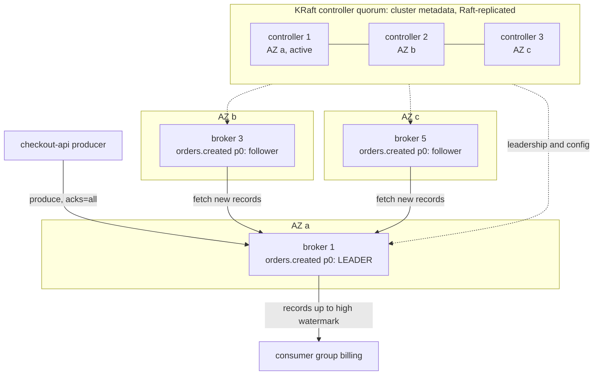

### The write path, and the decision Kafka makes about disks

When a producer sends a batch to the partition leader:

1. The leader appends the batch to its segment file. The write goes into the **page cache** — the
   area of RAM the Linux kernel uses to hold recently written and read file data. The kernel
   writes it to the physical disk later, on its own schedule (by default, dirty data older than
   about 30 seconds is written back).
2. Followers fetch the new records and append them to their own page caches.
3. Once every ISR member has the records, the leader advances the high watermark.
4. If the producer asked for `acks=all`, the leader now responds "acknowledged".

Notice what is missing: **Kafka does not call `fsync` before acknowledging.** `fsync` is the system
call that forces data from the page cache onto the physical disk. Kafka deliberately skips it by
default and relies on replication instead — the reasoning being that three copies in memory on three
machines in three AZs are less likely to all disappear than one copy on one disk. Part 8 examines
exactly what that bet covers and what it does not.

The page cache also explains Kafka's read performance. Consumers that are keeping up read records
that are still in RAM, and Kafka uses the `sendfile` system call to copy them straight from the
page cache to the network socket without passing through the JVM (**zero-copy**). This is why a
modest Kafka cluster can serve many consumer groups. It is also why a consumer that falls hours
behind is dangerous to everyone else: it reads old segments from disk, those reads evict recent
data from the page cache, and now producers and up-to-date consumers on that broker are competing
for disk. That is precisely what hurt Riverbend's W5.

### The read path and consumer groups

Each consumer in a group repeatedly **fetches** records from the partitions assigned to it, processes
them, and periodically **commits** its offset to the coordinator. If a consumer crashes, its
partitions are reassigned to other members, which resume from the last committed offset —
re-processing anything between that commit and the crash. That re-processing is why Kafka's default
delivery is **at-least-once**.

Reassigning partitions when members join or leave is a **rebalance**. Under the original protocol,
a rebalance paused the entire group while assignments were recalculated, and frequent rebalances
("rebalance storms") were one of Kafka's most common operational complaints. Kafka 4.0 made the new
consumer protocol from KIP-848 generally available: the broker computes assignments and moves
partitions incrementally, so members that keep their partitions keep working through the change.

Consumers can also read from a follower in their own AZ instead of the leader (**follower
fetching**, from KIP-392, configured with `client.rack` on the consumer and `replica.selector.class`
on the broker). This matters a great deal for cost, as Part 18 shows.

### What changed in the Kafka 4.x line

| Version | Change that matters for this comparison |
|---|---|
| 3.9 (Nov 2024) | **Tiered storage** (KIP-405) production-ready: old segments move to object storage such as S3, so brokers keep only recent data on local disk |
| 4.0 (Mar 2025) | **ZooKeeper removed**; KRaft only. New consumer rebalance protocol (KIP-848) generally available. Java 17 required for brokers |
| 4.1 (Sep 2025) | Share groups in preview; Kafka Streams' own rebalance protocol (KIP-1071) in early access |
| 4.2 (early 2026) | **Share groups production-ready** (KIP-932, "Queues for Kafka"): per-record acknowledgement, redelivery, and a delivery-count limit on a normal topic |
| Accepted, not shipped | **Diskless topics** (KIP-1150, accepted March 2026): partitions stored directly in object storage, removing cross-AZ replication traffic, at the cost of higher latency |

### What Kafka costs you, in exchange

- **A JVM.** Brokers run on the Java virtual machine. Garbage collection pauses add tail latency,
  and the heap must be sized and the collector tuned (typically a 6 GB heap with G1; most of the
  machine's RAM is deliberately left free for the page cache).
- **Many moving parts.** Brokers, controllers, the rebalancing tool (most teams use Cruise Control),
  a schema registry, Connect workers, monitoring for lag. Each needs someone who understands it.
- **Partition count is a design decision you cannot easily undo.** Adding partitions to a keyed
  topic changes which partition each key maps to, which breaks per-key ordering for keys that are
  in flight during the change. You size partitions up front for future parallelism.
- **Rebalancing data is slow.** Moving partitions to a new broker means copying their data over the
  network. Part 14 derives how long that takes at Riverbend: about seven hours.

What you get in return is the most mature, most widely understood, most widely supported streaming
system there is. Every stream processor, every CDC tool, every data warehouse loader has a Kafka
connector. Every cloud has a managed Kafka. You can hire people who have operated it at large
scale. That maturity is Kafka's strongest argument and it is a legitimate one.

---

## Part 4 — Redpanda: the same protocol on a different machine

Redpanda is a separate implementation of the Kafka wire protocol. Your producers and consumers use
the same Kafka client libraries and the same configuration; you point `bootstrap.servers` at a
Redpanda cluster instead of a Kafka cluster. Behind that protocol, the machine is built very
differently, and the differences are where both its advantages and its risks come from.

### Thread-per-core: no shared memory, no locks

Redpanda is written in C++ on a framework called Seastar. Seastar uses a **thread-per-core**
architecture: Redpanda starts one thread per CPU core and pins it there. Each core owns its own
partitions, its own slice of memory, and its own disk I/O queue. Cores do not share data
structures; when one core needs something from another, it sends an explicit message. Because
nothing is shared, nothing needs a lock, and because there is no JVM, there are no garbage-collection
pauses.

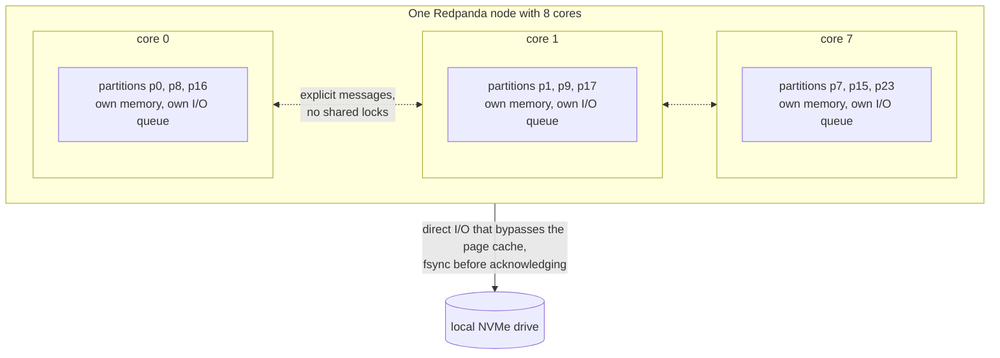

The consequence is predictable latency when the hardware matches the design: dedicated cores (not
burstable instances that borrow CPU time), and fast local NVMe drives. Redpanda ships a tuner
(`rpk redpanda tune`, `rpk iotune`) that measures your disks and configures the OS for it. When the
hardware does not match — shared CPUs, slow network disks, other busy workloads on the same physical host (often called "noisy
neighbours") — the
design loses much of its advantage, because one core's stall cannot be absorbed by another.

### Its own cache, and fsync by default

Redpanda does not use the Linux page cache. It reads and writes with direct I/O and keeps its own
cache in memory it manages. That lets it control exactly when data reaches the disk, and **by
default it calls `fsync` before acknowledging an `acks=all` write**: a majority of replicas have the
data on durable storage before the producer hears "acknowledged". That is a stronger default than
Kafka's (Part 8). Since version 24.1 you can relax it per topic with **write caching**, which
acknowledges once a majority has the data in memory — the same bet Kafka makes — in exchange for
lower latency.

### Raft per partition instead of ISR

Kafka's leader waits for whatever the current ISR is, and the ISR can shrink. Redpanda uses
**Raft**, a consensus protocol, for every partition. In Raft, the replicas of a partition elect a
leader, and a write is **committed** once a **majority** — more than half — of the replicas have
stored it. Because any two majorities of the same group overlap in at least one member, a newly
elected leader is guaranteed to have every committed write.

Majorities explain a rule that surprises Kafka users: **Redpanda requires an odd replication
factor.** Work it through:

```
3 replicas: majority = 2, so it keeps working with 1 replica down
4 replicas: majority = 3, so it keeps working with 1 replica down   (same as 3, one more copy to pay for)
5 replicas: majority = 3, so it keeps working with 2 replicas down
2 replicas: majority = 2, so it stops accepting writes if either replica is down
```

An even count costs more without tolerating more failures, so Redpanda disallows it. That has a
real consequence for Riverbend's W2: Kafka lets you run low-value data at RF 2 with
`min.insync.replicas=1` (two copies, keep writing with one). Redpanda offers RF 1 or RF 3. For a
106 TB/month stream, the difference between two copies and three copies is a 50% difference in
disk (Part 18).

Cluster metadata is held in a special Raft group, the **controller**, running inside the Redpanda
nodes themselves. There is no separate controller tier and no external dependency. One binary
contains the Kafka-compatible API, a **schema registry** (the service that stores message schemas
so producers and consumers agree on formats), and an HTTP proxy.

### Kafka compatibility is per feature, not all or nothing

"Speaks the Kafka protocol" means the common paths work: producing, consuming, consumer groups,
idempotent producers, transactions, and the usual admin operations, with the standard clients,
Kafka Connect, Kafka Streams, and Flink's Kafka connector. It does not mean every Kafka Improvement
Proposal (KIP) ships in Redpanda at the same time it ships in Apache Kafka. The newest features —
share groups from Kafka 4.2, the KIP-848 consumer protocol, specific admin and quota APIs — arrive
on Redpanda's own schedule. **Before you choose Redpanda, list every Kafka feature your clients and
tools actually use and check each one against Redpanda's documentation for the version you will
run.** That list is usually short, and checking it is cheaper than discovering a gap in production.

### Community edition versus enterprise features

Redpanda's core is source-available under the Business Source License (Part 19 explains what that
means). A set of features requires a paid **enterprise license key**, including **tiered storage**,
**continuous data balancing**, **Shadowing** (cluster-to-cluster disaster recovery, added in 25.3),
remote read replicas, audit logging, Kerberos authentication, and FIPS compliance. New clusters get a
time-limited trial. When a license expires, the cluster keeps running and keeps your data, but you
cannot enable those features, and Redpanda blocks upgrades while enterprise features are in use
without a valid license.

This matters more than it sounds. **Tiered storage is how you keep large retention cheap**, and on
Redpanda it is an enterprise feature; on Apache Kafka it is free. If your workload needs weeks of
retention, the comparison is "Kafka with free tiered storage" versus "Redpanda plus a license", not
"Kafka versus Redpanda".

### What Redpanda gives you, and what it costs

You get a Kafka-compatible system with fewer components (no controllers to run separately, no JVM to
tune, a built-in schema registry), lower and flatter tail latency on suitable hardware, fsync-safe
defaults, and an operational experience most teams describe as simpler. Redpanda's newer features
include **Iceberg Topics** (writing a topic directly into Apache Iceberg tables for analytics),
**Cloud Topics** (in beta in 25.3: topics stored directly in object storage), and **Redpanda Connect**
(the connector framework formerly called Benthos).

You pay with a single-vendor dependency, a license that restricts some uses, important features
behind an enterprise key, a smaller pool of engineers who have operated it at large scale, and
compatibility that you must verify feature by feature.

---

## Part 5 — NATS JetStream: subjects first, persistence second

NATS is the odd one out in this comparison, and understanding why is the key to using it well.
Kafka and Redpanda are storage systems that also move data. NATS is a messaging fabric — a network
of servers that routes messages by subject — to which JetStream adds storage.

### Core NATS: a router for subjects

A NATS server is a single small Go binary (about 20 MB). Clients connect and either **publish** to a
subject or **subscribe** to a subject pattern. Subjects are dot-separated tokens; `*` matches exactly
one token and `>` matches one or more tokens at the end.

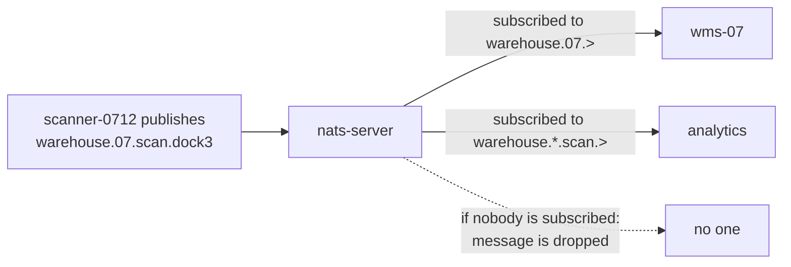

Core NATS delivers **at most once**. There is no storage: if no subscriber is connected, the message
is gone. It offers three patterns natively:

- **Publish/subscribe**: every matching subscriber gets a copy.
- **Queue groups**: subscribers that join the same queue group share the messages — each message goes
  to one member. This is load balancing without any broker-side state.
- **Request/reply**: the requester publishes with a unique reply subject (an "inbox") and waits for
  one answer. This turns NATS into a service-to-service RPC layer with built-in load balancing and
  discovery: a service just subscribes to `inventory.lookup` and any instance can answer.

That last pattern is why NATS shows up in so many architectures: it replaces a service mesh, a load
balancer, and a message broker with one system.

### JetStream: streams and consumers

**JetStream** is the persistence layer built into the same server binary. You enable it in the
server configuration and then create two kinds of objects:

A **stream** captures every message published to its subjects and stores it as an ordered log with a
sequence number. You choose:

- **Subjects** it captures, such as `warehouse.*.scan.>`.
- **Storage**: `file` or `memory`.
- **Replicas**: 1 to 5. A replicated stream is a Raft group, like a Redpanda partition, so 3 is the
  normal production choice.
- **Retention policy**, which is where JetStream's dual nature shows:
  - `limits` — keep messages until a limit on age, total size, or count is reached. This is a log.
  - `interest` — keep each message until every consumer that existed when it arrived has
    acknowledged it.
  - `workqueue` — delete each message as soon as any consumer acknowledges it. This is a queue.
- **Discard policy** when a limit is hit: `old` (drop the oldest messages, like Kafka retention) or
  `new` (reject new publishes — the producer gets an error, which is real backpressure).
- **Duplicate window**: if a publisher sets a `Nats-Msg-Id` header, the stream drops repeats of the
  same ID within this window (2 minutes by default).

A **consumer** is a server-side cursor over a stream. Unlike a Kafka consumer group, it lives on the
server and tracks acknowledgement per message, not just a position. You choose:

- **Durable or ephemeral** (does it survive when no client is connected?).
- **Pull or push** (does the client ask for batches, or does the server send them?). Pull is the
  recommended default for new work because the client controls its own rate.
- **Filter subjects**, so a consumer can read only `warehouse.07.>` from a stream holding all
  warehouses.
- **Ack policy**: `explicit` (each message acknowledged individually), `all` (acknowledging message
  N acknowledges everything before it, like a Kafka offset commit), or `none`.
- **AckWait** (30 s default): how long before an unacknowledged message is redelivered — the same idea
  as SQS's visibility timeout.
- **MaxDeliver** and **BackOff**: how many times to redeliver, and with what delays.
- **MaxAckPending** (1,000 by default): how many messages can be delivered but not yet acknowledged.
  This is the consumer's flow-control limit.

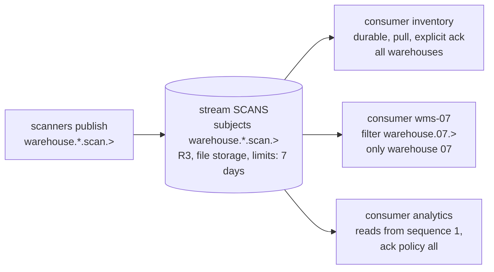

Each durable, replicated consumer is **also a Raft group**, holding its delivery and acknowledgement
state. That is how JetStream achieves per-message tracking with replication, and it is also its main
scaling cost: a stream with 50 R3 consumers is 51 Raft groups. Part 11 and Part 14 come back to this.

### Topologies: clusters, superclusters, and leaf nodes

NATS servers connect in three ways, and the third one is unusual enough to be a deciding factor:

- A **cluster** is a set of servers (usually 3 or 5) that share routing and host JetStream assets
  with Raft.
- A **supercluster** is several clusters, often in different regions, connected by **gateways**.
  Subject interest propagates globally, so a request published in Europe can be answered by a
  service in the US if no European instance exists.
- A **leaf node** is a server that connects to a cluster as a client would, extending it into
  another network — a warehouse, a factory, a ship, a retail store. The leaf node keeps working when
  its uplink drops. It can run its own JetStream **domain** with local streams, and a central stream
  can **source** from it (pull its messages in, asynchronously, catching up after the link returns).

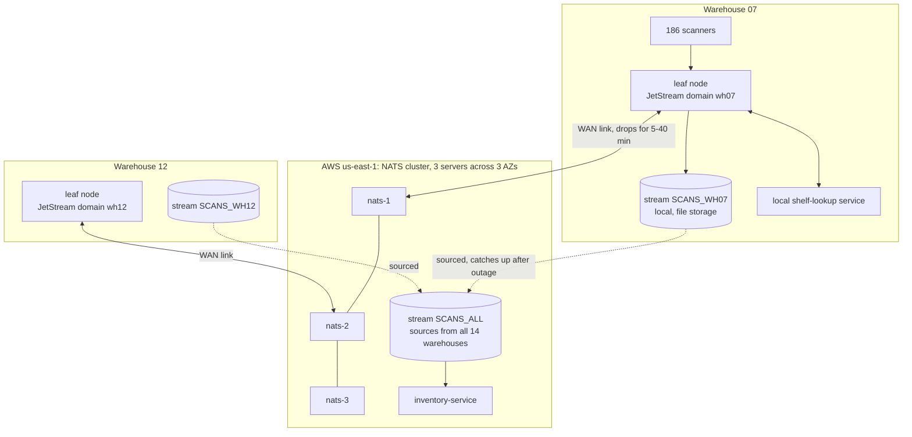

This is exactly Riverbend's W4. Scanners publish to the local leaf node, the local stream stores
every scan on disk, the local shelf-lookup service answers request/reply queries without the WAN,
and the central stream catches up automatically when the link returns.

### Accounts: multi-tenancy built into the protocol

NATS has **accounts**: isolated subject namespaces inside one deployment. Two accounts can both use
the subject `orders.created` without seeing each other's messages. Sharing is explicit — an account
**exports** a subject or service, and another account **imports** it. Authentication can be
**decentralised**: an operator signs account keys, accounts sign user keys (as JSON Web Tokens with
public-key "nkeys"), and servers verify signatures without a central user database. Part 16 compares
this with the other systems.

### Features on top of streams

Because a stream is a general-purpose replicated log, NATS builds other things on it: a **key-value
store** (with watch and history, useful for configuration and leader election), an **object store**
(large files chunked into a stream), **per-message TTL** (2.11), **distributed counters** and
**atomic batch publish** (2.12), and **server-side message scheduling** and high-throughput batch
publishing (2.14, released April 2026; there was no 2.13).

### What JetStream gives you, and what it costs

You get one small binary that does pub/sub, request/reply, queues, logs, key-value, and edge
replication; sub-millisecond core messaging; real multi-tenancy; and a topology (leaf nodes) that no
other system here matches.

You pay with these costs:

- **A stream's throughput is bounded by its single Raft leader.** To go beyond what one leader can
  handle, you split the data across several streams using subject mapping (Part 11). Kafka does
  this splitting for you with partitions; in JetStream you design it.
- **Per-object overhead.** Every replicated stream and every replicated durable consumer is a Raft
  group. Thousands of them put real load on the servers and on the cluster's metadata leader.
- **A weaker default for durability.** By default JetStream flushes data to disk every two minutes
  rather than before acknowledging, and a December 2025 Jepsen analysis demonstrated data loss
  because of it (Part 8).
- **A smaller ecosystem for analytics.** There is no NATS equivalent of Kafka Connect's hundreds of
  connectors or of Kafka's position as the reference input for Flink and Spark.

---

## Part 6 — Amazon SQS: the queue you do not operate

SQS is the simplest system in this comparison to describe, because most of it is hidden from you.
You get an HTTPS API with a handful of operations. AWS runs everything behind it.

### What you see

- `SendMessage` / `SendMessageBatch` (up to 10 messages per call).
- `ReceiveMessage` (up to 10 messages per call), which returns each message with a **receipt handle**
  — a token you need in order to delete it or change its timeout.
- `DeleteMessage` / `DeleteMessageBatch`.
- `ChangeMessageVisibility`, to extend or shorten a message's invisibility.

### What happens to one message

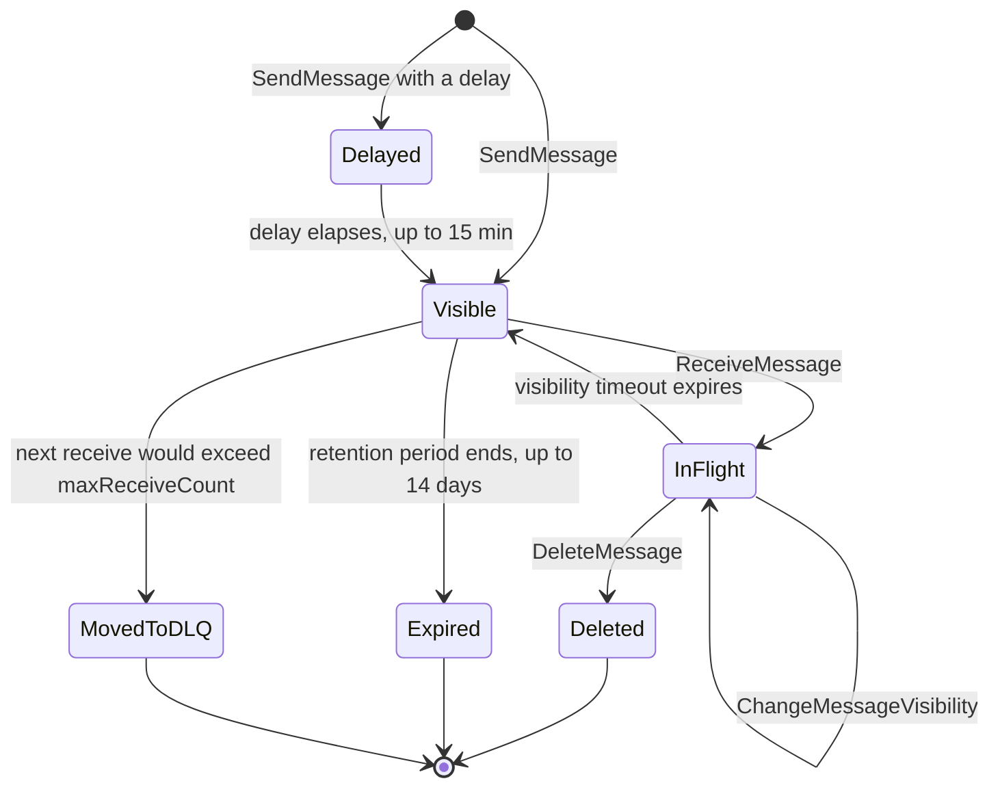

A received message is **in flight**: invisible to other consumers for the visibility timeout. If
your consumer deletes it, it is gone. If not, it becomes visible again and its **receive count**
increases. When a **redrive policy** is configured and the receive count would exceed
`maxReceiveCount`, SQS moves the message to the dead-letter queue instead of delivering it again.

Notice the `Expired` state. **A message that nobody processes within the retention period (4 days by
default, 14 days at most) is deleted silently.** There is no error and no notification. If a
consumer is broken for 15 days, the oldest messages are simply gone.

### Standard queues versus FIFO queues

| | Standard queue | FIFO queue |
|---|---|---|
| Delivery | At least once; occasional duplicates | Exactly-once *processing* within a 5-minute deduplication window |
| Ordering | Best effort, effectively none | Strict within a **message group ID** |
| Throughput | Effectively unlimited | 300 API calls/s per action by default (3,000 messages/s with batches of 10); **high-throughput mode** raises this to tens of thousands of calls per second in the largest regions |
| Price per million requests | $0.40 | $0.50 |
| A failing message | Others keep flowing | **Blocks its message group** until it is deleted or moved to the DLQ |

FIFO ordering is per message group. If you use the order ID as the message group ID, all events for
`ord_8823190` are processed in order, one at a time, while other orders proceed in parallel. A
message group can only have one batch in flight at a time, so a single group's throughput is bounded
by how fast one consumer can process it.

In July 2025 AWS added **fair queues** to standard queues: if producers set a message group ID
(typically a tenant ID), SQS limits how much one tenant's backlog can delay other tenants' messages.
This addresses the "noisy neighbour" problem in multi-tenant queues without the throughput limits of
FIFO.

### Short polling, long polling, and why it matters for cost

SQS stores each queue across many servers. A **short poll** (`WaitTimeSeconds=0`) asks a sample of
those servers and returns immediately — possibly with nothing, even when messages exist elsewhere.
A **long poll** (`WaitTimeSeconds` up to 20) asks all of them and waits until a message arrives or
the time runs out. Long polling returns as soon as a message is available, so it does not add
latency; it removes empty responses, each of which is a billed request. Always use long polling.

### The limits that shape designs

| Limit | Value | Design consequence |
|---|---|---|
| Message size | 1 MiB (raised from 256 KiB in August 2025) | Larger payloads go to S3 with a pointer in the message (the "extended client" pattern) |
| Retention | 60 s to 14 days, default 4 days | Backlogs older than retention are silently deleted |
| Visibility timeout | 0 s to 12 hours, default 30 s | Must exceed processing time, or extend it with heartbeats |
| Delay | 0 to 15 minutes | Longer delays need a scheduler (EventBridge Scheduler, Step Functions) |
| Long-poll wait | Up to 20 s | |
| Batch size | 10 messages per call | Batching is the main cost lever (Part 18) |
| In-flight messages | 120,000 per queue (FIFO raised from 20,000 to 120,000 in November 2024) | Very high concurrency with long processing can hit this |
| Billing unit | Each 64 KB chunk of a request counts as one request | A 256 KB message costs four requests to send |

### What SQS gives you, and what it costs

You get a queue with no servers, no disks, no upgrades, no capacity planning, scaling from zero to
very high throughput, multi-AZ durability managed by AWS, IAM-based security, encryption by default,
and native integration with Lambda, SNS, and EventBridge.

You pay with: no replay; fan-out only by adding SNS and one queue per reader; per-request pricing
that becomes significant at high volume; ordering only in FIFO queues, with throughput limits;
silent expiry at the retention limit; regional scope with no built-in cross-region replication; and
semantics (visibility timeouts, receipt handles) that are written into every consumer's code, which
makes leaving AWS a rewrite rather than a reconfiguration.

---

## Part 7 — One message, four journeys

The fastest way to feel the differences is to follow one message through each system. The message
is an `OrderPaid` event for order `ord_8823190`, amount 142.50 USD, event ID `evt_77120`. The
consumer is Riverbend's billing service.

### Kafka

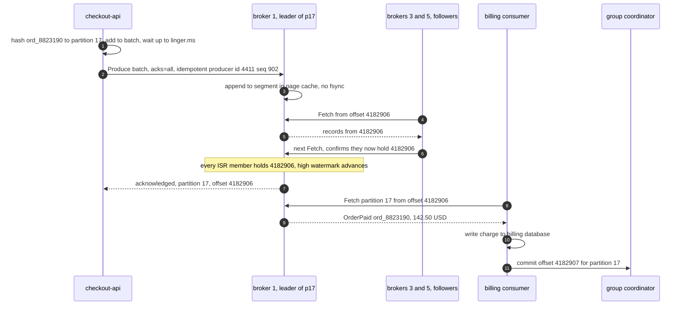

What to notice: the producer chose the partition (by hashing the key), so order is guaranteed per
key. The acknowledgement waited for replication but not for a disk flush. The consumer's only
state is offset `4182907` — "I have processed everything before this". If billing crashes after
writing the charge but before committing, it will re-read offset `4182906` on restart and see the
event again.

### Redpanda

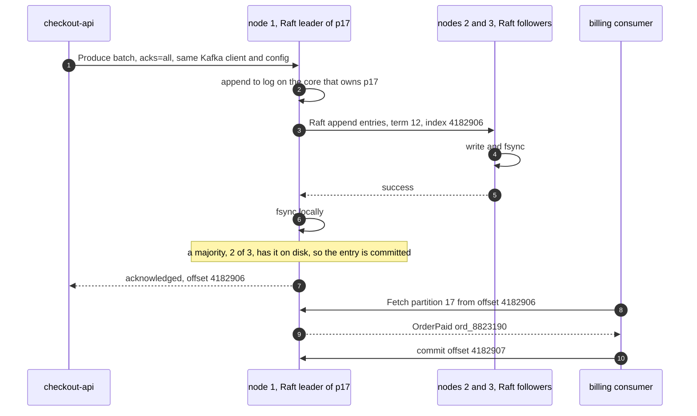

What to notice: the client side is identical to Kafka. The difference is inside — a majority vote
instead of the ISR, and an `fsync` before the acknowledgement. Your application code cannot tell
which one it is talking to.

### NATS JetStream

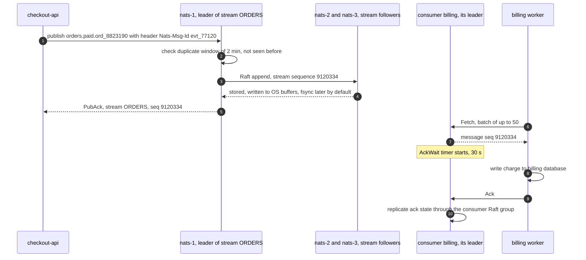

What to notice: the server tracks this specific message as "delivered, waiting for ack", with a
timer. If billing does not acknowledge within 30 seconds, the server redelivers it — possibly to a
different worker — without the rest of the stream waiting. The `Nats-Msg-Id` header means that if
checkout-api retried the publish (because the `PubAck` was lost), the second copy would be dropped
as a duplicate, as long as it arrived within two minutes.

### Amazon SQS

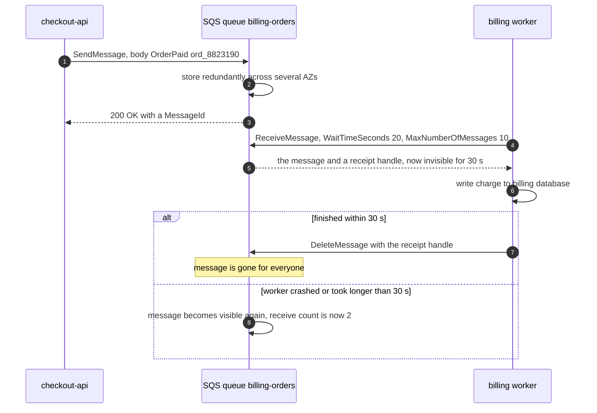

What to notice: there is no partition, no offset, no stream. There is one message with a timer. If
the eleven W1 consumers all need this event, checkout-api (or an SNS topic) must put eleven copies
into eleven queues, and each copy has its own lifecycle.

### Where the delivery state lives

| | Kafka | Redpanda | NATS JetStream | SQS |
|---|---|---|---|---|
| Unit of progress | One offset per partition per consumer group | Same as Kafka | Per-message ack state plus an "ack floor" per consumer | Per-message visibility state |
| Stored in | `__consumer_offsets` topic | Internal consumer-offsets topic | The consumer's own Raft group | Inside SQS |
| Who advances it | The consumer, by committing | The consumer | The server, as acks arrive | The consumer, by deleting |
| Cost of tracking | Tiny and constant | Tiny and constant | Grows with pending, unacknowledged messages | Grows with in-flight messages |
| A crashed consumer means | Re-read from last commit | Same | Unacked messages redelivered after AckWait | Messages reappear after visibility timeout |

---

## Part 8 — Durability: what "acknowledged" actually promises in each system

When a producer hears "acknowledged", it moves on. It deletes its local copy, tells the customer
"payment received", or marks the outbox row as sent. So the most important question you can ask of
a messaging system is: **after an acknowledgement, what has to go wrong for that message to be
lost?** The four systems answer differently, and in two of them the default answer is weaker than
most teams believe.

Three terms first:

- **`fsync`** forces data from the operating system's memory buffers onto the physical storage
  device. Until it completes, data that has been "written" by a program can still be lost if the
  machine loses power.
- A **correlated failure** is one where several machines fail at the same moment for the same
  reason: a power event that hits a whole data centre, a bad kernel update rolled out everywhere, a
  Kubernetes node that hosts three replicas of the same partition.
- A **replica placement** is where the copies physically live. Three copies on three machines in the
  same rack protect you from one machine failing, not from the rack losing power.

### Kafka: replication instead of disk flushes

Kafka's durability comes from three settings working together. Let `N` be the replication factor and
`M` be `min.insync.replicas` (the minimum number of in-sync replicas that must have a write before an
`acks=all` produce succeeds):

```
An acknowledged write exists on at least M replicas.
  -> it survives the loss of any M - 1 replicas.
Writes keep succeeding while at least M replicas are in sync.
  -> writes stay available through the loss of N - M replicas.

N = 3, M = 2:  acknowledged data survives 1 lost replica; writes continue with 1 replica down.
N = 3, M = 1:  acknowledged data survives 0 lost replicas in the worst case.
N = 2, M = 1:  same as above: cheap, and suitable only for data you can afford to lose.
```

The trap is in the defaults. Since Kafka 3.0, the **producer** defaults to `acks=all` with
idempotence enabled, which sounds safe. But the **broker** default for `min.insync.replicas` is
**1**. Walk through what that means for Riverbend's `orders.created` if nobody changed it:

1. Broker 3's disk becomes slow. Its replica of partition 17 falls more than 30 seconds behind and is
   removed from the ISR. Broker 5 is restarted for patching and is also out of the ISR for a while.
2. The ISR for partition 17 is now just the leader, broker 1.
3. `acks=all` means "all members of the ISR". The ISR has one member. So every produce is
   acknowledged after being written to broker 1's page cache alone.
4. Broker 1's instance is terminated by an EC2 hardware failure. Every write acknowledged during
   step 3 that the followers had not fetched is gone.

Nothing in that sequence logged an error. That is why the Kafka collection in this repository calls
`min.insync.replicas`, not replication factor, the real durability setting.

Then there is the missing `fsync`. With `N = 3, M = 2` and rack awareness configured (`broker.rack`
set to each broker's AZ, so Kafka places the replicas in different AZs), an acknowledged record is
in memory on at least two brokers in two different AZs. To lose it, both must lose power before the
kernel writes the data to disk — a window of roughly 30 seconds by Linux defaults — and before any
other replica fetches it. Separate AZs have separate power, so this needs a correlated failure
across AZs, which is rare. But notice the conditions: **if `broker.rack` is not set, Kafka does not
know where the AZs are, and all three replicas of a partition can land in the same AZ.** If brokers
run on Kubernetes without anti-affinity rules, replicas can land on the same physical host. In those
cases a single power event can take out every in-memory copy.

You *can* make Kafka flush every write (`flush.messages=1`), but it is rarely done because it
costs a lot of throughput on Kafka's design, and replication across failure domains gives most of
the protection.

### Redpanda: majority on disk before acknowledging

By default, an `acks=all` write to Redpanda is acknowledged only after a majority of replicas have
written **and fsynced** it. With RF 3, that is two copies on durable storage. To lose an acknowledged
write you must lose the *disks* (not just the power) of two of the three replicas. Even a
simultaneous power cut of the whole cluster does not lose acknowledged data, provided the drives
honour `fsync` — which enterprise NVMe drives and cloud block storage do.

The relaxed option is **write caching** (per topic, since 24.1), which acknowledges after a
majority has the data in memory. It is the same bet Kafka makes by default, and it is a reasonable
choice for data like W2's clickstream. The point is that on Redpanda you opt *in* to the weaker
guarantee; on Kafka you have to opt in to the stronger one.

`acks=1` on Redpanda, as on Kafka, means the leader alone — use it only for data you can lose.

### NATS JetStream: quorum in memory, disk every two minutes by default

A JetStream R3 stream acknowledges a publish once a quorum (2 of 3) of the stream's Raft group has
stored the message. By default, "stored" means written to the operating system, not fsynced: the
server's `sync_interval` setting defaults to **2 minutes**, meaning outstanding writes are flushed to
disk at most every two minutes.

In December 2025, **Jepsen** — an independent group that tests distributed systems by injecting
faults and checking what was lost — published an analysis of NATS 2.12.1. Using a filesystem layer
that discards any data not yet fsynced when it simulates a power failure, Jepsen showed JetStream
losing acknowledged writes after coordinated power failures. It also found that truncating or
corrupting data files on a *minority* of nodes could cause acknowledged writes to be lost — the
kind of fault a Raft system is supposed to tolerate. NATS responded by documenting the risk of the
default, pointing out that `sync_interval: always` forces an `fsync` after every write, and stating
that the handling of corrupted files was still being worked on.

What this means in practice:

- For data that must survive correlated failures (money, orders, audit trails), set
  `sync_interval: always` and **measure the throughput cost on your hardware**. On local NVMe it is
  modest. On network-attached disks such as EBS, small synchronous publishes slow down considerably.
- Place the three replicas in three AZs: tag each server with its AZ (`server_tags: ["az:us-east-1a"]`)
  and set `unique_tag: "az"` in the JetStream configuration, so no two replicas of a stream share an
  AZ. This is the same protection Kafka's rack awareness gives.
- Read the release notes for your exact version; the sync behaviour has continued to change through
  the 2.14 and 2.15 lines.

Two client-side traps make JetStream lose data with no server fault at all:

- **Publishing with a core NATS publish to a subject that a stream captures** stores the message,
  but the publisher gets no acknowledgement. If the stream leader is mid-election, the message is
  silently dropped. Use the JetStream publish call, which waits for a `PubAck`.
- **Asynchronous JetStream publishing** returns a future. If your code never checks those futures,
  failed publishes go unnoticed.

### SQS: AWS's problem, with different failure modes

When `SendMessage` returns success, AWS has stored the message redundantly across multiple AZs. You
cannot configure this, and you cannot make it weaker or stronger. The SLA is 99.9% monthly uptime.
For durability against hardware failure, SQS is the strongest default of the four and requires no
thought.

SQS messages are lost in other ways, all of them on your side of the API:

- **Retention expiry.** A consumer outage longer than the retention period (4 days by default)
  deletes the oldest messages without any error. Set retention to the maximum 14 days for anything
  important, and alarm on `ApproximateAgeOfOldestMessage`.
- **Batch partial failure.** `SendMessageBatch` returns HTTP 200 even when some of the ten entries
  failed; the failures are listed in a `Failed` field of the response. Code that checks only the
  HTTP status loses those messages silently. (`DeleteMessageBatch` has the same shape, and ignoring
  its failures causes duplicates instead.)
- **Deleting before processing.** A consumer that deletes on receipt and then crashes loses the
  message. This is at-most-once delivery by mistake.

### Where your message is at the moment of acknowledgement

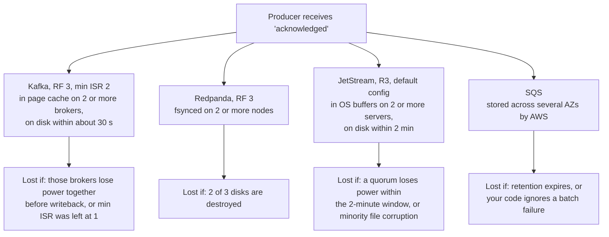

### Durability side by side

| | Kafka | Redpanda | NATS JetStream | SQS |
|---|---|---|---|---|
| Default meaning of an ack | ISR members have it in memory | Majority fsynced | Quorum has it in OS buffers | Stored across AZs |
| Default that most often causes loss | Broker `min.insync.replicas=1` | None; relaxed mode is opt-in | `sync_interval` of 2 minutes | 4-day retention |
| Strongest practical setting | RF 3, min ISR 2, `broker.rack`, unclean election off | Default (RF 3, write caching off) | R3, `sync_interval: always`, AZ-unique placement (`unique_tag`) | 14-day retention, DLQ, alarms |
| Survives full-cluster power cut | Not guaranteed | Yes | Not with defaults | Not your concern |
| Silent-loss trap on the client | Ignoring send callbacks | Same as Kafka | Core publish to a stream subject; unchecked async futures | Ignoring `Failed` in batch responses |

**The principle to take from this part:** durability is not a property of a product. It is a
per-topic or per-stream configuration combined with a physical placement decision, and in each
system you must check both. "We use Kafka, so it is durable" and "we use NATS, so it is fast and
durable" are both statements about configurations nobody has looked at.

---

## Part 9 — Ordering, delivery guarantees, and exactly-once

### Three delivery guarantees, defined

- **At-most-once**: a message is delivered zero or one times. You never see duplicates, but you can
  lose messages. Core NATS works this way; so does any consumer that acknowledges before processing.
- **At-least-once**: a message is delivered one or more times. You never lose a message that was
  acknowledged to the producer, but you can see duplicates. This is the normal mode of all four
  systems.
- **Exactly-once**: every message affects the result exactly one time. No system can deliver a
  message exactly once over an unreliable network in general, so in practice "exactly-once" means
  **at-least-once delivery plus deduplication** somewhere — in the broker, in the consumer, or in
  the database the consumer writes to.

Duplicates come from two places, and it helps to keep them separate:

1. **Producer retries.** The producer sends, the acknowledgement is lost, the producer sends again.
   Now the broker has two copies.
2. **Consumer redelivery.** The consumer processes a message, then crashes before acknowledging or
   committing. The message is delivered again.

### How each system handles producer duplicates

- **Kafka and Redpanda — the idempotent producer.** Each producer gets a producer ID, and each batch
  carries a sequence number per partition. The broker remembers the last sequence numbers it has
  accepted and drops a retried batch it has already written. This is on by default in Kafka since
  3.0 and preserves order with up to five requests in flight. It only covers retries *within one
  producer session*: if checkout-api restarts and re-sends the event from its outbox, the new process
  has a new producer ID and the broker cannot tell it is a duplicate.
- **NATS JetStream — message ID deduplication.** The publisher sets `Nats-Msg-Id: evt_77120`. The
  stream drops any later message with the same ID within the duplicate window (2 minutes by default,
  configurable). Because the ID comes from your application, this works across process restarts —
  as long as the retry happens within the window.
- **SQS FIFO — deduplication ID.** Same idea, with a fixed 5-minute window, using an explicit
  `MessageDeduplicationId` or a hash of the message body. **SQS standard queues have no producer
  deduplication.**

### How each system handles ordering

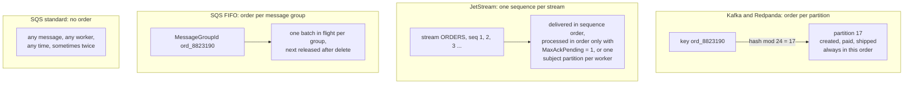

**Kafka and Redpanda** give you order per partition, and because the producer picks the partition by
hashing the key, all events for one key are in order. A single consumer reads a partition
sequentially. Order is preserved through producer retries by the idempotent producer. Order breaks
when you add partitions to a keyed topic (keys move to different partitions) or when a consumer
processes records from one partition in parallel threads without care.

**JetStream** gives every stream one total order by sequence number, and a consumer delivers in that
order. But a consumer with `MaxAckPending` of 1,000 and twenty workers processes up to 1,000 messages
concurrently, and a message that is not acknowledged within `AckWait` is redelivered *after* newer
messages have already been processed. If you need strict per-key order with parallelism, you split
the subject space into partitions with subject mapping (Part 11) and run one consumer, with
`MaxAckPending=1` or one worker, per partition — reconstructing by hand what Kafka gives you by
default.

**SQS FIFO** gives order per message group, and enforces it by allowing only one batch per group to
be in flight. Order is strong but has a cost: **a message that keeps failing blocks its entire
message group** until it succeeds or is moved to the DLQ after `maxReceiveCount` attempts. With
`maxReceiveCount=5` and a visibility timeout of 60 seconds, that is up to five minutes during which
nothing else for that order is processed.

**SQS standard** gives no order at all, not even approximately under load. Design as if every message
can arrive at any time, and more than once.

### How redelivery breaks order in queue-style consumption

This sequence is worth seeing once, because it surprises people who assume "the stream is ordered,
so my processing is ordered":

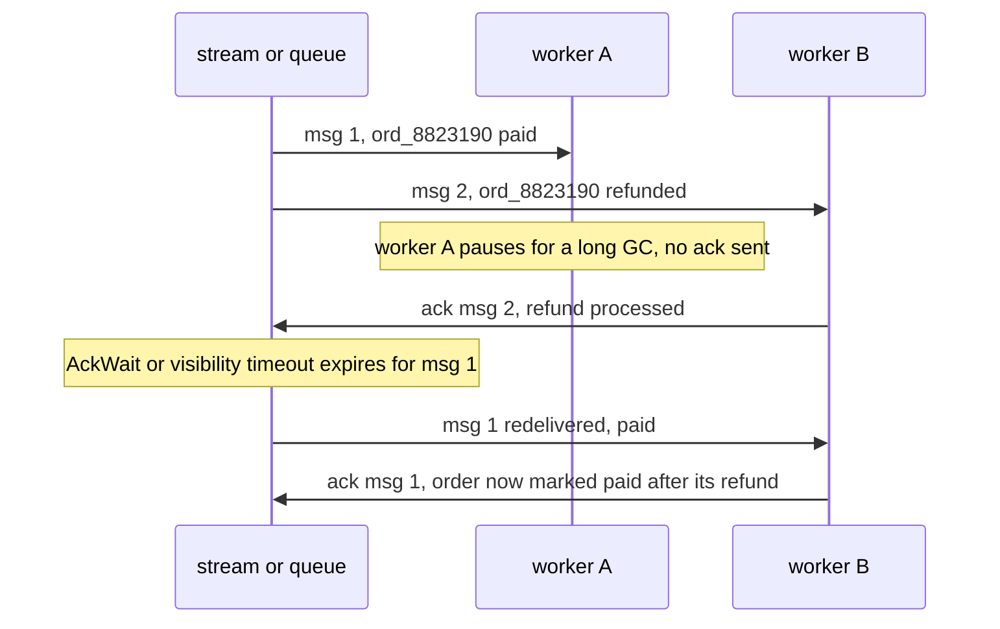

Kafka avoids this because one partition is consumed by one process in order and the offset cannot
skip ahead. SQS FIFO avoids it by holding back the group. JetStream and SQS standard do not avoid it
unless you design for it.

### Exactly-once, system by system

- **Kafka transactions** let a producer write to several partitions and commit consumer offsets in
  one atomic step. Consumers with `isolation.level=read_committed` see either all of a transaction or
  none of it. This gives exactly-once for **read from Kafka, process, write to Kafka** pipelines, such
  as Kafka Streams and Flink jobs. It does **not** cover side effects outside Kafka: if billing writes
  a charge to PostgreSQL, Kafka transactions cannot make that write happen once.
- **Redpanda** supports the same transactional API.
- **JetStream** combines message-ID deduplication on publish with a **double acknowledgement** on
  consume (the client waits for the server to confirm it received the ack, so the client knows the
  message will not be redelivered). Together these give exactly-once within the duplicate window.
- **SQS FIFO** advertises "exactly-once processing": SQS will not itself introduce a duplicate within
  the 5-minute window, and a deleted message is never redelivered. But if your consumer charges the
  card and crashes before calling `DeleteMessage`, the message reappears and the card is charged
  again.

So in every system, **a side effect outside the broker needs an idempotency key**. For billing, that
looks like this:

```sql
BEGIN;
  INSERT INTO processed_events (event_id) VALUES ('evt_77120');   -- unique constraint
  INSERT INTO charges (order_id, amount_usd) VALUES ('ord_8823190', 142.50);
COMMIT;
-- A redelivered evt_77120 fails the unique constraint, the transaction rolls back,
-- and the consumer acknowledges the message without charging twice.
```

The consumer then acknowledges (commits the offset, acks the JetStream message, or deletes the SQS
message) *after* the database commit. This pattern works identically on all four systems, which is
an argument for using it everywhere rather than leaning on any one broker's exactly-once feature.

### Delivery semantics side by side

| | Kafka | Redpanda | NATS JetStream | SQS standard | SQS FIFO |
|---|---|---|---|---|---|
| Default delivery | At least once | At least once | At least once (JetStream); at most once (core) | At least once | At least once, deduplicated on send |
| Ordering scope | Partition (by key) | Partition (by key) | Stream sequence; processing order needs design | None | Message group |
| Producer deduplication | Idempotent producer, per session | Same | `Nats-Msg-Id`, 2 min default window | None | 5-minute window |
| Exactly-once mechanism | Transactions, Kafka-to-Kafka | Transactions | Msg-ID dedup plus double ack | None | Dedup plus delete |
| One failing message | Blocks its partition | Blocks its partition | Redelivered alone; order lost | Redelivered alone | Blocks its message group |

---

## Part 10 — When processing fails: retries, poison messages, and dead letters

A **poison message** is one that fails every time it is processed — a malformed payload, a value
that violates an assumption, a reference to a record that was deleted. How a system handles a
poison message decides whether one bad event becomes one stuck event or a stopped pipeline.

### The example

Offset `4182907` in partition 17 of `orders.created` is an `OrderRefunded` event whose currency
field is `"USD "` with a trailing space. Billing's currency lookup throws an exception on it, every
time.

### Kafka and Redpanda: the bookmark cannot skip

A Kafka consumer cannot acknowledge one record and leave another pending; it can only move its
offset forward. So the naive consumer — catch the exception, wait, retry — **stops partition 17
entirely**. Work out the impact:

```
partition 17 carries 1/24 of all order events
640 events/s ÷ 24 partitions ≈ 26.7 events/s stuck behind the poison record
after 1 hour: 26.7 × 3,600 ≈ 96,000 events not billed
affected customers: every order whose ID hashes to partition 17, about 4% of all orders
```

The other 23 partitions keep flowing, so total lag looks small, and the dashboards that average lag
across partitions show almost nothing wrong. That is what makes head-of-line blocking dangerous: it
is partial and quiet.

You have four options, each with a cost:

1. **Retry forever in place.** Correct, but stalls the partition until a human intervenes.
2. **Log and skip.** Keeps the partition moving, but loses the event.
3. **Retry topics and a dead-letter topic.** The consumer publishes the failed record to
   `orders.created.billing.retry-1m`, commits its offset, and moves on. A separate consumer reads the
   retry topic after the delay; after a set number of attempts the record goes to
   `orders.created.billing.dlq`. This keeps the partition moving and keeps the event, but it **breaks
   per-key ordering**: later events for that order (say, a second refund) are processed before the
   retried one. The fix is to "park" the key — remember which keys have a record in retry, and divert
   their later events to the retry path too. That is real code you must write and test.
4. **Share groups (Kafka 4.2).** A share-group consumer acknowledges records individually, with
   `ACCEPT`, `RELEASE` (try again later), `REJECT` (unprocessable, do not deliver again), or `RENEW`
   (I need more time). Records are redelivered up to a delivery-count limit. This is queue-style
   failure handling on a topic — at the cost of ordering, and with dead-letter routing still something
   you arrange yourself in 4.2. Redpanda support for share groups needs to be checked for your version.

Kafka Connect has built-in error handling for connectors (`errors.tolerance=all` with a dead-letter
topic), but application consumers have to implement option 3 themselves or use a library that does.

### NATS JetStream: per-message verbs

A JetStream consumer can respond to each message individually:

- **`Ack`** — done.
- **`Nak`**, optionally with a delay — failed, redeliver later.
- **`InProgress`** — still working; reset the `AckWait` timer.
- **`Term`** — never redeliver this message.

The consumer configuration adds `MaxDeliver` (for example, 5) and `BackOff` (for example,
`[1s, 10s, 1m, 5m]`, the delays between successive redeliveries). The poison message is redelivered
on that schedule while every other message flows past it.

JetStream has **no built-in dead-letter queue**. When a message reaches `MaxDeliver`, the server
publishes an **advisory** event on
`$JS.EVENT.ADVISORY.CONSUMER.MAX_DELIVERIES.ORDERS.billing` containing the stream sequence number. You
run a small service that subscribes to these advisories, fetches the original message from the
stream by sequence number, and publishes it to a dead-letter stream. It is about a hundred lines of
code, but it is your code, and if it is down, terminated messages are only visible in the advisory
history.

### SQS: retry and dead-lettering are the product

In SQS, the visibility timeout *is* the retry timer. The poison message is received, the consumer
fails and does not delete it, it reappears after the timeout, and after `maxReceiveCount` receives
SQS moves it to the configured dead-letter queue. Once you have fixed the bug, a **DLQ redrive**
moves the messages back to the source queue. Everything else in the queue flows normally throughout.

Three details that matter in practice:

- **Exponential backoff** is done by calling `ChangeMessageVisibility` on failure — for example,
  setting the timeout to `10 s × 2^(receive count)` — because SQS's own retry interval is fixed at the
  visibility timeout.
- **DLQ retention must be longer than the source queue's.** For standard queues, a message's
  retention clock starts when it was first sent and is not reset when it moves to the DLQ. A message
  that spent 3 days failing in a 4-day source queue has 1 day left in a 4-day DLQ.
- **With Lambda, enable partial batch responses** (`ReportBatchItemFailures`). Otherwise one bad
  message in a batch of ten makes Lambda retry all ten.

### The visibility timeout trap, worked through for W3

W3's thumbnail jobs take 4 seconds at the median and 40 seconds at p99. Suppose the queue keeps the
default 30-second visibility timeout. About 2% of jobs take longer than 30 seconds. Each of those is
still being processed when it becomes visible again, so a second worker picks it up and resizes the
same image at the same time. During a 900-jobs-per-second burst, the extra work slows every worker,
more jobs cross 30 seconds, more are duplicated, and the duplication feeds itself.

The fix: set the visibility timeout well above normal processing time (Riverbend uses 120 s), and
have workers **heartbeat** — call `ChangeMessageVisibility` every 60 seconds while still working — so
a genuinely slow job keeps its claim and only a crashed worker's job reappears. JetStream's
`InProgress` is the same heartbeat; Kafka share groups' `RENEW` is the same idea.

### One poison message, four outcomes

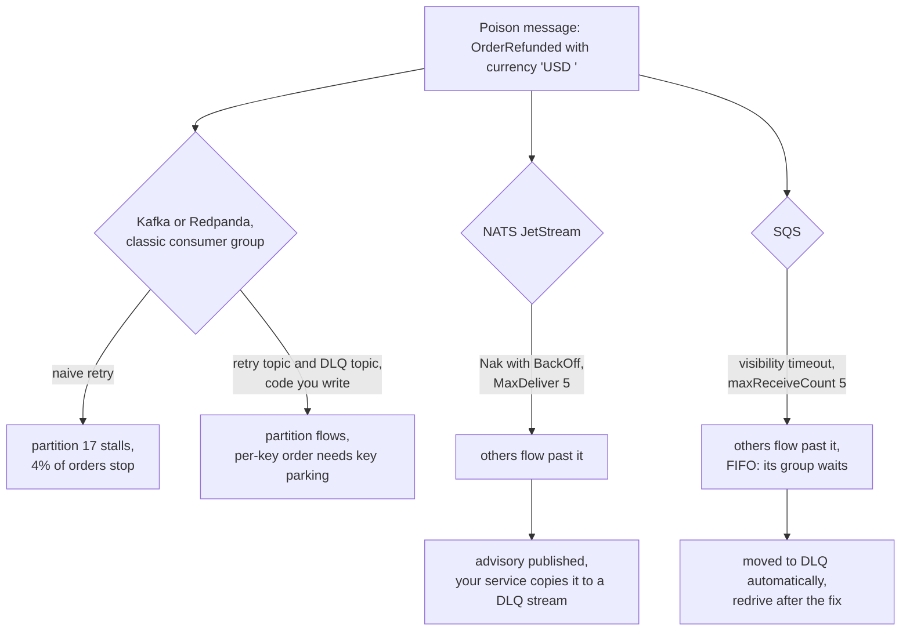

| | Kafka / Redpanda (consumer group) | Kafka 4.2 share group | NATS JetStream | SQS |
|---|---|---|---|---|
| Per-message retry | Build it | Native | Native | Native |
| Retry delay / backoff | Retry topics | Lock timeout | `Nak` delay, `BackOff` list | `ChangeMessageVisibility` |
| Dead-letter destination | Build it | Build it | Build it from advisories | Native, with redrive |
| Effect on other messages | Blocks the partition | None | None | None (standard); blocks the group (FIFO) |
| Extend processing time | Increase `max.poll.interval.ms` | `RENEW` | `InProgress` | `ChangeMessageVisibility` |

---

## Part 11 — Scaling consumers and fanning out to many readers

Two different scaling questions get mixed up in design reviews. **Scaling out** means more processes
sharing the work of one logical reader. **Fanning out** means more independent readers, each getting
every message. The four systems handle them very differently.

### Scaling out in Kafka and Redpanda: the partition count is the ceiling

A consumer group cannot usefully have more active members than the topic has partitions. Work it
through for billing on `orders.created`:

```
billing's processing time per event          = 35 ms (one database transaction each)
events per second per consumer instance      = 1,000 ms ÷ 35 ms ≈ 28.6
peak rate                                    = 3,400 events/s
instances needed at peak                     = 3,400 ÷ 28.6 ≈ 119
partitions                                   = 24
maximum throughput with 24 instances         = 24 × 28.6 ≈ 686 events/s
backlog growth at peak                       = 3,400 − 686 = 2,714 events/s
                                             = about 163,000 events per minute of peak
```

There are four ways out, and the cheapest one is usually not "more partitions":

1. **Batch the work.** If billing writes 100 events in one database transaction, the per-event cost
   might drop from 35 ms to about 3 ms, which is about 333 events per second per instance and
   24 × 333 ≈ 8,000 events per second total. This fixes the problem without touching the topic.
2. **More partitions.** Effective, but adding partitions to an existing keyed topic remaps keys and
   breaks ordering for in-flight keys. Do it at creation time: size partitions for the parallelism
   you expect in two to three years.
3. **Key-level concurrency within a partition.** Libraries such as Confluent's parallel consumer
   process different keys from the same partition concurrently while keeping each key in order.
4. **Share groups**, if this consumer does not need ordering.

In Redpanda the same ceiling applies, and partitions additionally consume memory and per-core
resources, so partition count is part of node sizing.

### Scaling out in JetStream: bounded by in-flight messages and by one leader

A JetStream pull consumer can be shared by any number of worker processes; each fetches batches and
acknowledges messages individually. The limit is `MaxAckPending` — the number of delivered but
unacknowledged messages — not a partition count. Scaling out is therefore easier than in Kafka, at
the cost of ordering (Part 9).

The ceiling you hit instead is the **stream leader**: every message in a stream passes through one
Raft leader on one server. When one stream cannot keep up, you partition the subject space with a
**subject mapping** in the server configuration, for example:

```
mappings = {
  "orders.*": "orders.{{wildcard(1)}}.{{partition(8,1)}}"
}
```

This rewrites `orders.ord_8823190` to `orders.ord_8823190.5`, where `5` is a deterministic hash of the
order ID into one of 8 partitions. You then create 8 streams (one capturing `orders.*.0`, one
capturing `orders.*.1`, and so on), spread their leaders across servers, and run one consumer per
stream if you need per-order ordering. This is what a Kafka topic with 8 partitions does
automatically. In JetStream it is a design you build, document, and operate.

### Scaling out in SQS: no ceiling you will meet

Any number of workers can call `ReceiveMessage` on a standard queue. W3 can go from zero to 333
workers and back without any change to the queue. FIFO queues scale by message group: more distinct
group IDs allow more parallelism, and high-throughput mode raises the queue-level limits.

### Fanning out: one copy versus one copy per reader

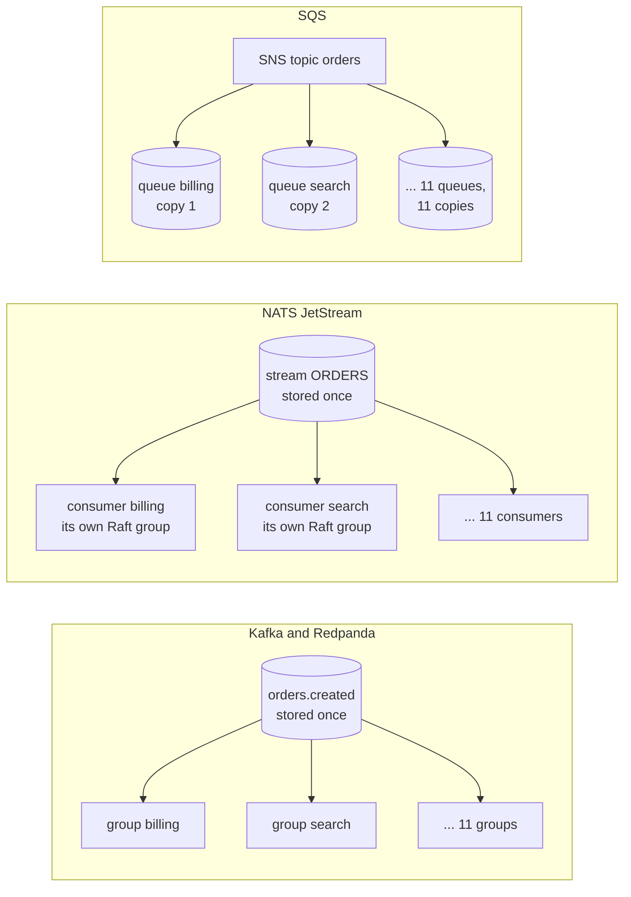

- **Kafka and Redpanda**: adding the twelfth consumer group adds a bookmark and some network and
  disk-read load. The data is stored once. A new group can start from the beginning of retention.
- **JetStream**: adding a consumer adds a server-side object; at R3, that object is a Raft group.
  Eleven consumers are cheap. Thousands of durable replicated consumers on one cluster — for example,
  one per tenant — need planning (use R1 or memory-backed consumers where losing consumer state is
  acceptable). A new consumer can start from the beginning of the stream.
- **SQS**: each reader needs its own queue, subscribed to an SNS topic (or an EventBridge rule). Each
  queue is billed separately, so request cost grows in direct proportion to the number of readers. A
  new reader receives only messages published **after** its subscription was created; there is no
  history to read.

That last point is the one teams discover late. When Riverbend's recommendations team wants to train
a new model on the last 72 hours of orders, Kafka lets them start a new consumer group at the offset
from 72 hours ago. With SNS and SQS, they would have to rebuild the events from the orders database.

### Autoscaling consumers

All four systems can drive consumer autoscaling from a backlog signal, and you should always scale on
backlog rather than CPU (a consumer blocked on a slow database has low CPU and a growing backlog).
**KEDA**, the Kubernetes event-driven autoscaler, has scalers for Kafka consumer lag, SQS queue
length, and JetStream consumer pending counts. **AWS Lambda** can consume SQS natively, scaling with
the queue and down to zero, and can also consume Kafka topics. Only SQS lets the *entire* system —
queue and workers — cost nothing while idle; the brokers of the other three keep running.

---

## Part 12 — Performance: throughput, latency, and how to read a benchmark

### The terms

- **Throughput** is how much data moves per second: messages per second, or megabytes per second.
  Both matter; small messages stress per-message overhead, large ones stress bandwidth.
- **Produce latency** is the time from a producer sending a message to receiving the
  acknowledgement. **End-to-end latency** is from sending to a consumer receiving it.
- **Percentiles**: p50 is the median; p99 means 99% of messages were faster. **Tail latency** means
  the high percentiles (p99, p99.9, maximum). A system with a 3 ms median and a 400 ms p99.9 will
  breach a 15 ms budget once every thousand messages — at W5's 1,600 messages per second, about
  1.6 times per second.

### Where latency comes from

Every system's latency is the sum of a few components. Seeing them separately explains most of the
differences:

| Component | Kafka | Redpanda | NATS JetStream | SQS |
|---|---|---|---|---|
| Client batching delay | `linger.ms`, default **5 ms since Kafka 4.0** (was 0) | Same client setting | None for a synchronous publish | None |
| Network to the leader | ~0.1–1 ms in-region | Same | Same, plus a hop if your client is connected to a non-leader server | HTTPS to a regional endpoint |
| Replication | One fetch round trip to followers in other AZs, ~1–3 ms | One Raft round trip, ~1–3 ms | One Raft round trip, ~1–3 ms | Internal, multi-AZ |
| Disk flush before ack | None by default | `fsync`: ~0.1 ms on local NVMe, ~1 ms or more on EBS | None by default (2-minute interval) | Internal |
| Runtime pauses | JVM garbage collection | None (no GC) | Go garbage collection, usually short | Not visible |

Adding these up for a typical three-AZ deployment gives rough medians:

```
Kafka, acks=all, linger.ms=5:   5 + 0.5 + 2 + 0.5 (response)  ≈ 8 ms produce latency
Kafka, acks=all, linger.ms=0:       0.5 + 2 + 0.5             ≈ 3 ms
Redpanda, acks=all, local NVMe:     0.5 + 2 + 0.2 (fsync) + 0.5 ≈ 3 ms
JetStream R3, synchronous publish:  0.5 + 2 + 0.5             ≈ 3 ms
SQS SendMessage:                    typically 10–30 ms per call
```

So the **medians are close** for the three self-run systems once batching is accounted for. The
real differences are in throughput per unit of hardware and in the **tail**.

### Throughput ceilings, and what bounds each

| | Kafka | Redpanda | NATS JetStream | SQS |
|---|---|---|---|---|
| Unit that serialises writes | Partition (one leader) | Partition (one leader, one core) | Stream (one Raft leader) | None visible (standard) |
| Typical per-unit ceiling | Tens of MB/s per partition | Tens of MB/s or more per partition | Tens of thousands to low hundreds of thousands of small msgs/s per stream with asynchronous or batch publishing | Standard: effectively unlimited; FIFO: 3,000 msgs/s per queue by default with batching, far higher in high-throughput mode |
| How you scale | More partitions and brokers, automatic | Same, fewer nodes for the same load if CPU-bound | More streams via subject mapping, manual | AWS does it |
| Cluster ceiling in practice | GB/s with enough brokers | GB/s | Hundreds of MB/s across many streams | Your budget |
| Synchronous one-at-a-time publishing | Rarely used | Rarely used | Bounded by round trip: ~3 ms means ~330 msgs/s per publisher | Bounded by API latency: ~20 ms means ~50 msgs/s per thread |

The last row explains many disappointing first benchmarks. A producer that sends one message and
waits for its acknowledgement before sending the next is measuring round-trip latency, not the
system's throughput. Kafka clients batch and pipeline by default. NATS clients do so only when you
use asynchronous or batch publishing (the latter made first-class in 2.14). SQS clients need
`SendMessageBatch` and multiple threads.

### Where tail latency comes from in each system

- **Kafka**: garbage-collection pauses; **page cache eviction** when a lagging consumer reads old data
  from disk (W5's incident); ISR shrink and expand; leadership moving during rolling restarts; disk
  saturation during partition reassignment.
- **Redpanda**: no GC, and its own cache is not shared with a lagging reader in the same uncontrolled
  way, which is why its tail is typically flatter. Its tail grows when **disks saturate** (including
  when NVMe drives fill up and their internal garbage collection slows writes), when one core owns a
  disproportionately hot partition, or when it runs on hardware it was not designed for.
- **NATS JetStream**: Raft leader elections; `fsync` cost if you set `sync_interval: always`; many Raft
  groups competing for the same disk and CPU; slow-consumer handling.
- **SQS**: variance in API latency, throttling under sudden very large bursts, and client retries.

### How benchmarks mislead, and the controversy worth knowing

In 2022, Redpanda published benchmarks showing large latency and throughput advantages over Kafka.
In 2023, Jack Vanlightly (then at Confluent) re-ran them and reported that the advantage shrank or
reversed under conditions the original tests had not covered: many more producers, records with
keys, runs long enough for the drives to fill, and different Kafka settings. Redpanda disputed parts
of the reproduction. Both sides were vendors, and **each side's workload choice largely determined
its winner**.

The lesson is not "Redpanda is slower" or "Kafka is slower". It is that no published benchmark tells
you how your workload will behave, and the most common sources of error are:

1. **Unequal durability.** Kafka without `fsync` versus Redpanda with `fsync` is not a fair
   comparison. Either enable Redpanda's write caching or set Kafka to flush, so both make the same
   promise. The same applies to JetStream's `sync_interval`.
2. **Short runs.** A 10-minute test never sees segment rolling, retention deletion, drive garbage
   collection, or page-cache pressure. Run for at least 24 hours, ideally 72.
3. **Empty disks.** Fill the disks to the level you will run at (60–80%) before measuring.
4. **No catch-up reads.** Production always has a consumer that falls behind and catches up. Include
   one.
5. **No failures.** Kill a node in the middle of the run and measure what happens to the tail.
6. **The wrong message shape.** Use your real message sizes, key distribution, and number of
   producers and partitions.
7. **Averages.** Report p50, p99, p99.9, and the maximum, at 50% and 80% of your target load.

### Riverbend's soak test for W5 (illustrative numbers)

Riverbend ran exactly that test for W5: dedicated three-node clusters, 72 hours, 1,600 reservation
messages per second of 0.5 KB, plus 30 MB/s of background load with a consumer that fell behind and
caught up every six hours. Producers used `acks=all` and `linger.ms=0`. To separate the effect of the
software from the effect of the hardware, Kafka was run on two kinds of machine.

| Configuration | p50 | p99 | p99.9 | Max |
|---|---|---|---|---|
| Kafka 4.2 on `m5.2xlarge` with `gp3` (network disk) | 3.4 ms | 12 ms | 41 ms | 380 ms |
| Kafka 4.2 on `i4i.2xlarge` with local NVMe | 2.9 ms | 7.5 ms | 19 ms | 140 ms |
| Redpanda 25.3 on `i4i.2xlarge`, fsync on (default) | 2.6 ms | 5.1 ms | 9.4 ms | 61 ms |

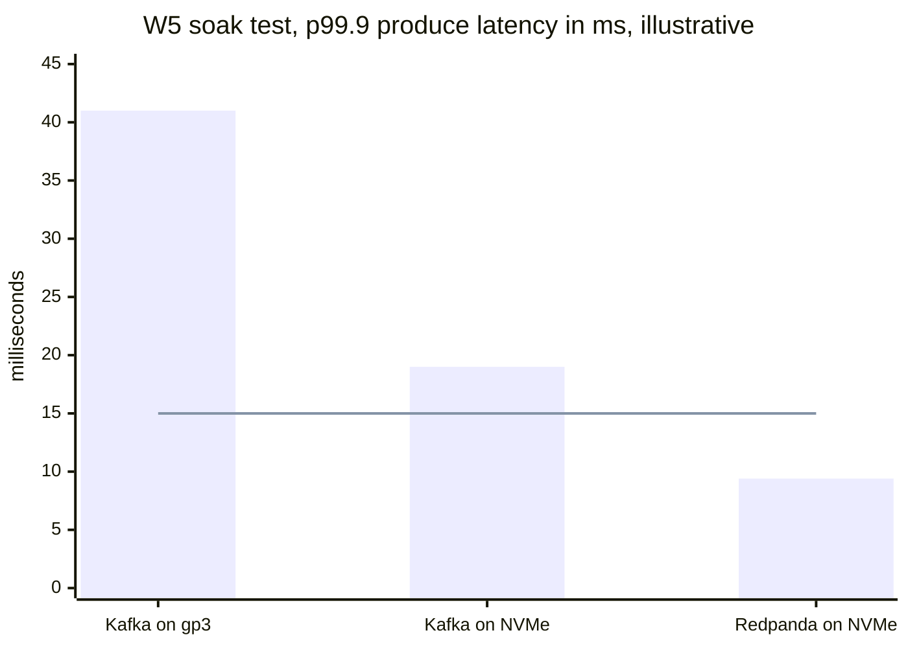

The bars are p99.9 latency; the line is W5's 15 ms budget. Read the results carefully:

- **Moving Kafka to local NVMe closed about two-thirds of the gap** (41 ms to 19 ms against
  Redpanda's 9.4 ms). Much of what looks like a software difference in casual comparisons is a
  hardware difference.
- **Redpanda met the 15 ms budget with room to spare, and did so while fsyncing every write.** Kafka
  on NVMe missed it at p99.9, though further tuning (GC settings, a dedicated cluster without
  background load) might bring it close.
- **The median barely matters here.** All three are under 3.5 ms. A comparison that reported only
  averages would have concluded they were equivalent.

---

## Part 13 — Availability: what each system does when hardware fails

Durability (Part 8) asks whether acknowledged data survives. Availability asks whether you can keep
producing and consuming while something is broken. Walk through the failures that actually happen.

### One server dies

- **Kafka**: the active controller notices within seconds and makes another in-sync replica the
  leader for each partition the dead broker led. Producers and consumers get errors, refresh their
  metadata, and retry against the new leaders. With RF 3 and `min.insync.replicas=2`, writes
  continue. Partitions are under-replicated until the broker returns or its replicas are moved.
- **Redpanda**: each affected partition's Raft group elects a new leader once followers stop hearing
  from the old one (typically a second or two). Same client behaviour as Kafka.
- **NATS JetStream**: each affected stream's and consumer's Raft group elects a new leader. Clients
  reconnect to another server automatically (NATS clients are given several server URLs). **R1
  streams on the dead server are unavailable until it returns** — R1 has no other copy.
- **SQS**: you do not see servers. Nothing to do.

### One availability zone is lost

This is the failure that tests your placement decisions. With nodes spread evenly over three AZs:

```mermaid
flowchart TB
    AZ["AZ c is lost"] --> KC["Kafka controllers: 3, one per AZ<br/>2 remain, majority of 3 is 2: OK"]
    AZ --> KP["Kafka orders.created, RF 3, min ISR 2<br/>2 replicas remain: writes continue"]
    AZ --> KCS["Kafka clickstream, RF 2, min ISR 1<br/>some partitions down to 1 replica:<br/>writes continue with no redundancy"]
    AZ --> RP["Redpanda RF 3<br/>2 of 3 is a majority: writes continue"]
    AZ --> NJ["JetStream R3, one replica per AZ<br/>2 of 3: continues<br/>R1 streams in AZ c: unavailable"]
    AZ --> SQ["SQS<br/>handled by AWS"]
```

The calculation people forget is **capacity**. Losing one of three AZs removes a third of your
nodes, so each remaining node carries 1.5 times its normal load:

```
6 brokers across 3 AZs, each at 60% CPU
lose 1 AZ  -> 4 brokers carry the load of 6
load per remaining broker = 60% × 6 ÷ 4 = 90%
```

At 90% the cluster survives, but any extra work — re-replication, a consumer catching up, a traffic
peak — pushes it over. **Size self-run clusters so that steady-state utilisation is at or below
about 60%**, or accept that an AZ loss during a peak becomes an outage. SQS absorbs this for you;
this headroom is part of what its per-request price pays for.

### A network partition isolates one server

- **Kafka**: if a leader is cut off from the controllers and from its followers but still reachable by
  some producers, the controller moves leadership away. The isolated broker cannot get its followers
  to fetch, so with `min.insync.replicas=2` its `acks=all` writes fail rather than succeed on the wrong
  side. With `acks=1`, it may accept writes that are later discarded when it rejoins and truncates its
  log to match the new leader — acknowledged data lost without any error.
- **Redpanda and JetStream**: Raft prevents a leader on the minority side from committing anything.
  It cannot gather a majority, so its writes time out, and it steps down.
- **SQS**: not visible to you.

### A disk fills up

- **Kafka**: when a log directory runs out of space, the broker marks it offline; with one log
  directory per broker, the broker stops. Because partitions are spread evenly, the other brokers
  are usually close to full too, and the failure can cascade. Alert on disk usage at 70–75%.
- **Redpanda**: has free-space thresholds below which it starts rejecting writes instead of crashing,
  so the failure is a loud "producers get errors" rather than a broker loss.
- **NATS JetStream**: each stream has limits (`max_bytes`, `max_msgs`, `max_age`) and a discard policy,
  and each server and account has a storage reservation. When a limit is hit, either old messages are
  dropped (`discard: old`) or new publishes are rejected (`discard: new`) — a choice you make per
  stream.
- **SQS**: no disks. The equivalent is a backlog growing until retention starts deleting messages.

### A consumer stops or falls far behind

- **Kafka and Redpanda**: lag grows. If it grows past retention, the oldest unread records are deleted.
  When the consumer comes back, its committed offset no longer exists, and it resets according to
  `auto.offset.reset` — **with `latest`, it silently skips everything it missed**. Monitor lag in time,
  not in records, and compare it with retention.
- **NATS JetStream**: with `limits` retention, the same thing can happen. With `interest` or `workqueue`
  retention plus `discard: new`, unacknowledged messages are kept and producers start getting errors
  when the stream is full — the slow consumer pushes back on producers instead of losing data. You
  choose which failure you prefer.
- **SQS**: backlog grows; messages older than retention are deleted silently. Alarm on
  `ApproximateAgeOfOldestMessage` well below the retention period.

### The control plane is lost

- **Kafka**: if the controller quorum loses its majority, existing leaders keep serving reads and
  writes, but nothing can change: no leader elections, no new topics, no configuration changes. A
  broker failure during this time leaves its partitions without a leader.
- **Redpanda**: the same shape — the controller Raft group handles metadata; partition Raft groups keep
  working.
- **NATS JetStream**: the **meta leader** (elected across all JetStream servers in the cluster) handles
  stream and consumer creation and placement. Without it, existing streams keep working; new ones
  cannot be created.
- **SQS**: an SQS regional disruption affects every queue in that region at once, and you cannot fail
  over unless you built a second region yourself (Part 15).

### Availability side by side

| Failure | Kafka | Redpanda | NATS JetStream | SQS |
|---|---|---|---|---|
| One node lost | Leaders move in seconds | Raft re-election in seconds | Raft re-election; R1 streams down | Invisible |
| One AZ lost (3-AZ placement) | Continues if RF 3, min ISR 2, rack-aware | Continues with RF 3 | Continues with R3 and `unique_tag` placement | Invisible |
| Network partition | Safe with `acks=all` and min ISR 2; `acks=1` can lose data | Safe (Raft) | Safe (Raft) | Invisible |
| Disk full | Broker stops; can cascade | Rejects writes | Limit and discard policy per stream | Not applicable |
| Consumer far behind | Silent skip past retention | Same | Silent skip, or backpressure, by configuration | Silent expiry |
| Region lost | Your DR design | Your DR design | Your DR design | Your DR design |

---

## Part 14 — Day-2 operations and maintenance

"Day 1" is installing the system. **"Day 2" is everything after**: upgrades, patching, adding
capacity, rebalancing data, rotating certificates, monitoring, responding to incidents, and planning
for growth. Day 2 is where most of the cost of a self-run system lives, and it is the part vendor
comparisons describe least.

### Kafka

**Rolling restarts** are the basic unit of Kafka maintenance: every patch, configuration change, and
upgrade is applied one broker at a time.

```mermaid
flowchart TD
    S["Pick the next broker"] --> CS["Controlled shutdown:<br/>move its partition leaderships away"]
    CS --> RS["Stop, patch, start"]
    RS --> W{"Under-replicated<br/>partitions back to 0?"}
    W -->|"no, wait"| W
    W -->|"yes"| PL["Preferred leader election:<br/>give leaderships back"]
    PL --> M{"More brokers?"}
    M -->|"yes"| S
    M -->|"no"| D["Done"]
```

At Riverbend, each broker takes about 7 minutes (2 minutes to move leadership away and shut down,
1 minute to start, 4 minutes for its replicas to catch up), and each controller about 3:

```
6 brokers × 7 min + 3 controllers × 3 min = 42 + 9 = 51 minutes per rolling change
```

**Adding capacity is slow because data must move.** A new broker starts with no partitions; you
must reassign some to it, which copies their data across the network. Riverbend's brokers hold
1.55 TB each. To add a seventh broker and balance the cluster:

```
total data             = 6 × 1.55 TB = 9.3 TB
data per broker with 7 = 9.3 TB ÷ 7 ≈ 1.33 TB, all of which must be copied to the new broker
replication throttle   = 50 MB/s (set so the copy does not hurt production traffic)
time                   = 1,330,000 MB ÷ 50 MB/s = 26,600 s ≈ 7.4 hours
```

**Tiered storage** shortens this. If clickstream keeps only 6 hours on local disk instead of 24, its
local footprint falls from about 7.0 TB to about 1.75 TB (40.4 MB/s × 21,600 s × 2 replicas), total
local data falls to about 4.05 TB, and the new broker's share is about 0.58 TB — roughly 3.2 hours to
move. Older data stays in S3 and is read from there when a consumer needs it.

**Upgrading to the Kafka 4.x line** requires KRaft (Riverbend already runs KRaft on 3.7), a bump of
the cluster's `metadata.version`, Java 17 on brokers, and checking that no client is older than
version 2.1, because 4.0 dropped support for very old protocol versions.

**What you monitor**: under-replicated partitions; partitions under `min.insync.replicas`; offline
partitions; exactly one active controller; produce and fetch request latency at p99; consumer lag
**measured in time**, compared with retention; disk usage; ISR shrink rate; network and request
handler idle percentages. Most teams add **Cruise Control** for automatic partition balancing and a
lag exporter (Burrow, KMinion, or kafka-lag-exporter).

**On Kubernetes**, Strimzi (a CNCF project) is the common operator. **Managed Kafka** (Amazon MSK,
Confluent Cloud, Aiven, and others) takes brokers, controllers, patching, and most rebalancing off your
team, in exchange for a higher infrastructure bill and less control over versions and
configuration.

### Redpanda

- **Rolling upgrades** use maintenance mode (`rpk cluster maintenance enable <node>`), which drains
  leadership from a node before you restart it. Upgrades move one feature release at a time. With no
  separate controller tier and no JVM warm-up, a three-node rolling upgrade at Riverbend takes about
  12 minutes.
- **Adding capacity**: in the community edition, the partition balancer moves partitions onto newly
  added nodes. **Continuous data balancing** — rebalancing automatically when a node fails or disks
  become uneven — is an enterprise feature. The physics of copying data is the same as Kafka's.
- **Fewer knobs**: `rpk` tunes the OS for the hardware, and there is no heap to size. Most clusters
  run with few configuration changes.
- **What you monitor**: under-replicated and leaderless partitions, free storage against Redpanda's
  thresholds, per-core CPU utilisation (a single hot core is a common bottleneck), and produce
  latency.
- **The depth problem**: when something unusual goes wrong, fewer people outside Redpanda Data can
  read the C++ and Seastar internals to diagnose it. A support contract is more important than it is
  for Kafka, where community knowledge is deep.

### NATS JetStream

- **Rolling restarts** are fast: the binary starts in well under a second. **Lame duck mode**
  (`nats-server --signal ldm`) makes a server stop accepting new clients and gradually move existing
  ones elsewhere before it shuts down.
- **Adding capacity does not move existing streams.** New servers receive new streams. To move an
  existing stream, you change its placement (tags or cluster) or remove a peer from its Raft group,
  and the stream's data is copied to the new peer as it catches up. This is manual, per stream.
- **Upgrades** are usually a binary swap, but read the release notes: 2.12 turned on strict request
  validation by default, and 2.14 added feature flags and rules about which versions you can
  downgrade to after using new features.
- **What you monitor**: per consumer, `num_pending` (backlog), `num_ack_pending` against
  `MaxAckPending`, and redelivery counts; per stream, bytes and messages against limits; Raft health
  (`nats server report jetstream` shows lagging peers); meta-leader stability; slow-consumer
  disconnects. The `nats` CLI and the HTTP monitoring endpoints (`/varz`, `/jsz`, `/healthz`) expose
  all of this, and the Prometheus exporter makes it graphable.
- **The sharp edges**: object counts (every replicated stream and durable consumer is a Raft group);
  the `sync_interval` decision; remembering that R1 streams have no failover; and, for W4, a fleet of
  14 leaf-node servers in warehouses that must be patched and monitored like any other server.

### SQS

There are no servers. Operations means: infrastructure as code for queues, DLQs, and redrive
policies; IAM policies; alarms on `ApproximateAgeOfOldestMessage`, `ApproximateNumberOfMessagesVisible`,
and any message arriving in a DLQ; watching `NumberOfEmptyReceives` (empty polls cost money); and
reviewing service quotas. Nearly every SQS incident is a **consumer** incident — a slow worker, a
visibility timeout set too short, a poison message — and that work exists in every system.

### Operating load at Riverbend (illustrative)

| | Kafka, 6 brokers + 3 controllers | Redpanda, 3 nodes (W5 trial) | NATS: 3 cloud servers + 14 leaf nodes | SQS (W3) |
|---|---|---|---|---|
| Routine hours per month | ~96 (about 0.6 of an engineer) | ~16 | ~24 | ~4 |
| Rolling change duration | ~51 min | ~12 min | ~5 min in cloud; leaf nodes staged | None |
| Adding capacity | Hours of data movement | Same physics; automatic balancing is an enterprise feature | Manual stream re-placement | None |
| Skills needed | JVM, Linux page cache, Kafka internals, Cruise Control | Linux, NVMe, Redpanda; vendor support | NATS config, Raft, accounts and JWTs | IAM, CloudWatch |
| Depth of hiring pool | Very deep | Shallow | Moderate | Very deep |

---

## Part 15 — Multi-region and disaster recovery

Two terms first. **RPO** (recovery point objective) is how much data you can lose, measured in time:
an RPO of 5 seconds means you accept losing up to the last 5 seconds of writes. **RTO** (recovery
time objective) is how long you can take to be working again in another region.

### Kafka

- **MirrorMaker 2** (MM2) copies topics asynchronously from one cluster to another. Because the copy
  is asynchronous, RPO equals replication lag — usually seconds, longer under load. The hard part is
  consumers: **offsets in the destination cluster differ from the source**, so MM2 publishes
  checkpoints that translate committed offsets, and each consumer group must be pointed at the
  translated position during failover. RTO is dominated by redirecting producers and consumers, and
  is minutes to hours depending on how much of that is automated and rehearsed.
- **Confluent Cluster Linking** (commercial) mirrors topics byte for byte, preserving offsets, which
  removes the translation problem.
- **Stretch clusters** (one cluster spanning regions) make replication synchronous, so `acks=all`
  latency includes the inter-region round trip — 60–80 ms between US coasts. They are used only
  between nearby regions.

### Redpanda

MM2 works against Redpanda unchanged. **Shadowing** (25.3, enterprise) maintains a hot-standby clone
of a whole cluster — topics, configurations, consumer offsets, ACLs, and schemas — with offsets
preserved, so consumers can fail over without translation; its RPO is low but not zero.
**Remote read replicas** (enterprise) serve read-only copies of topics from object storage in
another region.

### NATS JetStream

NATS was designed with multiple regions in mind. A **supercluster** joins regional clusters with
gateways, so subjects and request/reply work globally. Each stream lives in one cluster, and you
replicate it elsewhere asynchronously with a **mirror** (a read-only copy of one stream) or a
**source** (a stream that aggregates others). Clients are configured with server URLs in several
regions and reconnect automatically. Consumers are not copied by a mirror; on failover you create
consumers on the mirror and choose where they start. The same mirroring mechanism is what carries
W4's warehouse data into the cloud.

### SQS

SQS is regional and has **no built-in cross-region replication**. You have three options:

1. **Producers write to queues in two regions**, and consumers in both regions deduplicate with
   idempotency keys. Highest availability, double the cost, duplicate handling required.
2. **SNS cross-region subscriptions**: an SNS topic in `us-east-1` delivers to queues in
   `us-east-1` and `us-west-2`.
3. **Cold standby**: deploy the same queues in a second region and switch producers during a
   disaster. Messages already in the failed region are not lost — they are delayed until that region
   recovers, as long as recovery happens within the retention period.

```mermaid
flowchart LR
    subgraph KDR["Kafka or Redpanda: active-passive"]
        KP["riverbend-events<br/>us-east-1"] -->|"MM2, or offset-preserving<br/>Cluster Linking or Shadowing"| KS["standby cluster<br/>us-west-2"]
    end
    subgraph NDR["NATS: supercluster"]
        NE["cluster us-east-1<br/>stream ORDERS"] <-->|"gateway"| NW["cluster us-west-2<br/>mirror ORDERS_MIRROR"]
    end
    subgraph SDR["SQS: you build it"]
        SP["producer"] --> SE[("queue us-east-1")]
        SP --> SW[("queue us-west-2")]
        SE --> SC1["consumers, idempotent"]
        SW --> SC2["consumers, idempotent"]
    end
```

| | Kafka | Redpanda | NATS JetStream | SQS |
|---|---|---|---|---|
| Built-in mechanism | MM2 (free); Cluster Linking (commercial) | MM2; Shadowing (enterprise) | Mirrors, sources, superclusters | None |
| Offsets preserved on failover | Not with MM2; yes with Cluster Linking | Yes with Shadowing | Sequences mirrored; consumers recreated | Not applicable |
| Typical RPO | Seconds (replication lag) | Seconds | Seconds | Zero with dual writes; otherwise messages delayed, not lost |
| Typical RTO | Minutes to hours; client redirection dominates | Minutes with Shadowing | Minutes; clients fail over automatically | Minutes if producers can switch region |
| The hard part | Consumer offset translation | License for the good option | Recreating consumers and positions | Duplicates and dual-region cost |

---

## Part 16 — Security and multi-tenancy

| | Kafka | Redpanda | NATS JetStream | SQS |
|---|---|---|---|---|
| Authentication | SASL (SCRAM, OAUTHBEARER, GSSAPI/Kerberos), mutual TLS | SASL/SCRAM, OIDC, mutual TLS; Kerberos is enterprise | Tokens, passwords, nkeys, decentralised JWTs, mutual TLS, auth callout to your own service | AWS IAM (SigV4) |
| Authorisation | ACLs on topics, groups, cluster; prefixed ACLs | ACLs; role-based access control | Per-user publish and subscribe permissions on subjects; account isolation | IAM policies and queue policies |
| Encryption in transit | TLS | TLS | TLS | TLS |
| Encryption at rest | Disk-level (for example, encrypted EBS) | Disk-level; object storage encryption for tiered data | Built-in stream encryption option, plus disk-level | On by default (SQS-managed keys), or your own KMS key |
| Tenant isolation | Naming conventions, prefixed ACLs, quotas — no hard namespace | Same as Kafka | **Accounts**: separate subject namespaces with explicit import and export, per-account JetStream limits | One queue per tenant, or fair queues within a queue |
| Network isolation | Your VPC | Your VPC | Your VPC; leaf nodes can bridge networks | VPC endpoints (PrivateLink) |
| Audit | Authorizer logs; audit logs in commercial distributions | Audit logging (enterprise) | System account events | CloudTrail |

The row that most often decides a choice is **tenant isolation**. Kafka has no namespaces: two teams
share one flat topic namespace and are kept apart by naming conventions and ACLs. Quotas (limits on
produce and fetch bytes per second per client) are effective because a throttled client is slowed
down by delayed responses rather than rejected. NATS accounts are true namespaces:

```mermaid
flowchart LR
    subgraph ACCW["account WAREHOUSE"]
        W1["subject warehouse.07.scan.dock3"]
        WEXP["exports stream warehouse.*.scan.>"]
    end
    subgraph ACCI["account INVENTORY"]
        IIMP["imports warehouse.*.scan.>"]
        ISVC["exports service inventory.lookup"]
    end
    subgraph ACCA["account ANALYTICS"]
        AIMP["imports warehouse.*.scan.>"]
    end
    WEXP --> IIMP
    WEXP --> AIMP
    ISVC -.->|"imported by WAREHOUSE"| W1
```

Nothing crosses an account boundary unless one side exports and the other imports. If you are
building a platform where many teams or external customers share one messaging deployment, that model
is a real advantage. SQS achieves isolation differently: each tenant (or each team) gets its own
queues, and IAM decides who can touch them — simple, strong, and with no shared resource to contend
over, which is often the simplest multi-tenant design of all.

---

## Part 17 — Ecosystem and integration

| | Kafka | Redpanda | NATS JetStream | SQS |
|---|---|---|---|---|
| Connectors | Kafka Connect, hundreds of connectors; Debezium for change data capture | Kafka Connect works; Redpanda Connect with hundreds more | Fewer; Redpanda Connect has NATS inputs and outputs; bridges to Kafka | Native AWS integrations: Lambda, SNS, EventBridge Pipes, S3 notifications, Step Functions |
| Stream processing | Kafka Streams, Flink (reference connector), Spark, ksqlDB | Same, through the Kafka API | Limited; usually bridged to a Kafka-compatible system for heavy processing | Lambda or your own workers |
| Schema management | Confluent Schema Registry, Apicurio, Karapace | Built-in schema registry | Bring your own | Bring your own |
| Clients | Every major language | Kafka's clients | 40+ languages, official clients for the major ones | AWS SDKs in every major language |
| Analytics | Every data warehouse and lakehouse loader | Plus Iceberg Topics, writing tables directly | Bridge out | Bridge out |
| Managed offerings | MSK, Confluent Cloud (IBM), Aiven, Instaclustr, WarpStream, and more | Redpanda Cloud (Serverless, Dedicated, BYOC) | Synadia Cloud | It is the managed offering |

Ecosystem tends to decide the core of a data platform. If you will run Flink, load a lakehouse, or
capture database changes with Debezium, the Kafka protocol is the easiest choice because those tools already support it, and both
Kafka and Redpanda give it to you. NATS is strongest at the application and edge layer — services
talking to services, devices talking to the cloud — and is commonly bridged into a Kafka-compatible
system where the analytics ecosystem begins:

```mermaid
flowchart LR
    DEV["warehouse scanners"] --> NATS["NATS leaf nodes<br/>and cloud cluster"]
    SVC["microservices"] <-->|"request/reply"| NATS
    NATS -->|"Redpanda Connect bridge"| KAF[("Kafka-compatible log")]
    DB[("orders database")] -->|"Debezium CDC"| KAF
    KAF --> FL["Flink"]
    KAF --> LH["lakehouse tables"]
    KAF -->|"connector"| SQSQ[("SQS work queues")]
    SQSQ --> LAM["Lambda workers"]
```

---

## Part 18 — Cost, derived for Riverbend

### The unit each system charges for

The single most useful cost question is: **what unit does this system bill by, and how does my
workload map onto that unit?**

- **SQS** bills **per request**, where each 64 KB of payload in a request counts as one request. Send,
  receive, delete, empty receives, and visibility changes all count. Standard queues cost $0.40 per
  million requests; FIFO queues $0.50 per million. Data transfer between SQS and EC2 in the same region
  is free.
- **Self-run Kafka, Redpanda, and NATS** bill for **machines, disks, network transfer between AZs,
  and people**. Most of that is fixed until you outgrow the cluster.

Prices used here (us-east-1, on-demand, rounded): `m5.2xlarge` $0.384/hour ($280 per month),
`m5.xlarge` $0.192/hour ($140), `m5.large` $0.096/hour ($70), `i4i.2xlarge` $0.686/hour ($501), `i4i.xlarge` $0.343/hour ($250), `gp3` disk
$0.08 per GB-month, S3 $0.023 per GB-month, **cross-AZ transfer $0.01 per GB in each direction, so
$0.02 for every GB that crosses**, and a platform engineer at $240,000 per year fully loaded, which is
$20,000 per month.

### Cross-AZ transfer: the cost that is usually missing from the spreadsheet

In a three-AZ cluster, data crosses AZ boundaries several times. Count the crossings for one byte
produced:

```
Produce:      the producer is in a random AZ; the leader is in one of 3 AZs.
              P(different AZ) = 2/3                                  -> 0.67 crossings
Replicate:    with rack awareness, each follower is in another AZ    -> (RF − 1) crossings
Consume:      per consumer group, reading from the leader            -> 0.67 crossings
              with follower fetching, reading from a replica in the consumer's AZ, if one exists:
                RF 3 across 3 AZs: there is always one               -> 0 crossings
                RF 2 across 3 AZs: missing 1/3 of the time           -> 0.33 crossings
```

For W2's clickstream (RF 2 on Kafka, 3 consumer groups):

```
without follower fetching: 0.67 + 1 + 3 × 0.67 = 3.67 crossings per byte produced
with follower fetching:    0.67 + 1 + 3 × 0.33 = 2.67 crossings per byte produced

monthly volume = 106,171 GB
without:  106,171 × 3.67 = 389,300 GB × $0.02 ≈ $7,790 per month
with:     106,171 × 2.67 = 283,200 GB × $0.02 ≈ $5,660 per month
```

Two conclusions follow. First, **turning on follower fetching saves Riverbend about $2,100 a month**
for a configuration change. Second, cross-AZ transfer is **larger than the cost of all six brokers**
($1,682). This is true of most self-run streaming clusters in AWS, and it is why the newest designs —
WarpStream, Kafka's accepted diskless-topics proposal, Redpanda Cloud Topics — write directly to object
storage, which has no cross-AZ transfer charge, accepting end-to-end latency in the hundreds of
milliseconds in exchange.

### W2 clickstream on each system

Each column prices a dedicated deployment for W2 alone: 40.4 MB/s average, 108 MB/s peak, 24-hour
retention, three consumers.

**Kafka**, 6 × `m5.2xlarge`, RF 2, follower fetching:

```
storage needed   = 40.4 MB/s × 86,400 s × 2 replicas ≈ 6,981 GB
provisioned      = 6 brokers × 1,600 GB = 9,600 GB, so 73% full
brokers          = 6 × $280                = $1,682
disk             = 9,600 GB × $0.08        = $768
controllers      = 3 × $70                 = $210
cross-AZ         = (above)                 = $5,663
people           = 0.5 engineer            = $10,000
total                                      ≈ $18,300 per month
```

**Redpanda, community edition.** Redpanda requires an odd replication factor, so W2 must use RF 3,
not RF 2:

```
storage needed   = 3,491 GB × 3 replicas = 10,472 GB, at 75% full ≈ 14,000 GB
i4i.2xlarge has 1,875 GB of local NVMe   -> 14,000 ÷ 1,875 ≈ 7.5, round up to 9 for even AZ spread
nodes            = 9 × $501               = $4,507
cross-AZ         = 0.67 + 2 + 3 × 0 = 2.67 crossings (RF 3 with follower fetching) = $5,663
people           = 0.35 engineer          = $7,000
total                                     ≈ $17,200 per month
```

Notice what happened: Redpanda's usual argument is "fewer nodes for the same throughput", but W2 is
**sized by storage, not CPU**, and the odd-replication-factor rule adds a third copy. Node count is
`max(CPU need, storage need, network need)`; Redpanda's advantage is on the first term.

**Redpanda with tiered storage** (an enterprise feature) keeps 6 hours locally and the rest in S3:

```
local storage    = 40.4 MB/s × 21,600 s × 3 ≈ 2,618 GB -> 6 × i4i.xlarge (937 GB each) = $1,502
S3               = 3,491 GB × $0.023 ≈ $80, plus requests ≈ $150 in total
cross-AZ         = $5,663
people           = $7,000
total                                     ≈ $14,300 per month, plus the license
```

**NATS JetStream**, 8 partitioned R3 streams on 6 × `m5.2xlarge`:

```
storage          = 10,472 GB at 75% full ≈ 14,400 GB of gp3 = $1,152
servers          = 6 × $280                                  = $1,682
cross-AZ         = 0.67 + 2 + 3 × 0.67 = 4.67 crossings
                   (no follower reads, so delivery usually crosses an AZ)
                 = 106,171 × 4.67 × $0.02                    ≈ $9,910
people           = 0.4 engineer, including the partitioning design  = $8,000
total                                                        ≈ $20,700 per month
```

**SQS**, one queue per consumer (3 queues), every operation batched in tens:

```
messages per month     = 34,000/s × 2,628,000 s = 89,352 million
requests per message   = per queue: 0.1 send + 0.1 receive + 0.1 delete = 0.3; × 3 queues = 0.9
requests per month     = 89,352 million × 0.9 = 80,417 million
cost                   = 80,417 × $0.40 = $32,167
people                 = 0.05 engineer  = $1,000
total                  ≈ $33,200 per month
unbatched (3 requests per message per queue): ten times the request cost, ≈ $322,000 per month
```

| W2 per month | Kafka | Redpanda community | Redpanda + tiered storage | NATS JetStream | SQS (batched) |
|---|---|---|---|---|---|
| Machines and disks | $2,660 | $4,507 | $1,652 | $2,834 | — |
| Cross-AZ transfer | $5,663 | $5,663 | $5,663 | $9,910 | — |
| Requests | — | — | — | — | $32,167 |
| People | $10,000 | $7,000 | $7,000 | $8,000 | $1,000 |
| **Total** | **≈ $18,300** | **≈ $17,200** | **≈ $14,300 + license** | **≈ $20,700** | **≈ $33,200** |

Reading the table:

- **The three log options are within about 25% of each other**, and the gap is mostly the people line,
  which is an estimate. At this scale, cost does not decide between Kafka and Redpanda.
- **Cross-AZ transfer is the largest infrastructure line in every self-run column.**
- **SQS costs about 1.8 times as much and cannot replay.** For a high-volume stream with several
  consumers, the per-request model is the wrong unit.
- **Batching is a tenfold lever on SQS.** The unbatched figure is not hypothetical; it is what you get
  from the default one-message-at-a-time client code.

### Where SQS stops being cheaper: the crossover

Turn the same arithmetic into a per-rate formula, for 1.2 KB messages:

```
seconds per month = 2,628,000

SQS, batched, per consumer queue:
  2,628,000 × 0.3 requests × $0.40 / 1,000,000 = $0.315 per month for each message/second

Self-run Kafka, smallest production cluster (3 × m5.xlarge brokers, 3 × m5.large controllers,
3 × 500 GB gp3) = $751 per month, plus 0.5 engineer = $10,000  -> fixed ≈ $10,751
  variable: RF 3 with follower fetching = 2.67 crossings, whatever the number of consumer groups
  2,628,000 s × 1.2 KB = 3.15 GB per month for each message/second
  3.15 GB × 2.67 × $0.02 = $0.168 per month for each message/second
```

Set the two equal to find the crossover rate `r`:

```
3 consumer queues, batched:  10,751 + 0.168 r = 0.946 r  ->  r = 10,751 ÷ 0.778 ≈ 13,800 msgs/s
1 consumer queue, batched:   10,751 + 0.168 r = 0.315 r  ->  r = 10,751 ÷ 0.147 ≈ 73,000 msgs/s
1 consumer queue, unbatched: 10,751 + 0.168 r = 3.154 r  ->  r = 10,751 ÷ 2.986 ≈ 3,600 msgs/s
```

```mermaid
xychart-beta
    title "Monthly cost versus message rate, 1.2 KB messages"
    x-axis "messages per second" ["0", "10k", "20k", "30k", "40k", "50k", "60k", "70k", "80k"]
    y-axis "USD per month" 0 --> 80000
    line [10751, 12431, 14111, 15791, 17471, 19151, 20831, 22511, 24191]
    line [0, 3154, 6307, 9461, 12614, 15768, 18922, 22075, 25229]
    line [0, 9461, 18922, 28382, 37843, 47304, 56765, 66226, 75686]
```

The line that starts at about $10,800 is self-run Kafka. The shallow line starting at zero is SQS with
one batched consumer queue; the steep one is SQS with three. Three things to read from it:

1. **SQS is cheaper than you probably think at low and moderate rates** — below about 13,800 messages
   per second even with three consumers, if you batch. (By 73,000 messages per second the small Kafka
   cluster would need more brokers, so the one-consumer crossover is really "well above 50,000".)
2. **Fan-out is what makes SQS expensive**, because each reader multiplies the request count. On
   Kafka with follower fetching, extra consumer groups add almost no cross-AZ cost.
3. **The fixed cost is mostly people.** If Riverbend's platform team already runs Kafka for other
   reasons, the fixed cost of one more workload is close to $751, and the three-consumer crossover
   falls to `751 ÷ 0.778 ≈ 965` messages per second.

### Marginal cost versus standalone cost: the decision changes after the first workload

That last point deserves its own example, because it is the most common reasoning error in these
decisions. Price W1 (`orders.created`, 0.7 MB/s, 72-hour retention, 11 consumers) three ways:

```
On SNS + 11 SQS FIFO queues (receive and delete batched):
  messages per month   = 640 × 2,628,000 ≈ 1,682 million
  per queue            = 1,682 million × 0.2 requests × $0.50 per million ≈ $168
  11 queues            ≈ $1,850, plus SNS FIFO charges  ->  roughly $2,300 per month

On the existing riverbend-events Kafka cluster (marginal cost only):
  cross-AZ             = 0.704 MB/s × 2,628,000 s ≈ 1,850 GB × 2.67 × $0.02 ≈ $99
  disk                 = 0.704 MB/s × 259,200 s × 3 replicas ≈ 547 GB × $0.08 ≈ $44
                                                        ->  roughly $140 per month

On a new Kafka cluster built just for W1:
  $10,751 fixed + about $140                            ->  roughly $10,900 per month
```

The same workload costs $140, $2,300, or $10,900 depending on what already exists. **The first
workload on a new platform carries the platform's whole fixed cost; the tenth adds almost nothing to the bill.**
That is why "should W1 be on SQS or Kafka?" has a different answer at a company that already runs
Kafka well than at one that does not — and why a principal engineer should be suspicious of any cost
comparison that prices a workload as if it were alone.

### People are the largest line, and they are also a risk

In every self-run column the people estimate is the biggest single number, and it is also the least
certain. It depends on how many clusters you run, how often you upgrade, how many incidents you have,
and whether the people who understand the system are still at the company. Managed services convert
much of this into a vendor bill: Amazon MSK or Confluent Cloud for Kafka, Redpanda Cloud, Synadia Cloud
for NATS. Whether that is worth it is a question of how much operating expertise you have and want to
keep, not only of the bill.

---

## Part 19 — Licensing, governance, and vendor risk

| | Kafka | Redpanda | NATS | SQS |
|---|---|---|---|---|
| License | Apache 2.0 | Business Source License for the core; enterprise features under the Redpanda Community License with a paid key | Apache 2.0 | Proprietary service |
| Governance | Apache Software Foundation; committers from many companies | One company, Redpanda Data | CNCF project; Synadia is the main contributor | AWS |
| Commercial vendors | Confluent (owned by IBM since March 2026), AWS, Aiven, Instaclustr, Red Hat, WarpStream (Confluent), and others | Redpanda Data | Synadia and others | AWS |
| Cost of leaving | Low: many compatible implementations | Low at the protocol level: Kafka clients work against Kafka | Medium: NATS-specific APIs throughout the code | High: queue semantics are in the code |

**What the Business Source License means in practice.** You can run Redpanda's community edition in
production for free, inside your own company. You may not offer Redpanda as a commercial streaming or
queuing service to others. Each version's code converts to Apache 2.0 four years after it was
released. For most companies using it internally, the BSL is not a practical restriction; for a
company selling a hosted streaming service, it is decisive. The more practical constraint for most
users is that tiered storage, automatic data balancing, and Shadowing need the enterprise key.

**Governance events worth knowing.** In April 2025, Synadia, NATS's main sponsor, announced it wanted
to take NATS out of the CNCF and move future releases to a Business Source License. After public
dispute, the CNCF and Synadia reached an agreement on 1 May 2025: Synadia transferred the NATS
trademarks to the Linux Foundation and NATS stayed a CNCF project. In March 2026, IBM completed its
acquisition of Confluent, the largest commercial Kafka vendor; Apache Kafka itself remains an ASF
project. Neither event changed what you can run today, but both are reminders of the same lesson:
**a permissive license does not remove governance risk.** Look at who funds the maintainers and who
controls the trademark, not only at the license file.

**Protocol compatibility is the strongest protection against a wrong choice.** Because Redpanda, WarpStream, AutoMQ, and managed
Kafka services all speak the Kafka protocol, a choice among them is unusually reversible: you can move
between them with MirrorMaker 2 and a change of bootstrap servers, without rewriting producers or
consumers. Moving off SQS or off NATS-specific APIs means changing application code.

---

## Part 20 — Where each system is the right answer, and where it is not

Everything above condenses into a profile for each system: when to choose it, when to avoid it, and
the disadvantage you will feel first if you do choose it.

```mermaid
mindmap
  root((Messaging choice))
    Kafka
      Event backbone with many consumers
      Replay and per-key order
      Stream processing and CDC
      Deepest ecosystem and hiring pool
    Redpanda
      Kafka API with a smaller footprint
      Tight tail-latency budgets
      Small teams on NVMe hardware
      Edge or on-premises Kafka
    NATS JetStream
      Service-to-service and request-reply
      Edge sites with unreliable links
      Hard multi-tenant isolation
      Small footprint and low latency
    SQS
      Work queues and background jobs
      Bursty load and scale to zero
      AWS-native and serverless
      Teams that do not want to run brokers
```

### Apache Kafka

**Choose it when:**

- Several independent services consume the same events, and new consumers or fixed consumers need to
  re-read history.
- Per-key ordering matters at high throughput.
- You will run stream processing (Flink, Kafka Streams), change data capture (Debezium), or lakehouse
  ingestion, where Kafka is the reference integration.
- Volume is sustained in the tens of megabytes per second or more.
- You have, or will fund, a platform team — or you will use managed Kafka.
- You want the widest choice of vendors and the easiest exit.

**Avoid it when:**

- The workload is a job queue with highly variable processing times, per-message retries, and a need
  to scale workers to zero. (Share groups narrow this gap from 4.2 onward, but they are new.)
- You are a small team, volume is low, and there is no managed option — the fixed cost dominates.
- You need request/reply between services or messaging across unreliable edge links.

**The disadvantage you will feel first:** operational weight — rolling restarts, partition planning,
data movement when scaling — followed by the cross-AZ transfer line on the AWS bill.

### Redpanda

**Choose it when:**

- You want the Kafka API and ecosystem with fewer components to run, and your team is small.
- You have a tight tail-latency budget and can give it local NVMe drives and dedicated cores.
- You need a Kafka-compatible system on-premises, at the edge, or in a constrained environment with
  few nodes.
- You want streams written directly into Iceberg tables without a separate connector.

**Avoid it when:**

- You need large retention cheaply or automatic rebalancing at scale and do not want to buy the
  enterprise license (tiered storage and continuous balancing are enterprise features).
- You depend on the newest Kafka features on the day they ship.
- Your workload is storage-bound and would otherwise use RF 2 economics.
- Your organisation needs a deep public hiring pool, or you plan to sell streaming as a service (the
  BSL forbids it).

**The disadvantage you will feel first:** checking every feature against the compatibility and
licensing lists, and depending on one vendor for deep debugging.

### NATS JetStream

**Choose it when:**

- You want service-to-service messaging, request/reply, and persistence in one small system.
- You have edge locations — warehouses, stores, factories, vehicles — with intermittent connectivity.
  Leaf nodes are the deciding feature.
- You are building a multi-tenant platform that needs hard namespace isolation (accounts).
- You need low-latency control-plane messaging, fan-out to many subscribers, or a replicated
  key-value store for configuration.

**Avoid it when:**

- The workload is a high-volume analytics stream with long retention: you will hand-partition
  streams, pay more cross-AZ transfer, and miss the Kafka ecosystem.
- You need strict per-key ordering with high parallelism and do not want to design subject
  partitioning.
- Data must survive correlated failures and you are not prepared to set `sync_interval: always`,
  measure its cost, and test it.

**The disadvantage you will feel first:** designing what Kafka gives you by default (partitioning,
dead-lettering), and the per-object Raft overhead as stream and consumer counts grow.

### Amazon SQS

**Choose it when:**

- Each message is a task that any one worker should perform once, with retries and a dead-letter
  queue.
- Load is bursty, or idle for long periods, and you want workers to scale to zero.
- You are on AWS, especially with Lambda, and you do not want to operate brokers.
- You are decoupling services where history is not needed, or can be rebuilt from a database through
  an outbox.
- Volume is moderate: below roughly 10,000 messages per second per queue when you fan out to several
  readers; more when you do not.

**Avoid it when:**

- Consumers need replay, or many independent consumers read a high-volume stream.
- You need strict ordering at high throughput (FIFO's per-group limits).
- You need single-digit-millisecond latency.
- You need portability across clouds.
- Messages exceed 1 MiB, delays exceed 15 minutes, or backlogs might outlive 14 days.

**The disadvantage you will feel first:** the absence of replay, usually discovered when a new
consumer is added, followed by visibility-timeout tuning and the bill for fan-out at volume.

---

## Part 21 — A decision procedure you can reuse

```mermaid
flowchart TD
    START["New messaging workload"] --> Q1{"Must a new or repaired consumer<br/>re-read past messages?"}
    Q1 -->|"yes"| Q1B{"Can that history be rebuilt<br/>from a database or outbox instead?"}
    Q1B -->|"no"| LOG["You need a log"]
    Q1B -->|"yes, and rebuilding is acceptable"| Q2
    Q1 -->|"no"| Q2{"Is each message a task that<br/>any one worker should do once?"}
    Q2 -->|"yes"| Q2A{"On AWS, and under about<br/>10k msgs/s per queue?"}
    Q2A -->|"yes"| SQS["SQS standard, or FIFO<br/>if per-key order is required"]
    Q2A -->|"no"| Q2B{"Already running<br/>Kafka 4.2 or NATS?"}
    Q2B -->|"Kafka"| SHARE["Kafka share groups"]
    Q2B -->|"NATS"| WQ["JetStream work-queue stream"]
    Q2B -->|"neither"| SQS
    Q2 -->|"no: events, RPC, or edge"| Q3{"Edge sites with unreliable links,<br/>or request-reply between services?"}
    Q3 -->|"yes"| NATS["NATS, with JetStream<br/>where persistence is needed"]
    Q3 -->|"no"| LOG
    LOG --> Q4{"Is there already a well-run<br/>Kafka-protocol platform?"}
    Q4 -->|"yes"| EXIST["Put it there:<br/>the marginal cost is small"]
    Q4 -->|"no"| Q5{"Do you want to operate it?"}
    Q5 -->|"no"| MANAGED["Managed Kafka-protocol service:<br/>MSK, Confluent Cloud, Redpanda Cloud"]
    Q5 -->|"yes"| Q6{"Tight tail-latency budget, small team,<br/>NVMe and dedicated cores?"}
    Q6 -->|"yes"| RP["Redpanda:<br/>check the license and feature list"]
    Q6 -->|"no"| KAFKA["Apache Kafka"]
```

Each question exists for a reason you have already seen:

1. **"Must a consumer re-read past messages?"** is the log-versus-queue question from Part 2. It comes
   first because it is the hardest property to add later.
2. **"Can history be rebuilt from a database?"** is the way out of a replay requirement. Many teams say they need replay
   when what they need is the ability to reconstruct state, and an outbox table or the database itself
   already provides that. If so, a queue may be enough.
3. **"Is each message a task for one worker?"** separates work queues from event streams. Work queues
   want per-message retry, dead-lettering, and unlimited workers — the queue model's strengths.
4. **"Edge or request/reply?"** is where NATS has no real competitor among the four.
5. **"Is there already a well-run platform?"** is the marginal-cost lesson from Part 18. It is the
   question most often skipped, and skipping it is how companies end up with five messaging systems.
6. **"Do you want to operate it?"** turns the people line in Part 18 into a decision rather than an
   accident.
7. **"Tight tail latency, small team, right hardware?"** is the narrow case where Redpanda's design
   advantages are decisive rather than marginal.

### The rule for adding a system

The flowchart decides the best fit for one workload. A principal engineer also has to decide whether
that fit justifies a new system. A useful rule:

**Prefer a second-best fit on a system you already run well over a best fit on a new system — unless
the mismatch creates a correctness risk.** "Correctness risk" means things like: a replay
requirement on a queue (data you cannot recover), head-of-line blocking on a payments path (money
stops moving), or an edge site that cannot work offline (the warehouse stops). A mismatch that only
costs efficiency is usually cheaper to live with than a new system. Each additional self-run system
costs Riverbend, by its own estimate, 0.3 to 0.6 of an engineer indefinitely, plus a place in the
on-call rotation and a security review — so the workload had better be worth more than that.

---

## Part 22 — Riverbend's decision, workload by workload

Each decision is written as a short decision record: what was chosen, why, what was rejected, and what
would cause the decision to be revisited.

### W1 `orders.created` — stays on Kafka, upgraded to 4.2

- **Why:** replay is used weekly (the recommendations team re-reads 72 hours whenever it retrains),
  per-order ordering protects seller payouts, and the marginal cost on the existing cluster is about
  $140 per month.
- **Changes made:** `min.insync.replicas=2` set explicitly on the topic; `broker.rack` verified on every
  broker; follower fetching enabled; consumers moved to the KIP-848 protocol; consumer lag alerts in
  time rather than records.
- **Rejected:** SNS with 11 SQS FIFO queues (about $2,300 per month, no replay — the outbox could
  rebuild events, but rebuilding weekly is a recurring cost).
- **Revisit when:** Riverbend ever decides to retire Kafka entirely.

### W2 `clickstream.events` — stays on Kafka, with two changes

- **Why:** the log options cost about the same (Part 18), Flink's Kafka connector is the reference
  implementation, and Kafka's RF 2 with `min.insync.replicas=1` matches the data's value.
- **Changes made:** follower fetching (saves about $2,100 per month); tiered storage with 6 hours on
  local disk (cuts broker-add time from about 7.4 hours to about 3.2).
- **Rejected:** Redpanda (RF 3 forced by the odd-replication rule adds 50% storage, and tiered storage
  needs a license); SQS (about 1.8 times the cost and no replay); JetStream (manual partitioning and
  the highest cross-AZ cost).
- **Revisit when:** Kafka's diskless topics (KIP-1150) are production-ready. W2 tolerates hundreds of
  milliseconds of latency, so it is the ideal workload to remove the roughly $5,700 per month cross-AZ
  line.

### W3 `thumbnail-jobs` — moves from Redis to SQS standard

- **Why:** this is a work queue in every respect — bursty, retry-heavy, no ordering, no replay, and
  worth scaling to zero. SQS removes the failure that lost 3,100 jobs, and costs very little:

  ```
  jobs per month      = 18 × 2,628,000 ≈ 47.3 million
  requests per job    ≈ 1 send + 1 receive + 1 delete (+ occasional heartbeats) ≈ 3
  cost                ≈ 47.3 million × 3 × $0.40 per million ≈ $57 per month
  ```

- **Configuration:** visibility timeout 120 s with a heartbeat every 60 s; `maxReceiveCount=5`; source
  retention 4 days and DLQ retention 14 days; long polling at 20 s; workers on Kubernetes scaled by
  KEDA on queue depth, from 0 to 350.
- **Rejected:** Kafka share groups (new, and gives nothing W3 needs that SQS lacks); a JetStream
  work-queue stream (credible once NATS exists for W4, but SQS needs no cloud-side servers at all).
- **Revisit when:** jobs need to run outside AWS.

### W4 warehouse scanning — NATS with a leaf node in each warehouse

- **Why:** it is the only option that keeps scanning and shelf lookups working during a WAN outage.
  Each leaf node stores scans locally and the central stream sources them when the link returns, so
  the 29,760 scans from a 40-minute outage arrive automatically and in order per warehouse.
- **Configuration:**
  - One leaf node per warehouse on a small server with mirrored disks. Local stream `SCANS_WHnn` at R1
    with file storage (a warehouse has one server, so Raft replication is not available there); the
    mirrored disks and the scanners' own small buffer — scanners keep a scan until they receive its
    `PubAck` — cover the gap.
  - Cloud cluster of 3 servers across 3 AZs. `SCANS_ALL` at R3, one replica per AZ (`unique_tag`),
    and `sync_interval: always`, because scans are the audit trail for inventory.
  - A Redpanda Connect bridge copies `SCANS_ALL` into a Kafka topic `warehouse.scans` for the data
    warehouse loader, so analytics stays on the Kafka ecosystem.
- **Rejected:** Kafka at the edge (14 clusters to operate, no request/reply); SQS (scanners cannot
  enqueue when the link is down); an MQTT broker (considered seriously — NATS servers can also accept
  MQTT clients, which keeps that option open for future devices).
- **Revisit when:** the scanner fleet grows past what one leaf server per site handles, at which point
  a three-server leaf cluster per site allows R3 locally.

### W5 `inventory.reservations` — a dedicated three-node Redpanda cluster, reviewed after six months

- **Why:** inventory-service is event-sourced — it rebuilds its state by replaying the reservations
  log from its last snapshot — so W5 needs a log with per-SKU ordering. It also needs a 15 ms p99.9
  per hop. In the soak test, Redpanda met that budget at 9.4 ms with fsync on; Kafka on the same NVMe
  hardware reached 19 ms. Inventory-service and checkout already use Kafka clients, so nothing changes
  in application code. W5 needs no enterprise features (small volume, short retention), so the
  community edition suffices: 3 × `i4i.2xlarge` ≈ $1,500 per month.
- **The tension, stated openly:** this makes Redpanda Riverbend's fourth messaging system. The review
  accepted it on three conditions. First, SQS is managed and carries almost no operational load, so
  the self-run count is really three. Second, the decision is reversible: if Redpanda disappoints,
  W5 moves to a dedicated Kafka cluster on NVMe by changing bootstrap servers. Third, it has a fixed review date:
  after six months the team either evaluates moving `riverbend-events` itself to Redpanda (returning to
  one Kafka-protocol system), or moves W5 back to Kafka.
- **Rejected:** staying on the shared cluster (the noisy-neighbour incidents); a dedicated Kafka
  cluster on NVMe (missed the budget at p99.9, and needs separate controllers); NATS request/reply
  (the lowest latency of all, but W5 needs a replayable log, and it would put a second messaging
  system in the checkout path).
- **Revisit when:** the six-month review, or if W5 ever needs enterprise features.

### The resulting estate

```mermaid
flowchart LR
    subgraph AWS["AWS us-east-1"]
        subgraph KAF["Kafka 4.2: riverbend-events"]
            T1[("orders.created<br/>W1")]
            T2[("clickstream.events<br/>W2")]
            T4[("warehouse.scans<br/>bridged from W4")]
        end
        subgraph RPC["Redpanda: 3 nodes"]
            T5[("inventory.reservations<br/>W5")]
        end
        subgraph SQSB["SQS"]
            T3[("thumbnail-jobs + DLQ<br/>W3")]
        end
        subgraph NC["NATS cloud cluster, 3 servers"]
            SA[("SCANS_ALL, R3")]
        end
        SA -->|"Redpanda Connect"| T4
    end
    subgraph EDGE["14 warehouses"]
        LN["leaf node + local stream<br/>per warehouse"]
    end
    LN -.->|"sourced over the WAN"| SA
```

Three self-run systems and one managed one, each carrying at least one workload whose shape it fits
natively, with an explicit plan that may reduce the count by one.

---

## Part 23 — Migrating between these systems

### Between Kafka and Redpanda (either direction)

Because the protocol is the same, this is a data move, not a rewrite:

```mermaid
sequenceDiagram
    participant P as producers
    participant K as source cluster
    participant M as MirrorMaker 2
    participant R as target cluster
    participant C as consumer groups
    Note over K,R: step 0, check every Kafka feature you use against the target
    M->>K: read topics and committed offsets
    M->>R: write copies and offset checkpoints
    Note over C: step 1, consumers still read the source
    C->>R: step 2, move one group at a time, starting at translated offsets
    P->>R: step 3, move producers, one topic at a time
    Note over M: step 4, stop MM2 when the source topics are drained
    Note over K: step 5, keep the source for a rollback window, then retire it
```

Two cautions. Move all producers of a topic at once (or pause briefly), because if some write to the
source and some to the target, records for the same key can interleave out of order. And rehearse
step 2 with a non-critical consumer group first; offset translation is where migrations go wrong.
Redpanda's Shadowing or Confluent's Cluster Linking preserve offsets and remove the translation step.

### From SQS to a log (Kafka or Redpanda)

This changes consumer code: receive-and-delete becomes poll-and-commit, per-message retries become a
retry-topic design (or share groups), and DLQ redrive becomes your tooling. The safe sequence is to
**dual-publish** (producers write to both SQS and the topic), run the new consumer in **shadow mode**
writing to a scratch table, compare outputs for a week, then switch the real side effects over and
stop publishing to SQS. Idempotent consumers make the overlap safe.

### From a log to SQS

Usually done for work-queue workloads that were forced onto Kafka. Add a small forwarder that consumes
the topic and sends to SQS in batches, move workers to SQS, then retire the topic consumer. Remember
you lose replay; confirm nobody depended on it.

### Between NATS and the Kafka protocol

The semantics differ (subjects versus topics and partitions; per-message acks versus offsets), so treat
this as an integration rather than a migration. A bridge (Redpanda Connect, or a NATS-Kafka connector)
can run indefinitely, which is often the right end state, as with Riverbend's W4.

---

## Part 24 — Anti-patterns that show up in design reviews

1. **Choosing by the headline benchmark.** The workload is rarely limited by peak throughput, and the
   benchmark was designed by someone with an interest in the result (Part 12).
2. **A log used as a job queue for slow, variable tasks.** Head-of-line blocking and the partition
   ceiling turn one 40-second job into a stalled partition (Parts 10 and 11).
3. **A queue used as an event history.** Every service gets its own SNS-fed SQS queue, and the first
   time a new consumer needs last month's events, there are none (Part 11).
4. **Unexamined durability defaults.** Kafka's broker-side `min.insync.replicas=1`, JetStream's
   2-minute `sync_interval`, SQS's 4-day retention — each is a decision nobody made (Part 8).
5. **One message per SQS request.** Ten times the cost of batching, for no benefit (Part 18).
6. **A visibility timeout shorter than processing time.** Duplicate concurrent work that grows under
   load (Part 10).
7. **Ignoring partial batch failures.** `SendMessageBatch` returns 200 with failures inside; core NATS
   publishes to stream subjects are not acknowledged (Part 8).
8. **Pricing a workload as if it were alone, or as if the platform were free.** The marginal cost on an
   existing platform and the standalone cost differ by a factor of almost a hundred (Part 18).
9. **Leaving cross-AZ transfer out of the cost model.** It is usually the largest infrastructure line
   for self-run clusters in AWS (Part 18).
10. **Every team chooses its own broker.** The company ends up running five messaging systems, each
    understood by two people.
11. **Tens of thousands of per-tenant topics, streams, or consumers without a scale test.** Every system
    here has per-object metadata cost; in JetStream every replicated object is a Raft group.
12. **Assuming "Kafka-compatible" means "identical".** Check each feature you use (Part 4).
13. **`auto.offset.reset=latest` on a consumer that must not miss data.** After an outage longer than
    retention, it silently skips (Part 13).
14. **Believing a broker's exactly-once covers your database writes.** It does not; use idempotency
    keys (Part 9).
15. **R1 JetStream streams, or R1/RF 1 topics, for data that matters.** One server failure makes them
    unavailable, and one disk failure loses them.

---

## Part 25 — Questions a principal engineer should be able to answer

**1. Your team says "we need Kafka because we need replay". How do you test that claim?**
Ask who replays, how often, and how far back — and whether that history could be rebuilt from a
database or outbox. Replay used weekly by several teams justifies a log. Replay used once a year
after a bug is often cheaper to serve by rebuilding from the source of truth.

**2. What does an acknowledgement mean in Kafka with default settings, and how would you lose an
acknowledged message?**
With the broker default `min.insync.replicas=1`, `acks=all` can be satisfied by the leader alone when
the ISR shrinks; losing that leader's instance loses those writes. Even with `min.insync.replicas=2`,
writes are acknowledged from page cache, so losing power to both in-sync replicas before writeback
loses them — which is why rack awareness, placing replicas in different AZs, matters.

**3. Why does Redpanda require an odd replication factor, and what does that cost for a high-volume,
low-value stream?**
Raft commits on a majority; an even count adds a copy without adding failure tolerance. A stream that
would run at RF 2 on Kafka must run at RF 3 (50% more storage, more cross-AZ traffic) or RF 1.

**4. JetStream redelivers a message after AckWait. What happens to ordering, and how do you get strict
per-key order with parallelism?**
The redelivered message is processed after newer ones, so order is lost. For strict order with
parallelism, partition the subject space with a subject mapping and run one consumer per partition
with `MaxAckPending=1` or a single worker.

**5. At what message rate does SQS become more expensive than a self-run Kafka cluster?**
It depends on fan-out, batching, and whether you already pay for a platform team. For 1.2 KB messages
and a fixed Kafka cost of about $10,750 per month, the crossover is about 13,800 messages per second
with three batched consumer queues, about 3,600 unbatched, and below 1,000 if the platform team
already exists (Part 18).

**6. A consumer group's lag is near zero overall, but one customer segment's orders are not being
billed. What is your first hypothesis?**
Head-of-line blocking on one partition by a poison record. Overall lag averages it away; look at lag
per partition.

**7. Where does tail latency come from in Kafka, and how would you isolate a latency-sensitive
workload?**
GC pauses, page cache eviction by lagging consumers reading from disk, ISR changes, and leadership
movement. Isolate by giving the workload its own cluster (Riverbend's W5), or at minimum separating it
from workloads with large catch-up reads.

**8. How do you run a fair benchmark between Kafka and Redpanda?**
Equal durability settings, your own message shapes, disks filled to production levels, runs of at
least 24 hours, a lagging consumer, a node failure mid-run, and report p99.9 and the maximum, not the
average. Also control for hardware: in Riverbend's test, NVMe alone closed two-thirds of the gap.

**9. What is the largest infrastructure cost of a self-run streaming cluster in AWS, and how do you
reduce it?**
Usually cross-AZ transfer. Follower fetching removes most consumer-side crossings; designs that write
directly to object storage remove replication crossings at the cost of latency.

**10. When would you choose NATS over Kafka for a new system?**
When the system is mostly service-to-service messaging and request/reply, when edge sites must work
offline, or when hard multi-tenant isolation is required — and when the volume and analytics needs do
not demand the Kafka ecosystem.

**11. How many messaging systems should a 300-engineer company run?**
As few as possible while every correctness-critical workload runs in some system's native mode. In
practice, one log, one managed queue, and possibly a messaging fabric for edge or RPC — with an
explicit, written reason for each, and a rule that a new system needs a correctness reason, not an
efficiency reason.

**12. You are asked to migrate from Kafka to Redpanda to save money. What do you check first?**
Whether the workload is CPU-bound or storage-bound (Redpanda's node savings are on CPU), whether you
need tiered storage or automatic balancing (license), every Kafka feature your clients use, and the
cross-AZ line, which does not change. Then run a fair soak test.

---

## Appendix A — The full comparison table

| Dimension | Kafka | Redpanda | NATS JetStream | Amazon SQS |
|---|---|---|---|---|
| **Model** | Partitioned log | Partitioned log (Kafka API) | Subject routing plus stream log; queue or log consumers | Managed queue |
| **Written in** | Java / Scala (JVM) | C++ (Seastar, thread-per-core) | Go | Not visible |
| **Deployment** | Brokers + KRaft controllers | Single binary per node | Single binary per server; leaf nodes | API only |
| **Replication** | ISR, leader-follower | Raft per partition | Raft per stream and per consumer | Managed, multi-AZ |
| **Ack default** | ISR in memory, no fsync | Majority fsynced | Quorum in OS buffers; fsync every 2 min | Stored across AZs |
| **Ordering** | Per partition | Per partition | Per stream; processing order needs design | None (standard); per group (FIFO) |
| **Replay** | Yes, within retention | Yes | Yes, within stream limits | No |
| **Per-message ack / retry** | Share groups (4.2); otherwise build | Check share group support | Native | Native |
| **Dead-letter handling** | Build (retry and DLQ topics) | Build | Build from advisories | Native, with redrive |
| **Consumer parallelism** | Capped by partitions | Capped by partitions | Bounded by MaxAckPending and stream leader | Unlimited |
| **Fan-out cost** | Near zero per group | Near zero per group | One server object (Raft group) per consumer | One queue and its requests per reader |
| **Exactly-once** | Transactions (Kafka to Kafka) | Transactions | Msg-ID dedup plus double ack | FIFO dedup plus delete |
| **Typical p50 latency** | ~3–8 ms | ~2–5 ms | ~1–3 ms (core NATS well under 1 ms) | Tens of ms |
| **Tail latency** | Sensitive to GC, page cache, rebalancing | Flatter on NVMe; sensitive to disk saturation | Sensitive to elections and fsync mode | Variable |
| **Throughput scaling** | Automatic via partitions | Automatic via partitions | Manual via subject-mapped streams | Managed |
| **Max retention** | Unlimited with tiered storage (free) | Unlimited with tiered storage (enterprise) | By limits; disk-bound | 14 days |
| **Max message size** | 1 MB default, configurable | 1 MB default, configurable | 1 MB default, configurable | 1 MiB |
| **Multi-tenancy** | ACLs, quotas, naming | ACLs, quotas | Accounts (true namespaces) | Per-queue IAM; fair queues |
| **Multi-region** | MM2; Cluster Linking (commercial) | MM2; Shadowing (enterprise) | Superclusters, mirrors, sources | Build it |
| **Edge / offline** | Poor fit | Possible, few nodes | Excellent (leaf nodes) | Requires connectivity |
| **Request/reply** | No | No | Native | No |
| **Ecosystem** | Deepest | Kafka's, plus Redpanda Connect | Smaller; bridges | AWS-native |
| **Ops burden** | High | Medium-low | Low to medium | Very low |
| **Cost model** | Machines, disks, cross-AZ, people | Same, plus license for some features | Machines, disks, cross-AZ, people | Per request (64 KB units) |
| **License** | Apache 2.0 | BSL + enterprise license | Apache 2.0 | Proprietary |
| **Exit cost** | Low | Low (Kafka protocol) | Medium | High |

---

## Appendix B — Golden starting configurations

These are starting points for the workloads above, not universal answers. Each setting is one this
document has explained.

**Kafka topic and clients for W1 (`orders.created`):**

```properties
# topic
replication.factor=3
min.insync.replicas=2            # the real durability setting (Part 8)
retention.ms=259200000           # 72 hours
unclean.leader.election.enable=false

# broker (every broker)
broker.rack=us-east-1a           # its own AZ, so replicas spread across AZs
replica.selector.class=org.apache.kafka.common.replica.RackAwareReplicaSelector

# producer
acks=all
enable.idempotence=true
linger.ms=5                      # the 4.0 default; lower only for latency-critical paths
delivery.timeout.ms=120000

# consumer
group.protocol=consumer          # KIP-848 rebalance protocol
client.rack=us-east-1a           # follower fetching (Part 18)
enable.auto.commit=false         # commit after the database transaction (Part 9)
auto.offset.reset=earliest       # never silently skip (Part 13)
isolation.level=read_committed
```

**Redpanda topic for W5 (`inventory.reservations`):**

```bash
rpk topic create inventory.reservations \
  --partitions 12 \
  --replicas 3 \
  -c retention.ms=86400000 \
  -c write.caching=false     # keep fsync-before-ack (Part 8)
```

**NATS JetStream for W4 (cloud cluster and stream `SCANS_ALL`).** Server configuration on each cloud
server:

```
server_tags: ["az:us-east-1a"]     # this server's own AZ
jetstream {
  store_dir: /data/jetstream
  sync_interval: always            # fsync before acknowledging (Part 8)
  unique_tag: "az"                 # never place two replicas of a stream in one AZ
}
```

Stream and consumer definitions as JetStream API JSON (durations are in nanoseconds; each warehouse's
leaf node runs its own JetStream domain, reached through its `$JS.<domain>.API` prefix):

```json
{
  "name": "SCANS_ALL",
  "storage": "file",
  "num_replicas": 3,
  "retention": "limits",
  "max_age": 604800000000000,
  "discard": "old",
  "duplicate_window": 120000000000,
  "sources": [
    { "name": "SCANS_WH07", "external": { "api": "$JS.wh07.API" } },
    { "name": "SCANS_WH12", "external": { "api": "$JS.wh12.API" } }
  ]
}
```

```json
{
  "durable_name": "inventory",
  "ack_policy": "explicit",
  "ack_wait": 30000000000,
  "max_deliver": 5,
  "backoff": [1000000000, 10000000000, 60000000000, 300000000000],
  "max_ack_pending": 1000,
  "deliver_policy": "all"
}
```

The first is 7 days of retention and a 2-minute duplicate window; the second redelivers after 1 s,
10 s, 1 min, and 5 min, then stops after the fifth delivery and publishes a max-deliveries advisory
(Part 10).

**SQS queue for W3 (`thumbnail-jobs`), in Terraform:**

```hcl
resource "aws_sqs_queue" "thumbnail_jobs_dlq" {
  name                      = "thumbnail-jobs-dlq"
  message_retention_seconds = 1209600            # 14 days, longer than the source (Part 10)
}

resource "aws_sqs_queue" "thumbnail_jobs" {
  name                       = "thumbnail-jobs"
  visibility_timeout_seconds = 120               # workers heartbeat every 60 s (Part 10)
  message_retention_seconds  = 345600            # 4 days
  receive_wait_time_seconds  = 20                # long polling (Part 6)
  redrive_policy = jsonencode({
    deadLetterTargetArn = aws_sqs_queue.thumbnail_jobs_dlq.arn
    maxReceiveCount     = 5
  })
}
```

---

## What to take away

1. **These are not four brands of one product.** Kafka and Redpanda are logs, SQS is a queue, and NATS
   JetStream is a subject-routing fabric with a log underneath. Decide the model before the product.
2. **Every important property follows from log versus queue**: replay, fan-out cost, ordering,
   consumer parallelism, and what one bad message does to the rest.
3. **Durability is a configuration plus a placement, not a product feature.** Kafka's broker-side
   `min.insync.replicas` defaults to 1, JetStream flushes to disk every two minutes by default, and SQS
   silently expires messages after 4 days by default. Redpanda's fsync-before-ack is the strongest
   self-run default.
4. **Exactly-once never covers your database.** Use idempotency keys in every system, and the choice of
   broker matters less.
5. **Queues handle failure per message; logs block per partition.** If a workload is mostly about
   retries and dead letters, it wants a queue. If it is about history and order, it wants a log.
6. **Medians are similar; tails are not.** Compare p99.9 under realistic load, control for hardware,
   and distrust any benchmark you did not design.
7. **Cross-AZ transfer is usually the largest infrastructure cost of a self-run cluster in AWS.**
   Follower fetching removes much of it for the price of a configuration change.
8. **SQS is cheaper than most people expect until fan-out and volume grow** — around 13,800 messages
   per second with three batched consumers in Riverbend's model — and batching is a tenfold lever.
9. **Price workloads at their marginal cost on what already exists.** The same workload cost $140,
   $2,300, or $10,900 a month depending on that.
10. **Redpanda's advantages are real but specific**: lower tail latency on the right hardware, fewer
    components, and protocol compatibility that makes it reversible. Check the license-gated features
    and every Kafka feature you depend on.
11. **NATS JetStream is unmatched at the edge and for request/reply**, and a poor fit for
    high-volume analytics streams, which it was not designed for.
12. **The principal decision is how many systems, not which one.** Prefer a second-best fit on a
    system you already run well, unless the mismatch creates a correctness risk — and write down the
    reason for every system you keep.

