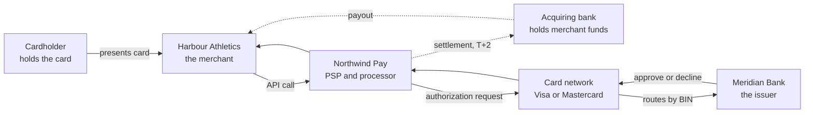

# What Actually Moves When a Card Is Charged, and Why Nobody in the Flow Trusts Anybody Else

Most engineers' mental model of a card payment is a single arrow: the customer's money goes to
the merchant. That model is wrong in a way that matters, because it hides the five separate
organisations that sit between those two parties, each of which keeps its own books, each of
which can fail independently, and none of which will take your word for what happened.

This document builds the real model. Everything in the rest of this collection — the state
machine, the ledger, the reconciliation process, the disputes — exists because of the structure
described here. If you skip it, the later documents will read as a pile of arbitrary rules.

---

## The running system for this collection

Every document in this collection derives its numbers from one imaginary company, so that the
figures stay consistent and you can carry a single mental picture through twenty files.

**Northwind Pay** is a payment service provider. A *payment service provider*, usually shortened
to PSP, is a company that merchants plug into so that they do not have to connect to the card
networks themselves. Stripe, Adyen and Braintree are real examples. Northwind Pay also acts as
its own *acquirer-processor*, which means it holds the technical connection to Visa and
Mastercard rather than renting one from somebody else — the distinction is explained later in
this document.

Here is the whole company in numbers. Each of these is referenced by name in later documents.

| Quantity | Value |
|---|---|
| Merchants | 40,000 |
| Authorization attempts per year | 1.2 billion |
| Approval rate | 87.3% |
| Average ticket | $47 |
| Peak throughput | 9,000 authorizations per second |
| End-to-end authorization latency target | p99 under 800 ms |
| Stored card tokens | 310 million |
| Presentment currencies | 135 |
| Settlement currencies | 23 |
| Regions | 3 (us-east, eu-west, ap-southeast) |

Two derived figures that get used constantly, derived here so you never have to take them on
faith:

**Average throughput.** A year is 365 × 24 × 60 × 60 = 31,536,000 seconds. So 1.2 billion
attempts per year is 1,200,000,000 ÷ 31,536,000 = **38 authorizations per second on average**.

**Peak-to-average ratio.** Peak is 9,000 per second against an average of 38, so the peak is
9,000 ÷ 38 = **237 times the average**. That ratio is the single most important fact about
capacity planning for a card processor, and it is not a modelling artefact. It happens because
Northwind Pay's merchants are mostly retailers, retailers run sales, and sales start on the hour
— so a large fraction of a day's traffic arrives in the first ninety seconds after midnight UTC
on the fourth Friday of November. A system sized for 38 per second is 0.4% of the way to
surviving that night.

**Annual authorized volume.** 1.2 billion attempts at an 87.3% approval rate gives 1,200,000,000
× 0.873 = 1,047,600,000 approved authorizations. At $47 each that is 1,047,600,000 × 47 =
**$49.2 billion authorized per year**. Not all of it is captured — some authorizations expire or
are cancelled, which you will meet in document 01 — so roughly $47 billion is actually settled.

---

## The four-party model, built one party at a time

Start with the naive two-party picture and add parties only when something forces you to.

### Two parties: it almost works

A customer wants to buy a $47 pair of running shoes from Harbour Athletics, a merchant on
Northwind Pay. In the simplest imaginable world, the customer's bank sends $47 to Harbour
Athletics' bank, and you are done.

This is how a bank transfer works, and it is worth asking why cards do not work this way, because
the answer explains everything else. In a bank transfer, the *payer* initiates. The customer logs
into their own bank, types in the merchant's account number, and pushes money out. The merchant
is passive.

Cards invert this. The customer hands over a number, and then **the merchant initiates the
pull**. Harbour Athletics tells the system "take $47 from the account identified by this
number." That inversion is the entire reason the card ecosystem is complicated, because now you
have a system where a stranger can attempt to remove money from your account, and every piece of
machinery that follows exists to control that.

### Party three: the issuer

The customer's bank is called the **issuer**, because it issued the card. In this collection the
running example issuer is **Meridian Bank**.

The issuer holds the customer's money, or in the case of a credit card holds a credit line it
has extended to the customer. The issuer is the only party that can actually decide whether $47
may be taken, because it is the only party that knows the balance, knows the credit limit, knows
whether the customer reported the card stolen an hour ago, and carries the loss if the decision
is wrong.

This gives you the first hard rule of card payments:

> **You never decide whether a payment succeeds. The issuer decides. You transport the question
> and the answer.**

A very large amount of engineering effort in a PSP goes into forgetting this and then being
reminded of it. Your fraud system does not approve payments; it only decides whether to *ask*.
Your retry logic does not get money; it only asks again.

### Party four: the acquirer

Harbour Athletics' bank is called the **acquirer**, because it acquires the merchant's card
transactions. The acquirer's role is not symmetric with the issuer's, and the asymmetry is easy
to miss.

The issuer takes the risk that the *customer* will not pay. The acquirer takes the risk that the
*merchant* will not deliver. If Harbour Athletics takes a million dollars in orders, ships
nothing, and dissolves, the customers will demand their money back, and that money has already
been paid out to a company that no longer exists. Somebody absorbs that loss, and it is the
acquirer. This is why opening a merchant account involves underwriting, why acquirers hold
reserves against merchant balances, and why a PSP will freeze a merchant's payouts on a day's
notice. Document 09 covers reserves in detail; the reason they exist is here.

### The network in the middle

Now you have four parties, and a combinatorial problem. There are thousands of issuers and
thousands of acquirers worldwide. Direct connections between all of them would be
unmanageable — with 5,000 issuers and 2,000 acquirers you would need up to ten million
relationships, each with its own contract, message format and settlement arrangement.

The **card network** — Visa, Mastercard, American Express, Discover — sits in the middle so that
every issuer and every acquirer need only connect once. The network does three things:

1. **Routing.** Given a card number, work out which issuer to ask.
2. **Message standards.** Define the format of the question and the answer, so that Meridian
   Bank in Ohio and an acquirer in Singapore can understand each other.
3. **Settlement arrangement.** Net everybody's obligations against everybody else's once a day,
   so that money actually moves in a manageable number of large transfers rather than a billion
   tiny ones.

The resulting shape is the **four-party model**: cardholder, merchant, acquirer, issuer, with a
network in the middle. (American Express historically operated a *three-party* model, where the
same company is both issuer and acquirer. This matters practically because Amex's message formats
and dispute rules differ, and you will handle it as a separate integration.)

Note the two different kinds of line. The solid lines are the **authorization path**: a
synchronous question and answer that completes in under a second. The dotted lines are the
**settlement path**: batch movements of money that happen a day or two later. Conflating these
two is the most common serious error in payment system design, and document 01 is devoted to
separating them properly.

---

## Where Northwind Pay actually sits

The four-party model does not have a box labelled "PSP", and that is because a PSP is a layer
that was inserted later. Understanding what it replaced tells you what it is for.

Before PSPs, a merchant who wanted to take cards had to:

- get a merchant account from an acquiring bank, which meant underwriting and a contract;
- buy or rent a *gateway*, a piece of software that spoke the network's message format;
- handle card data itself, which meant falling under the full weight of PCI DSS, the card
  industry's security standard (document 15);
- integrate separately with each network it wanted to accept.

A PSP collapses all of that into one API call. Northwind Pay holds the acquiring relationships,
holds the network connections, holds the card data in its own vault, and exposes
`POST /v1/payments` to the merchant. Harbour Athletics integrates once, in an afternoon.

The cost of that convenience shows up as the thing you must now get right: **Northwind Pay is in
the middle of other people's money**. It is not Harbour Athletics' money until it is paid out,
and it was never Northwind Pay's money at any point. That is the invariant underneath the entire
ledger design in document 08.

There is a vocabulary distinction worth fixing now, because the terms are used loosely in the
industry and precisely in contracts:

- A **gateway** moves messages. It takes your API call, turns it into a network message, and
  returns the answer. It touches no money.
- A **processor** holds the certified connection to the network and is responsible for the
  clearing and settlement files. Northwind Pay is its own processor.
- An **acquirer** is a licensed bank that holds the merchant relationship and the financial
  liability. Northwind Pay works through partner acquiring banks in each region.
- A **payment facilitator**, or PayFac, is a model where the PSP holds one master merchant
  account and the merchants are *sub-merchants* beneath it. This is why a small merchant can be
  onboarded in minutes instead of weeks, and it is also why the PSP absorbs that merchant's
  risk directly. Northwind Pay operates as a payment facilitator for merchants under $1M of
  annual volume and as a referral acquirer above that.

---

## Follow the money: who takes what out of $47

The fee structure is not a commercial footnote. It determines which parties have an incentive to
approve, decline, retry and dispute, and those incentives explain behaviour you will otherwise
find inexplicable.

Harbour Athletics sells a $47 pair of shoes. Here is where the money goes, step by step.

**The interchange fee** is paid by the acquiring side to the issuer. It is set by the network,
not negotiated, and it is the largest component. For a typical US consumer credit card in
card-not-present mode, interchange runs around 1.80% plus $0.10. On $47:

- 1.80% of $47 = $0.846
- plus $0.10
- = **$0.946 to Meridian Bank**

Read that again: the customer's own bank is paid almost a dollar for approving the transaction.
That is the economic engine of the card industry — it funds the credit risk, the fraud losses and
the airline miles. It also means **the issuer makes money when it approves and makes nothing when
it declines**, which is why issuers are not arbitrarily hostile, and why an unusually low approval
rate is usually your problem rather than theirs.

**The network assessment** is paid to Visa or Mastercard for running the rails. It is around
0.13% plus a few cents of fixed per-message fees:

- 0.13% of $47 = $0.061
- plus roughly $0.025 in fixed network fees
- = **$0.086 to the network**

**The PSP's margin** is what Northwind Pay charges above its own costs. The industry-standard
headline price is 2.9% + $0.30:

- 2.9% of $47 = $1.363
- plus $0.30
- = **$1.663 charged to Harbour Athletics**

So Northwind Pay collects $1.663, pays out $0.946 + $0.086 = $1.032, and keeps $0.631 per
transaction. Across 1,047,600,000 approved transactions that is 1,047,600,000 × 0.631 = **$661
million of gross revenue per year**, before the cost of fraud losses, disputes, infrastructure
and staff.

And Harbour Athletics receives $47.00 − $1.663 = **$45.34**, two business days later.

Three consequences follow from these numbers, and each one shapes the system:

1. **Per-transaction fixed fees make small payments uneconomic.** On a $3 transaction, the $0.30
   fixed fee is 10% of the sale. This is why micropayments are batched or prepaid, and why a
   failed-and-retried $3 payment can cost more than it earns.
2. **A declined transaction earns nothing but costs something.** Northwind Pay still paid the
   fixed network message fee, still burned the compute, and still has a customer who may now
   abandon the cart. This is why approval rate is treated as a top-level business metric and
   monitored as an SLI (document 18), not as a technical curiosity.
3. **A dispute costs far more than the transaction earns.** When a cardholder disputes, the
   $47 goes back and the network charges a dispute fee of around $15. Northwind Pay's $0.631 of
   margin is wiped out by a single dispute for every 24 clean transactions. At a portfolio
   dispute rate of 0.08%, which is one dispute per 1,250 payments, the economics still work —
   but a merchant at 0.9% is unprofitable and will be offboarded. Document 17 covers the
   mechanics.

---

## Why nobody trusts anybody: the trust model

Here is the part that most system designs get wrong, and the reason the later documents insist on
things that look like paranoia.

**Each party keeps its own books, and those books are the authority for that party.** Meridian
Bank's record of what it authorized is authoritative for Meridian Bank. The network's clearing
file is authoritative for the network. Northwind Pay's ledger is authoritative for Northwind Pay.
There is no shared database, no distributed transaction, and no two-phase commit across
organisational boundaries. There never will be.

The practical consequences:

- **You cannot ask "did it really work?" and get a synchronous answer.** If your authorization
  request times out, the issuer may have approved it. You will not find out in that request.
  You find out either by sending an explicit reversal, or the next day when the clearing file
  arrives. Document 06 is entirely about this one problem.
- **Your state can be wrong and the system will not tell you.** If you record a payment as failed
  and the issuer recorded it as approved, nothing breaks immediately. The customer sees a hold on
  their card for a payment your system says never happened. You discover it through
  reconciliation (document 10) or through a support ticket.
- **Disagreement is normal and must be a designed-for state, not an exception.** A mature
  payment system has a standing population of unreconciled items, a process for working them,
  and a target for how large that population may be. It does not have zero.

This is why the collection spends three documents on the ledger, settlement and reconciliation
before it gets anywhere near scaling. In a system that moves money between parties who do not
share a database, **reconciliation is not an operational chore bolted on at the end — it is the
mechanism by which truth is established at all.**

---

## The vocabulary you need before document 01

These terms appear throughout and are defined once, here.

**BIN** — Bank Identification Number, the first six to eight digits of a card number. It
identifies the issuer, the card network, the product type (debit, credit, prepaid, commercial)
and the country of issue. Routing, fee calculation and much of your analytics key off the BIN.

**PAN** — Primary Account Number, the full card number. Sixteen digits for most Visa and
Mastercard products. This is the single most sensitive piece of data in the system and document
15 is about keeping it in one place.

**Card-present versus card-not-present** — whether the card was physically at the point of sale.
A chip transaction in a shop is card-present; a web checkout is card-not-present, abbreviated
CNP. CNP carries higher interchange, higher fraud rates, and a dispute rule set that favours the
cardholder. Northwind Pay is 94% card-not-present by volume.

**Authorization** — the question "may I take $47 from this card?" and its answer. Places a hold
on the cardholder's available balance. Moves no money.

**Capture** — the instruction "I am now actually taking the $47 I was authorized for." Still
moves no money by itself, but commits the transaction into the day's clearing file.

**Clearing** — the exchange of transaction records between acquirer and issuer, via the network,
usually in daily batch files.

**Settlement** — the actual movement of funds between banks, netted, following clearing.

**Payout** — Northwind Pay transferring the merchant's balance to the merchant's bank account.
Distinct from settlement, and on a different schedule.

Those last four are the subject of document 01, in order, with the timing attached.

---

## What to take away

1. **A card payment is a pull, not a push.** The merchant initiates the removal of money from a
   stranger's account. Every control in the system exists because of that inversion.
2. **The issuer decides, always.** Your system transports a question and an answer. It does not
   approve payments, and designing as though it does will produce a system that lies to its
   users.
3. **There are five parties and no shared database.** Cardholder, merchant, acquirer, issuer and
   network each keep their own authoritative books. Disagreement between them is a normal
   operating state with a managed population, not an incident.
4. **Authorization and settlement are different systems on different clocks.** One is a
   synchronous sub-second question; the other is a daily batch movement of netted funds. Treating
   them as one flow is the most common structural error in payment design.
5. **The fee structure explains the behaviour.** The issuer earns $0.946 of the $47 and therefore
   wants to approve. Northwind Pay keeps $0.631 and therefore cannot absorb many disputes. Fixed
   per-transaction fees make small payments and retries expensive.
6. **Northwind Pay is never holding its own money.** Funds in flight belong to a merchant or to a
   cardholder at every instant. That single invariant is what forces the double-entry ledger in
   document 08.

Next: [01-the-life-of-one-payment.md](01-the-life-of-one-payment.md), which takes a single $47
purchase and follows it through authorization, capture, clearing, settlement and payout, with the
clock attached at every step.
