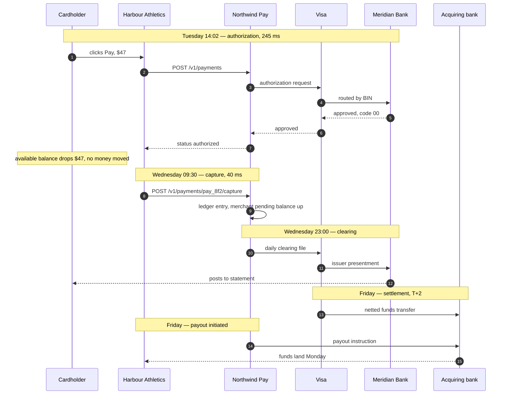

# The Life of One $47 Payment, With the Clock Attached

Document 00 established that authorization and settlement are different systems on different
clocks. This document makes that concrete by following a single purchase from the moment a
customer clicks "Pay" to the moment the merchant's bank balance changes, and labelling every step
with how long it takes and what state exists afterwards.

The purpose is to give you a timeline you can hold in your head, because almost every design
decision in later documents is really a decision about *which stage of this timeline a given
piece of information becomes available in*.

---

## The naive version, and what it gets wrong

If you have only ever integrated against a modern PSP API, your mental model is probably this:

```
POST /v1/payments  →  200 OK, status: succeeded  →  the merchant has the money
```

Two things are wrong with that, and both of them cause real bugs.

**First, `succeeded` does not mean the merchant has the money.** It means the issuer said yes.
The money arrives two business days later, and between those two points there are several ways
for the amount to change or the transaction to disappear.

**Second, the single API call hides a split.** What actually happened is two distinct operations
that the API collapsed for convenience: an *authorization* and a *capture*. For an e-commerce
merchant shipping physical goods, collapsing them is usually wrong, and the reason is in the next
section.

---

## Stage 1: Authorization — asking permission

**What it is.** Northwind Pay asks Meridian Bank, through Visa, whether $47 may be taken from
card `4319 •••• •••• 7732`. Meridian checks the available balance, the credit limit, whether the
card is reported lost, its own fraud models, and the velocity of recent transactions. It answers
approve or decline.

**What it changes.** On approval, Meridian places a **hold** on the cardholder's available
balance. The cardholder's statement balance is unchanged; their *available* balance drops by $47.
No money has moved between any two institutions. Nothing has been netted. If every party
vanished at this instant, no funds would be misplaced — only a hold would eventually expire.

**How long it takes.** This is the only synchronous, latency-sensitive step in the entire flow,
and Northwind Pay's budget for it breaks down as follows:

| Segment | p50 | p99 |
|---|---|---|
| Merchant → Northwind Pay edge | 20 ms | 60 ms |
| Northwind Pay own processing | 35 ms | 120 ms |
| Northwind Pay → network → issuer → back | 180 ms | 450 ms |
| Response assembly and return | 10 ms | 30 ms |
| **End to end** | **245 ms** | **660 ms** |

That leaves 140 ms of headroom against the 800 ms p99 target. Note where the time actually goes:
the network-and-issuer leg is 450 of the 660 ms at p99, and **Northwind Pay does not control any
of it**. This is the central fact of payment latency engineering. You cannot make the issuer
faster. You can only avoid adding to the 120 ms you do control, which is why document 16 is so
insistent that inline fraud scoring must fit in a tight budget.

**What can go wrong.** Approve, decline, or — the case that generates most of this collection's
difficulty — no answer at all. See document 06.

### Why authorization and capture are separate

Harbour Athletics sells physical goods. The customer clicks Pay at 14:02 on Tuesday. The
warehouse picks and ships the order at 09:30 on Wednesday. Between those two moments, the order
might be cancelled, an item might be out of stock, or the customer might change the shipping
address in a way that changes the tax.

If authorization and capture were one operation, Harbour Athletics would have taken the money at
14:02 for goods it has not shipped. This is not merely impolite; in many jurisdictions and under
the card network rules it is **not permitted** to capture before shipment for physical goods. The
card scheme rules exist because the alternative — merchants holding customer funds for
undelivered goods — is exactly the risk the acquirer underwrites.

So the split exists to give the merchant a window in which it has *permission* to take the money
but has not yet taken it. Three things can happen in that window:

- **Capture for the full amount.** The order shipped as placed.
- **Capture for less.** One of two items was out of stock, so capture $23 of the authorized $47.
  This is a *partial capture* and is allowed; the remaining $24 of hold is released.
- **Cancel.** The order was cancelled before shipping. This is a *void* or *authorization
  reversal*, and it releases the hold immediately.

Card-not-present digital goods — a subscription renewal, a software licence — ship instantly, so
there the combined "auth and capture" call is correct and Northwind Pay offers it as
`capture_method: automatic`.

---

## Stage 2: Capture — committing to take it

**What it is.** The merchant tells Northwind Pay "take the money I was authorized for." Northwind
Pay records it and includes the transaction in the next clearing batch.

**What it changes.** Internally, a great deal: the payment's state becomes terminal-ish, the
ledger records an obligation to the merchant (document 08), and the merchant's pending balance
increases. Externally, almost nothing yet — the network has not been told. The cardholder sees no
change; the hold they already had simply turns into a real charge later.

**How long it takes.** The API call is fast — around 40 ms at p99, because it touches no external
party. But the *effect* is delayed until the next clearing cut-off, which at Northwind Pay is
**23:00 UTC daily**. A capture at 09:30 waits thirteen and a half hours before anything leaves
the building.

**The authorization validity window.** An authorization does not last forever. The hold expires,
and the rules vary:

- Visa and Mastercard card-not-present: typically **7 days**
- Card-present retail: typically **7 days**
- Travel and hospitality (hotels, car hire): up to **30 days**

If Harbour Athletics captures on day 9, the capture is a **late capture**. It will usually still
clear — the issuer generally honours it — but at a worse interchange rate, and the issuer may
decline it outright because the hold has gone and the balance may no longer be there. Northwind
Pay therefore tracks `authorization_expires_at` on every payment and alerts merchants with
uncaptured authorizations approaching the limit. Roughly 0.4% of Northwind Pay's authorizations
expire uncaptured each year, which is 1,047,600,000 × 0.004 ≈ **4.2 million expired
authorizations** — each one a customer who had a hold on their card for a purchase that never
completed, and a non-trivial source of support contacts.

---

## Stage 3: Clearing — telling everyone what happened

**What it is.** At the 23:00 UTC cut-off, Northwind Pay assembles the day's captures into a file
and submits it to the network. The network splits it by issuer and delivers each issuer the
records relevant to it. The issuer matches each cleared record against the authorization it
approved earlier.

**What it changes.** The cardholder's *statement* balance now changes: the pending hold becomes a
posted transaction. The amounts owed between institutions are now formally stated.

**How long it takes.** The file is submitted at 23:00, the network processes overnight, and the
issuer posts the transaction to the cardholder's account within 24 hours. This is why a customer
sees "pending" on their banking app for a day or two and then sees the charge firm up — they are
watching the transition from authorization to clearing.

**The crucial property for your design.** The clearing file is the first point at which a *third
party tells you what it thinks happened*. Everything before it was your own record of your own
actions. The network's response file — which comes back with any records it rejected, and which
reports what the issuer acknowledged — is the external truth you reconcile against. This is why
document 10 can only happen after this stage exists.

**Matching is not guaranteed.** The issuer matches cleared transactions to authorizations by
amount, card, merchant identifier and acquirer reference number. A partial capture breaks the
amount match; a late capture may find the authorization already purged. Mismatches become
*exceptions* in the issuer's system and sometimes resurface as disputes. The practical rule is
to carry the authorization's identifiers through to the capture faithfully and never
re-generate them.

---

## Stage 4: Settlement — the money actually moves

**What it is.** The network computes, for each pair of institutions, the net amount owed across
all of the day's cleared transactions, and instructs the actual bank transfers.

Netting matters enormously. Suppose on a given day Northwind Pay's acquiring bank owes Meridian
Bank nothing (Northwind Pay is on the acquiring side, so money flows *to* it) and Meridian owes
Northwind Pay's acquirer $4.1 million across 87,000 transactions, while separately Meridian is
owed $300,000 by that same acquirer for refunds processed. The network nets these: one transfer
of $3.8 million moves, instead of 87,000-plus individual movements. The reduction in the number
of real-world bank transfers is roughly five orders of magnitude.

**What it changes.** Real money arrives in the acquiring bank account. This is the first moment
in the entire timeline at which funds have genuinely moved.

**How long it takes.** For Northwind Pay, funds for a Tuesday capture arrive on **Thursday**:
T+2, where T is the clearing date and the +2 counts business days. Weekends and bank holidays
push it out, which is why a Friday capture settles on Tuesday, and a Friday capture before a
Monday holiday settles on Wednesday — a five-day gap that merchants notice and complain about.

**Fees are deducted here or later depending on the model.** Northwind Pay operates *gross
settlement with separate fee billing* for large merchants — the full $47 settles and fees are
invoiced monthly — and *net settlement* for payment-facilitator merchants, where the $45.34
arrives directly. The choice affects the ledger structure considerably, and document 09 works
through both.

---

## Stage 5: Payout — the merchant gets paid

**What it is.** Northwind Pay transfers the merchant's accumulated balance to Harbour Athletics'
own bank account.

**Why this is a separate stage from settlement.** Settlement puts money into *Northwind Pay's*
acquiring account, commingled across all 40,000 merchants. The attribution of that pooled amount
to individual merchants lives in Northwind Pay's ledger, not in any bank. The payout is a
separate outbound transfer on Northwind Pay's own schedule.

Those schedules differ: Harbour Athletics is on daily automatic payouts with a two-day rolling
delay; a newly onboarded high-risk merchant may be on weekly payouts with a 7-day delay and a 10%
rolling reserve. The delay and the reserve exist for the reason established in document 00 — the
acquirer carries the risk that the merchant does not deliver — and document 09 covers how they
are computed.

**How long it takes.** The transfer itself is an ACH or SEPA credit, which takes 1–2 business
days to land. So the *customer-to-merchant* total is typically T+3 or T+4 from the original
click.

---

## The whole timeline in one picture



Count the days: the customer clicked on Tuesday afternoon and the merchant has spendable money
the following Monday. **Six calendar days.** The 245 ms authorization that everybody optimises is
0.00005% of that.

---

## The three flows that run backwards

Everything above describes money moving from cardholder to merchant. Three flows move the other
way, and they are not symmetric with each other. Confusing them is a classic source of
double-refunds.

**Authorization reversal (void).** Before capture, release the hold. No money ever moved, so
nothing needs to come back. The hold disappears from the cardholder's available balance within
minutes to days depending on the issuer. Cost: nothing. Use this whenever possible.

**Refund.** After capture, send money back. This is a *new* transaction in the opposite
direction, with its own clearing and settlement cycle. It takes 5–10 business days to appear on
the cardholder's statement. Critically, **the interchange fee on the original is generally not
returned** — so refunding a $47 payment costs Harbour Athletics the full $47 plus the $1.663 it
already paid in fees. A merchant with a 30% refund rate is paying processing fees on 130% of its
net revenue.

**Chargeback.** The cardholder goes to Meridian Bank and says the charge is wrong. Meridian pulls
the money back through the network, whether or not Harbour Athletics agrees. The merchant finds
out after the fact, pays a dispute fee of around $15, and may contest it. Document 17 covers the
full state machine, which runs for up to 180 days.

The ordering rule that prevents the most common bug: **if you can void, never refund.** A void is
free, instant, and leaves no trace on the cardholder's statement. A refund costs fees, takes a
week, and shows the customer two line items — a charge and a credit — which generates support
contacts. Northwind Pay's API therefore routes a cancellation request to a void if the payment is
uncaptured and to a refund if it is captured, and document 04's state machine is what makes that
decision safe.

---

## Where this leaves your data model

Walk back through the timeline and note what identity each stage needs, because this determines
your schema.

- **The merchant's identity for the thing being bought.** An `order_id` or `reference` that the
  merchant chose. Northwind Pay does not interpret it but must store it and must be able to
  look up by it, because this is what a merchant's support agent has in hand.
- **The payment.** One logical payment, `pay_8f2c...`, spanning authorization through refunds.
  This is the aggregate the merchant reasons about.
- **The authorization.** A specific approval with an amount, a code and an expiry.
- **Captures.** One or more, each with its own amount and clearing date. Note the plural —
  multiple partial captures against one authorization are legal for some merchant categories.
- **Refunds.** One or more, each with its own lifecycle, each referencing a capture.
- **Disputes.** Zero or more, each referencing a capture, each with a long state machine.
- **Ledger entries.** Many, immutable, generated by all of the above.

So the shape is **one payment, several child objects of different types, each with its own
state**, and the payment's overall status is a *derivation* from the children rather than a field
that something sets directly. That derivation is the subject of document 04, and getting it wrong
is how systems end up reporting a payment as `succeeded` while $23 of it has been refunded and
$24 is in dispute.

---

## What to take away

1. **"Succeeded" means the issuer said yes, not that the merchant has money.** Six calendar days
   separate those two facts in the ordinary case. Anything you build that implies otherwise will
   mislead merchants.
2. **Authorization and capture are separate because the merchant must be able to not take the
   money.** Partial capture and void are the reason, and the card scheme rules require the split
   for physical goods.
3. **Authorizations expire.** Seven days for most card-not-present transactions, thirty for
   travel. 4.2 million of Northwind Pay's annual authorizations expire uncaptured, and each is a
   customer with a stuck hold.
4. **Clearing is the first time an outside party tells you what it thinks happened.** Everything
   before it is your own account of your own actions, which is why reconciliation cannot start
   earlier.
5. **Settlement is netted, and that netting is why the card system is affordable.** 87,000
   transactions become one bank transfer.
6. **Payout is not settlement.** Settlement fills a pooled account; payout attributes and
   disburses it on your own schedule, with delays and reserves set by merchant risk.
7. **Void beats refund, always.** Free and invisible versus fee-bearing and visible. Your API
   should choose automatically based on state, never make the merchant decide.

Next: [02-money-is-not-a-float.md](02-money-is-not-a-float.md), on representing amounts, which
sounds trivial and is the source of a surprising share of real financial defects.
