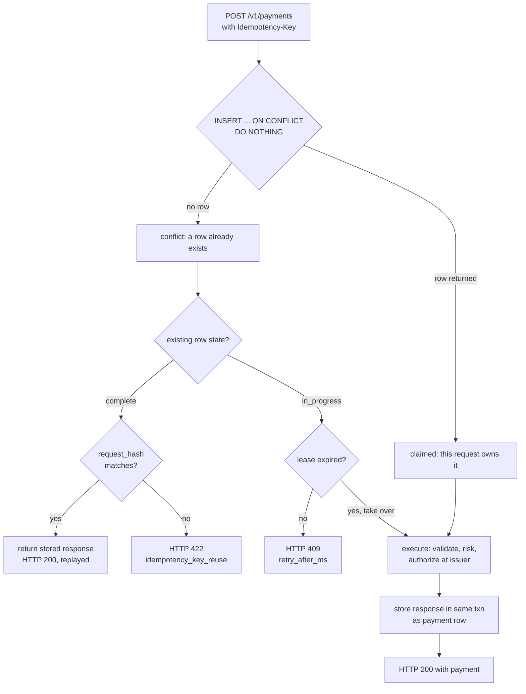

# The API Surface, and Idempotency as the Load-Bearing Primitive

Everything in this collection so far has been about the domain. This document is where you start
building, and it begins with the merchant-facing API — not because the API is the most
interesting part, but because **one decision made here determines whether the rest of the system
can be correct at all**.

That decision is idempotency. This document explains the problem it solves, shows what breaks
without it, and then designs it properly, including the parts that most implementations get
wrong.

---

## The problem, before any solution

Harbour Athletics' checkout server calls Northwind Pay:

```http
POST /v1/payments
Content-Type: application/json

{
  "amount_minor": 4700,
  "currency": "USD",
  "payment_method": "pm_1KqX9z",
  "capture_method": "manual",
  "reference": "HA-ORDER-88412"
}
```

The connection times out after 10 seconds. No response arrives.

**Harbour Athletics now does not know whether the customer was charged.** There are exactly three
possibilities and they are indistinguishable from the client's position:

1. The request never reached Northwind Pay. Nothing happened.
2. The request was processed, the issuer approved, and the *response* was lost on the way back.
   The customer has a $47 hold.
3. The request is still being processed right now. The issuer has not answered yet.

The checkout server has a customer waiting and must do something. Its options are to retry or to
fail the order. If it fails the order and case 2 was true, the customer has a hold on their card
for a purchase they were told failed — that generates a support ticket and possibly a dispute. If
it retries and case 2 was true, **the customer is charged twice.**

Scale that. Northwind Pay sees roughly 0.04% of requests end in a client-side timeout, which
across 1.2 billion attempts is 1,200,000,000 × 0.0004 = **480,000 ambiguous requests per year**,
about 1,315 per day. Without a mechanism, every single one is a coin flip between a double charge
and a stuck hold.

This is not an edge case you can defer. It is the *normal* condition of any network call, and in
payments the consequence of getting it wrong is visible to a customer's bank account.

---

## Why the usual answers do not work

Three approaches come up naturally, and each fails in an instructive way.

**"Make the operation naturally idempotent."** This works beautifully for `PUT /resource/123` with
a client-chosen id, because applying it twice yields the same state. It does not work for
payments, because creating a payment is *inherently* a create: two $47 payments from the same
customer to the same merchant on the same day are a completely legitimate thing that must be
possible. You cannot deduplicate on the content, because identical content is sometimes two real
payments.

**"Have the client check before retrying."** The client calls `GET /v1/payments?reference=HA-ORDER-88412`
to see whether its payment exists. This is better, and it is a real technique, but it has a race:
if the original request is still in flight (case 3), the lookup finds nothing, the client retries,
and now two requests are in flight. It also requires the merchant to have put a unique reference
on the request, which you cannot enforce retroactively.

**"Use a database unique constraint on the merchant's reference."** Closer still, and some PSPs do
this. It fails because the merchant's reference is the merchant's business key, and merchants
legitimately reuse them — a subscription with reference `SUB-4412` charges monthly. You would be
deduplicating across months.

What these attempts circle is the actual requirement: **the client needs to be able to say "this
request is the same attempt as that earlier one", separately from saying "this request has the
same content."** That is what an idempotency key is.

---

## The idempotency key

The client generates a unique value per *logical operation* and sends it as a header:

```http
POST /v1/payments
Idempotency-Key: 7f3a9c2e-5b41-4d8a-9e17-2c6b8d41f0a3
```

On retry, the client sends **the same key**. The server's contract is:

> For a given (merchant, idempotency key) pair, the operation is performed at most once. A repeat
> request with that key returns the result of the original, without performing it again.

Harbour Athletics generates the key when it begins the checkout attempt, stores it with the
order, and reuses it for every retry of that attempt. Now the timeout case resolves cleanly: the
client retries with the same key, and either learns the original succeeded (case 2) or has its
request executed for the first time (case 1).

Note what the key is *not*. It is not the merchant's order reference, and it should not be derived
from it. A customer whose first payment attempt was declined for insufficient funds and who tries
again with a different card is making a **new attempt** on the same order — new idempotency key,
same reference. Conflating them means the second attempt returns the first one's decline.

---

## Building it, carefully

Here is the mechanism in the order in which the problems appear.

### The first attempt: a lookup table

```sql
CREATE TABLE idempotency_keys (
  merchant_id      BIGINT       NOT NULL,
  idempotency_key  TEXT         NOT NULL,
  request_hash     BYTEA        NOT NULL,
  state            TEXT         NOT NULL,  -- in_progress | complete
  response_code    INT,
  response_body    JSONB,
  payment_id       TEXT,
  created_at       TIMESTAMPTZ  NOT NULL DEFAULT now(),
  expires_at       TIMESTAMPTZ  NOT NULL,
  PRIMARY KEY (merchant_id, idempotency_key)
);
```

The handler logic, naively:

1. Look up `(merchant_id, key)`.
2. If found and `complete`, return the stored response.
3. If not found, insert a row, process the payment, store the response, return it.

This is most of the way there, and it is wrong in three specific ways.

### Problem one: the concurrent duplicate

Two retries arrive 40 ms apart, which is entirely normal when a client has an aggressive retry
policy or a load balancer replays a request. Both execute step 1, both find nothing, both proceed
to step 3. **Two authorizations go to the issuer.**

The fix is that the insert must be the thing that claims the key, atomically, before any work
happens:

```sql
INSERT INTO idempotency_keys (merchant_id, idempotency_key, request_hash, state, expires_at)
VALUES ($1, $2, $3, 'in_progress', now() + interval '24 hours')
ON CONFLICT (merchant_id, idempotency_key) DO NOTHING
RETURNING *;
```

If this returns a row, you won the race and you own the execution. If it returns nothing, somebody
else owns it, and you must read the existing row and decide what to do based on its state.

This is the single most important line in the whole mechanism. **The claim must be the write, not
a read followed by a write.**

### Problem two: what to do when the original is still in progress

You lost the race and the existing row says `in_progress`. The original request is being handled
right now, possibly by a different server, possibly stuck waiting on the issuer for another 400
ms.

The wrong answer is to wait for it, because you do not know how long that will be and you will
tie up a connection. The wrong answer is also to execute anyway, which defeats the entire point.

The correct answer is to return **HTTP 409 Conflict** with a machine-readable error telling the
client that a request with this key is in flight and to retry after a short delay:

```json
{
  "error": {
    "type": "idempotency_in_progress",
    "message": "A request with this Idempotency-Key is currently being processed.",
    "retry_after_ms": 500
  }
}
```

Northwind Pay's client libraries handle this transparently with a bounded backoff, so merchant
code never sees it. The important property is that the server never performs the operation twice
and never blocks indefinitely.

There is a subtlety here that catches people out. If the server that claimed the key crashes
mid-execution, that row stays `in_progress` forever and the client is locked out of ever
completing this operation. You therefore need a **lease**: the `in_progress` row carries a
`locked_until` timestamp, and a request that finds an expired lease may take ownership. Northwind
Pay uses a 90-second lease, chosen because it is comfortably longer than the 30-second network
timeout plus retries. Recovering a stale lease must then go through the recovery procedure in
document 06, because the crashed attempt may have reached the issuer.

### Problem three: the same key with different content

A client sends the key with `amount_minor: 4700`, then retries the same key with
`amount_minor: 9400`. This is always a client bug — perhaps the key was stored in a variable that
got reused across orders — and silently returning the first response would charge the customer
$47 for a $94 order.

This is why the table stores `request_hash`. On a repeat, hash the incoming request body and
compare. On mismatch, refuse:

```json
{
  "error": {
    "type": "idempotency_key_reuse",
    "message": "This Idempotency-Key was already used with a different request body."
  }
}
```

Return 422. Do not perform the operation, and do not return the old response. The client must be
told it has a bug.

Hash the *canonicalised* body — keys sorted, whitespace normalised — or you will reject
legitimate retries whose JSON serialiser ordered fields differently. And exclude fields that are
legitimately allowed to differ between retries; Northwind Pay excludes nothing, having found that
a strict rule is easier to explain to merchants than a list of exceptions.

### Problem four: storing the result atomically with the effect

The payment succeeded. You now write the response into `idempotency_keys` and return it. If the
process dies between those two writes, the payment exists and the key says `in_progress`, so a
retry re-executes.

**The response write and the payment write must be in the same database transaction.** This is the
reason the idempotency table lives in the same database as the payments table, and the reason that
database is the one that must not be sharded away from the payment record. Document 13 discusses
the sharding consequences.

Where the effect is *not* in your database — the authorization at the issuer is the obvious
case — you cannot have atomicity, and that is precisely the gap document 06 exists to manage.
What you can do is record your *intent* transactionally before calling out, so that recovery
knows an attempt was made. The pattern is:

```
BEGIN
  claim idempotency key            -- in_progress
  insert payment row               -- status: pending
  insert ledger reservation        -- document 08
COMMIT
→ call the issuer                  -- the non-transactional part
BEGIN
  update payment row               -- status: authorized / declined
  insert ledger entries
  complete idempotency key         -- with the response body
COMMIT
```

Anything that dies between the two transactions leaves a `pending` payment with a claimed key,
which the recovery process in document 06 can find and resolve.

---

## The full request path



---

## How long to keep keys

Northwind Pay expires idempotency keys after **24 hours**. The reasoning is worth spelling out,
because both directions have real costs.

**Too short** and a legitimate retry falls outside the window. A merchant's background job that
retries failed webhooks once an hour needs the key to still be live. A merchant recovering from
its own outage might retry a batch of pending orders six hours later.

**Too long** and the table grows without bound and the semantics get strange. At 1.2 billion
requests a year, retaining keys for a year would mean 1.2 billion rows holding full response
bodies — Northwind Pay's average stored response is 1.8 KB, so that is 1,200,000,000 × 1,800
bytes ≈ **2.2 TB** of idempotency records, most of which will never be read again.

At 24 hours the steady-state size is 1.2 billion ÷ 365 ≈ 3.3 million rows per day, times 1.8 KB,
for about **5.9 GB**. That fits comfortably in cache-warm storage, and the table is partitioned by
day so expiry is a partition drop rather than a mass delete.

The 24-hour choice also has a semantic justification: it is shorter than the authorization
validity window (7 days) but longer than any reasonable client retry schedule. A merchant
retrying after 24 hours is not retrying — it is making a new attempt, and should use a new key.

---

## The rest of the API, briefly

With idempotency settled, the surface itself is unremarkable, and that is the goal. Resources and
their operations:

```
POST   /v1/payments                      create and authorize
POST   /v1/payments/{id}/capture         capture, full or partial
POST   /v1/payments/{id}/cancel          void an uncaptured authorization
POST   /v1/payments/{id}/refunds         refund a captured amount
GET    /v1/payments/{id}                 read
GET    /v1/payments?reference=...        search by merchant reference
POST   /v1/payment_methods               tokenise a card, document 15
GET    /v1/disputes/{id}                 read a dispute, document 17
```

Four design rules worth stating because they interact with the domain:

**Every state-changing endpoint accepts `Idempotency-Key`, and it is required, not optional.**
Northwind Pay rejects a `POST /v1/payments` without one. Making it optional means the merchants
who most need it are the ones who omit it. Captures and refunds need it just as much as creates —
a retried refund that double-refunds is the same bug with the sign flipped.

**Amounts follow document 02.** Integer minor units, explicit currency, never a float in JSON.

**Status is a read-only derivation.** There is no `PATCH /v1/payments/{id}` that sets status.
Status changes happen as a consequence of operations. Document 04 explains why.

**Errors distinguish three categories**, because clients must handle them differently:

- `invalid_request_error` — the client sent something wrong. Retrying is futile. HTTP 4xx.
- `card_error` — the issuer declined. Retrying this card now is usually futile; see document 11
  for when it is not. HTTP 402.
- `api_error` — something broke on Northwind Pay's side. Retrying with the same idempotency key
  is correct and safe. HTTP 5xx.

That third category is where idempotency pays for itself: the only honest advice you can give a
merchant on a 5xx is "retry with the same key", and that advice is only safe because of
everything above.

---

## Where idempotency is not enough

Be clear about the boundary, because idempotency is sometimes oversold.

Idempotency protects **you from the client's retries**. It does nothing about:

- **The issuer's view.** If your call to the issuer times out, idempotency has already done its
  job — the client's retry will be deduplicated — but you still do not know what the issuer did.
  Document 06.
- **The merchant's own duplicate orders.** If the customer clicks Pay twice and the merchant's
  front end creates two orders with two different keys, those are two genuine payments by your
  contract. Duplicate-order detection is a separate, heuristic, merchant-side concern, and
  Northwind Pay offers it as an advisory signal rather than a block.
- **Your own internal retries between services.** Each internal hop needs its own deduplication,
  which is usually the outbox pattern in document 12 rather than this table.

---

## What to take away

1. **A timed-out payment request is ambiguous between "nothing happened" and "charged, response
   lost."** At Northwind Pay's volume that is 1,315 ambiguous requests per day, and without a
   mechanism each is a coin flip between a double charge and a stuck hold.
2. **An idempotency key identifies an attempt, not a content hash and not a business reference.**
   Two identical payments can be legitimate; two retries of one attempt are not.
3. **The claim must be an atomic insert**, `ON CONFLICT DO NOTHING`, before any work. A read
   followed by a write loses the concurrent-retry race.
4. **A key in progress returns 409 with a retry hint, never a block and never a second
   execution** — and carries a lease so a crashed server does not lock the client out forever.
5. **Store the request hash and reject reuse with different content** with a 422. That is always
   a client bug and must be surfaced, not papered over.
6. **The stored response and the payment row must be written in one transaction**, which
   constrains where the idempotency table can live when you shard.
7. **Record intent transactionally before calling the issuer**, so a crash leaves a recoverable
   `pending` payment rather than nothing.
8. **Expire keys at 24 hours.** Long enough for every sane retry, short enough to keep the table
   at about 5.9 GB instead of 2.2 TB.
9. **Idempotency solves the client-to-you problem only.** The you-to-issuer problem is document
   06, and it cannot be solved the same way.

Next: [04-the-payment-state-machine.md](04-the-payment-state-machine.md), which defines the states
a payment may hold and why status must be derived rather than set.
