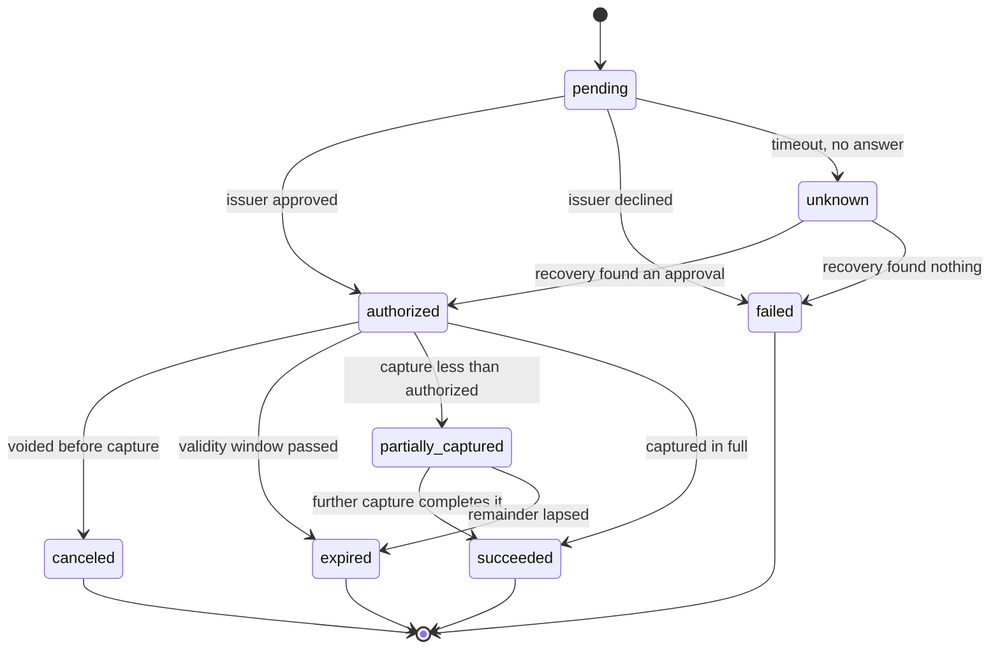

# The Payment State Machine, and Why Status Must Be Derived

A payment has a status, merchants poll it, dashboards display it, accounting systems branch on
it, and support agents read it aloud to customers. It is the single most-consumed field in the
entire API.

It is also the field most systems get structurally wrong, in a way that does not show up until
the system has been live long enough to accumulate partial captures, partial refunds and
disputes — at which point the status field is reporting something that is not true, and fixing it
requires rewriting every consumer.

This document works out what the states actually are, why the obvious implementation fails, and
what to do instead.

---

## The obvious implementation, and the day it breaks

Start where everyone starts. A payment has a `status` column:

```sql
ALTER TABLE payments ADD COLUMN status TEXT NOT NULL;
-- 'pending' | 'authorized' | 'captured' | 'refunded' | 'failed'
```

Code sets it as things happen. Authorize succeeds, set `authorized`. Capture succeeds, set
`captured`. Refund succeeds, set `refunded`. This works, it is easy to understand, and it is fine
for the first eighteen months.

Then Harbour Athletics ships a two-item order. The customer returns one item, and the merchant
issues a $19.99 refund against the $47.00 payment.

What is the status now? `refunded` is wrong — $27.01 is still with the merchant, and a merchant's
accounting export that treats `refunded` as "this sale did not happen" will understate revenue by
$27.01. `captured` is also wrong, because it implies nothing came back and a support agent
reading it will tell the customer no refund was issued.

The usual response is to add a status: `partially_refunded`. That holds until the customer returns
the second item too, at which point you need to know that `partially_refunded` plus another
refund becomes `refunded`, so the refund code now has to read the existing refunds and compute
which status to set.

Then a dispute arrives on the remaining $27.01 while a $5 refund is in flight. Then a partial
capture of $23 happens against a $47 authorization, and the remaining $24 of authorization is
still live and could still be captured. The status enum now needs to encode a combination of
several independent facts, and the number of combinations grows multiplicatively.

**The structural error is this: status is being stored as a fact when it is actually a summary of
several other facts.** Every time a new kind of child record appears, the summary becomes
incomplete, and because it is stored rather than computed, it also becomes *inconsistent* — there
will be payments whose status does not match their own children, because some code path forgot an
update.

---

## What the real states are

Separate the question into two: what has its own lifecycle, and what is a summary.

### Things with their own lifecycle

**The authorization.** One per payment in the common case. Its states:

- `pending` — request sent to the issuer, no answer yet
- `approved` — the issuer said yes, a hold exists
- `declined` — the issuer said no, terminal
- `expired` — the validity window passed without full capture, terminal
- `reversed` — explicitly voided before capture, terminal
- `unknown` — the request timed out and the outcome has not been established. **This state is
  mandatory and most designs omit it.** Document 06 is about it.

**Each capture.** Zero or more per authorization.

- `pending` — recorded, not yet in a clearing file
- `cleared` — included in a submitted clearing file
- `settled` — funds received, T+2
- `failed` — the network rejected the clearing record, terminal

**Each refund.** Zero or more per capture.

- `pending` → `cleared` → `settled`, or `failed`

**Each dispute.** Zero or more per capture, with a long state machine covered in document 17.

### The summary

The payment's `status` is then a pure function of its children. It is computed, never stored as
the authority — though it may be *materialised* for query performance, as discussed below.



Note what is deliberately **not** in that diagram: refunds and disputes. A refunded payment's
status stays `succeeded`, because the payment did succeed. Whether money later came back is a
separate dimension, reported in separate fields:

```json
{
  "id": "pay_8f2c4a91",
  "status": "succeeded",
  "amount_minor": 4700,
  "amount_captured": 4700,
  "amount_refunded": 1999,
  "amount_disputed": 0,
  "currency": "USD"
}
```

A consumer that wants "was this sale reversed?" reads `amount_refunded`. A consumer that wants
"did the charge go through?" reads `status`. Neither has to parse a compound enum, and adding a
new reversal mechanism later — a network credit, say — adds a field rather than multiplying the
enum.

This is the key design move, and it is worth stating plainly: **separate the question "did it
work?" from the question "how much of it is still standing?"** The first is a state; the second
is an amount. Encoding an amount into a state name is what produces `partially_refunded` and
everything that follows from it.

---

## Deriving the status

The derivation, in order, with the authorization's state and the capture totals as inputs:

```python
def payment_status(auth, captures) -> str:
    if auth.state == "pending":
        return "pending"
    if auth.state == "unknown":
        return "unknown"
    if auth.state == "declined":
        return "failed"
    if auth.state == "reversed":
        return "canceled"

    captured = sum(c.amount_minor for c in captures if c.state != "failed")

    if captured == 0:
        return "expired" if auth.state == "expired" else "authorized"
    if captured >= auth.amount_authorized:
        return "succeeded"
    # partial
    return "expired" if auth.state == "expired" else "partially_captured"
```

Three things to notice.

**The order of the checks is the priority order.** An expired authorization with a partial capture
is reported as `expired`, because the salient fact for a merchant is that it can no longer
capture the rest. Getting this ordering right is a product decision, and it must be written down
somewhere a support agent can read.

**Failed captures are excluded from the total.** A capture whose clearing record was rejected did
not happen, and including it would report `succeeded` for money that was never collected.

**`captured >= authorized` rather than `==`.** Some merchant categories are permitted to capture
slightly *more* than authorized — restaurants adding a tip, fuel pumps, hotels adding incidentals.
The permitted overage is set by the network, typically 15% or 20% for those categories and 0% for
everything else. An equality check here silently reports a tipped restaurant payment as
`partially_captured` forever.

---

## Materialising the derived status without losing correctness

A pure derivation means every read of a payment's status joins to captures. At Northwind Pay's
read volume — merchant dashboards, webhooks, support tooling, roughly 14,000 payment reads per
second at peak — that join is expensive.

The resolution is to **materialise the derived value and treat the derivation as the authority**:

- `payments.status` exists as a column, for indexing and fast reads.
- It is written only by a single function that takes the children and recomputes from scratch.
- No code path sets it to a literal. There is no `UPDATE payments SET status = 'succeeded'`
  anywhere; there is only `UPDATE payments SET status = <recomputed>`.
- The recomputation runs inside the same transaction as any child insert or update.
- A periodic job recomputes a sample and alerts on any divergence.

That last point is not paranoia. Northwind Pay's consistency sweep recomputes status for every
payment modified in the last 24 hours — about 3.3 million rows — and compares. The job exists
because the invariant "status always matches children" is the kind of thing that holds until
somebody adds a new code path, and you want to find out from a monitor rather than from a
merchant.

The difference between this and the naive version is not the presence of the column. It is that
**the column is a cache of a function, and the function is the definition.** When a new child type
is added, you change one function and run a backfill. In the naive version you change every code
path that writes the column and hope you found them all.

---

## Transitions that must be refused

A state machine is as much about the edges that do not exist as the ones that do. These are the
transitions Northwind Pay rejects, and the reason each matters.

**Capture on a non-approved authorization.** Capturing a declined or reversed authorization must
return `422 payment_not_capturable`. Without this check, a retry of a capture request that arrives
after a void will create a capture record against a released hold, which clears into a transaction
the issuer has no authorization for — and that becomes a chargeback with reason code "no
authorization", which the merchant cannot win.

**Capture beyond the authorized amount plus permitted overage.** Rejected at the API, because the
network will reject the clearing record anyway and discovering it a day later is much worse.

**Refund beyond `captured − already_refunded`.** The classic double-refund. Two concurrent refund
requests for $19.99 against a $19.99 remaining balance must not both succeed. This needs a real
lock, not an application-level check: Northwind Pay takes `SELECT ... FOR UPDATE` on the payment
row at the start of any refund, computes the remaining refundable amount, and inserts within that
transaction. An optimistic version-column check is also acceptable. A read-then-write without
either is a bug that will fire.

**Void after capture.** Returns `422`, with an error message that names the refund endpoint
instead. As established in document 01, the API should ideally route this automatically — Northwind
Pay's `/cancel` endpoint voids if uncaptured and returns a pointer to `/refunds` if captured,
rather than silently refunding, because a merchant who thinks they voided will not expect a
customer-visible credit line.

**Any transition out of a terminal state.** `failed`, `canceled` and `expired` are terminal. A
late issuer response that contradicts a terminal state does not change it; it raises a
reconciliation exception, because the two facts now disagree and a human must resolve which is
right.

---

## The state that most designs omit

`unknown` deserves its own section because leaving it out is the most consequential modelling
error in payments.

When the authorization request times out, the honest state of your knowledge is "I do not know."
Systems that lack an `unknown` state must map that situation onto either `failed` or
`authorized`, and both choices are wrong in an expensive way:

- **Map it to `failed`** and you will tell merchants and customers that payments failed when the
  issuer approved them. The customer has a hold. The merchant does not ship. The customer calls
  their bank. Northwind Pay saw this pattern before introducing `unknown`: timeouts mapped to
  failures produced roughly 1,300 "I was charged but the order failed" support contacts a day
  during a network degradation.
- **Map it to `authorized`** and you will tell merchants to ship goods for payments that do not
  exist. Worse, the capture will be submitted against a non-existent authorization and rejected
  at clearing — a day later, after the goods have gone.

With `unknown` as a real state, the system can say what is true, the merchant can be told to wait,
and a recovery process can resolve it. The API surfaces it honestly:

```json
{
  "id": "pay_8f2c4a91",
  "status": "unknown",
  "status_detail": "The issuer did not respond. The outcome will be resolved automatically, usually within 60 seconds and always within 24 hours.",
  "resolution_expected_by": "2026-11-12T14:03:40Z"
}
```

Merchants dislike this state, and the client libraries are built to poll through it rather than
expose it. But a state the merchant dislikes is better than a lie. Document 06 covers how
`unknown` is resolved.

---

## Events, and why they are the merchant's real interface

Every transition emits an event, and most merchants should be consuming events rather than
polling status:

```
payment.authorized
payment.capture_succeeded
payment.capture_failed
payment.canceled
payment.expired
payment.resolution_pending      (entered unknown)
payment.resolution_completed    (left unknown)
refund.succeeded
dispute.opened
dispute.closed
```

Two rules that follow from the state machine.

**Events carry the full object, not just the delta.** A merchant that receives
`payment.capture_succeeded` with only a capture id must call back to learn the amounts, which
multiplies read load and introduces a race where the callback sees a *later* state than the event
described. Include the payment as it was at the moment of the transition.

**Events are not ordered across a payment's lifetime, so each carries a sequence number.** Webhook
delivery is a distributed system and document 12 explains why ordering cannot be guaranteed. A
monotonically increasing `sequence` per payment lets a merchant discard an event older than one it
has already applied — which is the only reliable way for the merchant to maintain its own copy of
the state.

---

## What to take away

1. **Storing status as a fact fails as soon as partial captures, partial refunds and disputes
   exist**, because status is a summary of independent facts and the combinations multiply.
2. **Separate "did it work?" from "how much is still standing?"** The first is a state; the second
   is a set of amount fields. `partially_refunded` is the symptom of conflating them.
3. **The authorization, each capture, each refund and each dispute have their own lifecycles.**
   The payment's status is a function over them.
4. **Materialise the derived status as a column if you need the index, but keep the function as
   the authority** — one writer, recomputed from scratch, inside the child's transaction, with a
   sweep that alerts on divergence.
5. **Order the derivation's checks deliberately** and write that priority down where support can
   read it.
6. **Allow capture above the authorized amount only for the categories the networks permit**, or
   tipped restaurant payments report wrongly forever.
7. **Refunds need a real lock.** `SELECT ... FOR UPDATE` or a version column; a read-then-write
   will double-refund.
8. **Terminal states are terminal.** A contradicting late response raises a reconciliation
   exception for a human, it does not reopen the payment.
9. **`unknown` is a mandatory state.** Mapping a timeout onto `failed` or `authorized` is a lie,
   and both directions produce expensive, customer-visible damage.

Next: [05-talking-to-the-networks.md](05-talking-to-the-networks.md), on the integration itself —
message formats, connections, and the response you never receive.
