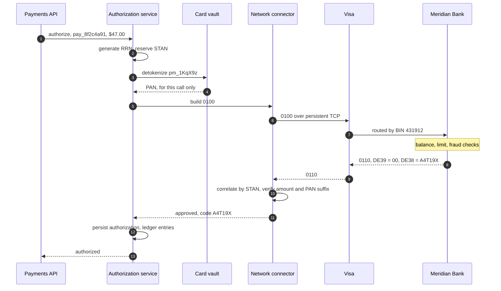

# Talking to the Networks: Message Formats, Connections and Timeouts

Up to this point the issuer has been a box labelled "the issuer" that answers in 180 ms. This
document opens that box. It covers the message format the networks actually use, how the
connection is maintained, what the response codes mean, and how to set timeouts — which turns out
to be the decision that determines how much of document 06's pain you will experience.

None of this is intellectually deep. It is operationally unforgiving, which is a different
problem, and the details below are the ones that cause incidents when guessed at.

---

## ISO 8583, and why a 1987 format is still in the hot path

The card networks speak **ISO 8583**, a binary message format standardised in 1987. Modern PSPs
often sit behind an HTTP gateway that speaks JSON to merchants and ISO 8583 to the network, but
if you are the processor — as Northwind Pay is — you implement 8583 directly.

It is worth understanding the format's shape, because its constraints leak upward into your API.

A message has three parts:

**The Message Type Indicator (MTI)**, four digits, which says what kind of message this is. The
ones you care about:

| MTI | Meaning |
|---|---|
| 0100 | Authorization request |
| 0110 | Authorization response |
| 0200 | Financial request (auth and capture combined) |
| 0210 | Financial response |
| 0400 | Reversal request |
| 0410 | Reversal response |
| 0420 | Reversal advice (notification, not a request) |
| 0800 | Network management request, for example an echo test |
| 0810 | Network management response |

**The bitmap**, a 64-bit or 128-bit field where each bit indicates whether the corresponding data
element is present. This is the 1987 part: it exists because bandwidth was expensive and a
self-describing format was unaffordable.

**The data elements**, numbered 1 to 128, each with a defined type and length. The ones that
matter constantly:

| DE | Name | Note |
|---|---|---|
| 2 | Primary account number | The PAN. Document 15 is about keeping this contained. |
| 3 | Processing code | What kind of transaction — purchase, refund, balance enquiry |
| 4 | Transaction amount | **12 digits, implied 2 decimals** |
| 7 | Transmission date and time | |
| 11 | System trace audit number | The STAN — six digits, cycles |
| 37 | Retrieval reference number | The RRN — twelve characters, your handle on this transaction |
| 38 | Authorization identification response | The six-character approval code |
| 39 | Response code | Approve, or the reason for decline |
| 41 | Card acceptor terminal id | |
| 42 | Card acceptor id | The merchant identifier, the MID |
| 49 | Transaction currency code | ISO 4217 numeric |

Two of those entries have consequences you must design around.

**DE 4 is twelve digits with two implied decimals.** This is where document 02's warning about
three-decimal currencies becomes concrete: the field physically cannot represent a Kuwaiti dinar
amount at full precision, which is why the networks require the third decimal to be zero. The
twelve-digit limit also caps a single transaction at 9,999,999,999.99 of the minor unit, which
sounds generous until you process in Indonesian rupiah.

**DE 37, the retrieval reference number, is your correlation key across the entire lifecycle.** The
authorization, the clearing record, the settlement entry and any subsequent dispute all reference
the same RRN. It is twelve alphanumeric characters, it must be unique within a reasonable window,
and **you generate it**. Northwind Pay constructs it as a 1-character region code, a 4-digit
Julian day, and a 7-character base-36 counter, giving roughly 78 billion values per region-day,
which is comfortably more than the 9,000-per-second peak requires.

Getting the RRN wrong is a category of incident unto itself. Reuse one and the issuer may match a
clearing record to the wrong authorization. Regenerate one between auth and capture and the
issuer cannot match at all, and your capture clears as an unmatched transaction that is
disproportionately likely to become a dispute. **Generate it once, at authorization, store it, and
carry it forward unchanged.**

---

## The connection: long-lived, authenticated, and heartbeat-monitored

You do not open a connection per transaction. The network link is a small number of persistent,
mutually authenticated TCP connections — in Northwind Pay's case **8 connections per network per
region**, so 8 × 2 networks × 3 regions = 48 total — each carrying many concurrent messages.

Three properties of that arrangement drive the design.

**Messages are multiplexed, and correlated by STAN.** Multiple requests are in flight on one
connection simultaneously, and responses come back in whatever order the issuer produces them. You
match a 0110 response to its 0100 request by the system trace audit number in DE 11. Your client
therefore maintains a map of outstanding requests keyed by STAN, with a timer on each.

The STAN is only six digits, so it cycles every million messages. At 9,000 per second on a region
that is a full cycle every 111 seconds, which is uncomfortably close to the timeout window — if a
STAN is reused while an old request bearing it is still outstanding, a late response can be
matched to the wrong request. Northwind Pay partitions the STAN space per connection (8
connections × 125,000 values each) so that the effective reuse interval per connection is eight
times longer, and additionally validates that a response's amount and PAN suffix match the
request it was correlated to before accepting it. That validation has caught real mismatches.

**The link must be heartbeated.** A TCP connection can be silently dead — the peer gone, no FIN
received, the socket still open from your side. The network management message (MTI 0800) exists
for this: Northwind Pay sends an echo test every **30 seconds** per connection and marks the
connection failed after two consecutive misses. Without heartbeating, a dead connection absorbs
traffic into a black hole until transaction timeouts reveal it, which at 9,000 TPS across 8
connections means roughly 1,125 transactions per second disappearing for the length of your
timeout.

**Connections are a scarce, slow-to-establish resource.** Bringing up a network connection
involves a TLS handshake against certificates that are managed by the network, plus a sign-on
exchange. It takes seconds, not milliseconds, and the networks limit how often you may do it. You
therefore cannot treat connections as disposable, and your capacity plan must assume you will
occasionally run at 7 of 8 connections rather than scaling out on demand.

---

## Response codes: the only output that matters

DE 39 carries the outcome. `00` means approved. Everything else is a decline, and the specific
code determines what your system should do next — which is the subject of document 11, but the
taxonomy belongs here.

The codes you will handle constantly:

| Code | Meaning | Class |
|---|---|---|
| 00 | Approved | Success |
| 01 | Refer to card issuer | Soft |
| 05 | Do not honour | Soft, and ambiguous |
| 13 | Invalid amount | Hard, your bug |
| 14 | Invalid card number | Hard |
| 41 | Lost card | Hard, do not retry |
| 43 | Stolen card | Hard, do not retry |
| 51 | Insufficient funds | Soft |
| 54 | Expired card | Hard, needs new card data |
| 57 | Transaction not permitted to cardholder | Hard |
| 59 | Suspected fraud | Hard, do not retry |
| 61 | Exceeds withdrawal amount limit | Soft |
| 62 | Restricted card | Hard |
| 65 | Exceeds withdrawal frequency limit | Soft |
| 91 | Issuer or switch inoperative | Retryable, not a decline |
| 96 | System malfunction | Retryable, not a decline |

The hard-versus-soft distinction is the one that matters commercially. A **hard decline** is a
statement about the card: it is expired, cancelled, stolen, or not valid. Retrying it will not
help and, for codes 41, 43 and 59, retrying is itself reported to the network as a suspicious
pattern. A **soft decline** is a statement about this moment: not enough money right now, too many
transactions today. Retrying later can legitimately succeed.

Code `05`, "do not honour", deserves special mention because it is the most common decline and the
least informative. It means the issuer declined and declined to say why. Roughly 38% of Northwind
Pay's declines carry code 05. It is conventionally treated as soft — a retry some hours later
succeeds often enough to be worth it — but it is also where issuers hide fraud declines, so
retrying aggressively against a 05 will damage your reputation with that issuer. Document 11 sets
out the schedule Northwind Pay actually uses.

**Codes 91 and 96 are not declines at all.** They say the issuer could not answer, not that the
answer is no. Treating them as declines means telling a customer their card was refused when
nothing was wrong with it, and it means not attempting the stand-in processing that document 14
describes. Northwind Pay maps them to a distinct internal outcome, `issuer_unavailable`, which
produces a different merchant-facing error and a different retry policy.

---

## Timeouts, which is the real subject of this document

Here is the decision that determines how much pain you will have.

You send a 0100. You must decide how long to wait before giving up. Set it too short and you
abandon requests the issuer was about to answer. Set it too long and you hold the merchant's
connection open past the point where the customer has given up anyway.

The networks specify a maximum. Visa's and Mastercard's authorization response windows are on the
order of **15 to 30 seconds** before the network itself will time out and generate a response on
the issuer's behalf. So any timeout you set below that is *yours*, not the network's, and
abandoning a request earlier than the network does means you may receive a response after you
have stopped listening.

Northwind Pay's layered timeouts, and the reasoning for each:

| Layer | Timeout | Reasoning |
|---|---|---|
| Merchant HTTP request | 10 s | Beyond this the customer has abandoned the checkout anyway |
| Internal auth service call | 8 s | Leaves 2 s to return a well-formed response to the merchant |
| Network 0100 send-to-response | 30 s | Matches the network's own window — abandoning earlier guarantees ambiguity |
| Echo test | 5 s | A heartbeat that is slow is a connection that is sick |

Read the third row carefully, because it looks inconsistent with the second and is not. **The
network request continues after the merchant's request has been answered.** At 8 seconds the
internal call gives up and the merchant is told `unknown` (document 04). But the 0100 is still
outstanding, the client is still listening for its STAN, and when the response arrives at, say,
11 seconds, it is applied to the payment and the merchant is notified by webhook.

This is the correct structure and it is worth being explicit about why: **you should stop making
the merchant wait long before you stop trying to find out what happened.** Those are two different
deadlines and collapsing them into one is the mistake. A system that cancels the network request
when the merchant's request times out converts every slow issuer response into a permanently
ambiguous transaction, which is exactly the population document 06 has to clean up.

The numbers at Northwind Pay: about 0.6% of authorizations exceed the 8-second internal deadline,
which is 1,200,000,000 × 0.006 ≈ 7.2 million per year. Of those, roughly 93% receive a network
response before the 30-second window closes and are resolved automatically within a minute. The
remaining 7% — about 504,000 per year, 1,380 per day — are genuinely unresolved and enter the
recovery process. That is the 1,315-per-day figure quoted in document 03, arrived at from the
other direction.

---

## What the request path looks like in full

Two details in that diagram are load-bearing.

**The vault call returns the PAN for the duration of one network message and nothing persists it.**
This is the boundary that keeps the authorization service out of PCI scope in the strongest sense
available, and document 15 explains how the boundary is enforced.

**The STAN is reserved before the message is built, not assigned when it is sent.** Reserving it
first means that a crash between reservation and send leaves a STAN that is known to be possibly
in use, which recovery treats conservatively rather than reusing.

---

## Modern alternatives, and what actually changes

Not every connection is ISO 8583 over TCP. Visa's and Mastercard's newer APIs are HTTPS with JSON
bodies, and if you integrate through an acquiring partner rather than directly you will likely
speak their REST API instead.

What changes: serialisation, transport, and the ergonomics of debugging. JSON over HTTPS is
enormously more pleasant to work with than a bitmap-indexed binary format.

What does not change, and this is the point: **every single hard problem in this document survives
the transport change.** You still need a correlation identifier carried from authorization to
clearing. You still need to decide a timeout shorter than the network's. You still receive
responses after you have stopped waiting. You still get `05 do not honour` with no explanation.
You still cannot tell a timeout from a decline. HTTP gives you a request id and a 504, which is
cosmetically nicer than a missing STAN correlation and semantically identical.

So if your integration is a modern REST API, read this document as describing the problems rather
than the format. Document 06 applies unchanged.

---

## What to take away

1. **ISO 8583 is a bitmap-indexed binary format from 1987 and it is still in the hot path.** Its
   constraints — a 12-digit amount with two implied decimals especially — leak into your API.
2. **DE 37, the retrieval reference number, is the correlation key for the entire lifecycle.**
   Generate it once at authorization and carry it unchanged through clearing, settlement and
   disputes.
3. **Connections are few, persistent, multiplexed and slow to establish.** Plan capacity assuming
   you cannot scale them out on demand.
4. **Correlate responses by STAN, and validate the correlation.** Six digits cycle in 111 seconds
   at peak, so partition the space per connection and verify amount and PAN suffix before
   accepting a response.
5. **Heartbeat every connection.** A silently dead TCP connection absorbs about 1,125
   transactions per second into nothing until timeouts reveal it.
6. **Hard declines must not be retried; soft declines may be.** Codes 41, 43 and 59 are reported
   as suspicious if retried. Code 05 is 38% of declines and tells you nothing.
7. **Codes 91 and 96 are not declines.** They mean the issuer could not answer, and treating them
   as refusals both misinforms the customer and skips stand-in processing.
8. **Stop making the merchant wait long before you stop trying to find out what happened.** Two
   deadlines, 8 seconds and 30 seconds, not one. Collapsing them manufactures ambiguity.
9. **A modern REST integration changes the serialisation and none of the hard problems.**

Next: [06-the-timeout-problem.md](06-the-timeout-problem.md), the document this collection has
been building toward — what to do when you do not know whether money moved.
