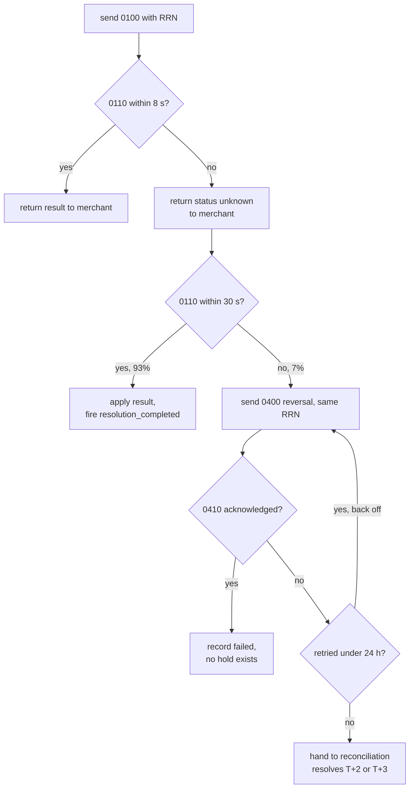

# The Timeout Problem: When You Do Not Know Whether Money Moved

This is the document the collection has been building toward. Every earlier document has gestured
at it: document 00 said there is no shared database between parties, document 03 said idempotency
solves the client's problem and not yours, document 04 insisted on an `unknown` state, document 05
set two timeouts instead of one. This is why.

The problem, stated as plainly as possible:

> **You sent an authorization request. You received no response. The issuer may have approved it.
> There is no synchronous way to find out.**

There is no clever architecture that eliminates this. There is only a set of mechanisms for
narrowing the window, resolving the ambiguity quickly, and bounding the damage while it lasts.
This document covers all three.

---

## Why this cannot be designed away

It is worth spending a moment on the impossibility, because engineers new to payments reliably
spend a week looking for the trick.

The authorization is an operation with an effect on two systems: Northwind Pay's database and
Meridian Bank's. For the pair to be consistent you would need an atomic commit across both, which
means a distributed transaction, which means Meridian Bank agreeing to hold a prepared
transaction open on Northwind Pay's behalf. No issuer will do that. There are tens of thousands of
issuers, no coordination protocol between them, and the whole arrangement is mediated by a network
that deliberately provides only request-response messaging.

So the authorization is, irreducibly, a **non-transactional side effect**. The canonical framing is
that you have an operation whose outcome is one of three values — succeeded, failed, unknown — and
the third is not an error condition to be eliminated but a legitimate outcome to be modelled. This
is the same shape as any remote call with at-most-once semantics, with one difference that makes
it sharper: **the side effect is visible to a third party who will complain about it**, namely the
cardholder looking at a hold on their statement.

---

## What the ambiguity actually costs

Make it concrete before solving it. A customer buys $47 of running shoes. The 0100 goes out. No
0110 comes back within 30 seconds.

**If Meridian approved and you record a failure:** the customer has a $47 hold they can see in
their banking app, for an order Harbour Athletics says failed. The hold will expire in seven days
without any money moving, but the customer does not know that. They will call Harbour Athletics,
who will say there is no order, and then they will call Meridian Bank, who will tell them there is
a pending charge from Harbour Athletics. The merchant looks incompetent, Northwind Pay generates a
support contact, and some fraction of these become disputes.

**If Meridian declined and you record an approval:** Harbour Athletics ships $47 of shoes. The
capture is submitted into the clearing file at 23:00. The next day the network rejects it, because
there is no matching authorization. The goods are gone and there is no money. This is
straightforwardly worse.

**If you retry the authorization blindly:** and the first one was approved, the customer now has
two $47 holds. Both will be visible. One will be captured and one will expire in seven days,
during which the customer has $94 of their credit line consumed for a $47 purchase. On a debit card
with a low balance that is a real hardship, and it is the single most common cause of the
complaint "your site charged me twice."

At Northwind Pay's scale, from document 05's derivation: about 1,380 transactions per day reach
the 30-second window unresolved. Each one of them is sitting on one of those three outcomes.

---

## Mechanism one: the reversal

The primary tool is the **reversal**, MTI 0400. Its semantics are precisely what you need:

> "Whatever you did with the authorization bearing this retrieval reference number — undo it. If
> you never had it, do nothing."

That second clause is the important one. A reversal is **idempotent and safe to send even if the
original never arrived**. The issuer looks up the RRN, finds a hold and releases it, or finds
nothing and acknowledges anyway. There is no state in which sending a reversal makes things worse.

This gives you a clean recovery for the ambiguous case:

```
send 0100
  → response within window     → proceed normally
  → no response within window  → send 0400 reversal for the same RRN
                                 → reversal acknowledged → the hold is gone (or never existed)
                                                            record the payment as failed, honestly
```

This is why document 05 insisted that the RRN is generated once and stored before the message goes
out. **The RRN is what makes the reversal possible.** If you cannot name the transaction you are
reversing, you cannot reverse it, and a system that generates the RRN inside the connector at send
time — rather than persisting it first — loses the ability to recover from a crash during send.

The reversal is the reason the honest answer to an ambiguous authorization is usually "failed"
rather than "unknown forever". You do not resolve the ambiguity by discovering what happened; you
resolve it by **forcing a known state**. You do not learn whether the hold existed. You make sure
it does not.

### When the reversal also times out

It happens. The issuer is down, not merely slow, and the 0400 gets no 0410.

The reversal is retried, with backoff, for an extended period — Northwind Pay retries a reversal
for **up to 24 hours** at increasing intervals, because unlike the authorization there is no
customer waiting and no cost to a redundant reversal. Each retry is cheap and idempotent.

If 24 hours of retries fail, the transaction is handed to reconciliation (document 10). The
clearing file will reveal whether the authorization existed, because an authorization that was
approved and never captured will appear in the issuer's records and can be identified through the
network's exception reporting. This path is slow — resolution in 2 to 3 days — and it is the
residual population that no amount of engineering removes. Northwind Pay's figure is roughly
**340 transactions per month** that reach reconciliation this way, out of 100 million. That is the
floor.

---

## Mechanism two: never abandon the in-flight request

Document 05 set the internal deadline at 8 seconds and the network window at 30. The reason
belongs here.

The merchant's request is answered at 8 seconds with `unknown`. **The 0100 is still outstanding.**
The connector is still holding the STAN correlation and is still listening. In 93% of cases the
response arrives between 8 and 30 seconds, and when it does:

- the payment transitions out of `unknown` to `authorized` or `failed`;
- a `payment.resolution_completed` webhook fires;
- the merchant, which has been told to wait, now knows.

The median time to resolution for this path at Northwind Pay is **4.2 seconds after the merchant
response**, because most slow issuer responses are slow by a few seconds, not by thirty.

The structure this requires is that **the thing waiting for the network response must not be the
thing serving the merchant's HTTP request**. If the response handler is a continuation of the
request handler, cancelling the request cancels the wait. So the connector owns the outstanding
request independently, keyed by STAN, with its own lifecycle, and the API layer merely subscribes
to the outcome with its own shorter deadline. This is a small structural decision made early that
determines whether you can do any of this at all.

---

## Mechanism three: bound what a merchant may do while unknown

While a payment is `unknown`, certain operations must be refused, because performing them could
make an already-bad situation worse.

**Capture must be refused.** Capturing an authorization that may not exist submits a clearing
record with no matching authorization, which the issuer rejects and which, if it does clear, is a
near-certain chargeback with reason code "no authorization". Northwind Pay returns
`422 payment_not_capturable` with a detail explaining that the payment's outcome is still being
established.

**Refund must be refused.** There is nothing to refund yet. A merchant trying to refund an
`unknown` payment is usually trying to "cancel" it, and the correct action is to wait for the
reversal to complete.

**Retry with a new payment should be discouraged but not blocked.** This is a judgement call.
Blocking it means a customer who wants to buy shoes cannot buy shoes until an unrelated system
recovers. Allowing it means a possible double hold. Northwind Pay allows it, returns a warning
field on the response, and the client libraries surface it to the merchant as guidance to offer
the customer the choice. The reasoning is that the merchant knows whether this customer is
standing at a till waiting.

---

## The decision tree, in full



Trace the volumes through it, using document 05's numbers for a year:

- 7,200,000 exceed the 8-second deadline and are told `unknown`
- 6,696,000 of those (93%) resolve from a late response, median 4.2 s later
- 504,000 go to reversal
- the large majority are acknowledged and recorded as honestly failed
- about 4,080 per year (340/month) exhaust 24 hours of reversal retries and go to reconciliation

So of 1.2 billion authorizations, **4,080 end the day in a genuinely unknown state** — a rate of
0.00034%. That is the achievable target, and it is not zero.

---

## The same problem, in the other three operations

The timeout problem is not unique to authorization. Each operation has its own version, and the
resolutions differ.

**Capture.** A capture timeout is far less dangerous, because capture is not an immediate
third-party effect — it is a record you include in a file at 23:00. If your capture call to an
internal service times out, you retry it, and the deduplication is your own (document 12). The
real ambiguity only arises if the clearing file submission itself is ambiguous, which is a batch
problem with a batch resolution: the network acknowledges files by identifier, and an
unacknowledged file is resubmitted. Document 09 covers it.

**Refund.** A refund timeout is dangerous in the same shape as authorization and with an extra
twist: there is no reversal for a refund. If you do not know whether a $19.99 refund was
submitted, you cannot un-submit it. The resolution is therefore purely reconciliation-based —
you wait for the clearing file to tell you whether the credit went out, and you do not retry
blindly. Northwind Pay holds ambiguous refunds in a `pending_verification` state and resolves them
from the next day's file. The alternative, retrying, double-refunds a customer, and a
double-refund is a direct loss to the merchant that is extremely hard to recover.

**Reversal.** Covered above: idempotent, retry freely.

The pattern worth extracting: **the safety of retrying an ambiguous operation depends entirely on
whether that operation has an idempotent undo.** Authorization does (the reversal), so you can
force a known state. Refund does not, so you must wait and observe. Before designing retry logic
for any new operation, ask that question first.

---

## What this means for the merchant's own system

A PSP cannot solve this for the merchant; it can only expose it honestly. The merchant's
integration must handle three outcomes, and the guidance Northwind Pay publishes is:

1. **On a definite success or definite failure**, proceed.
2. **On `unknown`**, do not ship, do not cancel the order, and do not charge again automatically.
   Mark the order as awaiting payment confirmation and wait for the webhook. Show the customer
   "we're confirming your payment" rather than either a success or a failure page.
3. **On a 5xx or a timeout from Northwind Pay itself**, retry with the same idempotency key
   (document 03). That is a different situation from `unknown` and the distinction must be clear
   in the documentation, because merchants conflate them constantly.

The third point is where most merchant-side bugs live. A merchant that retries an `unknown` with a
*new* idempotency key has converted a managed ambiguity into a probable double charge, and no
amount of correctness on your side prevents it. Northwind Pay's client libraries therefore make
the correct behaviour the default and the incorrect behaviour require explicit effort.

---

## What to take away

1. **The ambiguity is irreducible.** An authorization is a non-transactional side effect on a
   system that will never participate in a distributed transaction with you. Model `unknown` as an
   outcome, not an error.
2. **The reversal (0400) is the primary tool, and it is idempotent and always safe to send** —
   including when the original never arrived.
3. **You resolve the ambiguity by forcing a known state, not by discovering the truth.** You do
   not learn whether the hold existed; you ensure it does not.
4. **The RRN must be generated and persisted before the request goes out**, because it is the only
   handle by which a reversal can name the transaction.
5. **Stop making the merchant wait at 8 seconds; keep listening until 30.** 93% of slow responses
   land in that gap and resolve automatically with a median of 4.2 seconds.
6. **The connector must own the outstanding request independently of the HTTP handler**, or
   cancelling the merchant's request cancels your ability to recover.
7. **Refuse capture and refund while `unknown`.** A capture against a possibly-nonexistent
   authorization becomes an unwinnable chargeback.
8. **Retry a reversal for 24 hours; it is free.** What survives that goes to reconciliation and
   resolves in 2 to 3 days. At Northwind Pay that residue is about 340 transactions a month out of
   100 million.
9. **Whether an ambiguous operation may be retried depends on whether it has an idempotent undo.**
   Authorization has one. Refund does not, so ambiguous refunds wait for the clearing file rather
   than being retried.

Next: [07-3d-secure-and-the-async-interruption.md](07-3d-secure-and-the-async-interruption.md), on
what happens when the issuer wants to talk to the cardholder in the middle of your synchronous
flow.
