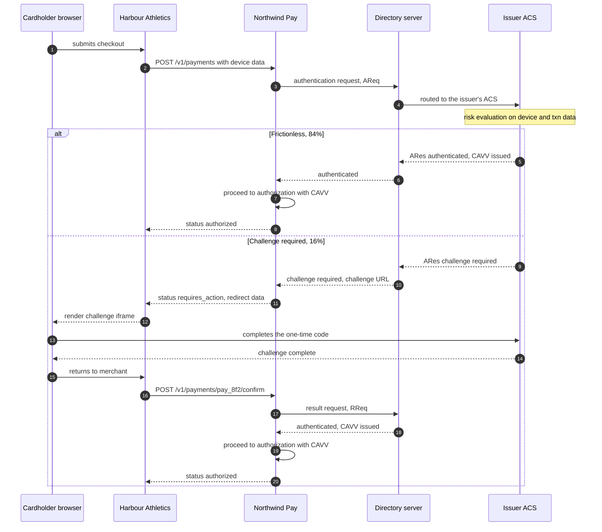
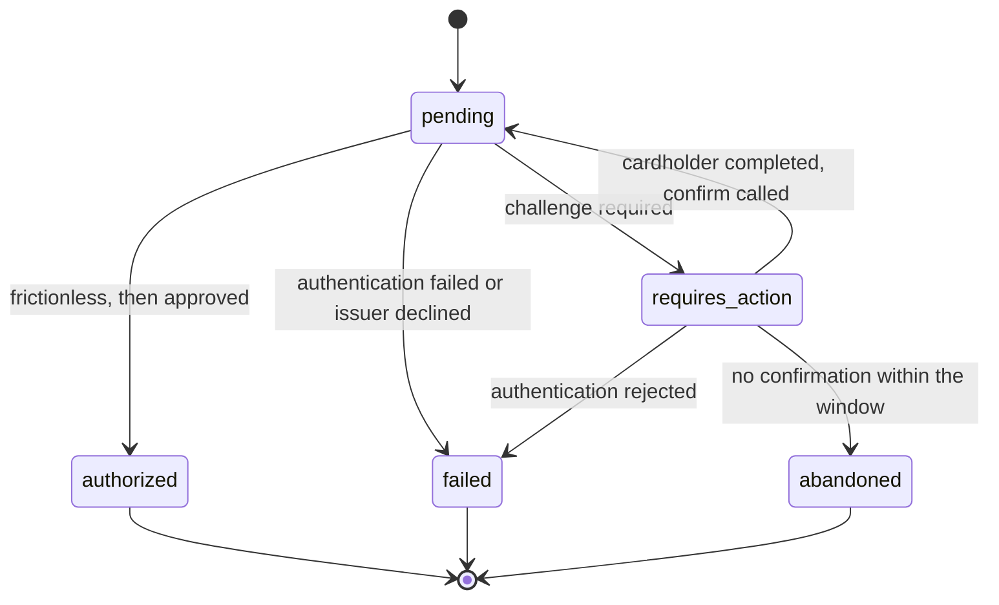

# 3-D Secure: When the Issuer Interrupts Your Synchronous Flow

Documents 01 through 06 described authorization as a question and an answer, possibly a slow
answer, possibly a missing answer, but always a two-message exchange that your backend conducts on
the merchant's behalf.

3-D Secure breaks that. It inserts a step in which **the issuer needs to talk to the cardholder
directly**, in their browser, while your API call waits. A backend-to-backend flow acquires a
human in the middle of it. That single structural change is responsible for most of the
complexity in modern card integrations, and for a specific class of lost revenue that merchants
blame on PSPs.

---

## Why this exists: the liability shift

Start with the commercial reason, because the technical design only makes sense in light of it.

Document 00 established that the card system is a pull, and that somebody absorbs the loss when
the pull is fraudulent. For card-not-present transactions, **the default is that the merchant
absorbs it.** If a stolen card number is used on Harbour Athletics' website, the cardholder
disputes, the issuer pulls the money back, and Harbour Athletics has lost both the goods and the
money. It has no defence, because it cannot prove the cardholder authorised anything.

3-D Secure changes who absorbs it. If the transaction is authenticated through 3-D Secure, the
**liability shifts to the issuer** for fraud-category disputes. The issuer verified the cardholder;
if that verification was wrong, that is the issuer's loss.

That is the whole point. Everything technical below is machinery for producing a cryptographic
proof that the issuer performed the verification.

The name, incidentally, means "three domains": the acquirer domain, the issuer domain, and the
interoperability domain between them. The current version is 3-D Secure 2, usually written 3DS2,
which replaced a widely disliked version 1 that redirected cardholders to a full-page bank form
and destroyed conversion rates. Consumers encountered version 1 under brand names like "Verified
by Visa" and "Mastercard SecureCode".

In Europe this stopped being optional. The revised Payment Services Directive, **PSD2**, mandates
**Strong Customer Authentication**, abbreviated SCA, for most electronic payments where both the
cardholder's bank and the merchant's acquirer are in the European Economic Area. Strong Customer
Authentication means two of three factors: something the cardholder knows (a password), has (a
phone), or is (a fingerprint). 3DS2 is how card payments satisfy it. A European transaction
without SCA and without a valid exemption is declined by the issuer with a soft-decline code,
typically `65` or `1A`.

---

## The flow, and where the interruption happens

3DS2's major improvement over version 1 is **frictionless authentication**. The merchant's page
collects a large amount of context — device fingerprint, browser characteristics, shipping address
history, transaction amount, the cardholder's prior relationship with this merchant — and sends it
to the issuer *before* any user interaction. The issuer evaluates that context with its own risk
model and, in the majority of cases, authenticates the cardholder without showing them anything.

At Northwind Pay, **84% of 3DS2 authentications are frictionless.** The remaining 16% go to a
*challenge*: the cardholder is shown something by their bank — a one-time code, an in-app
approval, a biometric prompt — and must complete it.

So there are two paths, and the merchant's integration must handle both.

Two new acronyms in that diagram, defined here:

- **ACS**, Access Control Server. The issuer's authentication service. Meridian Bank runs one, or
  rents one from a vendor.
- **CAVV**, Cardholder Authentication Verification Value. A cryptographic value produced by the
  ACS that proves the authentication occurred. It is carried in the subsequent authorization
  message, in ISO 8583 data element 126 or its network-specific equivalent, and **it is the thing
  that effects the liability shift**. An authorization sent without the CAVV from a completed
  authentication gets no liability shift, no matter that the authentication happened.

That last sentence is a real failure mode. A system that authenticates successfully, stores the
result, and then builds the authorization message from a code path that does not know about
authentication has paid the conversion cost of 3DS and received none of the benefit. It is
detectable only by auditing the outbound messages, which is why Northwind Pay asserts the presence
of the CAVV in a unit test against the message builder.

---

## What this does to your state machine

Document 04's state machine needs one more state, and it is not optional:

**`requires_action`** — the payment cannot proceed until the cardholder does something in their
browser. The payment is not authorized, not failed, and not pending in the sense of waiting for a
backend. It is waiting for a human.

The transitions:

`abandoned` is the state that costs merchants money and that most designs handle badly. The
cardholder was shown a challenge and never completed it — they closed the tab, the one-time code
did not arrive, the bank's app was not installed, the session expired. Northwind Pay's window for
completing a challenge is **15 minutes**, after which the payment is marked `abandoned` and any
reserved resources released.

The numbers matter here because they are the single largest conversion loss in European card
payments. Of the 16% of authentications that go to challenge, roughly **22% are never completed.**
So on a European merchant's traffic:

- 100 payment attempts
- 16 go to challenge
- 16 × 0.22 = 3.5 are abandoned at the challenge

**3.5% of attempted payments are lost to the challenge step**, before any decline. For Harbour
Athletics' European volume at an average ticket of $47, that is 0.035 × $47 = **$1.65 of lost
revenue per attempted payment**, which is larger than Northwind Pay's entire fee. A merchant that
understands this will push hard on exemptions, and that is the next section.

---

## Exemptions: how not to challenge

PSD2's mandate comes with exemptions, and using them well is a significant engineering
responsibility. Each exemption is *requested* by the acquirer in the authentication message, and
the issuer may accept or ignore it.

**Transaction Risk Analysis (TRA).** If the acquirer's fraud rate is below a threshold, it may
exempt low-value transactions from challenge. The thresholds are tiered by the acquirer's own
fraud rate:

| Acquirer fraud rate | Exemption permitted up to |
|---|---|
| below 0.13% | €100 |
| below 0.06% | €250 |
| below 0.01% | €500 |

Northwind Pay's European card-not-present fraud rate is **0.042%**, which places it in the middle
band and permits TRA exemptions up to €250. Note what this means structurally: **your fraud
performance is an input to your conversion rate.** Driving fraud down from 0.07% to 0.05% moves you
into a band that lets you skip challenges on transactions up to €250, which recovers a measurable
share of that 3.5% abandonment. Document 16 treats fraud as a control plane partly for this
reason.

**Low value.** Transactions under €30 may be exempted, but only up to five consecutive exempted
transactions or €100 cumulative since the last authentication — the issuer tracks the counter, not
you, so you must handle the decline when the counter trips.

**Merchant-initiated transactions (MIT).** A subscription renewal is not initiated by the
cardholder, so there is nobody to authenticate. These are out of scope for SCA provided the
*initial* transaction was authenticated and established a mandate. This is why a subscription's
first payment must go through 3DS even if subsequent ones do not, and why the initial
authentication's identifiers must be stored and referenced on every renewal. Losing that reference
means every renewal becomes a fresh SCA case with no cardholder present, which means it fails.

**Trusted beneficiary.** The cardholder told their bank to trust this merchant. You request it;
the issuer decides.

The practical engineering shape is an **exemption decision step** before the authentication
request: given the amount, the currency, the region, the merchant's category, the customer's
history and Northwind Pay's current fraud band, decide which exemption to request, if any.
Requesting an exemption the issuer refuses costs a round trip and results in a challenge anyway,
so the decision is a genuine optimisation problem and Northwind Pay runs it as a scored policy
rather than a hardcoded rule set.

---

## The soft decline you must handle

Here is a case that catches every team once.

Northwind Pay requests a TRA exemption on a €180 transaction. The issuer declines the
authorization with response code `65`, "exceeds withdrawal frequency limit", or the newer `1A`,
"strong customer authentication required". This is **not a decline of the card**. It is the issuer
saying "I will not approve this without authentication; come back with 3DS."

The correct handling is to **step up**: run the 3DS authentication that was skipped, then retry the
authorization with the resulting CAVV. Done properly this recovers the payment.

Done improperly — treating `65` or `1A` as a terminal decline and showing the customer "your card
was declined" — loses the sale outright and, worse, tells the customer something false about their
card. Northwind Pay's internal classification explicitly separates `soft_decline_sca_required`
from every other decline class for this reason, and the step-up is automatic rather than left to
the merchant.

This also interacts with document 03's idempotency. The step-up produces a second authorization
attempt for the same logical payment. It must not consume a new idempotency key from the merchant's
perspective — the merchant made one attempt — so the step-up is an internal retry within the same
idempotent operation, and the payment object accumulates two authorization attempt records while
presenting a single lifecycle to the merchant.

---

## Where the data comes from, and why the merchant must participate

The frictionless rate depends on the quality of the data in the authentication request. The ACS
has nothing to evaluate if all it receives is a card number and an amount, so it challenges.

The data that moves the frictionless rate most, in Northwind Pay's measurements:

- **Device fingerprint**, collected by a JavaScript snippet the merchant must embed. Without it,
  the frictionless rate drops from 84% to around 51%.
- **Billing and shipping address**, including whether they match.
- **Cardholder email and phone**, which the ACS can match against its own records.
- **Account age and prior transaction history with this merchant.**
- **A recognised device**, from the cardholder having been authenticated on it before.

This is the awkward part of the merchant relationship: **the merchant's integration quality
directly determines its own conversion rate**, through a mechanism the merchant cannot see. A
merchant that skipped the device-fingerprinting snippet sees a challenge rate three times higher
than a merchant that included it, and will attribute the resulting abandonment to Northwind Pay.

The design response is to make the snippet part of the standard client library rather than an
optional add-on, and to report challenge rate and abandonment to merchants as a first-class
dashboard metric with the diagnosis attached. Document 18 covers that reporting.

---

## What to take away

1. **3-D Secure exists to shift fraud liability from the merchant to the issuer.** All of the
   technical machinery is a mechanism for producing proof that the issuer verified the cardholder.
2. **It inserts a human into a backend flow.** That is the structural change, and it forces a
   `requires_action` state that is neither pending nor failed.
3. **The CAVV is the proof, and it must reach the authorization message.** Authenticating and then
   building the authorization without the CAVV pays the cost and gets no benefit — assert it in a
   test.
4. **84% frictionless, 16% challenged, and 22% of challenges are abandoned**, so about 3.5% of
   attempted payments are lost at this step before any decline. That is larger than the processing
   fee.
5. **`abandoned` needs its own state and a window** — 15 minutes at Northwind Pay — because a
   challenge that is never completed is not a failure and not a pending payment.
6. **Your own fraud rate determines which exemptions you may claim.** Below 0.06% permits €250
   exemptions; below 0.13% permits €100. Fraud performance is an input to conversion.
7. **A subscription's first payment must be authenticated and its identifiers stored**, or every
   renewal becomes an SCA case with no cardholder present to authenticate.
8. **Response codes `65` and `1A` are instructions to step up, not declines.** Treating them as
   declines loses the sale and misinforms the customer.
9. **The merchant's own integration quality drives its challenge rate**, via device data it must
   collect. Make it part of the default client library, and report the consequence back to them.

Next: [08-the-ledger.md](08-the-ledger.md), where the collection turns from moving messages to
keeping books.
