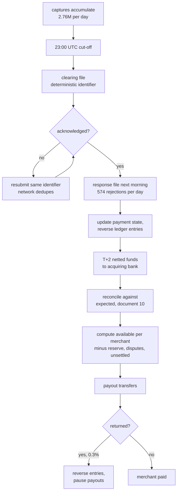

# Settlement, Payouts, Reserves and Negative Balances

Document 01 established that settlement and payout are different stages on different clocks.
Document 08 built the ledger that tracks them. This document is the machinery in between: how the
day's captures become a file, how the file becomes money in a bank account, and how that pooled
money becomes 40,000 individual transfers.

It also covers the uncomfortable part that most designs defer until a merchant goes bad: reserves,
negative balances, and what you do when you have already paid out money you now need back.

---

## The clearing file: what you submit and what comes back

At 23:00 UTC, Northwind Pay closes the day's capture batch. Every capture recorded since the
previous cut-off is assembled into a clearing file per network, per acquiring region.

The volume: 1,047,600,000 approved payments a year, of which about 96% are captured, gives
1,047,600,000 × 0.96 = 1,005,696,000 captures a year, or 1,005,696,000 ÷ 365 ≈ **2.76 million
capture records per day**, split across two networks and three regions. Add refunds — Northwind
Pay's refund rate is 4.1% of captures, so about 113,000 refund records a day — and the daily file
set is on the order of 2.87 million records.

The file formats are network-specific and unpleasant: Visa's is called the Base II / VSS format,
Mastercard's the IPM (Integrated Product Message) format. Both are fixed-width or TLV-encoded
records with network-defined fields, and both have validation rules that reject the whole file on
certain structural errors and individual records on others.

Three operational properties shape the design.

**Submission is acknowledged by file identifier, not by record.** You submit `NP-VISA-USE-20261111-01`
and receive an acknowledgement for that file. If you do not receive one, you must decide whether
to resubmit — and resubmitting a file the network already accepted double-charges every customer
in it. This is document 06's timeout problem at batch scale, with a much larger blast radius.

The resolution is that **file identifiers are deterministic and the network will reject a duplicate
identifier**. Northwind Pay constructs the identifier from region, network, business date and
sequence, never from a timestamp or a random value, so a resubmission of the same logical batch
carries the same identifier and is rejected as a duplicate rather than accepted as new volume. The
rule generalises: *any batch submission to an external party must have a deterministic identifier
that the party will deduplicate on.* A random file name turns an ambiguous submission into an
unrecoverable one.

**The response file reports per-record rejections.** The next morning a response file arrives
listing records the network refused — malformed data, an amount mismatch against the authorization,
a merchant identifier the network does not recognise, a late capture past the validity window.
Northwind Pay's rejection rate is about 0.02% of records, which is 2,870,000 × 0.0002 ≈ **574
rejected records per day**. Each one is a capture the merchant believes succeeded and which is not
going to settle.

Those rejections must flow back into the payment state machine (document 04) as
`capture.state = failed`, must trigger a `payment.capture_failed` webhook, and must reverse the
ledger entries posted at capture. A design that submits the file and does not consume the response
file leaves 574 payments a day permanently wrong — showing as succeeded, with ledger entries
asserting money that will never arrive.

**The business date is not the calendar date.** The 23:00 UTC cut-off means a capture at 23:30 on
Tuesday belongs to Wednesday's business date. Every financial report, every merchant statement,
and every reconciliation must use the business date, and the mapping from timestamp to business
date must exist in exactly one place in the codebase. Northwind Pay has had one incident caused by
two services disagreeing about which day a late-evening capture belonged to, which produced a
one-day population of unmatched records that took a week to unpick.

---

## Settlement: the money arrives

Two business days after clearing, funds arrive in the acquiring bank account. What arrives is a
**single netted amount per network per region per currency**, as document 01 described.

What you receive is therefore one figure, say $40,117,882.14, against an expectation you computed
from your own ledger. The two will not match, and the differences are predictable:

- **Interchange and assessment fees** have been deducted (for net settlement arrangements).
- **Chargebacks and representments** processed that day are netted in.
- **Network adjustments** — fee rebates, incentive credits, corrections from prior days — appear.
- **Rejected records** from the response file are absent.
- **FX** has been applied on cross-currency items at the network's rate, which may differ by a
  small amount from the rate you estimated.

Each of those is accounted for by a ledger entry, and the residual after accounting for all of
them is the reconciliation break that document 10 works. Northwind Pay's target is that the
unexplained residual on a daily settlement is **under 0.001% of the settled amount**, which on $40
million is $400 — and anything above that is investigated before the day is closed.

The ledger entries at settlement, for a clean day:

| Account | Direction | Amount |
|---|---|---|
| `acquiring_bank:us_east` | debit | +4,011,788,214 |
| `network_receivable:visa` | credit | −4,118,740,000 |
| `interchange_expense` | debit | +95,631,786 |
| `network_assessment_expense` | debit | +11,320,000 |

Sum: 4,011,788,214 − 4,118,740,000 + 95,631,786 + 11,320,000 = **0**. The receivable that was
built up by two days of captures is cleared, the bank account increases, and the fees Northwind
Pay actually paid are recognised as expense.

---

## Payout: from a pooled account to 40,000 merchants

The acquiring bank account now holds money belonging to many merchants, commingled. The
attribution lives only in Northwind Pay's ledger. Payout turns that attribution into real
transfers.

### What is actually available to pay out

This is the computation that matters, and getting it wrong in either direction is expensive. For
each merchant:

```
available = merchant_payable_balance
          − amount_held_for_reserve
          − amount_held_for_open_disputes
          − amount_held_pending_risk_review
          − amount_not_yet_settled
```

That last term is easy to miss and important. A capture from this morning has increased the
merchant's payable balance in the ledger, but the money has not arrived from the network and will
not for two business days. Paying it out immediately means Northwind Pay is funding the merchant
from its own working capital. Some PSPs do exactly that as a product — "instant payouts" — and
charge for it, because it is a credit product with credit risk, not a technical feature. If you
offer it, it must be a deliberate decision with underwriting attached, not an accident of
computing `available` from the payable balance alone.

### The payout cycle

Harbour Athletics is on a daily schedule with a 2-day rolling delay. At 06:00 local time:

1. Compute `available` as above, as of the previous business date.
2. If it exceeds the minimum payout threshold ($5 for most merchants, to avoid paying bank fees on
   trivial amounts), create a payout record.
3. Post the ledger entries: debit `merchant_payable:harbour_athletics`, credit
   `acquiring_bank:us_east`.
4. Submit the transfer — ACH in the US, SEPA in Europe, local rails elsewhere.
5. Track the transfer to completion, because it can fail.

Step 5 is the one that is routinely under-built. An ACH transfer can be **returned** days later —
the account is closed, the details are wrong, the account holder name does not match. Northwind
Pay's payout return rate is about 0.3%, and with 40,000 merchants on mostly daily schedules that
is roughly 40,000 × 0.3% ≈ **120 returned payouts per day**.

A returned payout must reverse its ledger entries — restoring the merchant's payable balance — and
must put the merchant into a state where payouts are paused until the bank details are corrected.
A system that does not consume return notifications shows the merchant as paid while the money sat
back in the pooled account, and the merchant's balance is understated by the amount of the return.

---

## Reserves: holding back money on purpose

Document 00 established why: the acquirer carries the risk that the merchant does not deliver. A
reserve is how that risk is funded.

Three structures, used for different risk profiles:

**Rolling reserve.** A percentage of each day's volume is held for a fixed period, then released.
Harbour Athletics, as an established merchant, has none. A newly onboarded merchant in a
high-risk category — travel, ticketing, subscription boxes, anything where goods are delivered
long after payment — might have a 10% rolling reserve with a 90-day hold. The mechanics: each
day, 10% of captured volume is moved from `merchant_payable` to `merchant_reserve` by a ledger
transaction, and each day the reserve from 90 days ago is moved back.

**Fixed reserve.** A flat amount held from the start, often funded by holding back early volume
until the target is reached. Used where the exposure is bounded and known.

**Capped reserve.** A rolling reserve that stops accumulating once a ceiling is reached.

The sizing logic follows from the exposure, and it is worth deriving rather than guessing. A
travel merchant selling flights for travel 120 days out has a worst case where it fails today, and
every customer who has paid for a flight not yet taken disputes. The exposure is therefore
**the total value of undelivered goods**, which for that merchant is roughly 120 days of volume.
A 10% rolling reserve against 120 days of exposure covers 10% of the loss. Nobody holds 100%, so
reserves are a partial mitigation and the rest is underwriting judgement — which is why merchant
risk teams exist and why engineering's job is to make the reserve mechanism flexible rather than to
choose the numbers.

---

## Negative balances: when you have already paid it out

Here is the situation the whole reserve apparatus exists to avoid, and which nonetheless happens.

Harbour Athletics' balance is $2,400. Overnight, $11,000 of disputes arrive — a card-testing attack
hit their checkout two weeks ago and the fraudulent charges are now being disputed en masse. The
merchant's payable balance goes to **−$8,600**.

That negative number is real. The money has been paid out and spent. The disputed amounts will be
pulled back from Northwind Pay by the issuers regardless of whether Harbour Athletics has the
funds. **Northwind Pay is now exposed for $8,600**, and the ledger must say so honestly: the
balance moves from `merchant_payable` (a liability) to `merchant_receivable` (an asset — money
owed to Northwind Pay), because the sign has flipped and so has the nature of the relationship.

The recovery sequence, in order of preference:

1. **Offset against future volume.** The merchant keeps trading; incoming captures pay down the
   negative balance before any payout resumes. This works if the merchant is viable and the
   negative balance is small relative to its volume. Harbour Athletics at $340,000 a month of
   volume clears $8,600 in a day.
2. **Debit the merchant's bank account.** Most PSP agreements permit a reverse ACH. It works
   maybe half the time; the account may be empty or closed.
3. **Draw the reserve**, if there is one.
4. **Write it off** to `dispute_loss`, and pursue collection commercially.

Two engineering requirements fall out of this, and both are commonly missing.

**Payouts must be blocked atomically with the balance going negative.** If the dispute batch posts
at 05:58 and the payout job runs at 06:00, the payout job must see the new balance. A payout job
reading a snapshot from the previous close, without the subsequent entries, will pay out money
that is already owed back — which is document 08's rule three, with a concrete price attached.

**The negative balance must be visible to the merchant immediately and explicably.** Harbour
Athletics' dashboard must show the balance, the disputes that caused it, and what happens next. A
merchant who discovers a negative balance when a payout silently fails will escalate, and the
support conversation is much worse when the system cannot itemise the cause. This is document 08's
"the system must explain itself" requirement in its most pointed form.

---

## Gross versus net settlement

One structural choice affects the whole ledger, and it is worth understanding before you pick.

**Net settlement.** Fees are deducted before the merchant's balance is credited. Harbour Athletics'
$47 capture credits $45.34. Simple, and what most small merchants expect.

**Gross settlement with separate fee billing.** The full $47 credits the merchant's balance, and
fees are accumulated separately and invoiced monthly. Large merchants prefer this because it makes
their revenue reporting match their card volume, and because they negotiate fees and want to see
them as a line item rather than embedded in every transaction.

The engineering difference is not trivial. Under gross settlement you must:

- accumulate fees in a separate account per merchant, which becomes a receivable;
- produce an invoice, with its own payment lifecycle and its own dunning when unpaid;
- handle the case where a merchant disputes the invoice while continuing to trade;
- track a second balance per merchant, which support, reporting and the dashboard must all
  understand.

Northwind Pay supports both, with gross settlement for merchants above $1M of annual volume. If
you are designing fresh, start with net and add gross only when a commercial need forces it,
because the second balance propagates into every merchant-facing surface.

---

## The whole flow



---

## What to take away

1. **A batch submitted to an external party must carry a deterministic identifier that the party
   deduplicates on.** A random file name turns an ambiguous submission into an unrecoverable one,
   with every customer in the file at risk of a double charge.
2. **Consume the response file.** 574 records a day are rejected at Northwind Pay; without
   processing them, 574 payments a day show as succeeded with ledger entries asserting money that
   will never arrive.
3. **The business date is not the calendar date**, and the mapping must live in exactly one place.
4. **Settlement delivers one netted figure, and it will not match your expectation.** Interchange,
   disputes, adjustments, rejections and FX account for the difference; the residual is the
   reconciliation break, targeted below 0.001% of settled value.
5. **`available` is not the payable balance.** Subtract reserves, open disputes, risk holds and —
   especially — amounts not yet settled, or you are extending credit without deciding to.
6. **Payouts fail after the fact.** 0.3% are returned; without consuming returns, the merchant
   shows as paid and their balance is understated.
7. **Reserves are sized from the exposure**, which for merchants delivering goods late is the
   value of everything undelivered. Make the mechanism flexible; let the risk team choose the
   numbers.
8. **Negative balances are real and must flip from liability to receivable in the ledger.**
   Blocking payouts must be atomic with the balance going negative, or you pay out money already
   owed back.
9. **Gross settlement adds a second balance per merchant** and propagates into every merchant-
   facing surface. Start with net settlement unless a commercial requirement forces otherwise.

Next: [10-reconciliation.md](10-reconciliation.md), on establishing truth between three parties
who each keep their own books.
