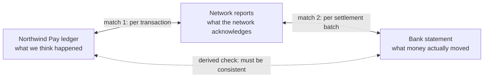

# Reconciliation: Establishing Truth Between Parties Who Disagree

Document 00 made the claim that reconciliation is not an operational chore bolted on at the end
but the mechanism by which truth is established at all. This document makes good on that claim.

The structure here is simple to state and demanding to implement: you hold three records of the
same events, produced by three organisations, and you must find and resolve every place they
disagree. In a system that moves other people's money across organisational boundaries with no
shared database, **this process is the only thing standing between you and a slowly accumulating
error you cannot detect.**

---

## Why you cannot skip it, stated concretely

Consider a Northwind Pay without reconciliation. Every component works. Captures are recorded,
files are submitted, settlements arrive, payouts go out, and the ledger balances internally
because document 08's constraint enforces it.

Now introduce one bug: a race in the refund path, present in 0.003% of refunds, that posts the
ledger entries twice. Northwind Pay processes 1,005,696,000 × 0.041 ≈ 41.2 million refunds a year,
so the bug fires 41,200,000 × 0.00003 ≈ **1,236 times a year**, at an average of $47, for about
$58,000 of merchant balances credited twice.

Nothing detects it. The ledger balances — both duplicate entries are internally consistent. The
payment state machine is happy. No alert fires. The money is paid out to merchants, and the first
signal is that Northwind Pay's bank account runs lower than the ledger says it should, by an
amount that accumulates at $58,000 a year and is attributable to nothing in particular.

**Internal consistency does not detect internal bugs.** It cannot, by construction: a bug that
posts a balanced pair of entries twice produces two internally consistent states. The only thing
that catches it is comparison against an *external* record of the same events, and that is what
reconciliation is.

---

## The three records

**Record one: your ledger.** What Northwind Pay believes happened, from document 08. Authoritative
for Northwind Pay's own actions, and the only one of the three that is under your control.

**Record two: the network's clearing and settlement reports.** What Visa and Mastercard
acknowledge, per record and in aggregate. Delivered daily as files. Authoritative for what will
actually be funded.

**Record three: the bank statement.** What money genuinely arrived in or left the acquiring bank
account. Delivered daily, usually as a BAI2 or MT940 file, or increasingly through a bank API.
Authoritative for reality — this one is the ground truth, because it is the only record that
describes money rather than intentions about money.

The reconciliation runs as two separate matches, not one, and conflating them hides errors:



**Match one is per transaction.** Every capture in your ledger should appear in the network's
clearing report, with the same amount, the same RRN and the same business date. This match catches
record-level problems: a capture you think cleared that did not, a record the network has that you
do not, an amount difference.

**Match two is per batch.** The total the network says it is funding should equal the amount that
arrives in the bank account. This match catches funding-level problems: a settlement that did not
arrive, a partial transfer, an adjustment nobody told you about.

Doing both separately is what makes a break diagnosable. If you only compared the ledger against
the bank, a mismatch could be caused by anything between them and you would have no way to
localise it.

---

## Matching, and why exact matching is not enough

The naive match is a join on a shared key. The RRN from document 05 is exactly that key, and for
the large majority of records it works: 2.76 million captures a day join cleanly to 2.76 million
clearing records.

Northwind Pay's first-pass exact match rate is **99.4%**. The remaining 0.6% is 2,760,000 × 0.006 ≈
**16,560 records a day** that do not match exactly, and the whole discipline of reconciliation is
in how you handle them.

They fall into categories, and each category gets its own rule.

**Timing differences.** Your capture is dated Tuesday's business date; the network reported it on
Wednesday's. Nothing is wrong. The rule is to match within a tolerance window — Northwind Pay
matches across a ±2 business-day window before declaring a record unmatched — and to track the
timing-difference population separately, because a sudden growth in it indicates a cut-off problem
rather than a correctness problem.

**Partial-capture amount differences.** You authorized $47 and captured $23. The network's record
is for $23, which matches your capture but not your authorization. A match keyed on the
authorization amount will fail. The rule is to match captures to clearing records, never
authorizations to clearing records, which sounds obvious and is a real implementation error
because the authorization is the record that carries the RRN most prominently.

**Fee and FX rounding.** A cross-border record differs by one or two minor units because the
network's FX rate was applied at a different precision than your estimate. The rule is a tolerance
— Northwind Pay tolerates up to 2 minor units per record, posting the difference to `fx_gain_loss`
— with the aggregate of tolerated differences monitored. A tolerance is safe only if you measure
how much it absorbs; a one-cent tolerance across 2.76 million daily records can absorb $27,600 a
day of real error if the differences are systematically in one direction. Northwind Pay's monitor
alerts if the tolerated differences are more than 70% one-directional, which is the signature of a
systematic bug rather than rounding noise.

**Records the network has that you do not.** The dangerous category. This means a transaction
cleared that your system has no record of — which can mean a capture submitted by a process whose
ledger write failed, or, in the worst case, a transaction you did not originate. These are never
auto-matched. Every one goes to a human.

**Records you have that the network does not.** Usually a rejected record whose response-file
processing failed (document 09), or a capture submitted into a file that was never actually
transmitted. Also never auto-matched.

---

## The break workflow

An unmatched record, after all the automated rules have run, is a **break**. Breaks are work items
with a lifecycle, and treating them as anything less — a log line, a dashboard count, an email —
means they do not get resolved.

```sql
CREATE TABLE reconciliation_breaks (
  id               BIGSERIAL PRIMARY KEY,
  business_date    DATE        NOT NULL,
  break_type       TEXT        NOT NULL,
  severity         TEXT        NOT NULL,   -- critical | high | normal
  amount_minor     BIGINT,
  currency         CHAR(3),
  ledger_ref       TEXT,
  network_ref      TEXT,
  bank_ref         TEXT,
  state            TEXT        NOT NULL,   -- open | investigating | resolved | written_off
  assigned_to      TEXT,
  resolution_note  TEXT,
  resolution_entry UUID,                   -- the ledger transaction that fixed it
  created_at       TIMESTAMPTZ NOT NULL DEFAULT now(),
  resolved_at      TIMESTAMPTZ
);
```

Two fields in there carry the weight.

**`resolution_entry`** links the break to the ledger transaction that resolved it. Every resolved
break that involved a real discrepancy must have posted entries — a correction, a write-off, an
adjustment. A break resolved with no ledger entry and a note saying "investigated, no action
needed" is acceptable only for timing differences, and Northwind Pay's process requires the break
type to justify an empty resolution entry. Otherwise breaks get closed by someone clearing a
queue, and the discrepancy survives.

**`severity`** drives the response time, and the thresholds are a policy decision that should be
written down. Northwind Pay's:

| Severity | Criteria | Target resolution |
|---|---|---|
| Critical | Over $10,000, or a record the network has that we do not | Same business day |
| High | $500 to $10,000, or affecting more than 50 records | 2 business days |
| Normal | Under $500 | 5 business days |

### Breaks are a managed population, not an exception

This is the mindset shift that matters, and document 00 flagged it. A mature payment system has
open breaks at all times. The questions that matter are not "are there any" but:

- **Is the open population stable or growing?** A stable 400 open breaks is a working process. A
  population growing by 30 a day is a bug nobody has found.
- **Is the aged population bounded?** Northwind Pay's rule is zero breaks older than 30 days, with
  anything approaching it escalated. A break that has been open for three months will never be
  resolved, because the people and records needed to resolve it have moved on.
- **What is the total unresolved value?** Expressed as a fraction of daily volume, this is the
  number an auditor asks for. Northwind Pay targets under 0.002% of settled value, which on $130
  million of daily settlement is about $2,600.

Those three metrics are the actual health indicators for the correctness of the entire system, and
they belong on the same dashboard as availability and latency. Document 18 covers that.

---

## What the daily close looks like

The reconciliation runs as a pipeline after the previous business date's files are complete,
typically at 09:00 UTC when both the network response files and the bank statement have arrived.

1. **Ingest.** Load the network clearing report, the network settlement advice and the bank
   statement into staging tables, keyed by business date. Each file's arrival is itself monitored —
   a bank statement that does not arrive is an incident, because you cannot close the day without
   it.
2. **Normalise.** Convert each source into a common record shape: reference, amount in minor units,
   currency, business date, type. This is where format-specific parsing lives, and it is the only
   place that knows what a Base II record looks like.
3. **Match one.** Ledger captures and refunds against network clearing records, exact first, then
   the tolerance rules.
4. **Match two.** Network settlement totals against bank statement credits.
5. **Classify** the residue into break types.
6. **Auto-resolve** what the rules permit, posting any required ledger entries.
7. **Create breaks** for the rest, assigned by type and severity.
8. **Post the day's adjustments** — tolerated FX differences, known network adjustments.
9. **Assert the close.** Compute whether the day's ledger movement equals the day's bank movement
   plus the day's known-but-unsettled receivables. If it does not, within the break tolerance, the
   day does not close and someone is paged.

Step 9 is the point of all of it. **"The day closed" is a specific, checkable assertion**, not a
feeling. Northwind Pay's close assertion is:

```
opening_bank_balance
  + settlements_received
  − payouts_sent
  − fees_paid
  = closing_bank_balance   (from the statement, not computed)
```

and separately,

```
sum(all ledger entries for the business date) = 0        (always, by construction)
sum(asset accounts) − sum(liability accounts) − sum(equity) = 0
```

The first assertion is the one that can fail, because it compares your records against the bank's.
When it fails by more than the break tolerance, the business date stays open and the on-call
finance engineer is paged. Northwind Pay closes on time about 97% of business days; the other 3%
are usually a late file rather than a real discrepancy.

---

## Reconciling the things people forget

Four reconciliations beyond the main one, each of which has caught a real bug at some point.

**Payouts against bank debits.** Did every payout you recorded actually leave the bank account,
for the amount you recorded? Catches returned payouts whose notifications were missed (document
09) and payouts submitted twice.

**Disputes against network dispute advices.** Did every chargeback you recorded correspond to a
network advice, and vice versa? Catches disputes processed from a stale file, and disputes the
network raised that your ingestion dropped.

**The authorization memo accounts.** Document 08 put authorizations into memo accounts that must
net to zero over a complete lifecycle. A non-zero residue older than the 7-day validity window
means the expiry job is not running correctly. This one is purely internal and still worth doing,
because it is a cheap, sharp signal.

**Fee calculations against the network's fee reports.** The networks publish what they actually
charged. Comparing that to what you computed catches fee-schedule drift, which is a slow leak
rather than a sudden break — and because it affects margin rather than merchant balances, nothing
else will surface it. Northwind Pay found a mis-tiered interchange category this way that had been
costing roughly $31,000 a month for seven months.

---

## Designing for reconcilability

The practical advice, which is mostly about decisions made elsewhere in the system:

**Carry one identifier end to end.** The RRN from document 05 must appear on the authorization, the
capture, the clearing record, the settlement detail and any dispute. Every point where a new
identifier is generated instead of a existing one being carried forward is a point where matching
becomes heuristic.

**Record what you sent, not just what you intended.** Northwind Pay stores the actual submitted
clearing record bytes, hashed and retained for 400 days. When a break says the network has an
amount you disagree with, the question "what did we actually send?" must be answerable from data,
not reconstructed from code.

**Make business date explicit on every financial row.** Deriving it at reconciliation time from a
timestamp means the derivation can differ from the one used at submission.

**Never let a reconciliation rule silently widen.** A tolerance is a deliberate acceptance of a
bounded error, and both the bound and the absorbed total must be monitored. The failure mode is a
tolerance introduced to clear a backlog that then absorbs a genuine bug for a year.

---

## What to take away

1. **Internal consistency cannot detect internal bugs.** A balanced pair of entries posted twice is
   internally consistent. Only comparison against an external record catches it.
2. **There are three records and two matches.** Ledger against network per transaction, network
   against bank per batch. Comparing only ledger to bank makes breaks undiagnosable.
3. **Exact matching gets you 99.4%.** The remaining 16,560 daily records are the entire discipline,
   and each category — timing, partial capture, FX rounding, missing on either side — needs its own
   rule.
4. **Match captures to clearing records, never authorizations.** Partial captures break an
   authorization-keyed match.
5. **A tolerance is only safe if you measure what it absorbs.** Monitor the directional bias; more
   than 70% one way is a systematic bug wearing rounding's clothes.
6. **Records the network has that you do not are never auto-matched.** Every one goes to a human.
7. **Breaks are work items with a lifecycle and a link to the ledger entry that resolved them**,
   not a dashboard count. A break closed with no entry and no justification leaves the discrepancy
   in place.
8. **Open breaks are a managed population.** Track stability, age (zero over 30 days) and total
   unresolved value (under 0.002% of settled value). Those are correctness SLIs.
9. **"The day closed" is a checkable assertion against the bank statement**, and when it fails the
   day stays open and someone is paged.
10. **Carry one identifier end to end and store what you actually sent.** Every regenerated
    identifier makes matching heuristic; every unstored submission makes a break unanswerable.

Next: [11-declines-and-retries.md](11-declines-and-retries.md), which turns to the commercial side
of failure — what to do when the issuer says no.
