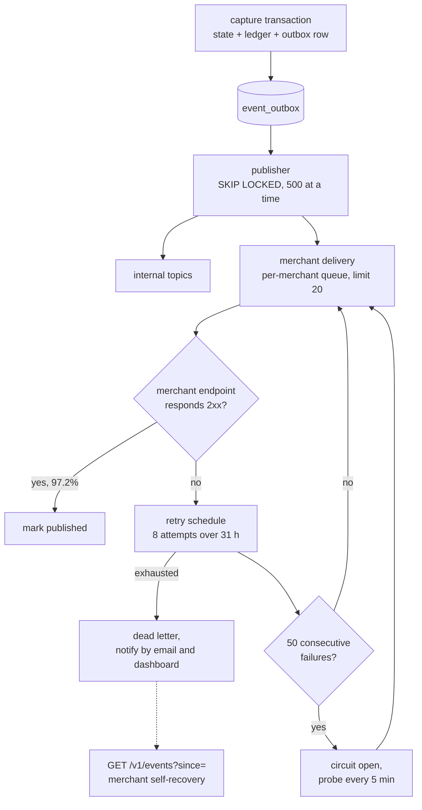

# Exactly-Once Is a Lie: The Outbox, and Delivering Events to Merchants

Document 04 established that events are the merchant's real interface to payment state. This
document is about getting those events out of your database and into the merchant's system, which
is a distributed systems problem with a specific financial consequence: a merchant that misses a
`payment.capture_succeeded` does not ship the order, and a merchant that processes a
`refund.succeeded` twice refunds twice.

The framing to start from, because it saves a great deal of wasted effort: **exactly-once delivery
does not exist.** What exists is at-least-once delivery plus idempotent consumption, and the design
below is about making that combination reliable and making the idempotent consumption easy for the
merchant.

---

## The bug that this entire document prevents

Here is the naive implementation, which almost every system writes first:

```python
def capture(payment_id, amount):
    with db.transaction():
        capture = insert_capture(payment_id, amount)
        post_ledger_entries(capture)
        update_payment_status(payment_id)
    send_webhook("payment.capture_succeeded", capture)   # outside the transaction
```

Two failure modes, and they are opposites.

**Move the webhook inside the transaction** and a slow merchant endpoint holds a database
transaction open for the duration of an HTTP call to a third party. At 9,000 transactions per
second with a merchant whose endpoint takes 4 seconds, you exhaust the connection pool and the
entire payment system stops. This is not hypothetical; it is the single most common way a webhook
implementation takes down the system it belongs to.

**Leave the webhook outside the transaction**, as written above, and the process can die between
the commit and the send. The capture exists, the money is committed, and the merchant is never
told. Harbour Athletics' order sits unshipped until a human notices.

At Northwind Pay's volume, "the process can die" is not a rare event. With roughly 2,000 service
instances and ordinary deploy and scaling churn, instances terminate thousands of times a day. Even
a one-in-fifty-thousand chance per capture of dying in that window, across 1,005,696,000 captures a
year, is 1,005,696,000 ÷ 50,000 ≈ **20,000 lost events a year** — 55 a day, each one an order
nobody shipped.

The two failure modes come from the same root: **the state change and the notification are in
different systems, and you cannot write to both atomically.** That is the problem the outbox solves.

---

## The transactional outbox

The move is to make the notification a *database write in the same transaction as the state
change*, and have a separate process do the sending.

```sql
CREATE TABLE event_outbox (
  id              BIGSERIAL PRIMARY KEY,
  merchant_id     BIGINT      NOT NULL,
  event_type      TEXT        NOT NULL,
  payload         JSONB       NOT NULL,
  aggregate_type  TEXT        NOT NULL,   -- payment | refund | dispute | payout
  aggregate_id    TEXT        NOT NULL,
  sequence        BIGINT      NOT NULL,   -- per aggregate, document 04
  created_at      TIMESTAMPTZ NOT NULL DEFAULT now(),
  published_at    TIMESTAMPTZ
);

CREATE INDEX ON event_outbox (published_at) WHERE published_at IS NULL;
```

And the handler becomes:

```python
def capture(payment_id, amount):
    with db.transaction():
        capture = insert_capture(payment_id, amount)
        post_ledger_entries(capture)
        update_payment_status(payment_id)
        insert_outbox_event("payment.capture_succeeded", capture)   # same transaction
    # nothing else here
```

Now the guarantee is clean. If the transaction commits, the event exists. If it rolls back,
neither the capture nor the event exists. **There is no window.** The commit is the single point at
which both facts become true together.

The partial index on `published_at IS NULL` matters at this volume: the table accumulates billions
of rows, and the publisher's query is "give me the unpublished ones", which must not scan the
published history.

### Publishing

A separate publisher process reads unpublished rows and sends them:

```sql
SELECT * FROM event_outbox
 WHERE published_at IS NULL
 ORDER BY id
 LIMIT 500
   FOR UPDATE SKIP LOCKED;
```

`FOR UPDATE SKIP LOCKED` is what lets multiple publisher instances run concurrently without
duplicating work — each claims a disjoint batch. Without it, you either run a single publisher,
which becomes a throughput ceiling, or you deliver every event several times.

After a successful send, set `published_at`. If the publisher dies between sending and marking,
the event is sent again — **which is precisely why delivery is at-least-once and why the merchant
must consume idempotently.** You cannot close that gap; you can only make it rare and make the
duplicate harmless.

### Change data capture as the alternative

Instead of polling the outbox table, you can read the database's replication log — Debezium against
PostgreSQL's logical decoding, for instance — and publish from there. The trade-off:

**In favour:** no polling load on the primary, lower latency, and the log is already a totally
ordered record of commits.

**Against:** significant operational complexity, a hard dependency on the database's replication
mechanism, and a failure mode where replication lag silently delays every event. Northwind Pay
polls, at 200 ms intervals, having concluded that the simplicity is worth the latency for a system
where merchants' own processing is measured in seconds.

---

## Delivering to merchants, which is the harder half

The outbox guarantees the event exists. Getting it into Harbour Athletics' system is a separate
problem with its own failures, because the merchant's endpoint is outside your control.

### Retry schedule

Merchant endpoints fail constantly — deploys, outages, rate limits, expired TLS certificates.
Northwind Pay's delivery success on first attempt is **97.2%**, which means 2.8% of events need
retrying.

The schedule, with exponential backoff and jitter:

| Attempt | Delay after previous |
|---|---|
| 1 | immediate |
| 2 | 5 s |
| 3 | 30 s |
| 4 | 2 min |
| 5 | 10 min |
| 6 | 1 h |
| 7 | 6 h |
| 8 | 24 h |

Eight attempts over 31 hours, then the event goes to a dead-letter state and the merchant is
notified through a different channel — an email to the technical contact, and a visible banner in
the dashboard.

The jitter is not decoration. Without it, a merchant whose endpoint was down for ten minutes
receives every queued event at exactly the same instants after recovery, which re-overwhelms the
endpoint and re-fails everything. Northwind Pay applies ±20% jitter to each interval.

### The slow-endpoint problem

A merchant endpoint that times out at 30 seconds, with thousands of events queued, consumes
delivery workers for a long time. One such merchant can starve delivery for all 40,000 others if
workers are shared.

Three mitigations, and all three are needed:

**Per-merchant concurrency limits.** No merchant gets more than a fixed number of in-flight
deliveries. Northwind Pay's limit is 20.

**Aggressive timeouts.** 10 seconds, after which the delivery is a failure and goes to the retry
schedule. A merchant endpoint that needs more than 10 seconds should be returning 200 and
processing asynchronously, and the documentation says so.

**Per-merchant queue isolation.** Rather than one global queue, Northwind Pay partitions delivery
by merchant id so that a single merchant's backlog cannot occupy the shared workers. This is the
same bulkhead idea that document 13 applies to the database.

### Circuit breaking

A merchant whose endpoint has returned 500 for the last 200 consecutive attempts is down, and
continuing to send is wasted work on both sides. Northwind Pay opens a circuit after 50
consecutive failures, stops delivering, and probes every 5 minutes with a single event. Queued
events accumulate — up to a 7-day retention — and flow on recovery, rate-limited so the recovery
does not re-break the endpoint.

---

## Ordering, which you cannot guarantee and must not pretend to

With retries, concurrency and partitioning, events arrive out of order. A merchant may receive
`payment.capture_succeeded` before `payment.authorized`, because the authorization event's first
delivery attempt failed and its retry landed later.

You have two options and only one of them is practical.

**Guarantee ordering per aggregate.** Deliver a payment's events strictly in sequence, blocking
later ones until earlier ones are acknowledged. This is possible — partition by `aggregate_id`,
single-threaded per partition — and it means one stuck event blocks every later event for that
payment indefinitely. For a payment that is usually fine. The cost is latency amplification and a
much more complex delivery pipeline.

**Deliver unordered and make order recoverable.** Every event carries the monotonic `sequence`
per aggregate from document 04. The merchant discards any event whose sequence is lower than the
highest it has applied for that aggregate.

Northwind Pay does the second, and publishes the consumption rule prominently:

```python
# merchant-side, the documented pattern
def handle(event):
    last = db.get_sequence(event.aggregate_id)
    if last is not None and event.sequence <= last:
        return  # already applied or superseded
    apply(event)
    db.set_sequence(event.aggregate_id, event.sequence)
```

Both the sequence check and the idempotency are in those six lines, and the reason to publish it
as a code sample rather than as prose is that merchants implement what they can copy.

---

## Making duplicate-safe consumption easy

Since delivery is at-least-once, the merchant must handle duplicates. Four things make that
practical, and all four are your responsibility rather than theirs.

**A stable event id.** Every event carries `evt_...`, unique and identical across every delivery
attempt of that event. A merchant deduplicates on it with a unique constraint. Generating a fresh
id per attempt — which happens if the id is created in the delivery path rather than stored in the
outbox — makes deduplication impossible and is a real bug that ships.

**The full object, not a delta.** Document 04 made this point: an event carrying the complete
payment state means applying it twice is naturally idempotent, because it is an assignment rather
than an increment. An event saying "refunded_amount increased by 1999" is not safe to apply twice;
one saying "refunded_amount is now 1999" is.

**A signature.** The merchant must be able to verify the event came from you. Northwind Pay signs
with HMAC-SHA256 over the raw body plus a timestamp, in a `Northwind-Signature` header, with the
timestamp inside the signed content so an old event cannot be replayed. The merchant's verification
must compare with a constant-time function, and the documentation says so, because a naive string
comparison leaks the signature byte by byte through timing.

**A replay API.** `GET /v1/events?since=evt_...` lets a merchant recover from its own outage
without your involvement. This is the single most requested feature by merchants with mature
integrations, and it dramatically reduces the support burden of delivery failures — the merchant
fixes its own gap rather than asking you to resend.

---

## The internal version of the same problem

Everything above is about merchant-facing delivery. The same pattern applies inside the system,
between Northwind Pay's own services, with one difference worth noting.

Internal consumers — the ledger service, the fraud scorer, the settlement batcher, the analytics
pipeline — consume from Kafka rather than HTTP, and the outbox publishes there. The delivery
semantics are identical: at-least-once, with consumers deduplicating.

The difference is that **internal consumers can be required to be idempotent, and merchants can
only be asked.** So internal consumers carry a processed-events table keyed by event id, checked
inside the same transaction as their effect, and that requirement is enforced in code review. For
merchants, the best you can do is make the correct pattern the easiest one to implement, which is
what the four points above are for.

---

## The full path



---

## What to take away

1. **Sending the webhook inside the transaction lets a slow merchant endpoint exhaust your
   connection pool**; sending it outside loses events when the process dies. Both come from
   writing to two systems that cannot commit together.
2. **The transactional outbox makes the notification a row in the same transaction as the state
   change.** If the commit happens, the event exists. There is no window.
3. **Claim outbox rows with `FOR UPDATE SKIP LOCKED`** so publishers scale horizontally without
   duplicating work, and index on the unpublished predicate so the publisher never scans history.
4. **Exactly-once does not exist.** At-least-once delivery plus idempotent consumption does, and
   designing for the former while hoping for the latter is how duplicates reach production.
5. **Isolate delivery per merchant** — concurrency limits, aggressive timeouts, separate queues —
   or one slow endpoint starves 40,000 others.
6. **Jitter the retry schedule**, or a recovered endpoint receives its whole backlog
   simultaneously and breaks again.
7. **Do not promise ordering; make order recoverable.** A monotonic sequence per aggregate plus a
   documented discard rule is simpler and more robust than a strictly ordered pipeline.
8. **A stable event id, the full object rather than a delta, a signature with the timestamp
   signed, and a replay API.** These four are what make duplicate-safe consumption achievable for
   a merchant, and three of the four are commonly missing.
9. **Internal consumers can be required to be idempotent; merchants can only be asked.** Make the
   correct pattern copy-pasteable.

Next: [13-partitioning-and-hot-keys.md](13-partitioning-and-hot-keys.md), on scaling the data
layer when one merchant is 40% of your volume.
