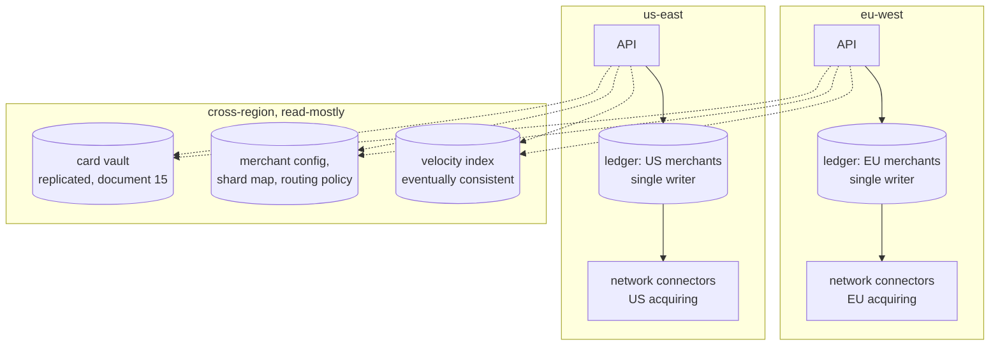

# Partitioning, Hot Keys and Multi-Region, When the Data Is Money

Scaling a payment system is a familiar sharding problem with two unfamiliar constraints bolted on:
the data has to balance as a ledger, and it has to be correct rather than eventually correct. Those
two constraints rule out several of the standard answers, and this document is about which ones
survive.

Northwind Pay's numbers from document 00 and document 08, gathered in one place because every
decision here derives from them:

- 9,000 authorizations per second at peak
- about 98,000 ledger entries per second at peak
- 40,000 merchants, with a distribution that is anything but uniform
- 3 regions
- 2.76 million captures per day feeding a daily batch

---

## Choosing the partition key

The partition key determines which queries are cheap and which are impossible. Four candidates,
examined in order of how tempting they are.

**Partition by payment id.** Perfectly uniform, trivially balanced, and wrong. Nearly every query
that matters is scoped to a merchant: list this merchant's payments, compute this merchant's
balance, produce this merchant's statement. All of them become scatter-gather across every shard.
Worse, the ledger constraint from document 08 — a transaction's entries must sum to zero and be
written atomically — now spans shards for every single payment, because the merchant-payable
account and the network-receivable account live on different shards. You have turned every
capture into a distributed transaction.

**Partition by card number.** Catastrophic. It puts the PAN in the routing layer, which drags your
entire infrastructure into PCI scope (document 15), and it does not match any query pattern.

**Partition by merchant id.** The right answer, and the rest of this document assumes it. Almost
all queries are merchant-scoped, so they resolve to one shard. The ledger entries for a payment —
merchant payable, network receivable, fee revenue — can be colocated if the non-merchant accounts
are replicated per shard, which is discussed below. The idempotency table from document 03 is
keyed by `(merchant_id, key)` and lands on the same shard as the payment it protects, which is
what makes the atomic claim possible.

**Partition by issuer BIN.** Tempting for the authorization path, since routing and issuer-health
tracking key off the BIN. Wrong for storage, for the same reason as payment id. It is, however, a
reasonable partitioning for the *connector* layer — the stateless part that talks to the networks —
and Northwind Pay does partition connector workers by BIN range so that an issuer's slowness is
contained.

The general principle worth extracting: **partition storage by the entity that owns the data and
partition compute by the entity that causes the load.** Those are different entities here — the
merchant owns the data, the issuer causes the latency — and trying to use one key for both produces
a bad compromise.

---

## The hot merchant

Here is where the uniform-distribution assumption dies. Northwind Pay's merchant volume
distribution:

| Segment | Merchants | Share of volume |
|---|---|---|
| Top 1 merchant | 1 | 11% |
| Top 10 | 10 | 38% |
| Top 100 | 100 | 61% |
| Remaining | 39,900 | 39% |

The largest merchant alone is 11% of 9,000 peak transactions per second, which is **990
authorizations per second on one merchant id**, and about 10,800 ledger entries per second against
**one account**: `merchant_payable:top_merchant`.

A naive merchant-id hash puts all of that on one shard, and that shard is now carrying eleven times
the average load. Three techniques, applied together.

### Technique one: append-only writes remove the contention

Document 08's design already solves most of this, and it is worth making the connection explicit.
A single mutable balance row would be the bottleneck: 10,800 updates per second to one row
serialise on that row's lock, and no database does that. PostgreSQL would manage perhaps a few
thousand per second on a single hot row before lock contention dominates.

Append-only entries have no such contention. 10,800 inserts per second into a partitioned table,
distributed across the index by time, is a workload a single well-provisioned PostgreSQL instance
handles. **The ledger design chosen for auditability turns out to be the design required for
scale**, which is a happy coincidence worth noticing rather than rediscovering.

The balance read is then served from a snapshot plus a tail, and for the hot merchant the tail is
large — 10,800 entries per second means a snapshot an hour old has 38 million entries after it. So
the hot merchant's snapshot cadence is different: Northwind Pay snapshots the top 100 merchants
every 60 seconds rather than daily, keeping the tail to roughly 650,000 entries, and the top
merchant every 10 seconds.

This is a general pattern for hot keys: **the cache refresh rate is a per-key decision, not a
global constant.**

### Technique two: dedicated shards

The top 100 merchants do not share shards with anybody. Each of the largest ten gets its own
database, sized and tuned for its traffic; the next ninety share four shards; the remaining 39,900
are distributed across sixteen shards by hash.

This costs operational complexity — a shard map that is partly explicit assignment and partly
hashing, rather than pure hashing — and it buys isolation. Harbour Athletics' Black Friday does not
degrade anybody else, and the top merchant's traffic cannot exhaust shared connections.

The shard map must therefore be data, not an algorithm:

```sql
CREATE TABLE shard_assignments (
  merchant_id  BIGINT PRIMARY KEY,
  shard_id     TEXT   NOT NULL,
  assigned_at  TIMESTAMPTZ NOT NULL,
  state        TEXT   NOT NULL  -- active | migrating_from | migrating_to
);
```

with a hash fallback for merchants not explicitly listed. Every service resolves a merchant to a
shard through one library that reads this table, cached with a short TTL. Having two independent
implementations of shard resolution is a guaranteed future incident, because they will disagree
during a migration and writes will go to the wrong shard.

### Technique three: sub-account partitioning for the extreme case

If one account is still too hot even append-only, split it. The top merchant's payable account
becomes sixteen accounts — `merchant_payable:top:00` through `:15` — and each entry goes to one of
them, chosen by hashing the payment id. The merchant's balance is the sum across all sixteen.

This is the standard sharded-counter technique and it has a real cost: the balance query now reads
sixteen snapshots instead of one, and any constraint you wanted to enforce on the single balance
(such as "never goes negative") can no longer be enforced locally. Northwind Pay applies it only
to the single largest merchant, and the decision to do so was deferred as long as possible, because
the complexity is genuine and the ordinary append-only design carried the load for a long time.

---

## What cannot be partitioned

Three things resist partitioning by merchant, and each needs its own answer.

**The non-merchant ledger accounts.** `network_receivable:visa` receives an entry for every single
capture — 2.76 million a day, at 10,800 per second peak across all merchants. It cannot live on one
merchant's shard.

The resolution: **non-merchant accounts are partitioned by shard.** Each shard holds its own
`network_receivable:visa:shard_07` sub-account, entries are written locally, and the global
receivable is the sum across shards, computed at the daily close. This keeps every capture's
entries within one shard and therefore within one local transaction, which is the property that
makes the whole scheme work.

The cost is that the global balance of a network account is only known as of the last aggregation,
not in real time. For an account that is reconciled daily against a settlement that arrives daily,
that is acceptable. It would not be acceptable for a merchant balance, which is why merchant
balances are not treated this way.

**Global uniqueness.** The RRN from document 05 must be unique across the whole system, and
generating it requires either a central allocator — a throughput ceiling and a single point of
failure — or a partitioned scheme. Document 05 described the latter: region code plus Julian day
plus a per-shard counter, so each shard allocates from its own space with no coordination. Any
identifier that must be globally unique in a sharded payment system should be constructed this
way, from a shard-local counter plus a shard identifier, rather than from a shared sequence.

**Cross-merchant queries.** Fraud detection needs to ask "has this card been tried at many
merchants in the last hour?", which is inherently cross-shard. The answer is not to make the
transactional store support it, but to maintain a separate, purpose-built store — Northwind Pay
uses a Redis-backed velocity index keyed by card token hash — fed from the event stream in document
12. It is eventually consistent, which for a fraud signal is acceptable, and document 16 discusses
the consequences of that acceptance.

---

## Multi-region, and the question of active-active

Northwind Pay runs in three regions. The question is what "runs in" means for the data, and this is
where payment systems diverge sharply from ordinary web services.

**The authorization path is regional.** A European merchant's traffic is authorized in eu-west,
against European acquiring, over European network connections. This is partly latency — a
transatlantic round trip adds 80 to 140 ms to a budget that document 05 showed has only 140 ms of
headroom — and partly regulatory: several jurisdictions require that transaction data be processed
and stored locally.

**Merchant data has a home region.** Harbour Athletics is a US merchant; its payments, ledger
entries and balances live in us-east and are *not* written anywhere else. This is the decision that
makes everything else tractable.

Why not active-active, where a merchant's data is writable in two regions? Because the ledger
requires that every transaction's entries be written atomically and that a balance be computable
correctly. Writable in two regions means either:

- **Synchronous cross-region consensus on every write.** At 98,000 entries per second with an
  80 ms inter-region round trip, that is not achievable within the latency budget.
- **Asynchronous replication with conflict resolution.** Two regions both accept a refund against
  the same remaining balance, and you discover afterwards that you refunded twice. There is no
  conflict resolution for that — the money has gone.

So the honest answer for the ledger is **single-writer per merchant, with the write region
explicit**. This is a real constraint and it must be stated rather than engineered around, because
every attempt to engineer around it produces a system that can double-spend.

### What this costs during a regional failure

If us-east is unavailable, US merchants' payments cannot be written. That is a real outage and
there is no way to make it not one while preserving correctness. What you can do:

**Fail over with a controlled promotion.** A synchronous replica in a second availability zone
within the region handles zone failure with no data loss. A cross-region asynchronous replica
handles region failure with some data loss — Northwind Pay's replication lag to its cross-region
standby is p99 of 340 ms, so a regional failover loses up to a few hundred milliseconds of writes.

**Decide in advance what happens to those lost writes.** This is the part most plans omit. Writes
lost in a failover are payments that may have been authorized at the issuer and whose records are
gone. They are, precisely, document 06's unknown-outcome population, and they are resolved the same
way: the clearing file reveals them, reconciliation catches them, and reversals clean them up.
Having that path already built is what makes a regional failover survivable rather than a
multi-week cleanup.

**Degrade rather than fail where you can.** Document 14 covers store-and-forward, which lets the
authorization path continue in a limited form when the system of record is unavailable.



Note what is in the shared box. Configuration, the shard map and the vault are read-mostly and
replicated globally; writes to them are rare and can afford cross-region consensus. The velocity
index is deliberately eventually consistent. **The ledger is in neither** — it is strictly
regional, and that is the whole point of the diagram.

---

## Resharding, briefly

A merchant outgrows its shard and must move. The sequence, which is the standard one with one
payments-specific addition:

1. Mark the merchant `migrating_from` in the shard map. Writes continue to the old shard.
2. Copy historical data to the new shard.
3. Stream ongoing changes until the lag is small.
4. **Pause writes for the merchant.** This is the payments-specific part: there is a brief window,
   measured in seconds, where the merchant's payments are rejected with a retryable error.
   Northwind Pay schedules these during the merchant's lowest-traffic hour and notifies them, and
   the pause is typically under 4 seconds.
5. Verify the ledger balances match on both shards — the sum of entries must be identical.
6. Flip the shard map, resume writes to the new shard.
7. Keep the old shard's data read-only for 30 days before dropping it.

Step 5 deserves emphasis: **verify by recomputing the balance from entries on both sides, not by
comparing row counts.** A migration that copies 2,299,998 of 2,300,000 entries has the right shape
and the wrong balance, and the balance is the thing that matters.

An alternative to pausing writes is a dual-write period, where both shards accept writes and are
reconciled. Northwind Pay does not do this for ledger data, because two writers against one
merchant's balance reintroduces exactly the double-spend risk that the single-writer rule exists to
prevent. A four-second pause is cheaper than that risk.

---

## What to take away

1. **Partition storage by merchant id.** Nearly every query is merchant-scoped, and it keeps a
   payment's ledger entries and its idempotency row on one shard, which is what makes atomic
   writes possible.
2. **Partition compute by the entity that causes the load**, which is the issuer BIN for the
   connector layer. Storage key and compute key are different, and forcing one key for both
   produces a bad compromise.
3. **Volume is radically non-uniform** — one merchant is 11%, the top ten are 38%. A pure hash puts
   eleven times the average load on one shard.
4. **Append-only entries remove the hot-row contention that a mutable balance would create.** The
   design chosen for auditability is the design required for scale.
5. **Snapshot cadence is a per-key decision.** The top merchant is snapshotted every 10 seconds,
   ordinary merchants daily.
6. **Give large merchants dedicated shards and make the shard map data, not an algorithm** — with
   exactly one implementation of resolution, or migrations will write to the wrong shard.
7. **Partition non-merchant ledger accounts by shard** and aggregate them at the daily close, so
   every capture's entries stay inside one local transaction.
8. **Construct globally unique identifiers from a shard-local counter plus a shard id**, never from
   a shared sequence.
9. **The ledger is single-writer per merchant, with an explicit home region.** Active-active on
   money either needs cross-region consensus you cannot afford or produces conflicts you cannot
   resolve, because a double refund cannot be merged.
10. **Plan what happens to writes lost in a regional failover.** They are the unknown-outcome
    population from document 06 and are resolved by the same reversal and reconciliation path.
11. **Verify a reshard by recomputing balances from entries on both sides**, not by comparing row
    counts, and accept a short write pause rather than dual-writing a ledger.

Next: [14-degradation-and-stand-in.md](14-degradation-and-stand-in.md), on what you are allowed to
do when the parts you depend on are unreachable.
