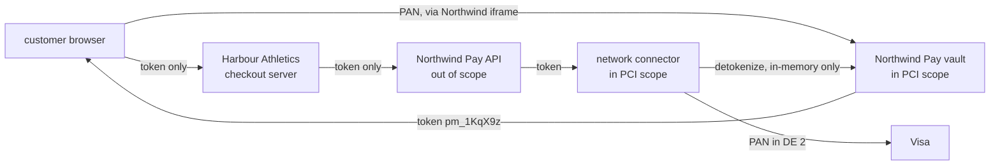

# PCI Scope and Tokenization: Keeping Card Data in One Place

PCI DSS — the Payment Card Industry Data Security Standard — is the card networks' security
standard, and engineers usually meet it as a compliance obligation arriving from outside. That
framing produces bad architecture, because it leads to treating the standard as a checklist applied
to an existing system.

The productive framing is this: **PCI DSS is expensive per system it applies to, and you control
which systems it applies to.** The architecture question is not "how do we comply" but "how do we
arrange things so that almost nothing has to." This document is about that arrangement.

---

## What scope means, and what it costs

A system is **in scope** for PCI DSS if it stores, processes or transmits cardholder data, or if it
is connected to a system that does in a way that could affect its security.

Cardholder data means the PAN (document 00) primarily, along with cardholder name, expiry and
service code. A separate and stricter category, **sensitive authentication data**, covers the full
magnetic stripe contents, the CVV/CVC security code, and the PIN. Sensitive authentication data
**may not be stored after authorization at all** — not encrypted, not hashed, not for a minute. This
is the single clearest rule in the standard and the one most often violated by accident, usually by
a debug log or an error report that captured a request body.

The cost of scope, concretely. Northwind Pay processes well over 6 million Visa transactions a
year, which makes it a **Level 1** merchant/service provider — the highest tier — and that requires:

- an annual on-site assessment by a Qualified Security Assessor, not a self-assessment
- quarterly network scans by an Approved Scanning Vendor
- annual penetration testing, internal and external
- formal change control, documented, for every in-scope system
- file integrity monitoring, log retention of at least a year, and access reviews
- network segmentation testing to prove the scope boundary holds

Applied to a single service and its dedicated infrastructure, that is a meaningful but manageable
programme. Applied to 300 microservices, it is a permanent organisational tax that slows every
deployment and touches every engineer.

So the architecture goal, stated in one sentence: **one small, heavily controlled system handles
card data, and everything else handles tokens that are worthless if stolen.**

---

## The vault

Northwind Pay's card vault is a separate service with its own database, its own network segment,
its own deployment pipeline, and its own on-call rotation. It does exactly three things.

**Tokenize.** Accept a PAN, store it encrypted, return an opaque token.

```
POST /vault/tokenize          (inside the segment only)
{ "pan": "4319...7732", "exp_month": 11, "exp_year": 2029 }
→ { "token": "pm_1KqX9z", "last4": "7732", "bin": "431912", "brand": "visa" }
```

**Detokenize.** Accept a token, return the PAN — only to the authorization connector, only for the
duration of one network message, never persisted by the caller.

**Delete.** Remove a stored card.

Nothing else. No business logic, no reporting, no merchant API. The surface is small because every
additional capability is an additional thing a QSA must assess and an additional way for a PAN to
leave.

Three design properties.

**Tokens are opaque and random, not derived.** A token must not be a hash or an encryption of the
PAN, because a hashed PAN is still cardholder data: the PAN space is small enough to brute-force
(16 digits with a known BIN and a Luhn check is on the order of a billion candidates per BIN, which
is minutes of compute). Northwind Pay's tokens are random 128-bit values with a prefix, and the
mapping lives only in the vault's database.

**The metadata the rest of the system needs comes back with the token.** Last four digits, BIN,
brand, expiry, country. These are not cardholder data on their own and the rest of the system needs
them constantly — for routing (document 11), for display, for fee calculation, for fraud signals.
Returning them at tokenization time means no other service ever needs to call back to the vault for
ordinary work.

**Encryption keys live in a hardware security module.** The PAN is encrypted with a data key, the
data key is wrapped by a master key held in an HSM, and the HSM never exports the master key.
Key rotation re-wraps data keys without decrypting PANs. This is standard and the reason to state
it is that the alternative — keys in a configuration file or an environment variable — is a finding
that fails an assessment outright, and it is still common.

---

## Keeping the PAN out of your network entirely

The vault reduces scope to one service. The next move reduces it further: **never let the PAN reach
your servers at all** for the common case.

The mechanism is client-side tokenization. Harbour Athletics' checkout page embeds an iframe or a
JavaScript SDK served from Northwind Pay's domain. The customer types their card number into a
field that belongs to Northwind Pay, not to Harbour Athletics, and it posts directly to Northwind
Pay's vault. Harbour Athletics' servers receive only `pm_1KqX9z`.

The effect on Harbour Athletics is dramatic: its PCI obligation drops from a full assessment to the
shortest self-assessment questionnaire, **SAQ A**, which is a few dozen questions rather than a few
hundred controls. This is the single largest piece of value a PSP delivers to a small merchant, and
it is worth understanding as a product feature rather than a security detail.

The effect on Northwind Pay is that the vault's tokenization endpoint is internet-facing, which is
a meaningful exposure and is why it does exactly one thing with a tightly validated input.



Two boxes are in scope: the vault and the connector. Everything else — the API, the ledger, the
settlement batcher, the dashboard, the reporting pipeline, the fraud scorer — handles tokens and
metadata only. At Northwind Pay that is **2 services in scope out of 180**, which is the whole
argument of this document reduced to a ratio.

---

## Holding the boundary

A scope boundary is easy to draw and hard to keep, because it erodes through ordinary engineering
work. The erosion paths, and the control for each.

**Logs.** A developer adds request-body logging to debug an issue, and PANs land in the log
aggregator — which is now in scope, along with everything that can read it. This is the most common
breach of scope by a wide margin.

Controls: the vault's logging framework redacts by pattern at the formatter level, not at the call
site. A regex for card-shaped digit sequences with a Luhn check runs over every log line before it
is emitted. And, because a formatter can be bypassed, the log pipeline runs the same detection
again and alerts on any hit, treating it as an incident.

**Error reporting and crash dumps.** An exception tracker captures local variables, one of which is
a PAN. Same problem, different pipe. Northwind Pay's vault service does not send stack traces to the
shared error tracker at all; it has its own, inside the segment.

**Database backups and replicas.** A backup of the vault's database is cardholder data. It must be
encrypted, access-controlled, and retained under the same rules. A read replica provisioned for
analytics convenience brings the analytics system into scope.

**Support tooling.** A support agent needs to identify a card and will ask for the full number if
the tool only shows the last four. The control is a tool that shows enough — last four, BIN, brand,
expiry, and the ability to search by token — so that nobody needs the PAN. Where a full PAN is
genuinely required, it is a separately audited, individually justified, time-limited retrieval, and
the retrieval itself is logged and reviewed.

**Test data.** A production PAN copied into a test environment brings that environment into scope.
The networks publish test card numbers for exactly this reason, and the rule is that non-production
environments never hold production card data. Document 17's dispute testing and document 11's
decline testing both depend on the networks' test cards.

The organising principle behind all five: **the boundary must be enforced by mechanism, not by
policy.** "Do not log card numbers" is a policy and will be violated. A formatter that cannot emit
them, plus a pipeline that alarms if one appears, is a mechanism.

---

## Network tokens, which are a different thing

The word "token" is overloaded and the distinction matters commercially.

A **PSP token** — `pm_1KqX9z` — is Northwind Pay's own identifier for a stored card. It is
meaningful only to Northwind Pay. If Harbour Athletics moves to another PSP, its stored tokens are
worthless, which is a significant source of lock-in and a recognised point of friction in the
industry.

A **network token** is issued by Visa or Mastercard and replaces the PAN in the transaction itself.
It is a real 16-digit number in the card's BIN range that routes to the same account, bound to a
specific merchant or domain, and accompanied by a cryptogram per transaction.

The practical differences, which are large:

**Network tokens are kept current automatically.** When Meridian Bank reissues a card, the network
token continues to work. Document 11 noted that Northwind Pay's network-tokenised volume has a
94% lower expired-card decline rate, and this is why.

**Network tokens improve approval rates.** Issuers treat them as lower risk because the token is
domain-bound and cryptographically authenticated. Northwind Pay observes approval rates roughly
1.8 percentage points higher on network-tokenised volume for the same card population, which at
1.2 billion attempts is a very large amount of recovered volume.

**A stolen network token is far less useful.** It is bound to one merchant, so it cannot be used
elsewhere, and it requires a per-transaction cryptogram.

**They reduce scope further**, because the stored credential is not a PAN.

The reason not everything is network-tokenised is coverage: not every issuer and not every market
supports provisioning, so you need both paths and a fallback. Northwind Pay's position is 71% of
stored cards network-tokenised, rising, with the PAN retained in the vault as the fallback — which
means the vault does not go away, it just handles a shrinking share of traffic.

---

## What you may and may not store

Short, and worth memorising because the consequences of getting it wrong are severe.

| Data | May store? | Notes |
|---|---|---|
| PAN | Yes | Must be rendered unreadable: strong encryption, truncation, or tokenization |
| Cardholder name | Yes | Protect per policy |
| Expiry date | Yes | Protect per policy |
| Service code | Yes | Protect per policy |
| **CVV / CVC / CID** | **No** | Never after authorization. Not encrypted, not hashed, not briefly |
| **Full magnetic stripe or chip track data** | **No** | Never after authorization |
| **PIN or PIN block** | **No** | Never after authorization |

The CVV rule deserves the emphasis. It is the control that makes a stolen card database less
useful, and storing it — even encrypted — defeats that purpose and is an automatic assessment
failure. The subtle violations are the ones to watch for: a CVV included in a request that gets
written to an audit table, retained in a message queue beyond the authorization, or held in an
in-memory cache that gets dumped on crash.

Northwind Pay's control is that the CVV is accepted at the vault's tokenization endpoint, passed
through to the authorization in memory, and never written to any durable medium — and the vault's
schema has no column for it, which is a stronger guarantee than any code review.

---

## What to take away

1. **PCI scope is something you design, not something you receive.** The cost scales with the
   number of in-scope systems, and that number is an architectural choice.
2. **A Level 1 assessment is a serious annual programme.** Applied to two services it is
   manageable; applied to 300 it is a permanent tax on every deployment.
3. **One vault, three operations: tokenize, detokenize, delete.** Every additional capability is
   additional assessment surface and another way for a PAN to leave.
4. **Tokens must be random, not derived.** A hashed PAN is still cardholder data, because the PAN
   space is brute-forceable in minutes per BIN.
5. **Return the needed metadata with the token** — last four, BIN, brand, expiry — so no other
   service ever needs to call the vault for ordinary work.
6. **Keep the PAN out of your network entirely** with client-side tokenization. It drops the
   merchant to SAQ A and is the largest security value a PSP provides.
7. **The boundary erodes through logs, error trackers, replicas, support tools and test data.**
   Enforce it by mechanism — a formatter that cannot emit a PAN, a pipeline that alarms if one
   appears — never by policy.
8. **Network tokens are a different thing from PSP tokens**, and they raise approval rates about
   1.8 points, cut expired-card declines about 94%, and stay current through reissues. Adopt them
   where coverage permits and keep the vault as the fallback.
9. **CVV, track data and PIN may never be stored after authorization.** The strongest control is a
   schema with no column for them.

Next: [16-fraud-as-a-control-plane.md](16-fraud-as-a-control-plane.md), on deciding risk inside a
latency budget you do not control.
