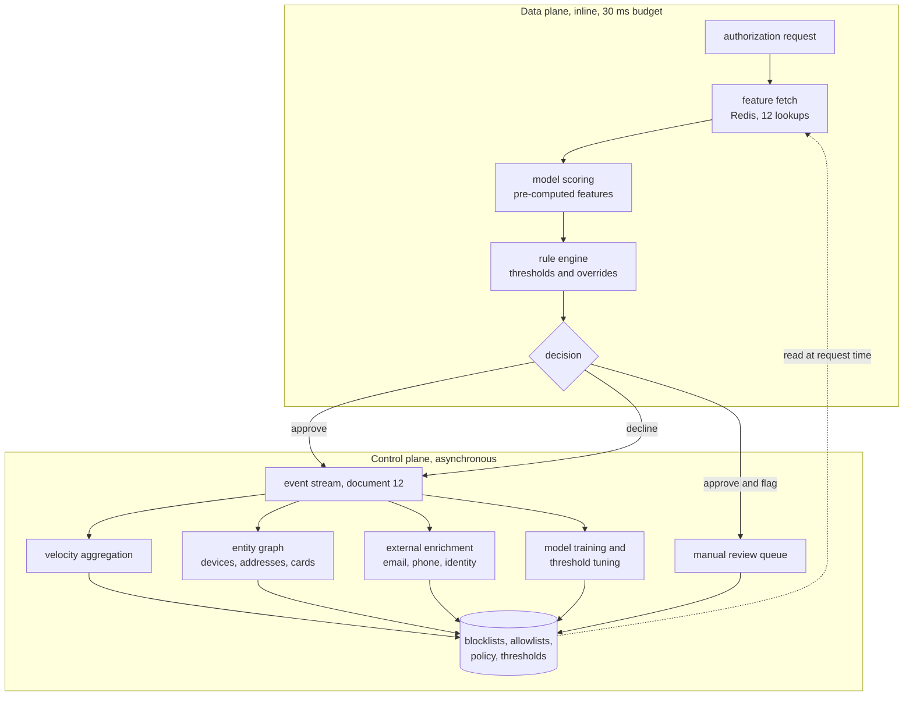

# Fraud and Risk as a Control Plane, Not a Gate

Fraud detection is usually drawn as a gate: the payment arrives, the fraud system approves or
blocks, the payment proceeds or does not. That drawing is wrong in a way that produces both bad
latency and bad decisions.

The better model, and the one this document develops, is that fraud is a **control plane** — a
system that sets policy, maintains state about entities, and influences the data plane's decisions —
with only a thin, strictly budgeted slice of it running inline. Document 00's running system
provides the constraint that forces this: there is 120 ms of own-processing budget at p99 in an
800 ms end-to-end target, and the authorization itself needs most of it.

A note on scope before starting: this is not a document about machine learning. It is about where
risk decisions belong in a payment system's architecture, what latency they may consume, and what
happens when they are wrong in each direction. The model itself is somebody else's specialty.

---

## The two losses, and why both are expensive

Every risk decision trades two errors against each other, and you cannot minimise both.

**A false negative** is fraud you approved. The cost is the transaction value plus the dispute fee.
For a $47 transaction that is $47 + $15 = **$62**, and under the liability rules from document 07
it falls on the merchant unless 3DS shifted it.

**A false positive** is a legitimate payment you declined. The cost is subtler and larger than most
teams assume. The immediate cost is the lost margin on that transaction, $0.631 at Northwind Pay.
But the real cost is behavioural: a customer declined at checkout frequently abandons entirely, and
a customer declined twice often stops using the merchant. Industry estimates of the lifetime cost
of a false decline run from 20 to 70 times the transaction value; Northwind Pay's own cohort
analysis puts it at **roughly 11 times the transaction value** when measured as reduced
twelve-month spend, which on a $47 ticket is about $520 of lost future volume.

Put those side by side and the asymmetry is striking. A false negative costs $62. A false positive
costs, in expectation, $520 of future volume — though that volume is the merchant's, not
Northwind Pay's, so the loss lands differently.

The conclusion that follows, and it is counterintuitive to engineers meeting fraud for the first
time: **a system tuned to catch nearly all fraud is almost certainly losing money.** The optimum
accepts a meaningful fraud rate, because the marginal legitimate transaction declined to catch the
marginal fraudulent one costs more than it saves.

Northwind Pay's operating point: a **0.042% fraud rate** with a **0.9% false-decline rate**. Derive
the annual cost of each on 1.2 billion attempts:

- Fraud losses: 1,047,600,000 approved × 0.00042 × $62 ≈ **$27.3 million**
- False declines: 1,200,000,000 × 0.009 = 10,800,000 declined legitimate payments, at $47 each =
  **$508 million of merchant volume not transacted**

Those two numbers are what the operating point trades. They are not denominated in the same
currency of harm — one is a direct loss, the other is merchant revenue foregone — which is exactly
why the operating point is a business decision rather than an engineering one. Engineering's job is
to make the operating point adjustable, measurable, and honest.

---

## What fits in the inline budget

The inline slice gets **30 ms at p99**, out of the 120 ms of own-processing budget from document
05. What fits in 30 ms:

**A few key-value lookups.** Velocity counters, blocklist membership, the card's and customer's
recent history. Each is a sub-millisecond Redis read; a dozen of them fit comfortably.

**A scored model evaluation on pre-computed features.** A gradient-boosted tree over 200 features
evaluates in under 5 ms if the features are already in hand. The cost is never the model; it is
feature retrieval.

**A rule engine over the result.** Microseconds.

What does not fit:

- **A graph traversal** over the entity relationship network — "is this device connected to a known
  fraud ring through shared addresses?" — which takes hundreds of milliseconds.
- **Any call to an external data provider.** Identity verification, email reputation, phone
  validation. These are 200–800 ms services.
- **A deep model over raw sequences.** Anything that reads a customer's full transaction history at
  request time.
- **A human.**

So the architecture is forced: **the expensive work happens outside the request, and the inline
path reads its results.** This is the control-plane/data-plane split, and it is not a stylistic
choice but a consequence of the 30 ms.

---

## The split, concretely

The dotted line is the important one. The control plane does not participate in the decision; it
**pre-computes the inputs to the decision**, deposits them where a sub-millisecond read can find
them, and the data plane consumes them. Latency in the control plane affects how fresh the signals
are, not how fast the payment is.

The three inline decisions, and note that there are three rather than two:

- **Approve.** Proceed to authorization.
- **Decline.** Refuse without contacting the issuer. Northwind Pay declines about 0.31% of attempts
  this way, before the issuer sees them.
- **Approve and flag.** Proceed, and place the payment in an asynchronous review queue. This is the
  option that most designs omit, and it is where a large share of the value sits: a transaction
  that is suspicious but not clearly bad is approved — preserving the customer experience — and
  examined within minutes. If review concludes it is fraud, the payment is **voided before capture**
  (document 01), which costs nothing and leaves no trace on the customer's statement.

That last mechanism is why the authorize/capture split from document 01 is a risk control as well
as a commercial one. The window between authorization and capture is time in which an asynchronous
system can change its mind at no cost. A system that captures immediately has thrown that window
away.

---

## Feature freshness, and the race you cannot win

The inline path reads pre-computed features. Those features are stale by however long the control
plane takes to update them, and staleness has a specific adversarial consequence.

The attack: a fraudster with a stolen card list runs 400 attempts across 60 seconds. A velocity
counter updated by a stream with 800 ms of lag sees, at the moment of the 100th attempt, a count
reflecting attempts up to about 800 ms ago. The attacker's effective rate exceeds the detector's
update rate, and the first tranche gets through.

Three responses, used together.

**Update the highest-signal counters synchronously.** Not all features need the stream. A card-level
attempt counter can be incremented inline, in Redis, as part of the 30 ms budget — one extra
round trip. Northwind Pay increments card, device and IP attempt counters inline and derives
everything else from the stream. The selection criterion is whether the feature is used in a rule
that an attacker can outrun.

**Make the window short and the threshold low for the inline counters.** A one-minute window with a
threshold of 5 attempts per card is cheap to maintain and catches the burst pattern specifically.

**Accept that the first few get through and make recovery fast.** Card testing is detected within
seconds and the remaining 395 attempts are blocked. The first 5 are a loss, and the correct design
goal is to bound that number rather than to reach zero — which, with a distributed counter and any
network latency at all, is not reachable.

This is the general shape of the trade: **inline freshness is expensive and bounded; asynchronous
depth is cheap and late.** Put the features an adversary can outrun in the first category and
everything else in the second.

---

## Card testing: the attack that is actually about you

Most fraud harms the merchant. **Card testing** harms you, and it is worth separating.

An attacker with a list of 50,000 stolen card numbers of unknown validity needs to know which ones
work. They find a merchant with a cheap product and a permissive checkout, and run small
authorizations — often $1 or less, sometimes $0 account verifications — to see which approve. The
approved ones are then sold or used elsewhere.

Why this is your problem rather than the merchant's:

- The volume is enormous and concentrated. Northwind Pay has seen single attacks generating 40,000
  attempts per second against one merchant, which is four times its entire normal peak.
- The approval rate is terrible, which damages your standing with issuers across your whole
  portfolio, not just that merchant's.
- The networks monitor it and levy fines. Visa's Acquirer Monitoring Program penalises excessive
  testing-pattern volume.
- The merchant may be an unwitting victim with no ability to detect or stop it.

The detection signals, which are different from ordinary fraud signals:

- **Many distinct cards, one merchant, short window.** The inverse of ordinary fraud, which is one
  card across many merchants.
- **A collapsing approval rate on that merchant**, as document 11's monitoring would show.
- **Uniform small amounts**, or a high rate of $0 verification requests.
- **Shared infrastructure** — one device fingerprint, one IP range, one user agent — across many
  cards.
- **Sequential or patterned card numbers**, which indicate generated rather than stolen lists.

The response must be **per-merchant rate limiting plus automatic throttle**, which ties directly to
document 14's load shedding and document 13's bulkheads. Northwind Pay's automatic response
triggers on a merchant's distinct-card rate exceeding a baseline multiple, throttles that merchant's
authorization rate, notifies the merchant, and pages the risk on-call. The throttle is deliberately
blunt — it will affect legitimate traffic for that merchant — because the alternative is a network
fine and portfolio-wide approval-rate damage.

---

## The merchant-facing side of risk

Three things merchants need, each of which is an engineering obligation.

**Visible, explicable decisions.** A merchant whose payment was declined by Northwind Pay's risk
system, not by the issuer, must be able to see that and see why at a category level — "velocity
limit exceeded", "address mismatch with high-risk indicators". Not the model score, not the feature
weights, but a reason. Without it, the merchant's support team cannot answer their customer and will
escalate everything.

**An adjustable operating point.** Merchants differ enormously in their tolerance. A digital-goods
merchant with no shipping cost may happily accept 2% fraud for a higher approval rate; a
high-value-electronics merchant wants the opposite. A single global threshold serves neither.
Northwind Pay exposes a three-point setting — conservative, balanced, permissive — mapped to
different score thresholds, with the expected fraud and decline rates for each shown to the
merchant.

**Rules the merchant controls.** Block this card, block this email domain, allow this customer who
keeps getting declined. Merchant-level allowlists are a frequent support request and a frequent
source of abuse, so they are rate-limited and audited.

---

## Measuring whether any of it works

The metrics that matter, and the trap in each.

**Fraud rate**, as disputed-fraud value over total value. The trap is the lag: a transaction today
becomes a fraud dispute up to 120 days from now, so today's fraud rate is unknown and will be for
months. You are always tuning against a number that describes the past. Northwind Pay reports both
a *matured* fraud rate — for cohorts old enough to have surfaced, at least 120 days — and an
*estimated* current rate from early indicators, and labels which is which, because conflating them
produces decisions based on an artificially low number.

**False-decline rate.** The hard one, because a declined transaction has no ground truth — you
never learn whether it was legitimate. Three proxies: the rate at which a declined customer
succeeds on a retry with a different card (strong signal it was legitimate), the rate at which
declined customers never return, and periodic deliberate hold-out testing where a small random
share of would-be declines are approved to measure their actual fraud rate. The hold-out is the only
one that gives a real number, and it costs money by construction — Northwind Pay runs it at 0.5% of
declines and treats the resulting fraud loss as the price of knowing.

**Review queue latency and throughput.** The approve-and-flag path only works if review happens
inside the authorization validity window, and ideally within minutes. A review queue with a
four-hour backlog has lost the free-void advantage entirely.

**Decline reason mix**, decomposed as in document 11. A shift in which rules are firing is more
informative than the aggregate rate.

---

## What to take away

1. **Fraud is a control plane, not a gate.** The expensive work pre-computes features; the inline
   path reads them. The 30 ms budget forces this, and it is not a stylistic choice.
2. **A false negative costs $62; a false positive costs roughly 11× the ticket in lost future
   volume.** A system tuned to catch nearly all fraud is probably losing money.
3. **The operating point is a business decision** — Northwind Pay's 0.042% fraud against 0.9% false
   declines trades $27.3 million of loss against $508 million of merchant volume foregone.
   Engineering's job is to make it adjustable, measurable and honest.
4. **Inline you can afford a dozen key-value reads and a model over pre-computed features.** You
   cannot afford a graph traversal, an external data provider, or a human.
5. **"Approve and flag" is the most valuable decision**, because the authorize/capture window lets
   an asynchronous review void a payment at zero cost. Capturing immediately throws that window
   away.
6. **Increment inline the counters an attacker can outrun**, and derive everything else from the
   stream. Zero burst leakage is not reachable; bounding it is.
7. **Card testing is your problem, not the merchant's** — portfolio-wide approval damage and network
   fines — and the response is blunt per-merchant throttling, accepting collateral impact.
8. **Merchants need explicable decisions, an adjustable operating point, and their own rules.**
   Without the first, every decline becomes an escalation.
9. **Today's fraud rate is unknowable for 120 days.** Report matured and estimated rates
   separately, and measure false declines with a paid-for hold-out, because the proxies alone do
   not give a number.

Next: [17-disputes-and-chargebacks.md](17-disputes-and-chargebacks.md), on the longest state machine
in the system.
