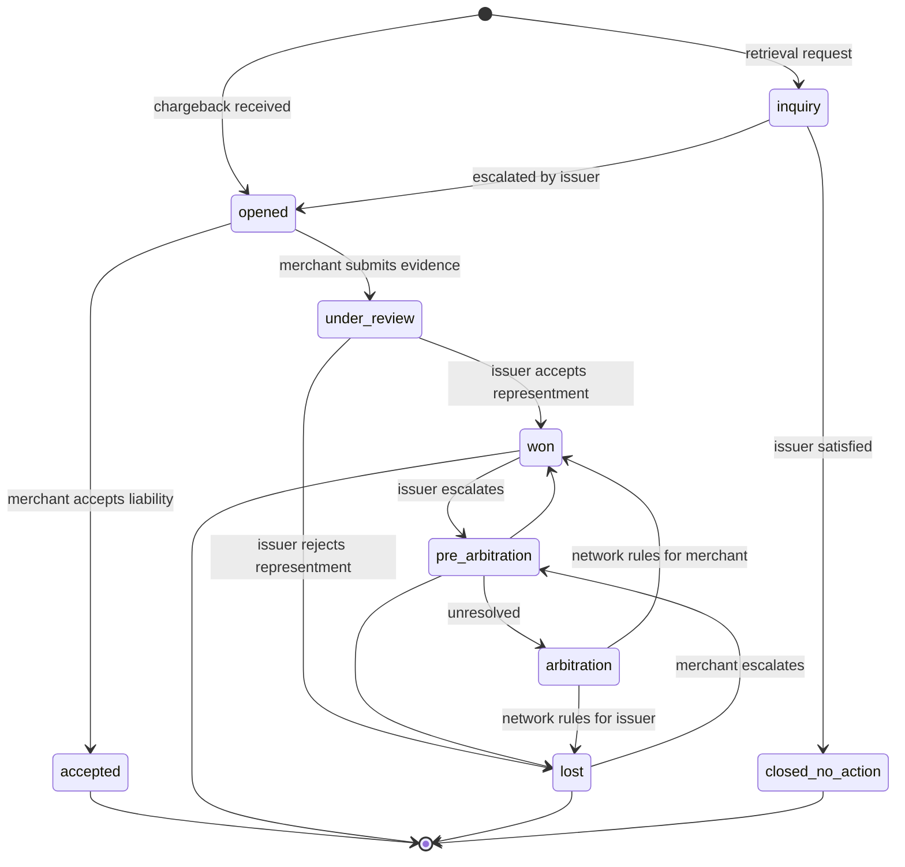

# Disputes and Chargebacks: The Longest State Machine in the System

Every other state machine in this collection completes in seconds or days. This one runs for up to
**540 days**, is driven by deadlines you do not control, and can be reopened after you thought it
was finished.

It is also the part of a payment system that is most often built last and worst, because it does
not affect the authorization path and therefore does not appear urgent. Then a merchant with a
4,000-dispute month arrives, the manual process collapses, and the network's monitoring programme
starts generating fines.

---

## What a dispute actually is

A cardholder tells Meridian Bank that a charge on their statement is wrong. Meridian evaluates the
claim, and if it accepts it, **takes the money back through the network** — debiting Northwind Pay's
acquiring account — and credits the cardholder.

Note the order of events: **the money comes back first, and the merchant argues afterwards.** The
cardholder is made whole immediately. Harbour Athletics discovers the dispute when $47 is deducted
from its balance, along with a dispute fee of around $15. This sequencing is deliberate consumer
protection and it determines the shape of everything below — a dispute is not a request you can
decline, it is a debit you may contest.

The terminology varies and is worth pinning down. **Chargeback** is the traditional term for the
whole mechanism. Visa's current framework, **Visa Claims Resolution** (VCR), splits disputes into
*Allocation* (fraud and authorization categories, resolved largely automatically by the network)
and *Collaboration* (consumer disputes, resolved by the parties exchanging evidence). Mastercard's
is **Mastercard Dispute Resolution**. The states below use neutral names and the network-specific
mapping is noted where it matters.

---

## The reason codes, grouped by what you can do about them

The reason code determines what evidence wins, so grouping by category rather than by number is the
useful organisation.

**Fraud.** The cardholder says they did not make the transaction. Visa 10.4 (card-absent
environment), Mastercard 4837. This is the largest category at Northwind Pay — **48% of disputes**.
The decisive question is whether 3DS applied (document 07): with a successful authentication and
the CAVV present in the authorization, liability sits with the issuer and the dispute is largely
unwinnable *against the merchant*, which is to say the merchant wins. Without it, the merchant
usually loses, and evidence about shipping and prior customer history rarely overturns a fraud
claim.

**Authorization.** The transaction was not properly authorized — captured after the authorization
expired, captured for more than authorized, captured against a declined authorization. Visa 11.x.
**These are your bugs, not the merchant's**, and they are unwinnable. Every document in this
collection that insisted on carrying the RRN forward, refusing a capture in an `unknown` state, or
honouring the validity window was preventing a dispute in this category. Northwind Pay's
authorization-category dispute rate is 0.9% of all disputes, and the team treats any increase as a
correctness incident rather than a risk event.

**Processing errors.** Duplicate processing, incorrect amount, incorrect currency, credit not
processed. Visa 12.x. Also largely your bugs or the merchant's, and also mostly unwinnable —
although "credit not processed" is winnable with proof that the refund was issued, which is exactly
what document 08's ledger provides.

**Consumer disputes.** Goods not received, goods not as described, cancelled recurring transaction,
services not provided. Visa 13.x. **This is the winnable category**, at 39% of Northwind Pay's
disputes, and winning depends entirely on the merchant's evidence: delivery confirmation, the terms
the customer accepted, correspondence, the cancellation policy.

The split that follows from this grouping is the single most useful product decision in dispute
handling: **separate the disputes the merchant can fight from the ones they cannot, and do not ask
them to fight the ones they cannot.** A merchant presented with an unwinnable authorization-category
dispute and asked to submit evidence will spend an hour on it, lose, and lose trust in the system.
Northwind Pay auto-accepts categories with a historical win rate below 8% and tells the merchant
why.

---

## The state machine



Walk the stages with their timings and costs.

**Inquiry, also called a retrieval request.** The issuer asks for information before raising a
formal dispute — a copy of the receipt, the transaction details. Not every dispute starts here, and
Visa's framework has largely replaced it with automated allocation, but Mastercard and Amex still
generate them. **This stage is free and it is the cheapest possible win.** Responding to an inquiry
with good documentation prevents the chargeback entirely, avoiding the $15 fee and the dispute-rate
impact. Northwind Pay resolves about 22% of inquiries without escalation, and the team regards the
inquiry response path as the highest return per unit of effort in the whole dispute system.

**Opened.** The chargeback is formal. The money is already gone. The merchant has a deadline to
respond — typically **20 to 30 days** depending on network and reason code — and the deadline is
counted from the network's notification date, not from when you told the merchant.

That distinction causes real losses. If your ingestion of the network's dispute file runs a day
late, and you then give the merchant "30 days from today", the merchant's submission arrives after
the network's deadline and the dispute is lost by default. Northwind Pay computes every
merchant-facing deadline from the network date minus a 3-day internal buffer, and shows the
merchant that earlier date.

**Representment.** The merchant submits evidence and Northwind Pay "re-presents" the transaction to
the issuer. The evidence package is reason-code specific, and assembling the right package is where
the win rate is made.

**Pre-arbitration.** Either side escalates after the representment decision. Costs rise.

**Arbitration.** The network decides. The losing party pays an arbitration fee of **$500 or more**,
which means arbitration is only rational on high-value disputes. On a $47 transaction it is never
rational, and a system that lets a merchant escalate to arbitration over $47 is helping them lose
$500 to win $47.

Northwind Pay's rule: escalation beyond representment is available only above a $500 transaction
value, with the arbitration fee exposure shown explicitly before the merchant confirms.

---

## The numbers at Northwind Pay

Derived so the scale is concrete. The portfolio dispute rate is 0.08% of captured transactions:

- 1,005,696,000 captures × 0.0008 = **804,557 disputes a year**, about 2,204 a day
- At 48% fraud category: 386,187 fraud disputes
- At 39% consumer disputes: 313,777
- Representment win rate overall: **41%**, which varies enormously by category — 68% on consumer
  disputes with good evidence, 11% on fraud without 3DS, 2% on authorization errors

The financial flow on a single lost $47 dispute:

| Item | Amount |
|---|---|
| Transaction reversed | −$47.00 |
| Dispute fee | −$15.00 |
| Original processing fee, not returned | −$1.66 |
| **Total cost to the merchant** | **−$63.66** |

So a lost dispute costs **135% of the transaction value** — the merchant is worse off than if the
sale had never happened, by the fees on both sides of it. Whether that is survivable depends on the
merchant's own gross margin, which Northwind Pay does not know; what Northwind Pay can say is that
the dispute rate, rather than the fraud rate, is the number that determines whether a merchant
stays viable, because fraud that never becomes a dispute costs the merchant nothing directly while
every dispute costs more than the sale was worth.

---

## The monitoring programmes, which set hard limits

The networks impose thresholds, and exceeding them has consequences that are not negotiable.

**Visa Dispute Monitoring Program.** A merchant exceeding **0.9% disputes** and 100 disputes in a
month enters the programme. Standard tier brings monthly fines; the excessive tier brings fines per
dispute and, eventually, termination of the merchant's ability to accept Visa.

**Visa Fraud Monitoring Program.** Separately, a merchant exceeding **0.9% fraud** and $75,000 of
monthly fraud enters a fraud programme with the same escalation.

**Mastercard Excessive Chargeback Merchant.** Thresholds at 1.5% and 300 disputes, with a higher
"excessive" tier.

Two engineering obligations follow.

**You must compute each merchant's ratio the way the network computes it**, which is not the obvious
way. Visa's dispute ratio is disputes this month divided by *transaction count in the same month* —
not the count of the month the disputed transactions came from. For a merchant with falling volume
this inflates the ratio, sometimes dramatically: a merchant that did 10,000 transactions in October
and 2,000 in November, with 60 November disputes mostly arising from October sales, shows 60 ÷
2,000 = 3.0% rather than the 0.6% an intuitive calculation gives. Merchants who shrink get pushed
into monitoring programmes by arithmetic. Your system must show them the same number the network
will.

**You must warn before the threshold, not after.** A merchant at 0.7% and rising needs to know in
time to change something. Northwind Pay alerts merchants at 0.65% and offers specific
interventions — chargeback alerts, 3DS enablement, delivery-confirmation requirements — mapped to
the merchant's own dispute reason mix.

---

## Chargeback alerts: paying to avoid disputes

There is a mechanism worth knowing about because it changes the economics. Services such as
Ethoca and Verifi (owned by Mastercard and Visa respectively) sit between issuers and merchants:
when a cardholder initiates a dispute, the merchant is notified *before* the chargeback is formally
raised, and may refund proactively. The dispute is then withdrawn.

The arithmetic: an alert costs around $30 in fees and the merchant refunds the $47, so the merchant
is out $77 and keeps nothing. A lost dispute costs $63.66. So on a per-transaction basis, taking
the alert is *worse*.

What makes it worth doing is the **ratio**. The refund does not count as a dispute, so it does not
move the merchant toward the 0.9% threshold. For a merchant at 0.4% the alerts are not worth
buying. For a merchant at 0.85% and facing programme entry — with fines and potential termination
— buying alerts to suppress the ratio is clearly correct.

This is a good illustration of a general point about dispute engineering: **the direct cost of a
dispute is rarely the whole cost, and the threshold effects dominate the decision**. A system that
optimises per-dispute economics without modelling the ratio will advise merchants badly.

---

## Building it

The data model, with the fields that are commonly missing called out.

```sql
CREATE TABLE disputes (
  id                   TEXT PRIMARY KEY,
  payment_id           TEXT        NOT NULL,
  capture_id           TEXT        NOT NULL,
  network              TEXT        NOT NULL,
  network_case_id      TEXT        NOT NULL,   -- their id, for correspondence
  reason_code          TEXT        NOT NULL,
  reason_category      TEXT        NOT NULL,   -- fraud | authorization | processing | consumer
  amount_minor         BIGINT      NOT NULL,   -- may be partial
  currency             CHAR(3)     NOT NULL,
  state                TEXT        NOT NULL,
  network_opened_at    TIMESTAMPTZ NOT NULL,   -- their date, the deadline clock
  ingested_at          TIMESTAMPTZ NOT NULL,   -- when we learned
  respond_by           TIMESTAMPTZ NOT NULL,   -- network deadline
  merchant_respond_by  TIMESTAMPTZ NOT NULL,   -- network deadline minus buffer
  evidence_submitted_at TIMESTAMPTZ,
  outcome              TEXT,
  ledger_txn_debit     UUID,                   -- the entries when funds were pulled
  ledger_txn_resolve   UUID                    -- the entries on win or loss
);
```

**`network_opened_at` versus `ingested_at`.** The deadline runs from theirs. Keeping both is how you
detect ingestion lag, and ingestion lag directly causes lost disputes.

**`amount_minor` may be less than the capture.** Partial disputes exist and a model assuming the
full amount will mis-post the ledger.

**Two ledger transaction references.** The debit when funds are pulled and the resolution when the
dispute is won or lost. Document 08's requirement that every financial movement be an entry applies
fully here, and disputes are where the ledger earns its keep — a merchant asking "why is my balance
$8,600 negative" gets an itemised answer.

The ledger entries at each stage, for a $47 dispute:

*Dispute opened — funds pulled:*

| Account | Direction | Amount |
|---|---|---|
| `merchant_payable:harbour_athletics` | debit | +4700 |
| `merchant_payable:harbour_athletics` | debit | +1500 (fee) |
| `acquiring_bank:us_east` | credit | −4700 |
| `fee_revenue:dispute` | credit | −1500 |

*Dispute won — funds returned:*

| Account | Direction | Amount |
|---|---|---|
| `acquiring_bank:us_east` | debit | +4700 |
| `merchant_payable:harbour_athletics` | credit | −4700 |

Note that the $15 fee is **not** returned on a win at most networks. The merchant wins the
transaction and keeps the fee loss, which is worth surfacing clearly or merchants will believe a
win made them whole.

### The evidence pipeline

The representment submission is a document package in a network-specific format, and the engineering
is mostly about collecting the right things:

- **Reason-code-specific templates.** A goods-not-received dispute needs delivery confirmation with
  the cardholder's address; a not-as-described dispute needs the product description and returns
  policy as displayed at the time of sale. A single generic form produces bad submissions.
- **Automatic evidence assembly.** Northwind Pay pre-fills what it already holds: the AVS and CVV
  results, the 3DS authentication result and CAVV, the IP address and device fingerprint, the
  transaction history with that customer. For fraud disputes with 3DS this is often the entire
  winning package and the merchant need do nothing.
- **A deadline-driven queue**, with escalating reminders and a configurable auto-accept for
  categories the merchant has chosen not to fight.
- **Submission verification.** The network acknowledges receipt; an unacknowledged submission must
  be resubmitted before the deadline, with the same deterministic-identifier discipline as document
  09's clearing files.

---

## What to take away

1. **The money leaves first and the merchant argues afterwards.** A dispute is a debit you may
   contest, not a request you may decline.
2. **Group reason codes by what evidence wins**, not by number. Fraud at 48%, consumer at 39%,
   authorization and processing errors mostly unwinnable.
3. **Authorization-category disputes are your bugs.** Every rule about carrying the RRN, honouring
   validity windows and refusing capture while `unknown` was preventing one. Treat an increase as a
   correctness incident.
4. **Do not ask merchants to fight unwinnable disputes.** Auto-accept categories below an 8%
   historical win rate and say why.
5. **The deadline runs from the network's date, not yours.** Store both, subtract a buffer, and show
   the merchant the earlier date — ingestion lag loses disputes by default.
6. **A lost $47 dispute costs $63.66**, 135% of the transaction, because the fee is charged and the
   original processing fee is not returned.
7. **Arbitration costs $500 or more.** Gate escalation on transaction value and show the exposure
   before the merchant confirms.
8. **Compute the dispute ratio the way the network computes it** — this month's disputes over this
   month's transactions — because a shrinking merchant is pushed into a monitoring programme by
   arithmetic, and they must see the number you will be judged on.
9. **Threshold effects dominate dispute economics.** Chargeback alerts cost more per dispute than
   losing, and are still correct for a merchant approaching 0.9%.
10. **Every dispute stage posts ledger entries**, and this is where the ledger earns its keep: a
    merchant with a negative balance gets an itemised explanation rather than a number.

Next: [18-observability-for-money.md](18-observability-for-money.md), on monitoring a system where
the most important signals are not technical.
