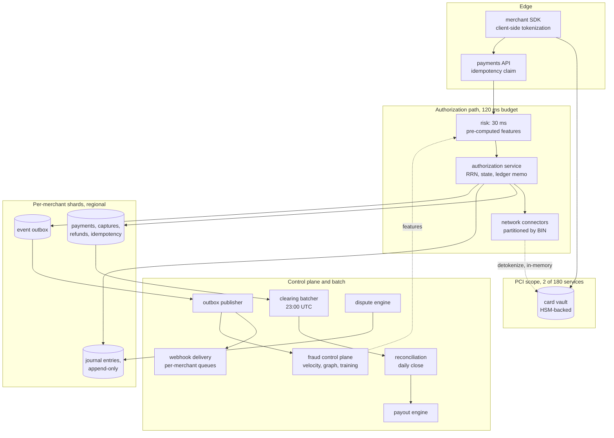

# The Failure Catalogue, and the Whole Design End to End

This document does two things. First it collects the failure modes scattered across the previous
nineteen documents into one catalogue, organised by symptom rather than by subsystem, because
symptoms are what you have when something goes wrong. Second it walks the entire design end to end
in the form it would take if you had to present it — in an interview, a design review, or to a new
team.

---

## Part one: the failure catalogue

Each entry gives the symptom as it is first observed, the mechanism underneath, and the document
that covers the prevention.

### Symptom: a customer was charged twice

**Mechanism A — the client retried an ambiguous request with a new idempotency key, or none.**
The most common cause by a wide margin. The request timed out, the client retried, and nothing
deduplicated it. Prevention: document 03. Detection: the duplicate-charge rate monitor in document
18.

**Mechanism B — the authorization was retried after a timeout without a reversal.** The first
authorization was approved and its response lost; the retry created a second hold. Prevention:
document 06 — send a reversal, do not retry blind.

**Mechanism C — the clearing file was submitted twice.** A submission was not acknowledged and was
resubmitted with a new file identifier, so the network accepted it as new volume. This is the worst
version, because it affects every transaction in the file simultaneously. Prevention: deterministic
file identifiers, document 09.

**Mechanism D — the capture was recorded twice.** A retry of an internal capture call without
deduplication. Prevention: documents 03 and 12.

### Symptom: the customer has a hold for an order that failed

The authorization was approved, the response was lost, and the system recorded a failure without
sending a reversal. Prevention: document 06. The specific error to look for is a system that maps
timeouts onto `failed` rather than `unknown` — document 04.

### Symptom: goods were shipped and no money arrived

**Mechanism A — captured against an authorization that did not exist.** Either the payment was in
`unknown` and capture was permitted (documents 04 and 06), or the authorization had expired
(document 01).

**Mechanism B — the clearing record was rejected and nobody processed the response file.** The
payment shows as succeeded, the ledger asserts money that will never arrive, and the merchant
shipped. 574 a day at Northwind Pay if the response file is ignored. Prevention: document 09.

**Mechanism C — a capture was recorded but the record never made it into a file.** Prevention: the
pipeline liveness monitoring in document 18, and reconciliation in document 10.

### Symptom: a merchant's balance is wrong and nobody can explain why

The balance is a stored number rather than a projection over entries. There is no derivation to
inspect. Prevention: document 08 — and note that this is the one failure on the list that cannot be
fixed after the fact, because the information needed to explain the number was never recorded.

### Symptom: the ledger does not balance

**Mechanism A — entries written outside the normal path**, bypassing the per-transaction zero-sum
check. Detection: the aggregate identity assertion in document 18.

**Mechanism B — a cross-currency transaction with no FX account to absorb the rounding.**
Prevention: documents 02 and 08.

**Mechanism C — a snapshot was adjusted in place rather than rebuilt.** The snapshot no longer
equals the sum of its entries and the discrepancy propagates to every reader. Prevention: document
08.

### Symptom: approval rate dropped and no alert fired

A single issuer is declining everything and the aggregate moved less than normal daily variation.
Prevention: per-BIN comparison alerting, document 18. The usual root cause is a message-construction
change that one issuer validates more strictly, document 05.

### Symptom: a payout went out that should not have

The payout job read a balance snapshot without the subsequent entries, and a dispute batch had
already landed. Prevention: document 08's rule that no business logic reads a snapshot without the
tail, and document 09's requirement that blocking payouts be atomic with the balance going negative.

### Symptom: a merchant was paid twice

A payout was submitted, the submission response was lost, and it was resubmitted. The same
ambiguity as every other external call, with no undo available. Prevention: deterministic payout
identifiers and verification before resubmission, document 09.

### Symptom: a refund was issued twice

Two concurrent refund requests both read the remaining refundable amount before either wrote.
Prevention: the row lock in document 04. There is no clean recovery — unlike an authorization, a
refund has no idempotent undo (document 06).

### Symptom: disputes are being lost by default

Ingestion of the network's dispute file is lagging, and merchant-facing deadlines are computed from
the ingestion date rather than the network date. Prevention: document 17, plus the dispute-file
liveness check in document 18.

### Symptom: a merchant entered a network monitoring programme unexpectedly

Their dispute ratio was computed the intuitive way — disputes divided by the transaction count of
the month those transactions came from — rather than the network's way. A shrinking merchant is
pushed over the threshold by arithmetic. Prevention: document 17.

### Symptom: European conversion collapsed

Either 3DS challenges are being generated where exemptions were available, or soft declines with
code 65 or 1A are being treated as terminal declines instead of triggering a step-up. Prevention:
document 07.

### Symptom: card data appeared in the log aggregator

A debug log, an exception tracker, or an analytics replica captured a request body. The whole
aggregator and everything that can read it is now in PCI scope. Prevention: mechanism rather than
policy — redacting formatters plus pipeline-level detection, document 15.

### Symptom: one merchant's traffic degraded everything

No per-merchant bulkheads. A card-testing attack or a slow webhook endpoint consumed shared
capacity. Prevention: documents 12, 13, 14 and 16 — the same bulkhead idea appears in all four.

### Symptom: the system approved a large amount of fraud during an incident

The fraud scorer failed open with no degraded policy. Prevention: document 14 — the fallback is a
pre-computed static policy, exercised on a schedule, not an on/off switch.

---

## Part two: the whole design, end to end

What follows is the design as you would present it. It is a synthesis, so every claim here is
derived in an earlier document and cross-referenced.

### The requirements, stated as constraints

Northwind Pay must accept card payments for 40,000 merchants, with these binding constraints:

- **9,000 authorizations per second at peak**, which is 237× the average of 38 (document 00). The
  peak-to-average ratio is the dominant capacity fact.
- **p99 end-to-end authorization under 800 ms**, of which 450 ms at p99 is the network and issuer
  leg that you do not control, leaving about 120 ms of own-processing budget (document 05).
- **No lost or duplicated money**, with every figure explicable at any past instant (document 08).
- **PCI DSS Level 1**, with scope confined as tightly as architecture permits (document 15).
- **Three regions, with regional data residency** (document 13).

### The shape

### The six decisions that define it

If you had to defend the design in six points, these are the ones.

**1. Idempotency is a required, atomically claimed primitive** (document 03). Every state-changing
endpoint requires a key; the claim is an `INSERT ... ON CONFLICT DO NOTHING` before any work; the
response is stored in the same transaction as the effect. This is what makes retries safe, and it is
the precondition for everything else — without it, every other reliability mechanism is building on
sand.

**2. `unknown` is a first-class outcome, resolved by forcing a known state** (documents 04 and 06).
The authorization is a non-transactional side effect, so ambiguity is irreducible. The system models
it, keeps listening after the merchant has been answered, and resolves it with an idempotent
reversal rather than by discovering the truth. 1.2 billion authorizations a year reduce to about
4,080 genuinely unresolved.

**3. Balances are projections over an immutable journal** (document 08). Append-only, zero-sum per
transaction, two timestamps, an account for every residual. It costs 11× the write volume of a
mutable balance and it is the only arrangement in which the system can explain its own numbers —
and, as it turns out, the only one that survives a merchant doing 10,800 ledger entries per second.

**4. Reconciliation against external records is how truth is established** (document 10). Internal
consistency cannot detect internal bugs. Three records, two matches, breaks as managed work items
with a bounded age and value, and a daily close that is a checkable assertion against the bank
statement rather than a feeling.

**5. Partition by merchant, single-writer per merchant, regional** (document 13). Storage follows
the entity that owns the data; compute follows the entity that causes the load. Active-active on a
ledger either needs consensus you cannot afford or produces conflicts you cannot merge, so the
constraint is accepted and stated rather than engineered around.

**6. Scope and risk are both confined by architecture** (documents 14, 15 and 16). Two services in
PCI scope out of 180. Fraud as a control plane feeding a 30 ms inline slice. Degradation decided in
advance in a table with a named loss-bearer per row.

### What was deliberately not built

Interviewers and reviewers ask this, and having an answer is worth more than any additional feature.

- **No active-active ledger.** Explained above and in document 13.
- **No queued authorizations during an issuer outage.** It converts a bounded availability problem
  into an unbounded financial one (document 14).
- **No local stand-in for issuers.** Only the network may authorize on an issuer's behalf (document
  14).
- **No ordering guarantee on webhooks.** A sequence number and a documented discard rule is simpler
  and more robust than a strictly ordered pipeline (document 12).
- **No synchronous graph-based fraud evaluation.** It does not fit in 30 ms, so it moved to the
  control plane (document 16).
- **No arbitration escalation on low-value disputes.** A $500 fee to recover $47 is a loss (document
  17).

### The first six months, in order

If you were building this from nothing, the order matters, because several pieces are preconditions
for others rather than independent features.

1. **Money representation and the currency table** (document 02). Everything stores amounts; getting
   this wrong is expensive to unwind.
2. **Idempotency and the API skeleton** (document 03). Precondition for safe retries everywhere.
3. **The ledger** (document 08). Precondition for honest balances; retrofitting it means losing the
   history before the retrofit.
4. **One network integration, with the RRN discipline and the two-deadline timeout structure**
   (documents 05 and 06).
5. **The state machine including `unknown`** (document 04).
6. **Clearing, settlement and reconciliation** (documents 09 and 10). Until reconciliation exists,
   you cannot know whether any of the above is correct.
7. **The outbox and webhooks** (document 12).
8. **Disputes** (document 17). Deadline-driven and expensive to be late on, but not a precondition
   for anything else.
9. **Fraud, degradation policy, sharding** (documents 13, 14, 16) — as volume demands, not before.

The ordering principle: **the things that are impossible to retrofit come first.** The ledger and
idempotency are both in that category, because both destroy information if absent — the ledger
destroys the derivation of every balance, and missing idempotency destroys the ability to
distinguish a duplicate from two genuine payments.

---

## Three case studies

Short, each illustrating a failure whose cause is in a different document than its symptom.

### Case one: the Tuesday double-charge

**Symptom.** On a Tuesday, 0.8% of one large merchant's payments were charged twice. Normal rate is
0.004%.

**Investigation.** The duplicate-charge monitor (document 18) fired at 09:12. Both charges had
different payment ids and different idempotency keys, so idempotency was working as designed.

**Cause.** The merchant had deployed a change that generated the idempotency key from the order id
plus a timestamp with millisecond precision, intending uniqueness. Their retry logic regenerated
the key on each retry, so every retry was a new logical attempt by Northwind Pay's contract.

**Resolution and lesson.** The merchant fixed their key generation. But the deeper lesson was
Northwind Pay's: the API accepted a request whose idempotency key differed from a payment created 90
milliseconds earlier with the same merchant, amount and card token, and said nothing. The system now
returns an advisory `possible_duplicate` field on such requests, which the client libraries surface
as a warning. **Correct by contract is not the same as correct in outcome**, and where a contract
lets a client hurt itself, an advisory signal is cheap.

### Case two: the settlement that was $31,000 light, every month

**Symptom.** None, for seven months. Settlement variance was within the 0.001% tolerance every
single day.

**Investigation.** The fee reconciliation described in document 10 — comparing the network's
published fee reports against computed fees — showed a persistent small difference in one merchant
category.

**Cause.** A merchant category code had been mapped to the wrong interchange tier during onboarding,
so Northwind Pay had been paying a higher interchange rate than it billed the merchant for. The
variance was below the daily tolerance and invisible in aggregate.

**Resolution and lesson.** $217,000 recovered through the network's adjustment process, and the fee
reconciliation became a mandatory daily check rather than a periodic one. The lesson is about
tolerances: **a tolerance absorbs anything smaller than itself, including a persistent
one-directional error.** Document 10's rule about monitoring directional bias came from this
incident.

### Case three: the regional failover that produced 1,100 stuck holds

**Symptom.** After a planned regional failover test, 1,100 payments were in `unknown` state with no
corresponding records anywhere.

**Investigation.** The failover promoted the cross-region standby, losing about 300 ms of writes as
designed and documented.

**Cause.** Nothing unexpected — the behaviour was exactly what document 13's replication lag
predicted. The 1,100 payments were authorizations that had been sent to the network but whose local
records were in the lost window.

**Resolution and lesson.** The existing reversal and reconciliation machinery (document 06) resolved
all 1,100 within 48 hours, with no customer-visible impact beyond holds that expired. The lesson is
the positive one: **the recovery path for ambiguity is also the recovery path for data loss**, and
because it already existed and was exercised daily on the ordinary 1,380-per-day population, a
failover that lost writes was a routine cleanup rather than an incident. Having built the hard thing
for the common case made the rare case cheap.

---

## What to take away

1. **Organise failure knowledge by symptom, not by subsystem.** What you have at 03:00 is "a
   customer was charged twice", and that symptom has four distinct mechanisms in four different
   documents.
2. **Duplicate charges, stuck holds and unauthorized captures all trace back to two root causes** —
   missing idempotency and mishandled ambiguity. Those two documents, 03 and 06, prevent most of
   the catalogue.
3. **Some failures cannot be fixed after the fact.** An unexplainable balance is permanent, because
   the derivation was never recorded.
4. **Build in the order of what cannot be retrofitted:** money representation, idempotency, ledger,
   then everything else. Reconciliation comes before scale, because until it exists you cannot know
   whether anything is correct.
5. **Be able to say what you deliberately did not build, and why.** Active-active ledgers, queued
   authorizations, local stand-in, webhook ordering and synchronous graph fraud are all reasonable-
   sounding and all wrong here, for reasons specific to money.
6. **A tolerance absorbs any error smaller than itself, including a persistent one.** Monitor
   directional bias, not just magnitude.
7. **Correct by contract is not correct in outcome.** Where the contract lets a client harm itself,
   add an advisory signal.
8. **The recovery path for ambiguity is the recovery path for data loss.** Building it properly for
   the daily case is what makes a regional failover survivable.

Back to [README.md](README.md) for the full index.
